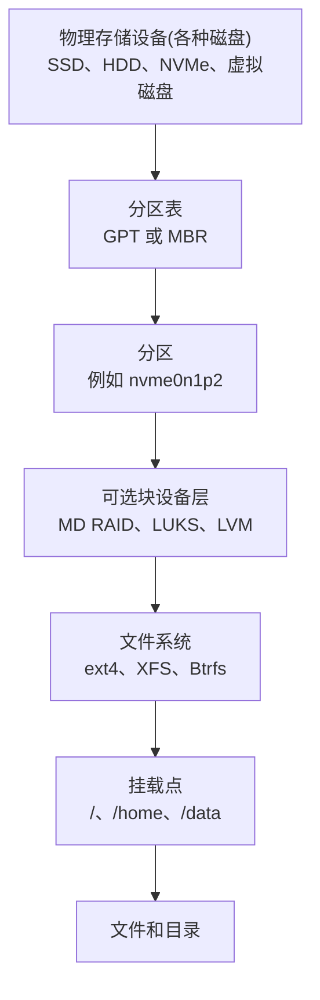
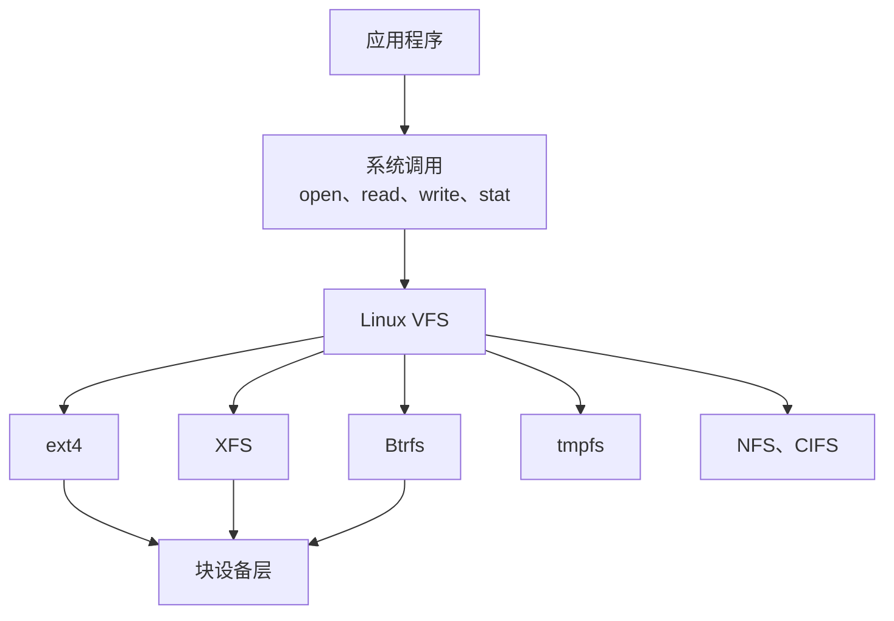
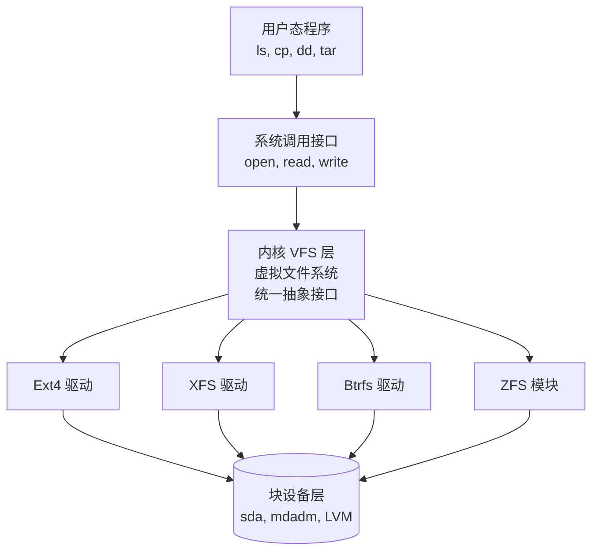
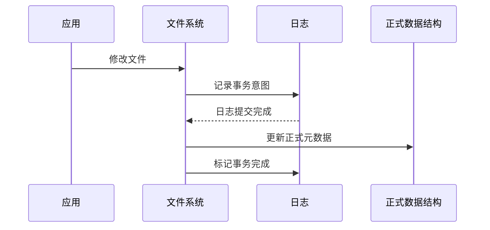
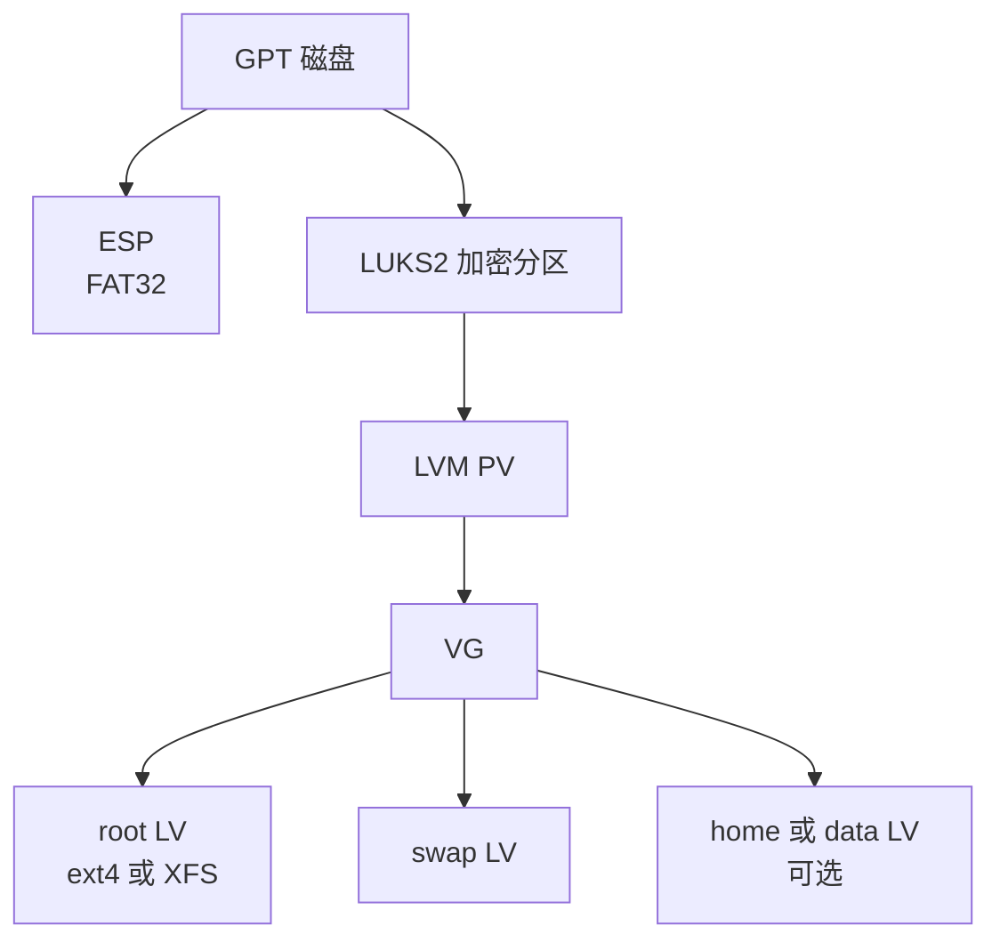
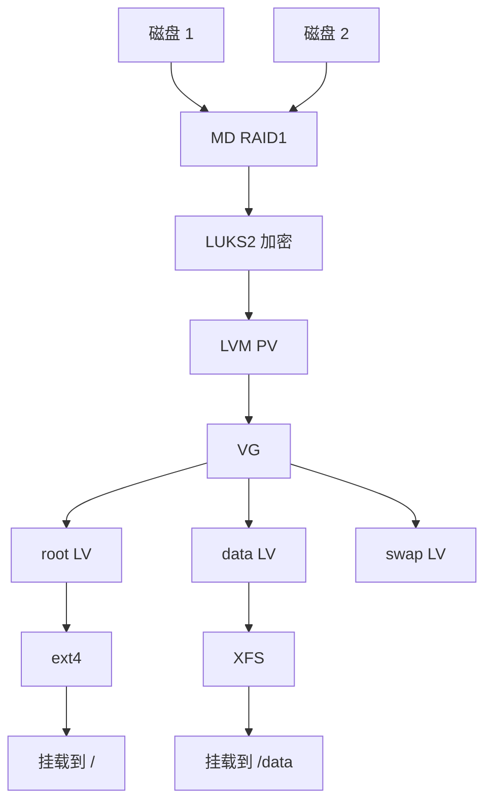
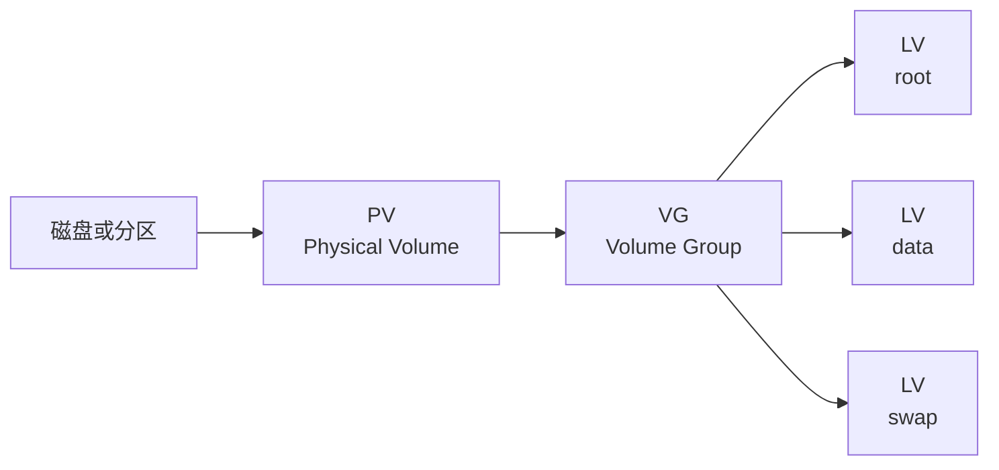

[toc]


## 学习目标与详细大纲

本文以现代 Linux 发行版和主流上游工具为基础，内容校准至 **2026 年 6 月**。

命令示例默认由具备 `sudo` 权限的用户执行。

涉及真实磁盘的**格式化、分区、缩容**命令具有破坏性，新手应先在文末的**镜像文件**实验环境中练习。

| 学习模块           | 核心问题                                               | 学完应具备的能力                            |
| ------------------ | ------------------------------------------------------ | ------------------------------------------- |
| 存储基本模型       | 磁盘、分区、文件系统、目录和挂载点有什么区别           | 能读懂 `lsblk` 输出，理解数据实际位于哪一层 |
| Linux 文件系统原理 | VFS、inode、目录项、超级块、日志和 CoW 是什么          | 能解释文件如何被定位、写入和恢复            |
| 常用文件系统       | ext4、XFS、Btrfs、F2FS、FAT、exFAT 等如何选择          | 能根据场景选择合适的文件系统                |
| 分区体系           | GPT、MBR、ESP、BIOS Boot 分区分别解决什么问题          | 能规划适合 UEFI、服务器和加密系统的分区布局 |
| 存储分层           | RAID、LUKS、LVM、文件系统之间如何组合                  | 能看懂复杂设备树，并选择不过度复杂的方案    |
| 挂载体系           | `mount`、`/etc/fstab`、systemd mount unit 如何工作     | 能安全配置持久挂载和自动挂载                |
| 工具体系           | `lsblk`、`blkid`、`fdisk`、`mkfs`、`fsck` 等分别做什么 | 能选对工具，不把检查、修复、格式化混淆      |
| 容量调整           | 扩容和缩容为什么必须遵循不同顺序                       | 能安全扩展分区、LVM 和文件系统              |
| 日常维护           | TRIM、scrub、SMART、容量监控应该怎样做                 | 能建立基本存储维护流程                      |
| 故障排查           | 空间不一致、挂载失败、无法卸载如何定位                 | 能从只读检查开始，避免扩大损坏              |
| 安全实验           | 怎样不使用真实硬盘练习全部操作                         | 能利用镜像文件和 loop 设备完成练习          |

------

## 存储模型

### 基础概念

**磁盘、分区、文件系统和挂载点**不是一回事.

> 许多概念的具体介绍参考其他章节.

一个典型数据路径可能是：



这些对象分别承担不同职责：

| 对象           | 本质                                 | 示例                                   | 主要作用                                |
| -------------- | ------------------------------------ | -------------------------------------- | --------------------------------------- |
| 物理或虚拟磁盘 | 可按块访问的设备                     | `/dev/sda`、`/dev/nvme0n1`、`/dev/vda` | 提供原始存储空间                        |
| 分区表         | 记录**磁盘空间划分方式**的**元数据** | GPT、MBR                               | 描述各**分区的起点、终点和类型**        |
| 分区           | 磁盘上的连续逻辑区域                 | `/dev/sda1`、`/dev/nvme0n1p3`          | 为文件系统、LVM、RAID或交换空间提供容器 |
| 块设备映射     | 在块设备之上创建的新块设备           | `/dev/md0`、`/dev/mapper/cryptroot`    | 实现冗余、加密、逻辑卷等功能            |
| 文件系统       | 文件、目录和空闲空间的组织规则       | ext4、XFS、Btrfs                       | 将块空间组织成文件和目录                |
| 挂载点         | Linux 目录树中的接入位置             | `/mnt/data`、`/home`                   | 让文件系统内容出现在统一目录树中        |
| 卷标与 UUID    | 文件系统或分区的稳定标识             | `UUID=...`、`LABEL=data`               | 避免依赖可能变化的 `/dev/sdX` 名称      |

**格式化分区**是指在分区中创建文件系统，而不是“创建分区”。例如：

```bash
sudo mkfs.ext4 /dev/sdb1
```

这会覆盖 `/dev/sdb1` 中原有的文件系统元数据，但不会自动修改 `/dev/sdb` 的分区表。

### Linux 使用一棵统一目录树

Linux 不像传统 Windows 那样将每个卷显示为独立盘符。所有本地文件系统、网络文件系统和内核伪文件系统都接入以 `/` 为根的同一棵目录树。

例如：

```text
/
├── home
├── var
├── boot
├── proc
├── sys
└── mnt
    └── data
```

`/mnt/data` 在挂载前只是根文件系统中的普通目录。将另一个文件系统挂载到这里后，原目录中的内容会暂时被遮住，但不会被删除；卸载后会重新出现。

### VFS：不同文件系统的共同接口

应用程序通常调用 `open()`、`read()`、`write()`、`stat()` 等系统调用，而不直接操作 ext4 或 XFS。

Linux 内核中的 VFS，即**虚拟文件系统层**，为不同文件系统提供统一接口，因此**本地文件系统、网络文件系统和内存文件系统**能够同时存在于同一目录树中。([Linux Kernel 文档](https://docs.kernel.org/filesystems/vfs.html?utm_source=chatgpt.com))



------


### 主流文件系统的共同点

尽管Ext4、XFS、Btrfs和ZFS在实现细节和高级功能上差异巨大，但它们作为Linux环境下的文件系统，共享着许多核心的**设计理念和基础特性**。这些共同点主要源于它们都需要遵循POSIX标准，并适应Linux内核的VFS（虚拟文件系统）接口。

| 共同维度             | 具体说明                                                     | 设计目的                                                     |
| :------------------- | :----------------------------------------------------------- | :----------------------------------------------------------- |
| **1. 日志机制**      | 都支持日志，在写入实际数据前，先将元数据（如文件名、权限、块位置）的变更记录到专用日志区。Ext4/XFS主要记录元数据，Btrfs/ZFS基于事务记录。 | **保证系统崩溃后数据的一致性**，避免文件系统结构损坏，极大缩短崩溃后的恢复时间（fsck）。 |
| **2. 核心POSIX兼容** | 都支持标准的文件操作权限模型、文件属性、符号链接、硬链接等基本操作。 | 确保上层的应用程序（如数据库、Web服务器）无需修改即可透明地运行在不同文件系统之上。 |
| **3. 顺应硬件演进**  | 都针对现代存储硬件（特别是SSD和NVMe）进行了优化。例如：支持TRIM指令（通知SSD哪些块已废弃）、针对大容量磁盘优化扫描算法。 | 在不同代次的存储介质上都能保持良好的性能和寿命。             |
| **4. 核心数据结构**  | 内部管理空间和文件映射时，大多采用了**B树及其变体**作为核心数据结构。 | 在海量文件和超大分区中，依然能保持快速的查找、插入和删除操作（时间复杂度接近对数级）。 |
| **5. 在线扩容**      | 都支持在不卸载文件系统的情况下（在线）增加其容量。           | 满足业务连续性要求，无需停机即可扩展存储空间。               |

---

### 基础文件系统命令通用性

这是一个非常关键的问题。答案是：**绝大多数基础工具是通用的，但高级管理和修复工具是高度专用的。**
这一切的奥秘在于Linux内核的**VFS（Virtual File System，虚拟文件系统）层**。VFS是内核中的一个软件层，它向上为用户态程序提供了统一的系统调用接口（如 `open()`, `read()`, `write()`），向下则对接各种具体的文件系统实现。



得益于VFS的存在，我们可以将工具分为以下两类：

#### 1. 通用工具（绝大多数日常操作）

这些工具通过VFS提供的标准接口工作，**它们根本不知道底层用的是Ext4还是ZFS**，因此完全通用。

| 工具类型           | 示例命令                                       | 通用性说明                                                   |
| :----------------- | :--------------------------------------------- | :----------------------------------------------------------- |
| **基础文件操作**   | `ls`, `cp`, `mv`, `rm`, `mkdir`, `cat`, `less` | 完全通用。所有文件系统都必须实现这些基本的POSIX接口。        |
| **文件查找与权限** | `find`, `chmod`, `chown`, `stat`               | 完全通用。操作的是VFS暴露的统一inode属性。                   |
| **磁盘占用分析**   | `df`, `du`                                     | 完全通用。通过 `statfs()` 系统调用获取空间使用情况。         |
| **数据备份与流转** | `tar`, `dd`, `rsync`, `dump/restore`           | 完全通用。它们将文件视为字节流，不关心底层块如何分配。       |
| **标准挂载命令**   | `mount`, `umount`                              | **部分通用**。基础挂载流程通用，但**特定的挂载选项（如压缩、日志模式）是专用的**。例如 `mount -o compress=zstd` 只有Btrfs认识。 |

#### 2. 专用工具（高级管理与修复）

当涉及到底层结构的创建、调整、修复或使用高级特性时，VFS就无能为力了，必须使用针对特定文件系统编写的专用工具。这类工具通常以 `mkfs.*`（创建）、`fsck.*`（检查修复）和特定前缀（如 `xfs_*`, `btrfs-*`）命名。

| 文件系统  | 创建工具                    | 修复/检查工具                 | 高级管理专用工具                                             |
| :-------- | :-------------------------- | :---------------------------- | :----------------------------------------------------------- |
| **Ext4**  | `mkfs.ext4`                 | `e2fsck`, `fsck.ext4`         | `resize2fs` (调整大小), `tune2fs` (调整参数), `debugfs` (底层调试) |
| **XFS**   | `mkfs.xfs`                  | `xfs_repair`                  | `xfs_fsr` (碎片整理), `xfs_growfs` (扩容), `xfs_admin` (参数调整) |
| **Btrfs** | `mkfs.btrfs`                | `btrfs check` (原 `btrfsck`)  | **`btrfs`** (功能极全的顶级命令，包含子卷管理、快照、设备添加、去重等) |
| **ZFS**   | `zpool create` (创建存储池) | `zpool scrub`, `zpool status` | **`zfs`**, **`zpool`** (两套庞大的命令体系，管理数据集、快照、压缩、RAID等) |

#### 跨文件系统操作

即便是通用工具，在跨文件系统操作时也可能遇到问题。

例如，使用 `cp` 将文件从Ext4复制到Btrfs，**文件数据本身没问题，但Ext4特有的一些扩展属性可能会丢失**。如果使用 `rsync -X` 或 `star` 等保留扩展属性的工具，目标文件系统必须支持相同的属性才能完整保留。

## 文件系统的核心概念

### inode 与目录项

在典型 Unix 文件系统中，文件名并不是文件本身。

目录可以近似理解为一张映射表：

```text
文件名 -> inode 编号
```

inode 则保存文件的主要**元数据**，例如：

- 文件类型
- 所有者 UID 和 GID
- 权限
- 文件大小
- 时间戳
- 硬链接计数
- 数据块或 extent 的位置

ext4 文档明确区分了**目录项与 inode**：**目录项**负责**名称到 inode 的关联**，inode 保存文件**元数据和数据位置**等信息。([Linux Kernel 文档](https://docs.kernel.org/filesystems/ext4/inodes.html?utm_source=chatgpt.com))

这能解释几个常见现象：

| 现象                                     | 原因                                                    |
| ---------------------------------------- | ------------------------------------------------------- |
| 重命名同一文件系统内的文件通常很快       | 主要修改**目录项**，不必复制文件数据                    |
| **硬链接**共享内容                       | **多个目录项指向同一个 inode**                          |
| 删除仍被进程打开的文件后**空间没有释放** | **目录项**已删除，但 inode **仍被打开的文件描述符引用** |
| **硬链接**通常不能跨文件系统             | inode 编号**只在所属文件系统内部有意义**                |
| **符号链接**可以跨文件系统               | 符号链接保存的是**路径**文本，而**不是目标 inode**      |

查看 inode：

```bash
ls -li file1
stat file1
```

例如:下面的`~/abc.sh`的inode为`145238397`

```bash
#( 06/26/26@10:39AM )( root@s6 ):~
   ls -li ~/abc.sh
145238397 -rw-r--r-- 1 root root 7687 Jun 24 18:11 /root/abc.sh
#( 06/26/26@10:51AM )( root@s6 ):~
   stat ~/abc.sh
  File: /root/abc.sh
  Size: 7687            Blocks: 16         IO Block: 4096   regular file
Device: fd01h/64769d    Inode: 145238397   Links: 1
Access: (0644/-rw-r--r--)  Uid: (    0/    root)   Gid: (    0/    root)
Access: 2026-06-24 18:11:29.009233147 +0800
Modify: 2026-06-24 18:11:26.101186138 +0800
Change: 2026-06-24 18:11:26.101186138 +0800
 Birth: 2026-06-24 18:11:26.101186138 +0800
```

创建硬链接与符号链接：

```bash
ln source.txt hardlink.txt
ln -s source.txt symlink.txt
```

### 超级块

超级块保存**整个文件系统**的总体信息，例如：

- 文件系统类型与特性
- 块大小
- 总块数与空闲块数
- inode 数量
- 文件系统 UUID
- 文件系统状态
- 挂载与检查信息

ext4 会在特定块组中保存超级块和组描述符的冗余副本，并可使用校验和保护部分元数据。([Linux Kernel 文档](https://docs.kernel.org/filesystems/ext4/super.html?utm_source=chatgpt.com))

“bad superblock”并不一定表示主超级块真的彻底损坏。它也可能意味着：

- 选错了设备
- 文件系统类型判断错误
- LUKS 或 LVM 尚未打开
- 设备偏移不正确
- 底层磁盘存在 I/O 错误
- 文件系统特性不被当前内核或工具支持

因此不要看到该提示就立即运行强制修复。

### 块、extent 与空间分配

文件系统最终需要记录“文件的某一段数据存在哪些块”。

早期文件系统可能逐块记录。现代文件系统普遍使用 extent 描述连续区域：

```text
文件逻辑偏移 0 开始的 4096 个块
存储在设备物理块 100000 开始的位置
```

extent 能减少大文件的元数据量，也更适合连续空间分配。

ext4 将文件系统划分为块组，并尽量让同一文件的数据保持在相近区域，以降低碎片和寻址成本。([Linux Kernel 文档](https://docs.kernel.org/filesystems/ext4/overview.html?utm_source=chatgpt.com))

查看文件 extent：

```bash
filefrag -v large-file
```

### 文件大小与实际占用空间

以下两个值可能不同：

```bash
ls -lh file
du -h file
```

`ls` 通常显示**逻辑文件大小**；`du` 通常**统计实际分配的磁盘空间**。

**稀疏文件**中未真正写入的区域不分配物理块：

```bash
truncate -s 10G sparse.img

ls -lh sparse.img
du -h sparse.img
```

这可能显示逻辑大小为 10 GiB，但实际占用接近零。

**复制稀疏文件**时应**使用支持稀疏语义的工具选项**，否则可能把**空洞变成真实零数据**：

```bash
cp --sparse=always source.img destination.img
rsync -S source.img destination.img
```

### 日志型文件系统

ext4 和 XFS 都属于日志型文件系统。日志主要用于保证**元数据更新**在崩溃后可以恢复到一致状态。

一个简化流程是：



日志并不等于备份，也不意味着应用数据永远不会丢失。它主要解决“写到一半突然断电后，文件系统结构是否还能保持一致”的问题。

对于 ext3/ext4，系统异常关闭后通常**先回放已提交的日志事务**；只有超级块表明存在进一步问题时，才需要完整的 `e2fsck` 检查。([man7.org](https://man7.org/linux/man-pages/man8/e2fsck.8.html?utm_source=chatgpt.com))

### Copy-on-Write

Btrfs 等 CoW 文件系统在修改已有数据时，通常不会直接覆盖原位置，而是：

1. 在新位置写入修改后的数据或元数据。
2. 更新指针，使新版本生效。
3. 保留或释放旧版本。

CoW 便于实现：

- 快照
- reflink 克隆
- 数据和元数据校验
- 增量发送
- 压缩
- 原子化元数据更新

代价是系统行为更复杂，并可能产生碎片、写放大、空间统计难理解等问题。

### reflink、硬链接与普通复制

| 操作         | 初始是否共享数据块 | 修改后是否互相影响 | 是否共享 inode     |
| ------------ | ------------------ | ------------------ | ------------------ |
| 普通复制     | 否                 | 否                 | 否                 |
| 硬链接       | 是                 | 是                 | 是                 |
| reflink 克隆 | 是                 | 否，修改时 CoW     | 否                 |
| 文件系统快照 | 通常是             | 否，修改时 CoW     | 属于文件系统级语义 |

支持 reflink 时，可以尝试：

```bash
cp --reflink=always source.img clone.img
```

### 校验、scrub 与 fsck 不是同一件事

| 操作            | 主要目标                                           |
| --------------- | -------------------------------------------------- |
| 校验和验证      | 检测读取的数据或元数据是否与校验和一致             |
| scrub           | 主动读取大量数据并验证校验和，有冗余副本时尝试修复 |
| fsck 或结构检查 | 检查目录树、空间分配、引用关系等结构一致性         |
| 块设备健康检查  | 检查磁盘介质、控制器和设备错误                     |

例如，`btrfs scrub` 会读取数据和元数据块、验证校验和，并在存在正确冗余副本时修复坏块；但官方文档明确说明 scrub 不是结构意义上的 fsck。([man7.org](https://man7.org/linux/man-pages/man8/btrfs-scrub.8.html?utm_source=chatgpt.com))

------

## Linux 常用文件系统

### 本地持久文件系统对比

| 文件系统      | 核心特点                                          | 适合场景                                   | 主要注意事项                                              | 常用工具                                                     |
| ------------- | ------------------------------------------------- | ------------------------------------------ | --------------------------------------------------------- | ------------------------------------------------------------ |
| ext4          | 成熟、日志型、工具完整、兼容面广                  | 通用桌面、服务器、虚拟机、根文件系统       | 不提供原生通用快照；在线扩容、离线缩容                    | `mkfs.ext4`、`e2fsck`、`resize2fs`、`tune2fs`                |
| XFS           | 高并发、擅长大容量和大文件、支持 reflink          | 文件服务器、数据库数据盘、大型并行工作负载 | 支持在线扩容；当前常规管理工具不提供缩容                  | `mkfs.xfs`、`xfs_info`、`xfs_growfs`、`xfs_repair`、`xfs_scrub` |
| Btrfs         | CoW、快照、子卷、校验、压缩、send/receive、多设备 | 桌面快照、系统回滚、备份源、多版本数据     | 空间管理更复杂；快照不是备份；RAID5/6 不宜生产使用        | `mkfs.btrfs`、`btrfs filesystem`、`btrfs subvolume`、`btrfs scrub` |
| F2FS          | 面向 NAND 闪存的日志结构设计                      | eMMC、SD 卡、嵌入式及特定闪存工作负载      | 是否优于 ext4 取决于设备 FTL 和负载，应实测               | `mkfs.f2fs`、`fsck.f2fs`、`dump.f2fs`                        |
| FAT32         | 简单、跨平台、UEFI 固件普遍支持                   | EFI System Partition、小型移动介质         | 不支持 Unix 权限、硬链接、日志和大于 4 GiB 的单文件       | `mkfs.fat`、`fsck.fat`                                       |
| exFAT         | 面向大容量移动存储，跨平台较好                    | U 盘、SDXC、系统间交换数据                 | 不适合作为 Linux 系统根文件系统                           | `mkfs.exfat`、`fsck.exfat`                                   |
| NTFS          | Windows 原生文件系统                              | 与 Windows 共享已有磁盘                    | Linux 上更适合作为互操作数据卷，而非通用 Linux 根文件系统 | `mkfs.ntfs`、`ntfsfix` 等，具体工具依发行版                  |
| ISO 9660、UDF | 光盘及只读镜像常见格式                            | 安装镜像、光盘、归档介质                   | ISO 9660 通常只读；UDF 更适合可写光盘和较大文件           | `xorriso`、`mkisofs`、`mkudffs`                              |

ext4 的核心设计采用块组、extent、日志和多种元数据校验机制，适合作为低运维复杂度的通用选择。([Linux Kernel 文档](https://docs.kernel.org/filesystems/ext4/overview.html?utm_source=chatgpt.com))

XFS 提供面向大型文件系统和并行负载的设计，并支持在线 scrub；无法在线修复的损坏仍需卸载后运行 `xfs_repair`。`xfs_growfs` 的职责是扩展已挂载的 XFS 文件系统。([Linux Kernel 文档](https://docs.kernel.org/filesystems/xfs/xfs-online-fsck-design.html?utm_source=chatgpt.com))

Btrfs 的磁盘格式与主要功能已经稳定，子卷、快照、压缩等核心功能可用于一般场景；但官方文档仍明确指出传统 RAID5/6 实现存在设计和断电安全问题，不应作为生产默认方案，尤其不要为元数据使用 RAID5/6。([btrfs.readthedocs.io](https://btrfs.readthedocs.io/en/latest/Status.html?utm_source=chatgpt.com))

F2FS 基于日志结构思路，主要针对 NAND 闪存、eMMC 和 SD 卡等设备的写入与垃圾回收特性设计。([Linux Kernel 文档](https://docs.kernel.org/filesystems/f2fs.html?utm_source=chatgpt.com))

### ext4

ext4 是新手最容易掌握的通用文件系统。

适合它的理由包括：

- 发行版支持广泛
- 故障修复工具成熟
- 维护资料丰富
- 在线扩容简单
- 在普通桌面、服务器和虚拟机中表现均衡
- 与 LVM、MD RAID、LUKS 等块设备层组合自然

创建并设置卷标：

```bash
sudo mkfs.ext4 -L data /dev/sdb1
```

查看信息：

```bash
sudo tune2fs -l /dev/sdb1
sudo dumpe2fs -h /dev/sdb1
```

只读检查：

```bash
sudo e2fsck -fn /dev/sdb1
```

`e2fsck` 通常不应在读写挂载的文件系统上执行。需要修复时应先卸载，或者从救援环境处理根文件系统。([man7.org](https://man7.org/linux/man-pages/man8/e2fsck.8.html?utm_source=chatgpt.com))

扩展已挂载文件系统：

```bash
sudo resize2fs /dev/mapper/vg-data
```

ext4 可在线扩容；缩容需要卸载文件系统。`resize2fs` 只调整文件系统，不会自动调整底层分区。([man7.org](https://man7.org/linux/man-pages/man8/resize2fs.8.html?utm_source=chatgpt.com))

### XFS

XFS 常用于：

- 大文件
- 大容量文件系统
- 多线程并发 I/O
- 数据库和对象数据目录
- 企业级服务器

创建：

```bash
sudo mkfs.xfs -L data /dev/mapper/vg-data
```

查看布局：

```bash
sudo xfs_info /data
```

在线扩容：

```bash
sudo xfs_growfs /data
```

在线检查：

```bash
sudo xfs_scrub -n /data
```

卸载后检查或修复：

```bash
sudo xfs_repair -n /dev/mapper/vg-data
sudo xfs_repair /dev/mapper/vg-data
```

`fsck.xfs` 本身基本只是占位程序，因为 XFS 会在挂载时回放日志；真正检查损坏应使用 `xfs_scrub` 或 `xfs_repair`。([man7.org](https://man7.org/linux/man-pages/man8/fsck.xfs.8.html?utm_source=chatgpt.com))

**重要限制：**常规 XFS 工具链支持扩容，不支持像 ext4 那样原地缩容。需要减小容量时，通常应创建较小的新文件系统、复制数据、验证，然后切换挂载点。

### Btrfs

Btrfs 的优势并不只是“有快照”，而是将卷管理、CoW、校验、压缩和多设备管理整合到文件系统层。

创建：

```bash
sudo mkfs.btrfs -L system /dev/sdb1
```

查看空间：

```bash
sudo btrfs filesystem usage /mnt
sudo btrfs filesystem df /mnt
sudo btrfs device stats /mnt
```

创建子卷：

```bash
sudo btrfs subvolume create /mnt/@data
```

创建只读快照：

```bash
sudo btrfs subvolume snapshot -r \
  /mnt/@data \
  /mnt/snapshots/data-2026-06-25
```

启用透明压缩的挂载示例：

```fstab
UUID=<uuid>  /data  btrfs  defaults,compress=zstd  0  0
```

执行 scrub：

```bash
sudo btrfs scrub start -Bd /data
```

结构检查首先使用只读模式，并且应尽量卸载：

```bash
sudo btrfs check --readonly /dev/sdb1
```

不要在未备份、未确认问题性质的情况下使用：

```bash
btrfs check --repair
```

Btrfs 支持对已挂载文件系统在线扩容和缩容，但调整文件系统并不会自动改变底层分区。([btrfs.readthedocs.io](https://btrfs.readthedocs.io/en/latest/Resize.html?utm_source=chatgpt.com))

Btrfs 交换文件有额外限制；活跃交换文件会影响 balance、scrub 和部分设备操作。根文件系统需要交换时，独立交换分区、zram，或严格按照 Btrfs 交换文件文档配置通常更容易管理。([btrfs.readthedocs.io](https://btrfs.readthedocs.io/en/latest/btrfs-man5.html?utm_source=chatgpt.com))

### Bcachefs 与 ZFS 的定位

Bcachefs 和 ZFS 都属于功能丰富的高级文件系统，但不适合作为新手学习 Linux 存储时的第一默认选择。

截至 2026 年 6 月，Bcachefs 项目说明其自 Linux 6.18 起不再随主线内核分发，主要通过 DKMS 模块和项目软件包部署。因此应将它视为需要主动评估内核、模块、发行版集成和恢复工具链的高级方案，而不是通用安装默认项。([Bcachefs](https://bcachefs.org/?utm_source=chatgpt.com))

ZFS 在 Linux 上有成熟应用，但属于内核外项目。选择它时需要同时评估：

- 发行版模块集成
- 内核升级兼容
- 内存与缓存规划
- 池级恢复经验
- 备份与异地复制方案

### 内存与内核伪文件系统

并非所有文件系统都位于磁盘上。

| 文件系统    | 用途                               | 是否通常持久化 |
| ----------- | ---------------------------------- | -------------- |
| `tmpfs`     | 使用内存与交换空间保存临时文件     | 否             |
| `proc`      | 暴露进程和内核状态                 | 否             |
| `sysfs`     | 暴露设备和内核对象                 | 否             |
| `devtmpfs`  | 提供设备节点基础                   | 否             |
| `cgroup2`   | 控制和统计进程资源                 | 否             |
| `overlayfs` | 将多个目录层叠为统一视图           | 取决于底层     |
| `squashfs`  | 压缩只读文件系统                   | 镜像本身持久   |
| `ramfs`     | 纯内存文件系统，无常规容量限制机制 | 否             |

查看当前所有挂载：

```bash
findmnt
```

仅查看真实块设备上的文件系统：

```bash
findmnt --real
```

### 网络文件系统

| 文件系统 | 常见用途                   | 关键工具                             |
| -------- | -------------------------- | ------------------------------------ |
| NFS      | Linux、Unix 主机共享目录   | `mount.nfs`、`exportfs`、`showmount` |
| CIFS/SMB | 与 Windows、NAS 共享目录   | `mount.cifs`、`smbclient`            |
| SSHFS    | 通过 SSH 临时挂载远程目录  | `sshfs`                              |
| CephFS   | 分布式集群文件系统         | Ceph 客户端工具                      |
| 9p       | 虚拟化、容器及特殊远程访问 | 内核 9p 支持                         |

网络文件系统在 `/etc/fstab` 中通常需要 `_netdev`，并可结合 systemd 自动挂载，防止网络尚未就绪时阻塞启动。

------

## 文件系统选择建议

| 场景                                | 优先考虑                                     | 原因                     |
| ----------------------------------- | -------------------------------------------- | ------------------------ |
| 初学 Linux、普通桌面或虚拟机        | ext4                                         | 简单、成熟、恢复工具清晰 |
| 通用服务器根文件系统                | ext4 或发行版默认值                          | 运维成本低               |
| 大容量数据盘、大文件、高并发        | XFS                                          | 扩展性和并发能力好       |
| 需要本地快照、回滚、压缩            | Btrfs                                        | 原生子卷、快照、压缩     |
| 需要频繁缩容                        | ext4 或 Btrfs                                | XFS 不适合需要缩容的布局 |
| eMMC、SD 卡和特定闪存负载           | F2FS                                         | 针对闪存特性设计         |
| EFI System Partition                | FAT32                                        | UEFI 固件标准环境        |
| 跨 Windows、macOS、Linux 的移动磁盘 | exFAT                                        | 跨平台和大文件支持较好   |
| 容器只读层                          | OverlayFS 配合 ext4 或 XFS                   | 常见容器存储模型         |
| 新手多盘冗余                        | MD RAID1 加 ext4/XFS，或谨慎使用 Btrfs RAID1 | 模型相对清晰             |
| Btrfs 多盘奇偶校验                  | 不建议 RAID5/6 作为生产默认                  | 官方仍提示可靠性限制     |

文件系统选择没有绝对“性能冠军”。真正需要评估的是：

- 小文件还是大文件
- 顺序还是随机 I/O
- 单线程还是高并发
- 是否需要快照和回滚
- 是否需要原地缩容
- 是否需要数据校验
- 恢复工具是否熟悉
- 发行版是否提供完整集成

对新手而言，**选择运维人员理解并能恢复的文件系统，比追求功能最多更重要**。

------

## 分区表：GPT 与 MBR

### GPT 为什么是现代默认选择

| 特性       | GPT                      | MBR                             |
| ---------- | ------------------------ | ------------------------------- |
| 地址字段   | 64 位 LBA                | 传统上为 32 位 LBA              |
| 大磁盘支持 | 良好                     | 512 字节扇区下约受限于 2 TiB    |
| 分区数量   | 通常默认可创建大量分区   | 通常 4 个主分区，或使用扩展分区 |
| 冗余       | 主 GPT 与备份 GPT        | 核心分区表主要位于磁盘开头      |
| 完整性     | GPT 头和分区项使用 CRC32 | 无等价完整性机制                |
| 分区标识   | 每个分区可有 GUID 和名称 | 主要依赖类型码和位置            |
| UEFI 配合  | 标准组合                 | 兼容环境可用，但不推荐新装系统  |
| 适用场景   | 现代系统默认             | 老旧 BIOS 和兼容需求            |

UEFI 规范定义 GPT 使用主、备两份 GPT 头，分区项具有唯一 GUID，并使用 CRC32 保护结构完整性。GPT 的 LBA 为 64 位，并且不受 MBR 四个主分区结构的限制。([统一可扩展固件接口论坛](https://uefi.org/specs/UEFI/2.10/05_GUID_Partition_Table_Format.html?utm_source=chatgpt.com))

现代 `fdisk` 同时支持 GPT 和 MBR，并会根据设备 I/O 拓扑自动选择合理对齐；通常应接受它给出的默认起始扇区。([man7.org](https://man7.org/linux/man-pages/man8/fdisk.8.html?utm_source=chatgpt.com))

### 分区对齐

错误对齐可能导致一次文件系统写入跨越多个物理扇区、RAID stripe 或 SSD 擦除单元。

现代工具通常已经正确处理：

- `fdisk` 默认起点
- `parted -a optimal`
- 使用 MiB 或 GiB 表示起点和大小
- 第一个分区从 1 MiB 左右开始

一般不要手工使用老式柱面、磁头、扇区几何参数。`sfdisk` 同样会在使用默认值和 MiB 等单位时依据块设备 I/O 限制进行对齐。([man7.org](https://man7.org/linux/man-pages/man8/sfdisk.8.html?utm_source=chatgpt.com))

检查对齐：

```bash
sudo parted /dev/sda align-check optimal 1
```

### UEFI 与 BIOS 分区

#### UEFI 启动

典型 GPT 磁盘至少包含一个 EFI System Partition，简称 ESP。

ESP 通常具有以下特征：

- GPT 类型为 EFI System Partition
- 使用 FAT32
- 挂载到 `/boot/efi` 或 `/efi`
- 保存 UEFI 可执行文件、引导管理器和相关启动文件

经验上可为 ESP 分配约 512 MiB 至 1 GiB。多系统启动、固件更新或 Unified Kernel Image 使用较多时，应适当增加空间。

#### Legacy BIOS 加 GPT

某些使用 GRUB BIOS 模式启动的 GPT 磁盘，需要一个很小的 BIOS Boot 分区，用于保存 GRUB 的嵌入代码。该分区：

- 通常不格式化
- 不挂载
- 与 ESP 不是同一个概念

#### `/boot` 是否需要独立分区

现代普通系统通常不必单独划分 `/boot`。下列情况可能需要：

- 引导程序不能直接读取根文件系统
- 根文件系统位于特殊加密或复杂存储层中
- 发行版安装器明确要求
- 需要独立控制内核与 initramfs 空间
- 特殊安全启动或不可变系统设计

独立 `/boot` 的代价是容易因旧内核未清理而占满。

------

## 推荐分区布局

以下是经验性模板，不是强制标准。

### 普通 UEFI 桌面或虚拟机

| 分区       | 建议容量       | 文件系统      | 说明                       |
| ---------- | -------------- | ------------- | -------------------------- |
| ESP        | 512 MiB～1 GiB | FAT32         | UEFI 启动文件              |
| 根分区 `/` | 剩余大部分空间 | ext4 或 Btrfs | 系统和用户数据             |
| swap       | 可选           | swap          | 可使用交换文件或 zram 替代 |

优点是简单，故障点少。

### 加密笔记本



常见布局：

| 层       | 用途                                  |
| -------- | ------------------------------------- |
| ESP      | 保持未加密，供固件读取                |
| LUKS2    | 加密主要系统空间                      |
| LVM      | 在加密容器内灵活创建 root、swap、data |
| 文件系统 | 在各 LV 上创建 ext4、XFS 等           |

### 简单服务器

| 分区或卷 | 建议                                 |
| -------- | ------------------------------------ |
| ESP      | 512 MiB～1 GiB                       |
| `/boot`  | 仅在确有需求时独立                   |
| LVM PV   | 占主要磁盘空间                       |
| root LV  | 留有合理余量，不要直接占满 VG        |
| data LV  | 根据服务增长规律单独规划             |
| swap LV  | 依据工作负载、崩溃转储和内存策略决定 |

LVM 的价值之一是可以保留 VG 未分配空间，在未来按需扩展逻辑卷。

### 服务器是否拆分 `/var`、`/home` 和 `/tmp`

单独文件系统的价值是建立容量和故障边界。例如：

- 日志暴涨时不占满根文件系统
- 用户数据不能挤占系统空间
- 不同目录使用不同挂载安全选项
- 独立备份和快照策略
- 不同数据采用不同文件系统

代价是：

- 容量预测错误后需要调整
- 文件系统数量增加
- 监控和恢复更复杂
- 空闲空间不能自动在不同分区间共享

新手系统通常不必机械地拆成很多分区。拆分应有明确的隔离目标。

------

## LVM、RAID、LUKS 与文件系统的关系

### 常见完整存储栈



实际系统不一定需要全部层。每增加一层，都增加功能，也增加恢复复杂度。

### LVM 的 PV、VG 与 LV



| 概念      | 说明                                       |
| --------- | ------------------------------------------ |
| PV        | 被 LVM 初始化的磁盘、分区、RAID 或加密映射 |
| VG        | 一个或多个 PV 构成的容量池                 |
| LV        | 从 VG 中分配出的虚拟块设备                 |
| PE        | PV 上的物理 extent                         |
| LE        | LV 使用的逻辑 extent                       |
| Thin pool | 按实际写入分配块的精简池                   |
| Snapshot  | 某一时间点的数据视图                       |

LVM 将物理设备抽象成可管理的虚拟块设备。`pvcreate` 初始化 PV，`vgcreate` 建立容量池，`lvcreate` 从 VG 的可用 extent 中创建 LV。([man7.org](https://man7.org/linux/man-pages/man8/pvcreate.8.html?utm_source=chatgpt.com))

查看 LVM：

```bash
sudo pvs
sudo vgs
sudo lvs
sudo lvs -a -o +devices
```

典型创建流程：

```bash
sudo pvcreate /dev/sdb1
sudo vgcreate vgdata /dev/sdb1
sudo lvcreate -L 100G -n data vgdata
sudo mkfs.ext4 -L data /dev/vgdata/data
```

### LVM thin provisioning

Thin LV 的逻辑容量可以大于 thin pool 的当前物理容量，只有写入数据时才分配块。([man7.org](https://man7.org/linux/man-pages/man7/lvmthin.7.html?utm_source=chatgpt.com))

例如，1 TiB thin pool 可以创建多个逻辑上各为 1 TiB 的 thin LV，但这不代表拥有数 TiB 真实空间。

核心风险是：

- thin pool 数据区耗尽
- thin pool 元数据区耗尽
- 过度承诺无法兑现
- 监控失效导致所有 thin LV 受影响

因此 thin provisioning 必须配合容量告警和自动扩展策略。普通新手环境不应只因“节省空间”就默认使用 thin pool。

### Linux MD 软件 RAID

MD RAID 通过 Linux `md` 驱动组合多个块设备，由 `mdadm` 管理。内核支持 RAID0、RAID1、RAID4、RAID5、RAID6、RAID10 等模式。([Linux Kernel 文档](https://docs.kernel.org/admin-guide/md.html?utm_source=chatgpt.com))

| RAID   | 最少磁盘 | 容错能力               | 典型特点                                     |
| ------ | -------- | ---------------------- | -------------------------------------------- |
| RAID0  | 2        | 无                     | 条带化，容量与性能增加，任一盘损坏即整体受损 |
| RAID1  | 2        | 通常可损坏一个镜像成员 | 简单可靠，读取可并行                         |
| RAID5  | 3        | 1 块盘                 | 单奇偶校验，重建风险和写惩罚较高             |
| RAID6  | 4        | 2 块盘                 | 双奇偶校验，容量利用率与写性能折中           |
| RAID10 | 4        | 取决于镜像组故障位置   | 镜像加条带，性能与恢复表现通常较好           |

查看状态：

```bash
cat /proc/mdstat
sudo mdadm --detail /dev/md0
```

**RAID 不是备份。** RAID 主要处理设备故障，不能防止：

- 误删除
- 勒索软件
- 应用逻辑错误
- 文件系统损坏扩散
- 控制器或电源事故
- 整机丢失
- 火灾和灾害

### LUKS 与 dm-crypt

`cryptsetup` 用于管理块设备加密，LUKS 为加密卷提供标准化头部、密钥槽和元数据。([GitLab](https://gitlab.com/cryptsetup/cryptsetup?utm_source=chatgpt.com))

创建 LUKS2：

```bash
sudo cryptsetup luksFormat --type luks2 /dev/sdb1
```

打开：

```bash
sudo cryptsetup open /dev/sdb1 securedata
```

得到映射：

```text
/dev/mapper/securedata
```

随后才能在映射设备上创建文件系统：

```bash
sudo mkfs.ext4 /dev/mapper/securedata
```

查看 LUKS 元数据：

```bash
sudo cryptsetup luksDump /dev/sdb1
```

备份 LUKS 头：

```bash
sudo cryptsetup luksHeaderBackup /dev/sdb1 \
  --header-backup-file luks-header-sdb1.img
```

LUKS 头备份应：

- 放在另一个物理设备
- 妥善加密或物理保护
- 不与加密卷唯一副本存放在一起
- 在密钥槽重大变更后重新生成

自动解锁通常由 `/etc/crypttab` 描述。systemd 会将其转换为相应的加密设备服务。([man7.org](https://man7.org/linux/man-pages/man8/systemd-cryptsetup-generator.8.html?utm_source=chatgpt.com))

### 加密和 LVM 谁在上面

#### LUKS 在外，LVM 在内

```text
分区 -> LUKS -> LVM PV -> VG -> 多个 LV
```

优点：

- 一次解锁后获得多个 LV
- LVM 元数据和卷布局也被加密
- 常见于整机加密

缺点：

- 所有卷共享同一个加密容器
- 单独迁移某个 LV 时需要额外规划

#### LVM 在外，每个 LV 单独 LUKS

```text
分区 -> LVM PV -> VG -> LV -> LUKS -> 文件系统
```

优点：

- 不同 LV 可使用不同密钥和策略
- 可以只解锁需要的卷

缺点：

- 管理的加密卷更多
- LVM 元数据和 LV 大小通常可见
- 启动和恢复流程更复杂

对普通加密笔记本，第一种模型通常更容易理解。

### Btrfs 与 LVM、MD RAID 的关系

Btrfs 自己能够：

- 管理多个设备
- 选择数据和元数据冗余 profile
- 增删或替换设备
- 进行快照与校验

这并不意味着 Btrfs 绝不能放在 LVM 或 MD RAID 上，而是应避免无目的地叠加重复功能。

例如：

- `MD RAID1 -> LVM -> XFS`：各层职责清晰。
- `LUKS -> Btrfs`：加密交给块设备层，快照和校验交给 Btrfs。
- `MD RAID1 -> LUKS -> Btrfs`：可行，但 Btrfs 看不到单盘冗余副本，部分自修复能力取决于底层。
- `Btrfs RAID1`：Btrfs 能识别副本、校验并在正确副本存在时修复。

新手应优先选择一套明确模型，而不是同时使用 MD RAID、LVM RAID 和 Btrfs RAID。

------

## 挂载与 `/etc/fstab`

### 临时挂载

准备挂载点：

```bash
sudo mkdir -p /mnt/data
```

挂载：

```bash
sudo mount /dev/sdb1 /mnt/data
```

查看：

```bash
findmnt /mnt/data
```

卸载：

```bash
sudo umount /mnt/data
```

`umount` 的主要参数应优先使用挂载点，因为同一个设备可能被挂载到多个位置。([man7.org](https://man7.org/linux/man-pages/man8/umount.8.html?utm_source=chatgpt.com))

### 挂载时发生了什么


挂载并不会复制数据，也不会把设备“变成目录”。它只是把文件系统根目录连接到指定目录项。

### `/etc/fstab` 字段

标准格式：

```fstab
<source>  <target>  <type>  <options>  <dump>  <pass>
```

| 字段    | 示例              | 说明                          |
| ------- | ----------------- | ----------------------------- |
| source  | `UUID=...`        | 文件系统来源                  |
| target  | `/data`           | 挂载点                        |
| type    | `ext4`            | 文件系统类型，也可使用 `auto` |
| options | `defaults,nofail` | 挂载选项                      |
| dump    | `0`               | 传统 dump 工具字段，通常为 0  |
| pass    | `0`、`1`、`2`     | 启动时 fsck 顺序              |

示例：

```fstab
UUID=11111111-2222-3333-4444-555555555555  /data  ext4  defaults,nofail  0  2
```

`fstab` 是描述待挂载文件系统的配置文件，记录顺序会影响传统 `fsck`、`mount` 和 `umount` 的处理。现代 systemd 系统会在启动早期把 `fstab` 条目转换为原生 mount unit。([man7.org](https://man7.org/linux/man-pages/man5/fstab.5.html?utm_source=chatgpt.com))

编辑后不要直接重启测试。先执行：

```bash
sudo findmnt --verify --verbose
sudo mount -av
```

### UUID、PARTUUID、LABEL 和设备名

| 标识                  | 指向对象                   | 推荐用途                                   |
| --------------------- | -------------------------- | ------------------------------------------ |
| `/dev/sda1`           | 当前设备节点               | 临时交互，不适合长期配置                   |
| `UUID=`               | 文件系统 UUID              | `/etc/fstab` 的首选标识                    |
| `LABEL=`              | 文件系统卷标               | 便于阅读，但必须保证不重复                 |
| `PARTUUID=`           | 分区表中的分区 GUID 或签名 | 引导、尚未创建文件系统的分区、特殊系统布局 |
| `PARTLABEL=`          | GPT 分区名称               | 管理和自动发现                             |
| `/dev/disk/by-id/...` | 设备硬件或虚拟设备稳定标识 | 管理裸盘、RAID 成员或脚本                  |

查询：

```bash
lsblk -f
sudo blkid
findfs UUID=<uuid>
```

`blkid` 可识别文件系统类型、卷标和 UUID；`lsblk --fs` 更适合快速查看整体设备关系。([man7.org](https://man7.org/linux/man-pages/man8/blkid.8.html?utm_source=chatgpt.com))

不要在持久配置中依赖 `/dev/sdb1`。设备枚举顺序可能因为：

- 新增磁盘
- 控制器初始化顺序
- USB 插拔
- 虚拟机设备调整
- 内核或固件变化

而改变。

### 常见挂载选项

| 选项                        | 作用                             | 注意事项                               |
| --------------------------- | -------------------------------- | -------------------------------------- |
| `defaults`                  | 使用一组常见默认选项             | 不是所有文件系统选项的完整声明         |
| `ro`                        | 只读挂载                         | 适合检查、恢复和不可变数据             |
| `rw`                        | 读写挂载                         | 常规默认                               |
| `nofail`                    | 设备缺失时不让启动失败           | 数据服务可能仍应显式等待该挂载         |
| `noauto`                    | 不在 `mount -a` 或启动时自动挂载 | 可手工或按需挂载                       |
| `_netdev`                   | 标记为网络依赖设备               | 常用于 NFS、CIFS、iSCSI 等             |
| `x-systemd.automount`       | 创建 systemd automount           | 首次访问时挂载                         |
| `x-systemd.idle-timeout=`   | 空闲后自动卸载                   | 与 automount 配合                      |
| `x-systemd.device-timeout=` | 等待设备出现的时间               | 仅适用于 systemd 解析                  |
| `nodev`                     | 不解释设备节点                   | 适用于普通数据目录                     |
| `nosuid`                    | 忽略 setuid 和 setgid 位         | 属于纵深防御                           |
| `noexec`                    | 阻止直接执行该挂载中的程序       | 不是绝对安全边界，解释器仍可能读取脚本 |
| `relatime`                  | 减少 atime 写入                  | 现代 Linux 常见默认行为                |
| `noatime`                   | 不更新访问时间                   | 某些程序依赖 atime 时需谨慎            |
| `discard`                   | 持续向底层发送 discard           | 应评估性能和加密信息泄露需求           |
| `compress=zstd`             | Btrfs 透明压缩                   | 仅适用于 Btrfs                         |

systemd 还支持 `x-systemd.growfs`、`x-systemd.makefs` 等扩展，但这些自动化选项会改变启动行为，应在理解后使用。([man7.org](https://man7.org/linux/man-pages/man7/systemd.directives.7.html?utm_source=chatgpt.com))

### 按需自动挂载示例

```fstab
UUID=<uuid>  /archive  ext4  noauto,x-systemd.automount,x-systemd.idle-timeout=10min,nofail  0  2
```

应用：

```bash
sudo systemctl daemon-reload
sudo systemctl restart local-fs.target
```

------

## 常用程序和工具总览🎈

### 软件包与主要命令

| 软件包          | 主要用途                 | 代表命令                                                     |
| --------------- | ------------------------ | ------------------------------------------------------------ |
| `util-linux`    | 块设备识别、挂载、分区   | `lsblk`、`blkid`、`findmnt`、`fdisk`、`sfdisk`、`mount`、`wipefs` |
| `parted`        | 分区管理                 | `parted`、`partprobe`                                        |
| `gptfdisk`      | GPT 专用高级管理         | `gdisk`、`sgdisk`                                            |
| `e2fsprogs`     | ext2、ext3、ext4         | `mkfs.ext4`、`e2fsck`、`resize2fs`、`tune2fs`                |
| `xfsprogs`      | XFS                      | `mkfs.xfs`、`xfs_info`、`xfs_growfs`、`xfs_repair`           |
| `btrfs-progs`   | Btrfs                    | `mkfs.btrfs`、`btrfs`、`btrfs check`                         |
| `f2fs-tools`    | F2FS                     | `mkfs.f2fs`、`fsck.f2fs`                                     |
| `dosfstools`    | FAT                      | `mkfs.fat`、`fsck.fat`                                       |
| `exfatprogs`    | exFAT                    | `mkfs.exfat`、`fsck.exfat`                                   |
| `lvm2`          | LVM                      | `pvs`、`vgs`、`lvs`、`lvcreate`、`lvextend`                  |
| `mdadm`         | Linux MD RAID            | `mdadm`                                                      |
| `cryptsetup`    | LUKS 和 dm-crypt         | `cryptsetup`、`veritysetup`、`integritysetup`                |
| `smartmontools` | SATA、SAS、NVMe 健康检查 | `smartctl`                                                   |
| `nvme-cli`      | NVMe 管理与日志          | `nvme`                                                       |
| `sysstat`       | I/O 性能统计             | `iostat`                                                     |
| `lsof`          | 查询打开文件             | `lsof`                                                       |
| `psmisc`        | 查询占用文件系统的进程   | `fuser`                                                      |

### 发现和识别设备

推荐的日常总览命令：

```bash
lsblk -o NAME,PATH,TYPE,SIZE,FSTYPE,FSVER,LABEL,UUID,PARTUUID,MOUNTPOINTS,MODEL,SERIAL
```

显示设备树和文件系统：

```bash
lsblk -f
```

显示挂载关系：

```bash
findmnt
findmnt /
findmnt --target /data
```

识别设备签名：

```bash
sudo blkid /dev/sdb1
sudo file -s /dev/sdb1
```

查看内核识别的分区：

```bash
cat /proc/partitions
```

`lsblk` 从 sysfs 和 udev 数据库汇总块设备信息；`findmnt` 可查询当前挂载表、`fstab` 和内核 mountinfo。([man7.org](https://man7.org/linux/man-pages/man8/lsblk.8.html?utm_source=chatgpt.com))

### 分区工具

| 工具        | 交互方式               | 适用场景                              |
| ----------- | ---------------------- | ------------------------------------- |
| `fdisk`     | 文本交互               | 普通 GPT、MBR 管理，现代通用首选      |
| `cfdisk`    | curses 界面            | 新手交互式查看和分区                  |
| `parted`    | 交互或脚本             | 大磁盘、按 MiB/GiB 操作、调整分区边界 |
| `sfdisk`    | 脚本化                 | 批量部署、导出和恢复分区表            |
| `gdisk`     | 文本交互               | GPT 高级处理                          |
| `sgdisk`    | 脚本化                 | GPT 备份、恢复、修改 GUID             |
| `partprobe` | 通知内核               | 分区表修改后请求内核重新读取          |
| `partx`     | 列出或更新内核分区记录 | 镜像和特殊分区操作                    |
| `wipefs`    | 查看或删除签名         | 清除旧文件系统、RAID、分区表签名      |

`partprobe` 只负责通知内核分区表发生变化；`partx` 能解析分区表并增删内核中的分区记录。([man7.org](https://man7.org/linux/man-pages/man8/partprobe.8.html?utm_source=chatgpt.com))

查看分区表：

```bash
sudo fdisk -l /dev/sda
sudo parted /dev/sda print
sudo sfdisk --dump /dev/sda
```

### `wipefs` 的正确理解

查看签名：

```bash
sudo wipefs /dev/sdb
sudo wipefs /dev/sdb1
```

删除指定设备上的已知签名：

```bash
sudo wipefs --all /dev/sdb1
```

`wipefs` 通常删除的是文件系统、RAID 或分区表的识别签名，不等于安全擦除全部数据。旧数据块可能仍然存在并可被恢复。

### 创建文件系统

通用前端：

```bash
sudo mkfs -t ext4 /dev/sdb1
```

更常见的是直接调用具体工具：

```bash
sudo mkfs.ext4 -L data /dev/sdb1
sudo mkfs.xfs -L data /dev/sdb1
sudo mkfs.btrfs -L data /dev/sdb1
sudo mkfs.fat -F 32 -n EFI /dev/sdb1
sudo mkfs.exfat -L SHARE /dev/sdb1
```

不要对以下对象直接执行 `mkfs`，除非明确知道后果：

- 整块正在使用的系统盘
- LVM PV
- MD RAID 成员
- 未打开的 LUKS 原始分区
- 已挂载文件系统
- 含有唯一数据副本的设备

### 空间查看工具

| 命令                     | 回答的问题                     |
| ------------------------ | ------------------------------ |
| `df -hT`                 | 文件系统总体用了多少空间       |
| `df -ih`                 | inode 是否耗尽                 |
| `du -xhd1 /path`         | 某目录下哪些子目录占空间       |
| `ls -lh`                 | 文件逻辑大小                   |
| `stat`                   | 文件详细元数据                 |
| `findmnt`                | 这个路径实际属于哪个文件系统   |
| `btrfs filesystem usage` | Btrfs 数据、元数据和未分配空间 |
| `lvs`                    | LVM LV 和 thin pool 使用情况   |

常用组合：

```bash
df -hT
df -ih
sudo du -xhd1 /var | sort -h
```

`-x` 能限制 `du` 不跨越其他文件系统，避免把网络挂载、容器挂载或 `/proc` 等内容统计进去。

### 设备健康与 I/O

SATA 或 SAS：

```bash
sudo smartctl -x /dev/sda
```

NVMe：

```bash
sudo nvme smart-log /dev/nvme0
sudo nvme error-log /dev/nvme0
```

I/O 观察：

```bash
iostat -xz 1
```

内核错误：

```bash
dmesg -T | grep -Ei 'error|fail|I/O|nvme|ata|ext4|xfs|btrfs'
journalctl -k -b
```

文件系统报错可能是底层硬件故障的结果。反复运行 `fsck` 无法修复有物理故障的磁盘。

------

## 安全操作原则

### 任何破坏性操作前先确认设备

至少执行：

```bash
lsblk -o NAME,PATH,SIZE,TYPE,FSTYPE,LABEL,UUID,MOUNTPOINTS,MODEL,SERIAL
findmnt
sudo blkid
```

尤其要确认：

- 容量是否匹配
- 型号与序列号是否匹配
- 是否已经挂载
- 是否属于 LVM、RAID 或加密映射
- 是否为当前根文件系统的底层设备
- 是否存在嵌套挂载
- 是否被交换空间使用

### 备份分区表

使用 `sfdisk`：

```bash
sudo sfdisk --dump /dev/sda > sda-partition-table.txt
```

恢复前应人工审核：

```bash
sudo sfdisk /dev/sda < sda-partition-table.txt
```

GPT 还可以使用：

```bash
sudo sgdisk --backup=sda-gpt.bin /dev/sda
sudo sgdisk --print /dev/sda
```

分区表备份不包含分区里的文件数据。

### 使用稳定设备标识

对裸盘脚本，优先使用：

```text
/dev/disk/by-id/...
```

而不是：

```text
/dev/sdb
```

例如：

```bash
ls -l /dev/disk/by-id/
```

### 先只读，再修复

合理顺序是：

1. 停止写入。
2. 查看日志和设备健康。
3. 确认设备层次。
4. 能备份时先备份。
5. 使用只读检查。
6. 根据文件系统选择专用修复工具。
7. 修复后再次检查。
8. 恢复数据并验证。

不要以“反正有 fsck”为理由跳过备份。

------

## 扩容与缩容的通用规则

### 核心顺序

**扩容：先扩底层，后扩上层。**


**缩容：先缩上层，后缩底层。**


原因很直接：如果先把底层容器截短，上层文件系统仍可能引用被截掉的数据块，造成立即损坏。

### 各文件系统能力

| 文件系统 | 在线扩容                 | 缩容                   | 主要命令                  |
| -------- | ------------------------ | ---------------------- | ------------------------- |
| ext4     | 支持                     | 支持，但通常必须卸载   | `resize2fs`               |
| XFS      | 支持，且要求挂载         | 常规工具不支持         | `xfs_growfs`              |
| Btrfs    | 支持                     | 支持，可在线进行       | `btrfs filesystem resize` |
| FAT      | 依赖工具，能力有限       | 不建议作为常规在线操作 | 专用工具                  |
| exFAT    | 工具支持和流程依环境而异 | 不作为常规运维手段     | 通常迁移重建              |
| swap     | 不是普通文件系统扩缩容   | 重新创建或调整容器     | `mkswap`、`swapon`        |

### LVM 加 ext4 扩容示例

先查看空间：

```bash
sudo vgs
sudo lvs
df -hT /data
```

扩大 LV：

```bash
sudo lvextend -L +20G /dev/vgdata/data
```

扩大 ext4：

```bash
sudo resize2fs /dev/vgdata/data
```

也可让 LVM 尝试同时调整文件系统：

```bash
sudo lvextend --resizefs -L +20G /dev/vgdata/data
```

自动方式是否适合，应根据文件系统类型、发行版工具和变更窗口决定。

### LVM 加 XFS 扩容示例

```bash
sudo lvextend -L +20G /dev/vgdata/data
sudo xfs_growfs /data
```

XFS 扩容命令通常接收挂载点，并要求文件系统处于挂载状态。([man7.org](https://man7.org/linux/man-pages/man8/xfs_growfs.8.html?utm_source=chatgpt.com))

### ext4 缩容原则

假设需要缩小 `/dev/vgdata/data`：

```bash
sudo umount /data
sudo e2fsck -f /dev/vgdata/data
sudo resize2fs /dev/vgdata/data 80G
sudo lvreduce -L 80G /dev/vgdata/data
sudo e2fsck -f /dev/vgdata/data
sudo mount /data
```

必须确保：

- 实际数据可以放入目标大小
- 已有可靠备份
- 文件系统检查通过
- `resize2fs` 成功结束
- LV 缩小后的大小不小于文件系统大小

不要先运行 `lvreduce` 再缩文件系统。

### XFS 减小容量

不要尝试通过缩小分区或 LV 来“逼迫”XFS 变小。

正确迁移流程：

1. 创建较小的新 LV。
2. 创建新 XFS。
3. 挂载新旧两个文件系统。
4. 使用适合数据语义的工具复制。
5. 停止应用写入。
6. 完成最后一次同步。
7. 验证权限、ACL、xattr、稀疏文件和硬链接。
8. 修改挂载配置。
9. 切换并保留旧卷一段观察期。

例如：

```bash
sudo rsync -aHAXS --numeric-ids /old/ /new/
```

XFS 官方工具也提供 `xfsdump` 和 `xfsrestore`，适合保留 XFS 特定元数据的迁移。([man7.org](https://man7.org/linux/man-pages/man5/xfs.5.html?utm_source=chatgpt.com))

------

## 文件系统检查与修复

### 不要把 `fsck` 当成万能命令

`fsck` 是前端，会根据文件系统类型调用具体检查程序：

```text
fsck.ext4
fsck.xfs
fsck.fat
fsck.btrfs
```

但不同文件系统的行为差异非常大。

| 文件系统 | 推荐检查方式                                                 | 修复方式                                            |
| -------- | ------------------------------------------------------------ | --------------------------------------------------- |
| ext4     | `e2fsck -fn DEVICE`                                          | 卸载后 `e2fsck -f DEVICE`                           |
| XFS      | 挂载时 `xfs_scrub -n MOUNTPOINT`                             | 在线能力允许时 `xfs_scrub`，否则卸载后 `xfs_repair` |
| Btrfs    | `btrfs scrub` 验证校验；卸载后 `btrfs check --readonly` 检查结构 | 优先恢复、只读挂载和专家指导，不轻易使用 `--repair` |
| FAT      | `fsck.fat -n DEVICE`                                         | 卸载后 `fsck.fat`                                   |
| exFAT    | `fsck.exfat -n DEVICE`                                       | 卸载后使用专用工具                                  |

通用 `fsck` 可接受设备、挂载点、UUID 或 LABEL，但最终仍取决于文件系统专用程序。([man7.org](https://man7.org/linux/man-pages/man8/fsck.8.html?utm_source=chatgpt.com))

### ext4

只读检查：

```bash
sudo e2fsck -fn /dev/sdb1
```

实际修复：

```bash
sudo umount /dev/sdb1
sudo e2fsck -f /dev/sdb1
```

根文件系统应在：

- 救援介质
- initramfs
- 单用户维护环境
- 只读且静止的恢复环境

中处理。

### XFS

只检查，不修改：

```bash
sudo xfs_repair -n /dev/sdb1
```

在线 scrub：

```bash
sudo xfs_scrub -n /data
```

卸载后修复：

```bash
sudo umount /data
sudo xfs_repair /dev/sdb1
```

不要把 `xfs_repair -L` 当作普通首选。它可能清除日志，从而丢失尚未落实的元数据更新，只有在日志无法回放且已接受风险时才考虑。

### Btrfs

读取校验：

```bash
sudo btrfs scrub start -Bd /data
```

设备错误统计：

```bash
sudo btrfs device stats /data
```

卸载后只读结构检查：

```bash
sudo btrfs check --readonly /dev/sdb1
```

优先尝试只读或救援挂载：

```bash
sudo mount -o ro,rescue=all /dev/sdb1 /mnt/recovery
```

具体 `rescue=` 选项受内核与文件系统状态影响，不应机械复制。修复前应保存日志、设备统计，并尽量制作块级镜像。

------

## TRIM、discard 与 SSD

### 两种常见方式

持续 discard：

```fstab
UUID=<uuid>  /data  ext4  defaults,discard  0  2
```

定期 TRIM：

```bash
sudo fstrim -av
```

启用 systemd 定时器：

```bash
sudo systemctl enable --now fstrim.timer
systemctl status fstrim.timer
```

`fstrim` 会向支持 discard 的底层设备报告已不再使用的块。([man7.org](https://www.man7.org/linux/man-pages/man8/fstrim.8.html?utm_source=chatgpt.com))

一般桌面和服务器更常采用周期性 `fstrim.timer`，因为：

- 不把 discard 延迟放进每次删除路径
- 执行时间和结果更容易观察
- 可集中安排维护窗口

但云盘、虚拟磁盘、LUKS、LVM、RAID 和存储阵列是否透传 discard，需要逐层确认。

查看 discard 能力：

```bash
lsblk --discard
```

加密环境还应评估 discard 是否会泄露哪些逻辑区域未被使用这一访问模式信息。

------

## 交换空间

### swap 分区、swap LV 与 swapfile

| 形式        | 优点                           | 缺点                            |
| ----------- | ------------------------------ | ------------------------------- |
| swap 分区   | 简单、独立、恢复环境容易识别   | 调整容量不够灵活                |
| LVM swap LV | 容量可调整，适合 LVM 系统      | 依赖 LVM 激活                   |
| swapfile    | 创建和调整方便                 | 某些文件系统存在限制            |
| zram        | 使用压缩内存，不消耗磁盘写入   | 占用 CPU 和内存，不等于持久交换 |
| zswap       | 在写入真实 swap 前进行压缩缓存 | 仍需要后端 swap                 |

创建普通 swapfile：

```bash
sudo fallocate -l 8G /swapfile
sudo chmod 600 /swapfile
sudo mkswap /swapfile
sudo swapon /swapfile
```

加入 `/etc/fstab`：

```fstab
/swapfile  none  swap  defaults  0  0
```

查看：

```bash
swapon --show
free -h
```

休眠场景对 swap 容量、位置和恢复偏移有额外要求，不能只按“内存的一半”或“内存两倍”这样的旧规则机械配置。

------

## 常见故障排查

### `df` 很满，但 `du` 找不到数据

先确认没有跨文件系统：

```bash
df -hT /path
findmnt --target /path
sudo du -xhd1 /path | sort -h
```

常见原因：

#### 已删除但仍被打开的文件

```bash
sudo lsof +L1
```

典型情况是日志文件已被删除，但服务仍持有文件描述符。

处理方法不是随意删除 `/proc` 中的内容，而是：

- 让应用重新打开日志
- 正确轮转日志
- 平滑重启对应服务

#### 挂载点遮住了原目录内容

例如，根文件系统中的 `/data` 原本已有 100 GiB 文件，随后另一个文件系统挂载到 `/data`，原文件被遮住。

可在维护窗口卸载后检查，或使用 bind mount 查看根文件系统中的原目录结构。

#### 文件系统保留空间或元数据占用

ext4 可为特权用户保留一定比例空间：

```bash
sudo tune2fs -l /dev/sdb1 | grep -i reserved
```

Btrfs 还需要分别考虑：

- 已分配但未使用的 block group
- 数据和元数据 profile
- 快照引用
- qgroup
- 未分配设备空间

应使用：

```bash
sudo btrfs filesystem usage /data
```

而不能只看 `df`。

### 有大量空间，但无法创建文件

检查 inode：

```bash
df -ih
```

大量小文件可能先耗尽 inode，而数据块仍有空余。

查找小文件密集目录：

```bash
sudo find /path -xdev -printf '%h\n' |
  sort |
  uniq -c |
  sort -n |
  tail
```

ext4 的 inode 总数主要在创建文件系统时确定，不能像普通容量一样随意在线增加。需要重新创建文件系统时，应根据小文件工作负载选择合适参数。

### 无法卸载：target is busy

查看嵌套挂载：

```bash
findmnt -R /data
```

查看占用进程：

```bash
sudo fuser -vm /data
sudo lsof +f -- /data
```

常见原因：

- shell 当前目录位于该文件系统
- 进程打开文件
- 子挂载尚未卸载
- swapfile 位于其中
- 容器或 namespace 内仍有挂载
- NFS 请求卡住
- bind mount 仍存在

递归卸载要谨慎：

```bash
sudo umount -R /data
```

lazy unmount：

```bash
sudo umount -l /data
```

`-l` 只是立即从当前名称空间中分离挂载，等引用结束后再清理，并没有停止仍在访问该文件系统的进程。它不应作为正常维护的默认手段。

### 挂载失败

按以下顺序排查：

```bash
lsblk -f
sudo blkid
findmnt
sudo file -s /dev/sdb1
journalctl -k -b
dmesg -T | tail -100
```

然后确认：

- 设备是否正确
- LUKS 是否已打开
- LVM LV 是否已激活
- MD RAID 是否完整组装
- 文件系统模块是否存在
- 是否重复 UUID
- 是否以错误文件系统类型挂载
- 设备是否已有 I/O 错误

可先尝试只读挂载：

```bash
sudo mount -o ro /dev/sdb1 /mnt/recovery
```

不要把所有挂载错误都归结为文件系统损坏。

### 文件系统突然变为只读

先保存日志：

```bash
journalctl -k -b > kernel-storage.log
dmesg -T > dmesg-storage.log
```

检查：

```bash
findmnt -no SOURCE,FSTYPE,OPTIONS /
lsblk -f
sudo smartctl -x /dev/sda
```

常见原因包括：

- 文件系统检测到严重一致性错误
- 底层设备返回 I/O 错误
- RAID 降级或失效
- NVMe 控制器重置
- 连接线、背板或电源问题
- 云存储后端异常

先解决硬件或块设备问题，再进行文件系统修复。

### 克隆磁盘后出现重复 UUID

块级克隆会复制：

- 分区 GUID
- 文件系统 UUID
- LUKS UUID
- LVM PV UUID
- RAID 元数据

如果原盘和克隆盘同时连接，自动发现可能变得不确定。

处理前必须明确要修改哪一层的 UUID。不同工具不能混用：

- GPT 分区 GUID：`sgdisk`
- ext4 UUID：`tune2fs`
- XFS UUID：`xfs_admin`
- Btrfs FSID：Btrfs 专用工具
- LUKS UUID：`cryptsetup`
- LVM UUID：LVM 专用恢复流程

不要为了消除一个重复 UUID，随意修改所有层。

------

## 日常维护建议

### 容量监控

至少监控：

```bash
df -hT
df -ih
pvs
vgs
lvs
cat /proc/mdstat
```

Btrfs 还应监控：

```bash
btrfs filesystem usage /data
btrfs device stats /data
```

LVM thin pool 应同时监控：

- `Data%`
- `Meta%`
- VG 可用空间
- 自动扩展是否生效

不要等到 100% 才处理。数据库、日志系统、Btrfs 元数据和 thin pool 都可能在接近满时出现严重运行问题。

### 定期 scrub

Btrfs：

```bash
sudo btrfs scrub start -Bd /data
```

MD RAID 一致性检查依发行版配置，通常可通过 sysfs 或定时任务启动。执行前应了解阵列负载和检查策略。

scrub 的频率取决于：

- 数据重要性
- 存储容量
- 磁盘类型
- 是否有冗余
- 业务 I/O 窗口
- 备份与恢复目标

### 定期检查硬件健康

```bash
sudo smartctl -x /dev/sda
sudo nvme smart-log /dev/nvme0
```

特别关注：

- 介质和数据完整性错误
- 重映射或待处理扇区
- 无法校正错误
- CRC 或链路错误
- NVMe critical warning
- 温度
- 非正常断电次数
- 错误日志增长趋势

单次健康状态为“PASSED”不能替代趋势监控。

### 备份关键元数据

| 对象            | 建议备份内容                              |
| --------------- | ----------------------------------------- |
| 分区表          | `sfdisk --dump`、`sgdisk --backup`        |
| LUKS            | LUKS header backup                        |
| LVM             | `/etc/lvm/backup/` 与 `/etc/lvm/archive/` |
| MD RAID         | `mdadm --detail --scan` 输出和阵列信息    |
| `/etc/fstab`    | 配置文件版本                              |
| `/etc/crypttab` | 加密映射配置                              |
| 引导配置        | ESP、引导项、initramfs 配置               |
| Btrfs           | 子卷结构、挂载选项、send/receive 方案     |

元数据备份不能替代文件数据备份，但在恢复设备布局时非常重要。

------

## 快照、RAID 与备份的边界

| 技术                   | 能抵御误删除 | 能抵御磁盘故障       | 能抵御整机丢失 | 能抵御快照同时被破坏 |
| ---------------------- | ------------ | -------------------- | -------------- | -------------------- |
| 本机快照               | 有时可以     | 通常不可以           | 不可以         | 不可以               |
| RAID1                  | 不可以       | 可以容忍部分设备故障 | 不可以         | 不可以               |
| 本机第二块盘备份       | 可以         | 部分可以             | 不可以         | 取决于隔离程度       |
| 离线备份               | 可以         | 可以                 | 取决于存放地点 | 较好                 |
| 异地备份               | 可以         | 可以                 | 可以           | 较好                 |
| 不可变或版本化远程备份 | 可以         | 可以                 | 可以           | 更强                 |

一个可用的备份体系至少需要：

- 多个数据副本
- 不同故障域
- 至少一个不持续在线的副本或不可变版本
- 定期恢复测试
- 明确恢复时间目标和恢复点目标

“命令执行成功”不代表备份可恢复。恢复演练才是验证。

------

## 现代 Linux 文件系统最佳实践

### 保持存储栈足够简单

能用：

```text
GPT -> ext4
```

解决的问题，不必自动升级为：

```text
GPT -> MD RAID -> LUKS -> LVM thin -> Btrfs 多设备
```

增加层次前应能回答：

- 这一层解决什么问题
- 失败时怎样恢复
- 启动环境是否支持
- 扩容和缩容顺序是什么
- 监控哪个指标
- 哪些元数据必须备份

### 新磁盘默认使用 GPT

除非明确兼容老旧系统，否则新磁盘优先 GPT。GPT 提供分区 GUID、备份表和完整性字段，更适合现代 UEFI 和大容量设备。([统一可扩展固件接口论坛](https://uefi.org/specs/UEFI/2.10/05_GUID_Partition_Table_Format.html?utm_source=chatgpt.com))

### 持久挂载使用 UUID

`/etc/fstab` 优先使用文件系统 UUID；操作裸盘和阵列成员时优先使用 `/dev/disk/by-id/`。

### 接受工具默认对齐

现代 `fdisk`、`sfdisk` 和 `parted` 会考虑设备拓扑。不要为了遵循过时教程手工指定 63 扇区起点。([man7.org](https://man7.org/linux/man-pages/man8/fdisk.8.html?utm_source=chatgpt.com))

### 不在读写挂载状态下运行离线修复

尤其不要对正常读写挂载的 ext4 运行 `e2fsck`，也不要对活跃文件系统直接使用破坏性修复选项。

### 扩容先底层，缩容先上层

这是所有分层存储操作中最重要的规则之一。

### 不把快照视为备份

快照通常与原数据位于同一设备、同一文件系统或同一存储池。底层损坏、误操作、勒索软件或整机故障可能同时影响快照。

### 不随意运行全量 Btrfs balance

Btrfs balance 会重写和迁移 block group，可能带来大量 I/O。应基于明确目的使用过滤条件，而不是把“定期全量 balance”当成常规保养。

### 不在生产环境默认使用 Btrfs RAID5/6

当前官方文档仍把传统 RAID56 的一些场景视为存在可靠性问题，尤其不应将 RAID5/6 用于元数据。([btrfs.readthedocs.io](https://btrfs.readthedocs.io/en/latest/btrfs-man5.html?utm_source=chatgpt.com))

### LVM thin pool 必须监控元数据

thin pool 元数据耗尽与数据区耗尽都可能影响所有 thin LV。创建超额容量不是获得了免费空间，而是建立了必须兑现的容量承诺。([红帽文档](https://docs.redhat.com/en/documentation/red_hat_enterprise_linux/7/html/logical_volume_manager_administration/lv_overview?utm_source=chatgpt.com))

### SSD 使用周期性 TRIM

大多数普通环境可启用 `fstrim.timer`，并确认 discard 能穿透 LVM、LUKS、RAID、虚拟磁盘和存储后端。

### 修复前检查硬件

如果设备持续返回 I/O 错误，应优先：

- 减少写入
- 保存日志
- 评估镜像或数据抢救
- 更换故障硬件
- 在副本上进行文件系统修复

### 重要操作要保存变更记录

记录：

```text
日期
设备 by-id
原分区表
原 lsblk 输出
操作命令
文件系统 UUID
LUKS UUID
LVM PV/VG/LV 信息
验证结果
回滚方式
```

------

## 新手安全实验：使用镜像文件练习

以下实验不会直接修改真实磁盘，但仍要确认使用的是本实验创建的 loop 设备。

### 创建虚拟磁盘镜像

```bash
truncate -s 2G linux-storage-lab.img
```

关联 loop 设备：

```bash
LOOPDEV=$(sudo losetup --find --show --partscan linux-storage-lab.img)
echo "$LOOPDEV"
```

预期类似：

```text
/dev/loop0
```

### 创建 GPT 和分区

```bash
sudo parted -s "$LOOPDEV" \
  mklabel gpt \
  mkpart data ext4 1MiB 100%
```

让内核重新读取：

```bash
sudo partprobe "$LOOPDEV"
sudo udevadm settle
```

检查：

```bash
lsblk -f "$LOOPDEV"
sudo fdisk -l "$LOOPDEV"
```

loop 分区通常类似：

```text
/dev/loop0p1
```

保存变量：

```bash
PART="${LOOPDEV}p1"
echo "$PART"
```

### 创建 ext4

```bash
sudo mkfs.ext4 -L LABDATA "$PART"
```

查看 UUID：

```bash
sudo blkid "$PART"
lsblk -f "$LOOPDEV"
```

### 挂载和写入

```bash
sudo mkdir -p /mnt/linux-storage-lab
sudo mount "$PART" /mnt/linux-storage-lab
```

写入文件：

```bash
echo "Linux filesystem lab" |
  sudo tee /mnt/linux-storage-lab/readme.txt

df -hT /mnt/linux-storage-lab
findmnt /mnt/linux-storage-lab
```

### 测试 inode、硬链接和符号链接

```bash
cd /mnt/linux-storage-lab

sudo ln readme.txt readme-hardlink.txt
sudo ln -s readme.txt readme-symlink.txt

ls -li
stat readme.txt readme-hardlink.txt readme-symlink.txt
```

观察：

- `readme.txt` 与硬链接 inode 相同
- 符号链接 inode 不同
- 硬链接计数增加

### 测试稀疏文件

```bash
sudo truncate -s 1G sparse.img

ls -lh sparse.img
du -h sparse.img
```

### 卸载并只读检查

离开挂载目录：

```bash
cd /
```

卸载：

```bash
sudo umount /mnt/linux-storage-lab
```

只读检查：

```bash
sudo e2fsck -fn "$PART"
```

### 清理

```bash
sudo losetup -d "$LOOPDEV"
rm linux-storage-lab.img
sudo rmdir /mnt/linux-storage-lab
```

------

## LVM 安全实验

### 创建镜像和 loop 设备

```bash
truncate -s 3G lvm-lab.img
LOOPDEV=$(sudo losetup --find --show lvm-lab.img)
echo "$LOOPDEV"
```

### 创建 PV、VG 和 LV

```bash
sudo pvcreate "$LOOPDEV"
sudo vgcreate labvg "$LOOPDEV"
sudo lvcreate -L 1G -n data labvg
```

查看层次：

```bash
sudo pvs
sudo vgs
sudo lvs -a -o +devices
lsblk
```

### 创建文件系统并挂载

```bash
sudo mkfs.ext4 -L LVMDATA /dev/labvg/data
sudo mkdir -p /mnt/lvm-lab
sudo mount /dev/labvg/data /mnt/lvm-lab
```

### 在线扩容

先扩 LV：

```bash
sudo lvextend -L +512M /dev/labvg/data
```

再扩 ext4：

```bash
sudo resize2fs /dev/labvg/data
```

验证：

```bash
sudo lvs
df -hT /mnt/lvm-lab
```

### 清理

```bash
sudo umount /mnt/lvm-lab
sudo lvremove -y /dev/labvg/data
sudo vgremove -y labvg
sudo pvremove -y "$LOOPDEV"
sudo losetup -d "$LOOPDEV"
rm lvm-lab.img
sudo rmdir /mnt/lvm-lab
```

------

## LUKS 安全实验

### 准备镜像

```bash
truncate -s 1G luks-lab.img
LOOPDEV=$(sudo losetup --find --show luks-lab.img)
echo "$LOOPDEV"
```

### 创建并打开 LUKS2

```bash
sudo cryptsetup luksFormat --type luks2 "$LOOPDEV"
sudo cryptsetup open "$LOOPDEV" labcrypt
```

检查：

```bash
sudo cryptsetup status labcrypt
sudo cryptsetup luksDump "$LOOPDEV"
lsblk -f
```

### 创建文件系统

```bash
sudo mkfs.ext4 -L CRYPTDATA /dev/mapper/labcrypt
sudo mkdir -p /mnt/luks-lab
sudo mount /dev/mapper/labcrypt /mnt/luks-lab
```

### 备份头部

```bash
sudo cryptsetup luksHeaderBackup "$LOOPDEV" \
  --header-backup-file luks-lab-header.img
```

实验结束后，该头部文件也应删除，因为它仅对应临时测试卷。

### 清理

```bash
sudo umount /mnt/luks-lab
sudo cryptsetup close labcrypt
sudo losetup -d "$LOOPDEV"
rm luks-lab.img luks-lab-header.img
sudo rmdir /mnt/luks-lab
```

------

## 推荐学习顺序

| 阶段         | 建议掌握内容                            | 实践目标                       |
| ------------ | --------------------------------------- | ------------------------------ |
| 入门         | `lsblk`、`blkid`、`findmnt`、`df`、`du` | 能看懂当前系统存储布局         |
| 基础操作     | GPT、`fdisk`、`mkfs.ext4`、`mount`      | 在镜像文件中创建和挂载文件系统 |
| 持久挂载     | UUID、`fstab`、systemd automount        | 能配置并验证自动挂载           |
| 文件系统维护 | `e2fsck`、`xfs_repair -n`、Btrfs scrub  | 理解检查、scrub 与修复的区别   |
| 容量管理     | 分区扩容、`resize2fs`、`xfs_growfs`     | 掌握先底层后上层的扩容顺序     |
| LVM          | PV、VG、LV、快照、thin pool             | 能创建和扩展逻辑卷             |
| 加密         | LUKS2、`crypttab`、头部备份             | 能创建并恢复加密映射           |
| RAID         | MD RAID1、阵列状态、故障替换            | 理解冗余不是备份               |
| 高级文件系统 | Btrfs 子卷、快照、send/receive          | 建立可恢复的快照和复制策略     |
| 综合运维     | SMART、监控、备份和恢复演练             | 能发现问题并安全处置           |

## 核心结论速查

| 问题                         | 建议                                                         |
| ---------------------------- | ------------------------------------------------------------ |
| 新手选什么文件系统           | 通用场景优先 ext4；需要快照和压缩时评估 Btrfs；大容量高并发数据盘考虑 XFS |
| 新磁盘选 GPT 还是 MBR        | 默认 GPT                                                     |
| 是否应该拆很多分区           | 只有存在容量、安全或管理隔离目标时才拆                       |
| 持久挂载用什么标识           | 文件系统使用 UUID，裸盘管理使用 `/dev/disk/by-id/`           |
| 扩容顺序                     | 先扩磁盘、分区、LVM，再扩文件系统                            |
| 缩容顺序                     | 先缩文件系统，再缩 LV 和分区                                 |
| XFS 能否缩容                 | 常规工具链不支持，应迁移到新文件系统                         |
| Btrfs scrub 是否等于 fsck    | 不等于                                                       |
| RAID 是否等于备份            | 不等于                                                       |
| 快照是否等于备份             | 不等于                                                       |
| 能否对挂载中的 ext4 运行修复 | 通常不能，应卸载或进入救援环境                               |
| SSD 是否需要 TRIM            | 通常需要，可优先使用周期性 `fstrim.timer`                    |
| 分区工具默认对齐是否可信     | 现代工具一般可信，应优先接受默认值                           |
| 第一次练习是否应使用真实磁盘 | 不应，先使用镜像文件和 loop 设备                             |