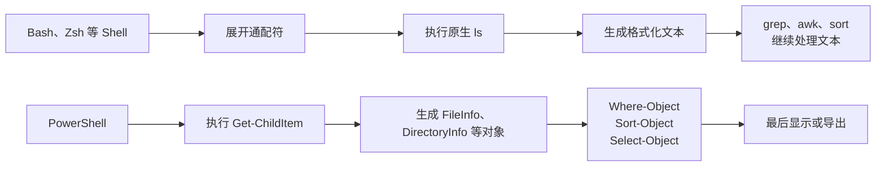

[toc]


## abstract

> powershell的get-childitem和ls有相似的基础功能,但是也有显著的不同,展开介绍,并且列出差异化功能下的对等方案.

`Get-ChildItem` 和 Unix/Linux 的 `ls` 都能“列出目录内容”，但二者属于不同的命令设计体系：

- `ls` 是面向**文件系统**的原生可执行程序，主要输出供人阅读的格式化文本。
- `Get-ChildItem` 是 PowerShell Cmdlet，主要输出 `.NET` 对象，可继续按属性筛选、排序、分组、计算和导出。
- `Get-ChildItem` 不只访问**文件系统**，还能通过 PowerShell Provider（提供程序）列出**注册表、环境变量、证书、变量、函数等层次化数据**。
- GNU `ls` 把大量**显示、排序、时间、权限**功能集中在一个命令里；PowerShell 倾向于把这些操作拆分给 `Where-Object`、`Sort-Object`、`Select-Object`、`Format-Table` 等命令。
- 在当前 PowerShell 中，`dir` 和 `gci` 是所有平台上的 `Get-ChildItem` 别名；`ls` 别名只在 Windows 上提供。在 Linux/macOS 的 PowerShell 中，输入 `ls` 通常调用系统原生 `ls`，而不是 `Get-ChildItem`。([Microsoft Learn](https://learn.microsoft.com/en-us/powershell/module/microsoft.powershell.management/get-childitem?view=powershell-7.6))

------

## 命令身份：先判断你执行的是哪个 `ls`

在 Windows PowerShell 或 Windows 上的 PowerShell 中：

```powershell
ls
```

通常等价于：

```powershell
Get-ChildItem
```

但在 Linux/macOS 上的现代 PowerShell 中，`ls` 通常是外部原生命令：

```powershell
Get-Command ls -All
Get-Alias ls -ErrorAction SilentlyContinue
```

可以用下面的命令确认：

```powershell
Get-Command ls
Get-Command Get-ChildItem
Get-Alias gci
Get-Alias dir
```

可能看到：

```text
CommandType     Name     Version    Source
-----------     ----     -------    ------
Alias           ls -> Get-ChildItem
```

也可能看到：

```text
Application     ls       0.0.0.0    /usr/bin/ls
```

因此，跨平台脚本中最好明确写：

```powershell
Get-ChildItem
```

而不要依赖：

```powershell
ls
```

同样，在 Windows PowerShell 中不要照搬：

```powershell
ls -lah
```

这里的 `ls` 实际是 `Get-ChildItem`，GNU `ls` 的 `-l`、`-a`、`-h` 选项不会自动转换成 PowerShell 参数。

------

## 两种命令模型



GNU `ls` 的主要结果是文本。它会根据终端环境、选项、区域设置和输出目标决定列布局、名称引用方式、颜色及排序方式。默认情况下，GNU `ls` 按 locale 规则对名称排序；输出到终端时通常采用多列，输出到管道或文件时通常每行一个条目。([GNU](https://www.gnu.org/software/coreutils/ls?utm_source=chatgpt.com))

`Get-ChildItem` 默认返回：

- 文件：`System.IO.FileInfo`
- 目录：`System.IO.DirectoryInfo`
- 注册表项：`Microsoft.Win32.RegistryKey`
- 环境变量：`System.Collections.DictionaryEntry`
- PowerShell 变量：`System.Management.Automation.PSVariable`
- 证书：`X509Certificate2` 等对象

PowerShell 管道传递的是对象，对象携带属性、方法和类型信息，而不是已经排版好的文本。([Microsoft Learn](https://learn.microsoft.com/en-us/powershell/module/microsoft.powershell.core/about/about_objects?view=powershell-7.6))

可以直接观察对象结构：

```powershell
Get-ChildItem | Get-Member
```

查看某个文件的全部属性：

```powershell
Get-Item ./report.txt | Format-List *
```

访问单个属性：

```powershell
(Get-Item ./report.txt).Length
(Get-Item ./report.txt).LastWriteTime
(Get-Item ./report.txt).FullName
```

------

## 基础功能对照

| 需求             | GNU/Linux `ls`                | PowerShell                                               |
| ---------------- | ----------------------------- | -------------------------------------------------------- |
| 当前目录         | `ls`                          | `Get-ChildItem`                                          |
| 指定目录         | `ls /etc`                     | `Get-ChildItem -Path /etc`                               |
| 当前目录显式写法 | `ls .`                        | `Get-ChildItem -Path .`                                  |
| 多个路径         | `ls dir1 dir2`                | `Get-ChildItem -Path dir1, dir2`                         |
| 只显示名称       | `ls -1`                       | `Get-ChildItem -Name`                                    |
| 包含隐藏项       | `ls -A`                       | `Get-ChildItem -Force`                                   |
| 只显示隐藏项     | 需要通配符或 `find`           | `Get-ChildItem -Hidden`                                  |
| 只显示文件       | 通常使用 `find`               | `Get-ChildItem -File`                                    |
| 只显示目录       | `ls -d */` 或 `find`          | `Get-ChildItem -Directory`                               |
| 递归             | `ls -R`                       | `Get-ChildItem -Recurse`                                 |
| 限制递归深度     | `ls` 无直接选项               | `Get-ChildItem -Depth 2`                                 |
| 按时间排序       | `ls -lt`                      | `Get-ChildItem | Sort-Object LastWriteTime -Descending`  |
| 按大小排序       | `ls -lS`                      | `Get-ChildItem -File | Sort-Object Length -Descending`   |
| 反向排序         | `ls -r` 与其他排序选项组合    | `Sort-Object ... -Descending`                            |
| 显示完整路径     | 通常配合 `realpath` 或 `find` | `Get-ChildItem | Select-Object -ExpandProperty FullName` |
| 排除名称         | `ls -I '*.tmp'`               | `Get-ChildItem -Exclude '*.tmp'`                         |
| 查看链接信息     | `ls -l`                       | `Get-ChildItem | Select-Object Name,LinkType,LinkTarget` |

`Get-ChildItem -Name` 是一个特殊情况：普通调用返回文件对象和目录对象，而使用 `-Name` 后返回的是字符串。([Microsoft Learn](https://learn.microsoft.com/en-us/powershell/module/microsoft.powershell.management/get-childitem?view=powershell-7.6))

------

## 参数风格的根本差异

### `ls` 倾向于短选项组合

```bash
ls -lahtr
```

可分解为：

- `-l`：长格式
- `-a`：全部条目
- `-h`：人类可读大小
- `-t`：按时间排序
- `-r`：反转排序

### PowerShell 倾向于具名参数和管道组合

```powershell
Get-ChildItem -Force |
    Sort-Object -Property LastWriteTime |
    Format-Table -AutoSize
```

PowerShell 允许参数名使用无歧义缩写，但正式脚本中建议写完整参数名：

```powershell
Get-ChildItem -Recurse -File
```

而不是：

```powershell
gci -r -af
```

完整名称更容易阅读，也能避免未来新增参数后缩写产生歧义。

------

## 输出：文本与对象

这是二者最重要的差异。

### `ls` 输出文本

例如：

```bash
ls -l
```

输出可能是：

```text
-rw-r--r-- 1 alice staff 1536 Jul 26 10:30 report.txt
```

若需要取得大小，经常有人尝试：

```bash
ls -l | awk '{print $5}'
```

这种方式依赖输出列格式，容易受到以下因素影响：

- 文件名中含空格或换行
- locale 不同
- 时间格式不同
- ACL 或安全上下文增加字段
- GNU、BSD、BusyBox 格式不同
- 颜色控制字符
- 列布局变化

因此，Unix 自动化中通常应使用 `find`、`stat`、Shell 通配符或 NUL 分隔输出，而不是解析 `ls`。

### `Get-ChildItem` 输出对象

```powershell
Get-ChildItem -File |
    Where-Object Length -gt 10MB |
    Sort-Object Length -Descending |
    Select-Object Name, Length, LastWriteTime
```

这里没有解析某一列文本：

- `Length` 是数值属性。
- `LastWriteTime` 是 `DateTime` 对象。
- `Name` 是字符串属性。
- 排序是数值或时间排序，不是文本列排序。

PowerShell 管道中的命令依次接收并处理对象。对象可以携带属性和方法，因此后续命令不需要重新解析前一个命令的显示结果。([Microsoft Learn](https://learn.microsoft.com/en-us/powershell/module/microsoft.powershell.core/about/about_objects?view=powershell-7.6))

### 显示和数据处理应分离

推荐：

```powershell
$files = Get-ChildItem -File |
    Where-Object Length -gt 10MB |
    Sort-Object Length -Descending

$files | Format-Table Name, Length, LastWriteTime
```

不推荐：

```powershell
Get-ChildItem |
    Format-Table Name, Length |
    Where-Object Length -gt 10MB
```

`Format-Table` 用于生成显示布局，应尽量放在管道末尾；需要保留属性时使用 `Select-Object`。`Format-Table` 的列由对象类型和格式化视图决定，也支持显式选择属性和计算列。([Microsoft Learn](https://learn.microsoft.com/en-us/powershell/module/microsoft.powershell.utility/format-table?view=powershell-7.6))

------

## 默认显示并不等于对象只有这些属性

`Get-ChildItem` 默认可能显示：

```text
Mode                 LastWriteTime         Length Name
----                 -------------         ------ ----
d----           2026-07-26 10:00                src
-a---           2026-07-26 10:01           1536 report.txt
```

但对象还具有很多未显示的属性：

```powershell
Get-Item ./report.txt | Select-Object *
```

常见属性包括：

| 属性             | 含义                                   |
| ---------------- | -------------------------------------- |
| `Name`           | 文件或目录名称                         |
| `FullName`       | 完整路径                               |
| `Extension`      | 扩展名                                 |
| `Length`         | 文件逻辑长度，单位为字节               |
| `CreationTime`   | 创建时间，由平台和文件系统支持情况决定 |
| `LastWriteTime`  | 最后写入时间                           |
| `LastAccessTime` | 最后访问时间                           |
| `Attributes`     | 文件属性集合                           |
| `Mode`           | PowerShell 生成的紧凑属性表示          |
| `PSIsContainer`  | 是否为容器，即是否为目录               |
| `LinkType`       | 符号链接、硬链接、Junction 等链接类型  |
| `LinkTarget`     | 链接目标                               |
| `UnixFileMode`   | 支持平台上的 Unix 文件模式             |

文件和目录对象基于 `.NET` 的 `FileInfo`、`DirectoryInfo` 和 `FileSystemInfo` 类型；现代 `.NET` 的 `FileSystemInfo` 包含 `FullName`、`LastAccessTime`、`LastWriteTime`、`LinkTarget` 和 `UnixFileMode` 等属性。([Microsoft Learn](https://learn.microsoft.com/en-us/powershell/module/microsoft.powershell.core/about/about_filesystem_provider?view=powershell-7.5))

------

## 隐藏文件语义

### Unix `ls`

Unix 中，名称以 `.` 开头通常就被视为隐藏名称：

```text
.git
.env
.config
ls
```

默认不显示它们。

```bash
ls -a
```

显示点文件，同时包括：

```text
.
..
ls -A
```

显示点文件，但排除 `.` 和 `..`。GNU `ls` 文档明确区分了 `-a` 与 `-A`。([GNU](https://www.gnu.org/software/coreutils/manual/html_node/Which-files-are-listed.html?utm_source=chatgpt.com))

### PowerShell

```powershell
Get-ChildItem -Force
```

是最接近 `ls -A` 的方案：

- 包含隐藏项目。
- 在 Windows 上还可能包含具有 System 属性的项目。
- 不会像 `ls -a` 那样产生 `.` 和 `..` 两个伪目录项。
- `-Force` 不会绕过文件访问权限或安全限制。([Microsoft Learn](https://learn.microsoft.com/en-us/powershell/module/microsoft.powershell.management/get-childitem?view=powershell-7.6))

只查看隐藏项：

```powershell
Get-ChildItem -Hidden
```

查看隐藏文件，不包括隐藏目录：

```powershell
Get-ChildItem -Hidden -File
```

同时取得普通文件和隐藏文件：

```powershell
Get-ChildItem -Force -File
```

`-Hidden` 的含义是“只返回隐藏项”，而 `-Force` 的含义更接近“也允许返回正常情况下被省略的隐藏或系统项目”。([Microsoft Learn](https://learn.microsoft.com/en-us/powershell/module/microsoft.powershell.management/get-childitem?view=powershell-7.6))

### 对等关系

| 目标             | `ls`                                    | PowerShell                    |
| ---------------- | --------------------------------------- | ----------------------------- |
| 普通可见条目     | `ls`                                    | `Get-ChildItem`               |
| 普通和隐藏条目   | `ls -A`                                 | `Get-ChildItem -Force`        |
| 包括 `.` 和 `..` | `ls -a`                                 | 没有完全相同的输出概念        |
| 只显示隐藏项     | `find` 或点号通配模式                   | `Get-ChildItem -Hidden`       |
| 只显示隐藏文件   | `find . -maxdepth 1 -type f -name '.*'` | `Get-ChildItem -Hidden -File` |

------

## 文件和目录筛选

### PowerShell 原生支持类型筛选

只显示普通文件：

```powershell
Get-ChildItem -File
```

只显示目录：

```powershell
Get-ChildItem -Directory
```

递归查找文件：

```powershell
Get-ChildItem -File -Recurse
```

递归查找目录：

```powershell
Get-ChildItem -Directory -Recurse
```

`-File` 和 `-Directory` 是 FileSystem Provider 提供的动态参数，只在文件系统路径下可用。([Microsoft Learn](https://learn.microsoft.com/en-us/powershell/module/microsoft.powershell.management/get-childitem?view=powershell-7.6))

### `ls` 没有完全对应的标准选项

只列目录的简便交互写法：

```bash
ls -d */
```

这里：

- `*/` 由 Shell 匹配目录。
- `-d` 只负责阻止 `ls` 展开目录内容。
- 它默认不包括隐藏目录。

可靠方案通常是：

```bash
find . -mindepth 1 -maxdepth 1 -type d
```

只列文件：

```bash
find . -mindepth 1 -maxdepth 1 -type f
```

### 对等表

| PowerShell                          | `ls` 单命令是否支持  | Unix 推荐方案                            |
| ----------------------------------- | -------------------- | ---------------------------------------- |
| `Get-ChildItem -File`               | 否                   | `find . -mindepth 1 -maxdepth 1 -type f` |
| `Get-ChildItem -Directory`          | 无直接标准选项       | `find . -mindepth 1 -maxdepth 1 -type d` |
| `Get-ChildItem -File -Recurse`      | `ls -R` 不能只筛文件 | `find . -type f`                         |
| `Get-ChildItem -Directory -Recurse` | `ls -R` 不能只筛目录 | `find . -type d`                         |

------

## 通配符和路径解释

### Unix Shell 通常先展开模式

```bash
ls *.txt
```

通常由 Bash 或 Zsh 先把 `*.txt` 展开成：

```text
ls a.txt b.txt report.txt
```

然后执行 `ls`。

### PowerShell Cmdlet 接收带通配符的路径

```powershell
Get-ChildItem -Path *.txt
```

PowerShell 将模式绑定给 `-Path`，再由 PowerShell 路径和 Provider 体系解释。

`Get-ChildItem -Path` 支持通配符；`-LiteralPath` 则完全按字面意义解释路径，不把任何字符当作通配符。([Microsoft Learn](https://learn.microsoft.com/en-us/powershell/module/microsoft.powershell.management/get-childitem?view=powershell-7.6))

假设文件名真的包含方括号：

```text
[draft].txt
```

下面的命令可能把方括号当成通配模式：

```powershell
Get-ChildItem -Path '[draft].txt'
```

正确的字面路径写法：

```powershell
Get-ChildItem -LiteralPath '[draft].txt'
```

Unix 对等方案是**引用路径并结束选项解析**：

```bash
ls -- '[draft].txt'
```

### `-Path` 与 `-LiteralPath`

| 参数            | 是否解释通配符 | 适用场景                       |
| --------------- | -------------- | ------------------------------ |
| `-Path`         | 是             | 用户主动输入的搜索模式         |
| `-LiteralPath`  | 否             | 确切文件名、变量路径、外部输入 |
| Unix 未引用路径 | Shell 可能展开 | 通配搜索                       |
| Unix 引用路径   | 不展开通配符   | 字面名称                       |

脚本中优先使用：

```powershell
Get-Item -LiteralPath $path
Get-ChildItem -LiteralPath $directory
Remove-Item -LiteralPath $path
```

------

## `-Filter`、`-Include`、`-Exclude` 与 `find`

PowerShell 提供三类名称筛选参数。

### `-Filter`

```powershell
Get-ChildItem -Path C:\Logs -Filter '*.log'
```

递归：

```powershell
Get-ChildItem -Path C:\Logs -Filter '*.log' -Recurse
```

对 FileSystem Provider 而言，`-Filter` 会尽量在 Provider 或底层枚举阶段应用，通常比先取得全部对象再使用 `Where-Object` 更高效。文件系统筛选 API 主要支持 `*` 和 `?`。([Microsoft Learn](https://learn.microsoft.com/en-us/powershell/module/microsoft.powershell.management/get-childitem?view=powershell-7.6))

Unix 对等方案：

```bash
find ./logs -type f -name '*.log'
```

### `-Include`

```powershell
Get-ChildItem -Path C:\Logs\* -Include '*.log', '*.txt'
```

递归时：

```powershell
Get-ChildItem -Path C:\Logs -Recurse -Include '*.log', '*.txt'
```

`-Include` 有一个常见陷阱：非递归时，路径通常需要显式表示“目录内容”，例如：

```powershell
Get-ChildItem -Path C:\Logs\* -Include '*.log'
```

而不是：

```powershell
Get-ChildItem -Path C:\Logs -Include '*.log'
```

微软文档明确指出，`-Include` 只有在命令针对某个项目的内容时才有效；非递归场景常需要路径尾部的 `*`。([Microsoft Learn](https://learn.microsoft.com/en-us/powershell/module/microsoft.powershell.management/get-childitem?view=powershell-7.6))

### `-Exclude`

```powershell
Get-ChildItem -Exclude '*.tmp', '*.bak'
```

递归使用时需要认真验证其作用层级：

```powershell
Get-ChildItem -Path ./project -Recurse -Exclude node_modules, '*.tmp'
```

如果要求精确排除某个完整目录树，使用属性过滤通常更清晰：

```powershell
Get-ChildItem -Path ./project -Recurse |
    Where-Object FullName -notlike '*/node_modules/*'
```

Windows 路径可写成：

```powershell
Get-ChildItem -Path C:\Project -Recurse |
    Where-Object FullName -notlike '*\node_modules\*'
```

### 选择原则

| 需求                         | 推荐方案       |
| ---------------------------- | -------------- |
| 简单文件名模式，文件系统路径 | `-Filter`      |
| 多个包含模式                 | `-Include`     |
| 简单名称排除                 | `-Exclude`     |
| 按大小、时间、属性等复杂条件 | `Where-Object` |
| Unix 中递归按条件查找        | `find`         |

PowerShell 的最佳实践是尽量“靠左过滤”（filter left）：如果源命令本身提供筛选参数，应优先使用它，而不是先取得所有对象再交给 `Where-Object`。([Microsoft Learn](https://learn.microsoft.com/en-us/powershell/scripting/learn/ps101/04-pipelines?view=powershell-7.6))

------

## 递归和深度

### 无限递归

GNU `ls`：

```bash
ls -R
```

PowerShell：

```powershell
Get-ChildItem -Recurse
```

### 限制递归深度

PowerShell：

```powershell
Get-ChildItem -Depth 2
```

`-Depth` 可以限制递归层级。微软文档中的 `-Depth 2` 会包括目标目录内容，以及向下两级子目录中的内容。([Microsoft Learn](https://learn.microsoft.com/en-us/powershell/module/microsoft.powershell.management/get-childitem?view=powershell-7.6))

GNU `ls -R` 没有对应的最大深度参数。通常应改用：

```bash
find . -maxdepth 3
```

为什么这里可能是 `3`，而 PowerShell 写的是 `2`？

因为不同工具对“起始目录是否算一层”的表达方式不同。实际迁移时应先用测试目录验证，而不要只机械替换数字。

### 对等关系

| 需求                 | PowerShell                                     | Unix                                 |
| -------------------- | ---------------------------------------------- | ------------------------------------ |
| 递归全部层级         | `Get-ChildItem -Recurse`                       | `ls -R` 或 `find .`                  |
| 递归两层             | `Get-ChildItem -Depth 2`                       | `find . -maxdepth 3`，需验证层级定义 |
| 递归查找 `.log` 文件 | `Get-ChildItem -File -Filter '*.log' -Recurse` | `find . -type f -name '*.log'`       |
| 递归排除目录         | `Where-Object` 或自定义遍历                    | `find ... -prune`                    |

------

## 排序能力

GNU `ls` 默认按 locale 规定的字符排序规则对名称排序，并提供 `-t`、`-S`、`-v`、`-X`、`-U` 等内建排序方式。([GNU](https://www.gnu.org/s/coreutils/manual/html_node/Sorting-the-output.html?utm_source=chatgpt.com))

PowerShell 通常使用独立的：

```powershell
Sort-Object
```

不要依赖 `Get-ChildItem` 的默认枚举顺序。需要稳定顺序时显式排序。

### 按名称

```powershell
Get-ChildItem |
    Sort-Object Name
```

对应：

```bash
ls
```

反向：

```powershell
Get-ChildItem |
    Sort-Object Name -Descending
```

对应：

```bash
ls -r
```

### 按修改时间

最新优先：

```powershell
Get-ChildItem |
    Sort-Object LastWriteTime -Descending
```

对应：

```bash
ls -lt
```

最旧优先：

```powershell
Get-ChildItem |
    Sort-Object LastWriteTime
```

对应：

```bash
ls -ltr
```

### 按大小

最大文件优先：

```powershell
Get-ChildItem -File |
    Sort-Object Length -Descending
```

对应：

```bash
ls -lS
```

最小优先：

```powershell
Get-ChildItem -File |
    Sort-Object Length
```

对应：

```bash
ls -lSr
```

这里建议加 `-File`，因为目录的 `Length` 不是目录内容总大小，通常没有与普通文件大小相同的比较意义。

### 按多个属性

先按大小，再按名称：

```powershell
Get-ChildItem -File |
    Sort-Object Length, Name
```

`Sort-Object` 支持多属性排序，前一个属性相同时继续使用后一个属性。([Microsoft Learn](https://learn.microsoft.com/en-us/powershell/module/microsoft.powershell.utility/sort-object?view=powershell-7.6))

### 目录优先

GNU：

```bash
ls --group-directories-first
```

PowerShell：

```powershell
Get-ChildItem |
    Sort-Object `
        @{ Expression = 'PSIsContainer'; Descending = $true },
        Name
```

### 按扩展名

GNU：

```bash
ls -X
```

PowerShell：

```powershell
Get-ChildItem |
    Sort-Object Extension, Name
```

### 版本或自然排序

GNU：

```bash
ls -v
```

PowerShell 没有通用的内建 `Get-ChildItem -VersionSort`。

当名称是严格语义版本时，可以提取并转换为版本对象：

```powershell
Get-ChildItem -Directory |
    Sort-Object {
        [version]($_.Name -replace '^v', '')
    }
```

适用于：

```text
v1.2.0
v1.10.0
v2.0.0
```

不适用于任意混合文件名。需要完全复制 GNU `ls -v` 的自然排序规则时，最直接的方案仍是调用原生：

```powershell
& /usr/bin/ls -v
```

------

## 取前几项

Unix 常见写法：

```bash
ls -lt | head -n 10
```

PowerShell：

```powershell
Get-ChildItem |
    Sort-Object LastWriteTime -Descending |
    Select-Object -First 10
```

按大小取最大的十个文件：

```powershell
Get-ChildItem -File |
    Sort-Object Length -Descending |
    Select-Object -First 10
```

现代 PowerShell 的 `Sort-Object` 也支持直接选取排序结果顶部或底部的对象，但 `Select-Object -First` 更容易理解。`Select-Object` 可以按位置选择对象，也可以选择对象属性。([Microsoft Learn](https://learn.microsoft.com/en-us/powershell/module/microsoft.powershell.utility/sort-object?view=powershell-7.6))

------

## 长格式与元数据

### GNU `ls -l`

GNU：

```bash
ls -l
```

显示：

- 文件类型
- POSIX 权限
- 硬链接数
- 所有者
- 组
- 文件大小
- 时间
- 名称

### PowerShell 默认表格

PowerShell：

```powershell
Get-ChildItem
```

通常已经显示：

```text
Mode  LastWriteTime  Length  Name
```

但它不是 `ls -l` 的逐列等价物。

### 自定义类似长格式的表格

```powershell
Get-ChildItem |
    Format-Table Mode, LastWriteTime, Length, Name -AutoSize
```

增加完整路径：

```powershell
Get-ChildItem |
    Format-Table Mode, LastWriteTime, Length, FullName -AutoSize
```

增加创建时间：

```powershell
Get-ChildItem |
    Format-Table Mode, CreationTime, LastWriteTime, Length, Name -AutoSize
```

PowerShell 的默认格式化视图只选择对象的一部分属性；可以用 `Format-Table` 指定显示列，或用 `Format-List *` 查看全部属性。([Microsoft Learn](https://learn.microsoft.com/en-us/powershell/module/microsoft.powershell.utility/format-table?view=powershell-7.6))

------

## `Mode` 不是 Unix 权限字符串

Windows 上可能看到：

```text
Mode
----
d----
-a---
-ar--
-a-h-
la---
```

常见字母包括：

| 字母 | 含义               |
| ---- | ------------------ |
| `l`  | 链接               |
| `d`  | 目录               |
| `a`  | Archive，存档属性  |
| `r`  | ReadOnly，只读属性 |
| `h`  | Hidden，隐藏属性   |
| `s`  | System，系统属性   |

这些主要是 Windows 文件属性，不是：

```text
rwxr-xr-x
```

微软的 `Get-ChildItem` 文档明确说明默认 `Mode` 中的 `l`、`d`、`a`、`r`、`h`、`s` 含义。([Microsoft Learn](https://learn.microsoft.com/en-us/powershell/module/microsoft.powershell.management/get-childitem?view=powershell-7.6))

### Windows ACL

查看 Windows 文件所有者和 ACL：

```powershell
Get-Acl -LiteralPath ./report.txt |
    Format-List Owner, Access
```

批量查看：

```powershell
Get-ChildItem -File | ForEach-Object {
    $acl = Get-Acl -LiteralPath $_.FullName

    [pscustomobject]@{
        Name  = $_.Name
        Owner = $acl.Owner
        ACL   = $acl.AccessToString
    }
}
```

当前 PowerShell 文档将 `Get-Acl` 标注为仅适用于 Windows 平台。([Microsoft Learn](https://learn.microsoft.com/en-us/powershell/module/microsoft.powershell.security/get-acl?view=powershell-7.6&utm_source=chatgpt.com))

### Unix 权限

现代 `.NET` 的文件对象可提供 `UnixFileMode`：

```powershell
Get-ChildItem |
    Select-Object Name, UnixFileMode
```

输出可能是枚举形式，而不是传统 `rwxr-xr-x` 形式。

需要与系统工具完全一致的权限、UID、GID、inode 等信息时，Unix 上仍推荐：

```powershell
& /usr/bin/ls -l
```

或者：

```powershell
& /usr/bin/stat ./report.txt
```

PowerShell 的 `FileSystemInfo.UnixFileMode` 表示 Unix 文件模式，但 `Get-ChildItem` 本身并未把 GNU `ls -l` 的所有者、组、硬链接数和权限列完整复制出来。([Microsoft Learn](https://learn.microsoft.com/en-us/dotnet/api/system.io.filesysteminfo?view=net-10.0&utm_source=chatgpt.com))

------

## 文件大小

### `Length`

```powershell
Get-ChildItem -File |
    Select-Object Name, Length
```

`Length` 是字节数，可直接做数值计算：

```powershell
Get-ChildItem -File |
    Where-Object Length -gt 100MB
```

这里的 `100MB` 是 PowerShell 数值字面量。

### 人类可读大小

GNU：

```bash
ls -lh
```

PowerShell 没有直接对应的 `-HumanReadable` 参数，可以使用计算属性：

```powershell
Get-ChildItem -File |
    Select-Object Name, @{
        Name = 'Size'
        Expression = {
            $bytes = $_.Length

            if ($bytes -ge 1TB) {
                '{0:N2} TiB' -f ($bytes / 1TB)
            }
            elseif ($bytes -ge 1GB) {
                '{0:N2} GiB' -f ($bytes / 1GB)
            }
            elseif ($bytes -ge 1MB) {
                '{0:N2} MiB' -f ($bytes / 1MB)
            }
            elseif ($bytes -ge 1KB) {
                '{0:N2} KiB' -f ($bytes / 1KB)
            }
            else {
                "$bytes B"
            }
        }
    }
```

按真实数值排序后再显示人类可读大小：

```powershell
Get-ChildItem -File |
    Sort-Object Length -Descending |
    Select-Object Name, @{
        Name = 'SizeMiB'
        Expression = { [math]::Round($_.Length / 1MB, 2) }
    }
```

应先按原始 `Length` 排序，不要先转换成 `"1.5 GiB"` 这样的字符串再按字符串排序。

### 目录总大小

`Get-ChildItem` 中目录的 `Length` 不是目录树的总大小。GNU `ls -ld directory` 中显示的目录大小也不是其所有内容的递归总和。

PowerShell 递归计算逻辑文件长度总和：

```powershell
$summary = Get-ChildItem -LiteralPath ./project -File -Recurse -Force |
    Measure-Object -Property Length -Sum

$summary.Sum
```

换算为 GiB：

```powershell
'{0:N2} GiB' -f ($summary.Sum / 1GB)
```

Unix 通常使用：

```bash
du -sh project
```

注意：PowerShell 的 `Length` 总和是文件逻辑长度之和，不一定等于磁盘实际分配空间；稀疏文件、压缩文件和文件系统块分配会造成差异。

------

## 时间字段

### 对应关系

| Unix 概念             | `ls`               | PowerShell 属性                    |
| --------------------- | ------------------ | ---------------------------------- |
| 数据修改时间 `mtime`  | 默认 `ls -l`       | `LastWriteTime`                    |
| 最后访问时间 `atime`  | `ls -lu`           | `LastAccessTime`                   |
| 创建时间 `birth time` | GNU `--time=birth` | `CreationTime`                     |
| 状态变化时间 `ctime`  | `ls -lc`           | 没有通用的直接 `FileInfo` 对应属性 |

### 修改时间

```powershell
Get-ChildItem |
    Sort-Object LastWriteTime -Descending
```

对应：

```bash
ls -lt
```

### 访问时间

```powershell
Get-ChildItem |
    Sort-Object LastAccessTime -Descending |
    Select-Object Name, LastAccessTime
```

对应：

```bash
ls -ltu
```

### 创建时间

```powershell
Get-ChildItem |
    Sort-Object CreationTime -Descending |
    Select-Object Name, CreationTime
```

对应 GNU：

```bash
ls -lt --time=birth
```

### `CreationTime` 不等于 Unix `ctime`

必须特别注意：

- PowerShell `CreationTime` 表示文件系统创建时间或 `.NET` 所暴露的对应时间。
- Unix `ctime` 表示 inode 状态变化时间。
- 修改权限、所有者或链接数可能更新 Unix `ctime`，但这不是“创建时间”。

因此，不应把：

```powershell
CreationTime
```

机械翻译为：

```bash
ls -lc
```

Unix 下需要 `ctime` 时应使用：

```bash
stat file
```

或：

```bash
find . -ctime ...
```

------

## 符号链接

### `ls`

查看链接自身：

```bash
ls -l latest
```

可能显示：

```text
latest -> releases/v3
```

跟随链接并查看目标信息：

```bash
ls -lL latest
```

### PowerShell

查看链接属性：

```powershell
Get-Item -LiteralPath ./latest |
    Select-Object Name, FullName, LinkType, LinkTarget
```

典型属性：

```text
Name       : latest
LinkType   : SymbolicLink
LinkTarget : releases/v3
```

PowerShell FileSystem Provider 会在 `Mode` 中使用 `l` 标记链接，并通过 `LinkType` 和 `LinkTarget` 提供链接类型及目标信息。不同平台支持的链接类型不同：Linux/macOS 通常包括 `HardLink` 和 `SymLink`；Windows NTFS 还可能包括 `Junction` 等。([Microsoft Learn](https://learn.microsoft.com/en-us/powershell/module/microsoft.powershell.core/about/about_filesystem_provider?view=powershell-7.5))

### 递归是否跟随目录链接

默认情况下：

```powershell
Get-ChildItem -Recurse
```

会显示递归中遇到的目录符号链接，但不会进入其目标目录。

显式跟随：

```powershell
Get-ChildItem -Recurse -FollowSymlink
```

`-FollowSymlink` 是 FileSystem Provider 的动态参数，从 PowerShell 6.0 起提供。([Microsoft Learn](https://learn.microsoft.com/en-us/powershell/module/microsoft.powershell.management/get-childitem?view=powershell-7.6))

需要谨慎：

- 链接可能形成循环。
- 链接可能进入非常大的目录树。
- 链接可能跨越挂载点或网络路径。
- 访问目标可能触发权限错误。

### 对等表

| 需求                 | GNU `ls`                    | PowerShell                                |
| -------------------- | --------------------------- | ----------------------------------------- |
| 查看链接本身         | `ls -l link`                | `Get-Item link`                           |
| 查看目标路径文本     | `readlink link`             | `(Get-Item link).LinkTarget`              |
| 递归时不进入链接目录 | 默认 `ls -R` 行为取决于选项 | 默认 `Get-ChildItem -Recurse`             |
| 递归跟随链接         | `ls -RL`                    | `Get-ChildItem -Recurse -FollowSymlink`   |
| 解析最终目标         | `readlink -f link`          | 可使用对象的链接解析能力或系统 `readlink` |

------

## inode 和硬链接

GNU：

```bash
ls -li file-a file-b
```

可以通过 inode 编号判断两个名称是否指向同一文件对象。

`Get-ChildItem` 没有通用、跨平台的 `-Inode` 参数。

Unix 对等方案：

```bash
stat -c '%i %n' file-a file-b
```

macOS/BSD：

```bash
stat -f '%i %N' file-a file-b
```

在 PowerShell 中可直接调用：

```powershell
& stat -c '%i %n' ./file-a ./file-b
```

macOS：

```powershell
& stat -f '%i %N' ./file-a ./file-b
```

这属于 `ls` 或 `stat` 更适合的领域，没有必要强行只用 `Get-ChildItem` 完成。

------

## PowerShell Provider：`Get-ChildItem` 独有的能力

`ls` 基本只处理**文件系统**命名空间。`Get-ChildItem` 的设计目标则是处理**任何由 Provider 暴露的层次化数据**。

PowerShell Provider 把**专用数据存储呈现成类似文件系统驱动器的结构**。内置 Provider 可以暴露文件系统、环境变量、别名、函数、变量、注册表、证书和 WSMan 配置等对象；其中证书、注册表和 WSMan Provider 仅在 Windows 上提供。([Microsoft Learn](https://learn.microsoft.com/en-us/powershell/module/microsoft.powershell.core/about/about_providers?view=powershell-7.6))

### 查看当前 Provider

```powershell
Get-PSProvider
```

查看 PowerShell Drive：

```powershell
Get-PSDrive
```

### 环境变量

```powershell
Get-ChildItem Env:
```

只查看名称：

```powershell
Get-ChildItem Env: -Name
```

Unix 近似方案：

```bash
env
```

或：

```bash
printenv
```

### PowerShell 别名

```powershell
Get-ChildItem Alias:
```

筛选名称：

```powershell
Get-ChildItem Alias: |
    Where-Object Name -like 'Get-*'
```

Bash 近似方案：

```bash
alias
```

但 Bash alias 输出是 Shell 内部文本，不是与 PowerShell `AliasInfo` 等价的对象集合。

### 函数

```powershell
Get-ChildItem Function:
```

Bash 近似方案：

```bash
declare -F
```

### PowerShell 变量

```powershell
Get-ChildItem Variable:
```

只看名称和值：

```powershell
Get-ChildItem Variable: |
    Select-Object Name, Value
```

Bash 近似方案：

```bash
declare -p
```

或：

```bash
set
```

### Windows 注册表

```powershell
Get-ChildItem HKCU:\Software
```

递归：

```powershell
Get-ChildItem HKCU:\Software\Microsoft -Recurse
```

Unix 没有注册表这一相同数据模型，因此没有直接 `ls` 对等命令。

Windows 原生命令的近似方案是：

```cmd
reg query HKCU\Software
```

但它返回文本，也不提供 PowerShell Provider 的统一对象和路径体验。

### Windows 证书存储

```powershell
Get-ChildItem Cert:\CurrentUser\My
```

只查看代码签名证书：

```powershell
Get-ChildItem Cert:\CurrentUser\My -CodeSigningCert
```

Unix 近似方案取决于证书存储位置和实现，通常组合：

```bash
find
openssl
trust
keytool
```

不存在一个与 `Cert:` Provider 完全等价的通用 `ls` 选项。

### Provider 差异化能力对照

| PowerShell 功能           | 近似 Unix 方案             | 是否完全等价            |
| ------------------------- | -------------------------- | ----------------------- |
| `Get-ChildItem Env:`      | `env`、`printenv`          | 否，Unix 输出通常是文本 |
| `Get-ChildItem Alias:`    | Bash `alias`               | 否                      |
| `Get-ChildItem Function:` | Bash `declare -F`          | 否                      |
| `Get-ChildItem Variable:` | Bash `declare -p`、`set`   | 否                      |
| `Get-ChildItem HKCU:\...` | 无通用 Unix 对应物         | 否                      |
| `Get-ChildItem Cert:\...` | `find`、`openssl`、`trust` | 否                      |
| 自定义 Provider           | 自定义工具或虚拟文件系统   | 架构不同                |

------

## 属性过滤：PowerShell 的突出优势

### 大于 100 MiB 的文件

```powershell
Get-ChildItem -File -Recurse |
    Where-Object Length -gt 100MB
```

Unix：

```bash
find . -type f -size +100M
```

这里 Unix 的 `find` 其实比 `ls` 更接近 PowerShell 的属性查询能力。

### 七天内修改的文件

```powershell
$since = (Get-Date).AddDays(-7)

Get-ChildItem -File -Recurse |
    Where-Object LastWriteTime -ge $since
```

Unix：

```bash
find . -type f -mtime -7
```

### 同时按扩展名、大小和时间筛选

```powershell
$since = (Get-Date).AddDays(-30)

Get-ChildItem -File -Recurse -Filter '*.log' |
    Where-Object {
        $_.Length -gt 10MB -and
        $_.LastWriteTime -ge $since
    }
```

Unix：

```bash
find . \
    -type f \
    -name '*.log' \
    -size +10M \
    -mtime -30
```

### 属性组合

PowerShell：

```powershell
Get-ChildItem -File |
    Where-Object {
        -not $_.IsReadOnly -and
        $_.Extension -in '.txt', '.md'
    }
```

`ls` 本身不适合作为这种属性查询语言；Unix 下应使用 `find`、`stat` 或其他专用工具。

------

## 属性表达式：PowerShell `-Attributes`

PowerShell FileSystem Provider 支持按文件属性筛选：

```powershell
Get-ChildItem -Attributes Hidden
```

非目录且隐藏：

```powershell
Get-ChildItem -Attributes '!Directory+Hidden'
```

普通文件或隐藏文件：

```powershell
Get-ChildItem -Attributes '!Directory', '!Directory+Hidden'
```

属性表达式操作符包括：

| 操作符 | 含义 |
| ------ | ---- |
| `!`    | NOT  |
| `+`    | AND  |
| `,`    | OR   |

例如压缩或加密文件：

```powershell
Get-ChildItem -Attributes Compressed, Encrypted
```

FileSystem Provider 支持 Archive、Compressed、Directory、Encrypted、Hidden、ReadOnly、ReparsePoint、SparseFile、System、Temporary 等属性。([Microsoft Learn](https://learn.microsoft.com/en-us/powershell/module/microsoft.powershell.core/about/about_filesystem_provider?view=powershell-7.5))

GNU `ls` 没有对应的通用属性表达式。Unix 下通常依靠：

- `find` 的谓词
- `stat`
- `getfacl`
- `lsattr`
- 平台专用文件系统工具

Windows 上也可以结合：

```powershell
Get-ChildItem |
    Where-Object Attributes -band [IO.FileAttributes]::ReparsePoint
```

------

## 全路径、相对路径和名称

### 只返回名称

```powershell
Get-ChildItem -Name
```

返回相对于 `-Path` 的字符串名称。([Microsoft Learn](https://learn.microsoft.com/en-us/powershell/module/microsoft.powershell.management/get-childitem?view=powershell-7.6))

类似：

```bash
ls -1
```

但二者仍有差别：

- `ls -1` 输出文本行。
- `Get-ChildItem -Name` 输出字符串对象。
- 文件名可以包含换行，因此两者都不应被当作通用无损记录格式。

### 返回完整路径

```powershell
Get-ChildItem |
    Select-Object -ExpandProperty FullName
```

递归：

```powershell
Get-ChildItem -File -Recurse |
    Select-Object -ExpandProperty FullName
```

Unix：

```bash
find "$PWD" -mindepth 1 -maxdepth 1
```

或：

```bash
realpath -- *
```

### 保留对象但只选择部分属性

```powershell
Get-ChildItem |
    Select-Object Name, FullName, Length
```

这与：

```powershell
Get-ChildItem |
    Format-Table Name, FullName, Length
```

并不相同：

- `Select-Object` 创建包含所选属性的新对象，可以继续筛选和导出。
- `Format-Table` 为显示系统生成格式化数据，通常应放在末尾。

------

## 导出结构化数据

这是 `Get-ChildItem` 相对于 `ls` 的重要优势。

### CSV

```powershell
Get-ChildItem -File -Recurse |
    Select-Object FullName, Length, CreationTime, LastWriteTime |
    Export-Csv -Path files.csv -NoTypeInformation -Encoding utf8
```

### JSON

```powershell
Get-ChildItem -File |
    Select-Object Name, FullName, Length, LastWriteTime |
    ConvertTo-Json
```

### 分组统计

按扩展名统计数量：

```powershell
Get-ChildItem -File -Recurse |
    Group-Object Extension |
    Sort-Object Count -Descending |
    Select-Object Count, Name
```

### 计算总大小

```powershell
Get-ChildItem -File -Recurse |
    Measure-Object Length -Sum -Average -Maximum -Minimum
```

Unix 中可以通过 `find -printf`、`stat`、`awk`、`jq` 等组合实现，但不要把 `ls -l` 当作可靠的结构化数据源。

------

## 错误处理

### GNU `ls`

Shell 通常根据进程退出状态判断成功或失败：

```bash
if ls -- "$path"; then
    echo "成功"
else
    echo "失败"
fi
```

GNU `ls` 使用：

- `0`：成功
- `1`：较小问题
- `2`：严重错误

例如无法访问命令行直接指定的路径，通常属于严重错误。([GNU](https://www.gnu.org/software/coreutils/ls?utm_source=chatgpt.com))

### PowerShell

`Get-ChildItem` 支持 PowerShell 通用参数，例如：

```powershell
-ErrorAction
-ErrorVariable
-Verbose
-Debug
-WarningAction
```

这些通用参数由 Cmdlet 框架统一提供。([Microsoft Learn](https://learn.microsoft.com/en-us/powershell/module/microsoft.powershell.management/get-childitem?view=powershell-7.6))

忽略访问错误：

```powershell
Get-ChildItem -Recurse -ErrorAction SilentlyContinue
```

记录错误：

```powershell
Get-ChildItem -Recurse `
    -ErrorAction SilentlyContinue `
    -ErrorVariable enumerationErrors

$enumerationErrors
```

把错误转成可捕获的终止错误：

```powershell
try {
    Get-ChildItem -LiteralPath $path -ErrorAction Stop
}
catch {
    Write-Error "无法列出路径：$($_.Exception.Message)"
}
```

最佳实践是不要无条件使用 `SilentlyContinue`。它可能隐藏：

- 权限不足
- 路径不存在
- 网络共享中断
- 符号链接目标不存在
- 文件在枚举过程中被删除

------

## 对等方案总表：从 `ls` 迁移到 PowerShell

| GNU `ls` 需求                  | PowerShell 对等方案                                     | 备注                             |
| ------------------------------ | ------------------------------------------------------- | -------------------------------- |
| `ls`                           | `Get-ChildItem`                                         | 当前目录                         |
| `ls /etc`                      | `Get-ChildItem -Path /etc`                              | 指定路径                         |
| `ls file.txt`                  | `Get-Item -LiteralPath file.txt`                        | 查看单个项目时 `Get-Item` 更准确 |
| `ls -a`                        | `Get-ChildItem -Force`                                  | 不产生 `.`、`..`                 |
| `ls -A`                        | `Get-ChildItem -Force`                                  | 最接近                           |
| `ls -l`                        | `Get-ChildItem` 或自定义 `Format-Table`                 | 列语义不完全相同                 |
| `ls -lh`                       | 计算属性转换 `Length`                                   | 没有直接 `-h`                    |
| `ls -1`                        | `Get-ChildItem -Name`                                   | 返回字符串                       |
| `ls -d directory`              | `Get-Item directory`                                    | 查看目录对象本身                 |
| `ls -d */`                     | `Get-ChildItem -Directory`                              | PowerShell 更直接                |
| `ls -R`                        | `Get-ChildItem -Recurse`                                | 递归                             |
| 无深度限制选项                 | `Get-ChildItem -Depth 2`                                | PowerShell 特有优势              |
| `ls -lt`                       | `Get-ChildItem | Sort-Object LastWriteTime -Descending` | 最新优先                         |
| `ls -ltr`                      | `Get-ChildItem | Sort-Object LastWriteTime`             | 最旧优先                         |
| `ls -lS`                       | `Get-ChildItem -File | Sort-Object Length -Descending`  | 大文件优先                       |
| `ls -lSr`                      | `Get-ChildItem -File | Sort-Object Length`              | 小文件优先                       |
| `ls -X`                        | `Get-ChildItem | Sort-Object Extension,Name`            | 按扩展名                         |
| `ls -v`                        | 自定义排序或调用原生 `ls -v`                            | 无通用直接对应                   |
| `ls --group-directories-first` | 按 `PSIsContainer`、`Name` 排序                         | 使用计算排序键                   |
| `ls -F`                        | 查看 `Mode`、`PSIsContainer`、`LinkType`                | 无完全相同后缀模式               |
| `ls -i`                        | 调用系统 `stat`                                         | 无通用 `Get-ChildItem` 参数      |
| `ls -n`                        | Windows 用 `Get-Acl`；Unix 用 `stat`                    | 权限模型不同                     |
| `ls -lu`                       | 选择、排序 `LastAccessTime`                             | 访问时间                         |
| `ls -lc`                       | 通常调用 Unix `stat`                                    | `CreationTime` 不是 ctime        |
| `ls --time=birth`              | 使用 `CreationTime`                                     | 受文件系统支持影响               |
| `ls -L`                        | 查看或解析 `LinkTarget`                                 | 语义不完全相同                   |
| `ls -RL`                       | `Get-ChildItem -Recurse -FollowSymlink`                 | 注意循环                         |
| `ls -I '*.tmp'`                | `Get-ChildItem -Exclude '*.tmp'`                        | 递归语义需验证                   |
| `ls -- '[x].txt'`              | `Get-Item -LiteralPath '[x].txt'`                       | 字面路径                         |

------

## 对等方案总表：PowerShell 差异化能力如何在 Unix 实现🎈

| PowerShell 能力     | PowerShell 示例                        | Unix 推荐方案                            |
| ------------------- | -------------------------------------- | ---------------------------------------- |
| 只列普通文件        | `Get-ChildItem -File`                  | `find . -mindepth 1 -maxdepth 1 -type f` |
| 只列目录            | `Get-ChildItem -Directory`             | `find . -mindepth 1 -maxdepth 1 -type d` |
| 限制递归深度        | `Get-ChildItem -Depth 2`               | `find . -maxdepth ...`                   |
| Provider 端名称筛选 | `Get-ChildItem -Filter '*.log'`        | `find -name '*.log'` 或 Shell glob       |
| 按数值属性筛选      | `Where-Object Length -gt 10MB`         | `find -size +10M`                        |
| 按日期对象筛选      | `Where-Object LastWriteTime -gt $date` | `find -newermt`、`-mtime`                |
| 多属性排序          | `Sort-Object Length,Name`              | `find -printf` 配合 `sort`               |
| 选择结构化属性      | `Select-Object Name,Length`            | `stat` 或 `find -printf`                 |
| 输出 CSV            | `Export-Csv`                           | `find`、`stat`、`awk` 自行编码字段       |
| 输出 JSON           | `ConvertTo-Json`                       | `find`、`stat` 配合 `jq` 或脚本语言      |
| 枚举环境变量        | `Get-ChildItem Env:`                   | `env`、`printenv`                        |
| 枚举别名            | `Get-ChildItem Alias:`                 | Shell `alias`                            |
| 枚举函数            | `Get-ChildItem Function:`              | Bash `declare -F`                        |
| 枚举变量            | `Get-ChildItem Variable:`              | Bash `declare -p`                        |
| 枚举注册表          | `Get-ChildItem HKCU:\...`              | 无直接对应                               |
| 枚举证书存储        | `Get-ChildItem Cert:\...`              | `openssl`、`trust`、`find` 等组合        |
| 统一错误控制        | `-ErrorAction Stop`                    | 退出状态、`set -e`、显式条件判断         |

------

## 实用场景

### 查看当前目录，包括隐藏项，最新优先

```powershell
Get-ChildItem -Force |
    Sort-Object LastWriteTime -Descending |
    Format-Table Mode, LastWriteTime, Length, Name -AutoSize
```

GNU：

```bash
ls -lAt
```

### 查看最大的十个文件

```powershell
Get-ChildItem -File -Recurse -ErrorAction SilentlyContinue |
    Sort-Object Length -Descending |
    Select-Object -First 10 FullName, Length
```

更适合阅读的大小：

```powershell
Get-ChildItem -File -Recurse -ErrorAction SilentlyContinue |
    Sort-Object Length -Descending |
    Select-Object -First 10 FullName, @{
        Name = 'SizeMiB'
        Expression = { [math]::Round($_.Length / 1MB, 2) }
    }
```

Unix：

```bash
find . -type f -printf '%s\t%p\n' |
    sort -nr |
    head -n 10
```

GNU `find` 的 `-printf` 不是 POSIX 通用功能。

### 查找最近一天修改的日志文件

```powershell
$since = (Get-Date).AddDays(-1)

Get-ChildItem -File -Recurse -Filter '*.log' |
    Where-Object LastWriteTime -ge $since |
    Sort-Object LastWriteTime -Descending
```

Unix：

```bash
find . -type f -name '*.log' -mtime -1
```

### 按扩展名统计文件数量

```powershell
Get-ChildItem -File -Recurse |
    Group-Object Extension |
    Sort-Object Count -Descending |
    Format-Table Count, Name -AutoSize
```

### 找出空文件

```powershell
Get-ChildItem -File -Recurse |
    Where-Object Length -eq 0
```

Unix：

```bash
find . -type f -empty
```

### 找出空目录

PowerShell 没有单个 `-Empty` 参数，可使用：

```powershell
Get-ChildItem -Directory -Recurse |
    Where-Object {
        -not (Get-ChildItem -LiteralPath $_.FullName -Force)
    }
```

Unix：

```bash
find . -type d -empty
```

### 生成文件清单

```powershell
Get-ChildItem -File -Recurse -Force |
    Select-Object FullName, Length, CreationTime, LastWriteTime |
    Export-Csv -Path manifest.csv -NoTypeInformation -Encoding utf8
```

这比把：

```bash
ls -lR > manifest.txt
```

作为机器数据更可靠，因为 CSV 字段和对象属性更明确。

------

## 最佳实践

### 脚本中使用完整 Cmdlet 名称

交互输入可以使用：

```powershell
gci
dir
```

正式脚本建议：

```powershell
Get-ChildItem
```

原因包括：

- `ls` 只在 Windows 上是该 Cmdlet 的别名。
- `dir` 在不同命令环境中可能指向不同程序。
- 完整名称更容易搜索文档。
- 代码审查时语义更明确。

### 路径变量使用 `-LiteralPath`

推荐：

```powershell
Get-ChildItem -LiteralPath $directory
```

特别是路径可能包含：

```text
[
]
*
?
`
```

等特殊字符时。

### 优先在源头筛选

优先：

```powershell
Get-ChildItem -File -Filter '*.log' -Recurse
```

而不是：

```powershell
Get-ChildItem -Recurse |
    Where-Object {
        -not $_.PSIsContainer -and
        $_.Name -like '*.log'
    }
```

然后再用 `Where-Object` 处理源命令无法表达的条件。

### 显式排序

不要假定文件系统枚举顺序：

```powershell
Get-ChildItem |
    Sort-Object Name
```

需要大小顺序：

```powershell
Get-ChildItem -File |
    Sort-Object Length -Descending
```

### `Format-*` 放在管道末尾

推荐：

```powershell
Get-ChildItem -File |
    Where-Object Length -gt 1MB |
    Sort-Object Length -Descending |
    Format-Table Name, Length
```

不要先格式化再继续按属性处理。

### 不要强行让一个工具完成所有任务

| 任务                        | PowerShell 推荐                  |
| --------------------------- | -------------------------------- |
| 列目录对象                  | `Get-ChildItem`                  |
| 查看单个项目                | `Get-Item`                       |
| 查看对象属性                | `Select-Object`、`Format-List *` |
| 筛选对象                    | `Where-Object`                   |
| 排序                        | `Sort-Object`                    |
| 统计                        | `Measure-Object`、`Group-Object` |
| Windows 权限                | `Get-Acl`                        |
| 文件内容搜索                | `Select-String`                  |
| 导出数据                    | `Export-Csv`、`ConvertTo-Json`   |
| Unix inode、UID、GID、ctime | 原生 `stat`                      |
| 磁盘实际占用                | `du` 或平台专用工具              |

------

## 最容易出现的迁移误区

| 误区                                                  | 正确认识                                              |
| ----------------------------------------------------- | ----------------------------------------------------- |
| PowerShell 中的 `ls` 在所有平台都等于 `Get-ChildItem` | `ls` 别名只在 Windows 上提供                          |
| `ls -la` 可以直接在 PowerShell 使用                   | Windows 上的 `ls` 是 Cmdlet 别名，不接受 GNU 选项语义 |
| `Get-ChildItem` 输出的是普通文本表格                  | 默认管道输出是对象，表格只是显示视图                  |
| `Mode` 等于 Unix `rwx` 权限                           | Windows 上主要表示文件属性                            |
| `CreationTime` 等于 Unix `ctime`                      | `ctime` 是状态变化时间                                |
| `-Hidden` 等于 `ls -a`                                | `-Hidden` 只返回隐藏项；全部项目应使用 `-Force`       |
| `-Force` 会绕过访问权限                               | 它不会覆盖安全限制                                    |
| `-Include` 在所有路径写法下都生效                     | 非递归时常需在路径尾部使用 `*`                        |
| `Get-ChildItem -Recurse` 默认进入目录链接             | 默认显示链接但不递归进入，需 `-FollowSymlink`         |
| 目录的 `Length` 是目录总大小                          | 目录树总大小需要递归统计                              |
| `Format-Table` 后还能正常访问文件属性                 | 格式化应放到管道末尾                                  |
| PowerShell 完全替代 Unix `ls`、`stat`、`find`         | 不同工具各有优势，跨平台时可合理混用                  |

------

## 选择建议

只需要人工浏览目录时：

```powershell
Get-ChildItem
```

需要包括隐藏项时：

```powershell
Get-ChildItem -Force
```

需要查找文件时：

```powershell
Get-ChildItem -File -Recurse -Filter '*.txt'
```

需要属性筛选、排序或导出时，优先使用 PowerShell 对象管道：

```powershell
Get-ChildItem -File -Recurse |
    Where-Object Length -gt 10MB |
    Sort-Object Length -Descending |
    Select-Object FullName, Length, LastWriteTime
```

需要 Unix 特有的权限、inode、硬链接数、ctime、磁盘块占用或 GNU 版本排序时，直接使用原生工具往往更准确：

```powershell
& /usr/bin/ls -li
& /usr/bin/stat ./file
& /usr/bin/du -sh ./directory
```

最合理的理解不是“`Get-ChildItem` 是 PowerShell 版 `ls`”，而是：

> `Get-ChildItem` 的文件系统模式覆盖了 `ls` 的基础浏览功能，同时把结果提升为可编程对象；
>
> `ls` 则在 Unix 文件元数据展示、紧凑交互选项和传统命令行兼容性方面更加直接。