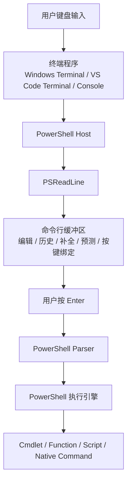
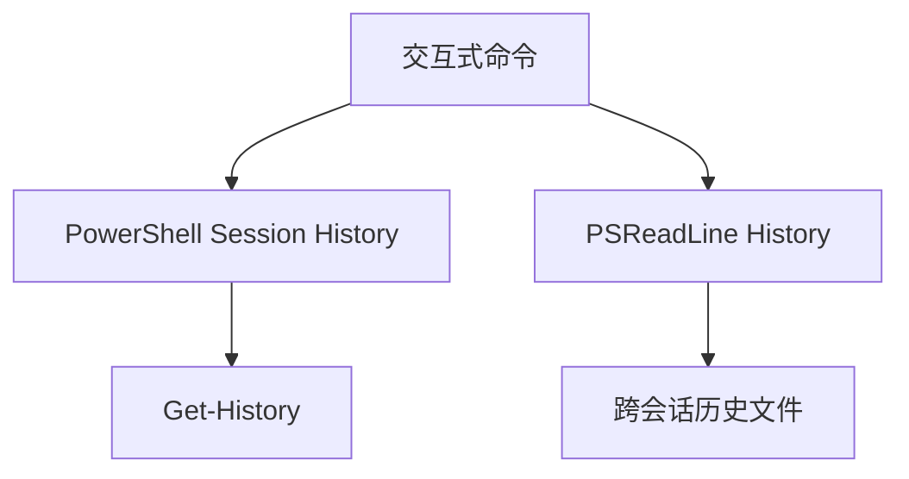
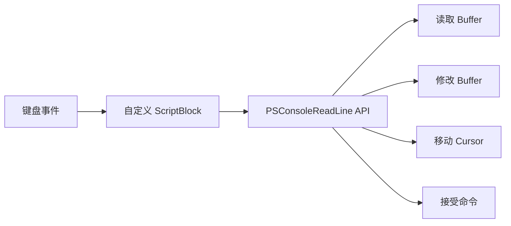

[toc]


## PSReadLine 技术指南

PSReadLine 是 PowerShell 交互式命令行体验的核心组件之一。

它并不负责“执行 PowerShell 命令”，而是负责你在按下 Enter 之前发生的大量事情：**命令行编辑、语法着色、历史记录、按键绑定、补全交互、预测式 IntelliSense、动态帮助**等。

> Microsoft 当前文档说明，PSReadLine 可以用于 Windows PowerShell 5.1 及更高版本；部分功能要求 PowerShell 7.2 或更高版本。

> 一个值得注意的文档细节：Microsoft Learn 的 PSReadLine 模块入口和部分函数参考仍以 2.3.6 为主要文档版本，而发布说明已经覆盖 2.4.5。因此，涉及“默认值”“新行为”“具体版本功能”时，不应只凭印象或单个页面判断，最好直接查看本机的 `Get-PSReadLineOption`、模块版本以及当前键绑定。

------

## 建议的大纲与学习路线

如果是第一次系统学习 PSReadLine，推荐按照下面的顺序理解：

| 阶段     | 核心主题                                       | 需要掌握的能力                                  |
| -------- | ---------------------------------------------- | ----------------------------------------------- |
| 基础认识 | PSReadLine 的定位                              | 分清 Shell、终端、PSReadLine 与 PowerShell 引擎 |
| 环境检查 | 版本、加载状态                                 | 判断自己实际运行的是哪个版本                    |
| 基础配置 | `Get-PSReadLineOption`、`Set-PSReadLineOption` | 查询和修改行为                                  |
| 编辑模式 | Windows、Emacs、Vi                             | 选择适合自己的编辑方式                          |
| 键绑定   | Key Handler                                    | 查看、覆盖、删除快捷键                          |
| 历史记录 | History                                        | 高效检索，同时避免泄露敏感信息                  |
| 自动补全 | Completion                                     | 理解 Tab 补全和菜单补全                         |
| 命令预测 | Predictive IntelliSense                        | 使用历史记录及 Predictor                        |
| 动态帮助 | Parameter Help、Command Help                   | 写命令时就地查看帮助                            |
| 外观体验 | Colors、Bell、Prompt                           | 改善视觉和交互反馈                              |
| 持久化   | PowerShell Profile                             | 让配置在新会话继续生效                          |
| 高级定制 | ScriptBlock、PSConsoleReadLine API             | 编写自己的交互行为                              |
| 最佳实践 | 可维护性、安全、兼容性                         | 建立稳定的长期配置                              |

不建议一开始背几十个 PSReadLine 函数。更有效的方法是先掌握：

- 如何检查状态；
- 如何查快捷键；
- 如何改快捷键；
- 如何搜索历史；
- 如何使用预测；
- 如何把设置写进 Profile。

掌握这些之后，其余功能基本可以按需发现。

------

## PSReadLine 到底位于 PowerShell 的哪一层

初学者最容易混淆的是：

- PowerShell
- PowerShell Console Host
- Windows Terminal
- PSReadLine
- Tab Completion
- Predictive IntelliSense

它们不是同一个东西。

可以用下面的模型理解：



PSReadLine 的职责集中在：

> **“你正在编辑的这一行命令”**

而不是命令真正开始执行后的行为。

官方文档将 `PSConsoleHostReadLine` 描述为 PSReadLine 的主要入口。正常情况下，PowerShell Console Host 会自动加载 PSReadLine，并调用该函数，因此通常不需要用户自己调用 `PSConsoleHostReadLine`。

这也解释了为什么：

```powershell
Set-PSReadLineOption ...
```

修改的是交互式输入体验，而不是 PowerShell 脚本语言本身。

------

## PSReadLine 提供什么

官方列出的主要能力包括：

- 命令行语法着色；
- 语法错误的视觉提示；
- 多行命令编辑；
- 命令历史记录；
- 可自定义键绑定；
- Windows/Cmd 风格、Emacs 和 Vi 编辑体验；
- Bash 风格的补全行为；
- 基于 PowerShell Token 的单词移动；
- Predictive IntelliSense；
- 终端内动态帮助。

从实践角度，可以归纳为四类：

| 类别     | 解决的问题                               |
| -------- | ---------------------------------------- |
| 编辑器   | “怎样快速修改当前命令？”                 |
| 历史系统 | “以前输入过的命令怎么快速找回来？”       |
| 辅助输入 | “参数、路径、命令怎样更快补出来？”       |
| 定制框架 | “怎样让 PowerShell 按我自己的习惯工作？” |

------

## 首先检查自己的运行环境

在修改任何设置之前，先建立一个习惯：

> **先观察，再配置。**

### 查看 PowerShell 版本

```powershell
$PSVersionTable
```

最常关注：

```powershell
$PSVersionTable.PSVersion
```

### 查看当前已加载的 PSReadLine

```powershell
Get-Module PSReadLine
```

### 查看机器中安装的所有 PSReadLine 版本

```powershell
Get-Module PSReadLine -ListAvailable |
    Sort-Object Version -Descending
```

如果同时存在多个版本，这是完全可能的。

### 单独查看版本

```powershell
(Get-Module PSReadLine).Version
```

如果什么都没有返回，可以显式导入：

```powershell
Import-Module PSReadLine
```

然后再检查：

```powershell
Get-Module PSReadLine
```

------

## 安装或升级 PSReadLine

PowerShell Gallery 当前同时提供 PowerShellGet 和较新的 Microsoft.PowerShell.PSResourceGet 安装方式。PSReadLine 2.4.5 的 Gallery 页面明确提供：

```powershell
Install-PSResource -Name PSReadLine
```

以及传统方式：

```powershell
Install-Module -Name PSReadLine
```

如果环境已经使用 `Microsoft.PowerShell.PSResourceGet`，更推荐：

```powershell
Install-PSResource -Name PSReadLine -Scope CurrentUser
```

如果还在使用传统 PowerShellGet：

```powershell
Install-Module -Name PSReadLine -Scope CurrentUser
```

安装完成后有一个容易忽略的细节：

> `Install-PSResource` 安装新的模块版本后，并不会自动把这个新版本替换进当前 PowerShell 会话。

官方建议重新导入相应版本或者启动一个新的 PowerShell 会话。

因此升级之后最稳妥的流程是：

```powershell
Get-Module PSReadLine -ListAvailable |
    Sort-Object Version -Descending
```

然后打开新的 PowerShell：

```powershell
(Get-Module PSReadLine).Version
```

确认实际加载版本。

------

## PSReadLine 最重要的几个命令

PSReadLine 本身公开的 Cmdlet 数量其实很少。PowerShell Gallery 当前列出的主要 Cmdlet 是以下五个，并另外包含 `PSConsoleHostReadLine` 函数。

| 命令                          | 用途                      |
| ----------------------------- | ------------------------- |
| `Get-PSReadLineOption`        | 查看当前 PSReadLine 配置  |
| `Set-PSReadLineOption`        | 修改 PSReadLine 配置      |
| `Get-PSReadLineKeyHandler`    | 查看当前键绑定            |
| `Set-PSReadLineKeyHandler`    | 创建或覆盖键绑定          |
| `Remove-PSReadLineKeyHandler` | 删除键绑定                |
| `PSConsoleHostReadLine`       | PSReadLine 的主要宿主入口 |

绝大多数日常配置，实际上就是围绕：

```powershell
Get-PSReadLineOption
```

和：

```powershell
Set-PSReadLineOption
```

展开。

------

## 理解 Option：PSReadLine 的全局行为配置

先执行：

```powershell
Get-PSReadLineOption
```

它返回当前 PSReadLine 配置状态。官方将它描述为与 `Set-PSReadLineOption` 对应的查询接口。

建议第一次学习时实际运行：

```powershell
Get-PSReadLineOption | Format-List *
```

然后观察里面有哪些属性。

常见配置大致可以归类为：

| 类别     | 常见属性                                                     |
| -------- | ------------------------------------------------------------ |
| 编辑模式 | `EditMode`                                                   |
| 历史记录 | `HistorySaveStyle`、`HistorySavePath`、`MaximumHistoryCount` |
| 历史搜索 | `HistoryNoDuplicates`、`HistorySearchCursorMovesToEnd`       |
| 预测     | `PredictionSource`、`PredictionViewStyle`                    |
| 显示     | `Colors`、`ContinuationPrompt`                               |
| 提示反馈 | `BellStyle`                                                  |
| Vi       | `ViModeIndicator`、`ViModeChangeHandler`                     |
| 补全     | `CompletionQueryItems`                                       |
| 单词边界 | `WordDelimiters`                                             |

`Set-PSReadLineOption` 的修改默认只作用于**当前 PowerShell 会话**。如果希望以后每次启动 PowerShell 都使用这些选项，需要把命令放进 Profile。

这条规则极其重要：

```text
当前会话配置
    =
Set-PSReadLineOption

永久个人配置
    =
把 Set-PSReadLineOption 写入 $PROFILE
```

------

## 编辑模式 EditMode

PSReadLine 支持不同编辑习惯。

最常见的是：

- `Windows`
- `Emacs`
- `Vi`

例如：

```powershell
Set-PSReadLineOption -EditMode Windows
```

或者：

```powershell
Set-PSReadLineOption -EditMode Emacs
```

Vi 用户可以使用：

```powershell
Set-PSReadLineOption -EditMode Vi
```

### 怎样选择

| 模式    | 推荐人群                                  |
| ------- | ----------------------------------------- |
| Windows | 普通 Windows / PowerShell 用户            |
| Emacs   | 熟悉 Bash、Readline、Emacs 风格键位的用户 |
| Vi      | 已经具有 Vim 操作习惯的用户               |

关键不是哪一种“高级”，而是：

> **你的肌肉记忆属于哪一种编辑模型。**

如果是 PowerShell 初学者，通常建议先使用 Windows 模式，之后再根据需要切换。

------

## 键绑定是 PSReadLine 最核心的机制之一

PSReadLine 可以把：

```text
按键
```

映射到：

```text
PSReadLine Function
```

或者：

```text
自定义 ScriptBlock
```

这就是 **Key Handler**。

概念上可以理解为：


------

## 查看当前键绑定

最基本：

```powershell
Get-PSReadLineKeyHandler
```

官方说明，无参数时会返回当前已经绑定的键处理函数。

查看包括未绑定函数在内的完整列表：

```powershell
Get-PSReadLineKeyHandler -Bound -Unbound
```

这条命令非常适合“发现功能”。

例如你可能看到：

- `AcceptLine`
- `BackwardWord`
- `ForwardWord`
- `PreviousHistory`
- `NextHistory`
- `ReverseSearchHistory`
- `MenuComplete`
- `HistorySearchBackward`

### 查询特定按键

```powershell
Get-PSReadLineKeyHandler -Chord Enter
```

也可以一次查询多个：

```powershell
Get-PSReadLineKeyHandler -Chord Enter, Shift+Enter
```

当你不知道某个快捷键为什么会产生某种行为时，这通常是第一条诊断命令。

------

## 绑定快捷键

基本形式：

```powershell
Set-PSReadLineKeyHandler -Chord <按键> -Function <函数>
```

例如：

```powershell
Set-PSReadLineKeyHandler `
    -Chord UpArrow `
    -Function HistorySearchBackward
```

官方示例正是使用这种方式，让 `UpArrow` 搜索“以当前输入内容开头”的历史命令。

通常还会同时设置：

```powershell
Set-PSReadLineKeyHandler `
    -Chord DownArrow `
    -Function HistorySearchForward
```

于是：

```text
输入：

git

按 UpArrow

只搜索以 git 开头的历史命令
```

而不是逐条遍历所有历史。

这是最值得推荐的 PSReadLine 定制之一。

------

## Chord 是什么

PSReadLine 将组合键称为 **Chord**。

例如：

```text
Ctrl+r
Ctrl+Spacebar
Alt+h
Ctrl+Shift+x
```

都可以是 Chord。

多阶段组合键也可以存在：

```text
Ctrl+x,Ctrl+l
```

官方说明，多键序列使用逗号分隔；同时需要注意：

```text
Ctrl+x
```

和：

```text
Ctrl+Shift+x
```

属于不同绑定。

例如：

```powershell
Set-PSReadLineKeyHandler `
    -Chord 'Ctrl+x,Ctrl+l' `
    -Function ClearScreen
```

------

## 删除键绑定

如果不再想使用某个绑定：

```powershell
Remove-PSReadLineKeyHandler -Chord Ctrl+b
```

`Remove-PSReadLineKeyHandler` 的作用就是移除指定 Chord 的绑定。

修改之前，建议先检查：

```powershell
Get-PSReadLineKeyHandler -Chord Ctrl+b
```

这是一个很好的配置习惯：

```text
先检查
再覆盖
出现问题时可恢复
```

------

## 默认快捷键不能死记

不同 `EditMode` 下，同一个功能的默认快捷键可能不同。

例如官方函数文档中：

`PreviousHistory`：

- Windows：`UpArrow`
- Emacs：`UpArrow`、`Ctrl+p`
- Vi Insert：`UpArrow`

而 `HistorySearchBackward` 在 Windows 模式中默认绑定到 `F8`。

所以技术文章中经常看到：

> “按 Ctrl+某键即可……”

实际上未必适用于你的 EditMode。

最可靠的办法永远是：

```powershell
Get-PSReadLineKeyHandler
```

或者：

```powershell
Get-PSReadLineKeyHandler -Chord Ctrl+r
```

------

## 历史记录是 PSReadLine 最实用的功能

PSReadLine 历史和：

```powershell
Get-History
```

看到的 PowerShell 会话历史不是一回事。

官方明确指出：

> PSReadLine history 与 PowerShell history 是分开的。

`MaximumHistoryCount` 控制的是 PSReadLine 历史记录，而不是 PowerShell 的 session history。

可以理解为：



PowerShell 的 `Get-History` 更偏向：

> 当前会话发生过什么。

PSReadLine 历史更偏向：

> 以前输入过什么，我想重新找到它。

------

## 查找历史文件

不要优先硬编码路径。

最可靠的是：

```powershell
(Get-PSReadLineOption).HistorySavePath
```

官方说明，Windows 默认历史目录通常位于：

```text
$Env:APPDATA\Microsoft\Windows\PowerShell\PSReadLine
```

非 Windows 环境通常位于：

```text
$Env:XDG_DATA_HOME/powershell/PSReadLine
```

或：

```text
$Env:HOME/.local/share/powershell/PSReadLine
```

每个 Host 使用相应的历史文件，例如 VS Code PowerShell Host 会拥有自己的历史文件。

实际工作中最好仍然使用：

```powershell
(Get-PSReadLineOption).HistorySavePath
```

因为这是“当前实例真正使用的值”。

------

## HistorySaveStyle

查看：

```powershell
(Get-PSReadLineOption).HistorySaveStyle
```

PSReadLine 支持三种保存方式：

| 值                  | 行为                                                 |
| ------------------- | ---------------------------------------------------- |
| `SaveIncrementally` | 每执行一条命令就保存，并可供多个 PowerShell 实例共享 |
| `SaveAtExit`        | PowerShell 退出时再追加历史                          |
| `SaveNothing`       | 不保存到历史文件                                     |

默认文档值为 `SaveIncrementally`。

设置：

```powershell
Set-PSReadLineOption -HistorySaveStyle SaveIncrementally
```

或者完全禁止写历史文件：

```powershell
Set-PSReadLineOption -HistorySaveStyle SaveNothing
```

但要特别注意一个细节：

如果在同一会话中：

```text
SaveNothing
```

之后又改回：

```text
SaveIncrementally
```

官方说明，PSReadLine 仍可能将此前会话中执行过的命令写入历史文件。

因此：

> `SaveNothing` 不应该被当成临时“隐身模式”使用。

------

## 高效历史搜索

通常有三种不同需求。

### 浏览历史

默认类似：

```text
UpArrow
DownArrow
```

对应：

```text
PreviousHistory
NextHistory
```

### 根据前缀搜索

例如输入：

```text
docker
```

然后只查找历史中以 `docker` 开头的命令：

```powershell
Set-PSReadLineKeyHandler `
    -Chord UpArrow `
    -Function HistorySearchBackward

Set-PSReadLineKeyHandler `
    -Chord DownArrow `
    -Function HistorySearchForward
```

### 交互式反向搜索

`ReverseSearchHistory` 默认通常可以通过：

```text
Ctrl+r
```

访问。官方函数文档列出 Windows、Emacs 和 Vi 模式的 `Ctrl+r` 绑定。

因此：

```text
Ctrl+r
```

是一个非常值得培养的快捷键。

------

## HistorySearchCursorMovesToEnd

假设历史记录里有：

```powershell
Get-ChildItem C:\Projects -Recurse
```

通过历史搜索找回来之后，光标究竟停在哪里？

这个行为由：

```powershell
HistorySearchCursorMovesToEnd
```

控制。

设置：

```powershell
Set-PSReadLineOption -HistorySearchCursorMovesToEnd
```

如果希望关闭：

```powershell
Set-PSReadLineOption -HistorySearchCursorMovesToEnd:$false
```

官方说明，启用后，从历史搜索载入命令时，光标移动到命令末尾；关闭时则尽可能保留搜索前的光标位置。

对于“搜出来之后通常继续往后追加参数”的用户，开启通常更自然。

------

## 历史记录与安全

这是 PSReadLine 中非常重要的一部分。

PSReadLine 的历史文件可能包含敏感数据。官方明确提醒：

> 历史记录可能包含密码等敏感数据。

PSReadLine 会尝试检测某些敏感内容，例如与：

- password
- token
- apikey
- secret
- asplaintext

有关的命令，并从 2.2.0 开始利用 PowerShell AST 改善敏感内容过滤；2.3.4 又进一步改善了部分 Secret、Azure、kubectl、gcloud 等场景。

但这里最重要的安全原则是：

> **历史过滤是降低风险的辅助措施，不是秘密管理系统。**

不要因此认为下面这种做法安全：

```powershell
Invoke-Something -ApiKey '真实密钥'
```

更好的方式是使用：

- 环境变量；
- SecretManagement；
- `Get-Credential`；
- 安全的 Secret Store；
- CI/CD Secret；
- 云平台的身份和凭据机制。

并且定期检查：

```powershell
(Get-PSReadLineOption).HistorySavePath
```

尤其是在：

- 共用开发机；
- 跳板机；
- 运维服务器；
- 教学演示环境；
- 录屏机器；
- CI 调试终端

中。

------

## 自定义哪些命令允许进入历史

高级情况下，可以使用：

```powershell
-AddToHistoryHandler
```

例如：

```powershell
Set-PSReadLineOption -AddToHistoryHandler {
    param([string]$Line)

    if ($Line -match '^some-sensitive-tool ') {
        return $false
    }

    return $true
}
```

处理程序可以控制命令进入：

- 内存历史和文件；
- 仅内存历史；
- 完全跳过。

对应的概念值包括：

- `MemoryAndFile`
- `MemoryOnly`
- `SkipAdding`

布尔值 `$true` 相当于 `MemoryAndFile`，`$false` 相当于 `SkipAdding`。

这比简单地关闭全部历史更灵活。

------

## Tab Completion 与 PSReadLine

很多用户把：

```text
Tab Completion
```

和：

```text
Predictive IntelliSense
```

混为一谈。

实际上它们解决的是不同问题。

### Tab Completion

回答的是：

> “基于我当前位置，有哪些合法补全候选？”

例如：

```powershell
Get-Chi<Tab>
```

可能补成：

```powershell
Get-ChildItem
```

或者：

```powershell
Get-Process -N<Tab>
```

补全参数名。

### Predictive IntelliSense

回答的是：

> “根据历史或者 Predictor，我猜你接下来可能想输入什么完整内容。”

所以：

```text
Completion
    ≠
Prediction
```

------

## 常见补全函数

PSReadLine 提供多个 Completion Handler。

### TabCompleteNext

Windows 模式中，`Tab` 通常对应：

```text
TabCompleteNext
```

不断按 Tab 会依次循环候选。

### TabCompletePrevious

通常：

```text
Shift+Tab
```

反向循环候选。

### MenuComplete

`MenuComplete` 会提供更偏菜单式的候选交互。Windows 和 Emacs 模式通常可以通过：

```text
Ctrl+Spacebar
```

使用。

例如：

```powershell
Get-Process -<Ctrl+Space>
```

可以帮助发现参数。

对于新手，这甚至比单纯按 Tab 更适合学习命令。

------

## Predictive IntelliSense

预测式 IntelliSense 是现代 PSReadLine 中非常重要的功能。

预测来源由：

```powershell
PredictionSource
```

决定。

官方 Predictor 文档列出的来源包括：

- `None`
- `History`
- `Plugin`
- `HistoryAndPlugin`

### 最简单的历史预测

```powershell
Set-PSReadLineOption -PredictionSource History
```

之后输入命令前缀时，PSReadLine 可以根据以前输入过的内容给出预测。

例如历史里有：

```powershell
Get-ChildItem C:\Projects -Recurse -File
```

再次输入：

```text
Get-Ch
```

可能看到后续内容以较暗颜色呈现在当前输入之后。

### 禁用预测

```powershell
Set-PSReadLineOption -PredictionSource None
```

------

## 不要死记“预测默认是否开启”

这里存在一个值得特别指出的文档现状。

当前 `about_PSReadLine` 页面写着预测 IntelliSense 默认禁用，并给出：

```powershell
Set-PSReadLineOption -PredictionSource History
```

作为启用方式。

但 Microsoft 的 Predictor 专题文档记录了 PSReadLine 2.2.6 起，根据 PowerShell 版本以及 Virtual Terminal 支持情况，`PredictionSource` 可以默认配置为 `History` 或 `HistoryAndPlugin`。

因此最稳妥的技术指南不应该告诉用户：

> “它默认一定是 X。”

而应该告诉用户检查：

```powershell
(Get-PSReadLineOption).PredictionSource
```

这也是处理 PowerShell 版本差异时非常重要的方法论：

> **运行时状态优先于记忆中的默认值。**

------

## InlineView 与 ListView

预测有两种重要显示方式。

查看：

```powershell
(Get-PSReadLineOption).PredictionViewStyle
```

### InlineView

设置：

```powershell
Set-PSReadLineOption -PredictionViewStyle InlineView
```

预测直接显示在当前输入后面。

这是文档所列的默认 View Style。

特点：

- 简洁；
- 占空间少；
- 非常适合熟悉命令的用户。

### ListView

```powershell
Set-PSReadLineOption -PredictionViewStyle ListView
```

预测以列表形式出现，可以浏览候选。

更适合：

- 学习新命令；
- 有多个预测来源；
- 希望看到更多上下文；
- 使用 Predictor 插件。

------

## 快速切换预测视图

PSReadLine 提供：

```text
SwitchPredictionView
```

函数。

在官方当前函数文档中，Windows、Emacs 和 Vi Insert 模式默认均可使用：

```text
F2
```

在 `InlineView` 与 `ListView` 之间切换。

因此实际工作中可以保持：

```powershell
Set-PSReadLineOption -PredictionSource History
```

然后根据任务随时按：

```text
F2
```

切换展示形式。

------

## 接受预测

PSReadLine 有两个特别有用的 Prediction Function：

```text
AcceptSuggestion
AcceptNextSuggestionWord
```

前者接受当前预测，后者只接受预测中的下一个单词。

这两个函数本身在当前函数参考中列为未默认绑定，因此非常适合自己绑定。

例如：

```powershell
Set-PSReadLineKeyHandler `
    -Chord 'Ctrl+f' `
    -Function ForwardWord
```

官方 Predictor 指南说明，在行尾使用 `ForwardWord` 可以实现按词接受预测的效果。

也可以显式设置：

```powershell
Set-PSReadLineKeyHandler `
    -Chord 'Alt+RightArrow' `
    -Function AcceptNextSuggestionWord
```

建议选择一个不会与常用终端快捷键冲突的组合。

------

## History Predictor 与 Plugin Predictor

`History` 很容易理解：

```text
过去输入过什么
    ->
预测现在可能要输入什么
```

而 `Plugin` 表示：

```text
外部 Predictor
    ->
根据特定领域逻辑产生预测
```

如果希望同时使用：

```powershell
Set-PSReadLineOption `
    -PredictionSource HistoryAndPlugin
```

插件预测要求 PowerShell 7.2 或更高版本；Windows PowerShell 5.1 可以使用基于历史的 Predictor，但不支持 Predictor Plugin 的完整机制。

在没有实际安装 Predictor 的情况下，仅配置：

```text
HistoryAndPlugin
```

并不会凭空产生专业领域预测。

------

## 动态参数帮助

PSReadLine 不只是编辑器，它也可以在输入过程中显示帮助。

当前函数文档提供：

```text
ShowParameterHelp
```

默认键位通常为：

```text
Alt+h
```

要求光标位于完整参数名末尾。

例如输入：

```powershell
Get-ChildItem -Recurse
```

把光标停在 `-Recurse` 后面，然后使用：

```text
Alt+h
```

即可查看相关参数帮助。

这对于学习 Cmdlet 很有价值，因为不需要：

```text
退出当前编辑
重新运行 Get-Help
再重新输入原命令
```

------

## 完整命令帮助

另一个函数是：

```text
ShowCommandHelp
```

默认通常绑定：

```text
F1
```

它会显示完整 Cmdlet 帮助，并在适当情况下定位当前参数。

官方指出，这项帮助使用备用屏幕缓冲区和 Pager，因此更依赖现代终端程序，例如 Windows Terminal。

推荐新用户记住：

| 操作         | 常见快捷键      |
| ------------ | --------------- |
| 参数帮助     | `Alt+h`         |
| 完整帮助     | `F1`            |
| 切换预测视图 | `F2`            |
| 历史反向搜索 | `Ctrl+r`        |
| 菜单补全     | `Ctrl+Spacebar` |

但仍然要强调：

```powershell
Get-PSReadLineKeyHandler
```

才是当前环境的最终事实来源。

------

## 多行编辑

PowerShell 命令天然可能跨多行，例如：

```powershell
Get-Process |
    Where-Object CPU -gt 100 |
    Sort-Object CPU -Descending
```

或者：

```powershell
$items = @(
    'one'
    'two'
    'three'
)
```

PSReadLine 会维护一个命令行 Buffer，因此所谓“一行命令”实际上可能包含多条视觉行。

这也是为什么很多 PSReadLine Function 操作的是：

```text
Buffer
```

而不是简单的：

```text
Console.ReadLine()
```

### Shift+Enter

在当前默认 Windows 键绑定参考中：

```text
Shift+Enter
```

对应：

```text
AddLine
```

即加入新行但不尝试执行当前输入。

对复杂 PowerShell Pipeline 来说非常实用。

------

## 语法着色

PSReadLine 会根据 PowerShell Token 类型给输入着色。

例如：

- Command
- Parameter
- Variable
- String
- Number
- Operator
- Comment
- Type

可以通过：

```powershell
Set-PSReadLineOption -Colors @{
    Command   = 'Cyan'
    Parameter = 'DarkCyan'
    String    = 'DarkYellow'
    Variable  = 'Green'
}
```

来修改。

官方说明，颜色值可以是：

- `ConsoleColor`
- ANSI Escape Sequence
- RGB/颜色字符串等支持形式

具体支持与终端能力有关。

### 不建议过度定制

最佳实践是：

> 只解决“看不清”问题，而不要把命令行配置成颜色展示项目。

颜色的目标应该是提高：

- 可读性；
- Token 区分度；
- 错误识别；
- Prediction 可见性。

而不是追求颜色数量。

------

## 修改预测颜色

Predictive IntelliSense 的文本颜色也可以调整。

例如当前 PowerShell 环境可以利用 `$PSStyle`：

```powershell
Set-PSReadLineOption -Colors @{
    InlinePrediction = $PSStyle.Foreground.BrightBlack
}
```

Microsoft Predictor 文档说明，预测颜色支持通过 ANSI 序列定制。

如果使用浅色终端主题尤其应该检查预测文本：

```text
预测文字是不是太浅？
```

而不是简单复制别人深色主题中的颜色配置。

------

## BellStyle

某些无效操作或者需要用户注意的情况，PSReadLine 可以产生 Bell。

支持：

- `Audible`
- `Visual`
- `None`

如果不喜欢终端发声：

```powershell
Set-PSReadLineOption -BellStyle None
```

这是个人 Profile 中很常见的配置。

如果希望视觉提示：

```powershell
Set-PSReadLineOption -BellStyle Visual
```

对于会议、录屏和共享办公环境，通常比 Audible 更合适。

------

## WordDelimiters 为什么重要

PSReadLine 中的：

```text
ForwardWord
BackwardWord
DeleteWord
```

并不是简单根据空格判断“单词”。

它具有：

```text
WordDelimiters
```

配置。

这直接影响：

- `Ctrl+LeftArrow`
- `Ctrl+RightArrow`
- 按词删除；
- 按词接受预测；
- 文本选择

等行为。

官方函数文档明确说明，Word 的边界由 `WordDelimiters` 配置决定。

查看：

```powershell
(Get-PSReadLineOption).WordDelimiters
```

除非很清楚自己希望改变什么，否则不建议新手立即修改它，因为它会同时改变多个编辑功能的手感。

------

## Vi 模式

如果使用：

```powershell
Set-PSReadLineOption -EditMode Vi
```

PSReadLine 会区分：

```text
Insert Mode
Command Mode
```

`Set-PSReadLineKeyHandler` 和 `Remove-PSReadLineKeyHandler` 都支持：

```powershell
-ViMode Insert
```

或：

```powershell
-ViMode Command
```

因此可以为相同按键分别建立不同模式下的行为。

例如：

```powershell
Set-PSReadLineKeyHandler `
    -Chord 'Ctrl+l' `
    -Function ClearScreen `
    -ViMode Insert
```

这比尝试建立一套“无模式快捷键”更符合 Vi 的设计。

------

## Vi 模式指示器

在 Vi 模式里，一个实际问题是：

> “我现在到底在 Insert 还是 Command？”

PSReadLine 提供：

```text
ViModeIndicator
ViModeChangeHandler
```

官方 `Set-PSReadLineOption` 示例甚至展示了根据 Vi 状态修改终端光标形状的方式。

因此对长期使用 Vi 模式的人来说：

> 强烈建议启用明显的 Mode Indicator。

否则“按键突然都不对”的体验非常容易令人困惑。

------

## 使用外部编辑器编辑当前命令

PSReadLine 还提供：

```text
ViEditVisually
```

它可以把当前命令交给 `$Env:EDITOR` 或 `$Env:VISUAL` 指定的编辑器。

Emacs 模式的默认键位文档中为：

```text
Ctrl+x,Ctrl+e
```

Vi Command Mode 中则是：

```text
v
```

对于下面这种命令特别方便：

```powershell
Get-ChildItem ... |
    Where-Object ... |
    ForEach-Object {
        ...
    }
```

当命令变成十几行时，与其继续在一行终端里调整，不如直接调用编辑器。

------

## ScriptBlock 键绑定

除了绑定内置函数：

```powershell
Set-PSReadLineKeyHandler `
    -Chord Ctrl+b `
    -Function SomeFunction
```

还可以直接绑定 ScriptBlock：

```powershell
Set-PSReadLineKeyHandler `
    -Chord Ctrl+b `
    -ScriptBlock {
        # 自定义行为
    }
```

官方说明，自定义 ScriptBlock 可以执行几乎任何 PowerShell 脚本允许的行为，并会收到按键信息等参数。

例如：

```powershell
Set-PSReadLineKeyHandler -Chord Ctrl+b -ScriptBlock {
    [Microsoft.PowerShell.PSConsoleReadLine]::RevertLine()
    [Microsoft.PowerShell.PSConsoleReadLine]::Insert('dotnet build')
    [Microsoft.PowerShell.PSConsoleReadLine]::AcceptLine()
}
```

按：

```text
Ctrl+b
```

相当于自动输入并运行：

```powershell
dotnet build
```

这个能力非常强，但也意味着：

> 快捷键可以直接触发真实命令。

因此不要随意复制来源不明的 PSReadLine Profile。

------

## Microsoft.PowerShell.PSConsoleReadLine API

高级自定义的核心类型是：

```powershell
[Microsoft.PowerShell.PSConsoleReadLine]
```

常见方法包括：

```text
GetBufferState()
Insert()
Replace()
RevertLine()
AcceptLine()
AddToHistory()
```

概念模型如下：



例如取出当前输入和光标位置：

```powershell
$line = $null
$cursor = $null

[Microsoft.PowerShell.PSConsoleReadLine]::GetBufferState(
    [ref]$line,
    [ref]$cursor
)

$line
$cursor
```

这类 API 是编写高级 PSReadLine 插件式体验的基础。官方 `about_PSReadLine` 也使用这些 API 演示自定义历史快捷键。

------

## 持久化设置：PowerShell Profile

假设运行：

```powershell
Set-PSReadLineOption -BellStyle None
```

当前终端立即生效。

关闭 PowerShell 再打开：

```text
设置可能消失
```

因为 `Set-PSReadLineOption` 默认只修改当前会话。官方明确要求将希望持久化的配置加入 Profile。

### 查看 Profile 路径

```powershell
$PROFILE
```

查看全部 Profile 位置：

```powershell
$PROFILE | Format-List *
```

### 检查文件是否存在

```powershell
Test-Path $PROFILE
```

### 创建 Profile

```powershell
if (-not (Test-Path $PROFILE)) {
    New-Item -ItemType File -Path $PROFILE -Force
}
```

### 使用 VS Code 编辑

```powershell
code $PROFILE
```

或者使用记事本：

```powershell
notepad $PROFILE
```

------

## 一个适合初学者的 Profile 配置

下面是一套相对保守、可维护的配置：

```powershell
# PSReadLine configuration

Set-PSReadLineOption -EditMode Windows

Set-PSReadLineOption -BellStyle None

Set-PSReadLineOption `
    -PredictionSource History `
    -PredictionViewStyle InlineView

Set-PSReadLineOption `
    -HistoryNoDuplicates `
    -HistorySearchCursorMovesToEnd

Set-PSReadLineKeyHandler `
    -Chord UpArrow `
    -Function HistorySearchBackward

Set-PSReadLineKeyHandler `
    -Chord DownArrow `
    -Function HistorySearchForward

Set-PSReadLineKeyHandler `
    -Chord 'Ctrl+f' `
    -Function ForwardWord
```

这套配置主要带来：

- Windows 风格编辑；
- 禁止蜂鸣；
- 历史预测；
- 根据已输入前缀搜索历史；
- 搜到命令之后光标移动到末尾；
- 可以按词接受预测。

它没有：

- 大规模覆盖默认快捷键；
- 复杂 ScriptBlock；
- 花哨终端主题；
- 第三方 Predictor；
- 高度依赖平台的逻辑。

因此比较适合作为起点。

------

## 更稳健的 Profile 写法

生产力配置进一步推荐：

```powershell
if (Get-Module -ListAvailable -Name PSReadLine) {
    Import-Module PSReadLine

    Set-PSReadLineOption -BellStyle None
    Set-PSReadLineOption -PredictionSource History
    Set-PSReadLineOption -PredictionViewStyle InlineView

    Set-PSReadLineKeyHandler `
        -Chord UpArrow `
        -Function HistorySearchBackward

    Set-PSReadLineKeyHandler `
        -Chord DownArrow `
        -Function HistorySearchForward
}
```

这里的思想是：

> Profile 应该尽量具有“防御性”。

因为你的同一个 Profile 未来可能出现在：

- Windows Terminal；
- VS Code；
- SSH Session；
- Linux；
- Windows Server；
- 容器；
- 老版本 PowerShell

中。

------

## Profile 不应该无限膨胀

一个很常见的反模式是：

```text
把网上几十段 PowerShell 美化配置全部复制进 $PROFILE
```

结果会出现：

- 启动速度下降；
- 快捷键冲突；
- 模块升级后报错；
- SSH 环境失效；
- VS Code 与 Windows Terminal 表现不同；
- 很难知道某个行为是谁改的。

更好的结构：

```powershell
# Modules

# PSReadLine options

# PSReadLine key bindings

# Aliases

# Functions

# Prompt
```

并为不直观的自定义增加注释。

------

## 推荐的“先查询再修改”工作流

修改一个按键前：

```powershell
Get-PSReadLineKeyHandler -Chord UpArrow
```

修改：

```powershell
Set-PSReadLineKeyHandler `
    -Chord UpArrow `
    -Function HistorySearchBackward
```

再次确认：

```powershell
Get-PSReadLineKeyHandler -Chord UpArrow
```

配置选项也是如此：

```powershell
(Get-PSReadLineOption).PredictionSource
```

修改：

```powershell
Set-PSReadLineOption -PredictionSource History
```

再次检查：

```powershell
(Get-PSReadLineOption).PredictionSource
```

这比“执行大量配置脚本然后希望它生效”可靠得多。

------

## 常用诊断命令

遇到 PSReadLine 问题时，可以先收集这些信息：

```powershell
$PSVersionTable
Get-Module PSReadLine
Get-Module PSReadLine -ListAvailable |
    Sort-Object Version -Descending
Get-PSReadLineOption | Format-List *
Get-PSReadLineKeyHandler
$Host
$PROFILE
```

基本上已经覆盖：

```text
PowerShell 版本
+
PSReadLine 版本
+
Host
+
选项
+
键绑定
+
Profile
```

这六类信息。

------

## “配置没生效”怎样排查

### 先看模块版本

```powershell
Get-Module PSReadLine
```

不要只看：

```powershell
Get-Module PSReadLine -ListAvailable
```

因为：

```text
安装了哪个版本
```

和：

```text
当前加载哪个版本
```

并不是一个问题。

------

### 检查 Profile 有没有实际执行

临时加入：

```powershell
Write-Verbose 'Profile loaded' -Verbose
```

打开新 PowerShell 看是否出现。

或者：

```powershell
$PROFILE
Test-Path $PROFILE
```

------

### 检查键位有没有被后续配置覆盖

```powershell
Get-PSReadLineKeyHandler -Chord Ctrl+f
```

Profile 的执行顺序是重要的。

如果前面：

```powershell
Set-PSReadLineKeyHandler ...
```

后面又重新绑定相同 Chord：

```powershell
Set-PSReadLineKeyHandler ...
```

后者会改变最终结果。

------

### 检查 EditMode

```powershell
(Get-PSReadLineOption).EditMode
```

很多“为什么快捷键不一样”的问题本质都是：

```text
教程用 Emacs
你使用 Windows
```

或者：

```text
教程用 Windows
你使用 Vi
```

------

### 检查终端快捷键冲突

键盘事件的传播路径是：


如果 Windows Terminal、VS Code 或其它终端先拦截了某个组合键：

```text
PSReadLine 根本不会收到它
```

此时修改：

```powershell
Set-PSReadLineKeyHandler
```

也无法解决。

应该同时检查终端本身的快捷键配置。

------

## “预测不显示”怎样排查

依次检查：

```powershell
Get-Module PSReadLine
```

然后：

```powershell
Get-PSReadLineOption |
    Select-Object PredictionSource, PredictionViewStyle
```

如果：

```text
PredictionSource = None
```

显然不会预测。

可以测试：

```powershell
Set-PSReadLineOption -PredictionSource History
```

确保历史里先执行一些命令，再重新输入前缀。

Microsoft Predictor 文档也建议直接查询当前 `PredictionSource`，而不是根据版本推测。

------

## “历史命令怎么没有了”

检查：

```powershell
Get-PSReadLineOption |
    Select-Object HistorySaveStyle, HistorySavePath, MaximumHistoryCount
```

重点判断：

```text
HistorySaveStyle
```

是不是：

```text
SaveNothing
```

以及：

```text
HistorySavePath
```

是否是预期文件。

还要记住：

```powershell
Get-History
```

不是 PSReadLine 跨会话历史。

因此：

```text
Get-History 为空
```

不能直接推出：

```text
PSReadLine 历史也为空
```

官方同样明确区分这两套历史机制。

------

## “F1 / Alt+h 不工作”

这类功能比单纯按键绑定更依赖：

- PSReadLine 版本；
- PowerShell 版本；
- Host；
- 终端的现代 VT/Alternate Buffer 能力；
- 当前按键有没有被终端占用。

首先：

```powershell
Get-PSReadLineKeyHandler -Chord F1
```

和：

```powershell
Get-PSReadLineKeyHandler -Chord Alt+h
```

然后检查：

```powershell
Get-Module PSReadLine
```

官方特别指出 `ShowCommandHelp` 使用 Pager 和备用屏幕缓冲区，其体验面向现代终端。

------

## 常见反模式

### 直接复制一整套陌生 Profile

问题：

- 不知道改了哪些键；
- 不知道运行哪些脚本；
- 难以排错；
- 有潜在安全风险。

正确方式：

> 一次增加一个功能。

------

### 把所有 Up/Down/Tab/Ctrl 键全部重映射

这样会破坏默认可发现性。

更好的原则：

> 只修改明确带来生产力提升的键。

例如：

```text
UpArrow
    ->
HistorySearchBackward
```

就是价值明显、风险较小的改变。

------

### 把 PSReadLine 历史当秘密保险箱

错误。

历史过滤只能降低意外写入风险。

不要主动在命令行里输入：

```text
明文密码
长期 API Key
生产 Secret
私钥
```

------

### 假定教程中的默认值就是自己的默认值

版本、Host、EditMode 都可能产生区别。

应检查：

```powershell
Get-PSReadLineOption
Get-PSReadLineKeyHandler
```

------

### 升级模块后立即假定当前会话用了新版

`Install-PSResource` 不会自动把新版本加载到当前会话。

因此：

```text
安装成功
    ≠
当前实例已经使用新版
```

------

## 推荐的最佳实践

### 配置原则

优先：

```text
少量
明确
可查询
可恢复
跨终端稳定
```

而不是：

```text
功能最多
配置最长
快捷键最复杂
```

### 版本原则

遇到版本相关问题，同时检查：

```powershell
$PSVersionTable.PSVersion
```

和：

```powershell
(Get-Module PSReadLine).Version
```

因为：

```text
PowerShell Version
```

与：

```text
PSReadLine Version
```

是两个版本维度。

------

### 安全原则

- 不在命令行中直接输入长期 Secret；
- 定期检查 `HistorySavePath`；
- 不依赖敏感词过滤作为唯一保护措施；
- 不执行来源不明的 Profile；
- 自定义 ScriptBlock Key Handler 前先阅读其行为。

------

### 可维护性原则

每一个自定义 Key Handler 最好能够回答：

```text
为什么要改这个键？
```

例如：

```powershell
# Search history using currently typed prefix.
Set-PSReadLineKeyHandler `
    -Chord UpArrow `
    -Function HistorySearchBackward
```

而不是大量没有说明的：

```powershell
Set-PSReadLineKeyHandler ...
Set-PSReadLineKeyHandler ...
Set-PSReadLineKeyHandler ...
Set-PSReadLineKeyHandler ...
```

------

## 推荐给初学者优先掌握的快捷操作

下面不是“必须使用的固定默认键”，而是一组值得优先理解的功能。

| 功能                    | 常见绑定                 | 价值               |
| ----------------------- | ------------------------ | ------------------ |
| `ReverseSearchHistory`  | `Ctrl+r`                 | 搜索历史           |
| `MenuComplete`          | `Ctrl+Spacebar`          | 浏览补全           |
| `ShowCommandHelp`       | `F1`                     | 查看完整帮助       |
| `ShowParameterHelp`     | `Alt+h`                  | 查看当前参数帮助   |
| `SwitchPredictionView`  | `F2`                     | 切换预测显示       |
| `PreviousHistory`       | `UpArrow`                | 上一条历史         |
| `NextHistory`           | `DownArrow`              | 下一条历史         |
| `HistorySearchBackward` | Windows 默认 `F8`        | 按当前前缀搜索历史 |
| `TabCompleteNext`       | Windows 默认 `Tab`       | 下一个补全         |
| `TabCompletePrevious`   | Windows 默认 `Shift+Tab` | 上一个补全         |

这些默认绑定来自当前 PSReadLine 函数及键处理文档，但实际配置仍应以本机 `Get-PSReadLineKeyHandler` 为准。

------

## 推荐的新手配置流程

第一次配置 PSReadLine 时，可以按照以下顺序。

### 检查版本

```powershell
$PSVersionTable.PSVersion
(Get-Module PSReadLine).Version
```

### 查看当前设置

```powershell
Get-PSReadLineOption
```

### 查看当前键位

```powershell
Get-PSReadLineKeyHandler
```

### 开启历史预测

```powershell
Set-PSReadLineOption -PredictionSource History
```

### 设置视图

```powershell
Set-PSReadLineOption -PredictionViewStyle InlineView
```

### 改进 Up/Down 历史搜索

```powershell
Set-PSReadLineKeyHandler `
    -Chord UpArrow `
    -Function HistorySearchBackward

Set-PSReadLineKeyHandler `
    -Chord DownArrow `
    -Function HistorySearchForward
```

### 关闭蜂鸣

```powershell
Set-PSReadLineOption -BellStyle None
```

### 使用一段时间

先不要增加其它配置。

如果这些行为确实适合自己，再写进：

```powershell
$PROFILE
```

这是比一次性复制“大而全配置”更加可靠的学习方式。

------

## 一套日常开发者配置示例

```powershell
# ------------------------------------
# PSReadLine
# ------------------------------------

if (Get-Module -ListAvailable -Name PSReadLine) {
    Import-Module PSReadLine

    # Editing
    Set-PSReadLineOption -EditMode Windows
    Set-PSReadLineOption -BellStyle None

    # History
    Set-PSReadLineOption -HistoryNoDuplicates
    Set-PSReadLineOption -HistorySearchCursorMovesToEnd

    # Prediction
    Set-PSReadLineOption -PredictionSource History
    Set-PSReadLineOption -PredictionViewStyle InlineView

    # Prefix-aware history search
    Set-PSReadLineKeyHandler `
        -Chord UpArrow `
        -Function HistorySearchBackward

    Set-PSReadLineKeyHandler `
        -Chord DownArrow `
        -Function HistorySearchForward

    # Accept prediction one word at a time
    Set-PSReadLineKeyHandler `
        -Chord 'Ctrl+f' `
        -Function ForwardWord
}
```

这里有意没有设置颜色。

原因是：

> 颜色最依赖具体终端主题。

深色 Windows Terminal、浅色 Terminal、VS Code Integrated Terminal 的最佳颜色并不相同。

因此视觉配置最好放在基本交互配置之后处理。

------

## 一套排查状态的快速命令

当 PSReadLine 出现问题，可以一次输出关键状态：

```powershell
[PSCustomObject]@{
    PowerShellVersion    = $PSVersionTable.PSVersion
    PSReadLineVersion    = (Get-Module PSReadLine).Version
    Host                 = $Host.Name
    EditMode             = (Get-PSReadLineOption).EditMode
    PredictionSource     = (Get-PSReadLineOption).PredictionSource
    PredictionViewStyle  = (Get-PSReadLineOption).PredictionViewStyle
    HistorySaveStyle     = (Get-PSReadLineOption).HistorySaveStyle
    HistorySavePath      = (Get-PSReadLineOption).HistorySavePath
}
```

再查看关键绑定：

```powershell
Get-PSReadLineKeyHandler -Chord `
    UpArrow,
    DownArrow,
    Ctrl+r,
    Ctrl+Spacebar,
    F1,
    F2
```

很多问题到这里已经能够定位。

------

## 应该形成的核心心智模型

学完 PSReadLine 后，最值得真正记住的不是参数表，而是下面这些关系。

```text
PSReadLine
    =
PowerShell 的交互式命令行编辑层
Option
    =
全局编辑行为
Key Handler
    =
按键到编辑行为的映射
History
    =
跨命令、跨会话的输入记忆系统
Completion
    =
基于当前语法位置寻找可用候选
Prediction
    =
根据历史或 Predictor 猜测接下来想输入什么
Profile
    =
把当前会话配置变成启动配置
PSConsoleReadLine API
    =
高级自定义当前输入 Buffer 的编程接口
```

一旦这些概念分清楚，PSReadLine 的大量参数就不再是“需要背诵的开关”，而只是这些机制的具体配置。

------

## 命令速查表

| 目标                 | 命令                                                       |
| -------------------- | ---------------------------------------------------------- |
| 查看 PSReadLine 版本 | `(Get-Module PSReadLine).Version`                          |
| 查看已安装版本       | `Get-Module PSReadLine -ListAvailable`                     |
| 查看配置             | `Get-PSReadLineOption`                                     |
| 查看所有键位         | `Get-PSReadLineKeyHandler`                                 |
| 查看某个键位         | `Get-PSReadLineKeyHandler -Chord F1`                       |
| 设置编辑模式         | `Set-PSReadLineOption -EditMode Windows`                   |
| 开启历史预测         | `Set-PSReadLineOption -PredictionSource History`           |
| 禁用预测             | `Set-PSReadLineOption -PredictionSource None`              |
| 使用内联预测         | `Set-PSReadLineOption -PredictionViewStyle InlineView`     |
| 使用列表预测         | `Set-PSReadLineOption -PredictionViewStyle ListView`       |
| 禁止蜂鸣             | `Set-PSReadLineOption -BellStyle None`                     |
| 查看历史文件         | `(Get-PSReadLineOption).HistorySavePath`                   |
| 保存历史             | `Set-PSReadLineOption -HistorySaveStyle SaveIncrementally` |
| 不保存历史文件       | `Set-PSReadLineOption -HistorySaveStyle SaveNothing`       |
| 设置键绑定           | `Set-PSReadLineKeyHandler -Chord ... -Function ...`        |
| 移除键绑定           | `Remove-PSReadLineKeyHandler -Chord ...`                   |
| 查看 Profile         | `$PROFILE`                                                 |

------

## 学习优先级建议

如果只有半小时学习 PSReadLine，建议只掌握：

```text
Get-PSReadLineOption
Get-PSReadLineKeyHandler
Ctrl+r
HistorySearchBackward
PredictionSource
PredictionViewStyle
$PROFILE
```

如果准备长期使用 PowerShell，再继续学习：

```text
MenuComplete
ShowParameterHelp
ShowCommandHelp
ScriptBlock Key Handler
PSConsoleReadLine API
Vi Mode
AddToHistoryHandler
Predictor Plugin
```

最后再处理：

```text
复杂颜色
高级 Buffer Manipulation
大量自定义 Chord
复杂 Vi Mode Handler
```

这种顺序的核心逻辑是：

> **先解决日常高频问题，再追求高度个性化。**

------

## 版本与文档阅读建议

当前官方信息存在三个值得区分的版本概念：

| 概念                     | 含义                       |
| ------------------------ | -------------------------- |
| PowerShell 版本          | 例如 PowerShell 7.x        |
| PSReadLine 模块版本      | 例如 2.4.5                 |
| Microsoft Learn 文档视图 | 例如 `view=powershell-7.6` |

它们不是同一个版本号。

当前 Microsoft 发布说明明确将 PSReadLine **2.4.5** 标记为稳定版本，并说明该版本首次随 PowerShell 7.6.0-rc.1 提供；PowerShell Gallery 也将 2.4.5 标记为当前包版本。

因此阅读网上资料时，建议优先检查：

```text
文章发布时间
PowerShell 版本
PSReadLine 版本
终端类型
EditMode
```

尤其是 2020 年以前的 PSReadLine 配置文章，其中不少默认行为已经发生变化。

------

## 最终建议

对于大部分 PowerShell 用户，PSReadLine 最值得投入精力的功能顺序是：

1. **历史搜索**
2. **预测式 IntelliSense**
3. **Tab/Menu 补全**
4. **动态帮助**
5. **少量高价值键绑定**
6. **Profile 持久化**
7. **历史安全**
8. **高级 ScriptBlock 定制**

不应该一开始就追求“最复杂的 PowerShell Profile”。

一套好的 PSReadLine 配置应该做到：

```text
几乎感觉不到它存在
```

但当需要：

```text
找旧命令
补参数
修改长命令
接受预测
查帮助
```

时，又能够明显减少输入和思考成本。

这正是 PSReadLine 最核心的价值：它不是给 PowerShell 增加新的语言能力，而是把 **交互式使用 PowerShell 的成本降下来**。