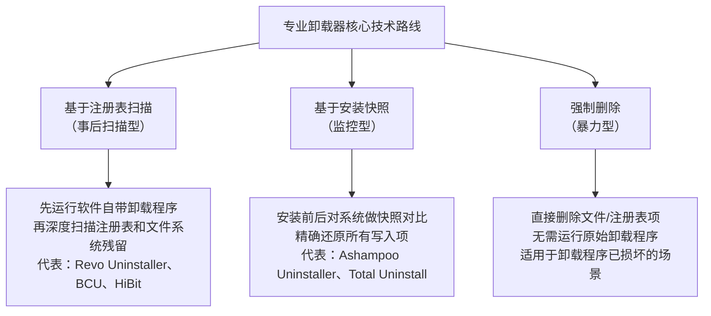
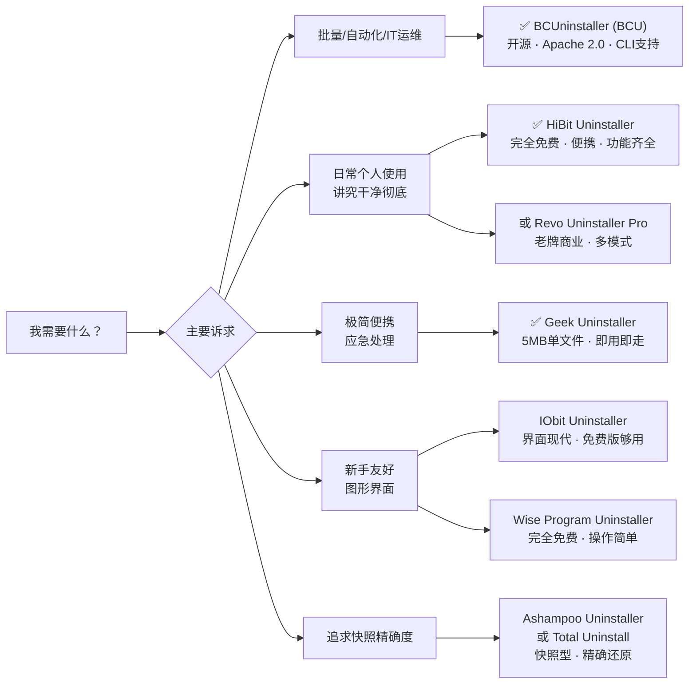

[toc]

## Windows平台专业软件卸载器全景盘点

> **知识截止日期：** 2026年10月（基于本轮联网搜索）
> **信息来源：** TechRadar、MajorGeeks、FossHub、Neowin、腾讯云开发者社区、知乎等权威技术媒体及社区平台

---

### 为什么需要专业卸载器？

电脑卸载软件时，仅通过系统自带的卸载程序往往无法彻底清理残留文件和注册表项，长期积累可能导致系统变慢或隐私泄露。专业卸载器（Uninstaller）的核心价值在于：

- **深度扫描残留**：清理注册表键值、`AppData`目录、用户数据等隐藏残留
- **强制卸载（Forced Uninstall）**：处理损坏、拒绝正常卸载的顽固软件
- **批量卸载（Batch Uninstall）**：一次性处理多个应用，提高效率
- **安装监控（Installation Monitor）**：在安装阶段就记录所有写入，确保后续卸载无痕
- **捆绑软件识别**：检测并清理随主程序附带的流氓插件

---

### 工作原理分类

不同方案采用不同的技术路线，理解这一点有助于选型：

**监控型**精度最高但需提前部署；**注册表扫描型**适合事后处理，覆盖面最广；**强制删除型**是最后手段，风险相对较高，建议配合系统还原点使用。

---

### 主流方案横向对比总览

衡量卸载器软件的维度包括：功能特性、清理有效性、附带工具、定价，以及能否最彻底地移除程序残留。

| 工具名称                     | 开源/免费  | 便携版 | 强制卸载 | 批量卸载    | 安装监控 | 残留深度扫描 | 适用人群           | 定价参考           |
| ---------------------------- | ---------- | ------ | -------- | ----------- | -------- | ------------ | ------------------ | ------------------ |
| **BCUninstaller (BCU)**      | 开源免费   | ✅      | ✅        | ✅(核心功能) | ✅        | ✅            | 高级用户/IT管理员  | 完全免费           |
| **HiBit Uninstaller**        | 免费闭源   | ✅      | ✅        | ✅           | ✅        | ✅            | 普通用户～进阶用户 | 完全免费           |
| **Geek Uninstaller**         | 免费(个人) | ✅      | ✅        | ✅           | ❌        | ✅(基础)      | 追求极简的用户     | 免费/Pro约$25      |
| **Revo Uninstaller**         | 免费版受限 | ✅(Pro) | ✅        | ✅(Pro)      | ✅(Pro)   | ✅            | 家庭用户～进阶     | 免费/Pro订阅或买断 |
| **IObit Uninstaller**        | 免费版可用 | ❌      | 仅Pro    | ✅           | ✅(Pro)   | ✅            | 普通用户/新手      | 免费/Pro约¥100/年  |
| **Wise Program Uninstaller** | 完全免费   | ✅      | ✅        | 有限        | ❌        | ✅(基础)      | 新手/轻量需求      | 完全免费           |
| **Ashampoo Uninstaller**     | 付费为主   | ❌      | ✅        | ✅           | ✅(快照)  | ✅            | 注重精确度的用户   | 付费(免费版有限)   |
| **Total Uninstall**          | 付费       | ❌      | ✅        | ✅           | ✅(快照)  | ✅            | 专业级用户         | 约$29.99           |
| **Advanced Uninstaller PRO** | 免费试用   | ❌      | ✅        | ✅           | ✅        | ✅            | 全功能需求用户     | 约$29.99起         |

---

### 各方案详解

#### BCUninstaller（BCU）—— 开源首选，批量之王

BCUninstaller（BCU）是一款免费、开源的批量软件卸载与系统清理工具，专为大规模应用管理和深度残留清理而设计，面向系统管理员、IT支持工程师和高级桌面用户。

它不仅涵盖常规已安装应用，还能聚合便携应用、Microsoft Store（UWP）应用、Steam/Oculus游戏及Windows更新，统一在一个界面中管理。

BCUninstaller具备数字证书验证、自定义正则表达式（Regex）过滤，以及强大的命令行接口（CLI），可用于无人值守的远程批量部署。

项目基于Apache 2.0开源协议，可免费用于私人和商业场景。在GitHub上已获得超过21,000颗星，是C#桌面工具中人气最高的项目之一。

版本路线清晰：v6面向Windows 10及以上，依赖.NET 8；v5支持Windows 7 SP1；4.x分支甚至支持Windows XP。

**核心优势：**
- 与许多竞品将深度清理功能锁在付费版不同，BCU在不收费的情况下提供完整的残留扫描、隐藏应用检测和静默卸载支持。
- 内置碰撞防御逻辑、智能静默/无人值守卸载排序，以及自动残留扫描，可清理孤立注册表键值、空目录和遗留用户数据。
- 包含**启动项管理器（Startup Manager）**，可直接在程序列表旁管理开机自启项，无需进入任务管理器或`msconfig`。

**适用场景：** OEM预装bloatware批量清理、IT运维批量重置工作站、CI/CD流水线中的自动化软件管理。

**获取：** [github.com/Klocman/Bulk-Crap-Uninstaller](https://github.com/Klocman/Bulk-Crap-Uninstaller)

---

#### HiBit Uninstaller —— 功能全面，完全免费，强烈推荐

HiBit Uninstaller由HiBitSoft开发，是一款免费的Windows程序卸载与残留清理工具，专注于彻底移除顽固应用和内置Windows组件，帮助清除卸载后的残留文件和游离注册表项。

安装版和便携版共享完整功能集，不存在人为限制。

HiBit还附带了丰富的辅助工具，包括：进程管理器（Process Manager）、系统还原管理器、服务管理器、上下文菜单管理器、空文件夹清理器、垃圾文件清理器、启动项管理器、快捷方式修复器、注册表清理器和文件粉碎器。

内置注册表清理器可检测并修复超过13种注册表错误，如过时的使用日志和错误的程序安装路径。

**适用人群：** 推荐给需要可靠卸载器且具备高级清理和故障排除功能的Windows用户，既适合希望简单删除残留文件的普通用户，也适合需要便携工具进行系统修复和维护的IT专业人员。

**获取：** [hibitsoft.ir](https://hibitsoft.ir/)（官网） 或 MajorGeeks搜索HiBit Uninstaller

---

#### Geek Uninstaller —— 极简便携，单文件绿色运行

Geek Uninstaller专为彻底移除Windows PC上的不需要软件而设计，以简洁高效见长，能处理顽固或难以移除的应用，并提供简洁直观的界面，追求无障碍的卸载流程。

Geek Uninstaller单文件绿色运行，体积仅约5MB。

- Geek Uninstaller是一款免费便携卸载器，扫描速度很快，并提供"Google识别"选项帮助用户了解不认识的程序。
- 缺点：免费版不支持深度扫描（Deep Scan），该功能被锁定在Pro版（约$25终身授权）中。

**适用场景：** 临时维修他人电脑、放在U盘随身携带作为急救工具。

**获取：** [geekuninstaller.com](https://geekuninstaller.com/)

---

#### Revo Uninstaller —— 老牌专业，多模式卸载

Revo Uninstaller以其高级功能脱颖而出，提供**快速卸载（Quick Uninstall）**和**强制卸载（Forced Uninstall）**等多种卸载模式，可移除最顽固的软件残留。

Revo的三级卸载流程（参考前述原理图的注册表扫描路线）是其经典标志：先执行软件内置卸载程序，再深度检查注册表项（Current User/Classes Root等）、程序文件目录和用户数据目录，最后安全移除识别出的残留。强制卸载功能特别适用于卸载失败报错、控制面板中不显示、部分安装的残留，或损坏的安装程序。

**注意：** 免费版功能受限（无实时监控、无批量卸载），功能完整体验需Pro版（订阅或买断）。

**获取：** [revouninstaller.com](https://www.revouninstaller.com/)

---

#### IObit Uninstaller —— 界面现代，新手友好

IObit Uninstaller是综合能力最强的卸载器之一，可彻底扫描系统，移除残留文件、损坏的注册表项，乃至浏览器扩展。

IObit将已安装软件分为：捆绑软件、最近安装软件、占用大量空间的软件、不常用软件等多个分类，用户可快速定位目标，对装了大量软件的用户尤为方便。

**注意事项：**
- 安装时会推荐IObit全家桶，需手动取消勾选；扫描深度略浅于Revo。
- 强制卸载功能仅Pro版可用。
- 免费版已能覆盖大部分用户约90%的使用场景。

**获取：** [iobit.com](https://www.iobit.com/en/advanceduninstaller.php)

---

#### Wise Program Uninstaller —— 轻量免费，新手入门

曾获CNET、ZDNet等知名媒体编辑推荐奖的Wise Program Uninstaller，是一款轻量级Windows程序卸载软件，由WiseCleaner出品，具有安全卸载和强制卸载两种模式，卸载完成后会自动弹出注册表清理程序，可按类型区分软件减少误删。

Wise Program Uninstaller是便携应用，不必担心其自身留下残留，体积轻巧、运行迅速。

---

#### Ashampoo Uninstaller / Total Uninstall —— 快照精确型代表

Ashampoo Uninstaller的免费版本没有任何功能限制，但使用过程中会提示升级到最新付费版本（目前官方最新为Ashampoo Uninstaller 10）。

这类工具的核心卖点是**安装快照（Snapshot）技术**：在软件安装前后分别对系统状态取快照，通过差异对比精确还原所有写入操作，是理论上最干净的卸载方式，但需要提前部署监控，不适合事后补救。

---

### 选型决策指南

**综合推荐总结：**

| 场景                               | 首选推荐                        | 理由                                    |
| ---------------------------------- | ------------------------------- | --------------------------------------- |
| **开源爱好者 / IT运维批量**        | **BCUninstaller (BCU)**         | 完全开源、Apache 2.0、CLI、批量无人值守 |
| **个人用户日常首选（免费全功能）** | **HiBit Uninstaller**           | 免费无阉割、便携、工具箱丰富            |
| **极简急救/U盘随身**               | **Geek Uninstaller**            | 5MB单文件，扫描极快                     |
| **新手/不想折腾**                  | **IObit Uninstaller（免费版）** | 界面现代，捆绑识别好                    |
| **需要快照精确还原**               | **Ashampoo Uninstaller**        | 快照技术，卸载最干净                    |
| **商业专业级**                     | **Revo Uninstaller Pro**        | 老牌可靠，多模式                        |

---

### 通用最佳实践

1. **操作前创建系统还原点**：`sysdm.cpl` → 系统保护，防止误删关键注册表项。
2. **卸载残留审查要谨慎**：深度扫描结果中，对于不确定的注册表项不要全选删除，尤其是共享键值（如`HKLM\SOFTWARE\Microsoft`下的系统键）。
3. **批量卸载场景优先用BCU**：避免手动逐一处理的效率低下，也避免遗漏。
4. **安装监控最干净**：对于生产机器或需要精确还原的场景，在安装软件前就开启Ashampoo/Total Uninstall的监控功能，后续卸载精度最高。
5. **国内网络下载建议**：BCU和HiBit均可在GitHub Release页获取，如访问受限可通过 `gh-proxy.com` 包裹原链接加速下载，或直接在[FossHub](https://www.fosshub.com/Bulk-Crap-Uninstaller.html)等镜像站获取BCU。