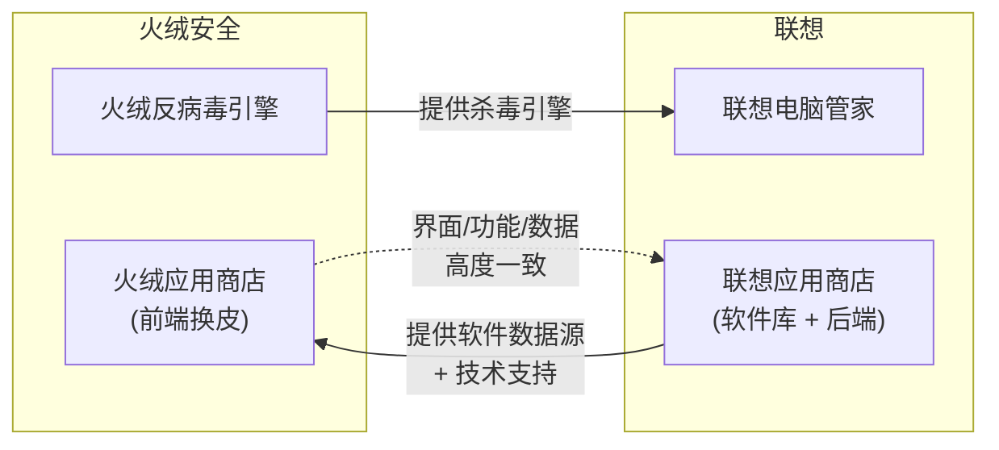
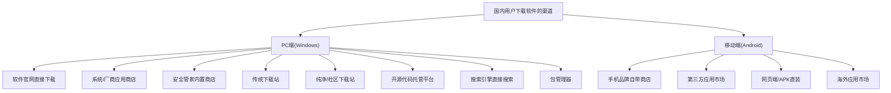

[toc]


## 联想应用商店与火绒应用商店的关系：确有依据

### 核心结论：火绒应用商店 = 联想应用商店"换皮"

你的观察完全正确，且有**官方确认**和**多方佐证**。

火绒官方人员做出了解释：**火绒应用商店为与联想合作开发**。

火绒应用商店官网页面底部明确标注了"**联想应用商店提供技术支持**"。

### 合作背景

二者的合作并非偶然，而是有深层的**双向业务关联**：

1. **联想电脑管家使用火绒引擎**：联想电脑管家使用火绒引擎，现在大概是火绒招架不住用户不停地要求做应用商店，所以也找联想合作一波拿联想应用商店换了个皮。

2. **火绒本身不想做商店**：火绒完全不想做商店，但耐不住有不少用户不停地催火绒要做个应用商店。而联想电脑管家使用火绒引擎，现在火绒拿联想应用商店换个皮肤做个商店，也解决了长期以来用户的催更。

这种合作本质上是一种**资源互换**：联想向火绒提供杀毒引擎的商业合作费用/授权，火绒反过来借用联想已有的应用商店基础设施，避免从零搭建。

### 具体相似之处

| 维度                   | 说明                                                         |
| ---------------------- | ------------------------------------------------------------ |
| **界面布局**           | 从软件图标到功能布局，甚至是首页推广横幅图片，几乎一模一样。 |
| **软件来源（数据源）** | 数据主要都还是来自联想软件商店。                             |
| **功能模块**           | 和之前传闻一样，火绒应用商店是基于联想应用商店改的，相当于换个皮肤，其他功能模块基本都是相同的。 |
| **退款流程**           | 在火绒应用商店里下载了付钱了，退款还得再下载一个联想应用商店（"联想应用商店-订单中心"进行退款）。 |
| **下载量数据**         | 里面的下载次数数据大概率是掺水的，一些合作软件的下载次数虚高。 |
| **账号体系**           | 内容较全，除了没账号基本一样。（火绒版去掉了联想账号登录）   |

### 社区评价与争议

社区对此合作的评价**两极分化**：

- **正面**：解决了用户长期以来对火绒应用商店的需求，且作为独立可选组件不强制集成
- **负面**：简单来说，就是套壳联想应用商店，包括软件源也是照搬联想的。这就导致了一个问题，很多网友吐槽，里面推荐的软件，实在有点流氓。例如联想自家产品排名靠前、收费软件推广位过多等。

> 值得注意的是，火绒威胁情报中心自己的报告中也提到：以鲁大师为例：其官网渠道需等待24小时后才会进行推广，而 lx_store（联想应用商店）渠道则无冷却期，安装后会立即推广。这说明联想应用商店渠道本身在某些软件的推广策略上较为激进。

### 关系示意图



---

## 国内普通用户下载软件的方法盘点

下面从**PC 端（Windows）**和**移动端（Android）**两个维度系统梳理国内用户获取软件的主要渠道。

### 整体渠道分类框架



---

### PC 端（Windows）渠道详解

#### 一、软件官网直接下载

**最推荐但门槛最高的方式**。下载软件时，尽量访问软件的**官方网站**，确保下载的是正版无篡改的软件。

**优点**：版本最新、无捆绑、可验证完整性

**痛点与风险**：

- 存在着官网打不开或下载速度缓慢等问题。
- 搜索引擎竞价排名导致**假官网（李鬼官网）**排在真官网前面，在数字化时代，下载软件和应用是常见的操作，然而却也面临着多重风险，例如带毒下载站、下载器，以及李鬼官网。
- 部分海外软件官网在国内访问速度不佳（如 GitHub Releases 下载慢），需要借助加速方案（如 `ghproxy.com` 等镜像代理，或本地 mihomo 代理）

**实践建议**：

- 优先通过**书签收藏**真正的官网地址
- 对于重要软件，下载后可通过文件哈希值（如 MD5、SHA256）验证文件完整性。
- 开源软件官网通常在 GitHub/GitLab 上有项目主页，认准 `github.com/组织名/项目名` 格式

#### 二、系统/厂商应用商店

| 商店                 | 说明                                                         | 适用场景           |
| -------------------- | ------------------------------------------------------------ | ------------------ |
| **Microsoft Store**  | Windows 系统内置，沙盒化安装，安全性最高；但软件数量有限，部分专业软件未上架 | 日常办公、UWP 应用 |
| **联想应用商店**     | 联想电脑官方提供的软件下载平台，内嵌于联想电脑管家，软件数量较多 | 联想电脑预装用户   |
| **火绒应用商店**     | 如前所述，与联想应用商店数据同源，独立安装                   | 火绒用户           |
| **华为电脑应用市场** | 华为 MateBook 系列预装，近年也在扩充生态                     | 华为 PC 用户       |

#### 三、安全管家/杀毒软件内置商店

这是国内**最大众化**的 PC 软件下载渠道之一，因为安全管家的装机率极高。

| 平台              | 说明                                                         |
| ----------------- | ------------------------------------------------------------ |
| **360 软件宝库**  | 360 软件宝库提供了数十类超过十万款的软件资源下载，所有的软件都通过 360 安全中心检测。内置于 360 安全卫士，用户量巨大 |
| **腾讯软件中心**  | 腾讯软件中心拥有海量免费软件，全部软件都已经过平台安全杀毒检测。可通过腾讯电脑管家的应用管理使用 |
| **火绒应用商店**  | 独立可选组件，数据来自联想                                   |
| **2345 软件大全** | 老牌下载平台，但捆绑问题较严重，不推荐                       |

> **注意**：安全管家内置商店虽然方便，但存在**推广位商业化**的问题——部分商店会将付费合作软件排在前列，甚至下载量数据不透明。用户需要自行辨别。

#### 四、传统综合下载站

这是中国互联网**最古老**的软件分发方式之一，代表了 Web 1.0 时代的产物。华军软件园、天空下载、太平洋下载、ZOL 下载、西西软件园等均属此类。

| 下载站             | 特点                                                         |
| ------------------ | ------------------------------------------------------------ |
| **华军软件园**     | 元老级，资源库大                                             |
| **天空下载站**     | 与华军齐名的元老级下载站，资源库巨大，软件分类清晰，尤其在系统工具、驱动程序等方面具有优势。 |
| **ZOL 软件下载**   | 中关村在线旗下，偏向硬件驱动+常用软件                        |
| **太平洋下载中心** | 太平洋电脑网旗下                                             |

**核心风险**：许多用户都曾经历过第三方软件下载网站的"高速下载"陷阱，稍有不慎就会被安装上一堆无用的垃圾软件。

**防坑指南**：在下载页面中不要选择"立即下载"，千万选择"更多下载地址"；下载地址中不要选择"高速下载地址"。所谓"高速下载"实际上是先下载一个**下载器**（P2P 小程序），这个下载器会捆绑安装其他软件。

#### 五、纯净/社区型下载站（推荐）

近年来涌现的**以纯净为卖点**的下载站和资源聚合博客，深受进阶用户喜爱：

| 站点                                | 说明                                                         |
| ----------------------------------- | ------------------------------------------------------------ |
| **果核剥壳** (`www.ghxi.com`)       | 果核剥壳是国内知名纯净软件分享站，提供绿色版、便携版、去广告版软件 |
| **423Down** (`www.423down.com`)     | "互联网的净土"，知名绿色软件分享站点，专注提供绿色版/去广告版/便携版软件。 |
| **软仓** (`ruancang.net`)           | 软仓上下载的软件解压密码，统一为网站域名 `ruancang.net`，使用百度网盘分发。 |
| **I Tell You** (`next.itellyou.cn`) | 专注 Windows/Office 等微软官方原版镜像下载                   |
| **Downloadly**                      | 比较受欢迎的国外软件下载网站，对于一些在国内软件网站查找不到的软件可以在此查找。 |
| **阿虚同学的储物间**                | 资源聚合导航类站点                                           |
| **PortableApps**                    | 类似于一个绿色软件的应用商店平台，可以通过这个工具来方便快捷地安装管理各种绿色软件。 |

#### 六、开源代码托管平台

| 平台       | 说明                                                         |
| ---------- | ------------------------------------------------------------ |
| **GitHub** | GitHub 是一个知名的代码托管平台，内容丰富，大量开源软件在此发布 Release。国内访问可能需要加速 |
| **Gitee**  | 国内 GitHub 替代平台，部分国产开源项目首发于此               |

**国内加速方案**：
- 使用 `ghproxy.com` 等 GitHub 文件加速代理
- 通过 mihomo 等本地代理工具
- 部分项目会同步发布到国内网盘（蓝奏云、阿里云盘等）

#### 七、搜索引擎直接搜索

这是普通用户**最常用但风险最高**的方式。搜索"XX软件下载"时，排名靠前的结果往往是：

1. **竞价广告**位：可能指向假官网或捆绑下载站
2. **SEO 优化过的下载站**：各类"XX 之家""XX 下载"

**建议**：使用搜索引擎时，注意辨认广告标识；或直接搜索 `软件名 + 官网` / `软件名 + site:github.com` 等方式精准定位。

#### 八、包管理器（进阶用户）

面向有一定技术背景的用户，**命令行**安装软件，自动解决依赖和更新：

| 工具                   | 平台          | 说明                                               |
| ---------------------- | ------------- | -------------------------------------------------- |
| **winget**             | Windows 10/11 | 微软官方包管理器，`winget install 软件ID` 即可安装 |
| **Scoop**              | Windows       | 社区驱动，偏向开发者和命令行工具，安装绿色/便携版  |
| **Chocolatey**         | Windows       | 老牌 Windows 包管理器，软件库丰富                  |
| **apt / dnf / pacman** | Linux         | 各发行版自带，生态最成熟                           |
| **Homebrew**           | macOS / Linux | macOS 事实标准，也支持 Linux                       |

**winget 示例**（Windows 下最推荐的自动化方式）：

```powershell
# 搜索软件
winget search "Visual Studio Code"
# 安装
winget install Microsoft.VisualStudioCode
# 批量升级所有已安装软件
winget upgrade --all
```

> 包管理器的优势在于**可脚本化、可复现**，适合多台设备统一部署。例如新装机时，可以编写一个包含所有常用软件 ID 的脚本一键安装。

---

### 移动端（Android）渠道详解

#### 一、手机品牌自带应用商店（主流渠道）

十大安卓应用商店排名包括应用宝、华为应用市场、小米应用商店、OPPO 软件商店、vivo 应用商店、百度手机助手、360 手机助手、豌豆荚、酷安应用商店和魅族应用商店。

| 品牌商店          | 说明                                                         |
| ----------------- | ------------------------------------------------------------ |
| **华为应用市场**  | 华为终端官方应用分发平台，拥有海量的绿色、安全、免费的软件以及游戏。 |
| **小米应用商店**  | 小米旗下手机用户的软件商店，提供经过严格检测的软件资源。     |
| **OPPO 软件商店** | OPPO 官方推出的正版安全 APP 下载渠道，所有资源均经过机器检测和人工亲测。 |
| **vivo 应用商店** | vivo 手机上自带的应用商店，同时也支持其他品牌手机安装运行。  |

> **注意**：各品牌应用商店的**收录范围不完全一致**，每个手机市场收录的应用不尽相同，很多应用在手机自带的应用商店没有收录，但是会被其他市场所收录。甚至部分品牌商店会屏蔽竞争对手的应用商店（如小米应用商店搜索不到酷安）。

#### 二、第三方应用市场

| 平台       | 说明                                                         |
| ---------- | ------------------------------------------------------------ |
| **应用宝** | 腾讯应用中心倾力打造，以丰富、优质、安全、个性化的安卓软件游戏资源著称。 |
| **酷安**   | 以用户社区和评价闻名，偏向数码极客群体，可以找到小众应用     |
| **豌豆荚** | 拥有超过 200 万个安卓应用和安卓游戏免费下载资源。网页版提供历史版本下载 |

豌豆荚和酷安的网页版可用性依然很强。但需要注意的问题是避开客户端的下载引导——需要取消勾选"需优先下载豌豆荚安装"选项。

#### 三、海外应用市场

| 平台            | 说明                                                         |
| --------------- | ------------------------------------------------------------ |
| **Google Play** | 全球最大 Android 应用市场，需要网络代理才能在国内正常访问和下载 |
| **APKMirror**   | 第三方 APK 镜像站，提供 Google Play 上架应用的原始 APK，免登录下载 |
| **APKPure**     | 类似 APKMirror，有自己的客户端                               |
| **F-Droid**     | 专注**自由开源软件 (FOSS)** 的应用市场，适合隐私敏感用户     |

---

### 渠道安全性与推荐度总览

| 渠道类型                      | 安全性 | 软件丰富度 | 便利性     | 推荐度   | 典型用户         |
| ----------------------------- | ------ | ---------- | ---------- | -------- | ---------------- |
| **软件官网**                  | 最高   | 单一       | 中等       | 最推荐   | 所有用户         |
| **Microsoft Store**           | 很高   | 较少       | 很高       | 推荐     | 日常用户         |
| **包管理器** (winget等)       | 很高   | 较多       | 高(熟悉后) | 强烈推荐 | 进阶/IT 用户     |
| **纯净下载站** (果核等)       | 较高   | 较多       | 高         | 推荐     | 进阶用户         |
| **安全管家商店** (360/腾讯等) | 中高   | 多         | 很高       | 一般推荐 | 小白用户         |
| **联想/火绒应用商店**         | 中等   | 较多       | 高         | 一般     | 对应生态用户     |
| **传统下载站** (华军等)       | 中低   | 很多       | 中等       | 谨慎使用 | 不得已时         |
| **搜索引擎直接搜索**          | 最低   | -          | 最高       | 不推荐   | 小白用户(高风险) |
| **手机品牌商店**              | 高     | 较多       | 最高       | 推荐     | 手机用户         |
| **GitHub Releases**           | 最高   | 开源为主   | 中等       | 强烈推荐 | 开发者/极客      |

---

### 给普通用户的实用建议

1. **养成官网意识**：收藏常用软件的真正官网地址，避免搜索引擎陷阱
2. **善用 winget**：Windows 10/11 用户建议学习 `winget`，一行命令即可安装/更新，无捆绑风险
3. **远离"高速下载"按钮**：传统下载站中的高速下载几乎都是捆绑下载器
4. 使用安全软件：安装后，用杀毒软件扫描文件，确保无病毒木马。
5. **移动端尽量用品牌自带商店 + 酷安补充**：品牌商店审核相对严格，酷安可覆盖小众应用
6. **开源软件优先去 GitHub/Gitee**：版本最新、最干净，配合加速方案解决下载速度问题

---

> **信息依据与知识截止说明**：
> - 联想-火绒合作关系信息主要来源于：蓝点网 (landiannews.com)、火绒官网 (huorong.cn)、知乎用户讨论、系统迷 (xitmi.com) 等渠道，时间跨度为 2023 年 9 月至 2026 年
> - 国内下载渠道信息综合了：买购网 (maigoo.com) 2026 年排名、知乎盘点文章（更新至 2026 年 4 月）、CSDN 博客、少数派 (sspai.com) 等来源
> - 本回答知识截止日期：**2026 年 9 月**