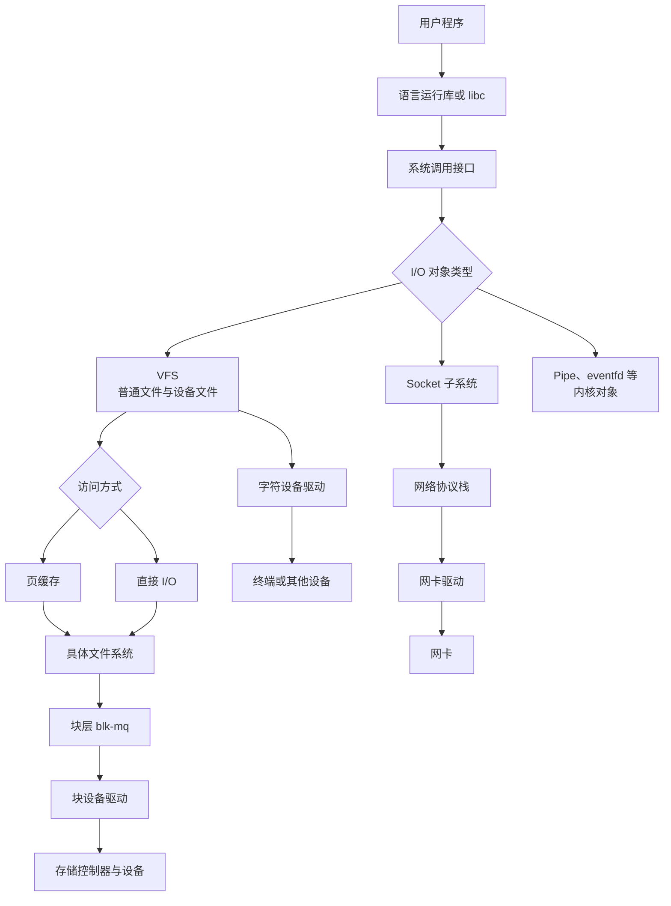
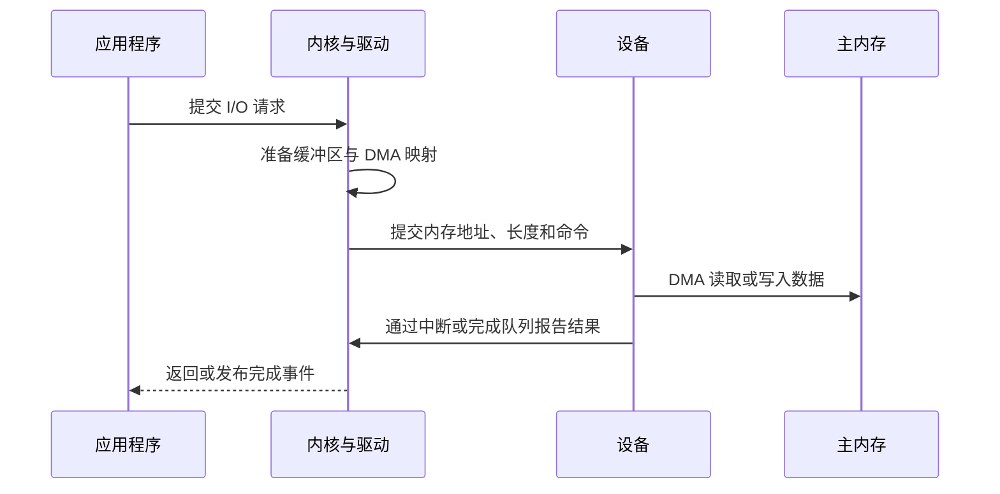
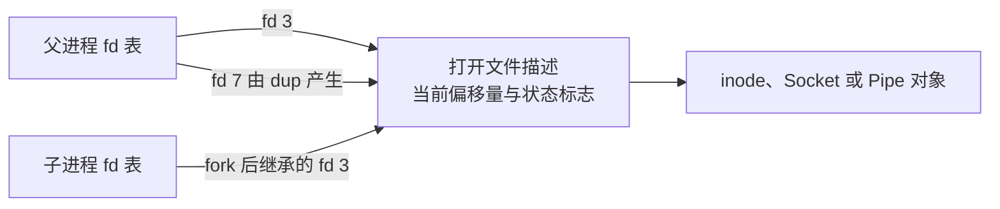
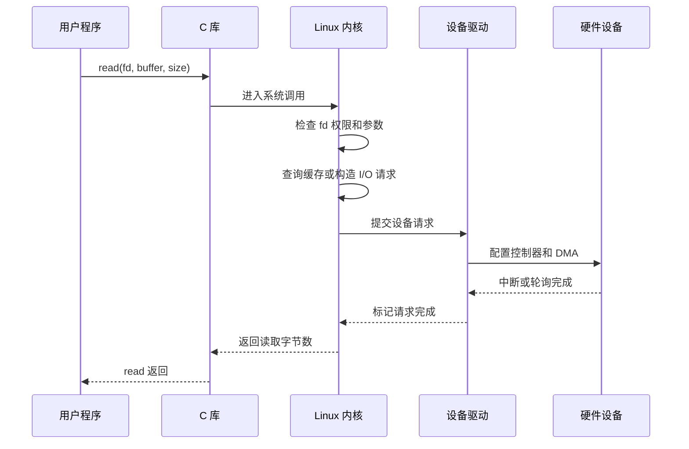
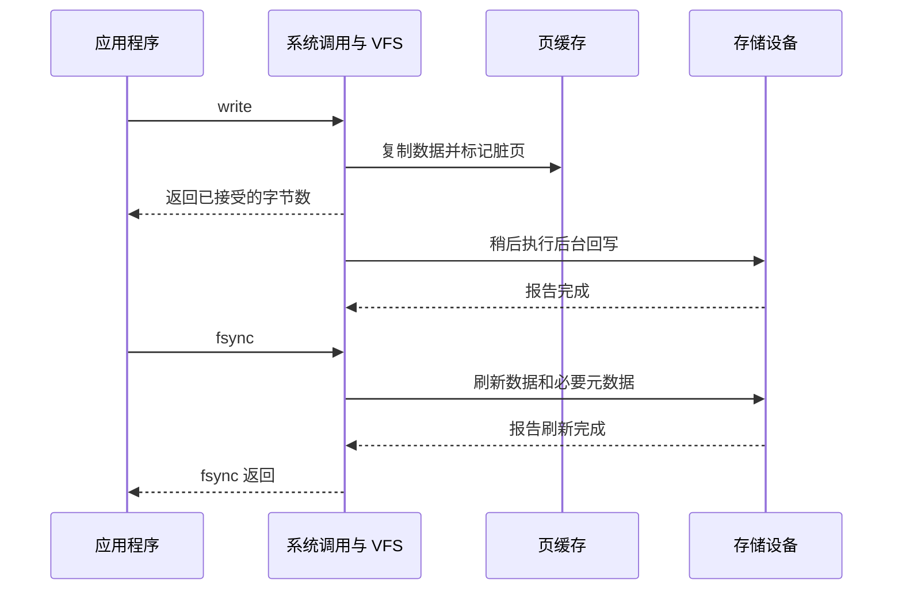
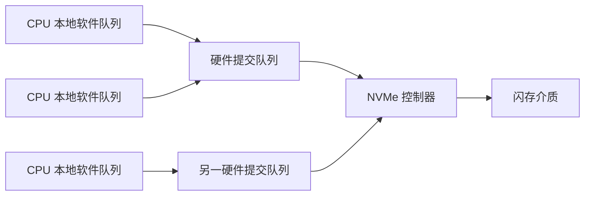
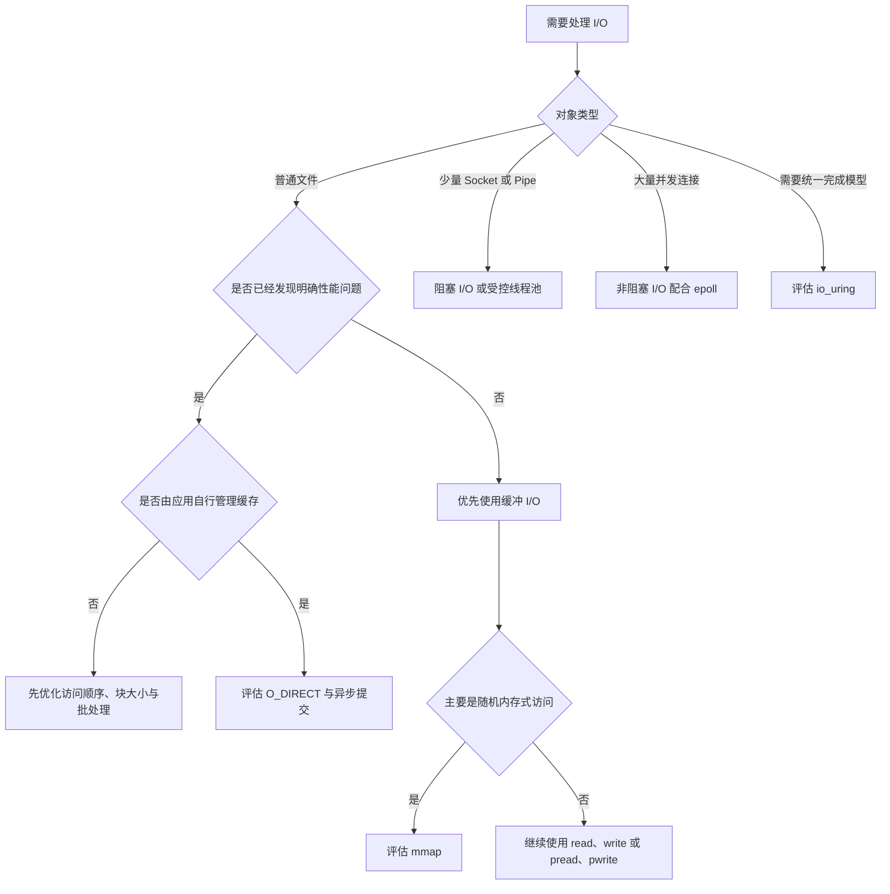

[toc]

## abstract

计算机操作系统中的IO,以linux系统为例.

I/O 是 Input/Output 的缩写，表示程序与外部世界交换数据的过程。这里的“外部”不仅包括磁盘，还包括网络、终端、键盘、管道、设备、内核事件源等。

> 应用程序如何表达 I/O 请求，内核如何抽象对象、缓存数据、调度请求，设备如何完成传输，以及程序如何判断 I/O 是否真正完成。

建议围绕以下模块学习：

| 模块           | 核心问题                                        | 实践目标                                    |
| -------------- | ----------------------------------------------- | ------------------------------------------- |
| I/O 基本模型   | 什么是设备、控制器、中断、DMA                   | 能画出一次设备 I/O 的基本过程               |
| Linux I/O 抽象 | 文件描述符、VFS、inode、dentry 是什么           | 能解释 `open()` 返回的整数代表什么          |
| 基础系统调用   | `open/read/write/close` 有什么语义              | 能正确处理短读、短写和错误                  |
| 缓冲与缓存     | 用户缓冲、页缓存、设备缓存有什么区别            | 不再把“写成功”等同于“落盘成功”              |
| 文件访问方式   | 缓冲 I/O、直接 I/O、内存映射如何选择            | 能根据场景选择合适方式                      |
| I/O 并发模型   | 阻塞、非阻塞、同步、异步有什么区别              | 理解线程池、`epoll`、`io_uring`             |
| 存储栈         | 文件系统、块层、调度器、驱动如何协作            | 能理解延迟来自哪一层                        |
| 网络 I/O       | Socket 与普通文件 I/O 有什么异同                | 能实现非阻塞网络服务                        |
| 数据持久性     | `fflush`、`fsync`、`fdatasync`、`rename` 的关系 | 能设计崩溃安全的文件更新流程                |
| 高性能技术     | 批处理、零拷贝、向量 I/O、队列深度              | 能避免盲目使用所谓高性能接口                |
| 性能观测       | 怎样判断是应用、缓存、文件系统还是设备慢        | 会使用 `strace`、`iostat`、`pidstat`、`fio` |
| 工程最佳实践   | 如何处理背压、超时、取消、资源泄漏              | 能编写可靠的生产级 I/O 代码                 |

------

## 什么是 I/O

I/O，即 Input/Output，是计算机与自身计算核心之外的对象交换信息的过程。

常见 I/O 对象包括：

| 类型         | 示例                             | 典型特征                           |
| ------------ | -------------------------------- | ---------------------------------- |
| 持久化存储   | HDD、SSD、NVMe、USB 存储         | 延迟远高于内存，需要考虑持久性     |
| 网络         | TCP、UDP、Unix Domain Socket     | 数据由远端产生，延迟和可用性不确定 |
| 字符设备     | 终端、串口、传感器               | 常表现为字节流或设备自定义协议     |
| 块设备       | 磁盘、逻辑卷                     | 可按块随机访问，进入 Linux 块层    |
| 进程间通信   | Pipe、FIFO、Socket               | 数据通常只存在于内核内存           |
| 内核事件对象 | `eventfd`、`timerfd`、`signalfd` | 把事件转换成可读取的文件描述符     |
| 用户输入输出 | 键盘、鼠标、显示设备             | 通常由专门子系统和驱动管理         |

I/O 的困难主要来自几个方面：

- CPU 和设备速度差异巨大。
- 设备可能暂时不可用。
- 请求可能排队、乱序或失败。
- “请求已接收”“数据已复制”“设备已完成”“数据已持久化”是不同阶段。
- 多个进程或线程可能同时访问同一对象。
- 性能优化经常与可靠性、资源消耗和程序复杂度冲突。

------

## Linux I/O 的总体结构

Linux 并不存在一条适用于所有 I/O 的唯一通路。文件、网络和设备控制会经过不同的内核子系统，但通常都以文件描述符作为用户空间入口。



VFS，即虚拟文件系统，是 Linux 内核中的文件系统抽象层。它让 ext4、XFS、Btrfs、tmpfs、NFS 等不同文件系统能够向用户空间提供相近的 `open()`、`read()`、`write()`、`stat()` 接口。路径查找会使用 dentry 缓存，打开后的内核文件对象则保存操作方法、当前位置和状态信息。([docs.kernel.org](https://docs.kernel.org/filesystems/vfs.html))

------

## 硬件层面的 I/O 工作机制

### 设备控制器与设备寄存器

CPU 通常不直接理解 SSD、网卡或键盘的内部协议。设备控制器或设备自身会暴露一组寄存器，例如：

- 状态寄存器：设备是否忙、是否发生错误。
- 命令寄存器：要求设备执行读取、写入、复位等操作。
- 数据寄存器：传递少量数据。
- 队列地址寄存器：告诉设备请求队列位于哪块内存。
- 中断控制寄存器：控制何时通知 CPU。

现代设备普遍使用内存映射 I/O，也就是把部分 CPU 地址空间解释为设备寄存器，而不是普通 RAM。Linux 驱动不会直接解引用物理地址，而会通过 `ioremap()` 及专用访问函数操作这些区域。([docs.kernel.org](https://docs.kernel.org/driver-api/device-io.html))

这里的“内存映射 I/O”不要和应用程序使用 `mmap()` 映射文件混为一谈：

| 名称          | 含义                             |
| ------------- | -------------------------------- |
| 设备 MMIO     | CPU 通过特殊地址读写设备寄存器   |
| 文件 `mmap()` | 把文件内容映射进进程虚拟地址空间 |
| DMA 映射      | 为设备建立访问内存所需的地址映射 |

### 轮询

轮询是 CPU 反复检查设备状态：

```text
提交请求
检查设备是否完成
如果未完成，继续检查
处理结果
```

优点是响应延迟可控，避免中断处理开销。缺点是设备较慢或负载较低时会浪费 CPU。

高性能 NVMe、网络包处理和低延迟系统有时会使用轮询，但它不是默认的通用答案。

### 中断

使用中断时，CPU 提交请求后可以去执行其他任务。设备完成后，通过中断控制器通知 CPU，内核再调用对应驱动处理完成事件。

Linux 的通用 IRQ 层屏蔽了不同中断控制器之间的差异，使驱动能够通过统一接口申请、启用和释放中断。([docs.kernel.org](https://docs.kernel.org/core-api/genericirq.html))

中断也有成本：

- CPU 当前执行流会被打断。
- 需要保存和恢复部分执行状态。
- 中断过多可能造成“中断风暴”。
- 多核环境需要考虑中断亲和性和缓存局部性。

因此现代设备经常结合以下技术：

- 中断合并：完成多个请求后再通知一次。
- 多队列：不同 CPU 使用不同硬件队列。
- 自适应轮询：低延迟时轮询，空闲时使用中断。

### DMA

DMA，即直接内存访问，允许设备在无需 CPU 逐字节搬运的情况下直接读写内存。

典型过程是：



设备看到的是 DMA 地址或总线地址，不一定等于 CPU 物理地址。IOMMU 可以在 DMA 地址与物理内存之间建立映射，从而提供隔离、重映射和访问控制。Linux 驱动应使用统一 DMA API，而不是假定总线地址等于物理地址。([docs.kernel.org](https://docs.kernel.org/core-api/dma-api-howto.html))

------

## 文件描述符：Linux I/O 的核心入口

### 文件描述符是什么

文件描述符，file descriptor，简称 fd，是进程文件描述符表中的一个非负整数索引。

常见约定：

| fd   | 传统含义 |
| ---- | -------- |
| `0`  | 标准输入 |
| `1`  | 标准输出 |
| `2`  | 标准错误 |

下面的对象都可以通过文件描述符引用：

- 普通文件
- 目录
- 管道
- Socket
- 终端
- 字符设备和块设备
- `eventfd`
- `timerfd`
- `signalfd`
- `epoll` 实例

因此，“Linux 中一切皆文件”是一种有用但不完全准确的概括。更准确地说：

> Linux 尽可能把不同内核对象包装为**文件描述符**，使它们能够使用一组相似的生命周期管理、等待和权限机制。

文件描述符可以表示：

| 类型            | 例子                               |
| --------------- | ---------------------------------- |
| 普通文件        | ext4、XFS 上的文件                 |
| 目录            | 通过目录文件描述符进行相对路径操作 |
| 设备            | `/dev/nvme0n1`、`/dev/tty`         |
| 网络套接字      | TCP、UDP、Unix Domain Socket       |
| 管道            | pipe、FIFO                         |
| 内核事件源      | `eventfd`、`timerfd`、`signalfd`   |
| I/O 事件集合    | epoll 实例                         |
| 异步 I/O 上下文 | io_uring 实例                      |

### fd 与打开文件描述之间的区别

`open()` 不只是返回一个数字。内核会创建一个打开文件描述，即 open file description，其中包含：

- 当前文件偏移量
- 文件状态标志，例如 `O_APPEND`
- 对底层文件对象的引用
- 对具体操作方法的引用

文件描述符只是对它的引用。`dup()` 产生的新 fd，以及 `fork()` 后继承的 fd，可能指向同一个打开文件描述，因此也可能共享文件偏移量。([man7.org](https://man7.org/linux/man-pages/man2/open.2.html))



这解释了一个常见问题：

```c
read(fd, buf1, 100);
read(fd, buf2, 100);
```

第二次读取通常从第一次读取后的偏移量继续。

多线程需要在固定位置读写时，优先使用：

```c
pread(fd, buf, size, offset);
pwrite(fd, buf, size, offset);
```

`pread()` 和 `pwrite()` 使用显式偏移量，不修改共享的当前文件偏移，因此特别适合并发访问。([man7.org](https://man7.org/linux/man-pages/man2/pread.2.html?utm_source=chatgpt.com))


### 使用 `O_CLOEXEC`

创建文件描述符时通常应原子地设置 close-on-exec：

```c
int fd = open(path, O_RDONLY | O_CLOEXEC);
```

这可以避免多线程程序中，一个线程创建 fd、另一个线程同时执行 `fork()` 和 `exec()` 时发生文件描述符泄漏。事后再调用 `fcntl()` 设置标志会留下竞态窗口。([man7.org](https://man7.org/linux/man-pages/man2/open.2.html))

类似地，应优先使用：

- `socket(..., SOCK_CLOEXEC, ...)`
- `accept4(..., SOCK_CLOEXEC)`
- `pipe2(..., O_CLOEXEC)`
- `epoll_create1(EPOLL_CLOEXEC)`

### dentry、inode 与 struct file

| 对象          | 主要作用                                       |
| ------------- | ---------------------------------------------- |
| dentry        | 表示路径中的一个目录项，将名称关联到 inode     |
| inode         | 表示文件系统对象及其元数据，如类型、权限、大小 |
| `struct file` | 表示一次打开操作，保存偏移量、状态及操作函数   |
| fd            | 用户空间用来引用打开文件对象的整数             |

一个 inode 可以被多个 dentry 指向，例如硬链接；同一个 inode 也可以通过多次 `open()` 产生多个独立的打开文件描述。

## 系统调用与用户态、内核态

应用程序不能直接随意操作设备或内核数据结构，而是通过系统调用请求内核完成工作。

------



系统调用的成本不只是“执行一条特殊指令”，还可能包括：

- 用户态与内核态切换
- 参数与权限检查
- 数据复制
- 页缓存查找
- 文件系统逻辑
- 调度和线程休眠
- 设备请求排队
- 缓存一致性处理

因此，高性能 I/O 常通过批处理、减少复制、减少系统调用次数和提高并发度来优化。


## `open`、`read`、`write`、`close` 的真正语义

### `open`

`open()` 完成路径解析、权限检查，并返回文件描述符：

```c
int fd = open("data.bin", O_RDONLY | O_CLOEXEC);
if (fd == -1) {
    perror("open");
}
```

常见标志：

| 标志         | 含义                                    |
| ------------ | --------------------------------------- |
| `O_RDONLY`   | 只读                                    |
| `O_WRONLY`   | 只写                                    |
| `O_RDWR`     | 读写                                    |
| `O_CREAT`    | 文件不存在时创建                        |
| `O_EXCL`     | 与 `O_CREAT` 配合，要求创建必须是独占的 |
| `O_TRUNC`    | 打开时清空文件                          |
| `O_APPEND`   | 每次写入前原子地定位到文件末尾          |
| `O_NONBLOCK` | 对支持的对象启用非阻塞行为              |
| `O_CLOEXEC`  | 执行新程序时关闭 fd                     |
| `O_DIRECT`   | 尝试绕过页缓存                          |
| `O_SYNC`     | 每次写操作执行同步持久化要求            |

不要手工使用 `access()` 检查权限后再调用 `open()`。两次调用之间文件可能被替换，形成 TOCTOU 竞态。应直接调用 `open()`，并处理它的返回值。

对于需要限制不可信路径解析范围的程序，可以评估 Linux 的 `openat2()`。它提供 `RESOLVE_BENEATH`、`RESOLVE_IN_ROOT`、`RESOLVE_NO_SYMLINKS` 等路径解析限制，可用于降低符号链接和目录逃逸风险。([man7.org](https://man7.org/linux/man-pages/man2/openat2.2.html))

### `read`

```c
ssize_t n = read(fd, buffer, capacity);
```

返回值含义：

| 返回值   | 含义                                                    |
| -------- | ------------------------------------------------------- |
| 大于 `0` | 实际读取的字节数                                        |
| `0`      | 到达 EOF；对于流式 Socket，也可表示对端有序关闭发送方向 |
| `-1`     | 发生错误，具体原因在 `errno`                            |

必须注意：

- 成功读取的字节数可以小于请求长度。
- 信号可能导致 `EINTR`。
- 非阻塞对象暂时无数据时通常返回 `EAGAIN` 或 `EWOULDBLOCK`。
- 对管道、Socket、终端而言，一次读取没有义务填满整个缓冲区。
- 对普通文件而言，读取可能因页缓存未命中而等待存储设备。

### `write`

```c
ssize_t n = write(fd, buffer, length);
```

成功返回不保证写入了全部数据。磁盘空间不足、信号、资源限制、非阻塞发送缓冲区已满等情况都可能产生短写。`write()` 的返回值是本次实际接受的字节数，而不是“以后一定不会出错”的承诺。([man7.org](https://man7.org/linux/man-pages/man2/write.2.html?utm_source=chatgpt.com))

对于阻塞型 fd，可以编写完整写入循环：

```c
#include <errno.h>
#include <stddef.h>
#include <unistd.h>

int write_all(int fd, const void *buffer, size_t length)
{
    const unsigned char *p = buffer;
    size_t written = 0;

    while (written < length) {
        ssize_t n = write(fd, p + written, length - written);

        if (n > 0) {
            written += (size_t)n;
            continue;
        }

        if (n == -1 && errno == EINTR) {
            continue;
        }

        /*
         * 对非阻塞 fd，EAGAIN 不能在这里忙等；
         * 应把剩余数据保存到输出缓冲区，等待可写事件。
         */
        return -1;
    }

    return 0;
}
```

对 Socket 写入时还需要考虑 `SIGPIPE`。常见策略是：

- 使用 `send(..., MSG_NOSIGNAL)`。
- 或在程序级别妥善处理、忽略 `SIGPIPE`。
- 将 `EPIPE` 视为连接已经失效。

### `close`

`close(fd)` 的主要作用是释放当前进程对文件描述符的引用。

需要牢记：

> `close()` 成功不等于文件数据已经安全写入非易失性介质。

Linux 通常会延迟写回页缓存。需要持久性保证时，应在 `close()` 之前调用并检查 `fsync()` 或 `fdatasync()`。([man7.org](https://man7.org/linux/man-pages/man2/close.2.html?utm_source=chatgpt.com))

------

## 三层缓冲经常被混淆

应用写文件时，数据可能依次经过多层缓冲：

| 层次               | 示例                         | 主要作用                     | 如何刷新             |
| ------------------ | ---------------------------- | ---------------------------- | -------------------- |
| 应用自身缓冲       | 数据库 buffer pool、日志批次 | 聚合请求、实现业务缓存       | 应用自身逻辑         |
| C 标准库缓冲       | `FILE *`、`printf`、`fwrite` | 减少系统调用次数             | `fflush()`           |
| Linux 页缓存       | buffered I/O                 | 缓存文件内容、合并和延迟写入 | `fsync()`、内核回写  |
| 文件系统与块层队列 | 日志、请求队列               | 保证一致性、调度请求         | 文件系统和块层负责   |
| 控制器或设备缓存   | SSD 写缓存、RAID 缓存        | 提高设备吞吐量               | flush/FUA 等设备命令 |

`fflush()` 只负责把 C 标准库的用户空间缓冲提交给内核。它并不等于 `fsync()`。

一次典型的缓冲写入如下：



Linux 默认的普通文件 I/O 是缓冲 I/O：文件内容会进入页缓存，脏数据随后回写，也可以通过 `fsync()` 等接口强制推进。([docs.kernel.org](https://docs.kernel.org/filesystems/iomap/operations.html))

------

## 缓冲 I/O、直接 I/O 与内存映射

| 方式       | 数据路径                   | 优点                             | 代价与风险                                       | 适合场景                 |
| ---------- | -------------------------- | -------------------------------- | ------------------------------------------------ | ------------------------ |
| 缓冲 I/O   | 用户缓冲与页缓存之间复制   | 简单、通用、自动预读和缓存       | 可能产生额外复制和缓存污染                       | 绝大多数程序             |
| `O_DIRECT` | 尝试绕过页缓存直接访问存储 | 应用可自行管理缓存，减少双重缓存 | 对齐复杂、兼容性差，常降低性能                   | 数据库、专用存储引擎     |
| `mmap()`   | 文件页映射到虚拟地址空间   | 随机访问自然，可按内存方式读取   | 缺页延迟不明显，错误以信号形式出现，截断竞态复杂 | 索引、只读数据、随机访问 |
| DAX        | 持久内存直接映射           | 减少传统块 I/O 路径              | 依赖文件系统和硬件，持久化语义复杂               | 持久内存专用场景         |

### 缓冲 I/O

缓冲 I/O 是默认选择，通常也是最佳起点。

读取过程大致为：

- 页缓存命中：从内存复制到用户缓冲区。
- 页缓存未命中：内核读取设备，填充页缓存，再复制给应用。
- 顺序读取时，内核可能执行预读。
- 内存紧张时，干净缓存页可直接回收，脏页需要先回写。

它的优势不仅是“缓存”。页缓存还会：

- 合并细小写入。
- 支持文件共享映射。
- 帮助顺序预读。
- 减少重复设备访问。
- 让空闲内存得到有效利用。

### 直接 I/O

`O_DIRECT` 表示尽量减少页缓存影响，文件数据直接在用户缓冲区与存储路径之间传输。它不等于“写入一定持久化”，也不自动提供 `O_SYNC` 的持久性语义。([man7.org](https://man7.org/linux/man-pages/man2/open.2.html?utm_source=chatgpt.com))

使用 `O_DIRECT` 时，缓冲区地址、长度和文件偏移可能存在对齐要求，而且要求因文件系统、文件和内核版本而异。现代 Linux 可在文件系统支持时通过 `statx()` 的 `STATX_DIOALIGN` 查询直接 I/O 对齐信息。([man7.org](https://man7.org/linux/man-pages/man2/open.2.html))

最佳实践是：

- 没有基准测试，不要使用 `O_DIRECT`。
- 应用必须有自己的缓存、预读和淘汰策略。
- 使用 `posix_memalign()` 等方式分配对齐缓冲区。
- 查询而不是猜测对齐要求。
- 避免对同一区域随意混用 buffered I/O、`mmap()` 和 direct I/O。
- 区分“绕过页缓存”与“持久化”。
- 不要在仍有基于私有内存缓冲的直接 I/O 请求时调用 `fork()`。相关限制和例外见 `open(2)`。([man7.org](https://man7.org/linux/man-pages/man2/open.2.html))

### `mmap`

```c
void *address = mmap(
    NULL,
    length,
    PROT_READ,
    MAP_PRIVATE,
    fd,
    offset
);
```

`mmap()` 把文件区间映射到进程虚拟地址空间。首次访问某页时可能发生缺页异常，由内核加载对应文件页。

两种常见映射：

| 标志          | 语义                                 |
| ------------- | ------------------------------------ |
| `MAP_PRIVATE` | 写入形成进程私有副本，不回写原文件   |
| `MAP_SHARED`  | 修改对其他共享映射可见，并可回写文件 |

`MAP_SHARED` 并不意味着每次内存写入都立即持久化。需要控制回写时机时使用 `msync()`；`MS_SYNC` 会等待对应更新完成。([man7.org](https://man7.org/linux/man-pages/man2/mmap.2.html?utm_source=chatgpt.com))

使用文件映射时还要注意：

- 映射偏移必须满足页大小对齐要求。
- 访问映射范围之外会发生 `SIGSEGV`。
- 文件被其他线程截断后，访问失效页面可能产生 `SIGBUS`。
- 缺页 I/O 延迟发生在普通内存访问指令中，调用栈不一定直观。
- 映射大型文件不等于整个文件立即占用同等大小的物理内存。

------

## 阻塞、非阻塞、同步、异步

这些概念描述的是不同维度，不应混用。

| 概念     | 回答的问题                                               |
| -------- | -------------------------------------------------------- |
| 阻塞     | 当前调用是否会等待条件满足                               |
| 非阻塞   | 当前不能立即推进时是否返回 `EAGAIN`                      |
| 同步完成 | 调用返回时，请求是否已经达到接口规定的完成状态           |
| 异步完成 | 请求提交后立即返回，结果稍后通过事件、回调或完成队列交付 |
| 就绪通知 | 告诉程序“现在执行某操作可能不会阻塞”                     |
| 完成通知 | 告诉程序“先前提交的操作已经结束”                         |

### 阻塞 I/O

```c
ssize_t n = read(fd, buf, sizeof(buf));
```

如果没有可读数据，线程可能睡眠。数据到达后，内核唤醒线程并继续执行。

阻塞 I/O 本身并不好或坏。对于以下场景，它通常最简单：

- 命令行工具
- 少量连接
- 后台批处理
- 每个请求由受控线程池处理
- 代码可读性比极端并发更重要

### 非阻塞 I/O

对 Socket、Pipe 等对象设置 `O_NONBLOCK` 后，如果操作当前无法推进，调用通常立即返回 `EAGAIN`。

```c
int flags = fcntl(fd, F_GETFL, 0);
fcntl(fd, F_SETFL, flags | O_NONBLOCK);
```

普通文件和块设备的 `O_NONBLOCK` 通常不会让实际磁盘访问变成真正的非阻塞操作；设备活动仍可能使调用短暂阻塞。([man7.org](https://man7.org/linux/man-pages/man2/open.2.html?utm_source=chatgpt.com))

因此下面的组合主要用于 Socket、Pipe、终端等就绪型对象：

```text
非阻塞 fd
    +
epoll
    +
应用层输入和输出缓冲区
```

### I/O 多路复用

| 接口       | 特点                                        | 常见用途           |
| ---------- | ------------------------------------------- | ------------------ |
| `select`   | fd 数量和集合操作受限，每次重建集合         | 教学、兼容旧系统   |
| `poll`     | 使用数组描述 fd，不受 `FD_SETSIZE` 形式限制 | 中等规模、接口简单 |
| `epoll`    | 内核维护关注集合和就绪集合                  | Linux 大量连接     |
| `io_uring` | 提交队列与完成队列模型                      | 文件和网络异步操作 |

------

## `epoll`：就绪通知模型

`epoll` 监视多个文件描述符，内核维护：

- interest list：程序关注的 fd 集合。
- ready list：当前已经就绪的 fd 集合。

程序通常使用：

```text
epoll_create1
epoll_ctl
epoll_wait
```

`epoll` 同时支持水平触发和边缘触发，并适合监视大量文件描述符。([man7.org](https://man7.org/linux/man-pages/man7/epoll.7.html))

### 水平触发与边缘触发

| 模式           | 行为                             | 编程难度           |
| -------------- | -------------------------------- | ------------------ |
| LT，水平触发   | 只要条件仍满足，就可能持续通知   | 较低，默认推荐     |
| ET，边缘触发   | 主要在状态发生变化时通知         | 较高，必须完全排空 |
| `EPOLLONESHOT` | 通知一次后暂时禁用，需要重新启用 | 适合工作线程模型   |

边缘触发的核心规则是：

> fd 必须为非阻塞模式，并持续读取或写入，直到返回 `EAGAIN`。

例如一次事件到来后只读取部分数据，然后重新调用 `epoll_wait()`，剩余数据可能一直留在 Socket 缓冲区中，却没有新的边沿事件。Linux 手册明确建议 ET 模式配合非阻塞 fd，并在操作返回 `EAGAIN` 后再等待下一事件。([man7.org](https://man7.org/linux/man-pages/man7/epoll.7.html))

### 非阻塞写入需要输出缓冲区

假设 Socket 当前只能接受 20 KB，但程序需要发送 100 KB：

- 首先发送可发送部分。
- 将剩余数据存入连接的输出缓冲区。
- 注册或保留 `EPOLLOUT`。
- 收到可写通知后继续发送。
- 缓冲区清空后取消不必要的 `EPOLLOUT` 关注。

不要一直关注 `EPOLLOUT`。Socket 大部分时间都可写，这会造成持续唤醒和无效循环。

### 必须实现背压

生产系统不能让每个连接的待发送缓冲无限增长。应设定：

- 单连接输入上限。
- 单连接输出上限。
- 全局待发送字节上限。
- 请求队列上限。
- 超时和慢客户端淘汰策略。

没有背压的异步系统，通常只是把“线程被阻塞”变成了“内存被耗尽”。

------

## `io_uring`：完成通知模型

`io_uring` 是 Linux 专用的异步 I/O 接口，用户空间与内核之间使用共享的提交队列和完成队列通信：


基本对象包括：

| 名称        | 含义                                   |
| ----------- | -------------------------------------- |
| SQ          | Submission Queue，提交队列             |
| SQE         | Submission Queue Entry，一条请求描述   |
| CQ          | Completion Queue，完成队列             |
| CQE         | Completion Queue Entry，一条完成结果   |
| `user_data` | 应用为请求附加的标识，用于关联完成事件 |

共享环形队列减少了逐个请求都通过系统调用传递描述信息的需要，并允许批量提交与批量收割完成事件。([man7.org](https://man7.org/linux/man-pages/man7/io_uring.7.html))

### `epoll` 与 `io_uring` 的区别

| 对比项       | `epoll`                  | `io_uring`                            |
| ------------ | ------------------------ | ------------------------------------- |
| 核心模型     | 就绪通知                 | 请求完成通知                          |
| 程序先做什么 | 等待 fd 可读或可写       | 先提交具体操作                        |
| 文件 I/O     | 普通文件就绪语义帮助有限 | 可直接提交读写操作                    |
| 网络 I/O     | 成熟、广泛使用           | 可以统一 accept、read、write、timeout |
| 复杂度       | 中等                     | 较高                                  |
| 可移植性     | Linux 专用               | Linux 专用，且更依赖内核功能          |
| 适合入门     | 是                       | 应在掌握基础 I/O 后学习               |

### 使用建议

- 优先使用 `liburing`，而不是直接手工操作底层系统调用和内存布局。
- 每个 SQE 都要能可靠关联到请求状态。
- CQE 的结果仍可能是短读、短写或负错误码。
- 明确管理缓冲区生命周期，完成前不能释放。
- 设计取消、超时和关闭流程。
- 不要假设内核运行环境支持所有操作码和标志，应检测特性。
- 注册文件和固定缓冲区属于进一步优化，不是入门默认配置。
- 批量提交能降低固定开销，但过深的队列会增加尾延迟。

------

## Linux 存储 I/O 路径

普通文件发生页缓存未命中或脏页回写时，典型路径为：

```text
应用程序
VFS
页缓存或直接 I/O
具体文件系统
块 I/O 层
设备映射层或逻辑卷
块设备驱动
存储控制器
SSD、NVMe 或 HDD
```

### 文件系统的职责

文件系统负责把“文件偏移”转换为底层存储位置，并管理：

- 文件和目录命名
- inode 元数据
- 空间分配
- 空闲空间
- 权限
- 文件系统日志
- 崩溃恢复
- 稀疏文件
- 扩展属性
- 校验和、压缩或写时复制等可选能力

### 块层与 `blk-mq`

块层把上层文件系统请求转换为块设备可以执行的请求，并承担：

- 请求合并
- 队列管理
- 优先级控制
- 调度
- 完成通知
- 多硬件队列映射

现代 SSD 和 NVMe 设备支持大量并行操作。Linux 的 `blk-mq` 使用多队列机制，避免所有 CPU 争用单一请求队列和锁，并利用现代设备的硬件并行能力。([docs.kernel.org](https://docs.kernel.org/block/blk-mq.html))

简化结构如下：



### I/O 调度器

调度器是否有价值取决于设备类型和工作负载。

机械硬盘随机寻道昂贵，重新排序请求可能显著提升吞吐量。NVMe 没有机械寻道，并支持多队列，并不意味着调度完全无用，但目标可能更多转向：

- 公平性
- 延迟控制
- cgroup I/O 隔离
- 防止后台大吞吐任务影响交互请求

不要仅依据调度器名称决定性能。应针对真实设备、文件系统和负载进行测量。

------

## 数据持久化与崩溃一致性

### 不同“完成”的含义

| 操作成功       | 通常能够说明什么                             | 不能说明什么               |
| -------------- | -------------------------------------------- | -------------------------- |
| `fwrite()`     | 数据进入了 stdio 缓冲或部分已提交            | 数据已进入内核或已落盘     |
| `fflush()`     | stdio 缓冲已提交给内核                       | 数据已持久化               |
| `write()`      | 内核接受了返回值对应的数据                   | 数据一定能承受断电         |
| `close()`      | fd 引用被释放                                | 数据已安全落盘             |
| `fdatasync()`  | 文件数据及读取数据所需元数据已同步           | 所有非必要元数据已同步     |
| `fsync()`      | 文件数据及关联元数据已同步到设备报告的完成点 | 父目录中的文件名一定已同步 |
| 目录 `fsync()` | 目录项变化被同步                             | 目标文件内容一定已同步     |

`fsync()` 会刷新文件修改后的数据以及关联元数据，并等待设备报告完成；但文件所在目录的目录项需要对目录文件描述符单独执行 `fsync()`。([man7.org](https://man7.org/linux/man-pages/man2/fsync.2.html))

最终保证仍依赖底层设备和控制器正确实现缓存刷新。操作系统只能等待设备报告的完成状态，无法修复会错误报告持久化完成的硬件或固件。

### 崩溃安全地替换配置文件

一个常见流程是：

```text
在相同目录创建临时文件
写入全部新内容
检查每一次写入
对临时文件调用 fsync
设置所需权限和所有权
使用 rename 原子替换目标名称
对父目录调用 fsync
关闭相关 fd
```

关键点：

- 临时文件和目标文件应位于同一文件系统，通常直接放在同一目录。
- `rename()` 主要保证命名空间切换的原子性，不自动等于断电后的持久化。
- 必须先同步临时文件内容，再执行重命名。
- 重命名后同步父目录，确保目录项变化持久化。
- 所有失败路径都要清理临时文件。

对于事务日志或数据库，还要考虑写入顺序、日志记录、校验和、恢复协议和 torn write，而不仅是调用一次 `fsync()`。

### `O_SYNC` 与批量同步

`O_SYNC` 会让每次写操作承担同步完成成本，逻辑简单，但可能大幅降低吞吐量。

常见优化是 group commit：

```text
多个事务追加日志
批量执行一次同步
同步完成后共同确认这些事务
```

它在吞吐量和单请求延迟之间取得平衡。批次越大，单位同步开销越低，但单个请求等待时间通常越长。

------

## 网络 I/O 与文件 I/O 的差异

Socket 也通过 fd 操作，但它不是普通的可寻址文件。

| 特性             | 普通文件                 | TCP Socket                                      |
| ---------------- | ------------------------ | ----------------------------------------------- |
| 是否有文件偏移   | 通常有                   | 没有                                            |
| 是否支持 `lseek` | 通常支持                 | 不支持                                          |
| 读取返回 0       | EOF                      | 对端有序关闭发送方向                            |
| 写成功含义       | 内核接受文件数据         | 数据进入本机 TCP 发送路径，不等于远端应用已处理 |
| `O_NONBLOCK`     | 通常不能避免实际磁盘等待 | 核心使用方式                                    |
| 消息边界         | 文件本身没有消息概念     | TCP 也没有消息边界                              |
| 数据来源         | 本地缓存或存储           | 网络对端                                        |
| 常用等待方式     | 阻塞、线程池、异步提交   | `epoll`、`io_uring`                             |

TCP 是字节流。一次 `send()` 的数据可能被多次 `recv()` 返回；多次 `send()` 的数据也可能被一次 `recv()` 合并。因此应用协议必须自己定义边界，例如：

- 固定长度
- 长度前缀
- 分隔符
- TLV
- 帧头加负载长度

非阻塞 Socket 在当前无法推进时通常返回 `EAGAIN`，然后可使用 `poll()`、`epoll` 等等待条件变化。([man7.org](https://man7.org/linux/man-pages/man7/socket.7.html?utm_source=chatgpt.com))

------

## 向量 I/O 与所谓零拷贝

### 向量 I/O

`readv()` 和 `writev()` 可以在一次系统调用中处理多个不连续缓冲区：

```c
struct iovec iov[2];

iov[0].iov_base = header;
iov[0].iov_len  = header_length;

iov[1].iov_base = payload;
iov[1].iov_len  = payload_length;

ssize_t n = writev(fd, iov, 2);
```

适合：

- 协议头与负载分开存储。
- 多个小缓冲区需要一次发送。
- 减少拼接缓冲区和系统调用次数。

仍然必须处理部分写入。返回值可能只覆盖前几个 `iovec`，或覆盖到某个缓冲区的一部分。

### 常见内核内数据传输接口

| 接口                | 主要用途                     | 注意事项                                    |
| ------------------- | ---------------------------- | ------------------------------------------- |
| `sendfile()`        | 文件向 Socket 发送           | 输入输出对象受接口约束                      |
| `splice()`          | 借助 Pipe 在 fd 之间移动数据 | 至少一端需要是 Pipe                         |
| `copy_file_range()` | 文件区间复制                 | 文件系统可能提供 reflink 或服务器端复制优化 |
| `readv/writev`      | 一次处理多个用户缓冲区       | 不是完整意义上的零拷贝                      |
| `mmap()`            | 通过映射访问文件页           | 仍会发生缺页、缓存和设备传输                |

`splice()` 可以避免数据在内核地址空间和用户地址空间之间往返复制；`copy_file_range()` 则可在内核中完成文件间复制，并允许文件系统采用 reflink 等加速方式。([man7.org](https://man7.org/linux/man-pages/man2/splice.2.html?utm_source=chatgpt.com))

“零拷贝”不是绝对术语。它可能只表示：

- 不复制到用户空间。
- 不在某两个软件缓冲区之间复制。
- 通过页面引用传递。
- 使用 DMA 从内存传给设备。

它不意味着数据从未经过内存、缓存、总线或设备内部缓冲区。

------

## I/O 性能应该如何理解

### 核心指标

| 指标       | 含义                         | 常见误区                 |
| ---------- | ---------------------------- | ------------------------ |
| 延迟       | 单次请求所需时间             | 只看平均值，忽略高分位   |
| 吞吐量     | 单位时间传输的数据量         | 把高吞吐等同于低延迟     |
| IOPS       | 每秒完成的 I/O 次数          | 不说明每次 I/O 的大小    |
| 队列深度   | 同时未完成的请求数量         | 越深不一定越好           |
| 并发度     | 同时工作的线程、连接或请求数 | 并发过高可能增加排队     |
| 缓存命中率 | 请求从缓存满足的比例         | 测试结果可能只是内存速度 |
| 尾延迟     | P95、P99、P99.9 等高分位延迟 | 平均延迟无法反映偶发卡顿 |

一次请求的延迟可以粗略拆成：

```text
总延迟
=
应用排队
+
系统调用与内核处理
+
文件系统处理
+
块层排队
+
设备服务时间
+
完成通知与线程调度
```

优化时必须先确定时间消耗在哪一层。

### 块大小

较小块大小：

- 单次延迟低。
- 系统调用和请求管理开销占比高。
- 适合随机小记录。
- 容易追求高 IOPS。

较大块大小：

- 更容易获得高带宽。
- 单请求占用资源更多。
- 可能增加其他请求的等待时间。
- 适合连续扫描和大文件传输。

### 队列深度

现代 SSD 和 NVMe 需要一定并行请求才能发挥吞吐量，但队列过深会带来：

- 更高排队延迟。
- 更差尾延迟。
- 更慢的取消和关闭。
- 更大的内存占用。
- 前台请求被后台任务淹没。

目标不是最大队列深度，而是在满足延迟目标时获得足够吞吐量。

### 批处理

批处理可以减少：

- 系统调用次数
- 锁竞争
- 缓存一致性流量
- 设备门铃操作
- 网络包和协议头开销
- 同步刷新次数

但批处理会引入等待形成批次的延迟。适合吞吐量优先的场景，不一定适合严格低延迟请求。

------

## 性能诊断工具

### 从应用行为开始

| 工具或接口         | 用途                         | 示例                                               |
| ------------------ | ---------------------------- | -------------------------------------------------- |
| `strace`           | 查看系统调用、阻塞时间和错误 | `strace -ttT -e trace=%file,%desc,%network -p PID` |
| `/proc/PID/fd`     | 查看进程打开的 fd            | `ls -l /proc/PID/fd`                               |
| `/proc/PID/fdinfo` | 查看偏移量和部分 fd 状态     | `cat /proc/PID/fdinfo/FD`                          |
| `/proc/PID/io`     | 查看进程读写统计             | `cat /proc/PID/io`                                 |
| `lsof`             | 查看进程打开的文件和 Socket  | `lsof -p PID`                                      |
| `pidstat`          | 查看进程级 I/O 活动          | `pidstat -d 1`                                     |

排查顺序可以是：

```text
系统调用是否频繁
是否存在短读、短写或 EAGAIN
线程是否阻塞
请求大小是否过小
数据是否真的进入设备
设备是否繁忙
队列和延迟是否异常
```

### 查看系统和块设备

| 工具              | 关注内容                                    |
| ----------------- | ------------------------------------------- |
| `iostat -xz 1`    | 设备吞吐量、队列、等待时间、利用率          |
| `vmstat 1`        | CPU、内存、换页、阻塞任务                   |
| `lsblk`           | 设备、文件系统、挂载点和设备拓扑            |
| `/proc/diskstats` | 内核块设备统计原始数据                      |
| `iotop`           | 哪些进程正在产生块 I/O                      |
| `perf`            | CPU 采样、调度和内核热点                    |
| eBPF/BCC 工具     | 请求延迟分布、块 I/O 生命周期、文件系统延迟 |

注意：单独观察设备利用率往往不够。NVMe 可以在未达到传统意义上的百分之百利用率时出现队列和尾延迟问题，也可能在高利用率下仍满足目标。

### 使用 `fio` 进行基准测试

安全的文件级示例：

```bash
fio \
  --name=randread \
  --filename=/path/to/test-directory/fio-test.bin \
  --size=1G \
  --rw=randread \
  --bs=4k \
  --iodepth=32 \
  --direct=1 \
  --runtime=30 \
  --time_based \
  --group_reporting
```

需要根据测试目的调整：

- `rw`：顺序读写或随机读写。
- `bs`：块大小。
- `iodepth`：队列深度。
- `numjobs`：并发任务数量。
- `direct`：是否尝试绕过页缓存。
- `fsync`、`fdatasync`：是否模拟持久性负载。

重要警告：

- 不要在生产裸设备上随意运行写测试。
- 不要把测试文件放在真实业务文件路径上。
- 测试前确认文件系统剩余空间。
- 区分冷缓存和热缓存结果。
- 测试持续时间应足以越过 SSD 的短时缓存阶段。
- 同时记录延迟分位数，而不仅是带宽。
- 让基准测试尽量模拟真实块大小、读写比例、同步频率和并发度。

------

## 常见错误与修正方式

| 常见错误                       | 问题                      | 正确做法                   |
| ------------------------------ | ------------------------- | -------------------------- |
| 假设一次 `read()` 会填满缓冲区 | 流式 I/O 可发生短读       | 循环读取并维护协议状态     |
| 假设一次 `write()` 会写完      | 文件和 Socket 均可能短写  | 维护已发送位置             |
| 收到 `EINTR` 就直接失败        | 信号可能只是中断调用      | 根据操作语义重试           |
| 非阻塞时遇到 `EAGAIN` 忙循环   | 消耗整个 CPU 核心         | 等待 `epoll` 等就绪事件    |
| ET 模式只读一次                | 可能丢失后续通知          | 读取到 `EAGAIN`            |
| 一直监听 `EPOLLOUT`            | fd 通常持续可写，造成空转 | 仅在有待发送数据时监听     |
| 认为 `write()` 成功就是落盘    | 数据可能只在页缓存        | 使用并检查 `fsync()`       |
| 只 `fsync` 文件，不同步目录    | 新目录项可能未持久化      | 创建或重命名后同步目录     |
| 未检查 `fsync()` 返回值        | 延迟写回错误可能在此报告  | 把同步失败视为真实错误     |
| 默认使用 `O_DIRECT`            | 可能降低性能并增加复杂度  | 先使用 buffered I/O 并测量 |
| 把 `mmap` 当作总是更快         | 缺页和访问模式可能更差    | 对真实负载做基准测试       |
| 多线程共享文件偏移             | 读写位置互相影响          | 使用 `pread()`、`pwrite()` |
| 创建 fd 后再设置 CLOEXEC       | 多线程环境存在竞态        | 创建时使用 `O_CLOEXEC`     |
| 队列无限增长                   | 最终耗尽内存              | 实施背压和队列上限         |
| 只看平均延迟                   | 掩盖尾部卡顿              | 观察 P95、P99 和最大值     |
| 基准测试未控制缓存             | 测到的是内存而非设备      | 明确冷热缓存和 direct 模式 |
| 小 I/O 数量过多                | 固定开销占比高            | 合并、批量或使用向量 I/O   |

------

## API 选择建议



可以遵循以下默认原则：

| 场景                         | 推荐起点                                  |
| ---------------------------- | ----------------------------------------- |
| 普通配置文件、日志、文档     | buffered I/O                              |
| 简单命令行文件复制           | `read/write` 或 `copy_file_range()`       |
| 多线程随机读取同一文件       | `pread()`                                 |
| 大量 TCP 连接                | 非阻塞 Socket 加 `epoll`                  |
| 数量受控的阻塞任务           | 线程池                                    |
| 数据库自行维护 buffer pool   | 评估 `O_DIRECT`                           |
| 只读索引或随机查询文件       | 评估 `mmap()`                             |
| 高吞吐文件和网络统一异步处理 | 评估 `io_uring`                           |
| 发送静态文件到 Socket        | 评估 `sendfile()`                         |
| 崩溃安全配置更新             | 临时文件、`fsync`、`rename`、目录 `fsync` |

------

## 推荐学习实践

### 基础文件复制程序

实现一个类似简化版 `cp` 的程序，要求：

- 使用 `open()`、`read()`、`write()`、`close()`。
- 正确处理短读和短写。
- 处理 `EINTR`。
- 使用 `O_CLOEXEC`。
- 保留合理的文件权限。
- 输出明确的错误信息。
- 对比不同缓冲区大小的性能。

重点不是复制本身，而是掌握系统调用语义。

### 对比三层缓冲

编写程序分别测试：

- `fwrite()` 后不调用 `fflush()`。
- `fflush()` 后不调用 `fsync()`。
- `fflush()` 加 `fsync()`。
- 使用 `write()`。
- 使用 `write()` 加 `fdatasync()`。

观察文件何时对其他进程可见，以及调用耗时的变化。

### 非阻塞 Echo Server

依次实现：

- 单连接阻塞版本。
- 每连接一个线程版本。
- 非阻塞加 LT `epoll`。
- 非阻塞加 ET `epoll`。
- 增加输出缓冲区和背压。
- 增加空闲超时和连接上限。

重点观察：

- 什么时候返回 `EAGAIN`。
- 为什么不能假设一次读取就是一个完整消息。
- 为什么 ET 模式必须读取到 `EAGAIN`。
- 慢客户端如何影响内存。

### 文件 I/O 基准实验

使用 `fio` 或自编程序比较：

| 变量     | 建议取值                       |
| -------- | ------------------------------ |
| 访问模式 | 顺序读、随机读、顺序写、随机写 |
| 块大小   | 4 KiB、64 KiB、1 MiB           |
| 队列深度 | 1、4、32、128                  |
| 缓存方式 | buffered、direct               |
| 并发数   | 1、4、16                       |
| 同步策略 | 不同步、每次同步、批量同步     |

每次记录：

- 吞吐量
- IOPS
- 平均延迟
- P95 和 P99
- CPU 使用率
- 设备队列
- 上下文切换
- 测试是否受页缓存影响

### 崩溃安全文件更新

实现：

```text
write temporary
fsync temporary
rename temporary to target
fsync parent directory
```

然后在不同步骤强制终止程序，检查恢复结果。这个实验能帮助理解“原子性”“可见性”和“持久性”不是同一概念。

------

## 最重要的心智模型

学习 Linux I/O 时，始终追问以下问题：

| 问题                 | 意义                                   |
| -------------------- | -------------------------------------- |
| 当前操作的对象是什么 | 文件、Socket、Pipe 和设备语义不同      |
| 数据现在位于哪一层   | 应用缓冲、页缓存、设备缓存还是持久介质 |
| 调用返回代表哪种完成 | 接受、提交、设备完成还是持久化         |
| 当前线程为什么等待   | 等数据、等空间、等锁、等调度还是等设备 |
| 谁拥有缓冲区         | 决定其何时可以重用或释放               |
| 谁负责重试           | 内核、运行库还是应用                   |
| 如何处理短读短写     | 所有可靠 I/O 程序都必须回答            |
| 队列是否有上限       | 无界异步最终会变成内存故障             |
| 性能瓶颈在哪一层     | 不测量就无法正确优化                   |
| 崩溃后需要保证什么   | 决定是否需要同步、日志或事务协议       |

最终可以把 Linux I/O 概括为：

> 文件描述符提供统一入口，VFS、网络栈和设备子系统提供抽象，缓存与队列隐藏速度差异，驱动通过 MMIO、DMA 和中断控制设备，而应用必须正确处理部分完成、并发、背压、错误和持久性边界。