[toc]

初学者在学习和了解文件系统时,可能对相关的概念和工作方式缺乏认识.

这里使用适当的mermaid示意图展示在linux系统上,一次典型且完整的I/O的过程.并对相关概念进行解释.

下面以 **Linux 上普通进程对磁盘文件进行 buffered I/O** 为主线解释。也就是最常见的：

```c
fd = open("a.txt", O_RDWR);
read(fd, buf, len);
write(fd, buf, len);
fsync(fd);
close(fd);
```

> 这里先不讨论网络 I/O、`mmap`、`O_DIRECT`、AIO/io_uring 的高级细节，先把主干跑通。

------

## 1. Linux 文件 I/O 的整体分层

一次典型文件 I/O 大致会穿过这些层：

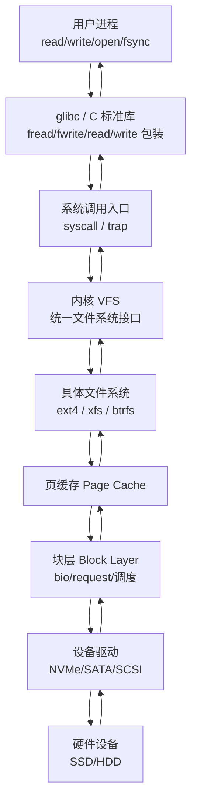

可以把它理解成：

**用户程序不直接操作磁盘。**
它通过系统调用进入内核，内核通过 VFS 找到对应文件系统，文件系统再通过页缓存、块层、驱动去访问真正的存储设备。

------

## 2. 几个核心概念先建立起来

### 文件描述符 fd

`open()` 返回的整数就是文件描述符，例如：

```c
int fd = open("a.txt", O_RDONLY);
```

它不是文件本身，而是进程打开文件后的一个“句柄”。

进程内部大致是这样：


重要点：

- `fd` 属于某个进程。
- open file 对象记录当前读写偏移量。
- inode 表示文件本体的元数据，例如权限、大小、数据块位置。
- 文件名不是文件本体，文件名只是目录项 `dentry` 指向 inode 的名字。

------

### VFS：虚拟文件系统

VFS 是 Linux 内核提供的统一抽象层。

不管底层是：

- ext4
- xfs
- btrfs
- tmpfs
- procfs
- NFS

用户程序都可以用类似的接口：

```c
open();
read();
write();
close();
```

VFS 的作用类似“统一插座标准”。

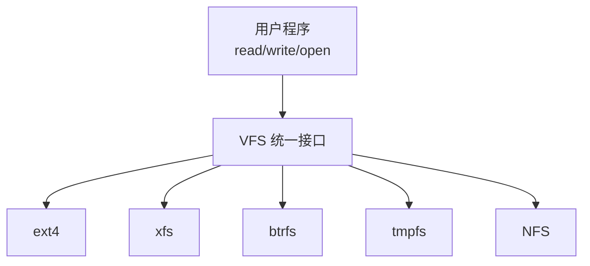

------

### Page Cache：页缓存

Linux 通常不会每次 `read()` 都真的读磁盘，也不会每次 `write()` 都立刻写磁盘。

它会用内存作为缓存，这就是 **Page Cache**。


读文件时：

- 如果数据已经在 Page Cache 中，直接从内存复制给用户。
- 如果不在 Page Cache 中，才从磁盘读入 Page Cache，再复制给用户。

写文件时：

- 通常先写入 Page Cache。
- 对应页被标记为 dirty page。
- 稍后由内核后台线程刷回磁盘。
- `fsync()` 可以要求尽量立即刷盘。

------

## 3. 一次典型 read() 的完整过程

假设用户执行：

```c
read(fd, buf, 4096);
```

### read 的主流程

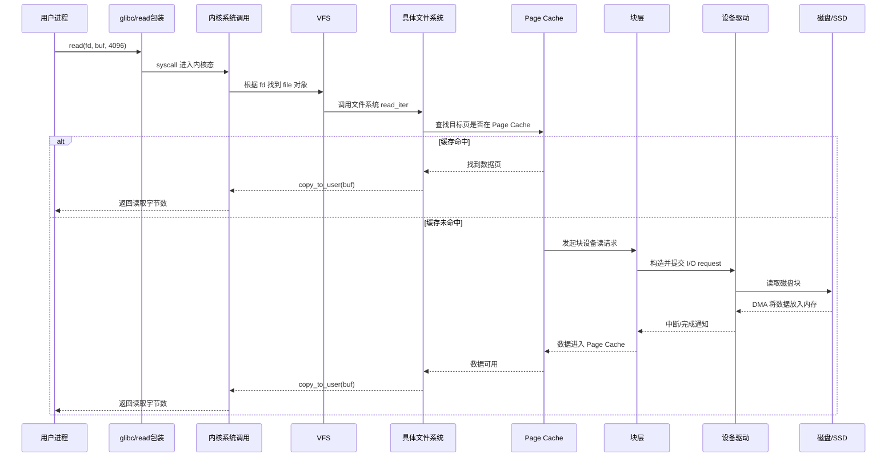

### read 过程拆解

#### 第一步：用户态进入内核态

用户调用：

```c
read(fd, buf, len);
```

这最终会触发系统调用。CPU 从用户态切换到内核态。

用户态不能直接访问磁盘、驱动、页表等敏感资源。必须让内核代办。

------

#### 第二步：根据 fd 找到文件对象

内核会通过当前进程的文件描述符表找到 `fd` 对应的 open file 对象。

里面包含：

- 当前文件偏移量
- 打开模式，例如只读、只写、追加
- 指向 inode/dentry 的引用
- 文件操作函数表

------

#### 第三步：VFS 调用具体文件系统

VFS 不关心这个文件到底是 ext4 还是 xfs。它会调用具体文件系统注册好的操作函数。

例如：

```text
VFS -> ext4_file_read_iter()
```

文件系统负责理解自己的磁盘布局，比如 inode、extent、block mapping 等。

------

#### 第四步：检查 Page Cache

如果要读取的文件范围已经在 Page Cache 中，这次 read 不需要碰磁盘。

这叫 **缓存命中**。

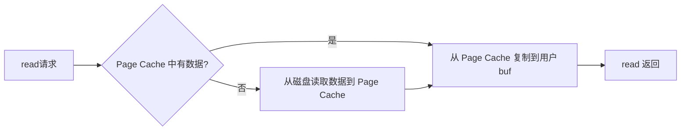

这就是为什么第二次读取同一个文件通常比第一次快很多。

------

#### 第五步：缓存未命中时访问磁盘

如果 Page Cache 没有对应数据，内核会发起真正的块设备 I/O：

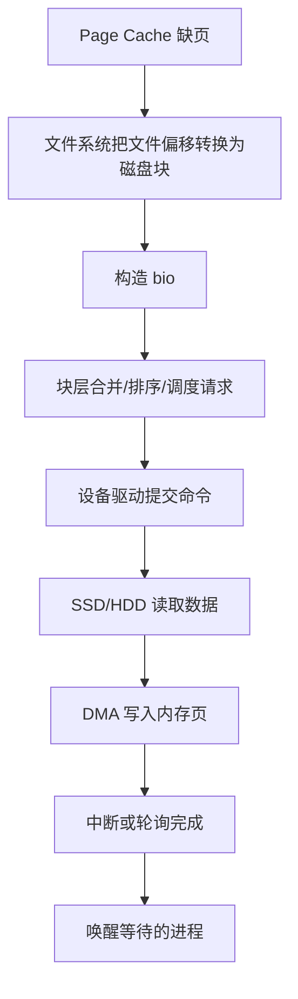

这里有几个关键点：

- 文件偏移，例如第 8192 字节，不等于磁盘物理位置。
- 文件系统负责把文件偏移映射成磁盘块。
- 块层负责组织 I/O 请求。
- 驱动负责和硬件协议交互。
- 设备通常通过 DMA 把数据直接搬到内存，避免 CPU 逐字节搬运。

------

## 4. 一次典型 write() 的完整过程

假设用户执行：

```c
write(fd, buf, 4096);
```

很多初学者容易误解：**write 返回成功，不一定代表数据已经安全写入磁盘。**

在默认 buffered I/O 下，`write()` 通常只是把数据复制到内核 Page Cache，然后把页标记为 dirty。

### write 主流程

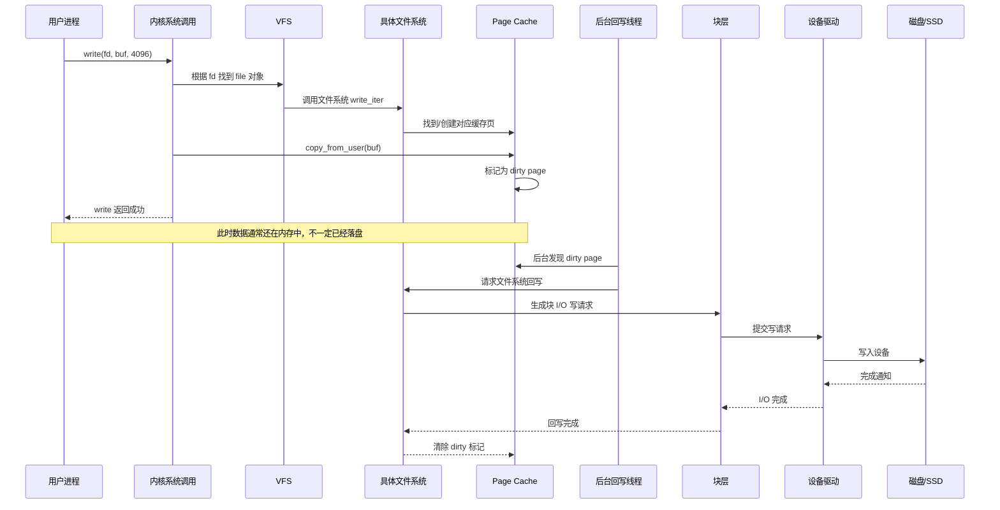

------

## 5. write、dirty page 与 fsync 的关系

### 普通 write


普通 `write()` 的特点：

- 通常速度快。
- 返回时数据大概率还在内存。
- 如果系统突然断电，尚未回写的数据可能丢失。
- 内核会根据内存压力、时间、脏页比例等策略自动回写。

------

### fsync

如果程序需要确保数据落盘，会调用：

```c
fsync(fd);
```

`fsync()` 的语义是：尽可能把这个文件相关的数据和必要元数据刷到持久化存储。

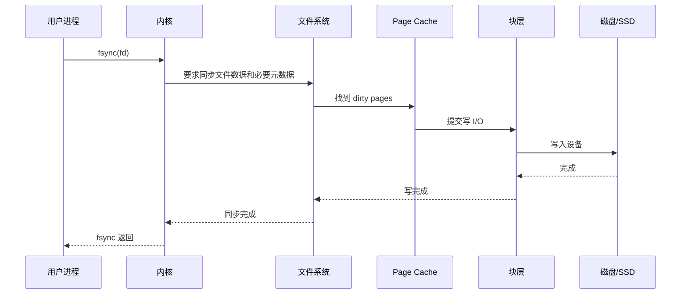

所以：

```text
write 成功 ≠ 数据已经落盘
fsync 成功 ≈ 文件数据已被要求持久化
```

实际还要考虑磁盘缓存、控制器、电源保护、文件系统日志等因素，但对学习主线来说，可以先这么理解。

------

## 6. 完整 I/O 生命周期：从 open 到 close

把一次完整文件访问串起来，大致是这样：

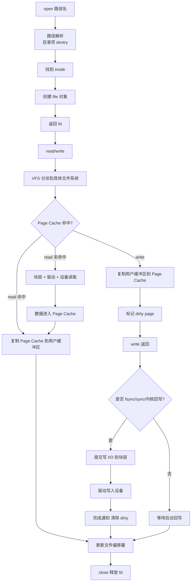

------

## 7. 数据到底被复制了几次？

以普通 `read()` 为例，缓存未命中时通常会经历：


也就是说：

1. 设备通过 DMA 把数据放入内核内存页。
2. 内核再把数据从 Page Cache 复制到用户空间 buffer。

普通 `write()` 则相反：

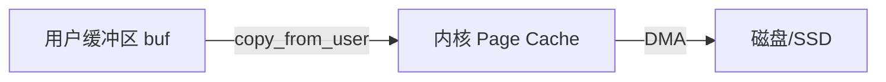

这也是为什么会有 `mmap`、`sendfile`、`splice`、`O_DIRECT` 等机制，它们试图减少复制、绕过缓存或优化数据路径。

------

## 8. 文件系统、块层、驱动分别负责什么？

### 文件系统负责“文件语义”

例如 ext4/xfs/btrfs 负责：

- 文件名到 inode 的关系
- inode 元数据
- 文件偏移到磁盘块的映射
- 目录结构
- 权限
- 文件大小
- 日志、事务、崩溃恢复

可以理解为：

```text
文件系统关心：这个文件的数据在哪里？元数据如何维护？崩溃后如何恢复？
```

------

### 块层负责“块设备 I/O 请求”

块层负责：

- 把读写请求表示为 bio/request
- 合并相邻请求
- 排队
- 调度
- 向设备驱动提交请求
- 处理完成回调

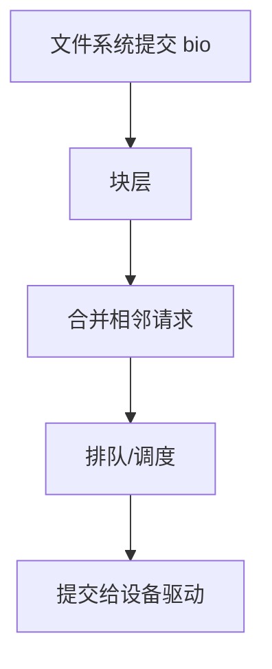

------

### 设备驱动负责“和硬件说话”

设备驱动负责：

- 按 NVMe/SATA/SCSI 等协议提交命令
- 管理硬件队列
- 设置 DMA
- 接收中断或轮询完成状态
- 通知上层 I/O 完成

```text
驱动关心：如何让这个具体硬件执行读写命令？
```

------

## 9. inode、dentry、file 的关系

这是学习 Linux 文件系统时非常重要的一组概念。

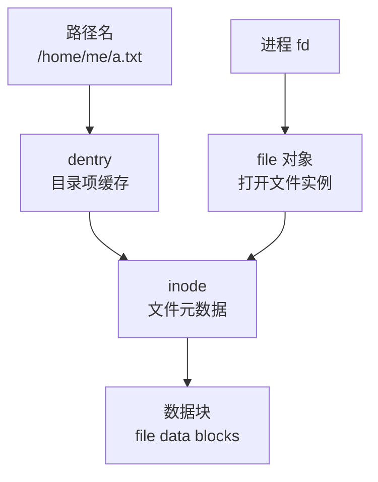

区别如下：

| 概念       | 含义                                           |
| ---------- | ---------------------------------------------- |
| `fd`       | 用户进程看到的整数句柄                         |
| `file`     | 内核中的“打开文件对象”，包含偏移量、打开模式等 |
| `dentry`   | 目录项，表示“名字到 inode 的映射”              |
| `inode`    | 文件元数据，表示文件本体                       |
| data block | 真正存放文件内容的数据块                       |

一个 inode 可以有多个文件名指向它，这就是硬链接。

一个文件也可以被多个进程同时打开，每次打开通常对应不同的 `file` 对象。

------

## 10. 缓存命中、缺页、阻塞与唤醒

对于读 I/O，进程可能会阻塞。

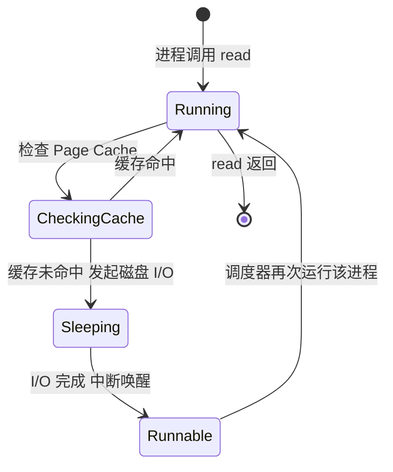

如果数据不在 Page Cache 中，进程通常会睡眠，等待 I/O 完成。
磁盘完成后，硬件触发中断，驱动通知块层，块层通知文件系统/页缓存，然后内核唤醒等待的进程。

------

## 11. buffered I/O 与 direct I/O 的区别

默认情况下，大多数文件 I/O 是 **buffered I/O**。

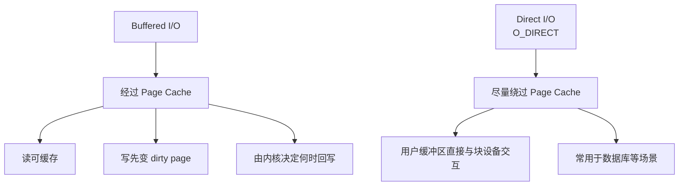

### buffered I/O

优点：

- 简单
- 有缓存加速
- 小 I/O 性能好
- 内核可以合并和优化请求

缺点：

- 多一次用户态/内核态复制
- write 返回不代表落盘
- 对数据库这类自己管理缓存的系统，可能造成双重缓存

### direct I/O

优点：

- 减少 Page Cache 干扰
- 数据库可以自己管理缓存
- 更容易控制落盘行为

缺点：

- 使用复杂
- 对齐要求严格
- 小 I/O 可能性能差
- 仍然要经过文件系统、块层和驱动，只是尽量绕过 Page Cache

------

## 12. 同步、异步、阻塞、非阻塞不要混淆

这几个词经常被混在一起。

| 概念         | 关注点                                |
| ------------ | ------------------------------------- |
| 同步 I/O     | 发起 I/O 后，调用者是否要等结果       |
| 异步 I/O     | 发起后先返回，完成后再通知            |
| 阻塞 I/O     | 等待期间线程是否睡眠                  |
| 非阻塞 I/O   | 没准备好就立刻返回错误，例如 `EAGAIN` |
| buffered I/O | 是否经过 Page Cache                   |
| direct I/O   | 是否尽量绕过 Page Cache               |

普通文件的 `read()` 通常是：

```text
同步 + 可能阻塞 + buffered I/O
```

`io_uring` 可以让文件 I/O 更接近：

```text
异步提交 + 完成队列通知
```

但底层仍然会经过文件系统、块层、驱动等机制。

------

## 13. 一个更贴近真实内核的简化调用链

以 read 为例，概念上可以理解为：

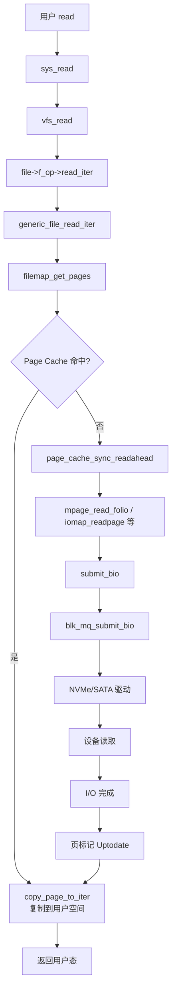

不同内核版本、文件系统和设备类型下函数名会有差异，但主线类似：

```text
系统调用 → VFS → 文件系统 → Page Cache → 块层 → 驱动 → 设备
```

------

## 14. 一句话总结

Linux 上一次典型文件 I/O 的核心路径是：

```text
用户进程
  → 系统调用
  → VFS
  → 具体文件系统
  → Page Cache
  → 块层
  → 设备驱动
  → 硬件设备
  → 完成通知
  → 唤醒进程 / 返回结果
```

最重要的理解点是：

**Linux 文件 I/O 并不是“程序直接读写磁盘”，而是由内核通过 VFS、文件系统、页缓存、块层和驱动共同完成。**

其中：

- `fd` 是进程访问文件的句柄。
- `VFS` 统一不同文件系统。
- `inode` 表示文件元数据。
- `dentry` 表示文件名到 inode 的映射。
- `Page Cache` 是文件 I/O 性能的核心。
- `write()` 通常先写内存，不保证立即落盘。
- `fsync()` 用来要求数据持久化。
- 块层负责组织 I/O 请求。
- 驱动负责和硬件设备交互。