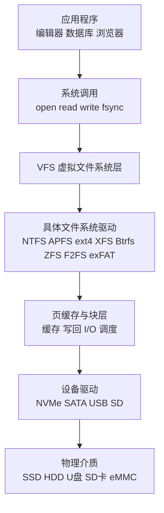
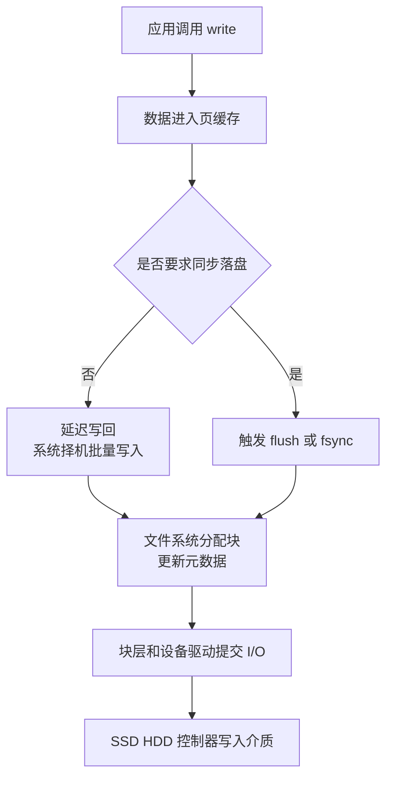
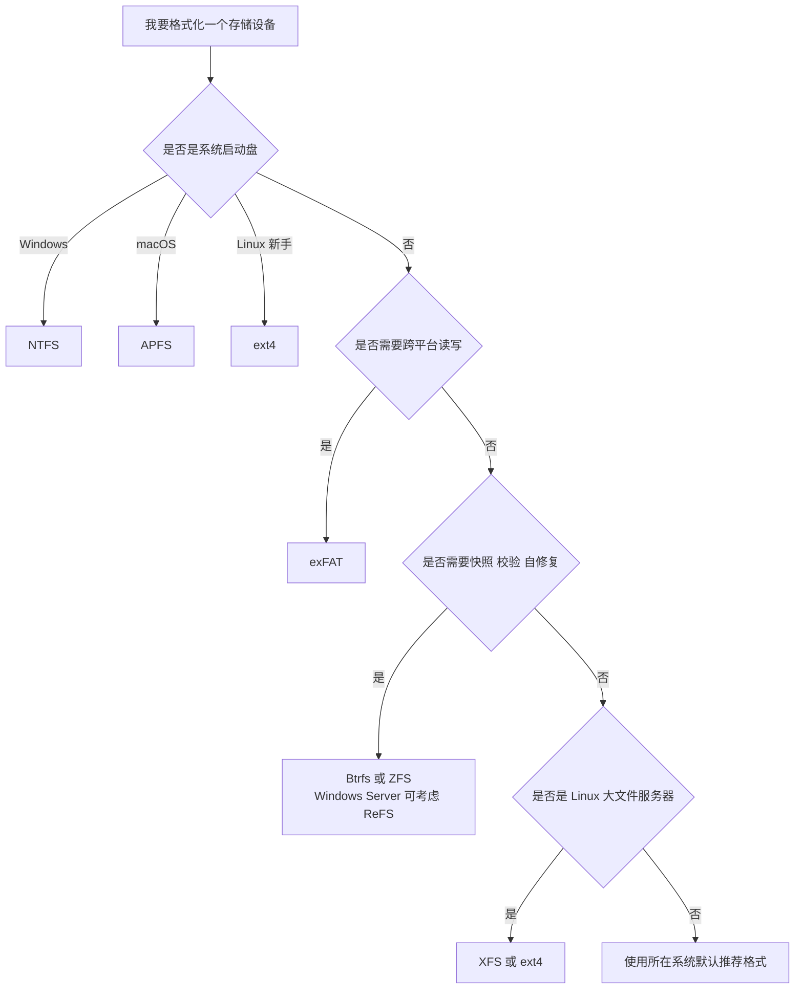

[toc]

## 学习大纲

| 学习层次           | 要理解的问题                                                | 核心关键词                                         | 学完后的实践能力                            |
| ------------------ | ----------------------------------------------------------- | -------------------------------------------------- | ------------------------------------------- |
| 文件系统的定位     | 文件系统到底解决什么问题？                                  | 文件、目录、路径、卷、分区、挂载                   | 能区分“硬盘、分区、卷、文件系统、目录树”    |
| 文件如何被组织     | 一个文件在磁盘上长什么样？                                  | 元数据、inode、MFT、extent、block、cluster         | 能理解文件大小、碎片、目录查找、链接        |
| 系统如何读写文件   | 程序调用 `read` / `write` 后发生什么？                      | VFS、页缓存、写回、I/O 调度、设备驱动              | 能解释“为什么复制完还要安全弹出”            |
| 崩溃后如何保持一致 | 断电、死机、蓝屏后为什么文件系统还能恢复？                  | journaling、copy-on-write、checkpoint、fsck、scrub | 能理解日志、快照、校验、修复的区别          |
| 常见文件系统对比   | NTFS、APFS、ext4、XFS、Btrfs、ZFS、F2FS、exFAT 各适合什么？ | 通用性、可靠性、快照、压缩、加密、跨平台           | 能为系统盘、移动盘、NAS、服务器选择合适格式 |
| 运维与最佳实践     | 如何避免数据丢失和性能问题？                                | 备份、快照、TRIM、SMART、权限、加密、监控          | 能建立安全、可恢复、可迁移的存储使用习惯    |

## 先建立一个统一认识

文件系统不是“硬盘本身”，而是操作系统在某个存储空间上建立的一套组织规则。它负责把底层连续或离散的块设备，抽象成用户熟悉的文件、目录、路径、权限、时间戳和可读写接口。

可以把存储栈粗略理解成这样：

VFS 的意义是：应用程序大多数时候不需要关心底层是 NTFS、APFS 还是 ext4。它调用的是相对统一的文件 API，具体文件系统负责把这些操作翻译成自己的磁盘结构。

## 基础术语

| 术语             | 含义                                                   | 新手常见误区                                                 |
| ---------------- | ------------------------------------------------------ | ------------------------------------------------------------ |
| 磁盘             | 物理或虚拟存储设备，例如 SSD、HDD、U 盘、虚拟硬盘      | 磁盘不等于文件系统                                           |
| 分区             | 把磁盘切成若干区域，例如 EFI 分区、系统分区、数据分区  | 分区只是容器，还需要格式化成文件系统                         |
| 卷               | 操作系统可挂载、可管理的一块逻辑存储空间               | 卷可能来自单个分区，也可能来自存储池、RAID、逻辑卷           |
| 文件系统         | 在卷上组织文件和目录的规则与数据结构                   | “格式化”为 NTFS、APFS、ext4，本质是创建文件系统结构          |
| 挂载             | 把一个文件系统接入目录树或盘符                         | Windows 常表现为 `C:`、`D:`；Unix/Linux/macOS 表现为 `/home`、`/mnt/data` |
| 元数据           | 描述文件的数据，例如文件名、权限、大小、时间戳、块映射 | 元数据损坏时，文件内容可能还在，但系统找不到                 |
| 数据块 / cluster | 文件实际内容存放的最小或近似最小分配单位               | 小文件也可能占用一个完整分配单元                             |
| inode / 文件记录 | 类 Unix 文件系统常用 inode；NTFS 使用 MFT 文件记录     | 文件名通常属于目录项，不一定直接存在 inode 中                |
| extent           | 一段连续块的描述，例如“从块 1000 开始连续 200 个块”    | extent 能减少大文件块映射开销                                |
| 日志             | 记录即将进行或已经进行的元数据事务，用于崩溃恢复       | 日志不是备份，也不一定保护文件内容本身                       |
| 快照             | 某一时刻文件系统状态的只读或可写视图                   | 快照不是异地备份，底层磁盘坏了快照也可能一起丢               |
| 校验和           | 对数据或元数据计算摘要，用于发现损坏                   | 只有校验和但没有冗余副本时，通常只能发现错误，未必能修复     |
| scrub            | 后台扫描数据并校验，发现潜在损坏                       | scrub 常见于 ZFS、Btrfs、ReFS 等强调完整性的系统             |
| TRIM / discard   | SSD 告诉设备哪些块已不用，便于闪存回收                 | 对 SSD 有意义，对机械硬盘通常不是重点                        |

## 主流文件系统总览

| 文件系统               | 常见平台                                    | 设计取向                             | 优势                                                  | 注意点                                                    | 典型使用                                  |
| ---------------------- | ------------------------------------------- | ------------------------------------ | ----------------------------------------------------- | --------------------------------------------------------- | ----------------------------------------- |
| NTFS                   | Windows                                     | 通用桌面与服务器文件系统             | 权限、日志、加密、配额、丰富元数据、兼容 Windows 生态 | 跨平台写入支持取决于驱动；不适合作为通用移动盘格式        | Windows 系统盘、数据盘、企业桌面          |
| ReFS                   | Windows Server、部分 Windows 场景           | 弹性、大规模、虚拟化和存储空间       | 完整性流、在线修复、块克隆、面向大数据集              | 不适合作为 Windows 启动盘；部分 NTFS 功能不可用           | Storage Spaces、备份目标、虚拟化数据卷    |
| APFS                   | macOS、iOS、iPadOS、watchOS、tvOS、visionOS | 面向 SSD、加密、快照、写时复制元数据 | 空间共享、克隆、快照、强加密、适合 Apple 生态         | 非 Apple 系统原生兼容性较弱                               | Apple 设备内置存储、Time Machine 本地快照 |
| ext4                   | Linux、Android 等                           | 稳定通用、日志式、成熟               | 稳定、工具完善、性能均衡、适合根分区                  | 原生快照、透明压缩、端到端校验不是核心设计                | Linux 桌面、服务器根分区、通用数据盘      |
| XFS                    | Linux                                       | 高吞吐、大文件、大目录、并行 I/O     | 适合大文件、服务器负载、在线扩容                      | 通常不支持原地缩小；功能重点不是快照压缩                  | 数据库、日志、媒体文件、大容量数据卷      |
| Btrfs                  | Linux                                       | 写时复制、子卷、快照、校验、压缩     | 快照、发送接收、透明压缩、数据和元数据校验            | RAID5/6 仍需谨慎；需要理解子卷和空间管理                  | 桌面快照回滚、容器、开发机、部分 NAS      |
| ZFS / OpenZFS          | FreeBSD、Linux、NAS、Solaris 系             | 存储池、写时复制、端到端校验、自修复 | 数据完整性强、快照、复制、压缩、scrub、RAID-Z         | 内存和管理知识要求较高；与 Linux 内核许可生态有历史复杂性 | NAS、备份服务器、关键数据池               |
| F2FS                   | Linux、Android                              | 面向 NAND 闪存的日志结构文件系统     | 适合 SSD、eMMC、SD、移动设备闪存特性                  | 清理和写放大需要关注；通用桌面服务器不一定优先            | Android 数据分区、闪存设备                |
| exFAT                  | Windows、macOS、Linux、相机、U 盘、SD 卡    | 简单、跨平台、大文件                 | 跨平台好，支持大文件，适合移动介质                    | 缺少传统权限、日志和高级可靠性特性                        | U 盘、移动硬盘、相机存储卡                |
| FAT32                  | 几乎所有系统                                | 极简兼容                             | 兼容性极强                                            | 单文件大小和功能限制明显                                  | 老设备、EFI 系统分区、小容量兼容介质      |
| HFS+ / Mac OS Extended | 老 macOS                                    | APFS 之前的 Apple 文件系统           | 老系统兼容                                            | 新 Apple 设备通常优先 APFS                                | 旧 Mac、老备份盘                          |

Windows 官方文档说明，NTFS 是现代 Windows 操作系统的默认文件系统，提供安全描述符、加密、磁盘配额和丰富元数据等功能；ReFS 则面向可用性、完整性、大规模数据集和 Windows Server 存储场景，并且官方功能对比中列出 ReFS 不支持作为可启动文件系统。([Microsoft Learn][1]) Apple 官方安全文档说明 APFS 设计时重点考虑加密，覆盖 Apple 各平台，并针对 Flash/SSD 优化，支持写时复制元数据、空间共享、克隆和快照。([苹果支持][2]) Linux 内核文档将 ext4 描述为 ext3 的高级演进，强调面向大容量文件系统的可扩展性和可靠性增强；Btrfs 官方文档将其定位为 Linux 上现代写时复制文件系统，强调快照、内建卷管理、校验、自修复、压缩和 reflink。([内核文档][3]) F2FS 的 Linux 内核文档说明它面向 NAND 闪存设备，基于日志结构文件系统思想；Microsoft 的 exFAT 规范说明 exFAT 是 FAT32 的后继者，设计目标包括保持 FAT 简单性、支持大文件和大存储设备。([内核文档][4])

## 文件系统内部通常保存什么

不同文件系统的磁盘结构不同，但从学习角度可以抽象成几类核心区域。

| 结构           | 作用                                           | 常见例子                                                     |
| -------------- | ---------------------------------------------- | ------------------------------------------------------------ |
| 引导或保留区域 | 保存启动相关信息或文件系统识别信息             | FAT/exFAT boot region、EFI 分区中的 FAT32                    |
| 超级块 / 卷头  | 描述整个文件系统的大小、版本、块大小、特性开关 | ext4 superblock、APFS container metadata                     |
| 分配器元数据   | 记录哪些块空闲、哪些块已使用                   | 位图、B-tree、space map                                      |
| 文件元数据     | 保存文件大小、权限、时间戳、数据块位置         | inode、NTFS MFT record、Btrfs inode item                     |
| 目录结构       | 文件名到文件对象的映射                         | 目录项、哈希目录、B-tree 目录                                |
| 数据块         | 文件实际内容                                   | 文档、图片、数据库页、日志内容                               |
| 日志或事务区   | 崩溃恢复所需的事务记录                         | ext4 journal、NTFS transaction log、XFS log                  |
| 校验与快照结构 | 发现损坏、保留历史版本                         | ZFS checksum tree、Btrfs checksum tree、APFS snapshot metadata |

一个文件并不一定在磁盘上连续存放。现代文件系统通常会用 extent 或树结构记录“文件的逻辑偏移到物理块”的映射。比如一个 10 GB 视频文件，可能被描述成若干段连续范围，而不是记录几百万个单独块号。

## 文件读写的基本流程

当程序读取一个文件时，操作系统大致会经历这些步骤：

| 步骤       | 发生了什么                           | 性能影响                                 |
| ---------- | ------------------------------------ | ---------------------------------------- |
| 路径解析   | 把 `/a/b/c.txt` 拆成目录层级逐级查找 | 目录缓存命中时很快，冷缓存时需要读元数据 |
| 权限检查   | 判断进程是否有读写执行权限           | ACL、POSIX 权限、沙盒机制都会影响        |
| 元数据读取 | 找到文件对象及其块映射               | 小文件和大量文件会增加元数据压力         |
| 页缓存查询 | 先看内存中是否已有内容               | 缓存命中可避免磁盘 I/O                   |
| 块设备读取 | 缓存未命中时读 SSD/HDD               | 随机读写和顺序读写差异很大               |
| 返回给应用 | 数据复制或映射给用户态               | mmap、direct I/O 等路径有所不同          |

写入则更复杂。很多系统会先把数据写入内存页缓存，稍后再批量写回磁盘。这能提升性能，但也意味着“应用程序显示保存完成”不一定等于“数据已经物理落盘”。数据库、编辑器和关键程序通常会使用 `fsync`、`fdatasync` 或平台等价机制要求系统把关键数据刷到稳定存储。

这也是为什么移动硬盘和 U 盘需要“安全弹出”：操作系统可能还有缓存数据、元数据或日志事务没有完全写完。

## 一致性机制

文件系统最怕的问题之一是：系统刚写了一半就断电。比如目录项已经指向新文件，但文件内容还没写完；或者块已经标记为已分配，但 inode 还没更新。现代文件系统主要通过三类机制降低这种风险。

| 机制              | 基本思想                                 | 代表文件系统     | 优点                     | 代价                                           |
| ----------------- | ---------------------------------------- | ---------------- | ------------------------ | ---------------------------------------------- |
| 日志式 journaling | 先记录元数据事务，崩溃后重放或回滚       | NTFS、ext4、XFS  | 成熟、性能好、恢复快     | 默认通常更关注元数据一致性，不等于完整数据保护 |
| 写时复制 COW      | 不原地覆盖旧块，先写新块，再原子切换指针 | APFS、Btrfs、ZFS | 天然适合快照、克隆、回滚 | 空间管理复杂，碎片和写放大需要关注             |
| 日志结构 LFS      | 把修改顺序追加到日志式区域，再后台清理   | F2FS             | 适合闪存顺序写和移动设备 | 需要清理无效块，延迟可能受清理影响             |

ext4 使用 JBD2 日志来保护崩溃时的元数据一致性；Linux 内核文档明确说明 ext4 默认出于性能原因只把文件系统元数据写入日志，文件数据块本身不保证在崩溃后处于完全一致状态，若使用 `data=journal` 才会把数据和元数据都写入日志但速度更慢。([Linux内核档案馆][5]) NTFS 也通过事务日志和检查点信息提高可靠性，系统故障后可利用日志恢复文件系统一致性。([Microsoft Learn][1]) XFS 文档描述了其数据区、日志区和可选实时区的结构，Red Hat 文档也强调 XFS 支持元数据日志以加快崩溃恢复。([内核文档][6])

写时复制的思路可以这样理解：

ZFS 文档把 ZFS 描述为事务性文件系统，使用 copy-on-write 语义，数据不会原地覆盖，操作序列要么全部提交，要么全部忽略；同时 ZFS 对所有数据和元数据进行校验，并可在有冗余副本时自修复。([Oracle 文档][7]) Btrfs 同样是写时复制文件系统，官方文档列出其支持快照、数据和元数据校验、压缩、reflink 和发送接收等能力。([BTRFS Documentation][8]) APFS 也支持写时复制元数据、空间共享、克隆和快照。([苹果支持][2])

## 快照、克隆、备份的区别

| 概念        | 是什么                         | 是否节省空间 |       能否抵抗误删 |           能否抵抗磁盘损坏 | 典型用途                     |
| ----------- | ------------------------------ | -----------: | -----------------: | -------------------------: | ---------------------------- |
| 快照        | 某一时刻的文件系统视图         |       通常是 |                 是 | 否，除非另有冗余和异地副本 | 系统升级前回滚、短期历史版本 |
| 克隆        | 基于已有文件或快照创建可写副本 |       通常是 |               部分 |                         否 | 虚拟机、容器、快速复制       |
| 备份        | 复制到独立介质或远端位置       |       不一定 |                 是 |         是，取决于备份位置 | 灾难恢复、长期保留           |
| RAID / 镜像 | 多盘冗余                       |           否 |                 否 |       是，针对部分硬盘故障 | 提高可用性                   |
| 同步盘      | 把文件同步到云端或多设备       |       不一定 | 视版本保留策略而定 |                 视服务而定 | 多设备访问                   |

ZFS 官方文档说明，快照是文件系统或卷的只读副本，创建时几乎不占额外空间，但随着活动数据集发生变化，快照会继续引用旧数据并消耗空间。([Oracle 文档][9]) 这个原理也解释了一个常见现象：你删除了很多文件，但磁盘空间没有释放，原因可能是旧快照仍然引用这些数据。

重要原则：快照不是备份。快照适合快速回滚，但如果整个磁盘、存储池、控制器或设备丢失，快照也可能一起丢失。关键数据至少需要一份独立备份，最好再有异地备份。

## 权限、安全与加密

文件系统不仅保存文件内容，还保存访问规则。

| 安全能力       | 说明                                 | 常见系统                                            |
| -------------- | ------------------------------------ | --------------------------------------------------- |
| POSIX 权限     | 所有者、用户组、其他人的读写执行权限 | Linux、Unix、macOS                                  |
| ACL            | 更细粒度的访问控制列表               | NTFS、Windows、Linux、macOS                         |
| 文件系统级加密 | 文件系统直接支持加密文件或卷         | APFS、NTFS EFS、ext4 fscrypt、F2FS fscrypt          |
| 块设备加密     | 在文件系统下方加密整个块设备         | BitLocker、FileVault、LUKS                          |
| 扩展属性       | 给文件附加额外元数据                 | Linux xattr、macOS metadata、NTFS alternate streams |
| 配额           | 限制用户、组或项目可用空间           | NTFS、XFS、ext4、ZFS、Btrfs 等                      |

对新手来说，最重要的是区分“文件系统加密”和“磁盘加密”。磁盘加密通常保护整块设备离线丢失后的数据安全；文件系统级加密可以更细粒度，但管理复杂度也更高。Apple 官方文档明确强调 APFS 是设计时考虑加密的文件系统，并支持强加密。([苹果支持][2]) NTFS 官方文档也列出加密、安全描述符、磁盘配额等能力。([Microsoft Learn][1])

## 性能相关核心概念

| 概念       | 含义                                | 实践建议                                 |
| ---------- | ----------------------------------- | ---------------------------------------- |
| 顺序 I/O   | 连续读写大文件                      | 媒体文件、备份、日志归档更受益           |
| 随机 I/O   | 分散位置读写小块                    | 数据库、小文件、虚拟机镜像常见           |
| 元数据 I/O | 创建、删除、重命名、遍历目录        | 大量小文件时，元数据性能比带宽更关键     |
| 页缓存     | 操作系统用内存缓存文件内容          | 第二次读取快，不代表磁盘本身快           |
| 写回       | 系统延迟把脏页写到磁盘              | 性能好，但异常断电风险更高               |
| 碎片       | 文件分布在许多不连续区域            | HDD 影响明显；SSD 主要影响元数据和写放大 |
| 写放大     | 一次逻辑写引发更多物理写            | COW、快照、压缩、闪存 FTL 都可能影响     |
| TRIM       | 通知 SSD 哪些块已释放               | SSD 上建议开启或定期执行                 |
| 对齐       | 文件系统块、分区起点、RAID 条带匹配 | 大容量阵列和数据库负载更重要             |

不要简单问“哪个文件系统最快”。更合理的问题是：“在我的硬件、文件大小、读写模式、可靠性需求、快照需求、跨平台需求下，哪个文件系统更合适？”

## Windows 常见选择

| 场景                                     | 推荐  | 原因                                 |
| ---------------------------------------- | ----- | ------------------------------------ |
| Windows 系统盘                           | NTFS  | 默认、可启动、权限和系统功能支持完整 |
| 普通内置数据盘                           | NTFS  | 兼容 Windows 功能，稳定成熟          |
| Hyper-V、备份目标、大规模 Storage Spaces | ReFS  | 面向弹性、大规模、虚拟化工作负载     |
| U 盘、移动硬盘、需要给 macOS/Linux 读写  | exFAT | 跨平台简单，支持大文件               |
| 很老设备、小容量兼容介质                 | FAT32 | 兼容性极强，但限制多                 |

ReFS 不应被简单理解为“NTFS 的全面替代品”。Microsoft 文档明确说明 NTFS 面向广泛配置和通用负载，而 ReFS 适合需要可用性、弹性或规模的特定场景；ReFS 还不支持启动、可移动介质、磁盘配额、缩小等若干 NTFS 功能。([Microsoft Learn][10])

## Apple 平台常见选择

| 场景                         | 推荐                   | 原因                                         |
| ---------------------------- | ---------------------- | -------------------------------------------- |
| Mac 内置 SSD                 | APFS                   | Apple 默认现代文件系统，适合 SSD、加密、快照 |
| iPhone、iPad、Apple Watch 等 | APFS                   | Apple 全平台使用 APFS                        |
| Time Machine 新备份盘        | 通常 APFS              | 与现代 macOS 备份机制配合                    |
| 与 Windows、Linux 共享移动盘 | exFAT                  | 跨平台读写最省事                             |
| 老 Mac 或老系统兼容          | Mac OS Extended / HFS+ | 仅用于兼容旧环境                             |

Apple 文档说明 APFS 覆盖 iPad、iPhone、Mac、Apple TV、Apple Vision Pro 和 Apple Watch，并针对 Flash/SSD 优化，具备空间共享、克隆、快照和加密等特性。([苹果支持][2]) Apple 磁盘工具文档也列出 APFS、Mac OS Extended、MS-DOS FAT、exFAT 等可用格式。([苹果支持][11])

## Linux 常见选择

| 场景                              | 推荐          | 原因                                  |
| --------------------------------- | ------------- | ------------------------------------- |
| 新手 Linux 根分区                 | ext4          | 稳定、成熟、资料多、恢复工具完善      |
| 大文件服务器、日志、数据库数据卷  | XFS 或 ext4   | XFS 适合大文件和高吞吐，ext4 通用稳妥 |
| 需要系统快照和快速回滚            | Btrfs         | 子卷、快照、发送接收、压缩方便        |
| NAS、长期数据完整性、校验和自修复 | ZFS / OpenZFS | 存储池、校验、自修复、快照、scrub 强  |
| 移动设备或闪存优化                | F2FS          | 面向 NAND 闪存设计                    |
| 跨系统移动盘                      | exFAT         | Windows、macOS、Linux 兼容较好        |

ext4 是很多 Linux 用户的稳妥默认选择，因为它成熟、工具链完善、行为相对可预期。XFS 常用于大容量、高吞吐服务器数据卷。Btrfs 更适合想要快照、透明压缩和子卷管理的用户，但需要学习它的空间管理方式。ZFS 非常适合 NAS 和关键数据池，但也要求理解存储池、vdev、scrub、快照保留策略和内存使用。F2FS 则针对 NAND 闪存设备设计，Linux 内核文档明确将其定位于 SSD、eMMC、SD 卡等闪存场景。([内核文档][3])

## Android 与移动设备

Android 不是单一文件系统答案，因为设备厂商、内核版本、分区用途都会影响实际选择。Android 官方文件系统支持文档列出 Android 13 起用户空间只使用 GKI 内建支持的文件系统，并列出更频繁获得 Android 安全补丁的文件系统包括 `exfat`、`ext4`、`f2fs`、`fuse`、`incfs`、`Vfat`、`EROFS` 等。([Android Open Source Project][12])

对普通用户来说，不建议随意给 Android 手机刷改 `/data` 文件系统。手机存储涉及加密、AVB、分区布局、恢复环境、厂商内核支持等，错误操作比桌面系统更容易导致无法启动或数据丢失。

## exFAT 与 FAT32 为什么仍然重要

exFAT 和 FAT32 技术上不如 NTFS、APFS、Btrfs、ZFS 那样“高级”，但它们的价值在于兼容性。

| 文件系统 | 优势                               | 限制                                   | 适合                              |
| -------- | ---------------------------------- | -------------------------------------- | --------------------------------- |
| FAT32    | 极高兼容性，几乎所有设备都认识     | 单文件大小限制明显，缺少现代权限和日志 | EFI 分区、老设备、小容量 U 盘     |
| exFAT    | 支持大文件，跨平台好，实现相对简单 | 缺少日志、权限、快照、校验等高级功能   | 大容量 U 盘、移动硬盘、相机 SD 卡 |

Microsoft exFAT 规范说明 exFAT 是 FAT32 的后继者，保留 FAT 系列简单易实现的特点，同时使用 64 位描述文件大小以支持大文件和大存储设备。([Microsoft Learn][13])

## 如何选型

| 你的需求                             | 优先考虑                          | 避免                             |
| ------------------------------------ | --------------------------------- | -------------------------------- |
| Windows 系统盘                       | NTFS                              | ReFS、exFAT                      |
| Mac 内置盘                           | APFS                              | exFAT、FAT32、非必要的 HFS+      |
| Linux 新手根分区                     | ext4                              | 一开始就折腾复杂存储池           |
| Linux 想要系统快照回滚               | Btrfs                             | 只靠 ext4 原生能力实现快照       |
| NAS 关键数据                         | ZFS、Btrfs、ReFS + Storage Spaces | 单盘无备份、只依赖 RAID          |
| 跨 Windows/macOS/Linux 的移动盘      | exFAT                             | APFS、NTFS、ext4，除非明确有驱动 |
| 大型虚拟机镜像和 Windows Server 存储 | ReFS 或 NTFS，取决于功能需求      | 不了解限制就把 ReFS 当默认系统盘 |
| 大量日志、大文件、服务器数据卷       | XFS、ext4                         | 频繁缩小需求下使用 XFS           |
| 闪存设备、Android 厂商场景           | F2FS、ext4                        | 用户自行盲目转换                 |
| 老设备兼容                           | FAT32                             | 存储大于 4GB 的单文件            |

最实用的判断流程：

## 最佳实践

| 实践                       | 为什么重要                                 | 建议                                                  |
| -------------------------- | ------------------------------------------ | ----------------------------------------------------- |
| 使用系统默认文件系统       | 默认值通常经过大量测试                     | 新手不要为了“听说更快”随意更换系统盘文件系统          |
| 关键数据必须备份           | 文件系统不是备份系统                       | 至少保留一份独立副本，重要数据再加异地副本            |
| 快照要设置保留策略         | 快照会占空间                               | 自动清理旧快照，监控剩余空间                          |
| 定期检查硬盘健康           | 文件系统无法拯救坏硬件                     | 关注 SMART、坏块、掉盘、I/O 错误                      |
| 对 ZFS/Btrfs/ReFS 做 scrub | 校验机制需要定期扫描才能发现潜在损坏       | NAS 和服务器建议定期安排                              |
| SSD 开启 TRIM              | 有利于闪存回收和长期性能                   | Linux 可用周期性 `fstrim`，Windows/macOS 通常自动处理 |
| 重要外置盘安全弹出         | 写缓存和元数据可能尚未落盘                 | 不要直接拔盘，尤其是复制大文件后                      |
| 断电风险高时使用 UPS       | 崩溃一致性不等于数据永不丢                 | NAS、服务器、台式机关键数据建议配 UPS                 |
| 不了解前不要乱用修复命令   | 修复工具可能改写元数据                     | 重要数据先做镜像，再尝试修复                          |
| 加密优先于“删除后擦除”     | 现代 SSD、快照、日志会让安全删除变复杂     | 敏感数据从一开始就加密存储                            |
| 跨平台文件名保守一点       | 不同系统大小写、保留字符、路径长度规则不同 | 避免 `:`、`*`、`?`、控制字符和仅大小写不同的文件名    |
| 数据库和虚拟机注意 fsync   | 应用级一致性依赖正确刷盘                   | 不要随意关闭同步写入换性能                            |

## 新手最容易混淆的点

| 误区                       | 正确理解                                                     |
| -------------------------- | ------------------------------------------------------------ |
| “日志文件系统就不会丢数据” | 日志主要保证文件系统结构一致，不等于保证所有刚写入文件内容都完整保存 |
| “快照就是备份”             | 快照通常仍在同一文件系统或存储池内，硬件故障、误删快照、池损坏都可能一起丢 |
| “RAID 就不用备份”          | RAID 提高可用性，不防误删、勒索软件、火灾、误格式化          |
| “格式化就是彻底删除”       | 快速格式化通常只是重建文件系统元数据；SSD、快照、日志也会让数据残留更复杂 |
| “越新的文件系统越好”       | 文件系统要看场景、工具成熟度、恢复能力和管理员熟悉程度       |
| “压缩一定降低性能”         | 在 SSD 和可压缩数据上，压缩有时会减少 I/O，反而更快；但 CPU 和数据类型会影响结果 |
| “校验和一定能修复数据”     | 校验和能发现损坏；要自动修复还需要镜像、RAID-Z、Storage Spaces 等冗余副本 |
| “exFAT 适合所有移动硬盘”   | exFAT 适合跨平台交换，不适合需要权限、日志、快照、强可靠性的长期主存储 |

## 实用命令与工具

| 平台    | 查看文件系统                                | 检查或修复                                         | 空间分析                                                |
| ------- | ------------------------------------------- | -------------------------------------------------- | ------------------------------------------------------- |
| Linux   | `lsblk -f`、`findmnt`、`blkid`、`df -T`     | `fsck`、`xfs_repair`、`btrfs check`、`zpool scrub` | `df -h`、`du -sh`、`btrfs filesystem usage`、`zfs list` |
| Windows | `Get-Volume`、`fsutil fsinfo volumeinfo C:` | `chkdsk`、`Repair-Volume`                          | 设置、磁盘管理、PowerShell                              |
| macOS   | `diskutil list`、`diskutil apfs list`       | 磁盘工具急救、`diskutil verifyVolume`              | 存储管理、`du`、`tmutil listlocalsnapshots /`           |

对新手来说，先掌握“查看”命令，再碰“修复”命令。尤其是硬盘疑似物理损坏时，修复前最好先复制或镜像重要数据。

## 推荐学习路线

| 阶段     | 学什么                                         | 建议练习                                               |
| -------- | ---------------------------------------------- | ------------------------------------------------------ |
| 入门     | 分区、格式化、挂载、路径、权限                 | 在虚拟机中新建一块虚拟磁盘，格式化为 ext4 或 NTFS      |
| 基础原理 | 元数据、目录项、inode/MFT、块、extent          | 用 `stat`、`ls -li`、`du`、`df` 观察文件大小与占用空间 |
| 一致性   | 日志、COW、fsync、快照                         | 创建文件、复制大文件、观察缓存和安全弹出               |
| 选型     | NTFS、APFS、ext4、XFS、Btrfs、ZFS、F2FS、exFAT | 为系统盘、移动盘、NAS 分别制定方案                     |
| 运维     | 备份、快照、scrub、SMART、TRIM                 | 设计一个“系统快照 + 外部备份 + 异地副本”的方案         |
| 进阶     | 数据库 I/O、虚拟机镜像、容器存储、对象存储     | 比较 ext4、XFS、Btrfs、ZFS 在具体负载下的行为          |

## 核心总结

现代主流文件系统可以按设计哲学理解：NTFS、ext4、XFS 是成熟通用型；APFS、Btrfs、ZFS 更强调写时复制、快照和现代存储管理；ReFS 偏 Windows Server 弹性存储和虚拟化；F2FS 面向闪存；exFAT 则主要解决跨平台移动存储。

新手选型时，不要追求“最先进”，而要优先满足四个问题：你的操作系统是否原生支持？你的数据是否需要备份和快照？你的设备是 SSD、HDD、移动盘还是 NAS？你是否需要跨平台读写？多数情况下，系统默认文件系统是最稳妥的起点；当你明确需要快照、校验、自修复、大规模存储或跨平台交换时，再选择更专门的文件系统。

[1]: https://learn.microsoft.com/en-us/windows-server/storage/file-server/ntfs-overview "NTFS overview | Microsoft Learn"
[2]: https://support.apple.com/guide/security/role-of-apple-file-system-seca6147599e/web "Role of Apple File System - Apple Support"
[3]: https://docs.kernel.org/admin-guide/ext4.html "ext4 General Information — The Linux Kernel  documentation"
[4]: https://docs.kernel.org/filesystems/f2fs.html "Flash-Friendly File System (F2FS) — The Linux Kernel  documentation"
[5]: https://www.kernel.org/doc/html/latest/filesystems/ext4/journal.html "3.6. Journal (jbd2) — The Linux Kernel  documentation"
[6]: https://docs.kernel.org/admin-guide/xfs.html "The SGI XFS Filesystem — The Linux Kernel  documentation"
[7]: https://docs.oracle.com/cd/E19253-01/819-5461/zfsover-2/ "docs.oracle.com"
[8]: https://btrfs.readthedocs.io/en/latest/Introduction.html "Introduction — BTRFS  documentation"
[9]: https://docs.oracle.com/cd/E19253-01/819-5461/gbciq/index.html "docs.oracle.com"
[10]: https://learn.microsoft.com/en-us/windows-server/storage/refs/refs-overview "Resilient File System (ReFS) overview | Microsoft Learn"
[11]: https://support.apple.com/guide/disk-utility/file-system-formats-dsku19ed921c/mac?utm_source=chatgpt.com "File system formats available in Disk Utility on Mac"
[12]: https://source.android.com/docs/core/architecture/android-kernel-file-system-support?utm_source=chatgpt.com "Android kernel file system support"
[13]: https://learn.microsoft.com/en-us/windows/win32/fileio/exfat-specification "exFAT File System Specification - Win32 apps | Microsoft Learn"