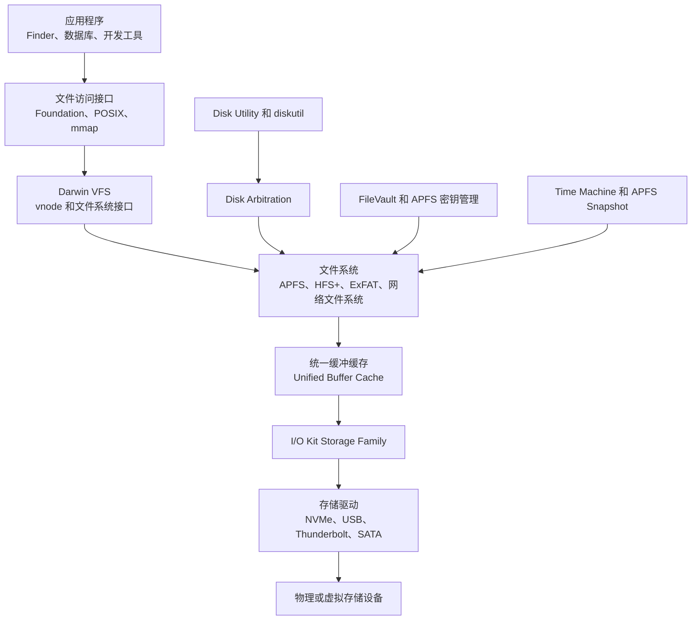
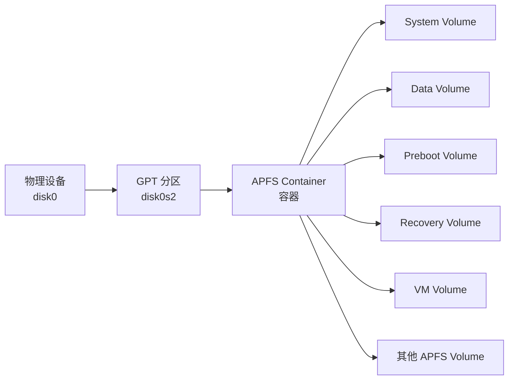
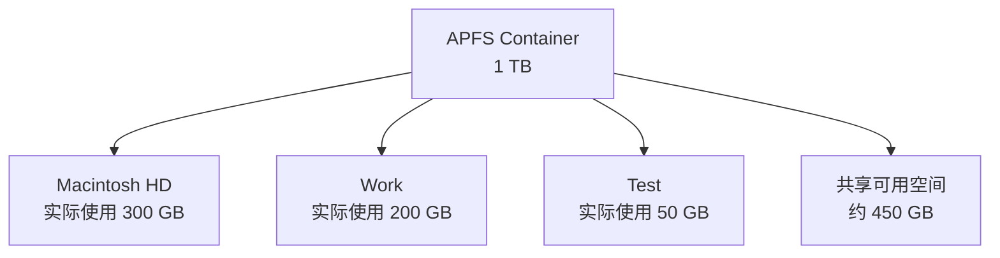
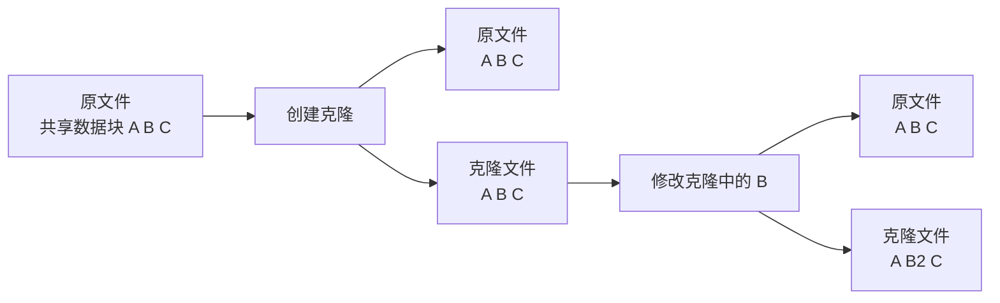
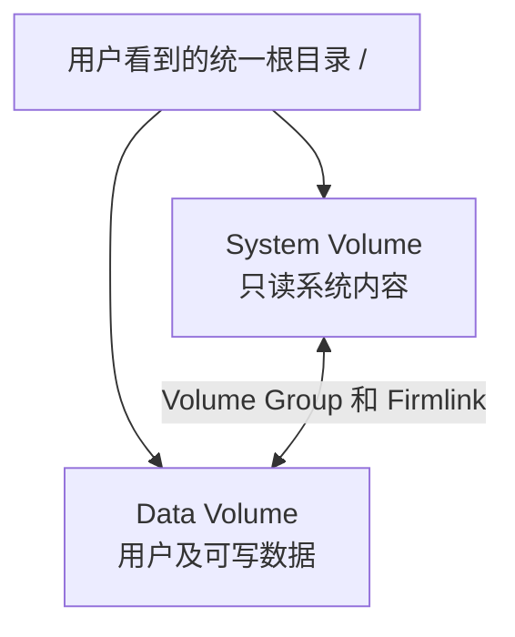
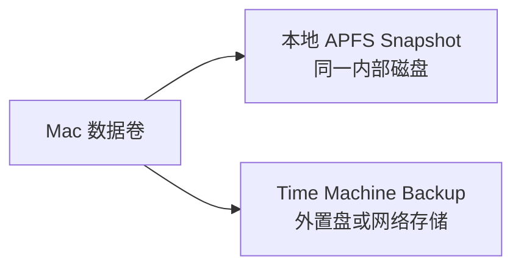
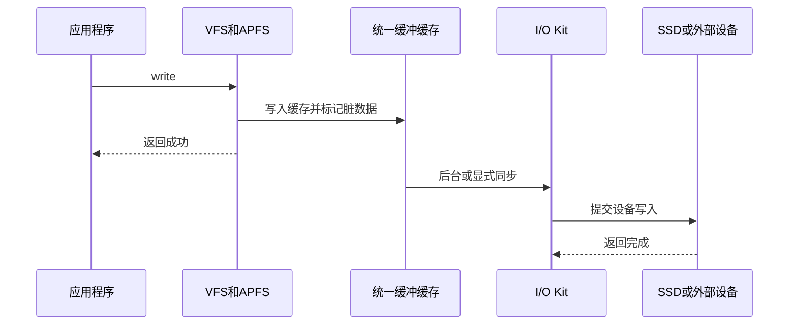
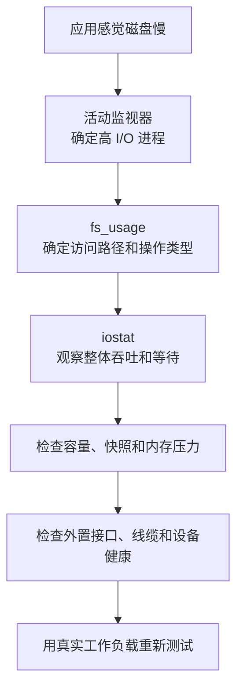

[toc]


下面内容可以作为前文的补充章节。macOS 与 Linux 都继承了 Unix 风格的文件系统接口，但二者在磁盘管理理念上差异明显：

- Linux 强调可组合的存储层：分区、MD RAID、LUKS、LVM、文件系统分别管理。
- macOS 更强调平台集成：APFS 同时承担卷管理、空间共享、快照、克隆和加密等功能，再由 Disk Arbitration、FileVault、Time Machine、RecoveryOS 等系统组件统一管理。

------

## macOS 磁盘管理学习大纲

| 模块       | 核心内容                                        | 与 Linux 对应关系                             |
| ---------- | ----------------------------------------------- | --------------------------------------------- |
| 设备识别   | `/dev/disk*`、I/O Kit、Disk Arbitration         | `/dev/sd*`、`/dev/nvme*`、udev、sysfs         |
| 分区方案   | GUID Partition Map、APFS Physical Store         | GPT 分区                                      |
| 存储池     | APFS Container                                  | 可类比 LVM VG，但不是同一种机制               |
| 逻辑卷     | APFS Volume、Space Sharing                      | 可类比文件系统卷或 LV                         |
| 文件系统   | APFS、HFS+、ExFAT、FAT                          | ext4、XFS、Btrfs、F2FS                        |
| 系统盘结构 | System/Data Volume Group、Preboot、Recovery、VM | Linux 根分区、EFI、initramfs、swap            |
| 系统保护   | Signed System Volume、SIP                       | 只读根、dm-verity、Secure Boot                |
| 磁盘加密   | FileVault、APFS Encrypted                       | LUKS、dm-crypt                                |
| 快照与备份 | APFS Snapshot、Time Machine                     | LVM/Btrfs 快照、备份系统                      |
| 挂载管理   | Disk Arbitration、`diskutil`、`/Volumes`        | `mount`、`fstab`、systemd mount               |
| 修复工具   | Disk Utility First Aid、`fsck_apfs`             | `fsck.ext4`、`xfs_repair`、`btrfs check`      |
| 开发者权限 | App Sandbox、TCC、Security-Scoped Bookmark      | POSIX 权限、SELinux、AppArmor、容器 namespace |

------

## macOS 存储栈概览



macOS 的底层内核是 Darwin/XNU，文件访问仍经过 Unix 风格的 VFS 和 vnode 抽象。文件数据缓存与虚拟内存通过统一缓冲缓存（Unified Buffer Cache，UBC）协同管理；更下层的块设备和驱动主要由 I/O Kit Storage Family 表示和管理。([Apple Developer](https://developer.apple.com/documentation/kernel/ioblockstoragedriver?utm_source=chatgpt.com))

Linux 中常见的“VFS → 页缓存 → 通用块层 → Device Mapper → 驱动”路径，在 macOS 中大体对应“VFS → UBC → I/O Kit Storage Family → 驱动”。但 macOS 没有将 blk-mq、Device Mapper、LVM 等接口作为日常管理员可组合的核心工具。

------

## macOS 的磁盘、分区、容器与卷

理解 APFS，首先要区分以下对象。



### 对象关系

| macOS 对象          | 含义                                 | Linux 中可近似类比         |
| ------------------- | ------------------------------------ | -------------------------- |
| Physical Disk       | SSD、HDD、USB 磁盘等物理或虚拟设备   | `/dev/sda`、`/dev/nvme0n1` |
| Partition           | GPT 分区                             | GPT 分区                   |
| APFS Physical Store | 被 APFS Container 使用的底层存储区域 | LVM PV 的部分概念          |
| APFS Container      | 管理共享物理空间的 APFS 容器         | LVM VG 的部分概念          |
| APFS Volume         | 容器内的逻辑文件系统卷               | LV 加文件系统的组合        |
| Volume Group        | 关联的 System 和 Data 卷             | Linux 中没有直接等价物     |
| APFS Snapshot       | 某个卷的只读时间点视图               | Btrfs/LVM 快照             |

“APFS Container 类似 LVM VG”只是帮助理解的近似说法，不能把两者当成同一种技术：

- LVM VG 管理块级 extent，并导出独立的逻辑块设备。
- APFS Container 由文件系统自身管理，并直接导出共享空间的 APFS Volume。
- APFS Volume 不需要预先固定划分全部容量。
- 一个容器内的多个 APFS Volume 默认共享容器剩余空间。([苹果支持](https://support.apple.com/guide/disk-utility/add-delete-or-erase-apfs-volumes-dskua9e6a110/mac?utm_source=chatgpt.com))

------

## 设备名称与设备发现

### `/dev/disk*`

macOS 使用 BSD 风格的设备节点。

| 示例            | 含义                             |
| --------------- | -------------------------------- |
| `/dev/disk0`    | 整块磁盘                         |
| `/dev/disk0s1`  | disk0 的第一个 slice，通常即分区 |
| `/dev/disk0s2`  | disk0 的第二个分区               |
| `/dev/disk3`    | 可能是 APFS 合成出来的逻辑设备   |
| `/dev/rdisk0`   | 对应 disk0 的 raw device 接口    |
| `/dev/rdisk0s2` | 某个分区的 raw device 接口       |

APFS Container 和 Volume 可能表现为“synthesized disk”，因此 `disk3` 不一定对应第三块物理磁盘。必须结合 `diskutil list` 的树形关系判断。

macOS 的设备节点来自 I/O Kit 存储对象通过 BSD 接口导出；I/O Registry 中还保留设备、驱动、总线和父子依赖关系。([Apple Developer](https://developer.apple.com/library/archive/documentation/DeviceDrivers/Conceptual/IOKitFundamentals/Families_Ref/Families_Ref.html?utm_source=chatgpt.com))

### 基本盘点命令

```bash
diskutil list
diskutil list physical
diskutil apfs list
diskutil apfs listVolumeGroups
diskutil info /
```

查看某个设备：

```bash
diskutil info /dev/disk4
diskutil info /Volumes/Backup
```

查看硬件信息：

```bash
system_profiler SPStorageDataType
system_profiler SPNVMeDataType
system_profiler SPUSBDataType
system_profiler SPThunderboltDataType
```

查看 I/O Registry：

```bash
ioreg -p IOService -w 0
ioreg -p IOUSB -w 0
```

### 自动化脚本中的注意点

与 Linux 的 `/dev/sda` 一样，`disk4` 不是持久业务标识。拔插顺序、启动顺序或设备变化都可能改变编号。

脚本中应优先使用：

- Volume UUID
- APFS Volume UUID
- APFS Container UUID
- Partition UUID
- 卷名加额外验证
- `diskutil` 的 plist 输出

例如：

```bash
diskutil info -plist /
diskutil list -plist
```

不要编写这种危险脚本：

```bash
diskutil eraseDisk APFS Data GPT /dev/disk2
```

并假设 `/dev/disk2` 永远是目标移动硬盘。

执行破坏性操作前，至少核对：

```bash
diskutil info /dev/disk2
system_profiler SPUSBDataType
```

重点确认容量、协议、可移动属性、设备名称和序列号。

------

## GUID Partition Map 与 APFS Container

现代 Mac 通常使用 GUID Partition Map，也就是 GPT。

在“磁盘工具”中初始化设备时，应选择：

- Scheme：GUID Partition Map
- Format：根据用途选择 APFS、ExFAT 等

Apple 的磁盘工具也推荐为现代 Mac 存储设备选择 GUID Partition Map。([苹果支持](https://support.apple.com/guide/disk-utility/initialize-a-storage-device-dsku365552c7/mac?utm_source=chatgpt.com))

### 分区和 APFS Volume 的区别

这是新手最容易混淆的地方。

| 操作                            | 是否重新划分固定磁盘范围 | 是否与其他卷共享剩余空间 |
| ------------------------------- | ------------------------ | ------------------------ |
| 新建 GPT 分区                   | 是                       | 否                       |
| 新建 APFS Container             | 通常依赖一个分区         | 容器内部可以             |
| 在 Container 中添加 APFS Volume | 否                       | 是                       |
| 为 APFS Volume 设置 Quota       | 否                       | 设置最大可用量           |
| 为 APFS Volume 设置 Reserve     | 否                       | 保留最低可用量           |

如果只是希望在 Mac 内部区分“工作数据”“测试数据”“Time Machine 数据”，通常应优先在现有 Container 中添加 APFS Volume，而不是重新切分 GPT 分区。

Apple 明确区分了：

- **Reserve Size**：为该 Volume 保证至少保留多少空间。
- **Quota Size**：限制该 Volume 最多能够占用多少空间。([苹果支持](https://support.apple.com/guide/disk-utility/add-delete-or-erase-apfs-volumes-dskua9e6a110/mac?utm_source=chatgpt.com))

这比 Linux 中“创建固定大小 LV，再格式化”的默认模型更加动态。

------

## APFS 的核心能力

APFS 是现代 macOS 的默认文件系统，支持空间共享、快照、文件和目录克隆、加密、快速目录大小计算以及面向安全保存的原子操作。([苹果支持](https://support.apple.com/en-ca/guide/security/seca6147599e/web?utm_source=chatgpt.com))

### APFS 格式类型

| 格式                           | 特点                 | 适用情况                     |
| ------------------------------ | -------------------- | ---------------------------- |
| APFS                           | 默认通常不区分大小写 | 一般系统和数据卷             |
| APFS Encrypted                 | APFS 加卷级加密      | 外置敏感数据盘               |
| APFS Case-sensitive            | 区分文件名大小写     | Linux 兼容开发、部分构建环境 |
| APFS Case-sensitive, Encrypted | 区分大小写并加密     | 开发及敏感数据               |

Apple 在磁盘工具中提供普通、加密、区分大小写及区分大小写加密等 APFS 格式。([苹果支持](https://support.apple.com/guide/disk-utility/file-system-formats-dsku19ed921c/mac?utm_source=chatgpt.com))

### 默认大小写行为

普通 APFS 通常是：

- 保留大小写（case-preserving）。
- 比较文件名时不区分大小写（case-insensitive）。

因此下面两个路径通常不能同时存在：

```text
Project/readme.md
Project/README.md
```

这与多数 Linux ext4/XFS 文件系统的默认行为不同。Linux 项目在 macOS 上可能因此遇到：

- Git 仓库文件名冲突。
- import 路径大小写错误未被发现。
- Docker 或 CI 中构建失败，但 Mac 本地成功。
- JavaScript、Go、Rust、C/C++ 工程在 Linux 部署时失败。

对于需要模拟 Linux 文件名语义的开发环境，可以创建单独的 Case-sensitive APFS Volume，而不一定要把整个系统盘改成区分大小写。

不过，一些面向普通 Mac 用户的软件可能没有充分测试区分大小写文件系统，因此不建议新手把整个启动盘改成 Case-sensitive。

------

## APFS 空间共享

假设一个 APFS Container 容量为 1 TB，里面有三个 Volume：

```text
Macintosh HD
Work
Test
```

它们并不是各自固定占用 333 GB。默认情况下，它们共同使用 Container 的 1 TB 存储池。



因此多个 APFS Volume 的 `df` 结果可能显示相同或非常接近的总容量和可用容量。这并不意味着这些容量可以重复使用。

Apple 将这种机制称为 Space Sharing：容器内各 Volume 按需增长和缩小，共享容器剩余空间。([苹果支持](https://support.apple.com/en-jo/guide/disk-utility/dskua9e6a110/mac?utm_source=chatgpt.com))

### 与 Linux LVM 的对比

| 行为           | APFS                         | LVM 加 ext4/XFS                |
| -------------- | ---------------------------- | ------------------------------ |
| 新建逻辑卷     | 默认不必固定容量             | 通常要指定 LV 大小             |
| 共享空闲空间   | Volume 自动共享 Container    | 空间先属于 VG，再手动分配给 LV |
| 文件系统扩容   | 通常自动随可用空间增长       | LV 和文件系统通常需要分别扩容  |
| 最大容量限制   | Quota                        | LV 大小                        |
| 最低空间保障   | Reserve                      | 预先分配 LV                    |
| 超分配         | 通过共享、快照和克隆间接出现 | LVM Thin 明确支持              |
| 底层块设备导出 | APFS 内部管理                | 每个 LV 是独立块设备           |

------

## APFS Copy-on-Write、克隆与快照

### 文件克隆

APFS 可以为同一 Volume 内的文件或目录创建克隆（Clone）。克隆刚创建时不需要复制全部数据块，原文件和克隆共享已有数据；其中一方发生修改时，才为变化部分分配新空间。([Apple Developer](https://developer.apple.com/documentation/foundation/about-apple-file-system?utm_source=chatgpt.com))

这与 Linux 中支持 reflink 的 Btrfs、XFS 和部分其他文件系统类似。

概念过程：



注意：

- 逻辑文件大小不等于新增物理占用。
- 删除一个克隆不一定释放其逻辑大小对应的空间。
- 随着两个文件逐渐分化，实际占用会增加。
- 不能用普通 `du` 精确推断两个文件共享了多少 extent。

### APFS Snapshot

APFS Snapshot 是父 APFS Volume 在某一时刻的只读视图。一个 Volume 可以有零个或多个关联快照。([苹果支持](https://support.apple.com/en-il/guide/disk-utility/dskuf82354dc/mac?utm_source=chatgpt.com))

查看快照：

```bash
diskutil apfs listSnapshots /
```

查看 Time Machine 本地快照：

```bash
tmutil listlocalsnapshots /
```

### 快照和克隆的区别

| 对象           | 克隆               | 快照                   |
| -------------- | ------------------ | ---------------------- |
| 粒度           | 单个文件或目录     | 整个 APFS Volume       |
| 是否可写       | 克隆文件可独立修改 | 快照本身通常只读       |
| 用途           | 快速复制文件       | 恢复某一时间点的卷状态 |
| 初始空间成本   | 很低               | 很低                   |
| 后续空间成本   | 取决于文件修改     | 取决于整个卷的修改     |
| 是否是独立备份 | 否                 | 否                     |

快照仍位于原 Container 和原物理设备上。磁盘整体故障、控制器损坏、错误抹盘或加密密钥丢失时，快照也可能一起丢失。

------

## 启动磁盘的特殊结构

现代 macOS 启动盘不是简单的“一个 APFS Volume 挂载为 `/`”。

### APFS 启动 Container

在现代 macOS 中，一个启动用 APFS Container 至少包含多个专用 Volume，例如：

| Volume   | 主要作用                            |
| -------- | ----------------------------------- |
| Preboot  | 保存启动各 System Volume 所需的数据 |
| VM       | 保存交换文件等虚拟内存数据          |
| Recovery | 保存恢复环境所需内容                |
| System   | 保存 macOS 系统文件                 |
| Data     | 保存用户和可写系统数据              |
| Update   | 某些系统版本和更新流程使用          |

Apple 的平台安全文档说明，现代 macOS 启动 Container 至少包含 Preboot、VM、Recovery、System 和 Data 等卷，其中部分卷默认对用户隐藏。([苹果支持](https://support.apple.com/fr-mu/guide/security/seca6147599e/web?utm_source=chatgpt.com))

可以查看：

```bash
diskutil apfs list
diskutil apfs listVolumeGroups
```

------

## System Volume Group

从用户视角看，根目录 `/` 像一个完整文件系统；实际上，macOS 把系统文件和可写数据放在不同 APFS Volume 中。



### System Volume

主要包含：

- macOS 系统组件。
- 系统自带应用。
- 启动所需文件。
- 受保护的系统库和框架。

### Data Volume

主要包含：

- `/Users`
- 用户安装的软件及其可写数据。
- `/Library` 中需要修改的内容。
- `/private`
- 日志、数据库、缓存及用户文档。

### Firmlink

Firmlink 是 System Volume Group 内的一种目录穿越机制，使系统卷上的路径可以透明转到 Data Volume。

例如，用户访问：

```text
/Users/alice
```

数据实际上位于 Data Volume 对应的目录，但应用通常不需要知道两者是分开的。Apple 将 Firmlink 描述为从 System Volume 中的目录穿越到 Data Volume 中目录的机制，并限制它只能在同一个 Volume Group 内使用。([Apple Developer](https://developer.apple.com/videos/play/wwdc2019/710/?utm_source=chatgpt.com))

在排查容量和权限时，常会看到：

```text
/System/Volumes/Data
```

不要在日常脚本中把 `/System/Volumes/Data/Users/...` 当成稳定的用户路径；应用和管理员通常仍应使用 `/Users/...`。

------

## Signed System Volume

macOS 10.15 引入只读 System Volume；macOS 11 及之后进一步采用 Signed System Volume，简称 SSV。

SSV 对系统内容进行密码学验证，读取系统数据时可以验证其是否匹配受信任的签名和哈希结构。默认情况下，即使是 Apple 系统进程，也不能像修改普通数据卷那样直接修改 System Volume。([苹果支持](https://support.apple.com/en-ie/guide/security/secd698747c9/web?utm_source=chatgpt.com))

### 与 Linux 的近似对比

| macOS                | Linux 中类似方向                           |
| -------------------- | ------------------------------------------ |
| 只读 System Volume   | 只读根文件系统                             |
| Signed System Volume | dm-verity、IMA、不可变 OS 镜像             |
| APFS System Snapshot | 镜像化或 snapshot-based 系统部署           |
| RecoveryOS           | initramfs、救援系统或独立恢复分区          |
| SIP                  | 只读挂载、LSM、capability 等多种机制的组合 |

二者不是一一对应关系。macOS 的 SSV、Secure Boot、RecoveryOS 和 Apple silicon 启动安全策略属于高度整合的平台方案；Linux 通常允许管理员自行组合 Secure Boot、dm-verity、LUKS、只读 rootfs 等组件。

### 管理员需要注意

不要为了修改系统目录而轻易关闭：

- System Integrity Protection，SIP
- Signed System Volume 保护
- 启动安全策略
- FileVault

现代 macOS 的正确扩展方式通常是：

- 安装到 `/Applications`。
- 将系统级支持文件放入 `/Library` 的适当子目录。
- 使用 LaunchDaemon、System Extension、DriverKit 等受支持机制。
- 使用配置描述文件或 MDM。
- 避免直接修改 `/System`。

------

## 挂载与 Disk Arbitration

### 自动挂载机制

Linux 通常由：

- 内核设备事件
- udev
- systemd
- `fstab`
- 桌面环境

共同完成设备发现和挂载。

macOS 中，外部磁盘的自动识别、挂载、卸载和弹出主要由 Disk Arbitration 参与管理。Disk Arbitration 允许应用接收磁盘事件，并参与挂载、卸载和弹出操作。([Apple Developer](https://developer.apple.com/documentation/diskarbitration?utm_source=chatgpt.com))

### 挂载点

外部或用户挂载的文件系统通常出现在：

```text
/Volumes/<卷名>
```

例如：

```text
/Volumes/Backup
/Volumes/USB
/Volumes/Work
```

Apple 的文件系统文档也以 `/Volumes` 作为用户连接卷的标准路径。([Apple Developer](https://developer.apple.com/library/archive/documentation/FileManagement/Conceptual/FileSystemProgrammingGuide/FileSystemOverview/FileSystemOverview.html?from=20423&from_column=20423&utm_source=chatgpt.com))

查看当前挂载：

```bash
mount
df -h
diskutil list
```

查看某个路径对应的 Volume：

```bash
df -h /Volumes/Backup
diskutil info /Volumes/Backup
```

### 挂载、卸载与弹出

挂载：

```bash
diskutil mount /dev/disk4s2
```

卸载单个 Volume：

```bash
diskutil unmount /Volumes/Backup
```

卸载整块磁盘上的所有卷：

```bash
diskutil unmountDisk /dev/disk4
```

安全弹出：

```bash
diskutil eject /dev/disk4
```

`unmount` 与 `eject` 不完全相同：

- unmount：解除文件系统挂载，但设备可能仍连接并可重新挂载。
- eject：请求系统让整个可移除设备进入可以安全断开的状态。

### 与 Linux `fstab` 的差别

macOS 仍有 `/etc/fstab` 兼容机制，`diskarbitrationd` 可以使用 UUID 或 LABEL 识别本地文件系统。([manpagez.com](https://www.manpagez.com/man/5/fstab/?utm_source=chatgpt.com))

但它不是 macOS 日常挂载管理的中心。常见外部磁盘一般由 Disk Arbitration 动态管理，而不是像 Linux 服务器那样主要依赖 `/etc/fstab`。

需要编辑时使用：

```bash
sudo vifs
```

不要直接用普通文本编辑器覆盖 `/etc/fstab`。

常见的高级用途是禁止某个 Volume 自动挂载：

```fstab
UUID=<volume-uuid> none apfs rw,noauto
```

实际使用前应根据当前 macOS 的本地 `man fstab` 和 `man diskutil` 验证，因为自动挂载行为可能受系统版本、文件系统和安全策略影响。

------

## FileVault 与磁盘加密

### FileVault 的作用

在 Apple silicon 或带 T2 芯片的 Mac 上，内部存储本身会使用硬件支持的加密。开启 FileVault 后，卷密钥会进一步与用户凭据、硬件 UID 和 Secure Enclave 管理的密钥体系关联；没有有效登录凭据或恢复密钥，无法正常解锁用户数据。([苹果支持](https://support.apple.com/guide/deployment/intro-to-filevault-dep82064ec40/web?utm_source=chatgpt.com))

因此，“设备默认已经加密”和“已启用 FileVault”不是同一件事：

| 状态           | 主要含义                                             |
| -------------- | ---------------------------------------------------- |
| 硬件加密存在   | 存储介质上的数据经过设备级加密                       |
| FileVault 开启 | 解密访问进一步受用户凭据或恢复密钥保护               |
| FileVault 关闭 | 在支持的硬件上仍可能加密，但密钥保护更多依赖硬件 UID |
| SSV            | 保护系统内容完整性，不等同于保护用户数据机密性       |

在 macOS 11 及之后，System Volume 主要由 SSV 提供完整性保护；Data Volume 仍由 FileVault 加密机制保护。([苹果支持](https://support.apple.com/en-euro/guide/deployment/dep82064ec40/web?utm_source=chatgpt.com))

### 与 Linux LUKS 的对比

| FileVault                                     | LUKS/dm-crypt                            |
| --------------------------------------------- | ---------------------------------------- |
| 与 Apple silicon、T2、Secure Enclave 深度集成 | 面向多种硬件平台                         |
| 与用户登录及启动流程紧密结合                  | 可独立于系统用户管理密钥                 |
| 通常管理整个启动数据卷                        | 可加密磁盘、分区、LV、镜像文件           |
| MDM 可托管恢复密钥                            | 可通过 TPM、Tang、Clevis、密钥文件等组合 |
| 层次和参数主要由 Apple 管理                   | 管理员可选择更多算法、层次和部署方式     |

FileVault 更像一个平台级安全功能，而不是普通管理员自由组合的块设备映射层。

### 查看 FileVault 状态

```bash
fdesetup status
```

查看可解锁用户：

```bash
sudo fdesetup list -extended
```

查看 APFS 加密用户：

```bash
sudo diskutil apfs listUsers /
```

在企业环境中，应通过 MDM 管理：

- FileVault 强制启用。
- Personal Recovery Key 托管。
- Secure Token。
- Bootstrap Token。
- Volume Ownership。

Apple 建议组织使用设备管理服务来配置和托管 FileVault，而不是长期依赖交互式脚本传递用户密码。([苹果支持](https://support.apple.com/en-vn/guide/deployment/dep0a2cb7686/web?utm_source=chatgpt.com))

------

## 外置磁盘加密

对外置盘，可以直接创建：

- APFS Encrypted
- APFS Case-sensitive, Encrypted

磁盘工具可以为存储设备创建需要密码才能访问的加密卷。([苹果支持](https://support.apple.com/guide/disk-utility/encrypt-protect-a-storage-device-password-dskutl35612/mac?utm_source=chatgpt.com))

命令行操作示意：

```bash
diskutil eraseDisk APFSX EncryptedData GPT /dev/disk4
```

该命令具有破坏性，而且密码输入和安全自动化需要额外处理。生产脚本中不应把密码直接写进命令行、Shell 历史或进程参数。

外置卷密码存入钥匙串（Keychain）虽然方便，但会改变威胁模型：任何能够解锁当前用户钥匙串的主体，可能也能自动解锁磁盘。

------

## Time Machine 与 APFS 快照

### Time Machine 的两层机制

现代 Time Machine 通常同时涉及：

1. 本机 APFS Local Snapshot。
2. 外部磁盘或网络目标上的实际备份。

本地快照让用户在备份盘未连接时也有机会恢复近期版本；它们位于原始磁盘上，并会在系统需要空间时被自动清理。([苹果支持](https://support.apple.com/is-is/guide/mac-help/mh35860/mac?utm_source=chatgpt.com))



### 常用命令

查看 Time Machine 状态：

```bash
tmutil status
```

查看目标：

```bash
tmutil destinationinfo
```

查看本地快照：

```bash
tmutil listlocalsnapshots /
```

创建本地快照：

```bash
sudo tmutil snapshot
```

手动删除特定快照应谨慎，并先查看当前版本的：

```bash
man tmutil
```

通常不应为了让存储界面中的“可清除空间”归零而批量删除全部快照。macOS 会根据空间压力管理它们。

### Time Machine 目标卷

如果同一物理磁盘还需要存放普通文件，推荐创建独立 APFS Volume 给 Time Machine。不同 Volume 可以共享 Container 空间，而 Time Machine 可以独占自己的逻辑卷。([苹果支持](https://support.apple.com/guide/mac-help/types-of-disks-you-can-use-with-time-machine-mh15139/mac?utm_source=chatgpt.com))

例如：

```text
外置 SSD
└── APFS Container
    ├── TimeMachine
    └── GeneralData
```

建议给 Time Machine Volume 设置 Quota，避免备份无限增长挤压普通数据；也可以根据业务需要给重要数据卷设置 Reserve。

------

## macOS 容量计算的特殊之处

macOS 上的容量排查通常比传统 ext4 更复杂，原因包括：

- APFS Volume 共享 Container 空间。
- APFS Snapshot 保留历史数据块。
- 文件克隆共享物理 extent。
- Time Machine 本地快照。
- iCloud 本地缓存。
- 系统缓存和可重新下载内容。
- Purgeable Space。
- System 和 Data Volume 的统一视图。

### Free 与 Available

macOS 可能同时显示：

- Free：当前未占用的物理空间。
- Purgeable：系统在需要时可以回收的内容。
- Available：Free 加上部分可回收空间。

Apple 的磁盘工具文档说明，Available 可以包括 Free 和 Purgeable，而 Purgeable 内容由 macOS 在需要空间时自动清理。([苹果支持](https://support.apple.com/en-gw/guide/disk-utility/dskutl1005/mac?utm_source=chatgpt.com))

因此：

```bash
df -h
```

与 Finder、系统设置“存储空间”、磁盘工具显示的可用值可能不同。

### `df`、`du` 不一致

| 原因                  | 表现                                  |
| --------------------- | ------------------------------------- |
| APFS Snapshot         | `du` 找不到历史文件，但块仍被快照引用 |
| 文件克隆              | 多个逻辑文件共享相同数据块            |
| Purgeable Space       | 系统认为可用，但当前仍被某些文件占用  |
| 已删除但仍打开的文件  | `df` 未释放，目录扫描找不到           |
| System/Data 统一视图  | 不正确遍历可能重复或遗漏              |
| Time Machine 本地快照 | 数据卷实际占用高于普通目录扫描        |
| iCloud 优化           | 文件可能有本地副本，也可能是占位符    |

### 推荐排查命令

```bash
df -h
diskutil info /
diskutil apfs list
diskutil apfs listSnapshots /
tmutil listlocalsnapshots /
```

目录扫描：

```bash
sudo du -x -h -d 1 /System/Volumes/Data
sudo du -x -h -d 1 /Users
sudo du -x -h -d 1 /Library
```

检查已删除但仍打开的文件：

```bash
sudo lsof +L1
```

检查用户目录大文件：

```bash
find "$HOME" -type f -size +1G -print
```

不要把多个 APFS Volume 报告的“可用空间”相加。

------

## System Data 为什么很大

系统设置中的 System Data 不是一个具体目录，而是无法归入应用、文档、照片等更明确类别的汇总，包括系统和第三方产生的多种文件。Apple 将其描述为没有归入其他特定类别的 Apple 和第三方文件。([苹果支持](https://support.apple.com/en-us/ht206996?utm_source=chatgpt.com))

可能包括：

- 系统缓存。
- 应用缓存。
- 日志。
- 本地设备备份。
- 虚拟机磁盘镜像。
- 开发工具数据。
- Xcode DerivedData、Simulator 和 Archives。
- Docker 或其他虚拟化镜像。
- Time Machine 本地快照。
- Spotlight 索引。
- 邮件附件。
- 软件更新暂存内容。

开发机常见排查位置：

```bash
du -sh ~/Library/Developer/*
du -sh ~/Library/Caches/*
du -sh ~/Library/Containers/*
du -sh ~/Library/Application\ Support/*
```

不要批量删除整个 `~/Library` 或 `/Library`。应先确定对应应用，并优先使用该应用自己的清理机制。

------

## I/O 缓存与持久化语义

macOS 和 Linux 都会把普通文件 I/O 与虚拟内存、文件缓存结合。macOS 的 Unified Buffer Cache 将文件数据缓存和虚拟内存页面统一管理。([Apple Developer](https://developer.apple.com/library/archive/documentation/Networking/Conceptual/AFP/AFPClientCaching/AFPClientCaching.html?utm_source=chatgpt.com))

普通写入过程可以简化为：



和 Linux 一样：

> `write()` 成功不等于已经安全写入非易失介质。

### `fsync()` 与 `F_FULLFSYNC`

macOS 支持 `fsync()`，但对于要求更强持久化保证的应用，Apple 还提供 `F_FULLFSYNC`，用于要求系统进一步请求存储设备刷新其内部缓存。Apple 建议只在确实需要较强数据持久性时使用，因为其性能成本可能很高，并且仍属于对底层硬件能力的最佳努力请求。([Apple Developer](https://developer.apple.com/library/archive/documentation/Cocoa/Conceptual/CoreData/PersistentStoreFeatures.html?utm_source=chatgpt.com))

简化对比：

| 操作                 | Linux                             | macOS                    |
| -------------------- | --------------------------------- | ------------------------ |
| 普通写入             | `write()`                         | `write()`                |
| 文件同步             | `fsync()`、`fdatasync()`          | `fsync()`                |
| 更强设备缓存刷新请求 | 通常由文件系统 flush/FUA 语义处理 | `fcntl(fd, F_FULLFSYNC)` |
| 全系统同步           | `sync()`                          | `sync()`                 |

开发者不应自己简单假设：

```text
Linux fsync 语义 = macOS fsync 语义
```

数据库、消息队列和版本控制系统应使用已经针对 macOS 处理过持久化语义的成熟存储库或运行时。

### 安全保存文件

macOS 与 Linux 上都推荐：

```text
在同一目录创建临时文件
→ 写入完整内容
→ 同步临时文件
→ 原子替换目标文件
→ 必要时同步父目录
```

APFS 还提供面向 atomic safe-save 的文件系统能力，但应用仍应通过 Foundation、SQLite 或成熟库提供的正确 API 完成，而不是假设 COW 自动保证业务事务完整。([苹果支持](https://support.apple.com/en-ca/guide/security/seca6147599e/web?utm_source=chatgpt.com))

------

## App Sandbox、TCC 与文件访问

macOS 开发者不能只考虑传统 POSIX 权限。

一个文件能否访问，可能同时受到：

- POSIX owner/group/mode。
- ACL。
- App Sandbox。
- TCC 隐私控制。
- Full Disk Access。
- System Integrity Protection。
- Signed System Volume。
- Volume 是否已经解锁。
- 用户是否通过文件选择器授权。

### App Sandbox

启用 App Sandbox 后，应用默认只能自由访问有限区域，通常包括自己的容器。沙盒应用的容器一般位于：

```text
~/Library/Containers/<bundle-id>
```

访问沙盒外文件通常需要：

- 用户通过 `NSOpenPanel` 或 `NSSavePanel` 选择。
- 对应 entitlement。
- Security-Scoped URL。
- 需要跨启动持久访问时保存 Security-Scoped Bookmark。

Apple 文档明确指出，沙盒限制应用访问受保护资源；用户选择文件可以临时扩展访问范围，而跨启动保持访问通常需要安全作用域书签。([Apple Developer](https://developer.apple.com/documentation/security/accessing-files-from-the-macos-app-sandbox?changes=_4&utm_source=chatgpt.com))

典型 Swift 逻辑：

```swift
let didStart = url.startAccessingSecurityScopedResource()
defer {
    if didStart {
        url.stopAccessingSecurityScopedResource()
    }
}

// 在授权范围内读取或写入文件
```

必须配对调用 `stopAccessingSecurityScopedResource()`，否则可能耗尽系统用于跟踪安全作用域访问的资源。([Apple Developer](https://developer.apple.com/documentation/foundation/nsurl/stopaccessingsecurityscopedresource()?utm_source=chatgpt.com))

### TCC 与 Full Disk Access

即使一个进程拥有 root 权限，也不一定自动拥有对所有用户隐私目录的访问权。备份工具、安全工具、终端和某些管理代理可能还需要 Full Disk Access。Apple 将其放在系统设置的 Privacy & Security 管理中。([苹果支持](https://support.apple.com/en-ae/guide/security/secddd1d86a6/web?utm_source=chatgpt.com))

因此，当脚本出现：

```text
Operation not permitted
```

不要立即认为是普通 `chmod` 问题，应依次检查：

1. POSIX 权限。
2. ACL。
3. TCC 授权。
4. Full Disk Access。
5. App Sandbox。
6. SIP 和 SSV。
7. Volume 是否只读或锁定。

这与 Linux 上排查 SELinux/AppArmor denial 的思路相似。

------

## 磁盘映像

磁盘映像是 macOS 中非常常见的虚拟存储形式。

常见扩展名：

- `.dmg`
- `.sparseimage`
- `.sparsebundle`
- `.iso`

`hdiutil` 可以创建、挂载、卸载、校验、转换和压缩磁盘映像。([SS64](https://ss64.com/mac/hdiutil.html?utm_source=chatgpt.com))

### 查看已连接映像

```bash
hdiutil info
```

### 挂载

```bash
hdiutil attach example.dmg
```

### 卸载

```bash
hdiutil detach /dev/disk5
```

### 创建普通映像

```bash
hdiutil create \
  -size 10g \
  -fs APFS \
  -volname TestVolume \
  test.dmg
```

磁盘映像可以近似类比 Linux 中：

```text
镜像文件 → loop device → 文件系统 → mount
```

区别在于 macOS 通过 DiskImages 框架和 `hdiutil` 进行了更完整的平台集成。

### Sparse Bundle

Sparse Bundle 由多个 band 文件组成，可按使用量增长，适合：

- 加密文件容器。
- 某些网络备份。
- 开发测试。
- 可动态增长的虚拟磁盘。

但它仍然只是一个文件集合。如果其所在文件系统损坏或文件被删除，整个映像内的数据都会受影响。

------

## 外置磁盘文件系统选择

| 使用场景                     | 推荐格式                    | 说明                                  |
| ---------------------------- | --------------------------- | ------------------------------------- |
| 仅现代 Mac 使用              | APFS                        | 支持快照、克隆、加密和空间共享        |
| Mac 专用机械硬盘，兼容旧系统 | 视需求选择 APFS 或 HFS+     | 新系统通常仍优先考虑 APFS             |
| Mac 与 Windows 交换大文件    | ExFAT                       | 两边原生兼容性较好                    |
| 旧设备或小容量兼容场景       | FAT                         | 单文件大小和容量限制明显              |
| Time Machine 新备份盘        | 独立 APFS Volume            | 可以和其他 APFS Volume 共享 Container |
| Linux 服务器长期使用         | 在 Linux 上创建原生文件系统 | 不建议用 APFS 作为通用 Linux 数据盘   |

Apple 的磁盘工具支持 APFS、Mac OS Extended、FAT 和 ExFAT，并将 ExFAT 定位为较大 Windows 兼容卷的选择。([苹果支持](https://support.apple.com/en-az/guide/disk-utility/dsku19ed921c/mac?utm_source=chatgpt.com))

### ExFAT 的局限

ExFAT 适合跨平台交换，但不适合作为需要高可靠事务语义的核心服务器文件系统：

- 没有 APFS 快照。
- 没有 APFS 克隆。
- 权限和 Unix 元数据能力有限。
- 非正常拔出后更容易需要检查。
- 不适合作为数据库主存储。

跨平台共享的重要数据仍应有独立备份。

------

## 磁盘检查与修复

### 磁盘工具 First Aid

图形界面的“急救”（First Aid）可以验证和修复支持的文件系统。

Apple 推荐从存储结构的底层卷逐步检查：

1. 每个 Volume。
2. Container。
3. 物理设备。

如果磁盘工具判断设备即将发生硬件故障，应备份并更换设备，而不是期望文件系统修复工具解决硬件问题。([苹果支持](https://support.apple.com/guide/disk-utility/repair-a-storage-device-dskutl1040/mac?utm_source=chatgpt.com))

### 命令行检查

查看：

```bash
diskutil verifyVolume /
```

尝试修复：

```bash
diskutil repairVolume /dev/disk3s5
```

验证整盘：

```bash
diskutil verifyDisk /dev/disk4
```

修复分区表相关问题：

```bash
diskutil repairDisk /dev/disk4
```

APFS 专用工具：

```bash
fsck_apfs -n /dev/rdisk3s5
```

其中 `-n` 表示只检查、不修改。

`fsck_apfs` 用于验证和尝试修复 APFS Container 或 Volume。进行底层检查时通常应在 Volume 未挂载、RecoveryOS 或其他安全环境中操作。([manp.gs — man pages](https://manp.gs/mac/8/fsck_apfs?utm_source=chatgpt.com))

### 不要直接修复正在运行的启动卷

启动卷包含：

- 活跃的 Data Volume。
- 快照。
- VM 文件。
- 系统服务数据库。
- FileVault 映射。
- SSV 及启动结构。

严重问题应从 macOS Recovery 启动，再运行 Disk Utility First Aid 或适当的命令行工具。

------

## RecoveryOS 中的磁盘管理

### Apple silicon

进入恢复环境的一般方式是：

1. 关机。
2. 长按电源按钮。
3. 等待出现启动选项。
4. 选择 Options。
5. 进入 RecoveryOS。

### Intel Mac

通常可在开机时使用相应组合键进入恢复环境。

RecoveryOS 中可以：

- 使用磁盘工具检查磁盘。
- 解锁 FileVault Volume。
- 重新安装 macOS。
- 修改部分启动安全设置。
- 使用 Terminal。
- 从 Time Machine 恢复。
- 抹掉启动设备。

对启动卷进行离线修复时，RecoveryOS 类似 Linux 的 rescue environment 或 live system，但它与 Apple 的启动安全、FileVault 和系统安装流程结合得更紧密。

------

## 磁盘性能观察

macOS 没有直接对应 Linux `iostat -xz` 全部字段的标准管理员体验，但仍提供多种观察工具。

### 活动监视器

“活动监视器”中的 Disk 页面可查看：

- 每个进程的读取字节。
- 每个进程的写入字节。
- 总体磁盘读取和写入速度。

### `iostat`

```bash
iostat -w 1
```

查看更多磁盘统计：

```bash
iostat -d -w 1
```

### `fs_usage`

观察实时文件系统活动：

```bash
sudo fs_usage -w -f filesystem
```

过滤某个进程：

```bash
sudo fs_usage -w -f filesystem MyProcess
```

`fs_usage` 输出量很大，应短时间使用，并配合过滤。

### `iotop`

macOS 自带的相关 DTrace 工具和脚本会受到 SIP、权限及系统版本限制，因此不能完全照搬 Linux `iotop` 的使用方式。

### `powermetrics`

在分析存储 I/O 对能耗和系统活动的影响时，可以结合：

```bash
sudo powermetrics
```

### 排查思路



### Apple silicon SSD 的特别考虑

管理员通常无法像服务器那样自由更换、重新组合内部 NVMe 设备。实践重点因此更偏向：

- 保证备份。
- 保持合理剩余空间。
- 避免无意义的持续写入。
- 监控异常日志和 I/O。
- 不使用来源不明的“磁盘清理”或“SSD 优化”工具。
- 出现硬件故障时及时迁移数据并维修设备。

------

## macOS 与 Linux 的关键对照

### 存储管理理念

| 方面         | macOS                                               | Linux                                      |
| ------------ | --------------------------------------------------- | ------------------------------------------ |
| 核心定位     | 桌面和平台集成                                      | 服务器、桌面、嵌入式和存储平台             |
| 默认文件系统 | APFS                                                | 依发行版而异，常见 ext4、XFS、Btrfs        |
| 卷管理       | APFS Container 和 Volume                            | LVM、ZFS、Btrfs 或普通分区                 |
| 加密         | FileVault、APFS Encrypted                           | LUKS、dm-crypt                             |
| RAID         | AppleRAID 或外部硬件方案，但不是普通 Mac 的中心模型 | MD RAID、LVM RAID、Btrfs、ZFS、硬件 RAID   |
| 自动挂载     | Disk Arbitration                                    | udev、systemd、桌面 automounter            |
| 系统卷       | System/Data Volume Group、SSV                       | 通常一个根文件系统，也可采用不可变系统设计 |
| 快照         | APFS Snapshot                                       | LVM、Btrfs、ZFS、存储阵列快照              |
| 备份         | Time Machine 深度集成                               | 工具选择较多，由管理员组合                 |
| 设备管理     | `diskutil`、Disk Utility                            | `lsblk`、`blkid`、`fdisk`、`parted` 等     |
| 修复         | First Aid、`fsck_apfs`                              | 各文件系统专用工具                         |
| 权限模型     | POSIX、ACL、Sandbox、TCC、SIP                       | POSIX、ACL、capability、SELinux、AppArmor  |

### 命令对照

| 目的             | macOS                                  | Linux                              |
| ---------------- | -------------------------------------- | ---------------------------------- |
| 列出磁盘         | `diskutil list`                        | `lsblk`                            |
| 查看设备详情     | `diskutil info`                        | `lsblk`、`udevadm info`            |
| 查看文件系统标识 | `diskutil info`                        | `blkid`                            |
| 查看 APFS 拓扑   | `diskutil apfs list`                   | `lvs`、`btrfs filesystem show`     |
| 查看挂载         | `mount`、`df`                          | `findmnt`、`mount`、`df`           |
| 挂载             | `diskutil mount`、`mount`              | `mount`                            |
| 卸载             | `diskutil unmount`                     | `umount`                           |
| 弹出设备         | `diskutil eject`                       | `udisksctl power-off` 等           |
| 格式化           | `diskutil eraseDisk`                   | `parted`、`mkfs.*`                 |
| 文件系统检查     | First Aid、`fsck_apfs`                 | `fsck.*`、`xfs_repair`             |
| 查看快照         | `diskutil apfs listSnapshots`          | `btrfs subvolume list`、`lvs`      |
| 备份管理         | `tmutil`                               | `restic`、`borg`、`rsync` 等       |
| 加密状态         | `fdesetup status`                      | `cryptsetup status`                |
| I/O 观察         | Activity Monitor、`iostat`、`fs_usage` | `iostat`、`pidstat`、`iotop`、eBPF |

------

## macOS 管理员重点

### 必须掌握

- `diskutil list` 输出中的物理设备、分区、Container 和 Volume。
- APFS Space Sharing。
- System/Data Volume Group。
- FileVault 和恢复密钥。
- Time Machine 与本地快照。
- Free、Available 和 Purgeable 的区别。
- Disk Utility First Aid 的使用边界。
- 外部磁盘安全卸载。
- RecoveryOS 的基本操作。
- TCC、Full Disk Access、SIP 和 SSV 对管理工具的影响。

### 企业环境还应掌握

- MDM 管理 FileVault。
- Personal Recovery Key 托管和轮换。
- Secure Token。
- Bootstrap Token。
- Volume Ownership。
- Erase All Content and Settings。
- 软件更新和启动安全授权。
- 外部存储访问限制。
- 备份和数据保留策略。

### 不应采用的做法

- 根据 `/dev/disk2` 编号盲目抹盘。
- 把 FileVault 恢复密钥仅保存在同一台 Mac。
- 把本地 APFS Snapshot 当成备份。
- 为了修改系统目录而长期关闭 SIP。
- 定期强制删除全部 Purgeable Space。
- 使用 `rm -rf` 清理不理解的 `~/Library` 内容。
- 直接编辑 `/System/Volumes/Data` 中映射出来的系统结构。
- 在未备份的唯一副本上运行破坏性修复。

------

## macOS 开发者重点

### 文件系统行为

开发者应测试：

- 默认大小写不敏感与 Linux 大小写敏感的差异。
- APFS 克隆和快照对容量统计的影响。
- 磁盘空间不足。
- Quota 或 Container 空间耗尽。
- 外部磁盘突然移除。
- FileVault Volume 未解锁。
- Volume 被卸载。
- 只读 Volume。
- 网络卷和本地 APFS 的语义差异。

### 文件访问权限

必须理解：

- App Sandbox container。
- User Selected File entitlement。
- `NSOpenPanel` 和 `NSSavePanel`。
- Security-Scoped Bookmark。
- TCC 授权。
- Full Disk Access。
- POSIX 权限和 ACL 仍然有效。

### 数据持久性

必须理解：

- `write()` 不等于持久化。
- `fsync()` 与 `F_FULLFSYNC` 的区别。
- 原子 rename 不等于所有相关数据都已落盘。
- APFS COW 不等于应用事务。
- 快照不等于应用一致性备份。
- SQLite 等成熟组件已经处理了大量平台差异，不应轻易重新实现。

### 文件存放位置

普通应用不应把数据随意写进：

```text
/Applications
/System
/usr
/
```

应根据用途使用系统提供的标准目录：

| 数据类型       | 典型位置                                    |
| -------------- | ------------------------------------------- |
| 用户文档       | 用户选择的位置或 Documents                  |
| 应用支持数据   | `~/Library/Application Support/<bundle-id>` |
| 缓存           | `~/Library/Caches/<bundle-id>`              |
| 偏好设置       | `~/Library/Preferences` 或相关 API          |
| 临时数据       | 系统临时目录                                |
| 沙盒应用数据   | `~/Library/Containers/<bundle-id>`          |
| App Group 数据 | App Group Container                         |

Apple 建议应用把可重建内容作为缓存管理，并使用系统提供的目录 API，而不是硬编码绝对路径。([Apple Developer](https://developer.apple.com/documentation/foundation/using-the-file-system-effectively?changes=_9&utm_source=chatgpt.com))

------

## macOS 常用磁盘检查清单

### 查看整体结构

```bash
diskutil list
diskutil apfs list
diskutil apfs listVolumeGroups
```

### 查看启动盘

```bash
diskutil info /
df -h /
mount | grep " on / "
```

### 查看空间

```bash
df -h
diskutil info /
sudo du -x -h -d 1 /System/Volumes/Data
```

### 查看快照

```bash
diskutil apfs listSnapshots /
tmutil listlocalsnapshots /
```

### 查看 FileVault

```bash
fdesetup status
sudo fdesetup list -extended
sudo diskutil apfs listUsers /
```

### 查看磁盘活动

```bash
iostat -w 1
sudo fs_usage -w -f filesystem
```

### 查看外置设备

```bash
diskutil list external
system_profiler SPUSBDataType
system_profiler SPThunderboltDataType
```

### 检查文件系统

```bash
diskutil verifyVolume /
diskutil verifyDisk /dev/disk4
```

### 查看打开但已删除文件

```bash
sudo lsof +L1
```

------

## 新外置磁盘的推荐流程

以下命令会删除数据，目标设备必须先经过人工确认。

### 盘点

```bash
diskutil list external
diskutil info /dev/disk4
```

确认：

- 是 Internal 还是 External。
- 是 Physical 还是 Synthesized。
- 容量是否正确。
- 连接协议是否正确。
- 是否包含已有 Volume。
- 是否有重要数据。
- 是否已经挂载或正在使用。

### 仅 Mac 使用

```bash
diskutil eraseDisk APFS Data GPT /dev/disk4
```

### Mac 与 Windows 交换

```bash
diskutil eraseDisk ExFAT SHARE GPT /dev/disk4
```

### 格式化后验证

```bash
diskutil list /dev/disk4
diskutil info /Volumes/Data
df -h /Volumes/Data
```

### 安全卸载

```bash
diskutil eject /dev/disk4
```

不要在 Finder 显示文件复制结束后立刻拔线。系统仍可能有缓存写回、元数据更新或 Spotlight 操作。

------

## 推荐学习实验

| 实验                                | 学习目标                        |
| ----------------------------------- | ------------------------------- |
| 创建一个普通 APFS Volume            | 理解 Container 和 Volume        |
| 设置一个 Volume Quota               | 理解共享空间与容量上限          |
| 创建 Case-sensitive Volume          | 观察 Git 文件名大小写行为       |
| 创建 APFS Encrypted 外置卷          | 理解卷解锁和钥匙串              |
| 复制一个大文件并观察空间            | 理解 APFS Clone                 |
| 创建本地 Snapshot 后修改文件        | 理解快照保留旧块                |
| 对比 `df`、`du` 和 Disk Utility     | 理解 Free、Available、Purgeable |
| 挂载和卸载 `.dmg`                   | 理解磁盘映像和虚拟设备          |
| 使用 `fs_usage` 观察应用            | 理解应用文件访问模式            |
| 在沙盒应用中选择目录并保存 Bookmark | 理解 Security-Scoped Access     |
| 从 RecoveryOS 运行 First Aid        | 理解离线修复                    |
| 使用 Time Machine 恢复单个文件      | 验证备份是否真正可恢复          |

------

## 最重要的对比结论

Linux 管理员更常问：

> 数据经过了哪些块设备层？是 RAID、LUKS、LVM Thin、文件系统还是存储阵列出了问题？

macOS 管理员更常问：

> 这是物理设备、APFS Container、Volume 还是 Snapshot？空间是否被共享、快照或 Purgeable 内容占用？FileVault、SSV、TCC 或 Disk Arbitration 是否影响了操作？

两者共同的基础原则仍然相同：

- 写入成功不等于数据已经持久化。
- 快照不是备份。
- 加密不是备份。
- 文件系统修复不能修复硬件故障。
- 不稳定的设备编号不能作为破坏性脚本的唯一依据。
- 必须监控容量增长，而不是只看当前百分比。
- 重要数据必须经过实际恢复演练。
- 对任何不理解的磁盘结构，先只读盘点，再进行修改。