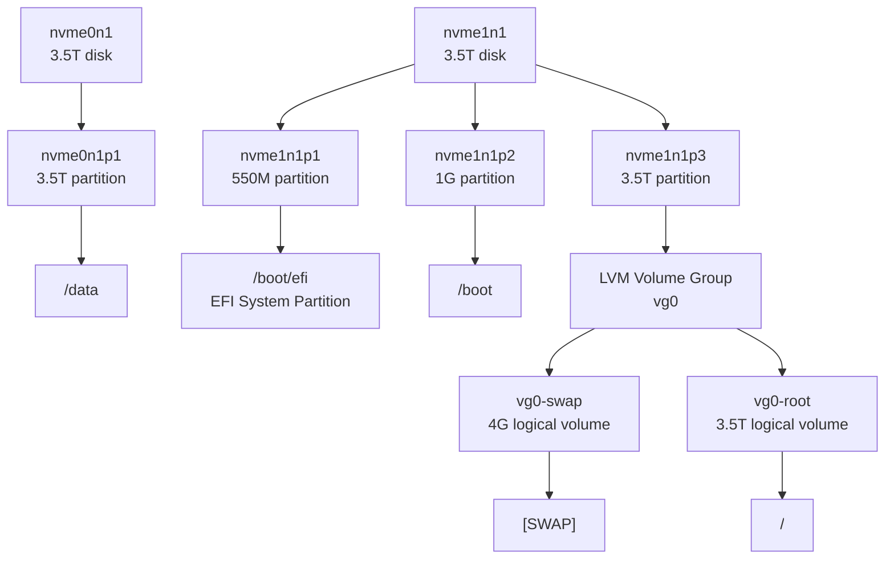

[toc]

下面这段 `lsblk` 输出展示了一个典型的 Linux 块设备层级：**物理磁盘 → 分区 → LVM 逻辑卷 → 挂载点**。

```text
NAME         MAJ:MIN RM  SIZE RO TYPE MOUNTPOINTS
loop0          7:0    0 63.8M  1 loop /snap/core20/2769
...
nvme0n1      259:0    0  3.5T  0 disk
└─nvme0n1p1  259:2    0  3.5T  0 part /data
nvme1n1      259:1    0  3.5T  0 disk
├─nvme1n1p1  259:3    0  550M  0 part /boot/efi
├─nvme1n1p2  259:4    0    1G  0 part /boot
└─nvme1n1p3  259:5    0  3.5T  0 part
  ├─vg0-swap 253:0    0    4G  0 lvm  [SWAP]
  └─vg0-root 253:1    0  3.5T  0 lvm  /
```

## 1. `lsblk` 每列含义

| 列名          | 含义                                               |
| ------------- | -------------------------------------------------- |
| `NAME`        | 设备名或逻辑卷名                                   |
| `MAJ:MIN`     | 主设备号和次设备号，内核用来区分设备驱动和具体设备 |
| `RM`          | 是否可移动设备，`1` 表示可移动，`0` 表示不可移动   |
| `SIZE`        | 设备容量                                           |
| `RO`          | 是否只读，`1` 表示只读                             |
| `TYPE`        | 设备类型，如 `disk`、`part`、`lvm`、`loop`         |
| `MOUNTPOINTS` | 挂载点，可能有多个，所以是复数                     |

其中树形结构非常重要：

```text
nvme1n1
├─nvme1n1p1
├─nvme1n1p2
└─nvme1n1p3
  ├─vg0-swap
  └─vg0-root
```

表示 `nvme1n1` 是一块物理磁盘，下面有三个分区，其中第三个分区又被 LVM 使用，进一步划分成 `swap` 和 `/` 根文件系统。

------

## 2. Linux 块设备命名规则

Linux 中块设备通常位于 `/dev` 目录下，例如：

```bash
/dev/nvme0n1
/dev/nvme0n1p1
/dev/sda
/dev/sda1
/dev/mapper/vg0-root
```

### 2.1 NVMe 磁盘命名

你的系统中使用的是 NVMe 磁盘：

```text
nvme0n1
nvme1n1
```

NVMe 命名格式一般是：

```text
nvmeXnYpZ
```

含义如下：

| 部分   | 含义                            |
| ------ | ------------------------------- |
| `nvme` | NVMe 设备                       |
| `X`    | 第几个 NVMe 控制器，从 `0` 开始 |
| `nY`   | 第几个 namespace，通常是 `n1`   |
| `pZ`   | 第几个分区                      |

例如：

```text
nvme0n1      第一块 NVMe 设备的第一个 namespace
nvme0n1p1    nvme0n1 上的第 1 个分区

nvme1n1      第二块 NVMe 设备的第一个 namespace
nvme1n1p3    nvme1n1 上的第 3 个分区
```

注意：`nvme0n1`、`nvme1n1` 的编号并不一定永久稳定。硬件顺序、BIOS/UEFI、内核扫描顺序变化后，编号可能变化。因此在 `/etc/fstab` 中更推荐使用：

```bash
UUID=...
PARTUUID=...
/dev/disk/by-id/...
```

而不是直接写死 `/dev/nvme0n1p1`。

------

### 2.2 SATA/SCSI/USB 磁盘命名

传统磁盘常见命名是：

```text
sda
sdb
sdc
```

含义是：

| 名称        | 含义                                  |
| ----------- | ------------------------------------- |
| `/dev/sda`  | 第一块被识别到的 SCSI/SATA/USB 类磁盘 |
| `/dev/sdb`  | 第二块                                |
| `/dev/sda1` | `/dev/sda` 的第 1 个分区              |
| `/dev/sda2` | `/dev/sda` 的第 2 个分区              |

NVMe 分区名中间有 `p`，例如：

```text
nvme0n1p1
```

而 SATA/SCSI 分区通常直接加数字：

```text
sda1
sda2
```

这是因为 `nvme0n1` 本身已经以数字结尾，如果直接写成 `nvme0n11` 会产生歧义，所以用 `p1` 表示第 1 个分区。

------

### 2.3 虚拟磁盘命名

在虚拟化环境中还可能看到：

| 设备名         | 场景                                           |
| -------------- | ---------------------------------------------- |
| `vda`, `vdb`   | VirtIO 虚拟磁盘，常见于 KVM/QEMU               |
| `xvda`         | Xen 虚拟磁盘                                   |
| `dm-0`, `dm-1` | device-mapper 设备，如 LVM、加密盘、多路径设备 |
| `md0`          | Linux 软件 RAID                                |
| `loop0`        | loop 回环设备，常用于挂载镜像文件、Snap 包     |

------

## 3. 解读你的这台机器

你的系统大致有两块 3.5T NVMe 磁盘：

```text
nvme0n1    3.5T
nvme1n1    3.5T
```

### 第一块盘：`nvme0n1`

```text
nvme0n1      3.5T disk
└─nvme0n1p1  3.5T part /data
```

这块盘只有一个分区：

```text
/dev/nvme0n1p1
```

它被挂载到了：

```text
/data
```

也就是说，这块磁盘主要作为数据盘使用。

------

### 第二块盘：`nvme1n1`

```text
nvme1n1      3.5T disk
├─nvme1n1p1  550M part /boot/efi
├─nvme1n1p2  1G   part /boot
└─nvme1n1p3  3.5T part
  ├─vg0-swap 4G   lvm [SWAP]
  └─vg0-root 3.5T lvm /
```

这块盘是系统盘。

它包含三个分区：

| 分区        | 大小 | 用途                              |
| ----------- | ---- | --------------------------------- |
| `nvme1n1p1` | 550M | EFI 系统分区，挂载到 `/boot/efi`  |
| `nvme1n1p2` | 1G   | `/boot` 分区                      |
| `nvme1n1p3` | 3.5T | LVM 物理卷，用于承载根分区和 swap |

其中：

```text
nvme1n1p1 -> /boot/efi
```

这是 UEFI 启动所需的 EFI System Partition，通常是 FAT32 文件系统，里面放置启动引导程序，例如 GRUB 的 EFI 文件。

```text
nvme1n1p2 -> /boot
```

这里通常存放 Linux 内核、initramfs、GRUB 配置等启动相关文件。

```text
nvme1n1p3 -> LVM
```

第三个分区没有直接挂载，而是作为 LVM 的物理卷使用。它下面创建了两个逻辑卷：

```text
vg0-swap -> [SWAP]
vg0-root -> /
```

`vg0-root` 是根文件系统，也就是 Linux 系统的 `/`。

------

## 4. Mermaid 示意图



------

## 5. `loop` 设备是什么？

你输出中还有很多 `loop` 设备：

```text
loop0  63.8M  loop /snap/core20/2769
loop1  63.8M  loop /snap/core20/2866
loop2  91.7M  loop /snap/lxd/38469
...
```

这些不是物理硬盘，而是 **loop 回环设备**。

在 Ubuntu 系统中，Snap 包通常会以只读 SquashFS 镜像形式挂载，因此你会看到很多类似：

```text
/snap/core20/2769
/snap/lxd/38469
/snap/snapd/26382
```

它们的特点是：

```text
TYPE = loop
RO = 1
```

表示它们是 loop 设备，并且只读。

这类设备一般不用手动管理，属于 Snap 软件包机制的一部分。

------

## 6. LVM 相关解读

你的系统用了 LVM：

```text
nvme1n1p3
  ├─vg0-swap
  └─vg0-root
```

LVM 的三层概念是：

| 层级 | 名称                    | 你的系统中的例子       |
| ---- | ----------------------- | ---------------------- |
| PV   | Physical Volume，物理卷 | `/dev/nvme1n1p3`       |
| VG   | Volume Group，卷组      | `vg0`                  |
| LV   | Logical Volume，逻辑卷  | `vg0-root`, `vg0-swap` |

可以理解为：

```text
物理分区 nvme1n1p3
  ↓
加入卷组 vg0
  ↓
划分出逻辑卷 root 和 swap
```

LVM 的好处是后期更容易扩容、缩容、快照和迁移。例如，如果以后再加一块盘，可以把新盘加入 `vg0`，然后扩容 `vg0-root`。

常见查看命令：

```bash
pvs     # 查看物理卷
vgs     # 查看卷组
lvs     # 查看逻辑卷
```

------

## 7. 更推荐的查看方式

为了看到文件系统类型、UUID、挂载点，可以用：

```bash
lsblk -f
```

为了看到更完整的层级和路径：

```bash
lsblk -o NAME,PATH,FSTYPE,SIZE,TYPE,MOUNTPOINTS,UUID
```

为了查看持久化设备名：

```bash
ls -l /dev/disk/by-id/
ls -l /dev/disk/by-uuid/
ls -l /dev/disk/by-partuuid/
```

查看挂载配置：

```bash
cat /etc/fstab
```

------

## 8. 总结这台系统的磁盘布局

你的系统可以概括为：

```text
nvme1n1 = 系统盘
  ├─ nvme1n1p1 = EFI 分区，挂载 /boot/efi
  ├─ nvme1n1p2 = /boot 分区
  └─ nvme1n1p3 = LVM 物理卷
       ├─ vg0-root = 根文件系统 /
       └─ vg0-swap = swap

nvme0n1 = 数据盘
  └─ nvme0n1p1 = /data

loop0~loop5 = Snap 软件包挂载出来的只读镜像
```

核心理解是：**Linux 块设备命名反映了设备类型、枚举顺序和分区层级；而 `lsblk` 展示的是从底层磁盘到上层文件系统挂载点的完整关系。**