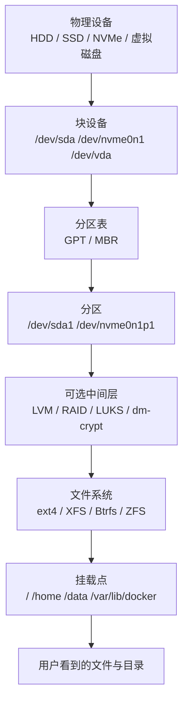
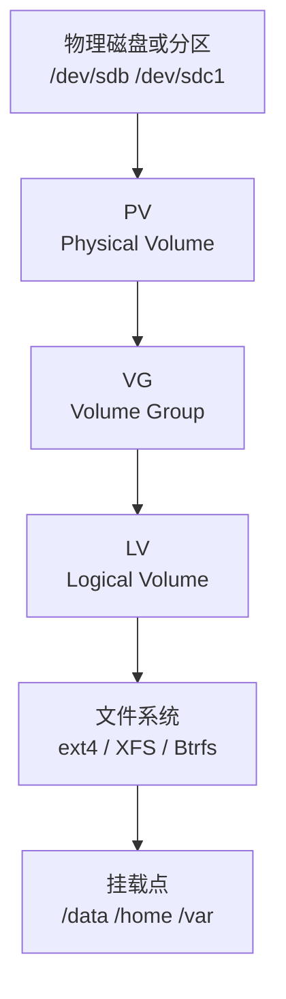

[toc]

## abstract

下面按“学习路线 + 工具体系 + 实战场景”系统介绍 Linux 磁盘管理工具。

核心思想是：**先会看，再会挂载，再会分区格式化，最后再学 LVM、RAID、加密、性能与故障处理**。

磁盘命令很多，但真正难点不在命令本身，而在理解 Linux **存储分层**。

## Linux 磁盘管理工具学习大纲

| 模块               | 学习目标                                   | 代表工具                                                     |
| ------------------ | ------------------------------------------ | ------------------------------------------------------------ |
| 存储分层模型       | 理解磁盘、分区、文件系统、挂载点之间的关系 | `lsblk`, `blkid`, `findmnt`                                  |
| 设备识别与只读查看 | 安全查看磁盘结构、UUID、文件系统类型       | `lsblk`, `blkid`, `fdisk -l`, `parted -l`                    |
| 空间占用分析       | 判断“磁盘满了”到底是哪一层满了             | `df`, `du`, `ncdu`, `lsof`                                   |
| 分区管理           | 创建、删除、查看 GPT/MBR 分区表            | `fdisk`, `parted`, `gdisk`, `sgdisk`, `sfdisk`, `partprobe`  |
| 文件系统管理       | 创建、检查、扩容、修复文件系统             | `mkfs.*`, `fsck`, `resize2fs`, `xfs_growfs`, `xfs_repair`, `btrfs` |
| 挂载管理           | 临时挂载、开机挂载、排查挂载关系           | `mount`, `umount`, `findmnt`, `/etc/fstab`, `systemd.mount`  |
| 逻辑卷管理         | 灵活扩容、缩容、迁移磁盘空间               | `pvcreate`, `vgcreate`, `lvcreate`, `lvextend`, `pvmove`     |
| 软件 RAID          | 多盘冗余或性能聚合                         | `mdadm`                                                      |
| 磁盘加密           | 加密分区或整盘加密                         | `cryptsetup`, LUKS                                           |
| Swap 与 zram       | 管理交换空间与压缩内存块设备               | `mkswap`, `swapon`, `swapoff`, `zramctl`                     |
| SSD/NVMe 维护      | TRIM、健康状态、寿命与错误日志             | `fstrim`, `smartctl`, `smartd`, `nvme`                       |
| 性能测试与排障     | 测试 I/O、定位慢磁盘与异常进程             | `fio`, `iostat`, `iotop`, `lsof`                             |
| 危险操作与最佳实践 | 避免误删、误格式化、误挂载                 | `wipefs`, `dd`, `shred`, `blkdiscard`                        |

## Linux 存储分层模型

Linux 磁盘管理不是单层操作，而是一层套一层的结构。你看到的 `/data`、`/home`、`/var` 并不是“磁盘本身”，而是某个文件系统被挂载到目录树后的结果。



`lsblk` 用来列出块设备信息，它读取 sysfs 和 udev 数据；`blkid` 用来识别块设备上的文件系统、swap、LABEL、UUID 等元数据；`findmnt` 用来查看已经挂载的文件系统或从 `/etc/fstab`、`/proc/self/mountinfo` 等来源搜索挂载信息。([man7.org](https://man7.org/linux/man-pages/man8/lsblk.8.html?utm_source=chatgpt.com))

## 核心术语解释

| 术语           | 英文                                               | 简明解释                                                     |
| -------------- | -------------------------------------------------- | ------------------------------------------------------------ |
| 块设备         | Block Device                                       | Linux 中以固定大小块进行读写的设备，例如硬盘、SSD、NVMe、虚拟磁盘。 |
| 分区表         | Partition Table                                    | 记录磁盘如何被划分。常见类型是 GPT 和 MBR。                  |
| 分区           | Partition                                          | 磁盘上的一段连续或逻辑区域，例如 `/dev/sda1`。               |
| 文件系统       | File System                                        | 负责组织文件和目录的数据结构，例如 ext4、XFS、Btrfs。        |
| 挂载           | Mount                                              | 把某个文件系统接入 Linux 目录树，例如挂载到 `/data`。        |
| 挂载点         | Mount Point                                        | 被挂载的目录，例如 `/mnt/backup`、`/data`。                  |
| UUID           | Universally Unique Identifier                      | 文件系统或分区的唯一标识，常用于 `/etc/fstab`，比 `/dev/sdb1` 更稳定。 |
| LABEL          | Volume Label                                       | 文件系统标签，便于人类识别，如 `data`、`backup`。            |
| PARTUUID       | Partition UUID                                     | 分区级别的唯一标识，和文件系统 UUID 不完全相同。             |
| inode          | Index Node                                         | 文件系统中记录文件元数据的结构。磁盘空间没满但 inode 用完时，也无法创建新文件。 |
| LVM            | Logical Volume Manager                             | 逻辑卷管理器，把物理磁盘抽象成可灵活分配的逻辑卷。           |
| PV             | Physical Volume                                    | LVM 中的物理卷，通常是磁盘或分区。                           |
| VG             | Volume Group                                       | LVM 中的卷组，由一个或多个 PV 组成。                         |
| LV             | Logical Volume                                     | LVM 中最终给系统使用的逻辑卷，可创建文件系统并挂载。         |
| RAID           | Redundant Array of Independent Disks               | 多磁盘阵列，用于冗余、性能或容量聚合。                       |
| LUKS           | Linux Unified Key Setup                            | Linux 常用磁盘加密格式。                                     |
| SMART          | Self-Monitoring, Analysis and Reporting Technology | 磁盘自监控与健康信息机制。                                   |
| TRIM / discard | TRIM / Discard                                     | 通知 SSD 或精简配置存储哪些块已经不再使用。                  |

## 新手最重要的安全原则

磁盘管理命令分为“只读查看”和“会改变磁盘”的两类。新手学习时，应该先熟练掌握只读命令，再碰分区、格式化、清除签名等危险命令。

| 危险等级   | 工具或命令                                                   | 风险说明                                         |
| ---------- | ------------------------------------------------------------ | ------------------------------------------------ |
| 安全，只读 | `lsblk`, `blkid`, `findmnt`, `df`, `du`, `fdisk -l`, `parted -l` | 只查看信息，一般不会破坏数据。                   |
| 低风险     | `mount`, `umount`, `swapon`, `swapoff`                       | 操作挂载关系，误操作可能影响正在使用的程序。     |
| 中风险     | `fsck`, `resize2fs`, `xfs_growfs`, `btrfs filesystem resize` | 修复或调整文件系统，建议先备份。                 |
| 高风险     | `fdisk`, `parted`, `gdisk`, `sfdisk`, `mkfs.*`               | 会改变分区表或创建文件系统，可能导致数据丢失。   |
| 极高风险   | `wipefs`, `dd`, `blkdiscard`, `shred`, `cryptsetup luksFormat` | 可能快速清除元数据或数据，执行前必须确认设备名。 |

`wipefs` 可以擦除文件系统、RAID 或分区表签名，使其对 `libblkid` 不可见，但它本身并不等同于完整擦除设备上的所有数据；这类命令仍然非常危险，因为会破坏系统识别已有数据结构的能力。([man7.org](https://man7.org/linux/man-pages/man8/wipefs.8.html?utm_source=chatgpt.com))

## 查看磁盘与块设备

### `lsblk`：最常用的磁盘结构查看工具

`lsblk` 是新手最应该先掌握的工具。它能用树状结构展示磁盘、分区、LVM、加密层、挂载点之间的关系。

常用命令：

```bash
lsblk
lsblk -f
lsblk -o NAME,SIZE,TYPE,FSTYPE,LABEL,UUID,MOUNTPOINTS,MODEL,SERIAL
lsblk -p
lsblk --json
```

常见字段含义：

| 字段          | 含义                                           |
| ------------- | ---------------------------------------------- |
| `NAME`        | 设备名                                         |
| `SIZE`        | 大小                                           |
| `TYPE`        | 类型，如 `disk`、`part`、`lvm`、`crypt`、`rom` |
| `FSTYPE`      | 文件系统类型                                   |
| `LABEL`       | 文件系统标签                                   |
| `UUID`        | 文件系统 UUID                                  |
| `MOUNTPOINTS` | 挂载点                                         |
| `MODEL`       | 设备型号                                       |
| `SERIAL`      | 序列号                                         |

典型输出理解：

```text
sda           100G disk
├─sda1          1G part /boot
└─sda2         99G part
  └─vg0-root   99G lvm  /
```

这表示：物理磁盘是 `/dev/sda`，里面有两个分区；`/dev/sda2` 被 LVM 使用，最终逻辑卷 `vg0-root` 挂载为根目录 `/`。

### `blkid`：查看 UUID、LABEL、文件系统签名

`blkid` 适合查看设备的文件系统类型、UUID、LABEL。相比直接写 `/dev/sdb1`，在 `/etc/fstab` 中使用 `UUID=` 或 `PARTUUID=` 通常更稳妥，因为磁盘设备名可能随启动顺序、控制器、虚拟化环境变化。Red Hat 文档也将 UUID、LVUUID、crypt UUID 等作为持久命名属性介绍；udev 体系也提供 `/dev/disk/by-id`、`/dev/disk/by-uuid`、`/dev/disk/by-label`、`/dev/disk/by-path` 等持久路径。([docs.redhat.com](https://docs.redhat.com/en/documentation/red_hat_enterprise_linux/10/html/managing_storage_devices/persistent-naming-attributes?utm_source=chatgpt.com))

常用命令：

```bash
sudo blkid
sudo blkid /dev/sdb1
ls -l /dev/disk/by-uuid/
ls -l /dev/disk/by-id/
```

### `fdisk -l` 与 `parted -l`：查看分区表

`fdisk` 是交互式分区表工具，现代 Linux 版本的 `fdisk` 已支持 GPT、MBR、Sun、SGI、BSD 等分区表；`parted` 也支持包括 MS-DOS/MBR 与 GPT 在内的多种分区表格式。([man7.org](https://man7.org/linux/man-pages/man8/fdisk.8.html?utm_source=chatgpt.com))

只查看分区时可以用：

```bash
sudo fdisk -l
sudo parted -l
sudo parted /dev/sdb print
```

新手建议：
**查看用 `lsblk -f`，确认分区表用 `fdisk -l` 或 `parted -l`，写入分区表前至少确认三遍设备名。**

## 查看磁盘空间

### `df`：看文件系统剩余空间

`df` 显示文件系统层面的空间使用情况。如果不指定文件名，默认显示所有已挂载文件系统的空间。([man7.org](https://man7.org/linux/man-pages/man1/df.1.html?utm_source=chatgpt.com))

常用命令：

```bash
df -h
df -hT
df -i
```

| 命令     | 作用                   |
| -------- | ---------------------- |
| `df -h`  | 以人类可读单位显示空间 |
| `df -hT` | 显示空间和文件系统类型 |
| `df -i`  | 查看 inode 使用情况    |

`df` 看到的是“文件系统整体空间”，不是某个目录逐项扫描的结果。

### `du`：看目录或文件占用

`du` 会递归统计文件和目录的磁盘占用。([man7.org](https://man7.org/linux/man-pages/man1/du.1.html?utm_source=chatgpt.com))

常用命令：

```bash
du -sh /var/log
du -h --max-depth=1 /var
sudo du -xhd1 /
```

| 命令                      | 作用                                   |
| ------------------------- | -------------------------------------- |
| `du -sh DIR`              | 汇总某个目录大小                       |
| `du -h --max-depth=1 DIR` | 看一级子目录大小                       |
| `du -xhd1 /`              | 只统计同一文件系统，避免跨到其他挂载点 |

### `ncdu`：交互式找大文件

`ncdu` 是文本界面的磁盘占用分析器，适合远程服务器上快速找大目录，不需要图形界面。([dev.yorhel.nl](https://dev.yorhel.nl/ncdu?utm_source=chatgpt.com))

```bash
sudo ncdu /
sudo ncdu -x /
```

### `df` 和 `du` 对不上怎么办

常见原因：

| 现象                             | 可能原因                     | 排查方法                        |
| -------------------------------- | ---------------------------- | ------------------------------- |
| `df` 显示满了，`du` 找不到大文件 | 文件被删除但仍被进程占用     | `sudo lsof +L1`                 |
| `/` 满了，但 `du /` 特别慢       | 扫到了其他挂载点             | `sudo du -xhd1 /`               |
| 空间没满但无法创建文件           | inode 用完                   | `df -i`                         |
| Btrfs 空间显示奇怪               | 元数据、快照、子卷、配额影响 | `sudo btrfs filesystem usage /` |
| Docker 占用很大                  | 镜像、容器、volume、日志堆积 | `docker system df`              |

`lsof` 用来列出进程打开的文件，适合排查“文件已删除但空间未释放”的情况。([man7.org](https://man7.org/linux/man-pages/man8/lsof.8.html?utm_source=chatgpt.com))

## 分区管理工具

### 分区表：GPT 与 MBR

| 类型 | 英文                 | 适用场景                             | 特点                             |
| ---- | -------------------- | ------------------------------------ | -------------------------------- |
| GPT  | GUID Partition Table | 现代 Linux、UEFI、新硬盘、大容量磁盘 | 更现代，支持更多分区和大容量磁盘 |
| MBR  | Master Boot Record   | 老系统、老 BIOS、兼容场景            | 传统方案，限制更多               |

新机器、新服务器、新虚拟机，一般优先使用 GPT。MBR 主要用于兼容老系统或特殊启动环境。

### `fdisk`：交互式分区工具

适合新手练习和常规分区。

查看磁盘：

```bash
sudo fdisk -l /dev/sdb
```

进入交互界面：

```bash
sudo fdisk /dev/sdb
```

常用交互按键：

| 按键 | 含义                |
| ---- | ------------------- |
| `p`  | 打印分区表          |
| `g`  | 创建 GPT 分区表     |
| `o`  | 创建 MBR/DOS 分区表 |
| `n`  | 新建分区            |
| `d`  | 删除分区            |
| `t`  | 修改分区类型        |
| `w`  | 写入并退出          |
| `q`  | 不保存退出          |

重要提醒：
在 `fdisk` 中，很多修改在按 `w` 前不会真正写盘；一旦 `w` 写入，就可能破坏原有分区结构。

### `parted`：脚本化和大盘常用工具

`parted` 适合 GPT、自动化脚本、大容量磁盘。GNU Parted 文档将分区描述为把存储设备划分为本地 sections，用于组织多个文件系统及相关操作系统。([gnu.org](https://www.gnu.org/software/parted/manual/parted.html?utm_source=chatgpt.com))

示例：为一块新盘创建 GPT 和一个 ext4 分区。

```bash
sudo parted /dev/sdb --script \
  mklabel gpt \
  mkpart primary ext4 1MiB 100%
```

让内核重新读取分区表：

```bash
sudo partprobe /dev/sdb
```

### `gdisk` / `sgdisk`：GPT 专用工具

`gdisk` 是交互式 GPT 分区工具，`sgdisk` 是脚本化 GPT 工具。适合高级用户或自动化场景。

示例：

```bash
sudo sgdisk -p /dev/sdb
sudo sgdisk -n 1:1MiB:0 -t 1:8300 -c 1:data /dev/sdb
```

### `sfdisk`：备份和恢复分区表

`sfdisk` 很适合备份分区表布局。

```bash
sudo sfdisk --dump /dev/sdb > sdb.partition.backup
sudo sfdisk /dev/sdb < sdb.partition.backup
```

恢复操作非常危险，只应在确认目标磁盘正确且有备份时执行。

## 文件系统管理工具

分区只是把磁盘切成区域，**真正能存文件的是文件系统**。常见文件系统包括 ext4、XFS、Btrfs、ZFS。

### 常见文件系统选择

| 文件系统      | 适合场景                               | 优点                                 | 注意事项                             |
| ------------- | -------------------------------------- | ------------------------------------ | ------------------------------------ |
| ext4          | 通用桌面、普通服务器、学习环境         | 稳定、简单、工具成熟                 | 功能相对传统                         |
| XFS           | 大文件、高吞吐服务器、数据库、日志系统 | 扩展性好，在线扩容成熟               | 创建后不能直接缩小，只能扩大         |
| Btrfs         | 快照、子卷、透明压缩、桌面回滚         | 支持快照、校验、子卷、在线调整       | 需要理解子卷、快照、balance、scrub   |
| ZFS / OpenZFS | NAS、存储服务器、大容量数据池          | 存储池、数据集、快照、校验、复制强大 | Linux 上通常依赖额外模块和发行版支持 |
| vfat / exFAT  | U 盘、跨 Windows/macOS/Linux           | 跨平台方便                           | 权限语义较弱                         |
| swap          | 交换空间                               | 内存压力时使用                       | 不是普通文件系统                     |

`mke2fs` 用于创建 ext2、ext3、ext4 文件系统；`resize2fs` 可调整 ext2/ext3/ext4 文件系统大小，支持扩展，也支持在未挂载状态下缩小；XFS 创建后不能缩小，但可以用 `xfs_growfs` 扩大；Btrfs 官方文档说明挂载后的文件系统可增长或缩小。([man7.org](https://man7.org/linux/man-pages/man8/mke2fs.8.html?utm_source=chatgpt.com))

### `mkfs.*`：创建文件系统

常见命令：

```bash
sudo mkfs.ext4 -L data /dev/sdb1
sudo mkfs.xfs -L data /dev/sdb1
sudo mkfs.btrfs -L data /dev/sdb1
```

注意：
`mkfs` 会重建文件系统，通常意味着原数据不可用。执行前必须确认目标是新分区或可清空分区。

### `fsck`：检查和修复文件系统

ext 系列常见：

```bash
sudo fsck.ext4 -f /dev/sdb1
```

通用入口：

```bash
sudo fsck /dev/sdb1
```

原则：

| 情况         | 建议                                                   |
| ------------ | ------------------------------------------------------ |
| 普通数据分区 | 先卸载，再检查                                         |
| 根分区 `/`   | 用 Live USB、救援模式或单用户模式                      |
| XFS          | 不使用 `fsck.xfs` 修复，通常用 `xfs_repair`            |
| Btrfs        | 不要轻易运行破坏性修复，优先看官方建议和 `btrfs scrub` |

### `resize2fs`：调整 ext 文件系统

扩容 ext4 的典型流程：

```bash
sudo resize2fs /dev/sdb1
```

如果是 LVM 上的 ext4，常见组合是：

```bash
sudo lvextend -r -L +20G /dev/vg0/data
```

`-r` 会调用合适的文件系统扩容工具，减少手动步骤，但生产环境仍建议先备份。

缩小 ext4 要谨慎，通常流程是：

```bash
sudo umount /data
sudo e2fsck -f /dev/vg0/data
sudo resize2fs /dev/vg0/data 80G
sudo lvreduce -L 80G /dev/vg0/data
sudo mount /data
```

缩小操作比扩容危险得多，顺序不能错：**先缩文件系统，再缩块设备或逻辑卷**。

### `xfs_growfs`：扩展 XFS

XFS 扩容通常在线完成，命令作用于挂载点：

```bash
sudo xfs_growfs /data
```

如果是 LVM：

```bash
sudo lvextend -r -L +20G /dev/vg0/data
```

XFS 的关键点是：**能扩，不能直接缩**。如果需要变小，常见做法是备份、重建较小文件系统、恢复数据。

### `btrfs`：Btrfs 管理工具

Btrfs 是现代 Copy-on-Write 文件系统，管理方式和 ext4/XFS 不太一样。`btrfs filesystem` 可执行调整大小、空间统计、标签、碎片整理等任务，scrub 和 balance 则由对应子命令管理。([btrfs.readthedocs.io](https://btrfs.readthedocs.io/en/latest/btrfs-filesystem.html?utm_source=chatgpt.com))

常用命令：

```bash
sudo btrfs filesystem show
sudo btrfs filesystem usage /
sudo btrfs subvolume list /
sudo btrfs scrub start -Bd /
sudo btrfs scrub status /
sudo btrfs balance status /
```

Btrfs 新手最容易混淆的点：

| 概念        | 解释                                          |
| ----------- | --------------------------------------------- |
| 子卷        | Subvolume，不是传统分区，也不完全等于普通目录 |
| 快照        | Snapshot，记录某一时刻的子卷状态              |
| scrub       | 校验数据和元数据，发现校验错误                |
| balance     | 重新分配数据块组，常用于多设备或空间布局调整  |
| compression | 透明压缩，例如 `compress=zstd`                |

## 挂载管理工具

### `mount` 与 `umount`

临时挂载：

```bash
sudo mkdir -p /data
sudo mount /dev/sdb1 /data
```

查看挂载：

```bash
mount
findmnt
findmnt /data
```

卸载：

```bash
sudo umount /data
```

如果卸载失败：

```bash
sudo lsof +f -- /data
sudo fuser -vm /data
```

这通常表示有进程正在使用该挂载点。

### `/etc/fstab`：开机自动挂载

`/etc/fstab` 用于定义磁盘分区、块设备、远程文件系统如何挂载到系统目录树；`fstab` 的处理在 util-linux/libmount 和 systemd 环境下有差异，需要结合实际发行版理解。([man7.org](https://man7.org/linux/man-pages/man5/fstab.5.html?utm_source=chatgpt.com))

典型格式：

```fstab
UUID=xxxxxxxx-xxxx-xxxx-xxxx-xxxxxxxxxxxx  /data  ext4  defaults,nofail  0  2
```

字段含义：

| 字段      | 示例              | 含义                                               |
| --------- | ----------------- | -------------------------------------------------- |
| 设备      | `UUID=...`        | 推荐用 UUID、LABEL、PARTUUID 或 `/dev/disk/by-id/` |
| 挂载点    | `/data`           | 要挂载到哪个目录                                   |
| 文件系统  | `ext4`            | 文件系统类型                                       |
| 选项      | `defaults,nofail` | 挂载参数                                           |
| dump      | `0`               | 传统备份字段，常用 0                               |
| fsck 顺序 | `2`               | 启动检查顺序，根分区通常 1，其他本地分区可 2       |

修改 `/etc/fstab` 后，不要马上重启，先测试：

```bash
sudo findmnt --verify
sudo mount -a
findmnt /data
```

最佳实践：

| 建议                             | 原因                                    |
| -------------------------------- | --------------------------------------- |
| 用 UUID 或 `/dev/disk/by-id/`    | 避免 `/dev/sdb1` 变成 `/dev/sdc1`       |
| 外接盘加 `nofail`                | 防止设备不存在导致启动卡住              |
| 网络盘考虑 `x-systemd.automount` | 按需挂载，减少启动阻塞                  |
| 修改前备份                       | `/etc/fstab` 错误可能导致系统进救援模式 |

### systemd 挂载与自动挂载

现代主流发行版多使用 systemd。`.mount` 单元用于描述由 systemd 管理的挂载点，`.automount` 可实现按需挂载和并行化挂载。([man7.org](https://man7.org/linux/man-pages/man5/systemd.mount.5.html?utm_source=chatgpt.com))

`/etc/fstab` 中也可以使用 systemd 相关选项，例如：

```fstab
UUID=xxxx  /backup  ext4  noauto,x-systemd.automount,nofail  0  2
```

适合外置盘、备份盘、网络存储等不一定每次开机都要立即访问的场景。

## LVM 逻辑卷管理

LVM 的价值是把物理磁盘抽象成更灵活的池，再从池中分配逻辑卷。LVM 官方手册将它描述为从物理设备创建虚拟块设备的工具，虚拟设备比直接使用物理设备更易管理，并可提供超出物理设备本身的能力。([man7.org](https://man7.org/linux/man-pages/man8/lvm.8.html?utm_source=chatgpt.com))

### LVM 分层



### LVM 常用工具

| 工具               | 作用                 |
| ------------------ | -------------------- |
| `pvcreate`         | 创建物理卷           |
| `pvs`, `pvdisplay` | 查看物理卷           |
| `vgcreate`         | 创建卷组             |
| `vgs`, `vgdisplay` | 查看卷组             |
| `lvcreate`         | 创建逻辑卷           |
| `lvs`, `lvdisplay` | 查看逻辑卷           |
| `lvextend`         | 扩展逻辑卷           |
| `lvreduce`         | 缩小逻辑卷，危险     |
| `pvmove`           | 在线迁移 PV 上的数据 |
| `vgextend`         | 向卷组添加磁盘       |
| `vgreduce`         | 从卷组移除磁盘       |
| `lvremove`         | 删除逻辑卷           |

### 创建 LVM 的经典流程

```bash
sudo pvcreate /dev/sdb
sudo vgcreate vg_data /dev/sdb
sudo lvcreate -n lv_data -L 100G vg_data
sudo mkfs.ext4 -L data /dev/vg_data/lv_data
sudo mkdir -p /data
sudo mount /dev/vg_data/lv_data /data
```

查看：

```bash
pvs
vgs
lvs
lsblk -f
```

### LVM 扩容示例

把新磁盘加入已有卷组：

```bash
sudo pvcreate /dev/sdc
sudo vgextend vg_data /dev/sdc
```

扩容逻辑卷和文件系统：

```bash
sudo lvextend -r -L +200G /dev/vg_data/lv_data
```

`-r` 很实用，会尝试同步调整文件系统。如果不用 `-r`，则要手动运行 `resize2fs` 或 `xfs_growfs`。

### LVM 缩容为什么危险

扩容通常是“增加空间”，风险较低；缩容是“减少底层块设备”，如果文件系统还占用被裁掉的区域，就会损坏数据。

缩容原则：

| 文件系统 | 是否建议缩容             | 说明                          |
| -------- | ------------------------ | ----------------------------- |
| ext4     | 可以，但要离线且非常谨慎 | 先 `resize2fs`，再 `lvreduce` |
| XFS      | 不支持直接缩小           | 备份、重建、恢复              |
| Btrfs    | 可调整，但仍需备份       | 需要理解 Btrfs 设备与子卷模型 |

## RAID 与 `mdadm`

Linux 软件 RAID 通常通过 `mdadm` 管理。`mdadm` 是用于创建、管理、监控 Linux md 驱动 RAID 设备的工具；RAID 设备由两个或多个真实块设备组成，可用于容量聚合、性能提升或冗余。([man7.org](https://man7.org/linux/man-pages/man5/mdadm.conf.5.html?utm_source=chatgpt.com))

### 常见 RAID 级别

| RAID 级别 | 最少磁盘 | 容量利用 | 容错      | 适合场景                           |
| --------- | -------- | -------- | --------- | ---------------------------------- |
| RAID 0    | 2        | 100%     | 无        | 临时高速缓存，不适合重要数据       |
| RAID 1    | 2        | 50%      | 可坏 1 块 | 系统盘、小服务器                   |
| RAID 5    | 3        | N-1      | 可坏 1 块 | 传统容量型场景，不推荐大盘随意使用 |
| RAID 6    | 4        | N-2      | 可坏 2 块 | 多盘存储                           |
| RAID 10   | 4        | 50%      | 较好      | 数据库、虚拟化、性能与冗余兼顾     |

### 创建 RAID 1 示例

```bash
sudo mdadm --create /dev/md0 \
  --level=1 \
  --raid-devices=2 \
  /dev/sdb /dev/sdc
```

查看状态：

```bash
cat /proc/mdstat
sudo mdadm --detail /dev/md0
```

创建文件系统并挂载：

```bash
sudo mkfs.ext4 -L raiddata /dev/md0
sudo mkdir -p /raiddata
sudo mount /dev/md0 /raiddata
```

保存配置：

```bash
sudo mdadm --detail --scan | sudo tee -a /etc/mdadm/mdadm.conf
```

不同发行版配置文件路径可能不同，例如 Debian/Ubuntu 常见 `/etc/mdadm/mdadm.conf`，RHEL 系常见 `/etc/mdadm.conf`。

## 磁盘加密与 `cryptsetup`

`cryptsetup` 用于管理 dm-crypt 映射，包括 plain 加密卷和 LUKS 卷；LUKS 带有元数据头，可支持多个 keyslot 和密钥管理等能力。([man7.org](https://man7.org/linux/man-pages/man8/cryptsetup.8.html?utm_source=chatgpt.com))

### LUKS 加密分区流程

创建加密容器：

```bash
sudo cryptsetup luksFormat /dev/sdb1
```

打开加密容器：

```bash
sudo cryptsetup open /dev/sdb1 secure_data
```

创建文件系统：

```bash
sudo mkfs.ext4 /dev/mapper/secure_data
```

挂载：

```bash
sudo mkdir -p /secure
sudo mount /dev/mapper/secure_data /secure
```

卸载和关闭：

```bash
sudo umount /secure
sudo cryptsetup close secure_data
```

### 加密层的位置

常见组合：

```text
磁盘 -> 分区 -> LUKS -> LVM -> 文件系统 -> 挂载点
```

或：

```text
磁盘 -> 分区 -> LVM -> LUKS -> 文件系统 -> 挂载点
```

个人电脑整盘加密常见第一种；服务器中要根据启动方式、密钥管理、运维复杂度决定。

## Swap、swapfile 与 zram

### `mkswap`、`swapon`、`swapoff`

`mkswap` 用于创建 Linux swap 区域，创建后需要用 `swapon` 启用；swap 区域也常写入 `/etc/fstab`，让系统启动时自动启用。([man7.org](https://man7.org/linux/man-pages/man8/mkswap.8.html?utm_source=chatgpt.com))

创建 swap 文件：

```bash
sudo fallocate -l 4G /swapfile
sudo chmod 600 /swapfile
sudo mkswap /swapfile
sudo swapon /swapfile
```

写入 `/etc/fstab`：

```fstab
/swapfile  none  swap  sw  0  0
```

查看 swap：

```bash
swapon --show
free -h
```

### `zramctl` 与 zram

zram 是内核提供的压缩 RAM 块设备，写入 zram 的页面会被压缩并存储在内存中，常用于 swap、缓存或临时目录等场景；`zramctl` 可快速设置、重置和查询 zram 设备。([Linux内核文档](https://docs.kernel.org/admin-guide/blockdev/zram.html?utm_source=chatgpt.com))

现代桌面发行版越来越常见 zram swap，因为它能在一定程度上改善内存紧张时的体验。

## SSD、NVMe 与健康监控

### `fstrim`：SSD TRIM

`fstrim` 用于对已挂载文件系统执行 discard/TRIM，告诉 SSD 或精简配置存储哪些块已经不再使用；这对 SSD 和 thin-provisioned storage 有帮助。([man7.org](https://man7.org/linux/man-pages/man8/fstrim.8.html?utm_source=chatgpt.com))

手动执行：

```bash
sudo fstrim -av
```

查看定时器：

```bash
systemctl status fstrim.timer
systemctl list-timers | grep fstrim
```

最佳实践：
多数桌面和服务器场景更推荐周期性 `fstrim.timer`，而不是所有文件系统都加实时 `discard`。实时 discard 在某些设备上可能影响性能；周期性 trim 更容易控制。

### `smartctl` 与 `smartd`

smartmontools 包含 `smartctl` 和 `smartd`，用于控制和监控存储设备的 SMART 信息。`smartctl` 可查看 SMART 属性、自检日志、错误日志并启动自检；`smartd` 则是持续监控守护进程。([smartmontools.org](https://www.smartmontools.org/?utm_source=chatgpt.com))

查看 SATA/SAS 磁盘：

```bash
sudo smartctl -a /dev/sda
sudo smartctl -t short /dev/sda
sudo smartctl -t long /dev/sda
```

扫描设备：

```bash
sudo smartctl --scan
```

重点关注：

| 指标                            | 含义             |
| ------------------------------- | ---------------- |
| Reallocated Sector Count        | 重映射扇区数量   |
| Current Pending Sector          | 待处理坏扇区     |
| Offline Uncorrectable           | 离线不可修复错误 |
| Power-On Hours                  | 通电时间         |
| Temperature                     | 温度             |
| Media Wearout / Percentage Used | SSD 寿命相关指标 |

### `nvme-cli`：NVMe 原生管理工具

NVMe 设备建议同时掌握 `nvme-cli`。`nvme smart-log` 会从 NVMe 设备读取 SMART log page，设备参数可以是 NVMe 字符设备如 `/dev/nvme0`，也可以是命名空间块设备如 `/dev/nvme0n1`。([GitHub](https://github.com/linux-nvme/nvme-cli/blob/master/Documentation/nvme-smart-log.txt?utm_source=chatgpt.com))

常用命令：

```bash
sudo nvme list
sudo nvme smart-log /dev/nvme0
sudo nvme error-log /dev/nvme0
```

NVMe 重点看：

| 字段                                     | 含义               |
| ---------------------------------------- | ------------------ |
| `temperature`                            | 温度               |
| `percentage_used`                        | 估算寿命使用百分比 |
| `data_units_read` / `data_units_written` | 读写数据量         |
| `power_on_hours`                         | 通电小时数         |
| `media_errors`                           | 介质错误           |
| `num_err_log_entries`                    | 错误日志条目数量   |

## 性能测试与 I/O 排障

### `fio`：专业 I/O 测试工具

`fio` 是 Flexible I/O Tester，用于模拟特定 I/O 工作负载，避免每次都写专门测试程序；通常通过 job file 描述 I/O 模式。([fio.readthedocs.io](https://fio.readthedocs.io/en/latest/fio_doc.html?utm_source=chatgpt.com))

随机读测试示例：

```bash
fio --name=randread \
  --filename=/data/fio.test \
  --size=2G \
  --bs=4k \
  --rw=randread \
  --iodepth=32 \
  --numjobs=4 \
  --direct=1 \
  --runtime=60 \
  --time_based \
  --group_reporting
```

随机写测试示例：

```bash
fio --name=randwrite \
  --filename=/data/fio.test \
  --size=2G \
  --bs=4k \
  --rw=randwrite \
  --iodepth=32 \
  --numjobs=4 \
  --direct=1 \
  --runtime=60 \
  --time_based \
  --group_reporting
```

不要在生产数据库目录、系统盘关键目录上随便跑写入测试。

### `iostat` 与 `iotop`

常见排障组合：

```bash
iostat -xz 1
sudo iotop
```

重点看：

| 指标             | 含义              |
| ---------------- | ----------------- |
| `%util`          | 设备忙碌程度      |
| `await`          | 平均 I/O 等待时间 |
| `r/s`, `w/s`     | 每秒读写请求数    |
| `rkB/s`, `wkB/s` | 每秒读写吞吐      |
| `aqu-sz`         | 平均队列长度      |

判断思路：

| 现象                              | 可能原因                                 |
| --------------------------------- | ---------------------------------------- |
| `%util` 长期接近 100%，`await` 高 | 磁盘瓶颈明显                             |
| 吞吐低但延迟高                    | 小随机 I/O、设备故障、队列拥塞           |
| 写入很高                          | 日志、数据库、容器、备份任务             |
| 读写不高但系统卡                  | 可能不是磁盘问题，继续看 CPU、内存、网络 |

## 经典实战场景

### 场景：安全查看当前系统磁盘结构

```bash
lsblk -o NAME,SIZE,TYPE,FSTYPE,LABEL,UUID,MOUNTPOINTS,MODEL
df -hT
findmnt
sudo blkid
```

建议先回答几个问题：

| 问题                 | 用什么看                |
| -------------------- | ----------------------- |
| 有几块物理盘？       | `lsblk`                 |
| 哪个分区挂载为 `/`？ | `lsblk -f`, `findmnt /` |
| 文件系统是什么？     | `df -hT`, `lsblk -f`    |
| UUID 是什么？        | `blkid`, `lsblk -f`     |
| 哪个目录最占空间？   | `du`, `ncdu`            |

### 场景：新硬盘格式化并挂载到 `/data`

确认新盘：

```bash
lsblk -o NAME,SIZE,TYPE,FSTYPE,MOUNTPOINTS,MODEL,SERIAL
```

假设新盘是 `/dev/sdb`，创建 GPT 和一个分区：

```bash
sudo parted /dev/sdb --script \
  mklabel gpt \
  mkpart primary ext4 1MiB 100%

sudo partprobe /dev/sdb
```

创建文件系统：

```bash
sudo mkfs.ext4 -L data /dev/sdb1
```

挂载：

```bash
sudo mkdir -p /data
sudo mount /dev/sdb1 /data
```

获取 UUID：

```bash
sudo blkid /dev/sdb1
```

写入 `/etc/fstab`：

```fstab
UUID=你的UUID  /data  ext4  defaults,nofail  0  2
```

测试：

```bash
sudo findmnt --verify
sudo mount -a
findmnt /data
df -hT /data
```

### 场景：扩容 LVM 数据盘

查看现状：

```bash
pvs
vgs
lvs
lsblk -f
df -hT
```

假设新盘是 `/dev/sdc`：

```bash
sudo pvcreate /dev/sdc
sudo vgextend vg_data /dev/sdc
sudo lvextend -r -l +100%FREE /dev/vg_data/lv_data
```

确认：

```bash
lvs
df -hT /data
```

这里 `-l +100%FREE` 表示把卷组剩余空间全部给该 LV；如果只想加 100G，用 `-L +100G`。

### 场景：XFS 数据盘扩容

如果 `/data` 是 XFS 且位于 LVM 上：

```bash
sudo lvextend -L +200G /dev/vg_data/lv_data
sudo xfs_growfs /data
df -hT /data
```

或者：

```bash
sudo lvextend -r -L +200G /dev/vg_data/lv_data
```

XFS 扩容对挂载点操作，而不是直接对块设备运行 `xfs_growfs /dev/xxx`。

### 场景：找出根分区为什么满了

先看文件系统：

```bash
df -hT /
df -i /
```

看一级目录：

```bash
sudo du -xhd1 /
```

常见大户：

```bash
sudo du -xhd1 /var
sudo du -xhd1 /var/log
sudo du -xhd1 /var/lib
```

如果 `df` 满但 `du` 找不到：

```bash
sudo lsof +L1
```

如果是 systemd journal：

```bash
journalctl --disk-usage
sudo journalctl --vacuum-time=7d
```

如果是 Docker：

```bash
docker system df
docker image prune
docker container prune
```

删除前务必确认业务影响。

### 场景：重用旧磁盘前清理旧签名

先查看：

```bash
sudo wipefs /dev/sdb
sudo wipefs /dev/sdb1
```

确认无误后再清理：

```bash
sudo wipefs -a /dev/sdb
```

注意：
如果磁盘曾经属于 RAID、LVM、Btrfs、ZFS 或加密卷，只清理一个位置可能不够。重用前应结合：

```bash
lsblk -f
sudo blkid
sudo wipefs
pvs
sudo mdadm --examine /dev/sdb
```

## 工具对照速查表

| 任务           | 首选工具           | 示例                               |
| -------------- | ------------------ | ---------------------------------- |
| 查看磁盘树     | `lsblk`            | `lsblk -f`                         |
| 查看 UUID      | `blkid`            | `sudo blkid /dev/sdb1`             |
| 查看挂载关系   | `findmnt`          | `findmnt /data`                    |
| 查看空间       | `df`               | `df -hT`                           |
| 查看目录大小   | `du`               | `du -h --max-depth=1 /var`         |
| 交互式找大文件 | `ncdu`             | `sudo ncdu -x /`                   |
| 查看分区表     | `fdisk`, `parted`  | `sudo fdisk -l`                    |
| 创建 GPT 分区  | `parted`, `fdisk`  | `parted /dev/sdb mklabel gpt`      |
| 创建 ext4      | `mkfs.ext4`        | `mkfs.ext4 -L data /dev/sdb1`      |
| 创建 XFS       | `mkfs.xfs`         | `mkfs.xfs -L data /dev/sdb1`       |
| 创建 Btrfs     | `mkfs.btrfs`       | `mkfs.btrfs -L data /dev/sdb1`     |
| 临时挂载       | `mount`            | `mount /dev/sdb1 /data`            |
| 开机挂载       | `/etc/fstab`       | `UUID=... /data ext4 defaults 0 2` |
| 检查 fstab     | `findmnt`, `mount` | `findmnt --verify && mount -a`     |
| 扩容 ext4      | `resize2fs`        | `resize2fs /dev/vg/lv`             |
| 扩容 XFS       | `xfs_growfs`       | `xfs_growfs /data`                 |
| 管理 LVM       | `pvs/vgs/lvs`      | `lvextend -r -L +20G /dev/vg/lv`   |
| 管理 RAID      | `mdadm`            | `mdadm --detail /dev/md0`          |
| 管理加密卷     | `cryptsetup`       | `cryptsetup open /dev/sdb1 secret` |
| 查看 SMART     | `smartctl`         | `smartctl -a /dev/sda`             |
| 查看 NVMe 健康 | `nvme`             | `nvme smart-log /dev/nvme0`        |
| SSD TRIM       | `fstrim`           | `fstrim -av`                       |
| I/O 测试       | `fio`              | `fio --name=test ...`              |
| 清除签名       | `wipefs`           | `wipefs -a /dev/sdb`               |

## 新手学习路线

### 先掌握只读命令

必须熟练：

```bash
lsblk -f
df -hT
df -i
findmnt
sudo blkid
sudo fdisk -l
du -h --max-depth=1 DIR
```

目标是看到任何一台 Linux 机器，都能回答：

| 问题                          | 能否回答 |
| ----------------------------- | -------- |
| 根分区在哪里？                | 应该能   |
| `/home` 是否单独分区？        | 应该能   |
| 磁盘是 ext4、XFS 还是 Btrfs？ | 应该能   |
| 哪个目录占空间最大？          | 应该能   |
| `/etc/fstab` 是否安全？       | 应该能   |
| 是否用了 LVM、RAID、LUKS？    | 应该能   |

### 再练习新盘流程

在虚拟机中添加一块空盘，练习：

```text
识别新盘 -> 创建 GPT -> 创建分区 -> mkfs -> mount -> 写 fstab -> mount -a 测试
```

这条流程比背命令更重要。

### 然后学习 LVM

LVM 是服务器磁盘管理的核心。重点不是记住所有命令，而是理解：

```text
PV -> VG -> LV -> 文件系统 -> 挂载点
```

以及：

| 操作                    | 风险         |
| ----------------------- | ------------ |
| `lvextend`              | 较低         |
| `vgextend`              | 较低         |
| `pvmove`                | 中等，耗时长 |
| `lvreduce`              | 高           |
| `pvremove`              | 高           |
| `vgremove` / `lvremove` | 高           |

### 最后学习 RAID、LUKS、Btrfs/ZFS

这些工具不是每台机器都会用，但一旦用上，误操作成本更高。

建议顺序：

```text
RAID 基础 -> LUKS 加密 -> Btrfs 子卷和快照 -> ZFS 池和数据集
```

## 最重要的最佳实践

| 最佳实践                                             | 原因                                         |
| ---------------------------------------------------- | -------------------------------------------- |
| 修改磁盘前先 `lsblk -f`                              | 防止认错盘                                   |
| 不在 `/etc/fstab` 里写死 `/dev/sdb1`                 | 设备名可能变化                               |
| 优先使用 UUID、PARTUUID、LABEL 或 `/dev/disk/by-id/` | 持久稳定                                     |
| 执行 `mkfs`、`wipefs`、`dd` 前确认三遍               | 这些命令可能直接毁数据                       |
| 改 `/etc/fstab` 后先 `mount -a`                      | 避免重启后进不去系统                         |
| 扩容前确认文件系统类型                               | ext4、XFS、Btrfs 扩容方式不同                |
| 缩容前必须备份                                       | 缩容比扩容危险得多                           |
| XFS 不按 ext4 的思路缩容                             | XFS 不能直接缩小                             |
| SSD 定期启用 TRIM                                    | 有利于 SSD 和 thin provisioning              |
| 监控 SMART/NVMe 健康                                 | 提前发现坏盘趋势                             |
| 快照不是备份                                         | 快照通常仍在同一存储池，硬盘坏了仍可能一起丢 |
| 生产环境不要直接跑破坏性测试                         | `fio`、`dd`、`blkdiscard` 都可能造成事故     |

## 最后给新手的一套常用命令模板

日常查看：

```bash
lsblk -f
df -hT
df -i
findmnt
sudo blkid
```

找空间：

```bash
sudo du -xhd1 /
sudo du -xhd1 /var
sudo ncdu -x /
sudo lsof +L1
```

新盘上线：

```bash
lsblk -o NAME,SIZE,TYPE,FSTYPE,MOUNTPOINTS,MODEL,SERIAL
sudo parted /dev/sdX --script mklabel gpt mkpart primary ext4 1MiB 100%
sudo partprobe /dev/sdX
sudo mkfs.ext4 -L data /dev/sdX1
sudo mkdir -p /data
sudo mount /dev/sdX1 /data
sudo blkid /dev/sdX1
```

挂载检查：

```bash
sudo findmnt --verify
sudo mount -a
findmnt /data
```

LVM 查看：

```bash
pvs
vgs
lvs
lsblk -f
```

健康检查：

```bash
sudo smartctl --scan
sudo smartctl -a /dev/sdX
sudo nvme list
sudo nvme smart-log /dev/nvme0
sudo fstrim -av
```

记住一句话：**Linux 磁盘管理的正确顺序永远是先识别、再确认、再备份、再操作、最后验证。**