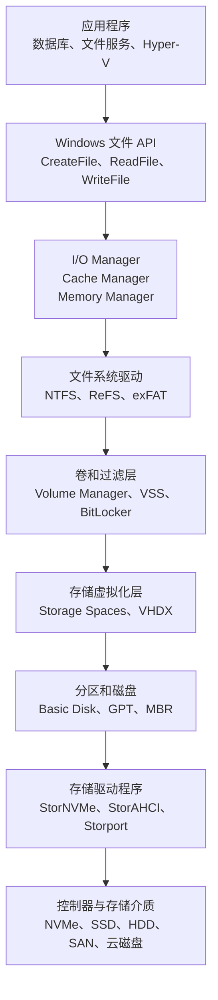
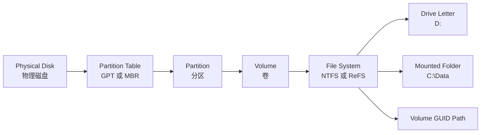
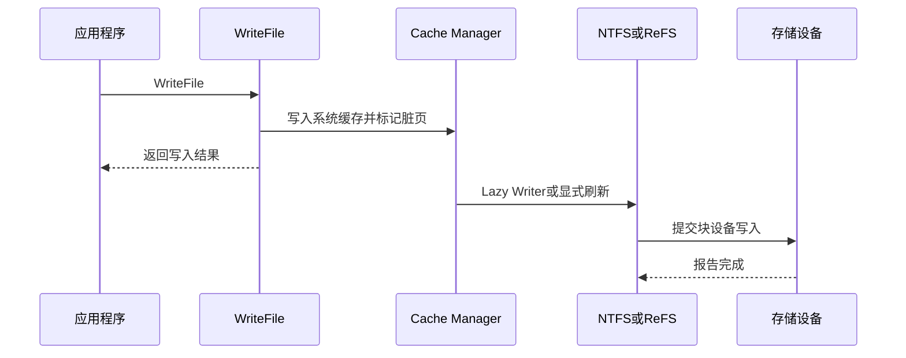
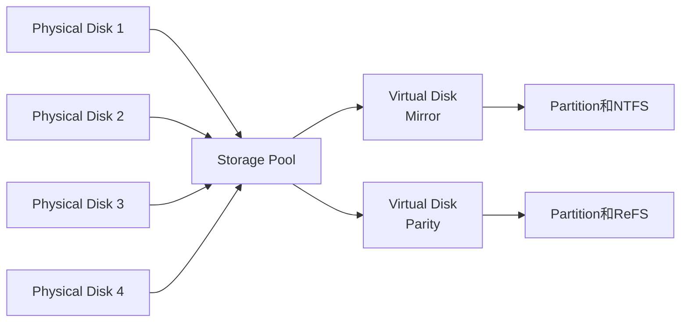
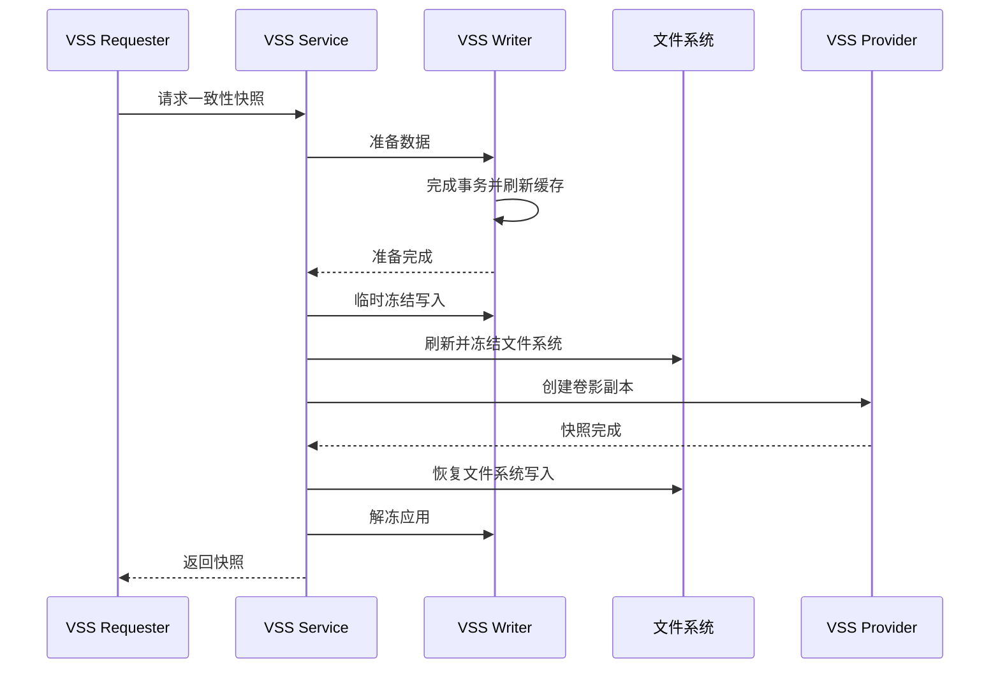
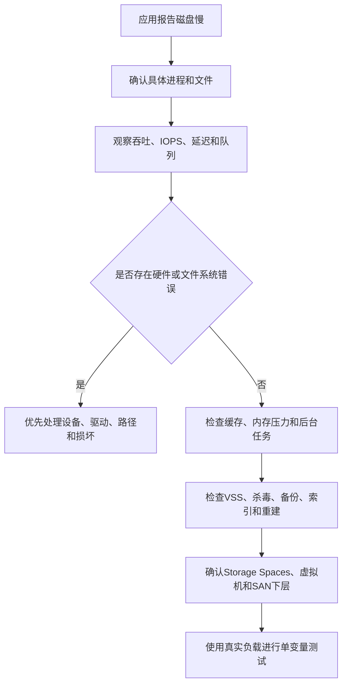

[toc]


## Windows 存储管理的整体思路

Windows 和 Linux 面向的是同一类底层硬件，因此核心问题基本一致：

- 如何发现物理磁盘。
- 如何划分地址空间。
- 如何把多个设备组合成逻辑存储。
- 如何创建文件系统。
- 如何缓存、调度和持久化 I/O。
- 如何提供冗余、快照、加密和备份。
- 如何监控容量、性能和硬件故障。

两者最大的差异不在底层原理，而在于：

- 使用的术语和管理工具不同。
- Windows 更强调“**磁盘、分区、卷、盘符**”。
- Linux 更强调“块设备、设备映射、文件系统、挂载点”。
- Windows 的常规管理入口是磁盘管理器和 PowerShell Storage 模块。
- Linux 的管理通常由多个专用工具共同完成，例如 `lsblk`、`parted`、LVM、mdadm、cryptsetup 和文件系统工具。

------

## Windows 存储栈概览

下面是一张简化的概念图。实际 Windows 内核存储栈还包含 I/O Manager、PnP Manager、过滤驱动程序、存储端口驱动等更多组件。



Windows 的 Cache Manager 会缓存文件数据，并通过延迟写入机制把脏数据写到存储设备；应用也可以使用写穿透或显式刷新接口控制持久化时机。Storage Spaces、BitLocker 和 VSS 则分别提供存储池与冗余、块级加密和卷快照协调能力。([Microsoft Learn](https://learn.microsoft.com/en-us/windows/win32/fileio/file-caching))

------

## Windows 与 Linux 核心概念对照

| Windows 概念                 | Linux 中大致对应                 | 说明                                     |
| ---------------------------- | -------------------------------- | ---------------------------------------- |
| Physical Disk                | 物理块设备，如 `/dev/sda`        | HDD、SSD、NVMe、SAN LUN 或虚拟磁盘       |
| Disk                         | 整盘块设备                       | Windows 管理工具中的 Disk 0、Disk 1      |
| Partition                    | 分区，如 `/dev/sda1`             | GPT 或 MBR 上的一段连续地址空间          |
| Volume                       | 文件系统所在的逻辑存储对象       | 可能位于分区、Storage Spaces 或动态卷上  |
| Drive Letter                 | 挂载路径的一种形式               | `C:`、`D:`，但不是卷的稳定身份           |
| Mounted Folder               | Linux 挂载点                     | 例如把新卷挂载到 `C:\Data\Database`      |
| Volume GUID Path             | 文件系统 UUID 对应的稳定引用方式 | 例如 `\\?\Volume{GUID}\`                 |
| Basic Disk                   | 普通 GPT/MBR 磁盘                | 类似直接使用分区                         |
| Dynamic Disk                 | 旧式逻辑卷管理                   | 某种程度类似早期 LVM，但现代部署不再推荐 |
| Storage Pool                 | LVM VG 或存储池                  | 聚合多块物理磁盘                         |
| Storage Space / Virtual Disk | LVM LV、MD RAID 设备             | 从 Storage Pool 创建的逻辑磁盘           |
| BitLocker                    | LUKS/dm-crypt                    | 卷级块设备加密                           |
| VSS Shadow Copy              | LVM/Btrfs/存储阵列快照协调框架   | 更强调应用、备份程序和快照提供者的协作   |
| VHD/VHDX                     | loop 设备、qcow2/raw 镜像        | 文件形式的虚拟磁盘                       |
| Storage Spaces Direct        | 分布式软件定义存储               | 与单机 mdraid、LVM 并不直接等价          |

这是一种便于理解的近似对应，而不是功能完全等价。例如 Storage Spaces 同时涵盖磁盘池、条带、镜像、校验和 thin provisioning，比单独的 Linux LVM 更接近“LVM 加 mdraid 的组合”。

------

## 磁盘、分区和卷

### Windows 中的层次关系



在最简单的场景中，一个卷位于一个分区上。但一个卷也可能建立在：

- Storage Spaces 虚拟磁盘上。
- SAN LUN 上。
- VHDX 虚拟磁盘上。
- 旧式 Dynamic Disk 的多个 extent 上。
- 故障转移群集的 Cluster Shared Volume 上。

### Disk、Partition 和 Volume 不应混用

| 对象         | 主要作用                           | 是否一定包含文件系统 |
| ------------ | ---------------------------------- | -------------------- |
| Disk         | 表示整个物理或虚拟磁盘             | 否                   |
| Partition    | GPT/MBR 划分出的区域               | 否                   |
| Volume       | 向文件系统或应用提供的逻辑存储对象 | 不一定               |
| File System  | 管理文件、目录和空闲空间           | 是卷上的上层结构     |
| Drive Letter | 卷的一个访问路径                   | 否                   |

这一点和 Linux 很相似：

```text
Windows:
Disk 1 → Partition 1 → Volume → NTFS → D:

Linux:
/dev/sdb → /dev/sdb1 → ext4 → /srv/data
```

Windows 管理员经常直接说“D 盘”，但从故障排查角度，应进一步确认它究竟对应哪块磁盘、哪个分区、哪个 Volume GUID，以及是否位于 Storage Spaces、SAN 或虚拟磁盘之上。

------

## 磁盘初始化与 GPT

新磁盘进入 Windows 后，通常需要先完成：

```text
磁盘上线
→ 初始化为 GPT 或 MBR
→ 创建分区
→ 格式化卷
→ 分配盘符或挂载目录
```

现代 Windows 环境通常优先采用 GPT。MBR 主要用于旧式启动和兼容场景。Windows 的磁盘管理器、`diskpart` 和 PowerShell 都可以完成初始化和分区操作。([Microsoft Learn](https://learn.microsoft.com/en-us/windows-server/storage/disk-management/initialize-new-disks?utm_source=chatgpt.com))

### PowerShell 盘点命令

```powershell
Get-Disk |
    Format-Table Number, FriendlyName, SerialNumber, BusType,
                 PartitionStyle, OperationalStatus, HealthStatus, Size

Get-Partition |
    Format-Table DiskNumber, PartitionNumber, DriveLetter,
                 Type, Size, Offset

Get-Volume |
    Format-Table DriveLetter, FileSystemLabel, FileSystem,
                 HealthStatus, SizeRemaining, Size
```

`Get-Disk`、`Get-Partition` 和 `Get-Volume` 分别返回系统可见磁盘、分区和卷对象，适合代替解析图形界面或传统文本输出。([Microsoft Learn](https://learn.microsoft.com/en-us/powershell/module/storage/get-disk?view=windowsserver2025-ps&utm_source=chatgpt.com))

### 初始化新数据盘

以下命令具有破坏性。生产环境中不能仅根据 `DiskNumber` 判断目标盘，应同时核对序列号、型号、总线类型和容量。

```powershell
$disk = Get-Disk -Number 3

$disk |
    Format-List Number, FriendlyName, SerialNumber, UniqueId,
                BusType, Size, PartitionStyle, OperationalStatus

# 确认是目标空盘后再执行
$disk |
    Initialize-Disk -PartitionStyle GPT -PassThru |
    New-Partition -UseMaximumSize -DriveLetter D |
    Format-Volume -FileSystem NTFS `
                  -NewFileSystemLabel "ApplicationData" `
                  -AllocationUnitSize 4096 `
                  -Confirm
```

`Format-Volume` 用于格式化已有分区或卷；创建新卷时通常与 `Initialize-Disk` 和 `New-Partition` 配合使用。([Microsoft Learn](https://learn.microsoft.com/en-us/powershell/module/storage/format-volume?view=windowsserver2025-ps&utm_source=chatgpt.com))

### 与 Linux 的管理方式对比

| 操作         | Windows                         | Linux                            |
| ------------ | ------------------------------- | -------------------------------- |
| 查看磁盘     | `Get-Disk`、磁盘管理器          | `lsblk`、`blkid`                 |
| 初始化 GPT   | `Initialize-Disk`               | `parted mklabel gpt`             |
| 创建分区     | `New-Partition`、`diskpart`     | `parted`、`fdisk`、`sgdisk`      |
| 创建文件系统 | `Format-Volume`、`format`       | `mkfs.ext4`、`mkfs.xfs`          |
| 分配访问路径 | 盘符、目录挂载点                | 目录挂载点                       |
| 持久化配置   | Mount Manager、注册表和卷元数据 | `/etc/fstab`、systemd mount unit |
| 自动化       | PowerShell 对象管道             | Shell、Ansible、专用命令         |

PowerShell 的优势是返回结构化对象，管理员不需要解析本地化文本；Linux 工具则更加模块化，很多工具支持 JSON 或显式列输出。

------

## 盘符、卷 GUID 和目录挂载点

### 盘符不是卷的稳定身份

常见盘符包括：

```text
C:  系统卷
D:  数据卷
E:  光驱或其他卷
```

但盘符只是一个挂载路径。设备接入顺序、系统配置、SAN 映射或管理员操作可能改变数据卷盘符。

更稳定的卷身份通常是 Volume GUID Path：

```text
\\?\Volume{xxxxxxxx-xxxx-xxxx-xxxx-xxxxxxxxxxxx}\
```

查看卷 GUID：

```powershell
mountvol
```

或者：

```powershell
Get-Volume |
    Select-Object DriveLetter, FileSystemLabel, UniqueId, Path
```

Windows 的 `mountvol` 可以创建、删除和列出卷挂载点，并允许卷在没有盘符的情况下通过 Volume GUID 或目录挂载点访问。([Microsoft Learn](https://learn.microsoft.com/en-us/windows-server/administration/windows-commands/mountvol?utm_source=chatgpt.com))

### Windows 也支持类似 Linux 的目录挂载

例如：

```text
C:\Data\Database
C:\Data\Logs
C:\Data\Backup
```

这些目录可以分别对应不同卷，而不需要占用 `D:`、`E:`、`F:`。

PowerShell 示例：

```powershell
New-Item -ItemType Directory -Path C:\Data\Database

Add-PartitionAccessPath `
    -DiskNumber 3 `
    -PartitionNumber 1 `
    -AccessPath "C:\Data\Database"
```

Windows 支持把卷挂载到现有空目录。现代管理文档要求挂载目录和目标卷使用受支持的 NTFS/ReFS 组合。([Microsoft Learn](https://learn.microsoft.com/en-us/windows-server/storage/disk-management/assign-a-mount-point-folder-path-to-a-drive?utm_source=chatgpt.com))

### 和 Linux 的差异

| Windows                            | Linux                                             |
| ---------------------------------- | ------------------------------------------------- |
| 盘符非常常见                       | 没有盘符概念                                      |
| 一个卷可以同时有盘符和目录挂载点   | 一个文件系统可以出现在一个或多个挂载点            |
| Volume GUID 是稳定卷标识之一       | UUID、PARTUUID 和 `/dev/disk/by-*` 常用于稳定识别 |
| 路径通常写作 `C:\Data`             | 路径统一从 `/` 开始                               |
| 盘符变化可能破坏依赖绝对路径的应用 | 挂载点改变同样会破坏绝对路径依赖                  |

对于服务器，推荐使用有业务含义的目录挂载点，而不是无限增加盘符。例如数据库可以使用：

```text
C:\Mounts\DatabaseData
C:\Mounts\DatabaseLog
C:\Mounts\TempDB
```

同时仍应在监控和自动化中记录 Volume GUID、磁盘 Unique ID 和存储池关系。

------

## Basic Disk 与 Dynamic Disk

### Basic Disk

Basic Disk 是现代 Windows 中的常规磁盘类型：

- 使用 GPT 或 MBR。
- 通过分区组织空间。
- 适合绝大多数系统盘和普通数据盘。
- 可以在分区上创建 NTFS、ReFS 或其他受支持文件系统。

### Dynamic Disk

Dynamic Disk 是旧式 Windows 逻辑卷管理技术，可以建立：

- Simple Volume。
- Spanned Volume。
- Striped Volume。
- Mirrored Volume。
- RAID-5 Volume。

但微软已经将 Dynamic Disks 标记为弃用；除了少数引导卷镜像场景，不建议新部署继续采用。需要跨盘组合、镜像或校验时，应优先考虑 Basic Disk、Storage Spaces 或硬件/阵列级 RAID。([Microsoft Learn](https://learn.microsoft.com/en-us/windows-server/storage/disk-management/change-disk-type-dynamic-basic?utm_source=chatgpt.com))

### 与 Linux LVM 的区别

| 对比              | Windows Dynamic Disk | Linux LVM                 |
| ----------------- | -------------------- | ------------------------- |
| 当前定位          | 旧式、弃用           | 仍是主流逻辑卷管理方案    |
| 新部署建议        | 通常不推荐           | 常用于服务器              |
| 跨盘扩展          | 支持                 | 支持                      |
| 条带、镜像        | 支持部分类型         | 可结合 LVM RAID 或 mdraid |
| Thin provisioning | 不作为现代核心能力   | LVM Thin 原生支持         |
| 推荐替代          | Storage Spaces       | LVM 本身仍可使用          |

看到已有服务器使用 Dynamic Disk 时，不要立即转换。应先确认：

- 是否包含系统卷或启动镜像。
- 是否为跨盘或镜像卷。
- 备份软件是否识别。
- 是否有完整数据备份。
- 转换过程中是否必须删除卷。

Basic/Dynamic 类型互转可能要求先删除卷，因此不能把它当作无风险在线操作。

------

## NTFS、ReFS 和其他文件系统

### 常见文件系统对比

| 文件系统 | 主要定位                           | 典型场景                           | 与 Linux 文件系统的近似比较          |
| -------- | ---------------------------------- | ---------------------------------- | ------------------------------------ |
| NTFS     | Windows 默认通用文件系统           | 系统盘、应用盘、文件服务器         | 类似 ext4/XFS 的通用地位             |
| ReFS     | 弹性、校验、规模化和虚拟化工作负载 | Hyper-V、备份仓库、大型数据卷      | 部分理念类似 Btrfs/XFS，但不完全等价 |
| exFAT    | 跨平台移动存储                     | U 盘、SD 卡、大文件交换            | 类似跨平台交换文件系统               |
| FAT32    | 兼容性和启动分区                   | EFI System Partition、小型移动介质 | Linux 可读写，但不适合现代服务器数据 |
| CSVFS    | 群集共享卷上的协调层               | Failover Cluster、Hyper-V 群集     | 不是普通本地文件系统的直接替代       |

NTFS 是现代 Windows 的默认文件系统，提供安全描述符、配额、加密和丰富元数据等能力。ReFS 则面向抗损坏、大规模存储和 Windows Server 工作负载，并与 Storage Spaces、Hyper-V 等功能结合。([Microsoft Learn](https://learn.microsoft.com/en-us/windows-server/storage/file-server/ntfs-overview))

### NTFS 的核心概念

NTFS 的重要结构和能力包括：

| 概念       | 英文                                        | 作用                                   |
| ---------- | ------------------------------------------- | -------------------------------------- |
| 主文件表   | Master File Table，MFT                      | 保存文件和目录记录                     |
| 文件引用   | File Reference                              | 标识 NTFS 文件记录                     |
| 安全描述符 | Security Descriptor                         | 保存所有者、ACL 和审核信息             |
| 备用数据流 | Alternate Data Stream，ADS                  | 一个文件名下保存多个命名数据流         |
| 更改日志   | Update Sequence Number Journal，USN Journal | 记录文件系统对象变更                   |
| 稀疏文件   | Sparse File                                 | 未分配区域逻辑读取为零                 |
| 重解析点   | Reparse Point                               | 支持符号链接、挂载点、云文件等扩展行为 |
| 配额       | Disk Quota                                  | 限制用户空间使用                       |
| 压缩       | NTFS Compression                            | 文件或目录级透明压缩                   |
| EFS        | Encrypting File System                      | 用户和证书相关的文件级加密             |

NTFS 的 ACL、所有者和继承模型与 Linux 传统的 user/group/other 权限不同。Linux 可以通过 POSIX ACL 扩展权限，而 Windows 通常从一开始就广泛使用细粒度 ACL。

### ReFS 的定位

ReFS 的重要能力包括：

- 元数据完整性保护。
- Integrity Streams。
- 在线损坏处理。
- 与冗余 Storage Spaces 结合时的数据修复。
- Block Cloning。
- Sparse VDL。
- 大规模文件和卷支持。
- 针对虚拟机磁盘和备份工作负载的优化。

ReFS Block Cloning 可以通过元数据重新映射，让同一卷上的文件范围共享底层逻辑簇，从而避免传统完整复制产生的大量读写。这与 Linux 中的 reflink 在使用体验上相似。([Microsoft Learn](https://learn.microsoft.com/en-us/windows-server/storage/refs/block-cloning?utm_source=chatgpt.com))

但应注意：

> ReFS 不是“功能更强的 NTFS”，也不应被理解为所有卷的默认最佳选择。

在选择 ReFS 前应确认：

- 当前 Windows 版本和 edition 是否支持创建该类型卷。
- 所需应用是否正式支持 ReFS。
- 是否需要 NTFS 专属功能。
- 备份、杀毒、复制和监控工具是否兼容。
- 目标工作负载是否真正需要 Block Cloning、Integrity Streams 等能力。
- 是否存在 Storage Spaces 或其他冗余副本供 ReFS 修复损坏数据。

### ReFS 与 Btrfs 的关键区别

| ReFS                                              | Btrfs                                        |
| ------------------------------------------------- | -------------------------------------------- |
| 与 Windows Server、Storage Spaces 和 Hyper-V 集成 | Linux 原生文件系统与多设备管理               |
| 有 Block Cloning                                  | 有 reflink 和原生子卷快照                    |
| 强调弹性和在线修复                                | 强调 COW、快照、校验和、子卷                 |
| 不等价于 Btrfs 子卷模型                           | 子卷是核心管理对象                           |
| 能力受 Windows edition 和版本影响                 | 能力受内核、btrfs-progs 和发行版支持策略影响 |

不能看到“校验和”和“块克隆”就认为两者有完全相同的快照、空间核算和故障恢复语义。

------

## 分配单元大小

Windows 格式化卷时会选择 Allocation Unit Size，通常也称 Cluster Size。

```powershell
Format-Volume `
    -DriveLetter D `
    -FileSystem NTFS `
    -AllocationUnitSize 4096
```

分配单元类似 Linux 文件系统块或 extent 分配粒度的一部分，但不能简单等同于硬件扇区。

| 分配单元较小             | 分配单元较大                               |
| ------------------------ | ------------------------------------------ |
| 小文件内部浪费较少       | 大文件元数据和映射开销可能更低             |
| 更适合大量小文件         | 某些数据库、虚拟磁盘和备份工作负载可能受益 |
| 极大卷中管理开销可能更高 | 小文件可能浪费更多空间                     |

不能机械地认为数据库一定要使用 64 KiB。应同时确认：

- 数据库厂商建议。
- NTFS 或 ReFS。
- 应用 I/O 大小。
- 存储阵列条带大小。
- Storage Spaces columns 和 interleave。
- 虚拟磁盘块大小。
- 备份和快照行为。

------

## 文件缓存与持久化

### Windows 的普通写入路径



默认情况下，Windows 会使用系统缓存优化文件读写。Cache Manager 的 Lazy Writer 会在后台回写脏数据；应用也可以使用 `FILE_FLAG_WRITE_THROUGH` 或 `FlushFileBuffers()` 请求更及时地刷新。([Microsoft Learn](https://learn.microsoft.com/en-us/windows/win32/fileio/file-caching))

和 Linux 一样：

> `WriteFile()` 成功通常不等于数据已经进入非易失介质。

它可能只意味着数据已经被 Windows 接收并进入系统缓存。

### Windows 与 Linux 持久化接口对比

| 需求               | Windows                              | Linux                   |
| ------------------ | ------------------------------------ | ----------------------- |
| 普通缓存写入       | `WriteFile()`                        | `write()`               |
| 刷新指定文件       | `FlushFileBuffers()`                 | `fsync()`               |
| 减少或绕过系统缓存 | `FILE_FLAG_NO_BUFFERING`             | `O_DIRECT`              |
| 写穿透             | `FILE_FLAG_WRITE_THROUGH`            | `O_SYNC`、`O_DSYNC`     |
| 内存映射刷新       | `FlushViewOfFile()`                  | `msync()`               |
| 原子替换路径       | `ReplaceFile()`、适当的重命名协议    | 同文件系统内 `rename()` |
| 异步 I/O           | Overlapped I/O、I/O Completion Ports | `io_uring`、AIO         |

这只是概念对应，两边的具体保证、错误返回、元数据刷新和网络文件系统语义并不完全相同。

### `FILE_FLAG_NO_BUFFERING` 不是持久化保证

使用：

```text
FILE_FLAG_NO_BUFFERING
```

主要表示绕过 Windows 系统文件缓存。它通常带来严格的对齐要求：

- 文件偏移应按扇区对齐。
- I/O 长度应为卷扇区大小的整数倍。
- 用户缓冲区地址通常也要适当对齐。

这类似 Linux 的 `O_DIRECT`，但两者都不自动表示断电后数据已经持久化。([Microsoft Learn](https://learn.microsoft.com/en-us/windows/desktop/FileIO/file-buffering?utm_source=chatgpt.com))

### `FILE_FLAG_WRITE_THROUGH`

使用：

```text
FILE_FLAG_WRITE_THROUGH
```

会让系统避免将写入长期留给 Lazy Writer，并请求更积极地写向设备。若与 `FILE_FLAG_NO_BUFFERING` 一起使用，Windows 还会请求写穿透设备本地硬件缓存；但最终保证仍受设备、控制器和驱动是否正确支持影响。([Microsoft Learn](https://learn.microsoft.com/en-us/windows/win32/api/fileapi/ns-fileapi-createfile2_extended_parameters?utm_source=chatgpt.com))

### 内存映射文件

对于 memory-mapped file，仅调用 `FlushViewOfFile()` 不足以保证文件元数据和硬件缓存也完成持久化。微软文档建议在需要完整刷新时先调用 `FlushViewOfFile()`，再对文件句柄调用 `FlushFileBuffers()`。网络文件上的远程持久化还取决于服务器端缓存和协议语义。([Microsoft Learn](https://learn.microsoft.com/en-us/windows/win32/api/memoryapi/nf-memoryapi-flushviewoffile?utm_source=chatgpt.com))

### 开发者应遵守的规则

- 不能把 `WriteFile()` 返回成功当作事务提交。
- 必须处理部分写入、磁盘满、配额耗尽和 I/O 错误。
- 不能把“关闭句柄”简单等同于已完成强持久化。
- 数据库日志和数据文件需要明确写入顺序。
- 重要文件更新应使用临时文件、刷新和原子替换协议。
- 需要绕过缓存时必须查询实际逻辑和物理扇区大小。
- 不要硬编码 512 字节扇区假设。
- SMB、SAN、虚拟磁盘和宿主机缓存会增加新的持久化层。

------

## Storage Spaces

Storage Spaces 是现代 Windows 的存储池和存储虚拟化技术。



基本对象包括：

| 对象     | 英文                         | 作用                         |
| -------- | ---------------------------- | ---------------------------- |
| 物理磁盘 | Physical Disk                | 加入存储池的实际磁盘         |
| 存储池   | Storage Pool                 | 聚合物理容量                 |
| 虚拟磁盘 | Virtual Disk / Storage Space | 从存储池创建的逻辑磁盘       |
| 弹性类型 | Resiliency Type              | Simple、Mirror 或 Parity     |
| 配置方式 | Provisioning Type            | Fixed 或 Thin                |
| 卷       | Volume                       | 在虚拟磁盘上创建的文件系统卷 |

Storage Spaces 可以从一组物理磁盘创建池和虚拟磁盘，并为虚拟磁盘选择 Simple、Mirror、Parity 以及 thin/fixed provisioning。([Microsoft Learn](https://learn.microsoft.com/en-us/windows-server/storage/storage-spaces/deploy-standalone-storage-spaces?utm_source=chatgpt.com))

### 弹性类型

| 类型             | 类似技术     | 容错                   | 特点                                             |
| ---------------- | ------------ | ---------------------- | ------------------------------------------------ |
| Simple           | RAID 0       | 无                     | 容量和性能优先，任一成员故障可能导致整体数据丢失 |
| Two-way Mirror   | RAID 1/10 类 | 通常可容忍一个副本故障 | 读写性能较好，容量开销大                         |
| Three-way Mirror | 三副本       | 可容忍更多故障         | 容量开销更大                                     |
| Single Parity    | RAID 5 类    | 单重校验               | 容量效率较好，随机写成本高                       |
| Dual Parity      | RAID 6 类    | 双重校验               | 更高容错，写入成本更高                           |

Microsoft 对 Storage Spaces 的说明指出，双向镜像保存两个副本，三向镜像保存三个副本；Parity 更节省容量，但由于校验计算和写入，写性能通常低于 Mirror，更适合归档、备份和偏顺序读取的负载。([Microsoft Learn](https://learn.microsoft.com/en-us/windows-server/storage/storage-spaces/overview))

### PowerShell 盘点

```powershell
Get-StoragePool |
    Format-Table FriendlyName, HealthStatus,
                 OperationalStatus, Size, AllocatedSize

Get-PhysicalDisk |
    Format-Table FriendlyName, SerialNumber, MediaType,
                 CanPool, HealthStatus, OperationalStatus, Size

Get-VirtualDisk |
    Format-Table FriendlyName, ResiliencySettingName,
                 ProvisioningType, HealthStatus, Size, FootprintOnPool

Get-StorageJob
```

### 创建示例

以下只适合实验环境或已经精确筛选目标设备的自动化脚本：

```powershell
$disks = Get-PhysicalDisk -CanPool $true

$pool = New-StoragePool `
    -FriendlyName "ApplicationPool" `
    -StorageSubsystemFriendlyName "Windows Storage*" `
    -PhysicalDisks $disks

$virtualDisk = New-VirtualDisk `
    -StoragePoolFriendlyName "ApplicationPool" `
    -FriendlyName "ApplicationMirror" `
    -ResiliencySettingName Mirror `
    -ProvisioningType Fixed `
    -UseMaximumSize

$virtualDisk |
    Get-Disk |
    Initialize-Disk -PartitionStyle GPT -PassThru |
    New-Partition -UseMaximumSize -DriveLetter D |
    Format-Volume -FileSystem ReFS `
                  -NewFileSystemLabel "ApplicationData"
```

官方 PowerShell Storage 模块支持通过 `New-StoragePool` 聚合可池化物理盘，并通过 `New-VirtualDisk` 创建 Mirror、Parity 和 thin-provisioned 虚拟磁盘。([Microsoft Learn](https://learn.microsoft.com/en-us/powershell/module/storage/new-storagepool?view=windowsserver2025-ps&utm_source=chatgpt.com))

### Thin provisioning 风险

Thin provisioning 允许虚拟磁盘声明的逻辑容量大于当前已分配物理容量，但它不会创造真实空间。

必须监控：

- Storage Pool 总容量。
- AllocatedSize。
- 虚拟磁盘 FootprintOnPool。
- thin-provisioned 虚拟磁盘增长速度。
- 自动扩容是否真的有可用物理盘。
- 修复和重建时是否有足够剩余空间。

这和 Linux LVM Thin Pool 十分类似：

> 只监控 `D:` 的可用空间是不够的，还要监控其下方 Storage Pool 是否即将耗尽。

------

## Storage Spaces、RAID 和备份

| 技术                  | 主要作用           | 能否防误删除 | 能否提供历史版本 | 能否替代备份           |
| --------------------- | ------------------ | ------------ | ---------------- | ---------------------- |
| Storage Spaces Mirror | 设备故障冗余       | 否           | 否               | 否                     |
| Storage Spaces Parity | 容量效率加设备容错 | 否           | 否               | 否                     |
| 硬件 RAID             | 控制器或阵列级冗余 | 否           | 否               | 否                     |
| VSS Shadow Copy       | 时间点视图         | 部分         | 是               | 否                     |
| Windows Server Backup | 数据复制和恢复     | 是           | 取决于策略       | 可以是备份方案组成部分 |
| 异地不可变备份        | 灾难和攻击恢复     | 是           | 是               | 是                     |

Storage Spaces 与 Linux mdraid 一样，解决的主要是成员设备故障，不防止：

- 管理员误删除。
- 应用逻辑错误。
- 勒索软件。
- 文件系统逻辑损坏。
- 电源或控制器造成的多盘损坏。
- 整机、机柜或站点故障。

------

## BitLocker

BitLocker 是 Windows 的卷级加密技术，可用于：

- 操作系统卷。
- 固定数据卷。
- 可移动数据卷。
- 与 TPM、PIN、启动密钥和恢复密钥配合。

BitLocker 与 TPM 配合时，可以把卷解锁与设备启动状态和平台完整性验证绑定起来；没有 TPM 时也存在其他启动解锁方案，但安全性和管理方式不同。([Microsoft Learn](https://learn.microsoft.com/en-us/windows/security/operating-system-security/data-protection/bitlocker/))

### BitLocker 与 LUKS 对比

| BitLocker                                        | LUKS/dm-crypt                              |
| ------------------------------------------------ | ------------------------------------------ |
| Windows 原生卷加密                               | Linux 原生块设备加密                       |
| 常与 TPM、Windows 启动链集成                     | 可与 TPM2、Clevis、Tang 等集成             |
| 由 `manage-bde`、PowerShell、组策略、Intune 管理 | 由 `cryptsetup`、systemd-cryptsetup 等管理 |
| 有恢复密码和恢复密钥管理机制                     | 有 key slot、passphrase、key file          |
| 加密卷常自动解锁                                 | 可通过密钥文件、TPM 或人工输入解锁         |

### 常用检查

```powershell
Get-BitLockerVolume |
    Format-Table MountPoint, VolumeType, VolumeStatus,
                 ProtectionStatus, EncryptionPercentage, EncryptionMethod
```

传统命令：

```powershell
manage-bde -status
manage-bde -protectors -get C:
```

### 最重要的运维要求

- 开启加密前确认恢复密钥保存位置。
- 恢复密钥不能只存放在被加密的同一设备上。
- 企业环境应集中保存在 Microsoft Entra ID、Active Directory、Intune 或受控密钥管理系统中。
- BIOS、UEFI、TPM、安全启动或启动链变更前，评估是否需要暂停保护。
- 不要在未确认恢复密钥可用时升级固件或更换主板。
- 备份恢复密钥不等于备份数据。
- BitLocker 不防止已登录用户、恶意软件或管理员删除数据。

BitLocker recovery 是默认解锁机制无法工作时恢复卷访问的流程，因此恢复信息的保存和权限审计属于部署的必要部分，而不是可选附件。([Microsoft Learn](https://learn.microsoft.com/en-us/windows/security/operating-system-security/data-protection/bitlocker/recovery-overview?utm_source=chatgpt.com))

------

## VSS：卷影复制服务

Volume Shadow Copy Service，简称 VSS，是 Windows 中极其重要但经常被误解的存储组件。

VSS 本身并不等同于某一种快照格式。它是一个协调框架，让以下组件合作：

| 角色     | 英文            | 作用                                       |
| -------- | --------------- | ------------------------------------------ |
| 请求者   | Requester       | 发起备份或快照，例如备份软件               |
| 写入器   | Writer          | 让应用准备一致状态，例如 SQL Server Writer |
| 提供者   | Provider        | 实际创建和维护快照                         |
| 文件系统 | File System     | 刷新并冻结必要的文件系统写入               |
| 存储后端 | Storage Backend | 可能使用软件 COW、硬件快照或阵列快照       |



VSS 会协调 Requester、Writer 和 Provider，要求应用准备事务状态、刷新文件系统缓冲，并在短时间冻结写入，以获得应用一致或至少文件系统一致的时间点副本。([Microsoft Learn](https://learn.microsoft.com/en-us/windows-server/storage/file-server/volume-shadow-copy-service))

### VSS 与 Linux 快照的差异

| Windows VSS                         | Linux 常见方式                                   |
| ----------------------------------- | ------------------------------------------------ |
| 是应用和快照提供者间的协调框架      | LVM/Btrfs/ZFS 快照本身主要是存储机制             |
| 应用可提供 VSS Writer               | 应用常通过钩子、脚本、备份代理或自身 API quiesce |
| Provider 可以是系统、软件或硬件阵列 | 快照由 LVM、文件系统或存储阵列创建               |
| 强调应用一致性协调                  | 是否应用一致取决于具体流程                       |
| 快照可能位于 diff area              | LVM snapshot、Btrfs snapshot 等各有空间模型      |

Linux 上执行：

```text
lvcreate --snapshot
```

只能保证创建一个块设备时间点视图，不自动保证数据库事务一致。Windows 中同样只有当对应 VSS Writer 正常参与时，才更可能获得应用一致快照。

### VSS 不是备份

VSS 快照可能：

- 和源卷位于同一物理磁盘。
- 使用源卷上的 diff area。
- 因空间不足而删除旧快照。
- 随源磁盘损坏一起丢失。
- 被管理员、攻击者或勒索软件删除。

因此：

> VSS 更适合作为备份过程中的一致性来源或快速恢复点，而不是唯一备份副本。

### 常用检查命令

```powershell
vssadmin list writers
vssadmin list providers
vssadmin list shadows
vssadmin list shadowstorage
```

高级管理：

```powershell
diskshadow
```

VSS 故障排查应首先确认：

- Writer 是否处于 Stable 状态。
- 是否有 Writer 报错或等待重试。
- Provider 是否正常。
- diff area 是否耗尽。
- 事件查看器中是否存在 VSS、VolSnap 或应用 Writer 错误。
- 备份软件是否正确调用对应 Writer。

------

## VHD 和 VHDX 虚拟磁盘

Windows 可以把一个普通文件作为块设备挂载：

```text
D:\VMs\Database01.vhdx
```

挂载后，Windows 会把它呈现为一个新的 Disk，对它仍然可以：

- 初始化 GPT。
- 创建分区。
- 格式化 NTFS/ReFS。
- 分配盘符。
- 用于 Hyper-V 虚拟机。

PowerShell 示例：

```powershell
New-VHD `
    -Path D:\VHD\Data01.vhdx `
    -SizeBytes 200GB `
    -Dynamic

Mount-VHD -Path D:\VHD\Data01.vhdx

Get-Disk |
    Sort-Object Number
```

### 与 Linux 镜像文件对比

| Windows            | Linux                 |
| ------------------ | --------------------- |
| VHD/VHDX           | raw、qcow2、VMDK      |
| `Mount-VHD`        | `losetup`、`qemu-nbd` |
| Dynamic VHDX       | sparse/qcow2 动态分配 |
| Differencing Disk  | qcow2 backing file    |
| Hyper-V Checkpoint | 虚拟机快照链          |

需要特别关注多层动态分配：

```text
NTFS/ReFS 文件系统
→ 动态 VHDX
→ 宿主机 NTFS/ReFS
→ Storage Spaces Thin Virtual Disk
→ SAN Thin LUN
```

每一层都可能认为自己还有大量逻辑空间，而最底层物理池已经接近耗尽。

------

## SSD、TRIM 和卷优化

Windows 的卷优化并不只是传统意义上的“磁盘碎片整理”。

`Optimize-Volume` 可以根据介质和参数执行：

- Defragmentation。
- ReTrim。
- Slab consolidation。
- Storage tier processing。

([Microsoft Learn](https://learn.microsoft.com/en-us/powershell/module/storage/optimize-volume?view=windowsserver2025-ps&utm_source=chatgpt.com))

常用检查：

```powershell
Get-PhysicalDisk |
    Format-Table FriendlyName, MediaType, BusType,
                 HealthStatus, Size

Optimize-Volume -DriveLetter D -Analyze -Verbose
```

SSD ReTrim：

```powershell
Optimize-Volume -DriveLetter D -ReTrim -Verbose
```

按系统判断的适当方式优化：

```powershell
Optimize-Volume -DriveLetter D -NormalPriority -Verbose
```

传统命令：

```powershell
defrag D: /A /V
defrag D: /L
defrag D: /O
```

其中 `/L` 用于 ReTrim，`/O` 根据介质类型执行适当优化。([Microsoft Learn](https://learn.microsoft.com/en-us/windows-server/administration/windows-commands/defrag?utm_source=chatgpt.com))

### 与 Linux 对比

| Windows                                      | Linux                                |
| -------------------------------------------- | ------------------------------------ |
| `Optimize-Volume -ReTrim`                    | `fstrim`                             |
| Optimize Drives 计划任务                     | `fstrim.timer`                       |
| `defrag` 根据参数和介质执行不同操作          | 文件系统有独立碎片整理工具           |
| Storage Spaces 还可能执行 slab consolidation | thin pool/discard 行为由多层共同决定 |

不要因为命令名是 `defrag` 就认为 Windows 一定会对 SSD 执行传统 HDD 式全盘碎片整理。应查看实际介质识别和运行参数。

------

## 容量管理

### 基本查看

```powershell
Get-Volume |
    Select-Object DriveLetter, FileSystemLabel, FileSystem,
                  Size, SizeRemaining, HealthStatus

Get-PSDrive -PSProvider FileSystem
```

计算使用率：

```powershell
Get-Volume |
    Where-Object DriveLetter |
    Select-Object DriveLetter, FileSystemLabel,
        @{Name = "SizeGB"; Expression = {
            [math]::Round($_.Size / 1GB, 2)
        }},
        @{Name = "FreeGB"; Expression = {
            [math]::Round($_.SizeRemaining / 1GB, 2)
        }},
        @{Name = "UsedPercent"; Expression = {
            if ($_.Size -gt 0) {
                [math]::Round(
                    (1 - $_.SizeRemaining / $_.Size) * 100,
                    2
                )
            }
        }}
```

### Windows 中“空间对不上”的常见原因

| 原因                      | 说明                           | 检查方向                             |
| ------------------------- | ------------------------------ | ------------------------------------ |
| VSS diff area             | 卷影副本使用空间               | `vssadmin list shadowstorage`        |
| System Volume Information | 系统还原、索引、VSS 等数据     | 检查服务和 VSS                       |
| 回收站                    | 每个卷可能有 `$Recycle.Bin`    | 查看各用户回收站                     |
| Pagefile                  | 页面文件                       | 系统内存配置                         |
| Hibernation file          | `hiberfil.sys`                 | 电源和休眠配置                       |
| NTFS 元数据               | MFT、日志、USN Journal         | `fsutil`                             |
| 稀疏文件                  | 逻辑长度大于实际分配           | `fsutil sparse`                      |
| ReFS Block Clone          | 多个文件共享底层簇             | 文件系统和应用专用工具               |
| Deduplication             | 逻辑大小大于后端实际占用       | Data Deduplication 状态              |
| Dynamic VHDX              | 文件逻辑磁盘大小和宿主占用不同 | `Get-VHD`                            |
| Storage Spaces Thin       | 卷有空闲但存储池快满           | `Get-StoragePool`、`Get-VirtualDisk` |
| 硬链接                    | 多个路径引用同一数据           | 专用文件分析工具                     |
| 权限限制                  | 扫描工具无法进入所有目录       | 以适当权限重新扫描                   |

这与 Linux 中的 `df` 和 `du` 不一致问题相似，但 Windows 需要额外关注 VSS、System Volume Information、USN Journal、VHDX 和 Storage Spaces。

------

## 文件系统检查与修复

### CHKDSK

常见检查：

```powershell
chkdsk D:
```

在线扫描 NTFS：

```powershell
chkdsk D: /scan
```

修复：

```powershell
chkdsk D: /f
```

定位修复：

```powershell
chkdsk D: /spotfix
```

PowerShell 方式：

```powershell
Repair-Volume -DriveLetter D -Scan
Repair-Volume -DriveLetter D -SpotFix
```

现代 NTFS 支持在线扫描和记录损坏位置，再通过 `/spotfix` 短暂离线修复特定问题；完整修复是否需要卸载或重启取决于卷是否正在使用。([Microsoft Learn](https://learn.microsoft.com/en-us/windows-server/administration/windows-commands/chkdsk?utm_source=chatgpt.com))

### 不要把 `/r` 当作日常保养

```powershell
chkdsk D: /r
```

`/r` 会查找不可读扇区并尝试恢复可读信息，通常耗时很长，会产生大量读 I/O。

只有在以下情况才应考虑：

- 明确怀疑介质坏块。
- 已经保存重要数据。
- 已检查设备和控制器健康。
- 可以接受长时间离线或高负载。
- 已考虑先进行块级镜像。

如果底层磁盘正在物理故障，反复全盘扫描可能加速故障。恢复优先级通常应是：

```text
停止不必要写入
→ 保存日志与健康信息
→ 备份或镜像可读数据
→ 更换故障硬件
→ 在可靠副本上修复文件系统
```

### ReFS 的修复模型

ReFS 设计为在多种损坏情况下尽量保持卷在线，并在有冗余副本时修复损坏数据。如果没有良好副本，某些不可恢复数据可能从命名空间中移除以隔离损坏。([Microsoft Learn](https://learn.microsoft.com/en-us/troubleshoot/windows-server/backup-and-storage/troubleshoot-data-corruption-and-disk-errors?utm_source=chatgpt.com))

但这不意味着：

- ReFS 不会损坏。
- 不需要硬件监控。
- 不需要备份。
- 所有数据都有校验和和冗余副本。
- 单盘 ReFS 等价于带镜像 Storage Spaces 的 ReFS。

------

## 硬件健康与错误日志

Windows 没有完全等同于 Linux `dmesg` 的单一入口。常用入口包括：

- Event Viewer。
- PowerShell。
- Windows Admin Center。
- 厂商 NVMe、RAID、HBA、SAN 管理工具。
- Performance Monitor。
- WMI/CIM。
- `Get-StorageReliabilityCounter`。

### 基本盘点

```powershell
Get-PhysicalDisk |
    Format-Table FriendlyName, SerialNumber, MediaType,
                 BusType, HealthStatus, OperationalStatus,
                 Usage, Size

Get-Disk |
    Format-Table Number, FriendlyName, SerialNumber,
                 OperationalStatus, HealthStatus,
                 IsOffline, IsReadOnly, Size
```

可靠性计数器：

```powershell
Get-PhysicalDisk |
    Get-StorageReliabilityCounter |
    Format-List *
```

不同控制器和驱动暴露的数据并不一致。硬件 RAID 可能只向 Windows 呈现一个逻辑磁盘，因此成员盘健康状态必须到 RAID 控制器管理工具中查看。

### 需要关注的事件类型

| 现象                    | 常见调查方向                     |
| ----------------------- | -------------------------------- |
| Disk 错误               | 设备、介质、控制器或路径问题     |
| NTFS/ReFS 错误          | 文件系统损坏或底层 I/O 问题      |
| StorPort reset          | HBA、SAN、控制器、固件或超时     |
| NVMe reset/timeout      | NVMe 设备、固件、温度或 PCIe     |
| VolSnap 错误            | VSS 空间或快照问题               |
| BitLocker 错误          | TPM、保护器、恢复密钥或启动链    |
| Storage Spaces degraded | 成员盘故障或池容量不足           |
| Event ID 129            | 存储请求超时并触发设备或路径重置 |
| Event ID 153            | I/O 被重试                       |
| Event ID 55/98          | 文件系统结构问题或需检查卷       |

Microsoft 的存储故障指导特别关注文件系统损坏事件、设备重置和底层存储错误；排查时不能只执行 CHKDSK，而应同时检查设备、驱动、固件、路径和控制器。([Microsoft Learn](https://learn.microsoft.com/es-es/troubleshoot/windows-server/backup-and-storage/troubleshoot-data-corruption-and-disk-errors?utm_source=chatgpt.com))

------

## 性能监控

### 常见工具

| 工具                         | 用途                     | Linux 中大致对应           |
| ---------------------------- | ------------------------ | -------------------------- |
| Task Manager                 | 快速观察磁盘活动         | `top`、桌面监视器          |
| Resource Monitor             | 查看进程和文件级磁盘活动 | `iotop`、`pidstat`         |
| Performance Monitor          | 长期采集性能计数器       | `sar`、Prometheus exporter |
| Windows Performance Recorder | 深度事件跟踪             | ftrace、perf、eBPF         |
| Windows Performance Analyzer | 分析 ETW 跟踪            | perf report、trace 工具    |
| Process Monitor              | 文件和注册表操作追踪     | `strace`、audit、eBPF      |
| DiskSpd                      | 存储基准测试             | `fio`                      |
| PowerShell Storage cmdlets   | 管理拓扑和健康           | `lsblk`、LVM、mdadm 工具   |

### 重要 Performance Monitor 计数器

常见计数器包括：

```text
PhysicalDisk\Disk Reads/sec
PhysicalDisk\Disk Writes/sec
PhysicalDisk\Disk Read Bytes/sec
PhysicalDisk\Disk Write Bytes/sec
PhysicalDisk\Avg. Disk sec/Read
PhysicalDisk\Avg. Disk sec/Write
PhysicalDisk\Current Disk Queue Length
LogicalDisk\% Free Space
LogicalDisk\Free Megabytes
```

### 不要简单解读 `% Disk Time`

现代 NVMe、多队列设备、虚拟存储和存储阵列中，单个利用率计数器很难完整表示饱和程度。应同时观察：

- IOPS。
- 吞吐量。
- 平均延迟。
- P95/P99 应用延迟。
- 请求大小。
- 队列长度。
- 读写比例。
- Storage Spaces 或 RAID 重建。
- VSS、备份、杀毒和索引活动。
- 虚拟机宿主层和来宾层。
- SAN 或云磁盘配额。

### 性能排查路径



------

## 页面文件

Windows Page File 对应 Linux 的 swap，但两者的默认策略和管理界面不同。

常见文件：

```text
C:\pagefile.sys
```

页面文件用于：

- 为部分提交内存提供后备存储。
- 将较不活跃的内存内容换出。
- 支持某些崩溃转储配置。
- 增加系统 commit limit。

查看：

```powershell
Get-CimInstance Win32_PageFileUsage
Get-CimInstance Win32_PageFileSetting
```

### 与 Linux swap 对比

| Windows Page File                | Linux Swap                 |
| -------------------------------- | -------------------------- |
| 通常由系统自动管理               | 可以是分区、文件或 zram    |
| 与 Commit Limit 紧密相关         | 与匿名页换出和内存回收相关 |
| 某些 crash dump 依赖页面文件配置 | kdump 通常采用独立机制     |
| 常见为 `pagefile.sys`            | `swapfile` 或 swap 分区    |
| 不应简单因为“内存足够”就关闭     | 同样不应机械关闭 swap      |

数据库服务器或低延迟系统是否调整页面文件，应根据：

- 应用厂商建议。
- 峰值 commit。
- 崩溃转储要求。
- 物理内存。
- 存储性能。
- 系统监控数据。

------

## Windows 文件权限与磁盘空间

Windows 存储管理不能只关注磁盘和文件系统，还要关注 NTFS ACL。

### 权限模型对比

| Windows NTFS               | Linux                         |
| -------------------------- | ----------------------------- |
| Security Identifier，SID   | UID/GID                       |
| Discretionary ACL，DACL    | mode bits 加 POSIX ACL        |
| System ACL，SACL           | audit 子系统规则              |
| 显式允许和拒绝 ACE         | 传统 POSIX ACL 主要表达允许   |
| 权限继承广泛使用           | 默认 ACL 可实现继承式行为     |
| 所有者不一定拥有全部访问权 | root 通常能绕过大部分权限检查 |

检查：

```powershell
Get-Acl D:\ApplicationData | Format-List
```

设置权限时不应只使用图形界面反复点击。企业环境应通过：

- PowerShell。
- `icacls`。
- DSC。
- 组策略。
- 配置管理系统。

进行可审计、可重复的权限部署。

------

## Windows 管理员的日常检查

### 磁盘和卷

```powershell
Get-Disk
Get-Partition
Get-Volume
mountvol
```

### 文件系统容量

```powershell
Get-Volume |
    Where-Object DriveLetter |
    Format-Table DriveLetter, FileSystemLabel,
                 FileSystem, HealthStatus,
                 SizeRemaining, Size
```

### Storage Spaces

```powershell
Get-StoragePool
Get-PhysicalDisk
Get-VirtualDisk
Get-StorageJob
```

### BitLocker

```powershell
Get-BitLockerVolume
manage-bde -status
```

### VSS

```powershell
vssadmin list writers
vssadmin list providers
vssadmin list shadows
vssadmin list shadowstorage
```

### 文件系统健康

```powershell
Repair-Volume -DriveLetter D -Scan
chkdsk D: /scan
```

### 卷优化

```powershell
Optimize-Volume -DriveLetter D -Analyze -Verbose
```

### 事件日志

```powershell
Get-WinEvent -FilterHashtable @{
    LogName = "System"
    Level   = 2, 3
} |
    Where-Object {
        $_.ProviderName -match
        "disk|ntfs|refs|storport|stornvme|volsnap|spaceport"
    } |
    Select-Object TimeCreated, ProviderName, Id, Message
```

------

## 新建 Windows 数据卷的推荐流程

### 盘点目标磁盘

```powershell
Get-Disk |
    Format-Table Number, FriendlyName, SerialNumber,
                 UniqueId, BusType, PartitionStyle,
                 OperationalStatus, HealthStatus, Size
```

确认：

- 磁盘编号。
- 序列号。
- Unique ID。
- 容量。
- 总线类型。
- 是否 Offline。
- 是否 ReadOnly。
- 是否已有分区。
- 是否属于 Storage Pool。
- 是否可能是 SAN 共享 LUN。

### 上线并初始化

```powershell
$disk = Get-Disk -Number 3

$disk | Set-Disk -IsOffline $false
$disk | Set-Disk -IsReadOnly $false

$disk | Initialize-Disk -PartitionStyle GPT
```

### 创建分区和文件系统

```powershell
$partition = New-Partition `
    -DiskNumber 3 `
    -UseMaximumSize `
    -DriveLetter D

$partition | Format-Volume `
    -FileSystem NTFS `
    -NewFileSystemLabel "ApplicationData" `
    -AllocationUnitSize 4096 `
    -Confirm
```

### 或挂载到目录

```powershell
New-Item `
    -ItemType Directory `
    -Path C:\Mounts\ApplicationData

Add-PartitionAccessPath `
    -DiskNumber 3 `
    -PartitionNumber $partition.PartitionNumber `
    -AccessPath "C:\Mounts\ApplicationData"
```

### 完成后验证

```powershell
Get-Disk -Number 3
Get-Partition -DiskNumber 3
Get-Volume -DriveLetter D
mountvol
```

然后继续检查：

- NTFS ACL。
- BitLocker。
- 监控告警。
- 备份策略。
- VSS Writer。
- 杀毒排除是否符合应用厂商要求。
- 实际 I/O 性能。
- 恢复流程。

------

## 扩容流程

Windows 扩容同样必须从下到上。


普通分区可先查询允许的大小：

```powershell
$supported = Get-PartitionSupportedSize `
    -DriveLetter D

$supported
```

扩展到最大值：

```powershell
Resize-Partition `
    -DriveLetter D `
    -Size $supported.SizeMax
```

Storage Spaces 场景还可能需要：

```text
添加物理磁盘
→ 扩展 Storage Pool
→ 扩展 Virtual Disk
→ 扩展 Partition
→ 扩展 Volume
```

虚拟机场景可能是：

```text
扩展 VHDX
→ 来宾系统重新扫描磁盘
→ 扩展分区
→ 扩展文件系统
```

和 Linux 一样，**缩容风险远高于扩容**。必须先确认文件系统、分区、虚拟磁盘和底层存储是否都支持相应操作。

------

## 常见故障处理

### 新盘没有出现在文件资源管理器

检查顺序：

```text
设备管理器是否识别
→ Get-Disk 是否可见
→ 磁盘是否 Offline
→ 是否已经初始化
→ 是否有分区
→ 是否已格式化
→ 是否有盘符或目录挂载点
```

命令：

```powershell
Get-Disk
Get-Partition
Get-Volume
```

### 磁盘显示 Offline

可能原因包括：

- 管理员手工下线。
- SAN 共享总线磁盘策略。
- 磁盘签名或 Unique ID 冲突。
- 克隆磁盘或快照引入相同身份。
- 群集或多路径软件控制。
- 存储设备故障。

Windows Server 对共享总线上的新磁盘可能采用更保守的上线策略，因此不能看到 Offline 就直接执行 Online；应先判断它是否属于其他群集节点或共享存储。([Microsoft Learn](https://learn.microsoft.com/en-us/windows-server/storage/disk-management/manage-disks?utm_source=chatgpt.com))

### 卷容量突然不足

依次检查：

```powershell
Get-Volume
vssadmin list shadowstorage
Get-StoragePool
Get-VirtualDisk
Get-VHD -Path D:\VMs\*.vhdx
```

再检查：

- VSS 快照增长。
- 动态 VHDX。
- Windows Update 和组件存储。
- 日志。
- 转储文件。
- 回收站。
- 临时目录。
- 数据库事务日志。
- Storage Spaces Thin Pool。
- 备份软件缓存。

### Storage Spaces 进入 Degraded

优先检查：

```powershell
Get-StoragePool
Get-PhysicalDisk
Get-VirtualDisk
Get-StorageJob
```

不要立即移除“看起来异常”的磁盘。应先判断：

- 磁盘是真故障还是临时掉线。
- HBA、线缆、背板或电源是否异常。
- 是否正在自动修复。
- 是否有足够空闲容量完成修复。
- 故障域和副本布局。
- 是否已经有第二块盘出现错误。

### VSS 备份失败

```powershell
vssadmin list writers
vssadmin list providers
vssadmin list shadowstorage
```

排查：

- Writer 是否 Failed。
- Writer 对应服务是否正常。
- Provider 是否冲突。
- diff area 是否不足。
- 事件日志是否有 VSS 或 VolSnap 错误。
- 是否有长事务无法及时冻结。
- 备份软件是否安装了自己的 Provider。
- 杀毒软件是否拦截备份组件。

不要把“重启所有 VSS 服务”作为唯一长期解决方案。需要找出反复失败的 Writer、Provider 或底层存储原因。

------

## Windows 与 Linux 管理风格总结

| 关注点       | Windows                               | Linux                             |
| ------------ | ------------------------------------- | --------------------------------- |
| 常用管理界面 | GUI、PowerShell、Windows Admin Center | CLI、配置文件、Web 管理平台       |
| 默认文件系统 | NTFS                                  | 依发行版而异，常见 ext4/XFS       |
| 高级文件系统 | ReFS                                  | Btrfs、ZFS 等                     |
| 卷访问方式   | 盘符和目录挂载点                      | 统一目录树挂载点                  |
| 普通逻辑卷   | Basic Disk partition                  | 分区或 LVM LV                     |
| 多盘池化     | Storage Spaces                        | LVM、mdraid、Btrfs、ZFS           |
| 旧式卷管理   | Dynamic Disk，已弃用                  | LVM 仍是现代主流                  |
| 磁盘加密     | BitLocker                             | LUKS/dm-crypt                     |
| 快照协调     | VSS                                   | 应用钩子加 LVM/Btrfs/ZFS/阵列快照 |
| 文件刷新     | `FlushFileBuffers()`                  | `fsync()`                         |
| 无缓存 I/O   | `FILE_FLAG_NO_BUFFERING`              | `O_DIRECT`                        |
| I/O 跟踪     | ETW、WPR、WPA、ProcMon                | perf、ftrace、eBPF、strace        |
| 自动化       | PowerShell 对象                       | Shell、Python、Ansible            |
| 设备稳定标识 | Unique ID、Volume GUID、序列号        | UUID、PARTUUID、WWN、by-id        |
| 文件系统修复 | CHKDSK、Repair-Volume                 | fsck 及文件系统专用工具           |

------

## 系统管理员应重点掌握

### 基础能力

- 正确区分 Disk、Partition、Volume、File System 和 Drive Letter。
- 熟练使用 `Get-Disk`、`Get-Partition`、`Get-Volume`。
- 能安全初始化 GPT 磁盘并创建卷。
- 理解 Volume GUID 和目录挂载点。
- 掌握 NTFS 权限和继承。
- 知道 ReFS 的适用边界。

### 进阶能力

- 设计和维护 Storage Spaces。
- 理解 Mirror、Parity、columns、interleave 和 provisioning。
- 监控 Storage Pool 真实容量。
- 管理 BitLocker 和恢复密钥。
- 排查 VSS Writer、Provider 和 shadow storage。
- 分析 Performance Monitor 和 ETW 数据。
- 识别硬件、驱动、文件系统和应用层故障。

### 可靠性能力

- 明确 RAID、Storage Spaces、VSS 和备份的边界。
- 能完成真实恢复演练。
- 掌握卷扩容和虚拟磁盘扩容。
- 不在故障介质上盲目反复运行 CHKDSK。
- 在固件、TPM 或主板变更前处理 BitLocker。
- 对 SAN、群集和虚拟机磁盘使用稳定标识。

------

## 开发者应重点掌握

- `WriteFile()` 成功不等于持久化。
- `FlushFileBuffers()` 对应的是显式持久化请求。
- `FILE_FLAG_NO_BUFFERING` 不等于 `FILE_FLAG_WRITE_THROUGH`。
- 非缓存 I/O 必须处理扇区和缓冲区对齐。
- memory-mapped file 需要正确组合 `FlushViewOfFile()` 和文件刷新。
- NTFS ACL 与 Linux 权限模型不同。
- Windows 路径不应假设数据一定在固定盘符。
- 稀疏文件、Block Clone 和动态 VHDX 会改变空间核算。
- VSS 快照是否应用一致取决于 Writer 是否参与。
- SMB 文件持久化不能简单套用本地 NTFS 假设。
- 应用必须处理磁盘满、配额、I/O 错误和只读状态。
- 日志型应用必须定义崩溃恢复和写入顺序协议。

总体而言，Windows 和 Linux 的底层存储原理高度相似。学习时最有效的方法不是分别记忆两套命令，而是先建立共同模型：

```text
物理设备
→ 分区或存储池
→ 逻辑卷
→ 文件系统
→ 挂载路径
→ 缓存和持久化
→ 快照、冗余、加密
→ 监控、备份和恢复
```

理解这条链路后，Windows 的 Disk、Volume、Storage Spaces、NTFS、VSS、BitLocker，与 Linux 的块设备、LVM、mdraid、文件系统、快照和 LUKS，就能放在同一个知识体系中理解。