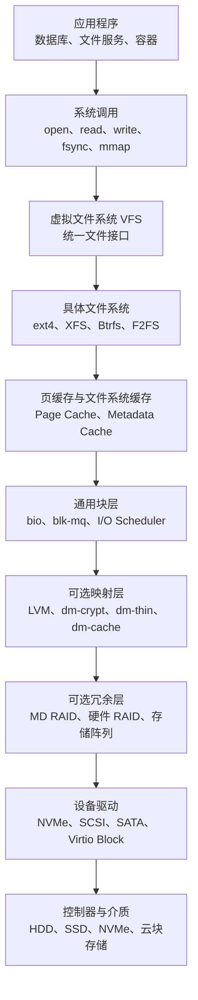
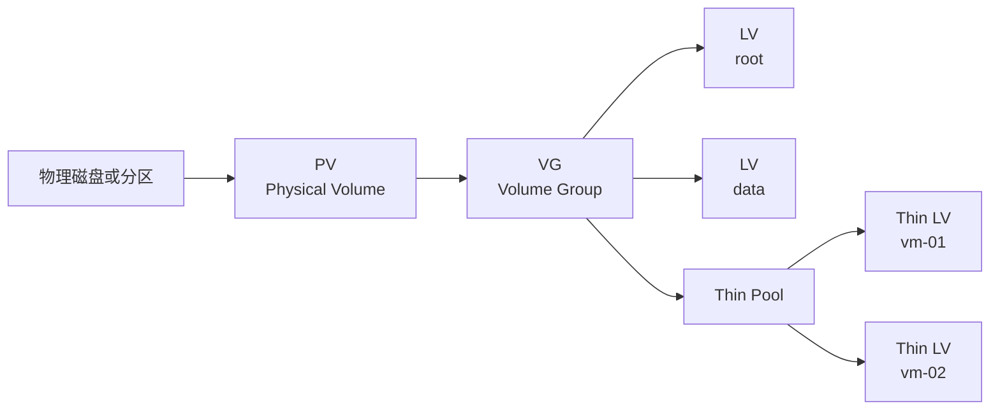
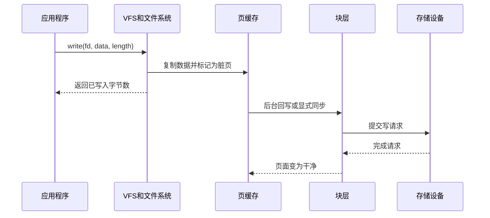
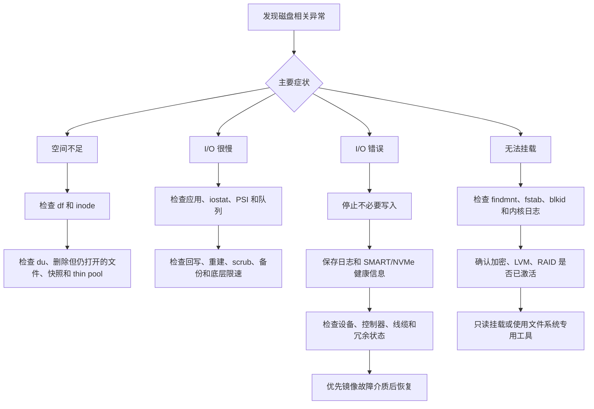

[toc]

## abstract

下面以 **Linux 为主线**，介绍现代操作系统如何使用和管理本地磁盘、SSD、NVMe、虚拟磁盘及其上的文件系统。大部分概念也适用于 BSD、其他 Unix-like 系统以及虚拟化环境。

真正理解磁盘管理，不能只停留在 `fdisk`、`mkfs`、`mount` 三个命令，而应建立一条完整链路：

> 应用程序如何发起 I/O，数据经过哪些缓存和抽象层，最终如何落到物理介质；
>
> 系统又如何完成容量管理、隔离、冗余、加密、监控和故障恢复。

------

## 学习目标与详细大纲

| 学习模块     | 核心问题                       | 管理员应掌握                              | 开发者应掌握                          |
| ------------ | ------------------------------ | ----------------------------------------- | ------------------------------------- |
| 存储硬件     | HDD、SATA SSD、NVMe 有何差异   | 接口、健康状态、故障模式、队列能力        | 顺序与随机 I/O、延迟、并发特征        |
| 块设备       | Linux 如何表示磁盘             | `/dev`、sysfs、udev、设备标识             | 块大小、对齐、I/O 边界                |
| 分区表       | GPT 和 MBR 的作用              | 分区、对齐、EFI System Partition          | 通常了解即可                          |
| 存储组合层   | RAID、LVM、加密如何叠加        | mdraid、LVM、Device Mapper、LUKS          | 了解数据路径和故障边界                |
| 文件系统     | 文件如何映射到磁盘块           | ext4、XFS、Btrfs 的选择、创建、扩容、维护 | inode、目录项、稀疏文件、COW、reflink |
| 挂载系统     | 文件系统如何接入目录树         | `mount`、`fstab`、systemd mount unit      | 挂载命名空间、容器中的文件系统视图    |
| 缓存与持久化 | `write()` 成功是否代表数据落盘 | 脏页、回写、flush、掉电保护               | `fsync()`、原子替换、数据库持久化语义 |
| I/O 调度     | 请求如何进入设备               | blk-mq、I/O 调度器、cgroup I/O 控制       | buffered I/O、direct I/O、异步 I/O    |
| 容量管理     | 为什么 `df` 和 `du` 不一致     | inode、已删除但仍打开的文件、快照         | 稀疏文件、预分配、reflink             |
| 性能监控     | 如何定位磁盘慢                 | IOPS、吞吐量、延迟、队列、PSI             | 访问模式、批量化、并发深度            |
| 可靠性       | RAID、快照、备份有何区别       | 巡检、scrub、备份和恢复演练               | 崩溃一致性、应用级校验                |
| 故障恢复     | 文件系统损坏时怎么处理         | 隔离、只读挂载、镜像、专用修复工具        | 正确处理 I/O 错误和空间耗尽           |
| 自动化与安全 | 如何安全编写运维脚本           | 稳定设备名、幂等、变更前验证              | 不假设设备顺序和持久化时机            |

------

## Linux 存储栈全景



Linux 的虚拟文件系统层（Virtual File System，VFS）向应用程序提供统一的 `open()`、`read()`、`write()`、`stat()` 等接口，再把操作分派给 ext4、XFS、Btrfs 等具体文件系统。

块层位于文件系统和块设备驱动之间；现代 Linux 主要使用多队列块层 blk-mq，以利用 NVMe、多核处理器和高并发设备的并行能力。([Linux内核文档](https://docs.kernel.org/filesystems/vfs.html?utm_source=chatgpt.com))

需要注意，图中的部分层次可以交换或省略。例如：

```text
磁盘 → GPT 分区 → ext4
磁盘 → LUKS → ext4
磁盘 → LUKS → LVM → XFS
多块磁盘 → MD RAID → LUKS → LVM → ext4
多块磁盘 → Btrfs 多设备文件系统
云块设备 → LVM Thin → 虚拟机逻辑卷
```

不存在对所有场景都最优的唯一顺序。设计时要明确每一层解决什么问题，以及它发生故障时会影响哪些上层。

------

## 从物理介质到 Linux 块设备

### 常见设备类型

| 类型              | 主要特点                             | 典型关注点                            |
| ----------------- | ------------------------------------ | ------------------------------------- |
| 机械硬盘 HDD      | 寻道成本高，顺序访问明显快于随机访问 | 坏扇区、振动、寻道、RAID 重建时间     |
| SATA SSD          | 无机械寻道，内部有闪存转换层 FTL     | 写放大、耐久度、TRIM、掉电保护        |
| NVMe SSD          | 通过 PCIe，支持多队列和较高并发      | 延迟、队列深度、温度、固件、耐久度    |
| SAS 磁盘          | 企业存储常见，双端口、较强错误报告   | 多路径、机箱、控制器兼容性            |
| 虚拟磁盘          | 由虚拟机监控器提供                   | 宿主机缓存、快照层、thin provisioning |
| 云块存储          | 网络后端呈现为块设备                 | 延迟抖动、吞吐和 IOPS 配额、故障域    |
| NVMe over Fabrics | 通过网络访问 NVMe                    | 网络、路径冗余、连接恢复、端到端延迟  |

NVMe 的高性能不仅来自介质，也来自其队列模型。blk-mq 允许多个 CPU 软件队列向一个或多个硬件队列并行提交请求，避免传统单队列模型成为瓶颈。([内核官方网站](https://www.kernel.org/doc/html/v6.0/block/blk-mq.html?utm_source=chatgpt.com))

> - **SATA** 是 **Serial Advanced Technology Attachment** 的缩写，中文通常译为：**串行高级技术附件**
> - **PCIe**是**Peripheral Component Interconnect Express** 直译为:**外围组件快速互连**,一种高速串行计算机扩展总线标准

### Linux 设备名称

| 设备示例              | 含义                                     |
| --------------------- | ---------------------------------------- |
| `/dev/sda`            | SCSI/SATA/USB 等经 SCSI 子系统呈现的整盘 |
| `/dev/sda1`           | `/dev/sda` 的第一个分区                  |
| `/dev/nvme0`          | NVMe 控制器设备                          |
| `/dev/nvme0n1`        | 控制器上的 namespace                     |
| `/dev/nvme0n1p1`      | NVMe namespace 的第一个分区              |
| `/dev/vda`            | 常见 virtio 虚拟磁盘                     |
| `/dev/xvda`           | 某些虚拟化平台的虚拟磁盘                 |
| `/dev/md0`            | Linux MD 软件 RAID                       |
| `/dev/dm-0`           | Device Mapper 内核映射设备               |
| `/dev/mapper/vg-data` | Device Mapper 的友好名称，常见于 LVM     |
| `/dev/loop0`          | 文件映射出的 loop 块设备                 |
| `/dev/zram0`          | 内存压缩块设备                           |

`/dev/sda` 这种名称并不是稳定的业务标识。磁盘探测顺序、控制器变化或启动时序都可能改变字母编号。持久配置通常应使用 UUID、PARTUUID、文件系统 LABEL、WWN 或 `/dev/disk/by-*` 下的稳定链接。

### 设备发现与盘点

推荐先建立只读盘点，不要一看到设备就运行格式化命令。

```bash
lsblk -e 7 \
  -o NAME,PATH,TYPE,SIZE,ROTA,TRAN,MODEL,SERIAL,WWN,LOG-SEC,PHY-SEC,\
FSTYPE,FSVER,LABEL,UUID,PARTUUID,MOUNTPOINTS

findmnt --real
findmnt --verify

blkid
cat /proc/partitions
```

`lsblk` 主要从 sysfs 和 udev 数据库收集块设备信息；`findmnt` 可以从 `/proc/self/mountinfo`、`fstab` 等位置查看实际挂载关系。脚本中应显式指定输出列，最好使用 JSON 输出，而不是解析默认的人类可读格式。([man7.org](https://man7.org/linux/man-pages/man8/lsblk.8.html?utm_source=chatgpt.com))

查看某个设备的 udev 属性：

```bash
udevadm info --query=property --name=/dev/nvme0n1
```

查看设备树及其依赖：

```bash
lsblk -s /dev/mapper/vg-data
lsblk -o NAME,TYPE,SIZE,PKNAME,MOUNTPOINTS
dmsetup ls --tree
```

------

## 扇区、块、页和对齐

“块”在不同上下文中可能指不同东西。

| 名称       | 英文             | 典型含义                                             |
| ---------- | ---------------- | ---------------------------------------------------- |
| 逻辑扇区   | Logical Sector   | 操作系统向设备寻址的最小单位，常见为 512 B 或 4096 B |
| 物理扇区   | Physical Sector  | 介质实际读改写单位，常见为 4096 B                    |
| 文件系统块 | Filesystem Block | 文件系统分配空间的基本单位，常见为 4096 B            |
| 内存页     | Memory Page      | 内核内存管理单位，常见架构通常为 4096 B，但并非固定  |
| 擦除块     | Erase Block      | NAND 闪存内部擦除单位，通常远大于逻辑扇区            |
| I/O 请求   | I/O Request      | 一次向块设备提交的连续扇区范围                       |

检查设备报告的大小和对齐信息：

```bash
blockdev --getss /dev/sda       # logical sector size
blockdev --getpbsz /dev/sda     # physical sector size
blockdev --getiomin /dev/sda    # minimum I/O size
blockdev --getioopt /dev/sda    # optimal I/O size

cat /sys/block/sda/queue/logical_block_size
cat /sys/block/sda/queue/physical_block_size
cat /sys/block/sda/queue/minimum_io_size
cat /sys/block/sda/queue/optimal_io_size
```

### 为什么要对齐

假设物理扇区为 4 KiB，但分区从不对齐的位置开始。应用写入一个 4 KiB 文件系统块时，可能跨越两个物理扇区，设备就需要执行额外的“读、修改、写”操作。

现代分区工具通常会自动按 MiB 或设备最佳边界对齐。GNU Parted 支持 `minimal` 和 `optimal` 等对齐策略。([gnu.org](https://www.gnu.org/software/parted/manual/html_node/Invoking-Parted.html?utm_source=chatgpt.com))

检查分区对齐：

```bash
parted /dev/sda align-check optimal 1
```

不要手工采用过去的柱面、磁头、扇区 CHS 对齐规则。现代磁盘、SSD、NVMe 和虚拟磁盘都应以设备报告的逻辑、物理和最佳 I/O 单位为依据。

------

## 分区表：GPT、MBR 与裸块设备

### GPT 与 MBR

| 对比项       | GPT                  | MBR                |
| ------------ | -------------------- | ------------------ |
| 全称         | GUID Partition Table | Master Boot Record |
| 现代系统推荐 | 是                   | 主要用于兼容旧系统 |
| 分区标识     | 分区 GUID、类型 GUID | 分区类型字节       |
| 备份元数据   | 通常有主、备份分区表 | 结构较简单         |
| UEFI 启动    | 原生配套             | 通常用于旧式 BIOS  |
| 大磁盘适应性 | 较好                 | 受传统结构限制     |
| 分区数量     | 通常足够多           | 传统主分区数量有限 |

在现代通用服务器和工作站上，通常优先采用 GPT。

### 是否一定要分区

不一定。以下形式都是合法的：

```text
整盘 → 文件系统
整盘 → LVM PV
整盘 → MD RAID 成员
分区 → 文件系统
分区 → LUKS
分区 → LVM PV
```

使用分区的优点：

- 能明确区分用途。
- 便于保留 EFI、恢复、启动等区域。
- 某些管理平台和工具更容易识别。
- 可以保留少量未分配空间，方便后续调整。

使用整盘的优点：

- 层次更少。
- 对专用数据盘、RAID 成员或 LVM PV 较简单。

关键不在于“必须哪一种”，而在于团队规范统一、自动化脚本能够识别，并且不会把已有数据盘误当成空盘。

### 典型 GPT 操作

以下命令具有破坏性，只适合确定为空的新设备。

```bash
parted -s -a optimal /dev/sdb \
  mklabel gpt \
  mkpart data 1MiB 100%

partprobe /dev/sdb
lsblk /dev/sdb
```

检查已有签名：

```bash
wipefs /dev/sdb
```

清除签名：

```bash
wipefs --all /dev/sdb
```

`wipefs --all` 只应在确认设备无用后执行。`blkdiscard /dev/sdb` 的危险性更高，它会直接对块设备范围发送 discard，默认可能覆盖整个设备，而 `fstrim` 是针对已挂载文件系统中的空闲空间。([man7.org](https://man7.org/linux/man-pages/man8/blkdiscard.8.html?utm_source=chatgpt.com))

------

## Device Mapper、LVM、RAID 和加密

### Device Mapper 的角色

Device Mapper 是 Linux 内核中的通用块设备映射框架。它可以把上层逻辑块范围映射到底层一个或多个设备，并通过不同 target 实现：

- 线性映射 `dm-linear`
- 加密 `dm-crypt`
- thin provisioning `dm-thin`
- 快照
- 缓存 `dm-cache`
- 完整性验证 `dm-integrity`
- 只读完整性验证 `dm-verity`
- RAID `dm-raid`

LVM、LUKS 加密卷以及很多容器和虚拟化存储方案，底层都使用 Device Mapper。([Linux内核文档](https://docs.kernel.org/admin-guide/device-mapper/?utm_source=chatgpt.com))

### LVM 的基本模型



| LVM 对象  | 英文                   | 作用                             |
| --------- | ---------------------- | -------------------------------- |
| PV        | Physical Volume        | 提供给 LVM 的底层块设备          |
| VG        | Volume Group           | 聚合一个或多个 PV 的存储池       |
| LV        | Logical Volume         | 从 VG 中划分出的逻辑块设备       |
| PE        | Physical Extent        | PV/VG 中的分配粒度               |
| Thin Pool | Thin Provisioning Pool | 按实际写入动态分配空间的池       |
| Snapshot  | Snapshot               | 保存某一时刻逻辑视图所需的差异块 |

常见命令：

```bash
pvs
vgs
lvs -a -o +devices,data_percent,metadata_percent

pvcreate /dev/sdb1
vgcreate vgdata /dev/sdb1
lvcreate -L 100G -n app vgdata
mkfs.xfs /dev/vgdata/app
```

### Thin provisioning

传统 LV 在创建时即占用相应物理 extent；thin LV 则在写入时才从 thin pool 分配块，因此逻辑容量可以大于当前物理容量。([man7.org](https://man7.org/linux/man-pages/man7/lvmthin.7.html?utm_source=chatgpt.com))

这带来便利，也带来严重风险：

- 所有 thin LV 的虚拟容量总和可以超过池容量。
- 数据区耗尽会导致写入失败。
- 元数据区耗尽同样可能使池不可用。
- 快照和克隆会共享空间，容量增长不容易凭单个文件系统的 `df` 看出来。
- 必须对 `data_percent` 和 `metadata_percent` 设置告警，而不是只监控 VG 剩余空间。

推荐监控：

```bash
lvs -a \
  -o lv_name,vg_name,lv_size,pool_lv,data_percent,metadata_percent,segtype
```

不要把 thin provisioning 当成“凭空增加磁盘”。它只是延迟物理分配，并把容量耗尽的风险从创建阶段转移到运行阶段。

### Linux 软件 RAID

Linux MD 子系统通常由 `mdadm` 管理。([man7.org](https://man7.org/linux/man-pages/man8/mdadm.8.html?utm_source=chatgpt.com))

| RAID 级别 | 数据布局   | 可容忍故障      | 典型特点                             |
| --------- | ---------- | --------------- | ------------------------------------ |
| RAID 0    | 条带化     | 0 块            | 容量和吞吐高，任一成员失败即整体失败 |
| RAID 1    | 镜像       | 通常 1 块或更多 | 简单可靠，读可并行                   |
| RAID 5    | 单校验     | 1 块            | 容量利用率较好，写入和重建成本较高   |
| RAID 6    | 双校验     | 2 块            | 比 RAID 5 多一重容错，写放大更明显   |
| RAID 10   | 镜像加条带 | 取决于失败位置  | 性能、恢复速度和冗余较均衡           |

基本检查：

```bash
cat /proc/mdstat
mdadm --detail /dev/md0
```

重要规则：

> RAID 提供的是设备故障冗余，不提供历史版本，不防止误删除、勒索软件、应用逻辑错误或整机损坏，因此 RAID 不是备份。

重建期间应关注：

- 其他成员是否出现读错误。
- 重建速度是否影响前台业务。
- 控制器、线缆、背板和电源是否才是真正故障源。
- RAID 成员是否来自同一故障域。
- 阵列巡检、校验或 scrub 是否按计划执行。

### LUKS 与 dm-crypt

dm-crypt 使用 Linux 内核加密 API，对块设备提供透明加密。LUKS 通常是用户空间管理密钥槽、头部元数据和 dm-crypt 映射的标准方式。([Linux内核文档](https://docs.kernel.org/admin-guide/device-mapper/dm-crypt.html?utm_source=chatgpt.com))

典型单盘结构：

```text
GPT 分区 → LUKS → LVM → 文件系统
```

基本操作示例：

```bash
cryptsetup luksFormat /dev/sdb1
cryptsetup open /dev/sdb1 cryptdata
pvcreate /dev/mapper/cryptdata
```

需要区分：

| 能力             | 普通磁盘加密是否提供   |
| ---------------- | ---------------------- |
| 防止离线读取明文 | 是                     |
| 防止设备被篡改   | 普通 dm-crypt 不一定   |
| 数据校验和       | 不等同于文件系统校验和 |
| 防误删除         | 否                     |
| 防勒索软件       | 否                     |
| 替代访问控制     | 否                     |
| 替代备份         | 否                     |

需要防篡改或认证加密时，应研究 dm-integrity、认证加密配置或只读镜像的 dm-verity。dm-verity 提供基于密码学摘要的透明完整性验证，而 dm-integrity 可为块提供额外完整性元数据。([Linux内核文档](https://docs.kernel.org/admin-guide/device-mapper/verity.html?utm_source=chatgpt.com))

启用 discard 穿透加密层可能暴露哪些逻辑区域正在使用，应结合威胁模型决定，而不是无条件开启。

------

## 文件系统的核心抽象

### VFS、inode、dentry 和文件描述符

VFS 为各种文件系统提供共同模型。打开一个文件时，内核会解析路径，找到目录项和 inode，并创建内核侧的打开文件对象，再把一个文件描述符返回给进程。([Linux内核文档](https://docs.kernel.org/filesystems/vfs.html?utm_source=chatgpt.com))

| 对象       | 英文                     | 作用                                             |
| ---------- | ------------------------ | ------------------------------------------------ |
| 超级块     | Superblock               | 描述一个已挂载文件系统的总体信息                 |
| inode      | Index Node               | 保存文件类型、权限、属主、大小、时间和数据映射等 |
| 目录项     | Directory Entry / dentry | 把文件名映射到 inode，并缓存路径解析结果         |
| extent     | Extent                   | 描述一段连续逻辑文件范围到连续物理块范围的映射   |
| 文件描述符 | File Descriptor          | 进程引用已打开文件对象的整数句柄                 |
| 硬链接     | Hard Link                | 多个目录项引用同一个 inode                       |
| 符号链接   | Symbolic Link            | 内容是另一个路径的特殊文件                       |
| 挂载点     | Mount Point              | 将一个文件系统连接到目录树的位置                 |

### 删除文件为什么不一定释放空间

Unix 文件删除的本质通常是移除一个目录项，而不是立即销毁所有打开对象。

当文件已经被删除但仍被某个进程打开时：

- 文件名可能已经不可见。
- 进程仍可继续读写原文件描述符。
- 文件占用的块通常要到最后一个引用关闭后才释放。
- `du` 找不到这个文件，但 `df` 仍显示空间被占用。

排查：

```bash
lsof +L1
```

常见场景是日志轮转后，服务仍保持旧日志文件描述符。正确做法通常是让服务重新打开日志，或重启相关进程，而不是直接重启整台机器。

### 稀疏文件

稀疏文件（Sparse File）逻辑上很大，但未写入区域没有实际分配数据块，读取空洞时返回零。

```bash
truncate -s 100G image.raw

ls -lh image.raw
du -h image.raw
du --apparent-size -h image.raw
```

这几个值可能完全不同：

- `ls -l` 显示逻辑大小。
- `du` 默认显示实际占用块。
- `du --apparent-size` 显示逻辑大小。

复制稀疏文件、备份、上传对象存储或转成某些镜像格式时，空洞可能被展开成真实零数据，应确认工具是否保留稀疏属性。

### extent、延迟分配与预分配

现代文件系统常使用 extent，而不是为每个块保存单独指针。ext4 还使用多块分配和延迟分配（Delayed Allocation）：应用写入时可以先保留逻辑空间，等到回写时再决定物理块位置，从而提高布局质量、减少碎片。([Linux内核文档](https://docs.kernel.org/filesystems/ext4/allocators.html?utm_source=chatgpt.com))

预分配可使用：

```bash
fallocate -l 100G database.dat
```

预分配可能用于：

- 提前发现空间不足。
- 减少后续 extent 分裂。
- 改善某些顺序写工作负载的布局。

但具体效果取决于文件系统、存储后端、快照和 thin provisioning 层。文件系统中已预分配，并不一定意味着底层 thin pool 已经真实写入全部物理空间。

------

## 常见 Linux 文件系统选择

| 文件系统  | 主要特点                                                   | 典型适用场景                                   | 需要注意                                     |
| --------- | ---------------------------------------------------------- | ---------------------------------------------- | -------------------------------------------- |
| ext4      | 成熟、通用、日志式、工具完善                               | 系统盘、中小型服务器、通用数据盘               | 高级快照和多设备能力通常交给 LVM/RAID        |
| XFS       | 高并发、extent、元数据日志、适合大型文件系统               | 大容量数据、日志、媒体、并发写入               | 修复和调整应使用 XFS 专用工具                |
| Btrfs     | COW、数据和元数据校验和、子卷、快照、压缩、reflink、多设备 | 快照管理、桌面、备份仓库、需要校验和的通用场景 | COW、快照和空间核算需要专门理解              |
| F2FS      | 面向 NAND 闪存的日志结构设计                               | 某些闪存、移动和嵌入式场景                     | 是否适合服务器负载需实测                     |
| tmpfs     | 内容位于虚拟内存，可使用 RAM 和 swap                       | 临时文件、运行时状态、小型高速工作区           | 占用内存，不能作为持久存储                   |
| OverlayFS | 将多个目录层组合成统一视图                                 | 容器镜像层                                     | 写放大、copy-up、inode 和底层空间核算较复杂  |
| NFS/CIFS  | 网络文件系统                                               | 共享目录                                       | 持久化、锁、缓存和故障语义不同于本地文件系统 |

ext4 使用 extent、日志和延迟分配等机制；XFS 使用日志式事务并为大规模并发文件系统设计；Btrfs 是 COW 文件系统，支持子卷、快照、数据及元数据校验和、压缩和多设备管理；F2FS 则针对 NAND 闪存特征采用日志结构设计。([Linux内核文档](https://docs.kernel.org/filesystems/ext4/allocators.html?utm_source=chatgpt.com))

### 一个实用选择原则

**优先选团队真正会维护的文件系统。**

- 不需要文件系统原生快照和校验和，追求通用、成熟：通常考虑 ext4。
- 文件系统很大、并发 I/O 多、运维体系熟悉 XFS：考虑 XFS。
- 明确需要子卷、快照、压缩、reflink、端到端数据校验：考虑 Btrfs。
- 面向特殊闪存或嵌入式设备：评估 F2FS。
- 数据库或虚拟机镜像等特殊负载：必须结合文件系统、COW、存储阵列和数据库厂商建议进行基准测试。

不要因为某个文件系统功能更多，就认为它在所有场景都更好。功能越多，容量核算、故障处理和运维模型通常也越复杂。

------

## 日志式文件系统与 COW 文件系统

### 文件系统日志

日志（Journal / Log）的首要目标通常是维护文件系统元数据的一致性。

简化过程：

```text
准备元数据事务
→ 将事务写入日志
→ 标记事务已提交
→ 将变更写入最终位置
→ 回收日志空间
```

系统崩溃后，文件系统可以重放已提交日志，避免目录、inode、空间位图等元数据处于半更新状态。

但要牢记：

> 文件系统“一致”不等于应用数据“一定是最新的”，也不等于应用的多文件事务一定完整。

XFS 的日志设计文档也明确指出，应用若关心数据完整性，必须在适当位置使用 `fsync()` 等持久化操作。([Linux内核文档](https://docs.kernel.org/filesystems/xfs/xfs-delayed-logging-design.html?utm_source=chatgpt.com))

### Copy-on-Write

COW 文件系统修改已有数据时，通常不会直接覆盖原块，而是：

1. 分配新块。
2. 把新数据写入新块。
3. 更新元数据指针。
4. 提交新的文件系统事务。
5. 在旧块不再被快照或其他引用使用时回收。

优点：

- 快照创建快。
- reflink 克隆节省空间。
- 更容易对数据和元数据做校验。
- 修改过程不必原地覆盖旧结构。

代价：

- 随机覆盖型负载可能产生碎片。
- 快照会让旧 extent 无法立即释放。
- 空间核算不再是简单的“文件大小之和”。
- 底层再叠加 thin snapshot、虚拟磁盘 COW 或云快照时，可能形成多层 COW。

Btrfs 快照最初与源子卷共享块，之后依靠 COW 使各自修改互不影响。([BTRFS 文档](https://btrfs.readthedocs.io/en/latest/dev/dev-btrfs-design.html?utm_source=chatgpt.com))

------

## 挂载：把文件系统接入目录树

Unix-like 系统不是用盘符表示文件系统，而是把每个文件系统挂载到统一目录树中的某个路径。

```bash
mount /dev/vgdata/app /srv/app
```

此后访问 `/srv/app`，就是访问该文件系统的根目录。

### 查看真实挂载关系

```bash
findmnt
findmnt /srv/app
findmnt -o TARGET,SOURCE,FSTYPE,OPTIONS,PROPAGATION
cat /proc/self/mountinfo
```

优先使用 `findmnt`，而不是解析历史格式的 `mount` 文本输出。`findmnt` 可以查询当前挂载、`fstab` 和 `/proc/self/mountinfo`。([man7.org](https://man7.org/linux/man-pages/man8/findmnt.8.html?utm_source=chatgpt.com))

### `/etc/fstab`

典型格式：

```fstab
UUID=8e6c...  /srv/app  xfs  defaults,noatime  0  0
```

| 字段         | 含义                                                    |
| ------------ | ------------------------------------------------------- |
| 设备或标识   | 推荐 UUID、PARTUUID、LABEL 等                           |
| 挂载点       | 文件系统接入的目录                                      |
| 文件系统类型 | `ext4`、`xfs`、`btrfs`、`auto` 等                       |
| 挂载选项     | `defaults`、`ro`、`noexec` 等                           |
| dump 字段    | 历史备份工具字段，常为 0                                |
| fsck 顺序    | 根文件系统传统上为 1，其他为 2 或 0，具体依文件系统而定 |

`fstab` 由管理员维护，其条目顺序会被 `fsck`、`mount`、`umount` 等工具使用。([man7.org](https://man7.org/linux/man-pages/man5/fstab.5.html?utm_source=chatgpt.com))

修改后先验证：

```bash
findmnt --verify
systemctl daemon-reload
mount -a
```

不要在远程生产主机上未经验证直接重启，以“测试”新的 `fstab`。

### 常见挂载选项

| 选项       | 含义                         | 注意事项                                      |
| ---------- | ---------------------------- | --------------------------------------------- |
| `ro`       | 只读挂载                     | 故障调查和恢复时常用                          |
| `rw`       | 读写挂载                     | 通常为默认                                    |
| `noatime`  | 不更新文件访问时间           | 可减少元数据写入，但可能影响依赖 atime 的程序 |
| `relatime` | 相对减少 atime 更新          | Linux 常见默认策略                            |
| `nodev`    | 不解释该文件系统上的设备节点 | 常用于普通数据目录                            |
| `nosuid`   | 忽略 setuid/setgid 效果      | 常用于不可信或用户数据目录                    |
| `noexec`   | 禁止直接执行二进制           | 不是完整安全边界，脚本仍可能被解释器读取      |
| `discard`  | 在线发送 discard             | 可能带来延迟和信息泄露考虑                    |
| `sync`     | 更多操作同步执行             | 性能代价通常很高，不等于应用设计正确          |

安全挂载选项应根据目录用途设置，而不是机械地给所有分区加同样选项。

### Mount namespace

挂载关系是进程视图的一部分。Linux 的挂载命名空间（Mount Namespace）允许不同进程看到不同的挂载树；容器正是利用该机制，让容器中的 `/`、`/proc`、bind mount 等视图与宿主机不同。([man7.org](https://man7.org/linux/man-pages/man7/mount_namespaces.7.html?utm_source=chatgpt.com))

因此，排查容器存储问题时要问：

- 这个挂载发生在哪个 mount namespace？
- 宿主机和容器看到的是不是同一个路径？
- 是否存在 bind mount？
- 挂载传播类型是 shared、slave、private 还是 unbindable？
- 进程的 `/proc/<pid>/mountinfo` 显示什么？

查看某个进程的挂载视图：

```bash
nsenter --target PID --mount findmnt
```

------

## 系统启动时如何找到根文件系统

简化启动过程：


initramfs 是早期用户空间。它负责加载访问根文件系统所需的驱动，识别根设备，并可能激活 RAID、加密和 LVM，然后挂载真正的根文件系统。dracut 文档将这一过程描述为：内核展开 initramfs，在早期用户空间中寻找并挂载根设备。([man7.org](https://man7.org/linux/man-pages/man8/dracut.8.html?utm_source=chatgpt.com))

管理员在修改以下内容后，要考虑是否需要重新生成 initramfs：

- 根文件系统所在设备的存储驱动。
- 根文件系统的 LUKS 配置。
- 根文件系统的 LVM、RAID 或 multipath 配置。
- 启动所需的文件系统模块。
- 根设备 UUID 或内核命令行。

------

## 页缓存、脏页与回写

### 普通 buffered I/O 写入路径



大多数普通文件写入采用 buffered I/O：

1. 数据先进入页缓存（Page Cache）。
2. 对应页面被标记为 dirty。
3. `write()` 可以在数据尚未到达物理介质时返回。
4. 内核在后台执行 writeback。
5. 文件系统和块层向设备提交请求。
6. 必要时再通过 flush/FUA 等机制要求设备把易失缓存内容持久化。

页缓存既提高读性能，也能合并小写入；在内存压力下，可回收的页缓存也能被释放。内核将页缓存和匿名内存视为重要的可回收页类别。([Linux内核文档](https://docs.kernel.org/admin-guide/mm/concepts.html?utm_source=chatgpt.com))

### `write()` 成功不等于持久化

`write()` 成功通常只表示数据已经被操作系统接收，并不保证：

- 已写入文件系统最终位置。
- 已离开主机内存。
- 已离开控制器易失缓存。
- 已进入 SSD 的非易失介质。
- 断电后一定可恢复。

这是应用开发中最重要的磁盘规则之一。

### `fsync()`、`fdatasync()` 和 `sync()`

| 接口            | 作用                                                 |
| --------------- | ---------------------------------------------------- |
| `fsync(fd)`     | 请求把文件数据及恢复该文件所需的相关元数据同步到存储 |
| `fdatasync(fd)` | 重点同步文件数据和读取数据所必需的元数据             |
| `sync()`        | 请求同步整个系统中的文件系统缓存                     |
| `syncfs(fd)`    | 请求同步指定文件系统                                 |
| `msync()`       | 同步 `mmap()` 修改的文件映射                         |

`fsync()` 和 `fdatasync()` 的定义就是把文件的内核态状态同步到存储设备；但对新文件名、重命名等目录结构变更，通常还需要同步相应目录。([man7.org](https://www.man7.org/linux/man-pages/man2/fsync.2.html?utm_source=chatgpt.com))

### 安全更新配置文件的经典模式

应用不应直接把重要配置文件截断后重写，因为进程或机器中途崩溃时可能留下空文件或半写文件。

更可靠的模式：

```text
在同一目录创建临时文件
→ 写入完整内容
→ fsync 临时文件
→ 设置权限和属主
→ rename 临时文件覆盖目标文件
→ fsync 父目录
```

同一文件系统中的 `rename()` 替换具有原子可见性：其他进程不会看到目标路径处于“既没有旧文件，也没有新文件”的中间状态。但“原子可见”不自动等于“断电后持久”，因此还需要恰当的 `fsync()`。([man7.org](https://man7.org/linux/man-pages/man2/rename.2.html?utm_source=chatgpt.com))

### 设备写缓存和掉电保护

数据路径上可能有多层易失缓存：

```text
应用缓冲区
→ 页缓存
→ 文件系统日志
→ 块层队列
→ RAID 控制器缓存
→ 磁盘或 SSD 内部 DRAM
→ 闪存介质
```

持久化正确性依赖整个链路正确实现写入顺序、flush 或 FUA。设备如果错误地报告写入已持久化，文件系统和应用无法凭空补救。Linux 块层为易失写回缓存和 flush 语义提供支持，但实际可靠性仍依赖设备、驱动和控制器。([Linux内核文档](https://docs.kernel.org/block/index.html?utm_source=chatgpt.com))

关键生产数据库应考虑：

- 企业级 SSD 的 Power Loss Protection。
- 带电池或闪存保护的 RAID 控制器写缓存。
- 正确的虚拟化缓存模式。
- 对实际存储栈进行断电和崩溃测试。
- 不随意关闭文件系统 barrier 或设备 flush。

------

## Direct I/O、同步 I/O 与异步 I/O

### Buffered I/O

优点：

- 利用页缓存。
- 自动预读。
- 合并小 I/O。
- 适合大量普通文件应用。

缺点：

- 可能出现应用缓存和内核页缓存双重缓存。
- 回写延迟会使瞬时吞吐与持久吞吐不同。
- 内存回收和脏页回写可能造成延迟尖峰。

### Direct I/O

`O_DIRECT` 试图绕过页缓存，让数据在用户缓冲区和存储设备之间直接传输。

注意：

- 常有地址、长度和文件偏移对齐要求。
- 不同文件系统和设备限制不同。
- 绕过页缓存不等于同步持久化。
- 需要持久化时仍应使用 `fsync()`、`O_SYNC` 或应用定义的等价机制。
- 同一文件区域混用 buffered I/O 和 direct I/O 会增加一致性与性能复杂度。

Linux `open(2)` 文档明确区分 `O_DIRECT` 和同步持久化语义；需要同步保证时不能仅依赖 `O_DIRECT`。([man7.org](https://www.man7.org/linux/man-pages/man2/open.2.html?utm_source=chatgpt.com))

数据库通常会自行管理缓存和 I/O，因此可能使用 Direct I/O；普通业务程序一般不应在没有基准测试和正确性需求的情况下自行启用。

### 异步 I/O

现代 Linux 程序可能使用：

- POSIX AIO
- libaio
- `io_uring`
- 线程池封装的阻塞 I/O
- `mmap()`

异步 I/O 的核心价值是让一个线程维护多个并发请求，减少阻塞和线程切换。但它不会自动改善错误的数据布局，也不会突破设备本身的吞吐和延迟极限。

------

## blk-mq 与 I/O 调度器

现代块层使用 blk-mq 管理软件提交队列和硬件调度队列，并可在其间使用 I/O 调度器进行排序、公平性或延迟控制。([Linux内核文档](https://docs.kernel.org/5.10/block/blk-mq.html?utm_source=chatgpt.com))

查看设备当前和可用调度器：

```bash
cat /sys/block/nvme0n1/queue/scheduler
cat /sys/block/sda/queue/scheduler
```

输出示例：

```text
[none] mq-deadline kyber bfq
```

方括号内是当前选择。

| 调度器        | 主要思路                         | 常见考虑                                  |
| ------------- | -------------------------------- | ----------------------------------------- |
| `none`        | 少做额外排序，直接利用设备队列   | 高性能 NVMe、底层已有调度的虚拟或阵列设备 |
| `mq-deadline` | 兼顾请求合并和延迟期限           | 通用服务器，避免部分请求长期饥饿          |
| `bfq`         | 强调进程和 cgroup 间的交互公平性 | 桌面、交互式负载、需要带宽公平的设备      |
| `kyber`       | 通过令牌和延迟目标控制请求       | 某些低延迟设备和服务器负载                |

内核支持在设备运行时切换可用的 `none`、`mq-deadline`、`bfq` 或 `kyber`，但具体可用集合取决于内核配置、模块和设备。([Linux内核文档](https://docs.kernel.org/6.6/block/switching-sched.html?utm_source=chatgpt.com))

最佳实践不是“NVMe 必须用 none”，而是：

1. 先确认当前内核和发行版默认值。
2. 使用真实业务负载测量尾延迟、吞吐和 CPU 消耗。
3. 检查底层是否还有 RAID、虚拟机或云平台调度。
4. 一次只修改一个变量。
5. 保存回滚方法。

------

## SSD、NVMe 与 discard/TRIM

文件系统删除文件时，通常只是把逻辑块标记为空闲。SSD 本身未必知道这些逻辑块已经不再使用。

discard/TRIM 用于把“这些逻辑块已空闲”的信息传给 SSD、thin provisioning 后端或某些存储阵列。

### 两种常见方式

| 方式            | 特点                               |
| --------------- | ---------------------------------- |
| 在线 discard    | 文件系统释放空间时立即发送 discard |
| 周期性 `fstrim` | 定时批量通知文件系统中的空闲范围   |

执行：

```bash
fstrim -av
```

`fstrim` 针对已挂载文件系统中的未使用块，适用于 SSD 和 thin provisioning 存储。([man7.org](https://man7.org/linux/man-pages/man8/fstrim.8.html?utm_source=chatgpt.com))

一般运维原则：

- 优先采用发行版提供的周期性 `fstrim` timer。
- 不要因为是 SSD 就机械添加 `discard` 挂载选项。
- discard 可能产生延迟，应观察设备行为。
- 在加密环境中评估空间使用信息泄露。
- 在 thin storage 上，discard 是否真正回收后端空间还取决于整个链路是否支持并传递。

检查：

```bash
systemctl status fstrim.timer
lsblk --discard
```

------

## 容量管理：理解 `df`、`du` 和 inode

### `df`

`df` 查看文件系统级的块分配和剩余空间：

```bash
df -hT
df -i
```

`df -i` 查看 inode 使用量。文件系统可能尚有大量数据块，但 inode 已耗尽，导致无法创建新文件。

### `du`

`du` 从目录树遍历可见文件，累计文件占用：

```bash
du -xhd1 /var | sort -h
du -xsh /var/*
```

`-x` 限制在同一文件系统，避免递归进入其他挂载点。

### `df` 与 `du` 不一致的常见原因

| 原因                    | 表现                           | 排查方法                          |
| ----------------------- | ------------------------------ | --------------------------------- |
| 已删除但仍打开的文件    | `df` 高，`du` 找不到           | `lsof +L1`                        |
| 文件系统保留空间        | 普通用户看到的可用空间较少     | 文件系统专用查看工具              |
| 元数据和日志            | `df` 包含，`du` 通常不直接体现 | `tune2fs`、`xfs_info`、Btrfs 工具 |
| 快照                    | 删除源文件后空间未释放         | LVM/Btrfs/存储平台快照列表        |
| 稀疏文件                | 逻辑大小远大于物理占用         | `du` 与 `du --apparent-size`      |
| reflink                 | 多个文件共享 extent            | 文件系统专用工具                  |
| bind mount 或其他挂载点 | 目录遍历范围与预期不同         | `findmnt`                         |
| 容器 overlay 层         | 宿主和容器视图不同             | 容器运行时和 OverlayFS 层检查     |
| thin pool               | 文件系统有空闲，但底层池快满   | `lvs ... data_percent`            |

### 容量阈值不能只看百分比

对于 1 TiB 和 1 PiB 的文件系统，“剩余 10%”含义完全不同。告警应同时考虑：

- 使用百分比。
- 剩余绝对字节数。
- 增长速度。
- 距离耗尽的预计时间。
- inode 使用率。
- thin pool 数据和元数据使用率。
- 快照增长速度。
- 删除后空间是否能真正回收到下层。

------

## Swap、swapfile 与 zram

Swap 用于把部分匿名内存页移到后备存储，并不是普通文件缓存。

可用形式：

- 独立 swap 分区。
- LVM swap LV。
- swap 文件。
- zram 压缩内存块设备。
- 某些系统中的 zswap 前端缓存。

查看：

```bash
swapon --show
free -h
cat /proc/swaps
```

### Swap 不是“内存的等速扩展”

磁盘或 SSD 的延迟远高于 RAM。Swap 的价值更多是：

- 为不活跃匿名页提供后备空间。
- 缓解短时内存压力。
- 给内核更多回收选择。
- 支持休眠到磁盘的特定配置。

持续大量 swap in/out 往往意味着内存压力或工作集超过物理内存，需要结合 `vmstat`、PSI 和应用情况判断。

### Swap 文件注意事项

Swap 文件不能随意做成带空洞的稀疏文件；在 COW 文件系统上还有额外限制，应使用发行版或文件系统文档认可的创建流程。`swapon` 文档特别提醒了 holes、预分配和 Btrfs COW 等约束。([man7.org](https://man7.org/linux/man-pages/man8/swapon.8.html?utm_source=chatgpt.com))

### zram

zram 创建位于 RAM 中的压缩块设备，写入的数据压缩后仍存放在内存中，常被用作 swap。它减少了对物理磁盘的 swap I/O，但会消耗 CPU 和一部分内存。([Linux内核文档](https://docs.kernel.org/admin-guide/blockdev/zram.html?utm_source=chatgpt.com))

查看：

```bash
zramctl
```

zram 不等于增加了真实 RAM，也不适合作为持久数据盘。

------

## I/O 性能的核心指标

| 指标             | 含义                        | 常见误区                               |
| ---------------- | --------------------------- | -------------------------------------- |
| IOPS             | 每秒 I/O 操作次数           | 不说明每次 I/O 大小                    |
| 吞吐量           | 每秒传输字节数              | 高吞吐不代表低延迟                     |
| 平均延迟         | 请求平均完成时间            | 可能掩盖严重尾延迟                     |
| P95/P99 延迟     | 高百分位延迟                | 需要应用或高级追踪支持                 |
| 队列深度         | 同时进行或等待的请求数      | 高队列可能提高吞吐，也可能增加延迟     |
| 利用率           | 设备忙碌时间的统计近似      | 对多队列 NVMe 不能简单等同于“完全饱和” |
| I/O 大小         | 每次请求字节数              | 4 KiB 随机与 1 MiB 顺序完全不同        |
| 读写比例         | 读和写的构成                | 写入还可能触发日志、COW 和 RAID 校验   |
| PSI I/O pressure | 任务因 I/O 等待而停顿的程度 | 比单看设备计数更接近业务受影响程度     |

内核通过 `/proc/diskstats` 和 `/sys/block/<device>/stat` 暴露块设备统计，`iostat`、`sar` 等工具会解析这些数据。([Linux内核文档](https://docs.kernel.org/admin-guide/iostats.html?utm_source=chatgpt.com))

### 常用观察工具

```bash
iostat -xz 1
vmstat 1
pidstat -d 1
iotop
sar -d 1
cat /proc/pressure/io
```

`/proc/pressure/io` 是 Pressure Stall Information（PSI）接口，用于反映任务因为 I/O 资源不足而发生的停顿。([Linux内核文档](https://docs.kernel.org/6.0/accounting/psi.html?utm_source=chatgpt.com))

### 一次性能排查应回答的问题

- 慢的是哪个应用、线程或 cgroup？
- 慢的是读、写、同步写还是 discard？
- 请求大小是多少？
- 是顺序还是随机？
- 是吞吐不足还是尾延迟过高？
- 队列是在应用、文件系统、块层、虚拟机还是后端阵列中积压？
- 当前看到的是逻辑设备还是底层物理设备？
- 是否正在进行 RAID 重建、scrub、备份或快照合并？
- 是否发生内存压力和脏页集中回写？
- 是否有设备重试、超时、控制器重置或介质错误？

### 性能调优的正确顺序

1. 明确 SLO：吞吐、平均延迟还是 P99 延迟。
2. 从应用访问模式开始测量。
3. 确认文件系统和块设备拓扑。
4. 排除硬件错误和容量不足。
5. 建立基准数据。
6. 每次只修改一个参数。
7. 使用业务负载复测。
8. 记录修改、效果和回滚方式。

不要从修改 `read_ahead_kb`、scheduler、dirty ratio 或数据库参数开始“碰运气”。

------

## cgroup 与容器 I/O 控制

cgroup v2 的 I/O 控制器可以按设备统计或限制进程组的 I/O。

常见接口：

| 文件          | 作用                                          |
| ------------- | --------------------------------------------- |
| `io.stat`     | 读取各设备的读写字节、I/O 次数和 discard 统计 |
| `io.max`      | 设置读写 BPS 或 IOPS 上限                     |
| `io.weight`   | 设置同级 cgroup 间的相对权重                  |
| `io.pressure` | 查看该 cgroup 的 I/O PSI                      |

示例：

```bash
echo "8:16 rbps=2097152 wiops=120" > io.max
```

cgroup v2 官方文档定义了 `rbps`、`wbps`、`riops`、`wiops` 等限制以及 `io.weight` 相对权重。([Linux内核文档](https://docs.kernel.org/6.4/admin-guide/cgroup-v2.html?utm_source=chatgpt.com))

需要注意：

- 限制的是指定 major:minor 设备。
- 上层 LVM 或 Device Mapper 设备与底层物理设备可能需要分别理解。
- 容器看到的设备编号不一定就是最终物理盘。
- 限制吞吐不一定能控制尾延迟。
- 多个容器共享同一底层设备时，要结合宿主机观察。

------

## 磁盘健康与硬件错误

### SATA、SAS 和 SMART

```bash
smartctl -x /dev/sda
smartctl -H /dev/sda
smartctl -t short /dev/sda
smartctl -t long /dev/sda
smartctl -l selftest /dev/sda
```

SMART 可报告健康状态、错误日志、介质属性并启动设备自检，但它不是完美的故障预测器。`smartctl` 和 `smartd` 用于读取和持续监控 ATA、SCSI、SAS、NVMe 等设备的健康信息。([ManKier](https://www.mankier.com/8/smartctl?utm_source=chatgpt.com))

管理员不应只看一行 `PASSED`，还应关注：

- 介质错误和不可校正错误。
- 重映射、待处理或离线不可校正扇区。
- CRC 或接口错误。
- 温度。
- 自检记录。
- 错误是否持续增长。
- 设备型号对应属性的实际含义。

### NVMe 健康

```bash
nvme list
nvme smart-log /dev/nvme0
nvme error-log /dev/nvme0
nvme id-ctrl /dev/nvme0
```

NVMe SMART/Health Log 通常包含：

- Critical Warning。
- 温度。
- Available Spare。
- Percentage Used。
- Data Units Read/Written。
- Power On Hours。
- Unsafe Shutdowns。
- Media and Data Integrity Errors。
- Error Log Entries。

NVM Express 官方资料将 critical warning、温度、耐久度、通电时间和错误摘要列为 `nvme smart-log` 的关键内容。([nvmexpress.org](https://nvmexpress.org/open-source-nvme-ssd-management-utility-nvme-command-line-interface-nvme-cli/?utm_source=chatgpt.com))

### 内核日志

```bash
journalctl -k
journalctl -k -p warning
dmesg -T
```

重点搜索：

```text
I/O error
medium error
timeout
reset
abort
blk_update_request
Buffer I/O error
EXT4-fs error
XFS error
BTRFS error
nvme
ata
scsi
```

遇到持续 I/O 错误时，不要先跑破坏性修复工具。应优先：

1. 减少或停止写入。
2. 保存内核日志和设备健康数据。
3. 检查线缆、背板、控制器、电源和路径。
4. 判断是否需要只读挂载。
5. 对故障设备做块级镜像。
6. 在副本上尝试恢复。
7. 最后才考虑文件系统修复。

------

## 文件系统检查、scrub 与修复

“检查”不是一个统一命令。不同文件系统的工具和语义不同。

| 文件系统 | 检查或维护工具               | 重要原则                                                   |
| -------- | ---------------------------- | ---------------------------------------------------------- |
| ext4     | `e2fsck`、`tune2fs`          | 通常不要对已挂载读写文件系统运行 `e2fsck`                  |
| XFS      | `xfs_repair`、`xfs_scrub`    | `xfs_repair` 要求文件系统卸载；`fsck.xfs` 本身不做传统检查 |
| Btrfs    | `btrfs scrub`、`btrfs check` | scrub 校验数据；不要盲目使用 `btrfs check --repair`        |
| MD RAID  | `mdadm`、阵列 check/scrub    | 检查镜像或校验一致性不等同于文件系统检查                   |
| LVM Thin | `lvs`、thin pool 检查工具    | 重点监控数据和元数据池状态                                 |

`e2fsck` 文档明确说明，一般不安全在已挂载文件系统上运行；`xfs_repair` 也要求修复目标处于卸载状态。([man7.org](https://www.man7.org/linux/man-pages/man8/e2fsck.8.html?utm_source=chatgpt.com))

### Btrfs scrub

```bash
btrfs scrub start -Bd /mountpoint
btrfs scrub status /mountpoint
```

Btrfs scrub 会读取数据和元数据、验证校验和，并在存在已知良好冗余副本时尝试修复损坏。scrub 不是完整的结构性 fsck。([BTRFS 文档](https://btrfs.readthedocs.io/en/latest/btrfs-scrub.html?utm_source=chatgpt.com))

### 不要盲目使用 Btrfs repair

```bash
btrfs check --readonly /dev/device
```

`btrfs check --repair` 只应在获得有经验人员或开发者建议、已经接受数据进一步受损风险并拥有副本的情况下使用。Btrfs 官方文档对此有明确警告。([BTRFS 文档](https://btrfs.readthedocs.io/en/latest/btrfs-check.html?utm_source=chatgpt.com))

------

## 快照、克隆、校验、RAID 与备份的边界

| 技术           | 主要解决的问题             | 是否防误删除 | 是否防磁盘故障           | 是否提供历史版本 | 是否可替代备份     |
| -------------- | -------------------------- | ------------ | ------------------------ | ---------------- | ------------------ |
| RAID           | 设备故障冗余               | 否           | 是，取决于级别           | 否               | 否                 |
| 文件系统日志   | 崩溃后的结构一致性         | 否           | 否                       | 否               | 否                 |
| 校验和         | 检测数据损坏               | 否           | 需要冗余副本才能自动修复 | 否               | 否                 |
| 快照           | 保存某一时刻的逻辑视图     | 部分         | 通常与源共享故障域       | 是               | 否                 |
| reflink 克隆   | 快速创建共享 extent 的副本 | 部分         | 通常否                   | 可形成副本视图   | 否                 |
| 复制到另一磁盘 | 设备级隔离                 | 是           | 是                       | 取决于保留策略   | 可以是备份的一部分 |
| 离线或异地备份 | 故障域和攻击面隔离         | 是           | 是                       | 是               | 是                 |

Btrfs 快照不会完整复制所有数据块，而是共享已有 extent；这正是其快速和节省空间的原因，也意味着源和快照通常处于同一存储故障域。([BTRFS 文档](https://btrfs.readthedocs.io/en/latest/Introduction.html?utm_source=chatgpt.com))

合格备份至少应考虑：

- 与生产数据不同的故障域。
- 不允许生产主机随意删除所有备份。
- 多个时间点。
- 数据加密。
- 完整性校验。
- 数据库一致性。
- 定期恢复演练。
- 明确的 RPO 和 RTO。

没有恢复测试的备份，只能称为“可能存在的数据副本”。

------

## 管理员的标准日常检查

### 容量和挂载

```bash
findmnt --verify
findmnt
df -hT
df -i
```

### 块设备拓扑

```bash
lsblk -e 7 \
  -o NAME,TYPE,SIZE,FSTYPE,LABEL,UUID,MOUNTPOINTS,MODEL,SERIAL
dmsetup ls --tree
pvs
vgs
lvs -a -o +devices,data_percent,metadata_percent
```

### RAID

```bash
cat /proc/mdstat
mdadm --detail --scan
mdadm --detail /dev/md0
```

### 性能

```bash
iostat -xz 1
vmstat 1
pidstat -d 1
cat /proc/pressure/io
```

### 健康和错误

```bash
journalctl -k -p warning
smartctl -x /dev/sda
nvme smart-log /dev/nvme0
```

### discard

```bash
systemctl status fstrim.timer
fstrim -av
```

### 打开但已删除的文件

```bash
lsof +L1
```

------

## 开发者必须掌握的磁盘规则

### 正确性规则

| 规则                             | 原因                                      |
| -------------------------------- | ----------------------------------------- |
| `write()` 成功不代表数据已持久化 | 数据可能仍在页缓存或设备易失缓存          |
| 文件内容和目录项要分别考虑       | 新文件名、rename、unlink 涉及目录元数据   |
| 原子 rename 不等于断电持久       | 还需要文件和目录的同步协议                |
| 必须处理短写                     | `write()` 可能只写入部分数据              |
| 必须处理 `ENOSPC`                | 空间可能在运行时耗尽                      |
| 必须处理 `EDQUOT`                | 用户、组或项目配额可能耗尽                |
| 必须处理 `EIO`                   | 存储设备和文件系统会报告真实 I/O 错误     |
| 不能假设 `fsync()` 永不失败      | 延迟写错误可能在同步或关闭时报告          |
| 不能假设文件大小等于物理占用     | 稀疏文件、压缩、reflink、COW 都会改变关系 |
| 不能用快照代替事务或备份         | 快照解决的是不同问题                      |

### 性能规则

| 规则                             | 原因                                       |
| -------------------------------- | ------------------------------------------ |
| 优先批量写，而不是大量极小同步写 | 每次持久化都有固定延迟                     |
| 顺序访问通常比随机访问友好       | HDD 尤其明显，SSD 也受内部映射和写放大影响 |
| 不盲目增加并发                   | 超过设备最佳队列深度会增加尾延迟           |
| 不无条件使用 `O_DIRECT`          | 对齐、缓存和一致性复杂度更高               |
| 不重复缓存超大数据集             | 应用缓存和页缓存可能争夺内存               |
| 预分配要理解底层 thin/COW        | 逻辑预分配不一定等于物理分配               |
| 性能测试必须包含 `fsync` 语义    | 否则测到的可能只是 RAM 和缓存速度          |

### 数据库和持久队列

自行实现数据库、日志或消息队列时，需要研究：

- Write-Ahead Logging。
- torn write。
- sector atomicity。
- checksum。
- group commit。
- log replay。
- 数据文件和日志的写入顺序。
- `fsync()` 的时机。
- 文件替换和目录同步。
- 磁盘满后的恢复协议。

不要根据“在开发机上拔电几次没丢数据”推断协议正确。

------

## 新建数据盘的推荐流程

以下是思路，不应直接复制到未知设备。

### 变更前确认

```bash
lsblk -e 7 -o NAME,PATH,TYPE,SIZE,FSTYPE,MOUNTPOINTS,MODEL,SERIAL
findmnt
blkid
wipefs /dev/sdb
```

核对：

- 设备型号、序列号和容量。
- 是否已挂载。
- 是否是 RAID、LVM 或加密层的成员。
- 是否存在文件系统或分区签名。
- 是否有进程正在使用。
- 是否有备份和回滚方案。

### 创建分区

```bash
parted -s -a optimal /dev/sdb \
  mklabel gpt \
  mkpart data 1MiB 100%
partprobe /dev/sdb
```

### 可选加密

```bash
cryptsetup luksFormat /dev/sdb1
cryptsetup open /dev/sdb1 cryptdata
```

### 可选 LVM

```bash
pvcreate /dev/mapper/cryptdata
vgcreate vgdata /dev/mapper/cryptdata
lvcreate -L 500G -n app vgdata
```

### 创建文件系统

```bash
mkfs.xfs -L appdata /dev/vgdata/app
```

或：

```bash
mkfs.ext4 -L appdata /dev/vgdata/app
```

### 临时挂载并验证

```bash
mkdir -p /srv/app
mount /dev/vgdata/app /srv/app

findmnt /srv/app
df -hT /srv/app
```

### 写入 `fstab`

先取得 UUID：

```bash
blkid /dev/vgdata/app
```

示例：

```fstab
UUID=xxxxxxxx-xxxx-xxxx-xxxx-xxxxxxxxxxxx /srv/app xfs defaults,noatime 0 0
```

然后：

```bash
findmnt --verify
mount -a
findmnt /srv/app
```

### 验证权限和安全选项

```bash
chown appuser:appgroup /srv/app
chmod 0750 /srv/app
```

不要在挂载前只修改挂载点目录权限，然后误以为挂载后的文件系统也继承了这些权限。挂载后看到的是新文件系统根目录自己的权限。

------

## 扩容的层次顺序

扩容时要从下到上逐层确认：


可能省略部分步骤。

典型 LVM 加 ext4：

```bash
pvresize /dev/sdb1
lvextend -L +100G /dev/vgdata/app
resize2fs /dev/vgdata/app
```

典型 LVM 加 XFS：

```bash
pvresize /dev/sdb1
lvextend -L +100G /dev/vgdata/app
xfs_growfs /srv/app
```

关键原则：

- 先确认底层确实已经看到新容量。
- 不要把文件系统命令用在错误设备层。
- 扩容前保存拓扑和元数据。
- 缩容风险显著高于扩容，不要假设所有文件系统都支持缩容。
- 快照、加密、RAID 和 thin pool 会改变步骤。
- 生产变更必须查阅当前发行版对应版本的文档。

------

## 常见故障排查路径



### 空间不足

```bash
df -hT
df -i
du -xhd1 / | sort -h
lsof +L1
findmnt
lvs -a -o +data_percent,metadata_percent
```

### 文件系统变成只读

检查：

```bash
findmnt -o TARGET,SOURCE,FSTYPE,OPTIONS
journalctl -k -p warning
```

文件系统可能因为检测到严重错误而主动 remount read-only。不要只执行：

```bash
mount -o remount,rw ...
```

而忽略底层错误。应先查明为什么变成只读。

### 无法卸载

```bash
findmnt /mountpoint
fuser -vm /mountpoint
lsof +f -- /mountpoint
```

常见占用者：

- 进程当前工作目录。
- 打开的文件。
- 子挂载。
- bind mount。
- 容器 mount namespace。
- swap 文件或 loop 设备。
- NFS 卡住的 I/O。

尽量不要直接使用 lazy unmount 掩盖问题。延迟卸载只是把挂载从当前命名空间分离，底层资源可能仍被引用。

------

## 生产环境最佳实践清单

### 架构设计

- 为每一层写明目的：RAID、加密、LVM、快照、文件系统分别解决什么。
- 控制存储栈层数，避免无意义的多层 COW 和快照。
- 使用稳定设备标识，不依赖 `/dev/sdX` 顺序。
- 将系统盘、日志、数据库、备份按性能和故障域合理隔离。
- 对容量、性能、可靠性和恢复目标分别设计。

### 数据安全

- RAID 之外必须有备份。
- 快照之外必须有独立副本。
- 定期做恢复演练。
- 重要数据使用校验和或应用级校验。
- 加密密钥和恢复密钥独立备份。
- 修复前尽量先做块级镜像或快照。
- 不在原始故障介质上反复尝试破坏性修复。

### 容量管理

- 同时监控字节、inode、thin pool 数据和元数据。
- 监控增长率和预计耗尽时间。
- 为日志、临时文件、容器层和快照设置生命周期策略。
- 不把 thin provisioning 的虚拟容量当成真实可用容量。
- 预留扩容空间和紧急操作空间。

### 性能

- 同时看吞吐、IOPS、延迟、队列和 PSI。
- 使用实际业务负载测试。
- 不以单个 `dd` 结果判断数据库性能。
- 测试必须说明是否经过页缓存、是否调用 `fsync()`、数据集是否大于 RAM。
- 避免未经测量修改调度器和内核参数。
- 对 NVMe 关注尾延迟、温度和并发，而不只看带宽。

### 运维变更

- 先盘点，再操作。
- 格式化、清签名、discard 前二次核对设备序列号。
- 变更前记录 `lsblk`、`blkid`、`findmnt`、LVM 和 RAID 状态。
- 修改 `fstab` 后运行 `findmnt --verify` 和 `mount -a`。
- 扩容逐层进行并逐层验证。
- 缩容应视为高风险专项变更。
- 自动化脚本必须显式验证目标设备和已有签名。

------

## 推荐的新手学习顺序

| 阶段     | 重点内容                                | 建议练习                                          |
| -------- | --------------------------------------- | ------------------------------------------------- |
| 入门     | 块设备、分区、文件系统、挂载            | 在虚拟机中添加一块虚拟盘并完成 GPT、ext4、`fstab` |
| 基础运维 | `lsblk`、`blkid`、`findmnt`、`df`、`du` | 制造 `df` 与 `du` 不一致并用 `lsof +L1` 排查      |
| 存储抽象 | LVM、Device Mapper、LUKS                | 创建加密的 LVM 逻辑卷并扩容                       |
| 可靠性   | RAID、快照、备份、scrub                 | 创建 RAID 1，模拟成员失效和更换                   |
| 文件系统 | inode、extent、日志、COW                | 比较 ext4 与 Btrfs 的快照、稀疏文件和 reflink     |
| I/O 原理 | 页缓存、脏页、writeback、`fsync()`      | 编写程序比较普通写、`fsync` 和 Direct I/O         |
| 性能     | IOPS、吞吐、延迟、队列、PSI             | 使用 fio 构造顺序、随机、同步和不同队列深度负载   |
| 故障处理 | SMART、NVMe 日志、fsck、只读恢复        | 在可丢弃虚拟盘镜像上模拟损坏和恢复                |
| 进阶     | cgroup I/O、容器挂载、OverlayFS         | 限制容器 IOPS，观察宿主和容器的设备视图           |
| 生产实践 | 监控、告警、容量预测、恢复演练          | 为一套测试服务制定 RPO、RTO 和磁盘故障手册        |

最重要的学习方法，是在可随时重建的虚拟机中操作虚拟磁盘：主动制造空间耗尽、已删除文件仍占空间、错误 `fstab`、LVM 扩容、RAID 降级和文件系统只读等场景。只有经历完整的“观察、判断、处理、验证”流程，才会真正建立可靠的存储运维能力。