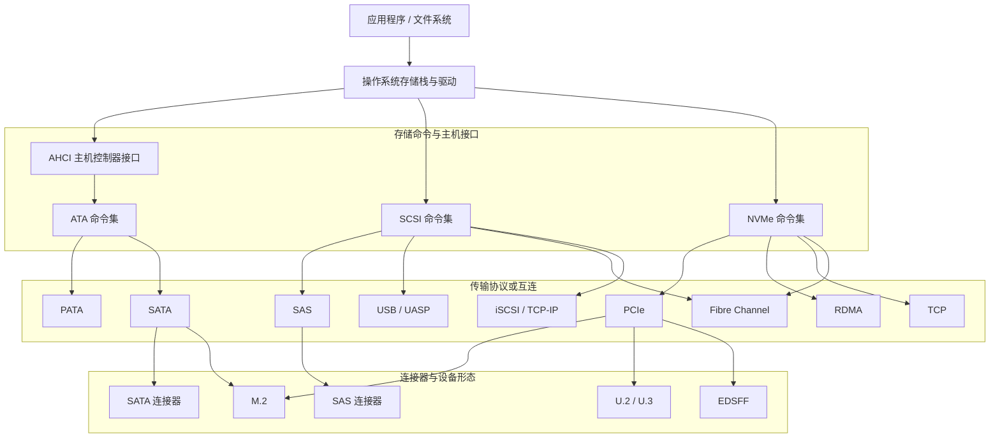
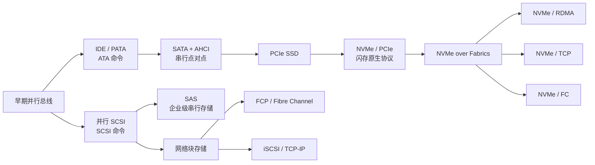
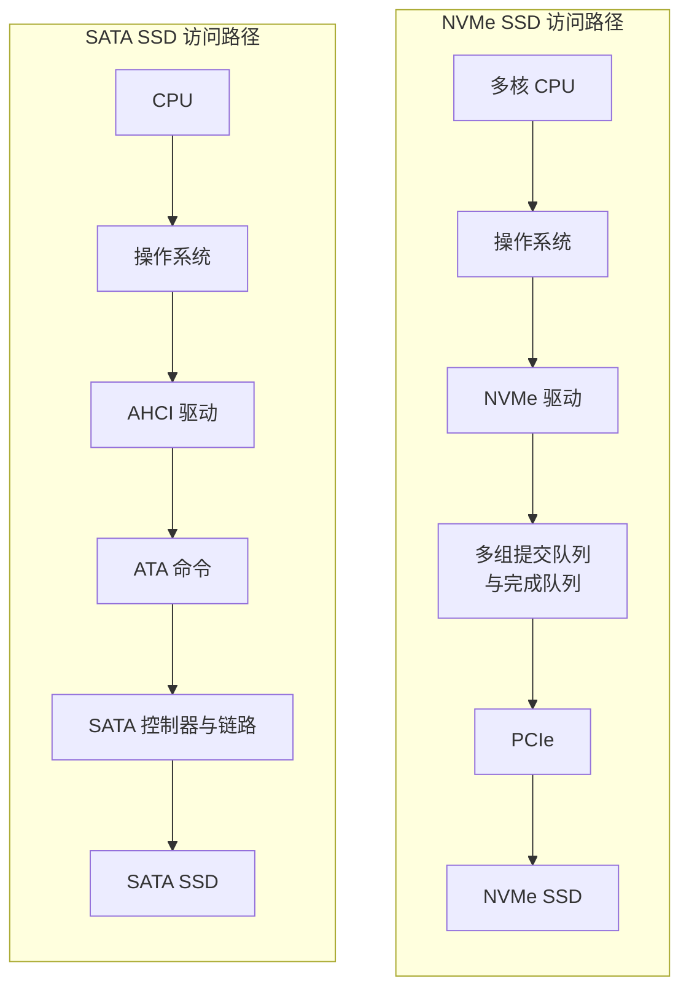
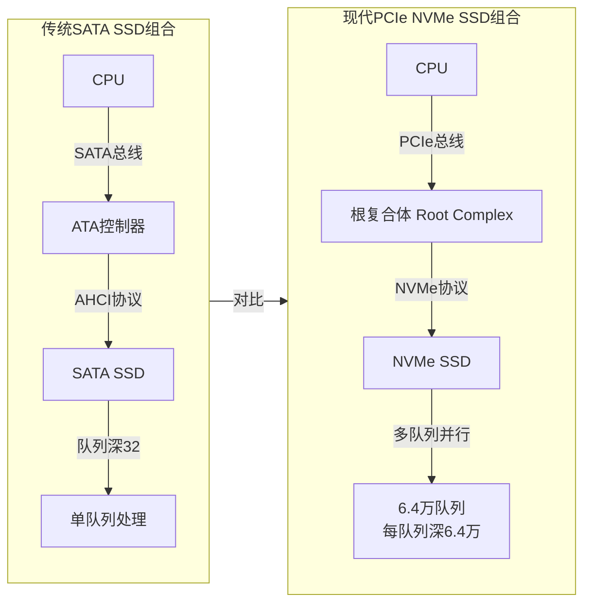
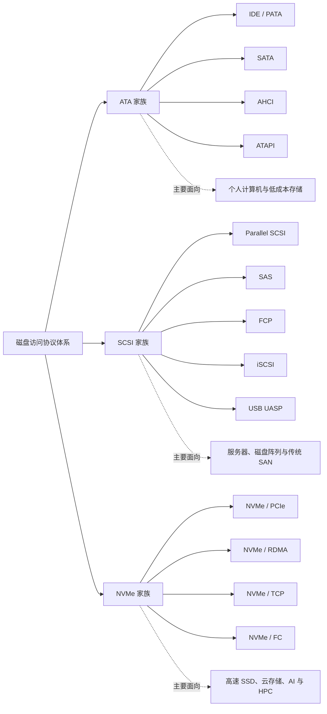
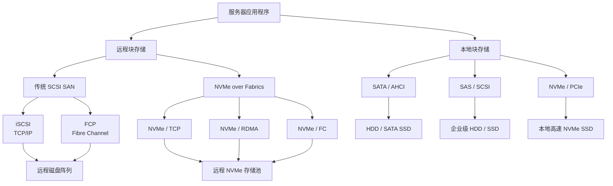
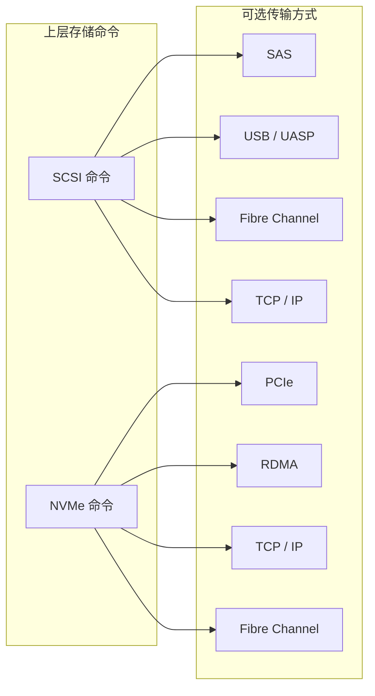
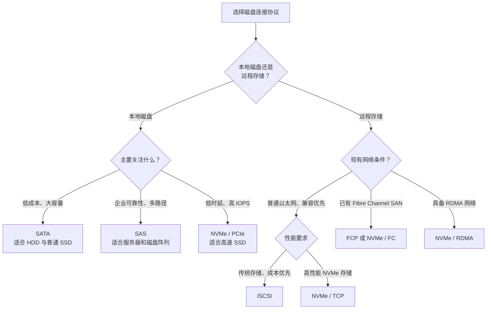
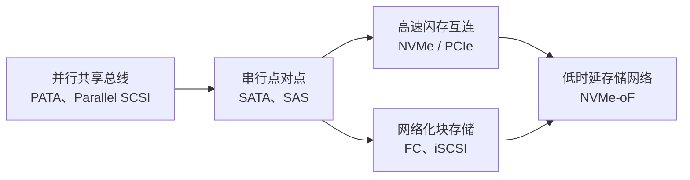

[toc]


## 计算机连接磁盘的协议演进与技术对比

理解磁盘协议时，首先要区分三个层次：

- **命令集**：主机用什么命令读写设备，如 ATA、SCSI、NVMe。
- **传输方式**：命令如何传送，如 PATA、SATA、SAS、PCIe、TCP/IP、Fibre Channel。
- **连接器或外形**：设备长什么样、用什么插槽，如 M.2、U.2、3.5 英寸、2.5 英寸、EDSFF。

## 相关物理接口外形

M.2 是一种紧凑型**物理接口/模块外形规范**，由 PCI-SIG 与 SATA-IO 联合定义，前身叫 NGFF（Next Generation Form Factor），主要用于连接 SSD、Wi-Fi/蓝牙网卡、5G 模块等设备。

> 它本身只是一个"插槽形态"，并不等于某种**传输协议**——同一个 M.2 插槽可以走 SATA 总线（AHCI 协议），也可以走 PCIe 总线（NVMe 协议），具体取决于主板布线和设备键位设计

**M.2接口不是协议**，一个 M.2 设备既可能运行 SATA，也可能运行 NVMe；**AHCI 主要是 SATA 控制器面向操作系统的主机编程接口**，也不等同于 SATA 本身。NVMe 同样已经从最初的 PCIe 本地传输扩展到 RDMA、TCP 等多种传输。

M.2 是接口外形，NVMe 是协议；M.2 SSD 可以是 SATA 协议也可以是 NVMe 协议.

**M.2 是"形状"，SATA/PCIe 是"通道"，AHCI/NVMe 是"语言"，三者组合才决定一块 SSD 的真实性能.**

M.2 接口最主要的“前辈”是 **mSATA** 接口，它的全称是 **Mini-SATA**,可以把 mSATA 看作是标准 SATA 接口的“迷你版”，M.2 就是为了解决 mSATA 的一些不足而设计的下一代接口标准.

## 磁盘连接技术的分层关系

避免把 M.2、PCIe、NVMe、AHCI 等概念混为一谈。



需要特别强调：

> M.2、U.2 和 EDSFF 主要表示连接器或设备形态；SATA、PCIe 表示互连方式；ATA、SCSI、NVMe 表示存储命令体系。一个 M.2 SSD 既可能是 SATA SSD，也可能是 PCIe/NVMe SSD。

------

## 一、三条主要技术演进路线





### 1. ATA 路线：IDE/PATA → SATA/AHCI

```text
IDE / PATA
    ↓ 并行总线改为高速串行点对点连接
SATA
    ↓ 配合 AHCI、NCQ、热插拔
现代 SATA HDD / SATA SSD
```

ATA (**Advanced Technology Attachment**)最初主要服务个人计算机硬盘，特点是成本低、实现简单。早期 IDE/PATA 使用宽排线和并行信号，一个通道可连接多个设备，但高速下存在串扰、时序同步和布线困难。

SATA (**Serial Advanced Technology Attachment**)将其改造成**串行、点对点连接**，形成了 1.5、3 和 6 Gbit/s 三代主要链路速率，并加入热插拔、NCQ (**原生指令排序**)等功能。**AHCI** 下的 SATA NCQ 通常最多允许每端口同时保留 32 条命令。([sata-io.org](https://sata-io.org/developers/sata-ecosystem?utm_source=chatgpt.com))

> **AHCI** 的全称是 **Advanced Host Controller Interface**，中文译为“**高级主机控制器接口**”
>
> 在电脑主板的BIOS设置中，SATA控制器通常有“IDE”和“AHCI”两种兼容模式可选。
>
> **选择AHCI模式**是发挥SATA硬盘（尤其是固态硬盘）性能的前提；而**IDE**( **Integrated Drive Electronics**集成驱动电子设备,它实际上是 **PATA（并行ATA）** 接口的另一种通用叫法)模式是为了兼容老旧操作系统（如Windows XP），会显著降低硬盘性能。
>
> 目前**NVMe**协议（用于M.2接口的高速固态硬盘）已经取代AHCI，成为新一代高速存储的主流标准。如果使用的是M.2 NVMe固态硬盘，则无需关注AHCI设置。

**优点：**

- 成本低，兼容性好；
- 适合机械硬盘和普通消费级 SSD；
- 驱动和操作系统支持成熟。

**局限：**

- SATA 最高链路速率长期停留在 6 Gbit/s；
- AHCI 和 ATA 的设计背景主要是机械硬盘；
- 队列数量和并发能力不足以充分发挥高速闪存性能。

------

### 2. SCSI 路线：并行 SCSI → SAS / FC / iSCSI / UASP

```text
并行 SCSI
 ├─→ SAS：服务器内部直连存储
 ├─→ FCP/FC：专用存储区域网络
 ├─→ iSCSI：基于 TCP/IP 的存储网络
 └─→ UASP：基于 USB 的外置存储
```

**SCSI** 的全称是 **Small Computer System Interface**（小型计算机系统接口），读作“斯卡西”（Scuzzy）。

它是一套用于计算机和外部设备（如硬盘、磁带机、扫描仪、光盘驱动器）之间进行数据传输的**接口标准**，诞生时间早于 SATA 和 IDE.

SCSI 与 ATA 最大的不同，是它从较早阶段就形成了比较完整的**客户端—服务器式存储命令体系**：主机一侧叫 initiator，设备一侧叫 target，实际磁盘或逻辑卷通过 LUN 等机制呈现。

现代 SCSI 已经不再绑定于老式并行 SCSI 总线。T10 的 SCSI 架构可以运行在 SAS、Fibre Channel、iSCSI、USB Attached SCSI 等多种传输之上。([t10.org](https://www.t10.org/intro.htm?utm_source=chatgpt.com))

#### SAS：Serial Attached SCSI

SAS 是并行 SCSI 的**串行化继承者**，主要用于服务器、磁盘阵列和企业级存储。

> **SAS（Serial Attached SCSI，串行连接SCSI）**

其典型能力包括：

- 点对点串行连接；
- 支持扩展器，可构建多设备拓扑；
- 支持双端口磁盘和多路径；
- 较强的错误处理、设备管理和企业级可靠性；
- SAS 控制器通常可以通过相应协议连接 SATA 设备，但 SATA 控制器不能直接连接 SAS 设备。

SAS-2 引入了 6 Gbit/s 链路，SAS-4 进一步发展到每物理链路约 22.5 Gbit/s。([t10.org](https://www.t10.org/drafts.htm?utm_source=chatgpt.com))

#### Fibre Channel Protocol：FCP

Fibre Channel 是**专门面向存储网络的交换式互连技术**，FCP 将 SCSI 命令映射到 Fibre Channel 网络。

它强调：

- 稳定、可预测的时延；
- 专用存储网络和交换机；
- 多路径、分区、冗余和大规模阵列支持；
- 较高的采购和运维成本。

Fibre Channel **不仅能承载 SCSI，也能承载 NVMe**，即 FC-NVMe。([snia.org](https://www.snia.org/sites/default/files/ESF/FC_vs_iSCSI_Jan2018_Final.pdf?utm_source=chatgpt.com))

#### iSCSI

**iSCSI** 将 SCSI 命令封装在 TCP/IP 中：

>  iSCSI:**Internet Small Computer System Interface**（互联网小型计算机系统接口）

```text
SCSI 命令
   ↓
iSCSI
   ↓
TCP
   ↓
IP / Ethernet
```

**通过网络（TCP/IP）来传输 SCSI 命令**的存储协议。它的核心作用是把**远程的存储设备（在服务器机房）虚拟成一块“本地硬盘”**，让你（客户端电脑）像使用内置硬盘一样使用它

因此服务器可以**利用普通以太网访问远程块设备**。RFC 7143 将 iSCSI 定义为运行在 TCP 之上的 SCSI 传输协议。([rfc-editor.org](https://www.rfc-editor.org/info/rfc7143?utm_source=chatgpt.com))

其优点是成本低、距离灵活、可复用现有 IP 网络；缺点是 TCP/IP 协议栈会增加处理开销和时延抖动，网络配置不当还可能造成拥塞。

#### USB BOT 与 UASP

传统 USB 移动硬盘、U 盘多采用 **USB Mass Storage Bulk-Only Transport，BOT**。BOT 实现简单，但命令处理基本串行化，对高速 SSD 不够高效。

UASP，即 USB Attached SCSI Protocol，在 USB 上传输 SCSI 命令，支持更好的命令并发和队列处理，尤其适合 USB 3.x 外置 SSD。USB-IF 的大容量存储规范同时定义或列出了 BOT 和 UASP 等传输方式。([usb.org](https://www.usb.org/sites/default/files/Mass_Storage_Specification_Overview_v1.4_2-19-2010.pdf?utm_source=chatgpt.com))

------

### 3. 闪存原生路线：NVMe/PCIe → NVMe over Fabrics

NVME:**Non-Volatile Memory Express**(**非易失性存储高速通信协议**),Express 在计算机术语的语境下，通常**不单独直译**，而是译为 **“高速传输”** 或 **“快速通道”**

它是一种专门为固态硬盘（SSD）设计的**高速传输协议**，目的是充分发挥闪存芯片的读写速度，取代传统机械硬盘使用的老旧 AHCI 协议

```text
PCIe SSD
   ↓ 专门面向非易失性存储设计命令集
NVMe over PCIe
   ↓ 扩展到网络和存储结构
NVMe over Fabrics
   ├─ NVMe/RDMA
   ├─ NVMe/TCP
   └─ NVMe/FC
```

NVMe 不再沿用为机械硬盘设计的 ATA/AHCI 模型，而是直接针对 SSD、闪存和低时延并行访问设计。

其核心变化不是单纯提高链路速度，而是：

- 使用多个提交队列和完成队列；
- 队列可以与 CPU 核心对应；
- 降低锁竞争和中断处理开销；
- 简化高频 I/O 命令路径；
- 通过 PCIe 直接访问设备，而不经过 SATA/AHCI 控制模型。

NVM Express 官方将 NVMe 定义为主机软件与非易失性存储系统之间的协议；NVMe over PCIe 是其本地高速传输方式。当前 NVMe 规范已拆分为基础规范、命令集规范以及 PCIe、RDMA、TCP 等传输规范。([nvmexpress.org](https://nvmexpress.org/specification/nvm-express-base-specification/?utm_source=chatgpt.com))

NVMe 的链路能力随 PCIe 代际和通道数增长，而不是像 SATA 那样固定在单一速率上。例如 PCIe 6.0 为每通道64 GT/s，PCIe 7.0 提升到128 GT/s；但具体 SSD 性能仍取决于使用的 PCIe 代际、通道数、控制器和闪存介质。([pcisig.com](https://pcisig.com/pci-express-6.0-specification?utm_source=chatgpt.com))

#### NVMe over Fabrics，NVMe-oF

NVMe-oF 将 NVMe 命令从单机内部 PCIe 总线扩展到网络存储，主要传输包括：

- **NVMe/RDMA**：低时延、高性能，需要 RoCE、InfiniBand 或 iWARP 等 RDMA 环境；
- **NVMe/TCP**：使用标准 TCP/IP，以太网兼容性最好，部署成本较低；
- **NVMe/FC**：在现有 Fibre Channel SAN 上运行 NVMe；
- 其他内存型或消息型 Fabric。

NVMe-oF 1.0 于2016年发布，其目标是让远程 SSD 或存储系统尽量保持接近本地 NVMe 的低开销访问模型，并支持计算与存储资源解耦。([nvmexpress.org](https://nvmexpress.org/specification/nvme-of-specification/?utm_source=chatgpt.com))

#### SATA/AHCI 与 NVMe/PCIe 的访问路径对比

对于同样的SSD硬盘,采用NVMe 的优势不只是 PCIe 带宽更高，其软件路径和队列模型也更适合 SSD。



主要差别：

- SATA/AHCI 沿用了面向机械硬盘的控制模型；
- AHCI 通常每端口只有一组较浅的命令队列；
- NVMe 支持多组提交队列和完成队列；
- NVMe 队列可以与 CPU 核心对应，减少锁竞争；
- NVMe 更适合 SSD 内部多个 NAND 通道并行工作。

------

### PCIe和NVMe的关系

**NVMe 和 PCIe 有密切关系，但它们不是同一层面的东西。**

简单来说，**PCIe和NVMe是“基础设施”与“专用交通规则”的关系**：PCIe是**物理高速公路**，提供了高速、低延迟的传输通道；而NVMe则是**专为SSD优化的智能交通规则**，它跑在这条高速公路上，让SSD的性能得以充分释放.



> - **PCIe（PCI Express）**：一种**总线标准（Bus Standard）**，既规定了硬件接口，也规定了链路通信协议。
> - **NVMe（Non-Volatile Memory Express）**：一种**存储协议（Storage Protocol）**，定义了主机如何与 SSD 通信。

因此，两者并不是同一类协议，而是**上下层关系**。

PCIe（Peripheral Component Interconnect Express）可以理解为：

> **一种高速设备互连标准（Interconnect Standard）**,是一种Bus Standard（总线标准）

它包含很多内容，而不仅仅是"协议"。NVMe 的命令最终会：封装成 PCIe 的数据包（Transaction Layer Packet，简称 TLP）。然后

经过 PCIe 总线发送到 SSD。

NVMe 并不依赖 PCIe 本身。也有不是 PCIe 的 NVMe,例如:NVMe over Fabrics（NVMe-oF）.

#### 相关对比

AHCI/SATA组合和NVMe/PCIe组合

| 名称 | 类型                | 负责什么                     |
| ---- | ------------------- | ---------------------------- |
| SATA | 总线标准 + 传输协议 | 定义硬件接口、链路和传输方式 |
| AHCI | 存储协议            | 定义 HDD/SSD 的命令集        |
| PCIe | 总线标准 + 链路协议 | 提供高速数据传输             |
| NVMe | 存储协议            | 定义 Flash SSD 的命令集      |

**AHCI ↔ NVMe**：都是存储协议。

**SATA ↔ PCIe**：都是底层互连/总线标准。

现代 PCIe SSD 基本全部都是 NVMe.但是反之则不成立,NVMe不一定走PCIe总线.

## 二、代表性协议技术对比




三大家族的核心差异如下：

| 协议家族 | 最初优化对象       | 主要特点                       | 代表应用                  |
| -------- | ------------------ | ------------------------------ | ------------------------- |
| ATA      | 个人计算机机械硬盘 | 简单、低成本、兼容性强         | SATA HDD、SATA SSD、光驱  |
| SCSI     | 服务器和多设备存储 | 完整命令体系、错误处理、多路径 | SAS、FC SAN、iSCSI、UASP  |
| NVMe     | SSD和非易失性存储  | 多队列、低时延、高并发         | PCIe SSD、NVMe-oF、云存储 |

------


| 协议或体系 | 主要命令集               | 传输及拓扑             | 并发能力           | 典型优势                       | 主要不足                           | 典型场景                           |
| ---------- | ------------------------ | ---------------------- | ------------------ | ------------------------------ | ---------------------------------- | ---------------------------------- |
| IDE/PATA   | ATA                      | 并行共享总线           | 低                 | 成本低、历史兼容性好           | 排线宽、高速信号困难、设备共享通道 | 早期个人计算机                     |
| SATA/AHCI  | ATA                      | 串行点对点             | 较低，NCQ 通常32条 | 便宜、成熟、适合 HDD           | 6 Gbit/s 上限，SSD 并发不足        | 台式机硬盘、NAS HDD、普通 SATA SSD |
| 并行 SCSI  | SCSI                     | 并行共享总线           | 中等               | 多设备、功能完整               | 电缆和终结复杂，扩展困难           | 早期服务器和工作站                 |
| SAS        | SCSI，也可承载 SATA 访问 | 串行点对点、扩展器     | 高                 | 双端口、多路径、可靠、适合阵列 | 成本和功耗高于 SATA                | 服务器、企业 HDD/SSD、磁盘阵列     |
| USB BOT    | 通常为 SCSI 类命令       | USB                    | 低                 | 实现简单、兼容性极强           | 命令串行化、效率较低               | U 盘、传统移动硬盘                 |
| USB UASP   | SCSI                     | USB 3.x/USB4           | 中高               | 支持队列和并发，适合 SSD       | 性能受 USB 桥接芯片和主机支持影响  | 高速移动 SSD、硬盘盒               |
| FCP/FC     | SCSI                     | Fibre Channel 交换网络 | 高                 | 时延稳定、可靠、成熟 SAN 管理  | 专用设备成本高                     | 企业级 SAN                         |
| iSCSI      | SCSI                     | TCP/IP/Ethernet        | 中高               | 可使用普通以太网、距离灵活     | TCP 开销和时延抖动较大             | 中小型 SAN、虚拟化平台、NAS 块服务 |
| NVMe/PCIe  | NVMe                     | PCIe 点对点或交换结构  | 很高               | 低时延、多队列、高 IOPS        | 距离短，本地部署为主               | PC SSD、服务器 SSD、数据库、AI     |
| NVMe/RDMA  | NVMe                     | RDMA 网络              | 很高               | 远程访问时延低、CPU 开销小     | 网络配置复杂，可能需要专用网卡     | 高性能存储、AI/HPC                 |
| NVMe/TCP   | NVMe                     | TCP/IP/Ethernet        | 高                 | 标准网络、易部署、可扩展       | 时延通常高于 RDMA                  | 云数据中心、通用以太网存储         |
| NVMe/FC    | NVMe                     | Fibre Channel          | 很高               | 可复用现有 FC SAN，时延稳定    | FC 基础设施成本高                  | 大型企业存储                       |

------

## 三、关键技术指标的演变

### 1. 从共享总线转向点对点和交换结构

早期 PATA、并行 SCSI 是多个设备共享一条总线。现代 SATA、SAS、PCIe 都倾向点对点连接，FC、PCIe Switch 和网络 Fabric 则进一步发展为交换结构。

这样可以：

- 避免多个设备争用同一总线；
- 独立协商链路速率；
- 支持多路径和故障隔离；
- 更容易扩展设备数量。

### 2. 从机械磁盘优化转向大规模并行

机械硬盘通常同时处理大量请求的意义有限，因为磁头移动是主要瓶颈。SATA 的32条 NCQ 命令已经能改善机械盘寻道顺序。

SSD 内部却有多个 NAND 通道、控制器核心和并行单元，因此 NVMe 采用多队列设计，让操作系统和多核 CPU 能同时向设备提交大量请求。NVMe 的优势在高并发、随机访问和低时延工作负载上最明显，而不只是顺序吞吐量更高。

### 3. 从本地磁盘转向远程块存储




------


协议发展经历了：

```text
本地主板总线
    ↓
服务器内部磁盘阵列
    ↓
专用 SAN
    ↓
基于 IP 的存储网络
    ↓
低时延、可解耦的 NVMe Fabric
```

iSCSI 解决了“利用普通 IP 网络访问块存储”的问题；NVMe-oF 则进一步解决“如何在网络上保留 NVMe 的高并发和低开销特征”。

### 4. 命令协议与传输协议逐渐解耦

现代存储体系中，同一个命令集可以运行在多种传输上：

```text
SCSI → SAS / Fibre Channel / TCP-IP / USB
NVMe → PCIe / RDMA / TCP / Fibre Channel
```

这说明现代存储协议不再是“一个插头对应一个协议”，而是分层、可组合的体系。




因此，现代存储协议不能只按照接口插头分类，而应分别观察命令集、传输方式、物理接口和设备形态。

------

## 四、代表性协议总结

可以把计算机磁盘协议概括为三大家族：

### ATA 家族

代表协议：

- IDE/PATA
- SATA
- AHCI
- ATA/ATAPI

特点是成本低、消费市场普及度高，当前主要用于机械硬盘、光驱和对性能要求不高的 SSD。

### SCSI 家族

代表协议：

- Parallel SCSI
- SAS
- FCP
- iSCSI
- UASP

特点是命令体系成熟、设备管理和错误处理完善、传输方式丰富，长期占据服务器、磁盘阵列和 SAN 市场。

### NVMe 家族

代表协议：

- NVMe over PCIe
- NVMe/RDMA
- NVMe/TCP
- NVMe/FC

特点是专门针对闪存和非易失性存储设计，强调低时延、多核并行、大量队列和计算存储解耦。NVM Express 在2025年发布的 NVMe 2.3 规范进一步将基础架构、命令集和不同传输模块化。([nvmexpress.org](https://nvmexpress.org/specification/nvm-express-base-specification/?utm_source=chatgpt.com))


###   面向应用场景的协议选择




## 最简结论

磁盘连接协议的核心演进可以浓缩为：

> **并行总线 → 串行点对点 → 交换式网络；单命令或浅队列 → 多队列大并发；机械硬盘导向 → 闪存原生；本地直连 → 网络化、池化和解耦。**

在当前系统中：

- 普通机械硬盘主要使用 **SATA**；
- 企业级 HDD 和传统磁盘阵列主要使用 **SAS/SCSI**；
- 本地高性能 SSD 主要使用 **NVMe/PCIe**；
- 传统 SAN 主要使用 **FCP 或 iSCSI**；
- 新一代高性能网络存储主要使用 **NVMe-oF**。



> 磁盘连接协议的总体发展方向，是从**并行共享总线转向串行点对点和交换结构**，从机械硬盘导向转向闪存原生，从浅队列转向多队列高并发，并由本地直连进一步扩展到远程存储池和计算存储解耦。