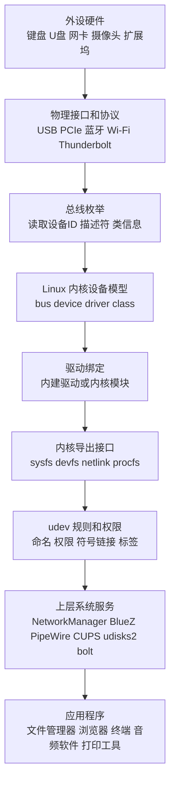
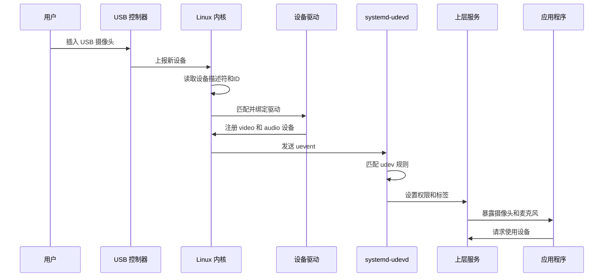
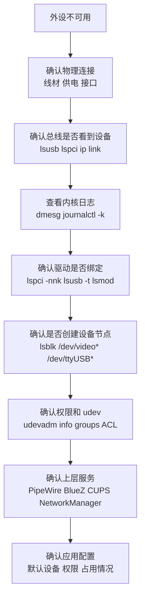

[toc]


下面以 **Linux 系统管理视角** 系统介绍“计算机连接的外设有哪些、如何分类、Linux 如何识别和管理它们”。重点不是死记设备清单，而是掌握一套分析方法：**看接口、看功能、看 Linux 抽象、看驱动、看权限、看上层服务**。

------

## 详细大纲

## 主题边界

- 外设是什么
- 外设、内置设备、扩展设备的关系
- Linux 下“设备”不等于“一个 `/dev` 文件”的原因

## 外设的常见分类方式

- 按连接方式分类
- 按功能用途分类
- 按 Linux 内核抽象分类
- 按热插拔能力分类
- 按安全风险分类

## 常见外设总览

- 输入设备
- 输出设备
- 存储设备
- 网络通信设备
- 音视频设备
- 打印扫描设备
- 安全认证设备
- 传感器与专用设备
- 扩展坞、集线器与桥接设备

## Linux 管理外设的核心机制

- 总线、设备、驱动、类
- 内核模块与驱动绑定
- `sysfs`、`/dev`、`udev`
- 设备节点、主设备号、次设备号
- 热插拔事件
- 权限、ACL、Polkit、用户会话
- 上层服务：NetworkManager、BlueZ、PipeWire、CUPS、udisks2、bolt 等

## Linux 中常用的外设管理命令

- 查看 USB 设备
- 查看 PCIe 设备
- 查看块设备
- 查看输入设备
- 查看内核日志
- 查看驱动模块
- 观察 udev 事件
- 管理蓝牙、音频、网络、打印、Thunderbolt

## 典型场景实践

- U 盘接入与挂载
- USB 串口设备固定命名
- 蓝牙耳机连接
- USB 摄像头排查
- 打印机管理
- Thunderbolt / USB4 扩展坞安全授权

## 最佳实践

- 选择标准协议
- 使用稳定设备名
- 避免随意给外设 root 权限
- 不在 udev 规则里跑长任务
- 注意 USB-C、USB4、Thunderbolt 的区别
- 重视固件、内核版本和日志
- 安全管理未知 USB 与 Thunderbolt 设备

------

## 外设是什么

**外设**，即外围设备，英文通常称为 **Peripheral Device**。它指连接到计算机、为计算机提供输入、输出、存储、通信、扩展或专用功能的硬件设备。

常见例子包括：

| 外设类型       | 典型设备                                             |
| -------------- | ---------------------------------------------------- |
| 输入设备       | 键盘、鼠标、触摸板、手写板、游戏手柄、条码枪         |
| 输出设备       | 显示器、打印机、扬声器、投影仪                       |
| 存储设备       | U 盘、移动硬盘、读卡器、外置 SSD                     |
| 网络设备       | 有线网卡、无线网卡、蓝牙适配器、4G/5G 模块           |
| 音视频设备     | 摄像头、麦克风、声卡、采集卡、耳机                   |
| 安全设备       | 智能卡读卡器、FIDO2 安全密钥、指纹识别器             |
| 工业与专用设备 | USB 串口转换器、调试器、示波器、PLC 编程线、传感器   |
| 扩展设备       | USB Hub、Thunderbolt 扩展坞、USB-C Dock、PCIe 外接盒 |

需要注意：**外设不一定都是“外接”的**。从 Linux 管理角度看，内置键盘、内置摄像头、内置无线网卡、板载声卡也经常被放在类似的设备管理框架中处理。区别主要在于它们是焊接在主板上、插在内部总线上，还是通过外部接口连接。

------

## 外设分类的核心思路

学习外设管理时，建议同时从四个角度看：

| 分类角度   | 关注问题                 | 示例                                        |
| ---------- | ------------------------ | ------------------------------------------- |
| 连接方式   | 它通过什么接口连进计算机 | USB、PCIe、蓝牙、网络、HDMI                 |
| 功能用途   | 它提供什么能力           | 输入、存储、音频、网络、打印                |
| Linux 抽象 | Linux 把它暴露成什么对象 | 块设备、字符设备、网络接口、输入事件、声卡  |
| 管理服务   | 谁负责上层管理           | udev、NetworkManager、BlueZ、PipeWire、CUPS |

同一个外设可以同时属于多个分类。例如一个 **USB 摄像头**：

| 角度       | 结论                                                    |
| ---------- | ------------------------------------------------------- |
| 连接方式   | USB                                                     |
| 功能用途   | 视频输入，也可能带麦克风                                |
| Linux 抽象 | `/dev/video*`、`/dev/media*`，麦克风可能是 `/dev/snd/*` |
| 内核子系统 | USB、V4L2、ALSA                                         |
| 上层服务   | PipeWire、浏览器权限、桌面门户 xdg-desktop-portal       |

这就是为什么 Linux 外设管理不能只看“插在哪里”，还要看“被内核识别成什么”。

------

## 按连接方式分类

连接方式是最直观的分类方法。

| 连接方式           | 英文术语                    | 常见外设                                     | Linux 常用查看方式                         | 特点                                         |
| ------------------ | --------------------------- | -------------------------------------------- | ------------------------------------------ | -------------------------------------------- |
| USB                | Universal Serial Bus        | 键鼠、U 盘、摄像头、声卡、打印机、串口转换器 | `lsusb`、`lsusb -t`、`dmesg`               | 最常见，支持热插拔，设备类型很多             |
| USB-C              | USB Type-C Connector        | 扩展坞、显示器、充电器、移动硬盘             | `lsusb`、`boltctl`、`dmesg`                | 只是接口形态，不等于一定支持高速、视频或充电 |
| USB4               | USB4                        | 高速扩展坞、外置 SSD、显示器链路             | `lsusb`、`boltctl`、`/sys/bus/thunderbolt` | 基于 USB-C，支持高速数据和协议隧道           |
| Thunderbolt        | Thunderbolt                 | 扩展坞、外置 GPU、专业存储                   | `boltctl`、`lspci`、`dmesg`                | 可暴露 PCIe，安全管理很重要                  |
| PCIe               | PCI Express                 | 显卡、网卡、NVMe、采集卡                     | `lspci -nnk`                               | 常见于内置或扩展卡，性能高                   |
| SATA               | Serial ATA                  | 硬盘、光驱                                   | `lsblk`、`smartctl`                        | 传统存储接口                                 |
| NVMe               | Non-Volatile Memory Express | SSD                                          | `lsblk`、`nvme list`                       | 通过 PCIe，高性能存储                        |
| HDMI / DisplayPort | HDMI / DP                   | 显示器、投影仪、采集设备                     | `xrandr`、桌面设置、`dmesg`                | 主要用于视频输出                             |
| 蓝牙               | Bluetooth                   | 耳机、键盘、鼠标、手柄                       | `bluetoothctl`、`btmgmt`                   | 无线、低功耗、依赖配对                       |
| Wi-Fi              | Wireless LAN                | 无线网卡、热点设备                           | `nmcli device wifi`、`iw`                  | 网络通信                                     |
| 以太网             | Ethernet                    | 有线网卡、USB 网卡                           | `ip link`、`nmcli`                         | 稳定、低延迟                                 |
| 音频接口           | Audio Jack / USB Audio      | 麦克风、耳机、声卡                           | `wpctl`、`pactl`、`arecord -l`             | 模拟或数字音频                               |
| 串口               | Serial / UART               | 调试线、工控设备、路由器 Console             | `/dev/ttyUSB*`、`/dev/ttyACM*`             | 工业、嵌入式常见                             |
| 网络协议           | IP / TCP / UDP / IPP        | 网络打印机、NAS、IP 摄像头                   | `ping`、`nmap`、`lpstat`                   | 不一定直接插在本机上                         |

现代接口中最容易混淆的是 **USB-C、USB4、Thunderbolt、DisplayPort Alt Mode、USB Power Delivery**。USB-C 只是物理连接器；USB4 是协议规范；Thunderbolt 是高速外设互联技术；DisplayPort Alt Mode 是通过 USB-C 输出视频的替代模式；USB PD 是供电协议。USB-IF 在 USB4 Version 2.0 中发布了支持 USB 80Gbps 的规范更新，说明现代 USB-C 生态已经不仅是“插 U 盘”的概念，而是可能同时承载数据、视频、供电和隧道协议。([USB-IF](https://usb.org/sites/default/files/2022-10/USB-IF USB 80Gbps Announcement_FINAL_v2.pdf?utm_source=chatgpt.com))

------

## 按功能用途分类

功能分类适合新手建立“外设地图”。

| 功能类别 | 常见设备                              | Linux 常见接口或子系统              | 常用工具                          |
| -------- | ------------------------------------- | ----------------------------------- | --------------------------------- |
| 输入设备 | 键盘、鼠标、触摸板、手柄、手写板      | input、evdev、HID                   | `libinput list-devices`、`evtest` |
| 存储设备 | U 盘、移动硬盘、SD 卡、NVMe           | block、SCSI、USB Mass Storage、NVMe | `lsblk`、`blkid`、`udisksctl`     |
| 网络设备 | 有线网卡、无线网卡、USB 网卡、4G 模块 | netdev、cfg80211、wwan              | `ip link`、`nmcli`、`iw`          |
| 音频设备 | 声卡、USB 麦克风、蓝牙耳机            | ALSA、PipeWire、Bluetooth Audio     | `wpctl`、`pactl`、`arecord`       |
| 视频设备 | 摄像头、采集卡、电视卡                | V4L2、media controller              | `v4l2-ctl`、`cheese`              |
| 显示输出 | 显示器、投影仪、扩展坞视频口          | DRM/KMS、Wayland/X11                | `xrandr`、`drm_info`              |
| 打印扫描 | 打印机、扫描仪、一体机                | CUPS、IPP、SANE                     | `lpstat`、`scanimage`             |
| 串口通信 | USB-TTL、USB-RS232、调试线            | tty、usb-serial、cdc-acm            | `screen`、`minicom`               |
| 安全认证 | FIDO2 Key、智能卡、指纹设备           | HID、pcscd、fprintd                 | `fido2-token`、`pcsc_scan`        |
| 扩展桥接 | USB Hub、Dock、Thunderbolt 扩展坞     | USB、PCIe、Thunderbolt、USB4        | `lsusb -t`、`boltctl`、`lspci`    |

------

## 按 Linux 内核抽象分类

Linux 管理外设时，最终关心的是：**这个设备在系统中被抽象成什么对象？**

Linux 内核设备模型使用统一的数据模型描述 **总线 bus、设备 device、驱动 driver、类 class** 等概念；也就是说，Linux 不只是“发现一个硬件”，而是把硬件放进一个可管理、可匹配、可导出属性的设备模型中。([Linux Kernel 文档](https://docs.kernel.org/driver-api/driver-model/overview.html?utm_source=chatgpt.com))

| Linux 抽象          | 英文术语           | 典型路径                                | 常见外设               | 说明                                         |
| ------------------- | ------------------ | --------------------------------------- | ---------------------- | -------------------------------------------- |
| 块设备              | Block Device       | `/dev/sda`、`/dev/nvme0n1`              | 硬盘、U 盘、SD 卡      | 以块为单位读写，适合文件系统                 |
| 字符设备            | Character Device   | `/dev/ttyUSB0`、`/dev/hidraw0`          | 串口、HID、调试器      | 以字节流或控制接口方式访问                   |
| 网络接口            | Network Interface  | `eth0`、`wlan0`、`enp3s0`               | 网卡、USB 网卡、Wi-Fi  | 通常不通过 `/dev` 访问，而是通过网络栈       |
| 输入事件设备        | Input Event Device | `/dev/input/event*`                     | 键盘、鼠标、触摸板     | 通过 evdev 向用户空间传递输入事件            |
| 声音设备            | Sound Device       | `/dev/snd/*`                            | 声卡、麦克风、耳机     | ALSA 是底层，PipeWire 常作为现代桌面音频服务 |
| 视频设备            | Video Device       | `/dev/video0`                           | 摄像头、采集卡         | 常见接口是 V4L2                              |
| 图形设备            | DRM Device         | `/dev/dri/card0`、`/dev/dri/renderD128` | GPU、显示输出          | 图形渲染和显示管理                           |
| 打印设备            | Printer / IPP      | CUPS 队列                               | USB 打印机、网络打印机 | 现代 Linux 更倾向 IPP/driverless             |
| 蓝牙控制器          | Bluetooth HCI      | `/sys/class/bluetooth`                  | 蓝牙适配器             | 通常由 BlueZ 管理                            |
| Thunderbolt/USB4 域 | Thunderbolt Domain | `/sys/bus/thunderbolt`                  | 扩展坞、外置 PCIe 设备 | 需要关注授权与安全级别                       |

`lsusb` 用于显示系统中的 USB 总线和连接的 USB 设备；`lspci` 用于显示 PCI 总线和 PCI 设备；`lsblk` 会从 `sysfs` 和 udev 数据库读取块设备信息。([man7.org](https://man7.org/linux/man-pages/man8/lsusb.8.html?utm_source=chatgpt.com))

------

## Linux 外设管理总体结构



可以把 Linux 管理外设理解成分层流程：

| 层级   | 负责内容                    | 典型组件                              |
| ------ | --------------------------- | ------------------------------------- |
| 硬件层 | 电气连接、协议传输、供电    | USB、PCIe、蓝牙、Wi-Fi                |
| 枚举层 | 发现设备、读取 ID、判断类别 | USB Host、PCIe Root Complex           |
| 内核层 | 匹配驱动、创建内核对象      | driver core、kernel module            |
| 导出层 | 向用户空间暴露设备信息      | `/sys`、`/dev`、netlink               |
| 策略层 | 命名、权限、自动动作        | udev、systemd-udevd                   |
| 服务层 | 面向具体场景管理设备        | PipeWire、BlueZ、CUPS、NetworkManager |
| 应用层 | 用户真正使用设备            | 浏览器、文件管理器、播放器、IDE       |

------

## Linux 识别外设的基本过程🎈

以插入一个 USB 摄像头为例：



`systemd-udevd` 会监听来自内核的设备事件，并根据 udev 规则执行匹配动作；udev 规则可以基于设备属性识别设备、补充属性、创建符号链接或设置权限。([man7.org](https://man7.org/linux/man-pages/man8/systemd-udevd.service.8.html?utm_source=chatgpt.com))

------

## 核心概念

## 总线

**总线**，英文 **Bus**，是设备连接到计算机并被发现、通信、管理的通道或协议体系。

常见总线：

| 总线               | 典型设备                             |
| ------------------ | ------------------------------------ |
| USB                | 键鼠、U 盘、摄像头、打印机、USB 声卡 |
| PCIe               | 显卡、网卡、NVMe、采集卡             |
| I2C                | 触摸板、传感器、电源管理芯片         |
| SPI                | 闪存、嵌入式外设                     |
| Bluetooth          | 蓝牙耳机、键盘、鼠标                 |
| Thunderbolt / USB4 | 扩展坞、外置 PCIe、显示器、存储阵列  |

Linux 内核设备模型把总线看成设备与驱动匹配的重要上下文。一个驱动通常声明自己支持某类 ID 或设备类别，当总线上出现匹配设备时，内核会尝试绑定对应驱动。

------

## 设备 ID 与类

设备通常会报告自己的身份信息，例如：

| 类型                 | 示例       |
| -------------------- | ---------- |
| Vendor ID            | 厂商 ID    |
| Product ID           | 产品 ID    |
| Device Class         | 设备类别   |
| Subclass             | 子类别     |
| Serial Number        | 序列号     |
| Interface Descriptor | 接口描述符 |

USB 设备可能是复合设备。例如一个 USB 耳机可能同时包含：

| 接口            | 功能           |
| --------------- | -------------- |
| Audio Output    | 耳机播放       |
| Audio Input     | 麦克风         |
| HID             | 线控按键       |
| Vendor-specific | 厂商自定义功能 |

因此，`lsusb` 看到的是一个 USB 设备，但 Linux 可能会为它创建多个功能接口。

------

## 驱动

**驱动程序**，英文 **Driver**，负责让操作系统理解并控制硬件。

Linux 驱动可能有三种存在形式：

| 形式         | 说明                                                         |
| ------------ | ------------------------------------------------------------ |
| 内建驱动     | 编译进内核，开机即存在                                       |
| 内核模块     | `.ko` 文件，可动态加载和卸载                                 |
| 用户空间驱动 | 某些设备通过 libusb、FUSE、SANE、CUPS 后端等方式在用户空间管理 |

常用命令：

```bash
lsmod
modinfo 模块名
sudo modprobe 模块名
sudo modprobe -r 模块名
```

`modprobe` 会智能地向 Linux 内核添加或移除模块，并从 `/lib/modules/$(uname -r)` 等位置查找模块及其依赖信息。([man7.org](https://man7.org/linux/man-pages/man8/modprobe.8.html?utm_source=chatgpt.com))

------

## sysfs

`sysfs` 通常挂载在 `/sys`，用于把内核中的设备、驱动、总线、类等对象以文件系统形式暴露给用户空间。以 PCI 设备为例，Linux 内核文档说明 `/sys` 下可以访问 PCI 设备资源和属性。([Linux Kernel 文档](https://docs.kernel.org/PCI/sysfs-pci.html?utm_source=chatgpt.com))

常见路径：

| 路径                      | 作用            |
| ------------------------- | --------------- |
| `/sys/bus/usb/devices/`   | USB 设备        |
| `/sys/bus/pci/devices/`   | PCI / PCIe 设备 |
| `/sys/class/block/`       | 块设备类        |
| `/sys/class/net/`         | 网络接口        |
| `/sys/class/input/`       | 输入设备        |
| `/sys/class/sound/`       | 声音设备        |
| `/sys/class/video4linux/` | V4L2 视频设备   |
| `/sys/module/`            | 内核模块        |

`/sys` 适合查看设备真实关系。例如 `/dev/sdb` 只是一个设备节点，而 `/sys` 可以告诉你它来自哪个 USB 端口、绑定了什么驱动、厂商 ID 是什么。

------

## /dev

`/dev` 目录存放设备节点，英文 **Device Node**。

常见例子：

| 设备节点              | 含义                                  |
| --------------------- | ------------------------------------- |
| `/dev/sda`            | 第一个 SCSI/SATA/USB 块设备风格的磁盘 |
| `/dev/nvme0n1`        | 第一个 NVMe 磁盘                      |
| `/dev/ttyUSB0`        | USB 转串口设备                        |
| `/dev/ttyACM0`        | CDC ACM 串口设备，常见于开发板        |
| `/dev/input/event0`   | 输入事件设备                          |
| `/dev/video0`         | 摄像头或视频采集设备                  |
| `/dev/snd/*`          | ALSA 声音设备                         |
| `/dev/dri/renderD128` | GPU 渲染节点                          |

注意：**网络接口通常不是 `/dev/eth0` 这种设备文件**。网卡主要通过 Linux 网络栈、netlink、`ip`、NetworkManager 等管理。

------

## udev

`udev` 是 Linux 用户空间的动态设备管理机制。它主要负责：

| 功能             | 说明                           |
| ---------------- | ------------------------------ |
| 动态创建设备节点 | 设备插入时创建 `/dev/*`        |
| 设置权限         | 决定普通用户是否能访问设备     |
| 创建设备别名     | 例如 `/dev/disk/by-uuid/*`     |
| 添加标签         | 供 systemd、桌面环境或服务识别 |
| 触发简单动作     | 例如通知服务有设备接入         |

udev 规则一般位于：

```bash
/usr/lib/udev/rules.d/
/lib/udev/rules.d/
/etc/udev/rules.d/
```

管理员自定义规则通常放在：

```bash
/etc/udev/rules.d/
```

典型 udev 规则示例：

```bash
SUBSYSTEM=="tty", ATTRS{idVendor}=="1a86", ATTRS{idProduct}=="7523", SYMLINK+="my-serial", GROUP="dialout", MODE="0660"
```

这条规则的含义是：当系统发现匹配指定 USB 厂商 ID 和产品 ID 的串口设备时，创建一个稳定别名：

```bash
/dev/my-serial
```

这样脚本就不必依赖容易变化的 `/dev/ttyUSB0`。

------

## udev 规则的常见匹配项

| 匹配项      | 说明                                         |
| ----------- | -------------------------------------------- |
| `SUBSYSTEM` | 匹配设备所属子系统，如 `usb`、`tty`、`block` |
| `KERNEL`    | 匹配内核设备名，如 `sd*`、`ttyUSB*`          |
| `ATTR{}`    | 匹配当前设备属性                             |
| `ATTRS{}`   | 匹配父级设备链上的属性                       |
| `ENV{}`     | 匹配环境变量                                 |
| `DRIVER`    | 匹配驱动名                                   |
| `ACTION`    | 匹配事件动作，如 `add`、`remove`、`change`   |

常见赋值项：

| 赋值项      | 说明         |
| ----------- | ------------ |
| `SYMLINK+=` | 添加符号链接 |
| `MODE=`     | 设置权限模式 |
| `GROUP=`    | 设置所属组   |
| `OWNER=`    | 设置所有者   |
| `TAG+=`     | 添加标签     |
| `ENV{}`     | 设置环境变量 |
| `RUN+=`     | 运行短任务   |

重要最佳实践：**不要在 udev 规则里运行长时间任务、挂载复杂文件系统、启动守护进程或访问网络**。udev 文档明确说明 `PROGRAM` / `RUN` 类动作只适合非常短的前台任务，长时间运行会阻塞后续设备事件；如果要触发长期任务，应交给 systemd 服务。([man7.org](https://man7.org/linux/man-pages/man7/udev.7.html?utm_source=chatgpt.com))

------

## Linux 外设管理中的上层服务

很多外设并不是只靠内核驱动就能“好用”，还需要用户空间服务。

| 服务           | 英文                        | 管理对象                   | 常见命令            |
| -------------- | --------------------------- | -------------------------- | ------------------- |
| systemd-udevd  | udev daemon                 | 动态设备节点、规则、权限   | `udevadm`           |
| NetworkManager | NetworkManager              | 有线、无线、VPN、移动网络  | `nmcli`、`nmtui`    |
| BlueZ          | BlueZ                       | 蓝牙控制器和蓝牙设备       | `bluetoothctl`      |
| PipeWire       | PipeWire                    | 音频、视频流、屏幕共享     | `wpctl`、`pw-cli`   |
| CUPS           | Common UNIX Printing System | 打印机、打印队列           | `lpstat`、`lpadmin` |
| SANE           | Scanner Access Now Easy     | 扫描仪                     | `scanimage`         |
| udisks2        | udisks                      | 桌面磁盘挂载、弹出         | `udisksctl`         |
| bolt           | boltd                       | Thunderbolt 授权和安全     | `boltctl`           |
| ModemManager   | ModemManager                | 4G/5G 模块、蜂窝调制解调器 | `mmcli`             |
| fprintd        | fprint daemon               | 指纹设备                   | `fprintd-*`         |
| pcscd          | PC/SC daemon                | 智能卡读卡器               | `pcsc_scan`         |

NetworkManager 是 Linux 上常见的网络配置工具套件，覆盖桌面、服务器和移动网络等场景。([NetworkManager](https://networkmanager.dev/?utm_source=chatgpt.com)) BlueZ 是 Linux 官方蓝牙协议栈。([GitHub](https://github.com/bluez?utm_source=chatgpt.com)) PipeWire 的目标是改进 Linux 下音频和视频处理，并兼容 PulseAudio、JACK、ALSA、GStreamer 等应用生态。([pipewire.org](https://pipewire.org/?utm_source=chatgpt.com)) CUPS 与现代打印生态正在越来越多地使用 IPP Everywhere、AirPrint、Mopria 等 driverless printing 方式，减少传统厂商专用驱动依赖。([红帽文档](https://docs.redhat.com/en/documentation/red_hat_enterprise_linux/9/html/configuring_and_using_a_cups_printing_server/determining-whether-a-printer-supports-driverless-printing_configuring-printing?utm_source=chatgpt.com))

------

## 常见外设与 Linux 管理方式总表

| 外设             | 连接方式           | Linux 识别形态                        | 常用命令                         | 常见问题                          |
| ---------------- | ------------------ | ------------------------------------- | -------------------------------- | --------------------------------- |
| USB 键盘鼠标     | USB / 蓝牙         | `/dev/input/event*`、HID              | `lsusb`、`libinput list-devices` | 权限、按键映射、蓝牙配对          |
| U 盘             | USB                | `/dev/sdX`、`/dev/disk/by-*`          | `lsblk -f`、`udisksctl`          | 未挂载、文件系统损坏、权限        |
| 移动硬盘         | USB / Thunderbolt  | 块设备                                | `lsblk`、`smartctl`              | 供电不足、线材不支持高速          |
| USB 串口线       | USB                | `/dev/ttyUSB*`、`/dev/ttyACM*`        | `dmesg`、`udevadm info`          | 设备名变化、用户不在 `dialout` 组 |
| USB 摄像头       | USB                | `/dev/video*`                         | `v4l2-ctl --list-devices`        | 浏览器无权限、被其他程序占用      |
| USB 麦克风       | USB                | `/dev/snd/*`                          | `wpctl status`、`arecord -l`     | 默认输入源错误、PipeWire 配置     |
| 蓝牙耳机         | 蓝牙               | BlueZ 设备、音频 profile              | `bluetoothctl`、`wpctl`          | 配对失败、A2DP/HFP 切换           |
| Wi-Fi 网卡       | PCIe / USB         | `wlan*` 网络接口                      | `nmcli device`、`iw dev`         | 固件缺失、驱动不支持              |
| 打印机           | USB / 网络         | CUPS 队列                             | `lpstat -t`                      | 驱动、IPP、网络发现               |
| 扫描仪           | USB / 网络         | SANE 后端                             | `scanimage -L`                   | 后端缺失、权限                    |
| 显示器           | HDMI / DP / USB-C  | DRM/KMS 输出                          | `xrandr`、桌面设置               | 线材、刷新率、缩放                |
| Thunderbolt Dock | Thunderbolt / USB4 | `/sys/bus/thunderbolt`、PCIe/USB 设备 | `boltctl`、`lspci`、`lsusb`      | 未授权、DMA 安全、固件            |
| FIDO2 Key        | USB / NFC          | HID / hidraw                          | `fido2-token -L`                 | 浏览器权限、udev 规则             |
| 智能卡读卡器     | USB                | pcscd 设备                            | `pcsc_scan`                      | pcscd 未运行                      |
| 游戏手柄         | USB / 蓝牙         | input、hidraw                         | `jstest`、`evtest`               | 映射、蓝牙模式                    |

------

## 常用命令速查

## 查看 USB 外设

```bash
lsusb
lsusb -t
dmesg -w
```

`lsusb -t` 很适合看 USB 拓扑，例如设备接在哪个 Hub 下、速度是多少、绑定了什么驱动。

示例输出概念：

```text
/:  Bus 02.Port 1: Dev 1, Class=root_hub, Driver=xhci_hcd/4p, 10000M
    |__ Port 2: Dev 3, If 0, Class=Mass Storage, Driver=uas, 5000M
```

这说明一个 USB 存储设备通过 `uas` 驱动工作，链路速率显示为 5000M。

------

## 查看 PCIe 外设

```bash
lspci
lspci -nn
lspci -nnk
```

推荐常用：

```bash
lspci -nnk
```

它能显示：

| 信息                  | 用途                                         |
| --------------------- | -------------------------------------------- |
| 设备类型              | 判断是显卡、网卡、USB 控制器还是 NVMe 控制器 |
| Vendor ID / Device ID | 判断硬件型号                                 |
| Kernel driver in use  | 当前使用的内核驱动                           |
| Kernel modules        | 可用模块                                     |

------

## 查看存储设备

```bash
lsblk
lsblk -f
blkid
findmnt
```

推荐：

```bash
lsblk -f
```

可以看到：

| 字段        | 含义          |
| ----------- | ------------- |
| NAME        | 设备名        |
| FSTYPE      | 文件系统      |
| LABEL       | 卷标          |
| UUID        | 文件系统 UUID |
| MOUNTPOINTS | 挂载点        |

最佳实践：脚本和 `/etc/fstab` 中尽量使用 `UUID`、`LABEL` 或 `/dev/disk/by-id/`，不要依赖 `/dev/sdb1` 这种顺序相关名称。

------

## 查看输入设备

```bash
libinput list-devices
cat /proc/bus/input/devices
ls -l /dev/input/
```

如果安装了 `evtest`：

```bash
sudo evtest
```

它可以观察键盘、鼠标、触摸板、遥控器、手柄等输入事件。

------

## 查看音频设备

```bash
wpctl status
pactl list short sinks
pactl list short sources
arecord -l
aplay -l
```

现代桌面发行版中，PipeWire 经常作为默认音频服务；底层硬件仍常由 ALSA 驱动，应用可能通过 PipeWire、PulseAudio 兼容层或 JACK 兼容层使用设备。

------

## 查看摄像头和采集设备

```bash
v4l2-ctl --list-devices
v4l2-ctl --all -d /dev/video0
```

如果没有 `v4l2-ctl`，通常需要安装 `v4l-utils` 包。

------

## 查看网络设备

```bash
ip link
nmcli device
nmcli connection show
iw dev
```

常用判断：

```bash
nmcli device status
```

它可以快速显示设备是否已连接、是否被 NetworkManager 管理。

------

## 查看蓝牙设备

```bash
systemctl status bluetooth
bluetoothctl
```

进入 `bluetoothctl` 后常用：

```text
power on
agent on
default-agent
scan on
pair XX:XX:XX:XX:XX:XX
trust XX:XX:XX:XX:XX:XX
connect XX:XX:XX:XX:XX:XX
```

蓝牙 6.0 规范已经由 Bluetooth SIG 发布，新增能力包括 Channel Sounding 等；但外设是否能用到新特性取决于电脑控制器、外设、驱动、固件和软件栈是否全部支持。([Bluetooth® Technology Website](https://www.bluetooth.com/specifications/specs/core-specification-6-0/?utm_source=chatgpt.com))

------

## 查看打印机

```bash
lpstat -t
lpinfo -v
```

网络打印机常见协议：

| 协议               | 说明                                     |
| ------------------ | ---------------------------------------- |
| IPP                | Internet Printing Protocol，现代打印核心 |
| IPP Everywhere     | 免专用驱动打印标准                       |
| AirPrint           | Apple 推广的 driverless 打印生态         |
| Mopria             | 移动和通用打印标准                       |
| JetDirect / socket | 传统网络打印端口，常见 9100              |

现代 Linux 打印优先考虑 **driverless printing**。如果打印机支持 IPP Everywhere、AirPrint、Mopria，通常比安装闭源厂商驱动更省心。

------

## 查看 Thunderbolt / USB4 设备

```bash
boltctl
ls /sys/bus/thunderbolt/devices/
dmesg | grep -i thunderbolt
```

Linux 内核文档说明，USB4 是基于 Thunderbolt 3 协议的公开规范，并存在固件或软件连接管理器负责枚举和建立隧道。([Linux Kernel 文档](https://docs.kernel.org/admin-guide/thunderbolt.html?utm_source=chatgpt.com)) 对 Thunderbolt 设备，如果安全级别为 `user` 或 `secure`，连接设备通常需要用户授权后才会创建 PCIe 隧道。([kernel.org](https://www.kernel.org/doc/html/v4.14/admin-guide/thunderbolt.html?utm_source=chatgpt.com)) `boltd` 的目标就是以安全且方便的方式管理 Thunderbolt 设备授权。([man.archlinux.org](https://man.archlinux.org/man/boltd.8.en?utm_source=chatgpt.com))

------

## Linux 外设排查的通用方法

遇到外设不可用，不要一开始就盲目安装驱动。建议按这个顺序排查：



核心判断问题：

| 问题               | 对应检查                    |
| ------------------ | --------------------------- |
| 系统有没有看到硬件 | `lsusb`、`lspci`、`ip link` |
| 内核有没有报错     | `dmesg`、`journalctl -k`    |
| 驱动有没有绑定     | `lsusb -t`、`lspci -nnk`    |
| 有没有设备节点     | `ls /dev/...`               |
| 普通用户有没有权限 | `ls -l /dev/...`、`getfacl` |
| 上层服务是否工作   | `systemctl status ...`      |
| 应用是否选错设备   | 应用设置、桌面隐私权限      |

------

## 实践场景：U 盘接入

插入 U 盘后：

```bash
dmesg -w
```

另一个终端查看：

```bash
lsblk -f
```

可能看到：

```text
sdb
└─sdb1  vfat  MYUSB  1234-ABCD
```

挂载方式有几种。

桌面环境通常会通过 udisks2 自动挂载。命令行可以使用：

```bash
udisksctl mount -b /dev/sdb1
```

或者手动挂载：

```bash
sudo mkdir -p /mnt/usb
sudo mount /dev/sdb1 /mnt/usb
```

卸载：

```bash
udisksctl unmount -b /dev/sdb1
```

或：

```bash
sudo umount /mnt/usb
```

最佳实践：

| 建议                                | 原因                               |
| ----------------------------------- | ---------------------------------- |
| 不要在写入中直接拔出                | 可能导致文件系统损坏               |
| 使用 `lsblk -f` 确认设备            | 避免误操作系统盘                   |
| 脚本使用 UUID 或 `/dev/disk/by-id/` | `/dev/sdX` 顺序可能变化            |
| 对未知 U 盘保持警惕                 | USB 设备可能伪装成键盘、网卡或存储 |

Linux 内核也支持 USB 授权控制，可以由用户空间控制某个 USB 设备是否允许使用，这适合实现 USB 设备管控或锁定策略。([Linux Kernel 文档](https://docs.kernel.org/usb/authorization.html?utm_source=chatgpt.com))

------

## 实践场景：USB 串口设备固定命名

很多开发板、路由器 Console、工业设备会使用 USB 转串口。常见设备节点：

```bash
/dev/ttyUSB0
/dev/ttyACM0
```

问题是：如果插入多个串口设备，编号顺序可能变化。

查看设备属性：

```bash
udevadm info -a -n /dev/ttyUSB0
```

观察插拔事件：

```bash
udevadm monitor --kernel --udev --property
```

创建规则：

```bash
sudo nano /etc/udev/rules.d/99-usb-serial.rules
```

示例：

```bash
SUBSYSTEM=="tty", ATTRS{idVendor}=="1a86", ATTRS{idProduct}=="7523", SYMLINK+="router-console", GROUP="dialout", MODE="0660"
```

重新加载规则：

```bash
sudo udevadm control --reload-rules
sudo udevadm trigger
```

之后可以使用：

```bash
screen /dev/router-console 115200
```

或：

```bash
minicom -D /dev/router-console -b 115200
```

最佳实践：

| 做法                                   | 说明                                   |
| -------------------------------------- | -------------------------------------- |
| 优先用 `SYMLINK+=` 创建别名            | 不要强行改内核原始设备名               |
| 匹配 `idVendor`、`idProduct`、`serial` | 多个相同设备时需要序列号               |
| 给用户加入正确组                       | 常见为 `dialout`、`uucp`，视发行版而定 |
| 不要把串口权限直接设成 `0666`          | 避免所有用户无差别访问                 |

------

## 实践场景：USB 摄像头不可用

检查是否识别：

```bash
lsusb
v4l2-ctl --list-devices
ls -l /dev/video*
```

查看日志：

```bash
journalctl -k -b | grep -iE "uvc|video|camera"
```

常见原因：

| 现象                               | 可能原因                         |
| ---------------------------------- | -------------------------------- |
| `lsusb` 看不到                     | 线材、接口、供电、硬件故障       |
| `lsusb` 能看到但没有 `/dev/video0` | 驱动未绑定、设备不是标准 UVC     |
| 浏览器不能用                       | 浏览器权限、桌面门户、设备被占用 |
| 画面黑屏                           | 隐私开关、格式不兼容、带宽不足   |
| 麦克风可用但视频不可用             | 复合设备部分接口失败             |

很多 USB 摄像头遵循 **UVC**，即 **USB Video Class**，这类设备通常不需要厂商专用驱动。

------

## 实践场景：蓝牙耳机连接

基本流程：

```bash
systemctl status bluetooth
bluetoothctl
```

在 `bluetoothctl` 中：

```text
power on
agent on
default-agent
scan on
pair 设备地址
trust 设备地址
connect 设备地址
```

连接后查看音频：

```bash
wpctl status
```

常见问题：

| 问题                       | 说明                                     |
| -------------------------- | ---------------------------------------- |
| 能配对但没声音             | 默认输出设备没切换                       |
| 音质差                     | 可能使用了 HFP/HSP 通话模式，而不是 A2DP |
| 麦克风和高音质不能同时满足 | 蓝牙音频 profile 限制                    |
| 断连频繁                   | 省电、干扰、固件、控制器兼容性           |
| 找不到设备                 | 蓝牙适配器被禁用或 rfkill 阻断           |

查看 rfkill：

```bash
rfkill list
```

解除阻断：

```bash
sudo rfkill unblock bluetooth
```

------

## 实践场景：打印机管理

优先判断打印机是否支持 driverless printing。

查看打印服务：

```bash
systemctl status cups
lpstat -t
lpinfo -v
```

添加打印机通常可以通过：

| 方式         | 说明                     |
| ------------ | ------------------------ |
| 桌面系统设置 | 新手最友好               |
| CUPS Web UI  | 通常是本机 631 端口      |
| `lpadmin`    | 适合脚本化               |
| 自动发现     | 依赖 mDNS、IPP、Avahi 等 |

现代建议：

| 建议                               | 原因                       |
| ---------------------------------- | -------------------------- |
| 优先买支持 IPP Everywhere 的打印机 | Linux 兼容性通常更好       |
| 优先使用网络打印                   | 多设备共享更方便           |
| 少依赖闭源厂商驱动                 | 内核升级和发行版升级时更稳 |
| 保留打印机 IP 或主机名             | 避免地址变化导致队列失效   |

OpenPrinting 也在推动 Printer Applications，把传统打印机驱动迁移为本地服务，并向系统暴露为 IPP Everywhere 打印机，这是现代 Linux 打印架构的重要方向。([openprinting.github.io](https://openprinting.github.io/upcoming-technologies/01-printer-application/?utm_source=chatgpt.com))

------

## 实践场景：Thunderbolt / USB4 扩展坞

Thunderbolt 和 USB4 扩展坞可能同时提供：

| 功能      | 可能暴露为                 |
| --------- | -------------------------- |
| USB Hub   | `lsusb` 中的 Hub           |
| 有线网卡  | `ip link` 中的新网络接口   |
| 声卡      | `/dev/snd/*`               |
| 显示输出  | DRM/KMS 输出               |
| PCIe 设备 | `lspci` 中的新设备         |
| 存储设备  | `/dev/nvme*` 或 `/dev/sd*` |

查看：

```bash
boltctl
lsusb -t
lspci -nnk
dmesg -w
```

如果扩展坞连接后显示器能用，但 USB、网卡或存储不可用，可能是 Thunderbolt 安全授权问题。

授权通常通过桌面设置完成，也可用：

```bash
boltctl
```

常见安全建议：

| 建议                                | 说明                                      |
| ----------------------------------- | ----------------------------------------- |
| 只信任自己的 Thunderbolt 设备       | Thunderbolt 可暴露 PCIe，风险高于普通 USB |
| 启用 IOMMU                          | 降低 DMA 风险                             |
| 不随便授权陌生扩展坞                | 防止恶意外设                              |
| 更新 BIOS/UEFI、固件和内核          | USB4/Thunderbolt 兼容性强依赖固件和内核   |
| 区分 USB-C Dock 与 Thunderbolt Dock | 外观相似，能力差异很大                    |

------

## USB-C、USB4、Thunderbolt 的关键区别

| 名称                 | 本质             | 说明                                             |
| -------------------- | ---------------- | ------------------------------------------------ |
| USB-C                | 连接器形态       | 只是接口外形，可正反插，不代表速度或功能         |
| USB 2.0 / USB 3.x    | USB 数据协议     | 决定 USB 数据传输能力                            |
| USB4                 | 高速 USB 规范    | 基于 USB-C，可承载 USB、DisplayPort、PCIe 隧道等 |
| Thunderbolt 3/4/5    | 高速外设互联技术 | 常用于扩展坞、显示、外置 PCIe                    |
| DisplayPort Alt Mode | 视频替代模式     | 通过 USB-C 输出 DP 视频                          |
| USB Power Delivery   | 供电协议         | 决定充电功率协商                                 |

新手常见误区：

| 误区                          | 正确认识                                    |
| ----------------------------- | ------------------------------------------- |
| USB-C 线都一样                | 不同线材支持的速率、供电、视频能力可能不同  |
| 有 USB-C 就能接显示器         | 需要主机、线材、设备都支持视频输出          |
| USB4 就一定等于 Thunderbolt   | 二者相关但不完全等同                        |
| 扩展坞不工作一定是 Linux 问题 | 也可能是线材、固件、BIOS 安全级别、供电不足 |
| 充电线也能高速传数据          | 很多充电线只支持 USB 2.0 数据甚至仅供电     |

------

## 外设权限管理

Linux 下外设访问通常涉及权限。

查看设备权限：

```bash
ls -l /dev/ttyUSB0
ls -l /dev/video0
ls -l /dev/input/event0
```

可能看到：

```text
crw-rw---- 1 root dialout ...
```

含义：

| 字段        | 说明                     |
| ----------- | ------------------------ |
| `c`         | 字符设备                 |
| `root`      | 所有者                   |
| `dialout`   | 所属组                   |
| `rw-rw----` | root 和 dialout 组可读写 |

常见组：

| 组                 | 常见用途                             |
| ------------------ | ------------------------------------ |
| `dialout` / `uucp` | 串口                                 |
| `video`            | 摄像头、视频设备                     |
| `audio`            | 音频设备，现代桌面不一定需要手动加入 |
| `plugdev`          | 可插拔设备，部分发行版使用           |
| `lp`               | 打印设备                             |
| `scanner`          | 扫描仪，部分发行版使用               |

现代桌面系统往往通过 **logind、ACL、Polkit、桌面门户** 动态授予当前登录用户访问权限。因此，不要一遇到权限问题就把设备改成 `MODE="0666"`。

------

## 设备命名规则与稳定性

Linux 中很多设备名是动态分配的。

| 动态名称       | 问题             | 推荐替代                           |
| -------------- | ---------------- | ---------------------------------- |
| `/dev/sdb`     | 插入顺序变化会变 | `/dev/disk/by-id/`、UUID           |
| `/dev/ttyUSB0` | 多串口顺序变化   | udev `SYMLINK+=`                   |
| `/dev/video0`  | 多摄像头顺序变化 | `/dev/v4l/by-id/`                  |
| `eth0`         | 现代系统可能不用 | `enp3s0` 或 NetworkManager profile |
| `card0`        | GPU 顺序可能变化 | 具体 PCI 地址或 render node        |

查看稳定链接：

```bash
ls -l /dev/disk/by-id/
ls -l /dev/disk/by-uuid/
ls -l /dev/v4l/by-id/
ls -l /dev/serial/by-id/
```

最佳实践：
**人操作可以看 `/dev/sdb`，脚本和配置尽量用稳定路径。**

------

## 外设驱动来源

| 驱动来源       | 示例                                     | 优点             | 风险                   |
| -------------- | ---------------------------------------- | ---------------- | ---------------------- |
| Linux 内核自带 | USB HID、UVC、USB Mass Storage、常见网卡 | 稳定、随内核更新 | 新硬件可能需要新内核   |
| 固件包         | Wi-Fi、蓝牙、GPU                         | 启用硬件完整能力 | 缺固件会导致设备不可用 |
| DKMS 模块      | 某些厂商网卡、采集卡                     | 可支持内核外硬件 | 内核升级后可能编译失败 |
| 用户空间驱动   | libusb 工具、SANE 后端、CUPS 后端        | 不必写内核驱动   | 权限和性能需注意       |
| 闭源厂商驱动   | 特殊打印机、专业设备                     | 支持厂商私有功能 | 兼容性和安全性不可控   |

新手建议优先选择：

| 设备     | 推荐标准                           |
| -------- | ---------------------------------- |
| 摄像头   | UVC                                |
| 声卡     | USB Audio Class                    |
| 键鼠     | USB HID / Bluetooth HID            |
| 打印机   | IPP Everywhere / AirPrint / Mopria |
| 存储     | USB Mass Storage / UAS / NVMe      |
| 安全密钥 | FIDO2 / U2F                        |
| 网卡     | Linux 内核主线支持良好的芯片       |

------

## 按安全风险分类

外设不是“插上就安全”。从安全角度可以分为：

| 风险等级 | 设备类型                     | 风险点                       |
| -------- | ---------------------------- | ---------------------------- |
| 低       | 普通显示器、被动音箱         | 主要是隐私和配置问题         |
| 中       | U 盘、摄像头、麦克风、打印机 | 数据泄露、恶意文件、录音录像 |
| 高       | USB HID、网卡、调试器        | 可伪装键盘输入、改变网络路由 |
| 很高     | Thunderbolt / 外置 PCIe      | 可能涉及 DMA 和 PCIe 隧道    |
| 特殊     | 安全密钥、智能卡             | 身份认证资产，丢失风险高     |

特别注意 **BadUSB** 类攻击：一个看似 U 盘的设备可能同时伪装成键盘，自动输入命令。Linux 能看到它，但用户仍需要安全策略控制。

建议：

| 场景         | 建议                                                |
| ------------ | --------------------------------------------------- |
| 办公电脑     | 禁止随意插陌生 USB                                  |
| 服务器       | 尽量禁用不必要 USB 端口                             |
| 高安全环境   | 使用 USBGuard、内核 USB authorization、物理端口管控 |
| Thunderbolt  | 启用授权、IOMMU、只信任已知设备                     |
| 摄像头麦克风 | 使用桌面隐私控制和物理遮挡                          |

------

## 新手应掌握的核心判断模型

遇到任何外设问题，可以套用这张表：

| 层面   | 问题                   | 命令                        |
| ------ | ---------------------- | --------------------------- |
| 物理层 | 线、接口、供电是否正常 | 换线、换口、看指示灯        |
| 总线层 | 系统是否发现设备       | `lsusb`、`lspci`、`ip link` |
| 内核层 | 内核是否报错           | `dmesg`、`journalctl -k`    |
| 驱动层 | 是否绑定驱动           | `lsusb -t`、`lspci -nnk`    |
| 节点层 | 是否生成设备节点       | `lsblk`、`ls /dev/video*`   |
| 权限层 | 用户是否有访问权限     | `ls -l`、`getfacl`          |
| 服务层 | 上层服务是否正常       | `systemctl status ...`      |
| 应用层 | 应用是否选对设备       | 应用设置、默认设备          |

------

## 外设学习路线

## 入门阶段

掌握这些命令：

```bash
lsusb
lspci -nnk
lsblk -f
dmesg -w
journalctl -k -b
ip link
nmcli device
```

理解这些目录：

```bash
/dev
/sys
/proc
/etc/udev/rules.d
```

------

## 进阶阶段

学习：

| 内容                    | 目标                           |
| ----------------------- | ------------------------------ |
| udev 规则               | 固定设备命名、设置权限         |
| 内核模块                | 理解驱动加载和绑定             |
| systemd 服务            | 设备接入后触发安全的后台任务   |
| PipeWire / BlueZ / CUPS | 理解音频、蓝牙、打印的上层管理 |
| NetworkManager          | 管理有线、无线、移动网络       |
| `/sys`                  | 追踪设备拓扑和属性             |

------

## 实战阶段

建议练习：

| 练习                    | 学到的知识                     |
| ----------------------- | ------------------------------ |
| 给 USB 串口创建稳定别名 | udev、设备属性、权限           |
| 排查一个 U 盘挂载失败   | 块设备、文件系统、日志         |
| 配置蓝牙耳机            | BlueZ、PipeWire、音频 profile  |
| 添加网络打印机          | CUPS、IPP、driverless printing |
| 查看 USB 拓扑           | Hub、速率、驱动                |
| 查看 PCIe 网卡驱动      | PCI ID、内核模块、固件         |
| 管理 Thunderbolt Dock   | bolt、授权、PCIe 隧道          |

------

## 最佳实践总结

| 主题        | 建议                                                     |
| ----------- | -------------------------------------------------------- |
| 购买外设    | 优先选择标准协议、Linux 主线支持好的设备                 |
| USB-C 设备  | 确认线材、主机、设备都支持所需速率、视频和供电           |
| 存储设备    | 脚本使用 UUID 或 `/dev/disk/by-id/`                      |
| 串口设备    | 使用 udev 创建稳定别名                                   |
| 音频视频    | 优先理解 PipeWire、ALSA、V4L2 的分层                     |
| 网络        | 优先用 NetworkManager 或发行版推荐工具，不混用多套管理器 |
| 打印        | 优先 driverless printing 和 IPP Everywhere               |
| 蓝牙        | 用 BlueZ 管理配对，用 PipeWire 管理音频路由              |
| Thunderbolt | 只授权可信设备，启用 IOMMU，关注 bolt 状态               |
| 权限        | 不要滥用 `chmod 666`，优先用组、ACL、Polkit、udev 标签   |
| udev        | 只做命名、权限、短动作；长任务交给 systemd               |
| 排障        | 先看日志和识别结果，再考虑安装驱动                       |
| 安全        | 对未知 USB、HID、Thunderbolt 设备保持警惕                |

------

## 总结

计算机外设可以按 **连接方式、功能用途、Linux 内核抽象、热插拔能力和安全风险** 分类；而在 Linux 中，外设管理的主线是：

**硬件接入 → 总线枚举 → 内核驱动绑定 → sysfs 和 `/dev` 暴露 → udev 命名与权限 → 上层服务管理 → 应用程序使用。**

掌握这条链路后，无论是 U 盘、串口线、摄像头、蓝牙耳机、打印机，还是 USB4 / Thunderbolt 扩展坞，都可以用同一套方法分析和排障。