[toc]

## abstract

现代操作系统可以先理解成一句话：

> **操作系统是硬件和应用程序之间的管理层。它向上提供抽象，向下管理硬件资源。**

应用程序不直接控制 CPU、内存、磁盘、网卡、键盘、屏幕，而是通过操作系统提供的接口来使用这些资源。

操作系统位于底层硬件与用户之间，是两者沟通的桥梁。用户可以通过操作系统的用户界面，输入命令。操作系统则对命令进行解释，驱动硬件设备，实现用户要求。

以现代标准而言，一个标准PC的操作系统应该提供以下的功能：

- 进程管理（Processing management）
- 内存管理（Memory management）
- 文件系统（File system）
- 网络通信（Networking）
- 安全机制（Security）
- 用户界面（User interface）
- 驱动程序（Device drivers）

------

# 1. 现代操作系统的整体结构

可以先用一个大图看全局：

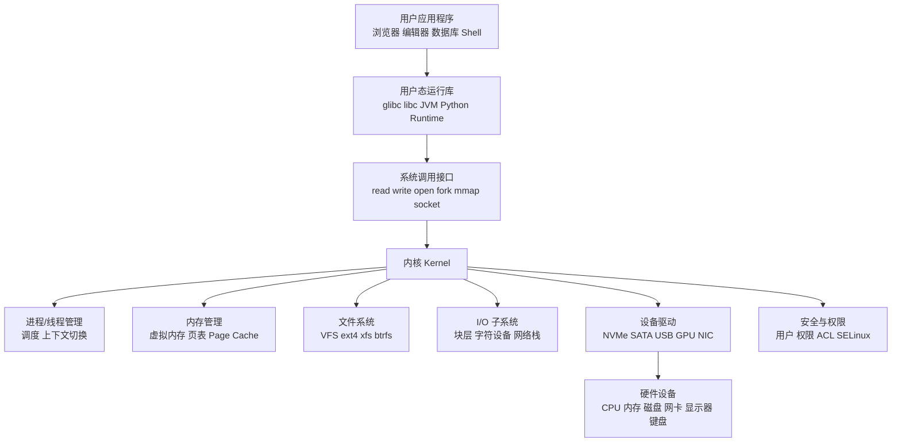

现代操作系统大体分为：

| 层次       | 作用                                          |
| ---------- | --------------------------------------------- |
| 应用层     | 运行用户程序，例如浏览器、数据库、Shell       |
| 运行库层   | 封装系统调用，例如 glibc、语言运行时          |
| 系统调用层 | 用户态进入内核态的入口                        |
| 内核层     | 操作系统核心，管理 CPU、内存、I/O、文件、权限 |
| 驱动层     | 让内核能够控制具体硬件                        |
| 硬件层     | CPU、内存、磁盘、网卡、GPU 等真实设备         |

------

# 2. 用户态和内核态

现代操作系统通常把执行环境分成两种权限级别：


## 用户态

普通程序运行在用户态，例如：

- 浏览器
- 文本编辑器
- Python 程序
- 数据库进程
- Shell 命令

用户态程序不能随便访问硬件，也不能直接修改内核数据结构。

------

## 内核态

内核运行在更高权限下，可以：

- 调度 CPU
- 分配内存
- 访问磁盘
- 控制网卡
- 管理文件系统
- 检查权限
- 响应中断

所以应用程序想读文件、创建进程、申请内存、发网络包，都必须通过系统调用进入内核。

例如：

```c
read(fd, buf, 4096);
write(fd, buf, 4096);
open("/tmp/a.txt", O_RDONLY);
fork();
mmap(...);
socket(...);
```

这些都不是普通函数那么简单，它们最终会进入内核。

------

# 3. 内核内部有哪些核心子系统？

可以把内核看成多个协作的管理模块：

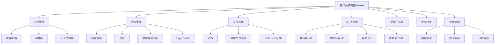

其中最核心的几个是：

## 进程管理

负责：

- 创建进程
- 创建线程
- 调度 CPU
- 上下文切换
- 进程间通信
- 信号处理

它回答的问题是：

> 谁可以使用 CPU？什么时候使用？使用多久？

------

## 内存管理

负责：

- 虚拟地址空间
- 页表
- 物理内存分配
- 缺页异常
- 内存映射
- Page Cache
- swap

它回答的问题是：

> 每个进程看到的内存从哪里来？如何保护？如何映射到真实物理内存？

------

## 文件系统

负责：

- 文件名
- 目录
- inode
- 文件权限
- 文件内容布局
- 元数据
- 日志和一致性
- 挂载点

它回答的问题是：

> `/home/user/a.txt` 这个名字对应哪个文件？文件内容在哪里？权限是什么？

------

## I/O 子系统

负责：

- 磁盘 I/O
- 网络 I/O
- 字符设备 I/O
- 缓冲
- 队列
- 调度
- 中断
- DMA
- 设备驱动协作

它回答的问题是：

> 数据如何在进程、内存和设备之间流动？

------

# 4. I/O 在操作系统中的位置

I/O 是一个很大的概念，不只是磁盘读写。

I/O 包括：

| 类型         | 例子                   |
| ------------ | ---------------------- |
| 文件 I/O     | read/write 文件        |
| 块设备 I/O   | 磁盘、SSD、U 盘        |
| 字符设备 I/O | 键盘、鼠标、串口、终端 |
| 网络 I/O     | socket、TCP、UDP       |
| 图形 I/O     | 显示器、GPU            |
| 事件 I/O     | epoll、select、poll    |
| 异步 I/O     | io_uring、AIO          |

整体可以这样看：

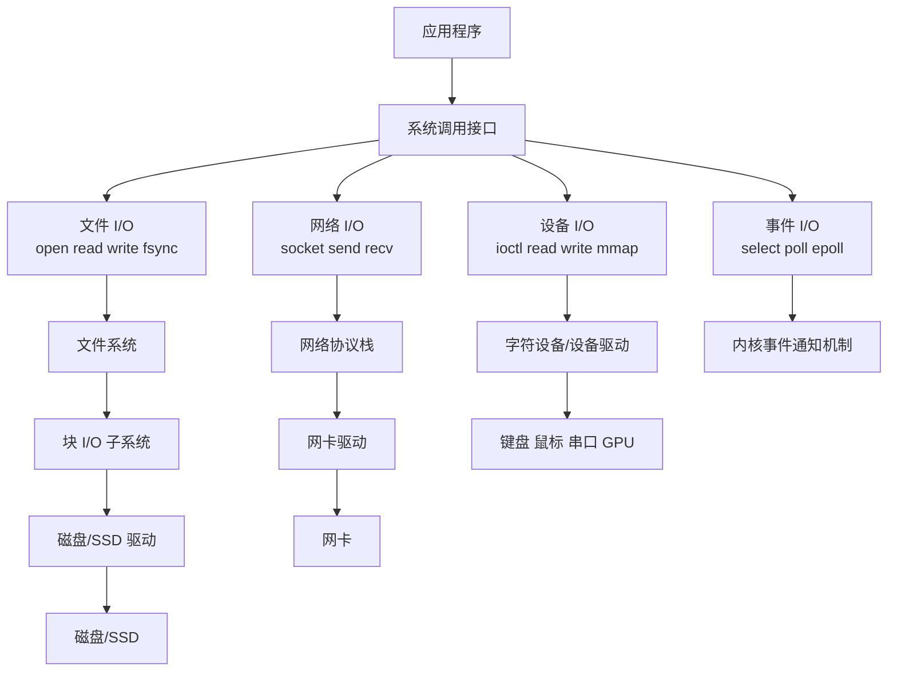

所以：

> **I/O 子系统是操作系统中负责“数据进出”的大系统。**

文件系统只是 I/O 的一部分，而且主要负责“文件形式的数据组织”。

------

# 5. 文件系统在操作系统中的位置

文件系统位于：

```text
应用程序
  ↓
系统调用
  ↓
VFS
  ↓
具体文件系统
  ↓
Page Cache
  ↓
块 I/O 层
  ↓
设备驱动
  ↓
磁盘/SSD
```

用图表示：

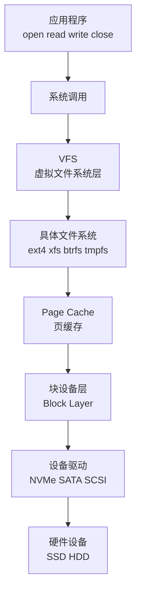

文件系统不是直接等于磁盘。

文件系统更像是：

> **在磁盘或其他存储介质上组织文件、目录和元数据的一套规则与内核实现。**

------

# 6. VFS：为什么需要虚拟文件系统？

Linux 支持很多文件系统：

- ext4
- xfs
- btrfs
- tmpfs
- procfs
- sysfs
- NFS
- FAT
- exFAT
- ISO9660

但应用程序不需要分别调用：

```text
ext4_read()
xfs_read()
btrfs_read()
nfs_read()
```

而是统一调用：

```c
read(fd, buf, len);
```

这是因为中间有 VFS。

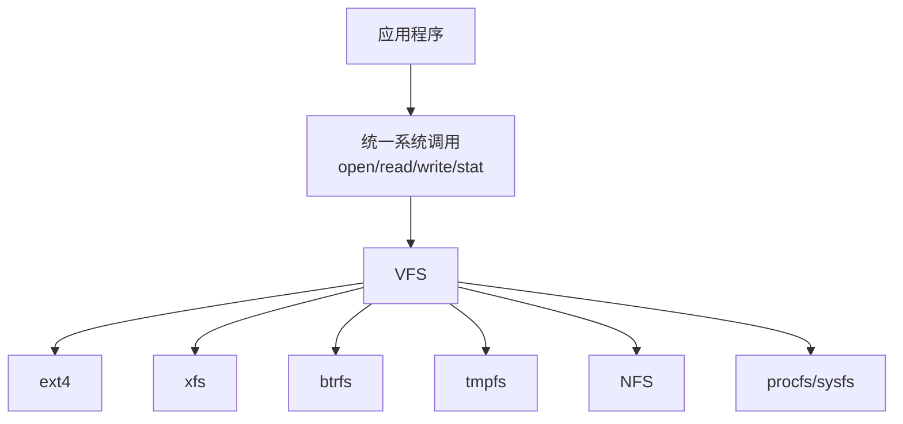

VFS 的作用是：

> **给上层提供统一文件接口，给下层适配不同文件系统。**

它抽象出几个重要对象：

| 对象       | 含义                         |
| ---------- | ---------------------------- |
| superblock | 一个已挂载文件系统的整体信息 |
| inode      | 文件本体的元数据             |
| dentry     | 文件名到 inode 的映射        |
| file       | 一次打开文件的内核对象       |
| mount      | 挂载点信息                   |

------

# 7. I/O 和文件系统的关系

二者不是并列完全独立的关系，而是包含和协作关系。

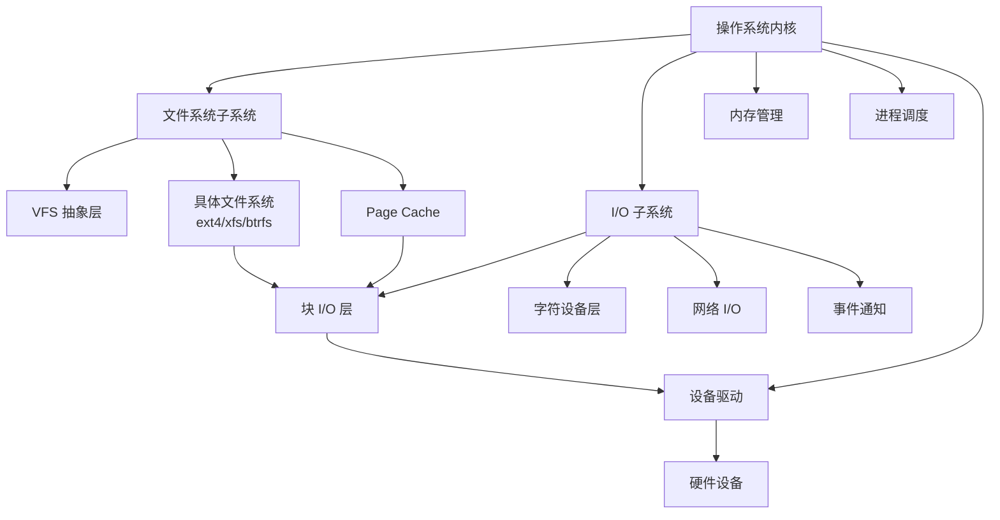

可以这样理解：

| 模块       | 更关心什么                                  |
| ---------- | ------------------------------------------- |
| 文件系统   | 文件、目录、权限、inode、元数据、文件布局   |
| I/O 子系统 | 数据如何进入/离开设备，如何排队、调度、完成 |
| 块层       | 如何对块设备提交读写请求                    |
| 驱动       | 如何操作具体硬件                            |
| 内存管理   | 数据在内存中如何缓存、映射和分配            |

一句话：

> **文件系统决定“读写哪个文件、哪些块”；I/O 子系统负责“怎么把这些块的数据和设备交换”。**

------

# 8. 一次文件读取在 OS 中经过哪里？

假设程序执行：

```c
read(fd, buf, 4096);
```

完整路径大致是：

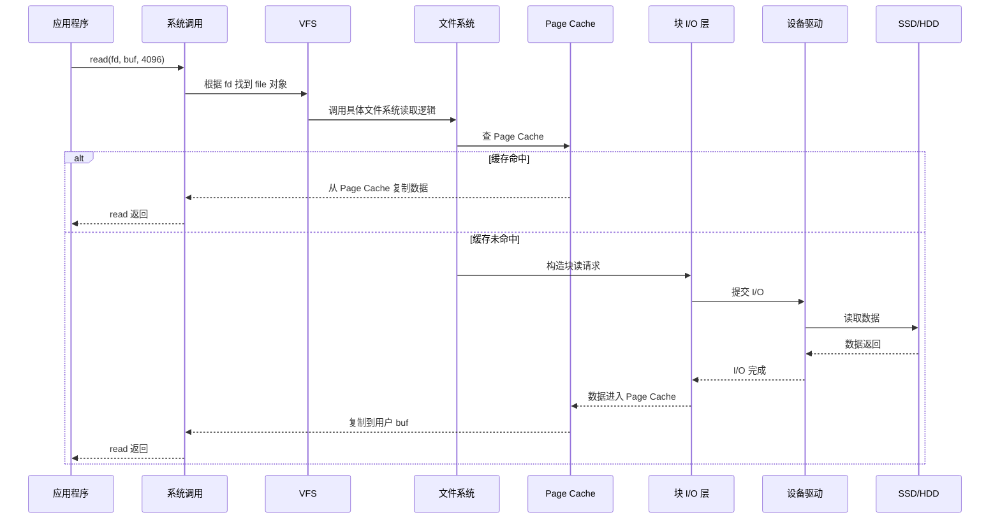

这个过程里：

- 进程管理负责让进程运行或睡眠。
- 内存管理负责 Page Cache 和用户缓冲区。
- VFS 负责统一接口。
- 文件系统负责找到文件数据对应的块。
- 块层负责组织磁盘 I/O。
- 驱动负责控制设备。
- 硬件负责真正读取数据。

------

# 9. 一次文件写入在 OS 中经过哪里？

假设程序执行：

```c
write(fd, buf, 4096);
```

典型 buffered write 的路径是：

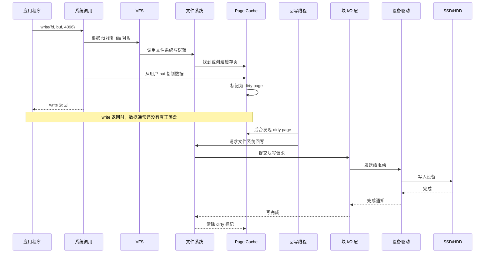

这说明一个很重要的点：

> **write 成功，不等于数据已经写入磁盘。**

通常只是写进了内核的 Page Cache。

如果程序需要更强的持久化保证，要调用：

```c
fsync(fd);
```

------

# 10. 文件系统和 Page Cache 的关系

Page Cache 属于内存管理和文件 I/O 的交叉区域。

它让文件数据可以缓存在内存中。


读文件时：

```text
磁盘 → Page Cache → 用户缓冲区
```

写文件时：

```text
用户缓冲区 → Page Cache → 稍后写回磁盘
```

Page Cache 的意义很大：

- 减少磁盘访问
- 提升重复读取性能
- 合并小写入
- 支持预读
- 支持延迟回写
- 让文件 I/O 和虚拟内存系统协作

------

# 11. 块设备、字符设备、网络设备

I/O 系统里常见设备可以分为几类。

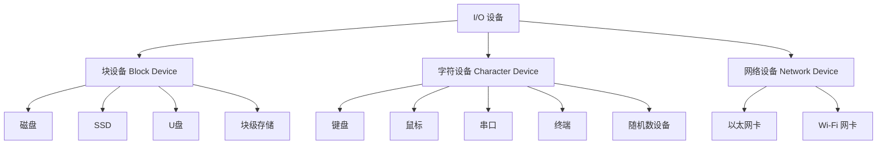

## 块设备

块设备按块读写，例如磁盘、SSD。

文件系统通常建立在块设备之上。

```text
文件系统 → 块层 → 磁盘驱动 → 磁盘
```

------

## 字符设备

字符设备更像字节流，例如：

- 终端
- 键盘
- 串口
- `/dev/null`
- `/dev/random`

它们通常不经过文件系统的数据块布局。

------

## 网络设备

网络设备不走文件系统路径，而是走网络协议栈：

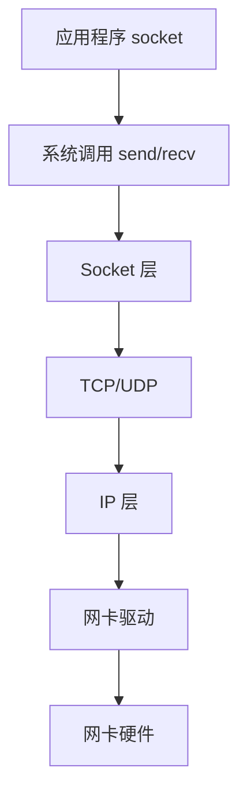

虽然 socket 在 Unix/Linux 中也表现得像文件描述符，但它不是普通文件系统文件。

------

# 12. 文件系统不是磁盘，磁盘也不是文件系统

这是初学者最容易混淆的点。


区别如下：

| 概念     | 含义                             |
| -------- | -------------------------------- |
| 磁盘     | 物理或虚拟存储设备               |
| 分区     | 磁盘上的一段区域                 |
| 文件系统 | 在分区上组织文件和目录的数据结构 |
| 目录树   | 用户看到的路径结构               |
| 文件     | 文件系统提供的抽象对象           |

例如：

```text
/dev/nvme0n1      是整块 NVMe 磁盘
/dev/nvme0n1p1    是一个分区
ext4              是分区上的文件系统类型
/home/a.txt       是文件系统中的文件路径
```

------

# 13. 从操作系统角度看：文件是什么？

对用户来说，文件是：

```text
一个有名字的字节序列
```

对文件系统来说，文件是：

```text
inode + 数据块 + 元数据 + 目录项
```

可以这样画：

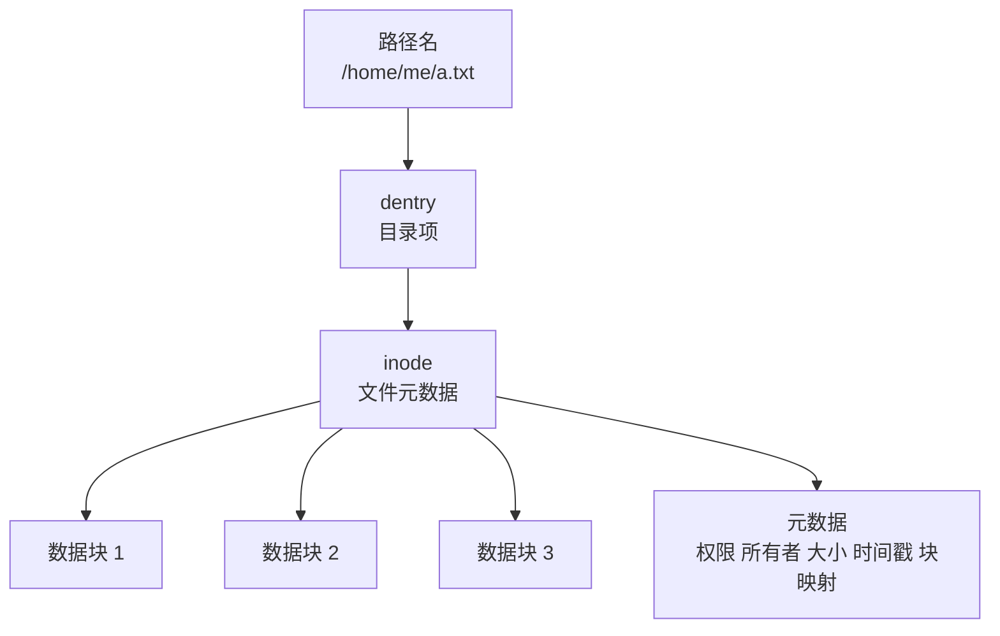

其中：

| 概念      | 说明                        |
| --------- | --------------------------- |
| 路径名    | 用户看到的名字              |
| dentry    | 目录项，名字到 inode 的映射 |
| inode     | 文件本体的元数据            |
| 数据块    | 真正保存文件内容的位置      |
| fd        | 进程打开文件后的句柄        |
| file 对象 | 内核中一次打开文件的状态    |

------

# 14. 现代 OS 的结构风格

操作系统内核结构大体有几种：

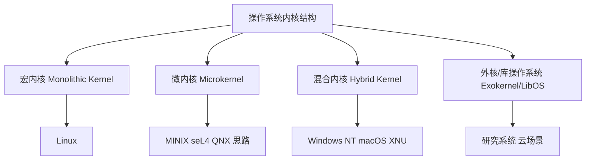

## 宏内核

Linux 是典型宏内核。

特点：

- 进程管理、内存管理、文件系统、网络栈、驱动大多在内核态
- 性能好
- 子系统之间调用直接
- 内核复杂度高

------

## 微内核

微内核只保留最小核心功能，例如：

- 线程调度
- 地址空间
- IPC
- 基本中断处理

文件系统、驱动、网络栈可以放到用户态服务中。

优点：

- 模块隔离强
- 安全性和可靠性好

缺点：

- IPC 开销较高
- 实现复杂

------

## 混合内核

Windows NT、macOS XNU 常被归为混合内核风格。

它们吸收了微内核的一些设计思想，但为了性能，很多服务仍运行在内核态。

------

# 15. I/O 与文件系统在 Linux 宏内核中的位置

以 Linux 为例，它更接近这样的结构：

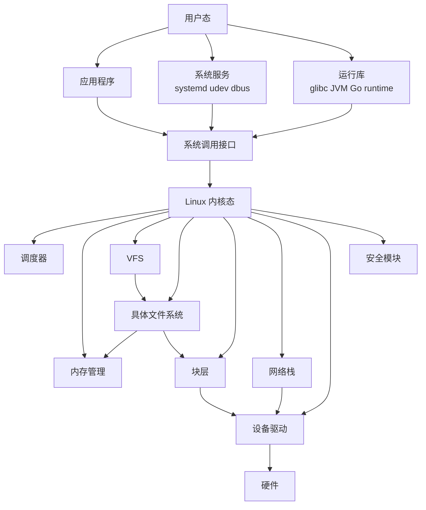

在 Linux 中：

- 文件系统在内核中。
- 块 I/O 层在内核中。
- 大多数设备驱动在内核中。
- Page Cache 是内核内存管理的重要部分。
- 用户程序通过系统调用访问这些能力。

------

# 16. 用一个“读文件”的例子理解各子系统协作

执行：

```bash
cat /home/me/a.txt
```

背后大致发生：

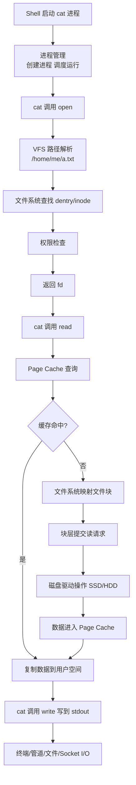

这个例子中涉及：

| 子系统     | 参与内容                        |
| ---------- | ------------------------------- |
| 进程管理   | 创建和调度 `cat`                |
| 内存管理   | 给进程分配内存，管理 Page Cache |
| VFS        | 统一 open/read/write            |
| 文件系统   | 解析目录，找到 inode 和数据块   |
| I/O 子系统 | 提交磁盘读取请求                |
| 驱动       | 控制 SSD/HDD                    |
| 权限系统   | 检查用户是否能读文件            |

------

# 17. 更抽象地说，OS 提供了哪些“假象”？

现代操作系统最重要的能力之一，是给程序提供一些“高级抽象”。

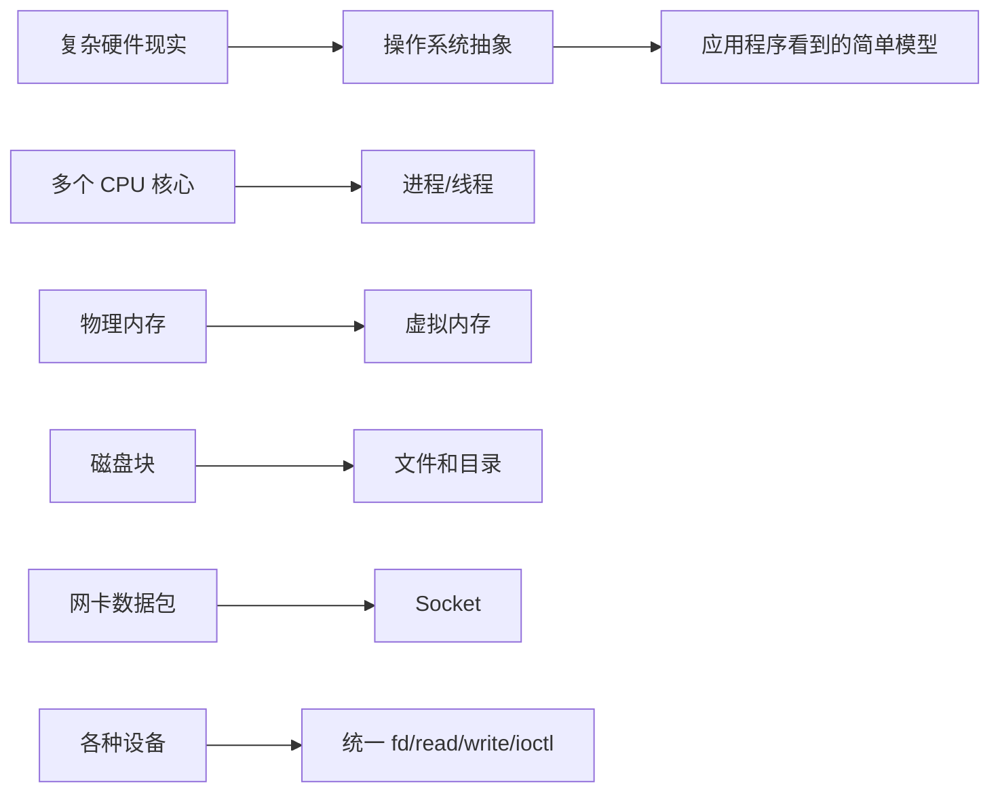

例如：

| 硬件现实    | OS 提供的抽象 |
| ----------- | ------------- |
| CPU 时间片  | 进程、线程    |
| 物理内存页  | 虚拟地址空间  |
| 磁盘扇区/块 | 文件、目录    |
| 网卡收发包  | socket        |
| 键盘中断    | 输入事件      |
| 显示硬件    | 图形接口      |

文件系统就是一个特别重要的抽象：

> 它把“磁盘上的块”抽象成“目录和文件”。

I/O 子系统则是另一个重要抽象：

> 它把“各种硬件设备的数据交换”抽象成统一的读写、事件和缓冲机制。

------

# 18. 一个推荐的理解框架

你可以按这四层理解：

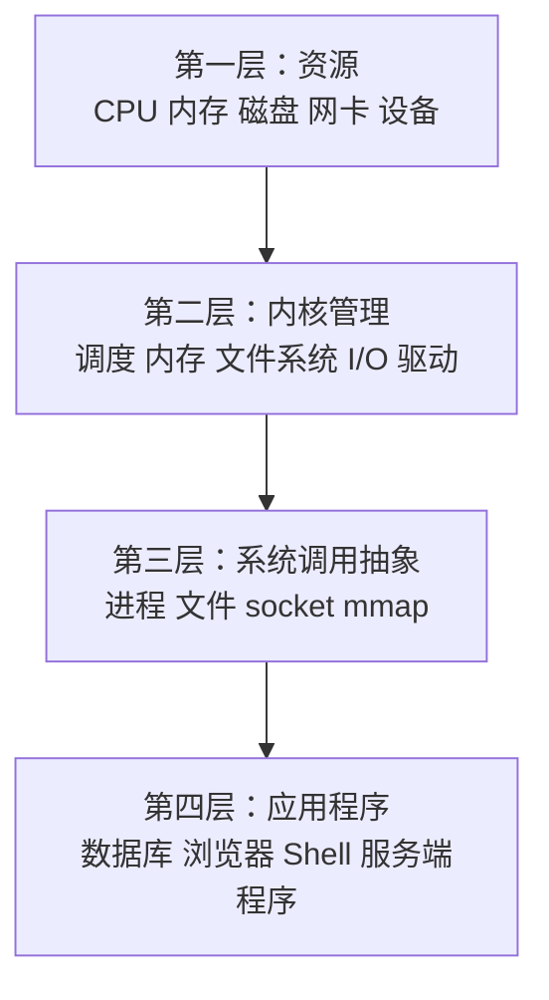

然后把 I/O 和文件系统放进去：

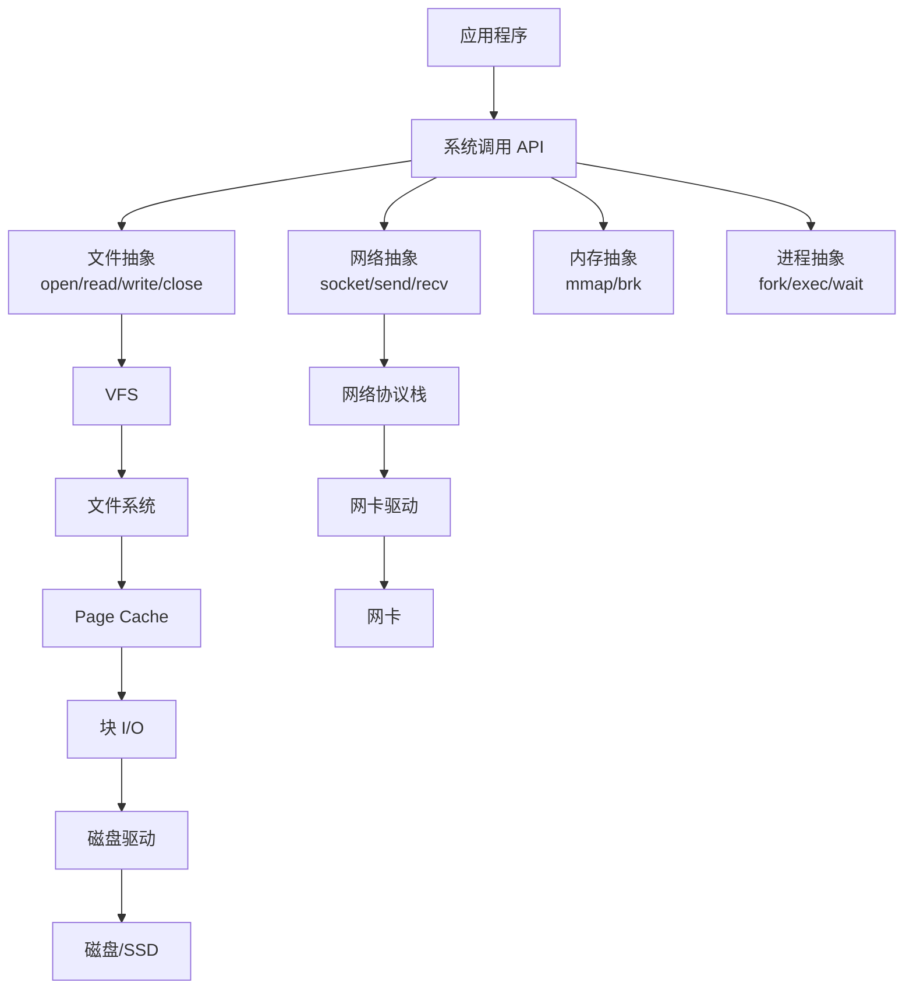

------

# 19. 最核心的总结

现代操作系统大致是：

```text
应用程序
  ↓
运行库
  ↓
系统调用
  ↓
内核
  ├── 进程管理
  ├── 内存管理
  ├── 文件系统
  ├── I/O 子系统
  ├── 网络协议栈
  ├── 安全权限
  └── 设备驱动
  ↓
硬件
```

I/O 和文件系统在其中的位置是：

```text
文件系统：负责把“路径、文件、目录、权限、inode、数据块”组织起来。

I/O 子系统：负责把数据在“内存和设备”之间传输，包括排队、调度、中断、DMA、驱动交互。

二者关系：文件系统决定要读写什么数据，I/O 子系统负责把这些数据真正传到设备或从设备取回来。
```

最简洁的理解是：

> **文件系统负责“数据如何被组织成文件”。
> I/O 子系统负责“数据如何在计算机和设备之间流动”。
> 操作系统内核负责把这些东西统一管理，并通过系统调用提供给应用程序使用。**