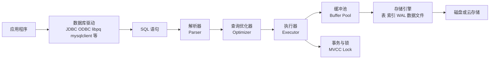
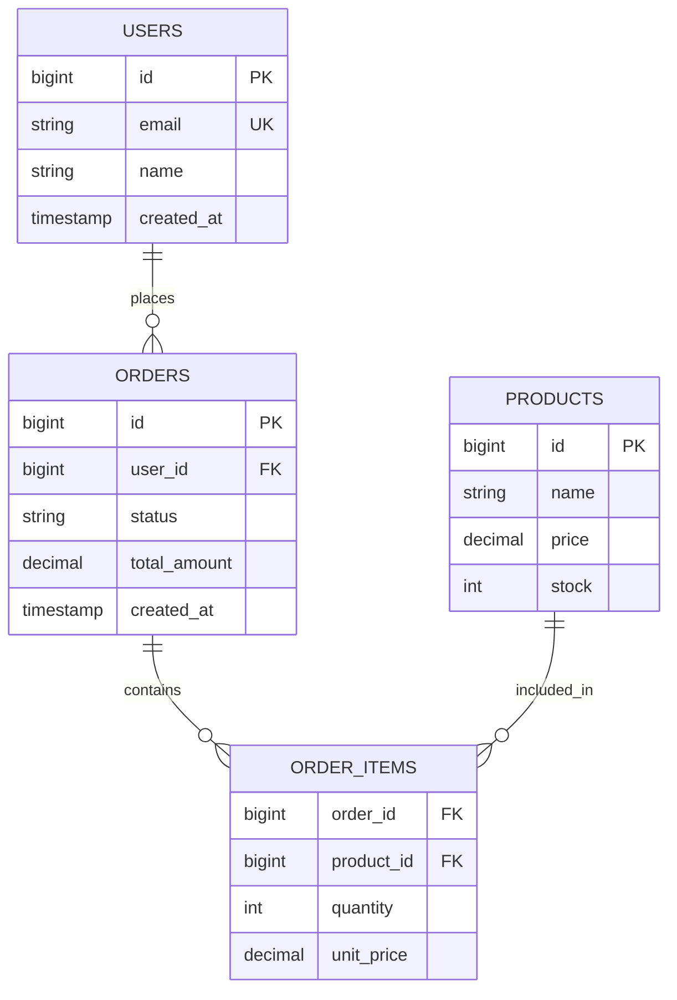
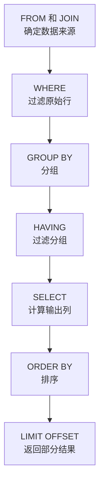
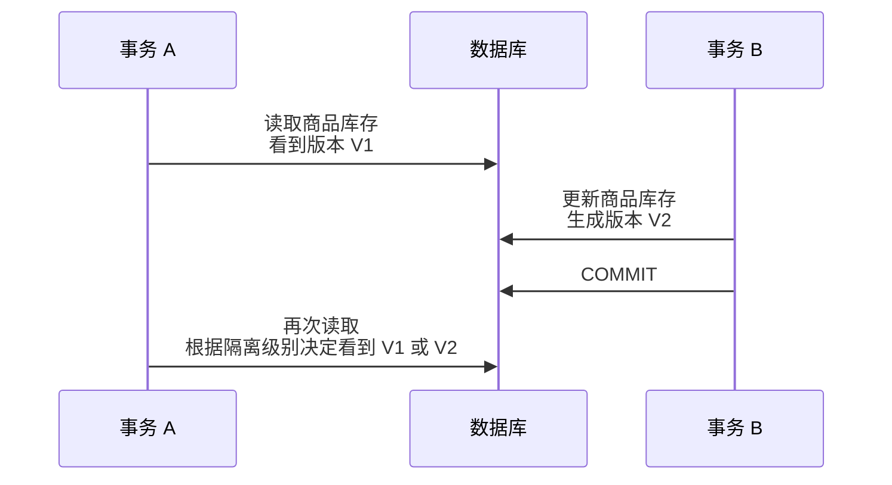
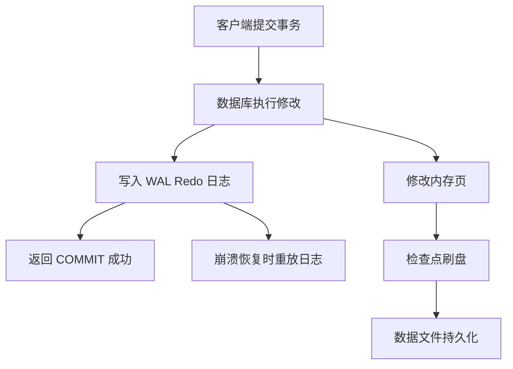
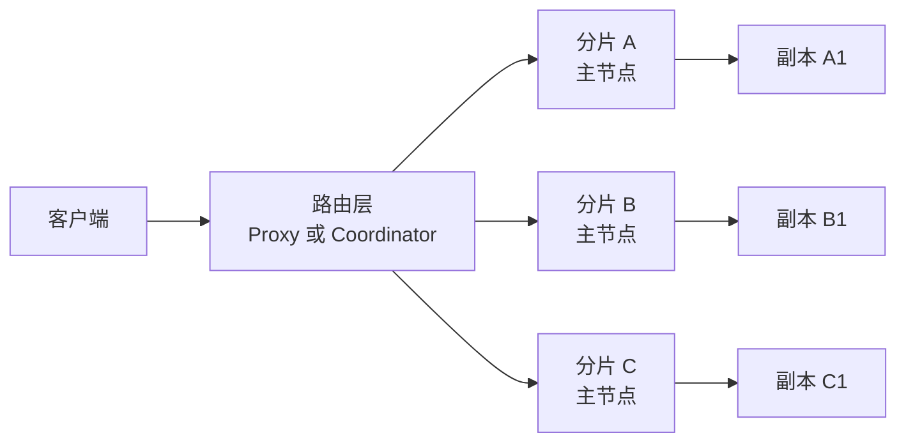
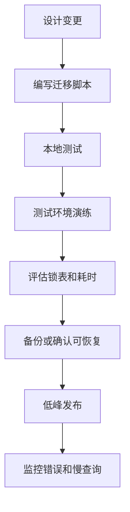
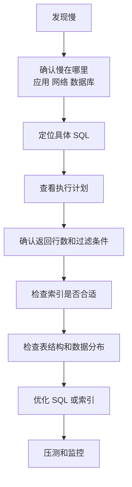
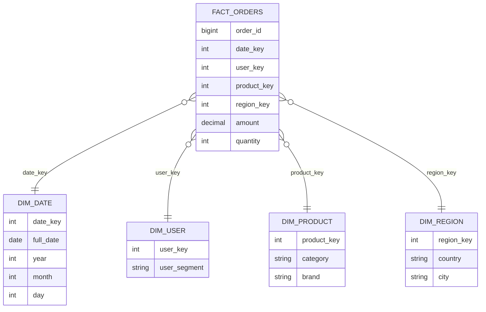
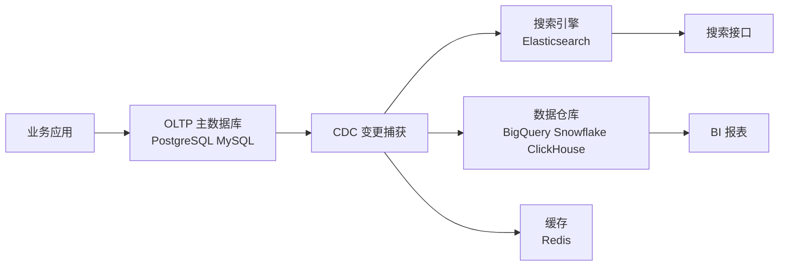

[toc]

下面是一份面向新手、但尽量贴近现代工程实践的 **SQL 和现代数据库系统学习指南**。它既可以作为学习大纲，也可以作为后续深入每个主题的索引。

本文基于截至 **2026**的主流数据库实践整理。SQL 的正式标准仍由 ISO/IEC 9075 系列定义，当前可公开确认的版本包括 SQL:2023；不同数据库厂商会实现标准的一部分，并扩展自己的语法与能力。([ISO](https://www.iso.org/standard/76583.html?utm_source=chatgpt.com))

------

## 学习 SQL 和数据库时要先建立的整体认知

SQL 不是“某一个数据库”，而是一门用于操作关系型数据的声明式语言。数据库系统也不只是“存表的地方”，而是一整套负责 **数据建模、查询、事务、并发、安全、备份、复制、性能优化和可靠性** 的基础设施。

可以先用下面这个图建立全局印象：



这张图背后的核心思想是：

SQL 写出来以后，数据库不会“照着字面顺序执行”，而是会解析 SQL，生成逻辑计划，优化成物理计划，再通过执行器访问表、索引、缓存、日志和事务系统。现代数据库的能力差异，很大程度上来自 **优化器、存储引擎、事务模型、分布式架构和生态集成** 的差异。

------

## 详细学习大纲

| 学习模块       | 核心问题                     | 必须掌握的内容                                  | 典型产出能力                             |
| -------------- | ---------------------------- | ----------------------------------------------- | ---------------------------------------- |
| 数据库基础     | 数据库到底解决什么问题       | DBMS、表、行、列、主键、外键、约束、事务        | 能解释数据库与文件、缓存、搜索引擎的区别 |
| SQL 基础       | 如何用 SQL 查询和修改数据    | SELECT、WHERE、ORDER BY、INSERT、UPDATE、DELETE | 能写基本增删改查                         |
| 关系模型       | 为什么数据要拆成多张表       | 实体、关系、范式、主键、外键、连接              | 能设计简单业务表结构                     |
| 查询能力       | 如何从多表中得到业务答案     | JOIN、GROUP BY、HAVING、子查询、CTE、窗口函数   | 能完成常见报表、排行榜、统计分析         |
| 数据完整性     | 如何防止脏数据进入系统       | NOT NULL、UNIQUE、CHECK、FOREIGN KEY、DEFAULT   | 能把业务规则沉淀到数据库层               |
| 事务与并发     | 多人同时改数据会发生什么     | ACID、隔离级别、MVCC、锁、死锁、乐观锁、悲观锁  | 能避免余额、库存、订单状态错误           |
| 索引与性能     | SQL 为什么慢，如何变快       | B+Tree、复合索引、覆盖索引、选择性、EXPLAIN     | 能分析慢查询并设计索引                   |
| 存储与日志     | 数据库如何保证崩溃后不丢数据 | WAL、Redo Log、Undo、Checkpoint、Buffer Pool    | 能理解持久化和恢复机制                   |
| 现代数据库类型 | 为什么有这么多数据库         | OLTP、OLAP、NoSQL、搜索、时序、图、向量数据库   | 能根据业务场景选型                       |
| 分布式数据库   | 单机不够用怎么办             | 主从复制、分片、共识、CAP、最终一致性           | 能理解可用性、延迟、一致性的取舍         |
| 工程实践       | 如何把数据库用于真实项目     | 迁移、备份、安全、监控、连接池、审计            | 能维护生产级数据库应用                   |

------

## 数据库、DBMS、SQL 的关系

| 概念   | 含义                                       | 类比                       |
| ------ | ------------------------------------------ | -------------------------- |
| 数据   | 被记录的事实，例如订单、用户、日志         | 商品本身                   |
| 数据库 | 组织化存储数据的集合                       | 仓库                       |
| DBMS   | Database Management System，数据库管理系统 | 仓库管理系统               |
| SQL    | Structured Query Language，结构化查询语言  | 与仓库沟通的标准语言       |
| RDBMS  | Relational DBMS，关系型数据库管理系统      | 按表格和关系管理的仓库系统 |

常见关系型数据库包括 PostgreSQL、MySQL、SQL Server、Oracle Database、SQLite 等。PostgreSQL 当前官方文档覆盖 SQL 语言、数据定义、查询、事务、索引等完整主题；MySQL 的 InnoDB 存储引擎则是 MySQL 事务和索引能力的核心之一。([PostgreSQL](https://www.postgresql.org/docs/current/index.html?utm_source=chatgpt.com))

需要注意：

| 误区                 | 正确认知                                   |
| -------------------- | ------------------------------------------ |
| SQL 就是 MySQL       | MySQL 是数据库产品，SQL 是语言             |
| 数据库只是存数据     | 数据库还负责一致性、并发、恢复、权限、优化 |
| 会 SELECT 就会数据库 | SQL 查询只是数据库能力的一部分             |
| NoSQL 取代 SQL       | NoSQL 是补充，不是无条件替代               |
| 索引越多越好         | 索引会加速读，也会拖慢写，并占用空间       |

------

## SQL 的语言分类

SQL 通常可以按用途分为几类。

| 类型 | 名称                         | 常见语句                | 作用                     |
| ---- | ---------------------------- | ----------------------- | ------------------------ |
| DDL  | Data Definition Language     | CREATE、ALTER、DROP     | 定义表、索引、视图等结构 |
| DML  | Data Manipulation Language   | INSERT、UPDATE、DELETE  | 修改数据                 |
| DQL  | Data Query Language          | SELECT                  | 查询数据                 |
| TCL  | Transaction Control Language | BEGIN、COMMIT、ROLLBACK | 控制事务                 |
| DCL  | Data Control Language        | GRANT、REVOKE           | 控制权限                 |

示例：

```sql
CREATE TABLE users (
    id BIGINT PRIMARY KEY,
    email VARCHAR(255) NOT NULL UNIQUE,
    name VARCHAR(100) NOT NULL,
    created_at TIMESTAMP NOT NULL DEFAULT CURRENT_TIMESTAMP
);

INSERT INTO users (id, email, name)
VALUES (1, 'alice@example.com', 'Alice');

SELECT id, email, name
FROM users
WHERE email = 'alice@example.com';

UPDATE users
SET name = 'Alice Zhang'
WHERE id = 1;

DELETE FROM users
WHERE id = 1;
```

------

## 关系模型的核心概念

关系型数据库的基本单位是 **表**。表由行和列组成。

| 概念   | 示例             | 说明               |
| ------ | ---------------- | ------------------ |
| 表     | users            | 一类实体的集合     |
| 行     | 一名用户记录     | 一条具体事实       |
| 列     | email、name      | 某种属性           |
| 主键   | id               | 唯一标识一行       |
| 外键   | order.user_id    | 指向另一张表的主键 |
| 候选键 | email            | 也能唯一识别记录   |
| 约束   | NOT NULL、UNIQUE | 防止不合法数据     |

以电商为例：



这个模型表达了：

| 关系                     | 含义                                                         |
| ------------------------ | ------------------------------------------------------------ |
| 一个用户可以有多个订单   | users 到 orders 是一对多                                     |
| 一个订单可以包含多个商品 | orders 到 products 是多对多，需要 order_items 中间表         |
| 商品价格会变化           | order_items 里保存 unit_price，避免历史订单金额被商品当前价格影响 |

------

## 主键、外键和约束

数据库约束的价值是：**把业务规则放到数据层兜底**。应用代码可能有 bug，多个服务可能同时写库，但数据库约束始终是最后一道防线。

PostgreSQL 官方文档明确说明，SQL 允许定义列级和表级约束，用来控制表中可存储的数据；违反约束的数据会被拒绝。([PostgreSQL](https://www.postgresql.org/docs/current/ddl-constraints.html?utm_source=chatgpt.com))

| 约束        | 作用                   | 示例                       |
| ----------- | ---------------------- | -------------------------- |
| PRIMARY KEY | 唯一标识一行，不能为空 | user.id                    |
| FOREIGN KEY | 保证引用的数据存在     | order.user_id 引用 user.id |
| UNIQUE      | 保证某列或某组列唯一   | email 不重复               |
| NOT NULL    | 禁止空值               | 用户名不能为空             |
| CHECK       | 自定义条件             | price >= 0                 |
| DEFAULT     | 默认值                 | created_at 默认当前时间    |

示例：

```sql
CREATE TABLE products (
    id BIGINT PRIMARY KEY,
    name VARCHAR(200) NOT NULL,
    price NUMERIC(10, 2) NOT NULL CHECK (price >= 0),
    stock INTEGER NOT NULL CHECK (stock >= 0),
    created_at TIMESTAMP NOT NULL DEFAULT CURRENT_TIMESTAMP
);

CREATE TABLE orders (
    id BIGINT PRIMARY KEY,
    user_id BIGINT NOT NULL REFERENCES users(id),
    status VARCHAR(30) NOT NULL CHECK (
        status IN ('pending', 'paid', 'shipped', 'cancelled')
    ),
    total_amount NUMERIC(10, 2) NOT NULL CHECK (total_amount >= 0),
    created_at TIMESTAMP NOT NULL DEFAULT CURRENT_TIMESTAMP
);
```

最佳实践：

| 场景       | 建议                                                   |
| ---------- | ------------------------------------------------------ |
| 每张业务表 | 尽量有主键                                             |
| 金额       | 用 DECIMAL 或 NUMERIC，不要用 FLOAT                    |
| 时间       | 统一时区策略，常用 UTC 存储                            |
| 状态       | 可以用 CHECK、枚举表或数据库 enum                      |
| 软删除     | 使用 deleted_at 比单纯 is_deleted 更有信息量           |
| 外键       | 核心一致性强的场景建议使用，超高并发或跨服务场景要权衡 |

------

## 数据类型选择

数据类型不是细节，而是数据库设计的基础。选错类型会带来精度错误、索引失效、空间浪费或迁移困难。

| 数据          | 推荐类型                                         | 避免                  |
| ------------- | ------------------------------------------------ | --------------------- |
| 自增 ID       | BIGINT、IDENTITY、BIGSERIAL                      | INT 容量不足          |
| 金额          | DECIMAL、NUMERIC                                 | FLOAT、DOUBLE         |
| 短文本        | VARCHAR、TEXT                                    | 过度限制长度          |
| 时间点        | TIMESTAMP WITH TIME ZONE 或统一 UTC 的 TIMESTAMP | 混用本地时间          |
| 是否          | BOOLEAN                                          | 用 0、1 但无约束      |
| JSON 扩展属性 | JSON、JSONB                                      | 把核心字段全部塞 JSON |
| 枚举状态      | CHECK、enum、状态表                              | 任意字符串            |
| 二进制        | BYTEA、BLOB                                      | Base64 文本滥用       |

PostgreSQL 原生支持 JSON/JSONB，并提供 SQL/JSON 函数；其文档还说明，GIN 索引可用于高效搜索大量 jsonb 文档中的键或键值对。([PostgreSQL](https://www.postgresql.org/docs/current/functions-json.html?utm_source=chatgpt.com))

使用 JSON 字段时要注意：

| 适合放 JSON        | 不适合放 JSON            |
| ------------------ | ------------------------ |
| 不稳定的扩展属性   | 用户 ID、订单 ID、金额   |
| 第三方回调原始数据 | 需要频繁 JOIN 的字段     |
| 配置、元数据       | 需要强约束的核心业务字段 |
| 低频查询字段       | 高频过滤、排序、聚合字段 |

------

## NULL 与三值逻辑

SQL 里的 NULL 不是空字符串，也不是 0，而是“未知”或“缺失”。

这会导致 SQL 不是简单的 true/false 二值逻辑，而是三值逻辑：

| 表达式        | 结果       |
| ------------- | ---------- |
| NULL = NULL   | UNKNOWN    |
| NULL <> NULL  | UNKNOWN    |
| NULL IS NULL  | TRUE       |
| 1 = NULL      | UNKNOWN    |
| WHERE UNKNOWN | 不返回该行 |

错误示例：

```sql
SELECT *
FROM users
WHERE deleted_at = NULL;
```

正确写法：

```sql
SELECT *
FROM users
WHERE deleted_at IS NULL;
```

常见规则：

| 需求       | 写法                                         |
| ---------- | -------------------------------------------- |
| 判断为空   | IS NULL                                      |
| 判断不为空 | IS NOT NULL                                  |
| 空值替代   | COALESCE(value, default_value)               |
| NULL 排序  | 注意不同数据库默认顺序可能不同               |
| 聚合       | COUNT(column) 不统计 NULL，COUNT(*) 统计行数 |

示例：

```sql
SELECT
    COUNT(*) AS total_rows,
    COUNT(email) AS rows_with_email
FROM users;
```

------

## SELECT 查询的逻辑执行顺序

SQL 的书写顺序和逻辑处理顺序不同。理解这一点非常重要。

| 书写顺序     | 逻辑含义       |
| ------------ | -------------- |
| SELECT       | 选择输出列     |
| FROM         | 从哪些表取数据 |
| JOIN         | 如何连接其他表 |
| WHERE        | 行级过滤       |
| GROUP BY     | 分组           |
| HAVING       | 分组后过滤     |
| ORDER BY     | 排序           |
| LIMIT/OFFSET | 截取结果       |

更接近逻辑处理顺序的是：



经典查询：

```sql
SELECT
    u.id,
    u.email,
    COUNT(o.id) AS order_count,
    SUM(o.total_amount) AS total_spent
FROM users AS u
LEFT JOIN orders AS o
    ON o.user_id = u.id
WHERE u.created_at >= DATE '2026-01-01'
GROUP BY u.id, u.email
HAVING COUNT(o.id) >= 1
ORDER BY total_spent DESC
LIMIT 20;
```

解释：

| 子句             | 作用                       |
| ---------------- | -------------------------- |
| FROM users       | 以用户表为主表             |
| LEFT JOIN orders | 即使用户没有订单也保留     |
| WHERE            | 只看 2026 年后注册的用户   |
| GROUP BY         | 按用户聚合                 |
| HAVING           | 只保留至少有一个订单的用户 |
| ORDER BY         | 按消费金额倒序             |
| LIMIT            | 取前 20 个                 |

------

## JOIN 的本质

JOIN 是 SQL 的核心，也是新手最容易混淆的部分。

| JOIN 类型  | 保留哪边数据       | 典型用途                   |
| ---------- | ------------------ | -------------------------- |
| INNER JOIN | 只保留两边匹配的行 | 查有订单的用户             |
| LEFT JOIN  | 保留左表全部行     | 查所有用户及其订单         |
| RIGHT JOIN | 保留右表全部行     | 较少使用，可换成 LEFT JOIN |
| FULL JOIN  | 保留两边全部行     | 对账、差异比对             |
| CROSS JOIN | 笛卡尔积           | 生成组合                   |
| SELF JOIN  | 表和自己连接       | 组织架构、层级关系         |

示例数据：

users：

| id   | name  |
| ---- | ----- |
| 1    | Alice |
| 2    | Bob   |
| 3    | Cindy |

orders：

| id   | user_id | amount |
| ---- | ------- | ------ |
| 101  | 1       | 100    |
| 102  | 1       | 50     |
| 103  | 2       | 80     |

INNER JOIN：

```sql
SELECT u.name, o.amount
FROM users AS u
INNER JOIN orders AS o
    ON o.user_id = u.id;
```

结果只包含 Alice 和 Bob，因为 Cindy 没有订单。

LEFT JOIN：

```sql
SELECT u.name, o.amount
FROM users AS u
LEFT JOIN orders AS o
    ON o.user_id = u.id;
```

结果会包含 Cindy，但订单字段为 NULL。

常见错误：

```sql
SELECT u.name, o.amount
FROM users AS u
LEFT JOIN orders AS o
    ON o.user_id = u.id
WHERE o.amount > 50;
```

这个 WHERE 条件会过滤掉 NULL，导致 LEFT JOIN 变得像 INNER JOIN。若希望保留没有订单的用户，应把条件放到 ON 中：

```sql
SELECT u.name, o.amount
FROM users AS u
LEFT JOIN orders AS o
    ON o.user_id = u.id
   AND o.amount > 50;
```

------

## 聚合查询

聚合用于把多行数据汇总成统计结果。

| 函数  | 作用   |
| ----- | ------ |
| COUNT | 计数   |
| SUM   | 求和   |
| AVG   | 平均值 |
| MIN   | 最小值 |
| MAX   | 最大值 |

示例：统计每天订单金额。

```sql
SELECT
    DATE(created_at) AS order_date,
    COUNT(*) AS order_count,
    SUM(total_amount) AS revenue
FROM orders
WHERE status = 'paid'
GROUP BY DATE(created_at)
ORDER BY order_date;
```

注意：

| 问题                      | 说明                                        |
| ------------------------- | ------------------------------------------- |
| SELECT 中非聚合列         | 通常必须出现在 GROUP BY 中                  |
| WHERE 和 HAVING           | WHERE 过滤分组前数据，HAVING 过滤分组后结果 |
| COUNT(*) 和 COUNT(column) | 前者统计行数，后者忽略 NULL                 |
| SUM 无数据                | 可能返回 NULL，可用 COALESCE                |

```sql
SELECT
    user_id,
    COALESCE(SUM(total_amount), 0) AS total_spent
FROM orders
GROUP BY user_id;
```

------

## 窗口函数

窗口函数是现代 SQL 的重要能力，适合做排名、累计、同比、环比、分组内取 Top N。

SQLite 文档也支持窗口函数，并将其定义为：输入来自结果集中一个或多个行构成的“窗口”的 SQL 函数。([sqlite.org](https://sqlite.org/windowfunctions.html?utm_source=chatgpt.com))

普通聚合会把多行压缩成一行；窗口函数不会压缩行，而是在每行旁边计算统计值。

| 场景         | 窗口函数                     |
| ------------ | ---------------------------- |
| 排名         | ROW_NUMBER、RANK、DENSE_RANK |
| 分组内 Top N | ROW_NUMBER + PARTITION BY    |
| 累计和       | SUM(...) OVER                |
| 前后对比     | LAG、LEAD                    |
| 移动平均     | AVG(...) OVER                |

示例：每个用户最近一笔订单。

```sql
WITH ranked_orders AS (
    SELECT
        o.*,
        ROW_NUMBER() OVER (
            PARTITION BY user_id
            ORDER BY created_at DESC
        ) AS rn
    FROM orders AS o
)
SELECT *
FROM ranked_orders
WHERE rn = 1;
```

示例：每日销售额及累计销售额。

```sql
WITH daily_sales AS (
    SELECT
        DATE(created_at) AS order_date,
        SUM(total_amount) AS revenue
    FROM orders
    WHERE status = 'paid'
    GROUP BY DATE(created_at)
)
SELECT
    order_date,
    revenue,
    SUM(revenue) OVER (
        ORDER BY order_date
        ROWS BETWEEN UNBOUNDED PRECEDING AND CURRENT ROW
    ) AS cumulative_revenue
FROM daily_sales
ORDER BY order_date;
```

------

## 子查询、CTE 与视图

| 技术     | 作用                | 适合场景                 |
| -------- | ------------------- | ------------------------ |
| 子查询   | 在 SQL 内嵌套查询   | 简单过滤、存在性判断     |
| CTE      | WITH 定义临时结果集 | 提高可读性，拆解复杂逻辑 |
| 视图     | 保存查询逻辑        | 复用查询、隐藏复杂表结构 |
| 物化视图 | 保存查询结果        | 加速重型统计查询         |

子查询示例：

```sql
SELECT *
FROM users
WHERE id IN (
    SELECT user_id
    FROM orders
    WHERE status = 'paid'
);
```

EXISTS 通常更适合表达“是否存在”：

```sql
SELECT *
FROM users AS u
WHERE EXISTS (
    SELECT 1
    FROM orders AS o
    WHERE o.user_id = u.id
      AND o.status = 'paid'
);
```

CTE 示例：

```sql
WITH paid_orders AS (
    SELECT *
    FROM orders
    WHERE status = 'paid'
),
user_spending AS (
    SELECT
        user_id,
        SUM(total_amount) AS total_spent
    FROM paid_orders
    GROUP BY user_id
)
SELECT
    u.email,
    s.total_spent
FROM user_spending AS s
JOIN users AS u
    ON u.id = s.user_id
ORDER BY s.total_spent DESC;
```

最佳实践：

| 场景                     | 建议                                                |
| ------------------------ | --------------------------------------------------- |
| SQL 很长                 | 用 CTE 分层                                         |
| 多处复用逻辑             | 用视图                                              |
| 报表查询很慢且数据可延迟 | 考虑物化视图                                        |
| 高频在线接口             | 不要依赖复杂嵌套 SQL 临时救火，要回到索引和模型设计 |

------

## 数据建模与范式

数据库设计的目标不是“表越少越好”，也不是“表越多越专业”，而是在 **一致性、性能、可理解性、扩展性** 之间平衡。

### 范式的核心思想

| 范式     | 解决的问题                     | 简化理解       |
| -------- | ------------------------------ | -------------- |
| 第一范式 | 字段不可再分、不要重复组       | 一格只放一个值 |
| 第二范式 | 非主键字段依赖整个主键         | 不要部分依赖   |
| 第三范式 | 非主键字段不依赖其他非主键字段 | 不要传递依赖   |

反例：订单表里直接存用户邮箱、商品名称、商品当前价格。

```text
orders
- order_id
- user_id
- user_email
- product_id
- product_name
- product_current_price
- quantity
```

问题：

| 问题                     | 后果                     |
| ------------------------ | ------------------------ |
| 用户邮箱重复存储         | 邮箱修改时多处更新       |
| 商品名重复存储           | 名称修改后历史数据不一致 |
| 当前价格和历史成交价混淆 | 历史订单金额被污染       |

更合理的设计：

```text
users
- id
- email
- name

products
- id
- name
- current_price

orders
- id
- user_id
- status
- total_amount

order_items
- order_id
- product_id
- quantity
- unit_price
```

注意：`unit_price` 是故意冗余的，因为订单需要记录成交当时价格。这是业务正确性要求，不是违反设计原则。

### 反范式化

反范式化是为了性能或查询便利，有意识地保存冗余数据。

| 反范式化场景 | 示例                     | 风险                     |
| ------------ | ------------------------ | ------------------------ |
| 高频读取     | orders 保存 total_amount | 写入时要保证同步         |
| 报表统计     | daily_sales_summary      | 数据延迟和重算           |
| 搜索展示     | 商品表保存 category_name | 分类改名需要同步         |
| 分布式服务   | 订单服务保存用户快照     | 用户信息变更不会自动同步 |

原则：

> 先用规范化模型保证正确性，再针对明确的性能瓶颈做可控冗余。

------

## 事务与 ACID

事务是数据库区别于普通文件和缓存的核心能力之一。

ACID 表示：

| 特性               | 含义                       | 示例                           |
| ------------------ | -------------------------- | ------------------------------ |
| Atomicity 原子性   | 要么全部成功，要么全部失败 | 下单扣库存和写订单必须一起成功 |
| Consistency 一致性 | 事务前后数据满足约束       | 余额不能变负，外键必须有效     |
| Isolation 隔离性   | 并发事务互不干扰到一定程度 | 两个人同时抢最后一件库存       |
| Durability 持久性  | 提交后即使崩溃也不应丢失   | COMMIT 后机器宕机仍能恢复      |

示例：下单事务。

```sql
BEGIN;

UPDATE products
SET stock = stock - 1
WHERE id = 1001
  AND stock >= 1;

INSERT INTO orders (id, user_id, status, total_amount)
VALUES (9001, 1, 'paid', 99.00);

INSERT INTO order_items (order_id, product_id, quantity, unit_price)
VALUES (9001, 1001, 1, 99.00);

COMMIT;
```

如果中间失败：

```sql
ROLLBACK;
```

事务的关键不是“把 SQL 包起来”，而是要让业务不变量在并发情况下仍成立。例如库存不能小于 0，账户转账不能凭空多钱或少钱。

------

## 并发异常与隔离级别

多个事务同时运行时，可能出现并发异常。

| 异常       | 含义                                         | 示例                       |
| ---------- | -------------------------------------------- | -------------------------- |
| 脏读       | 读到别人未提交的数据                         | 读到稍后回滚的余额         |
| 不可重复读 | 同一事务两次读同一行结果不同                 | 期间被别人改了             |
| 幻读       | 同一条件两次查询行数不同                     | 期间有人插入符合条件的新行 |
| 丢失更新   | 两个事务覆盖彼此修改                         | 两人同时改库存             |
| 写偏斜     | 各自读到旧快照后写入不同数据，整体规则被破坏 | 排班系统无人值班           |

常见 SQL 隔离级别：

| 隔离级别         | 大致能力               | 代价                                 |
| ---------------- | ---------------------- | ------------------------------------ |
| READ UNCOMMITTED | 可能脏读               | 很少用于核心业务                     |
| READ COMMITTED   | 避免脏读               | 仍可能不可重复读                     |
| REPEATABLE READ  | 同事务内多次读取更稳定 | 可能需要处理幻读或冲突，具体看数据库 |
| SERIALIZABLE     | 效果接近串行执行       | 成本最高，可能出现重试               |

PostgreSQL 文档说明，它可请求四种标准隔离级别，但内部实现为三种不同隔离级别，其中 Read Uncommitted 在 PostgreSQL 中表现为 Read Committed，这是其 MVCC 架构下的映射方式。([PostgreSQL](https://www.postgresql.org/docs/current/transaction-iso.html?utm_source=chatgpt.com)) MySQL InnoDB 文档说明 InnoDB 提供 SQL 标准中的四种事务隔离级别，默认隔离级别是 REPEATABLE READ。([MySQL开发者专区](https://dev.mysql.com/doc/refman/8.1/en/innodb-transaction-isolation-levels.html?utm_source=chatgpt.com))

------

## MVCC、锁与死锁

现代数据库通常不会简单地让读写互相阻塞。很多数据库使用 MVCC，也就是 Multi-Version Concurrency Control，多版本并发控制。

PostgreSQL 文档解释了 MVCC 的优势：读数据时获取的锁不会与写数据的锁冲突，因此读不会阻塞写，写也不会阻塞读；PostgreSQL 即使在严格隔离级别下也维护这种保证。([PostgreSQL](https://www.postgresql.org/docs/current/mvcc-intro.html?utm_source=chatgpt.com)) MySQL InnoDB 的事务模型则结合多版本数据库和传统两阶段锁，使用行级锁，并默认以非锁定一致性读方式运行查询。([MySQL开发者专区](https://dev.mysql.com/doc/refman/8.4/en/innodb-transaction-model.html?utm_source=chatgpt.com))

简化理解：



锁的类型很多，但新手先掌握这些：

| 锁     | 说明                     | 场景                             |
| ------ | ------------------------ | -------------------------------- |
| 行锁   | 锁住具体行               | 更新某个订单                     |
| 表锁   | 锁住整张表               | DDL 或某些批量操作               |
| 共享锁 | 允许别人读，不允许别人改 | 显式一致性读取                   |
| 排他锁 | 当前事务独占修改         | UPDATE、DELETE                   |
| 意向锁 | 表示事务准备锁某些行     | 存储引擎内部协调                 |
| 间隙锁 | 锁住索引范围间隙         | 防止幻读，常见于 InnoDB 某些场景 |

死锁示例：

```text
事务 A：先锁订单 1，再锁订单 2
事务 B：先锁订单 2，再锁订单 1
```

避免死锁的实践：

| 做法                     | 原因                           |
| ------------------------ | ------------------------------ |
| 固定资源访问顺序         | 所有事务都按相同顺序加锁       |
| 事务尽量短               | 减少锁持有时间                 |
| 不在事务里调用慢外部接口 | 网络延迟会放大锁等待           |
| 给查询条件建立合适索引   | 避免锁范围扩大                 |
| 捕获死锁错误并重试       | 死锁是并发系统中的正常现象之一 |

------

## 索引的原理

索引是数据库性能优化中最重要的概念之一。

PostgreSQL 文档说明，`CREATE INDEX` 会在表或物化视图上构建索引，主要用于提升数据库性能，但不恰当使用索引也可能降低性能。([PostgreSQL](https://www.postgresql.org/docs/current/sql-createindex.html?utm_source=chatgpt.com)) MySQL InnoDB 中，定义主键时会将其作为聚簇索引，表数据会围绕主键组织，以优化主键查找。([MySQL开发者专区](https://dev.mysql.com/doc/refman/9.7/en/innodb-index-types.html?utm_source=chatgpt.com))

### 为什么索引能加速

没有索引：

```text
查 email = 'a@example.com'
需要从第一行扫到最后一行
```

有索引：

```text
先在索引结构中定位 email
再找到对应行
```

常见索引类型：

| 索引类型        | 适合场景                               |
| --------------- | -------------------------------------- |
| B-Tree / B+Tree | 等值查询、范围查询、排序，最常见       |
| Hash            | 等值查询                               |
| Full-text       | 全文搜索                               |
| GIN             | 数组、JSONB、全文、倒排索引类场景      |
| GiST / SP-GiST  | 空间、范围、相似性等                   |
| BRIN            | 超大表、数据与物理顺序相关，如时间序列 |
| Vector index    | 语义搜索、向量近邻查询                 |

### 单列索引

```sql
CREATE INDEX idx_users_email
ON users (email);
```

适合：

```sql
SELECT *
FROM users
WHERE email = 'alice@example.com';
```

### 复合索引

```sql
CREATE INDEX idx_orders_user_created
ON orders (user_id, created_at);
```

适合：

```sql
SELECT *
FROM orders
WHERE user_id = 1
ORDER BY created_at DESC;
```

复合索引顺序非常重要。

| 索引                  | 适合                         |
| --------------------- | ---------------------------- |
| (user_id, created_at) | 按用户查订单，并按时间排序   |
| (created_at, user_id) | 按时间范围查订单，再区分用户 |
| (status, created_at)  | 查某状态订单的时间范围       |
| (created_at, status)  | 查某时间范围内再看状态       |

经验规则：

| 规则                     | 说明                                  |
| ------------------------ | ------------------------------------- |
| 等值条件优先             | user_id = ?                           |
| 高选择性列优先           | 能过滤掉大量数据的列                  |
| 范围条件之后的列利用受限 | created_at > ? 后面的列不一定充分利用 |
| 排序字段可纳入索引       | 避免额外排序                          |
| 频繁查询才建索引         | 不要为偶发查询建太多索引              |

### 覆盖索引

如果查询需要的列都在索引里，数据库可能不必回表。

```sql
CREATE INDEX idx_orders_user_status_amount
ON orders (user_id, status, total_amount);
```

适合：

```sql
SELECT status, total_amount
FROM orders
WHERE user_id = 1;
```

### 部分索引

部分索引只索引满足条件的行，适合冷热数据明显的场景。

```sql
CREATE INDEX idx_orders_pending
ON orders (created_at)
WHERE status = 'pending';
```

适合：

```sql
SELECT *
FROM orders
WHERE status = 'pending'
ORDER BY created_at;
```

### 函数索引

```sql
CREATE INDEX idx_users_lower_email
ON users (LOWER(email));
```

适合：

```sql
SELECT *
FROM users
WHERE LOWER(email) = LOWER('Alice@Example.com');
```

注意：如果 WHERE 里对列做函数计算，普通索引可能无法使用；应考虑函数索引，或在写入时保存规范化字段。

------

## 如何使用 EXPLAIN 看查询计划

数据库优化器会为 SQL 选择执行计划。PostgreSQL 文档说明，可以使用 `EXPLAIN` 查看优化器为查询创建的计划，而选择与查询结构和数据属性匹配的计划对性能非常关键。([PostgreSQL](https://www.postgresql.org/docs/current/using-explain.html?utm_source=chatgpt.com))

示例：

```sql
EXPLAIN
SELECT *
FROM orders
WHERE user_id = 1
ORDER BY created_at DESC
LIMIT 10;
```

你要重点关注：

| 指标            | 含义                               |
| --------------- | ---------------------------------- |
| Seq Scan        | 全表扫描                           |
| Index Scan      | 使用索引扫描                       |
| Index Only Scan | 可能只扫索引                       |
| Nested Loop     | 嵌套循环连接                       |
| Hash Join       | 哈希连接                           |
| Merge Join      | 排序合并连接                       |
| Sort            | 额外排序                           |
| Rows            | 估算行数                           |
| Cost            | 优化器估算成本                     |
| Actual Time     | 实际耗时，通常需要 EXPLAIN ANALYZE |

常见慢查询原因：

| 原因         | 表现             | 解决方向              |
| ------------ | ---------------- | --------------------- |
| 缺索引       | 大表 Seq Scan    | 建合适索引            |
| 索引顺序不对 | 建了索引仍慢     | 调整复合索引顺序      |
| 返回行太多   | 网络和应用处理慢 | 分页、限制字段        |
| 统计信息过期 | 优化器选错计划   | ANALYZE、维护统计信息 |
| 隐式类型转换 | 索引失效         | 参数类型与列类型一致  |
| 函数包裹列   | 无法用普通索引   | 函数索引或改写 SQL    |
| 深分页       | OFFSET 很大很慢  | Keyset Pagination     |

------

## 分页：OFFSET 与 Keyset Pagination

普通分页：

```sql
SELECT *
FROM orders
ORDER BY created_at DESC
LIMIT 20 OFFSET 100000;
```

问题：数据库可能需要先跳过 100000 行，页数越深越慢。

更好的方式是基于游标或键集分页：

```sql
SELECT *
FROM orders
WHERE created_at < TIMESTAMP '2026-06-01 12:00:00'
ORDER BY created_at DESC
LIMIT 20;
```

若时间可能重复，用组合条件：

```sql
SELECT *
FROM orders
WHERE
    (created_at, id) < (TIMESTAMP '2026-06-01 12:00:00', 9001)
ORDER BY created_at DESC, id DESC
LIMIT 20;
```

适合无限滚动、消息列表、订单列表。

------

## 写入、更新和 UPSERT

### INSERT

```sql
INSERT INTO users (id, email, name)
VALUES (1, 'alice@example.com', 'Alice');
```

### 批量 INSERT

```sql
INSERT INTO users (id, email, name)
VALUES
    (1, 'alice@example.com', 'Alice'),
    (2, 'bob@example.com', 'Bob');
```

### UPDATE

```sql
UPDATE users
SET name = 'Alice Zhang'
WHERE id = 1;
```

更新一定要小心 WHERE：

```sql
UPDATE users
SET name = 'Unknown';
```

这会更新整张表。

### DELETE

```sql
DELETE FROM users
WHERE id = 1;
```

生产环境常见做法是软删除：

```sql
UPDATE users
SET deleted_at = CURRENT_TIMESTAMP
WHERE id = 1;
```

### UPSERT

不同数据库语法不同。

PostgreSQL 常见写法：

```sql
INSERT INTO users (id, email, name)
VALUES (1, 'alice@example.com', 'Alice')
ON CONFLICT (email)
DO UPDATE SET
    name = EXCLUDED.name;
```

MySQL 常见写法：

```sql
INSERT INTO users (id, email, name)
VALUES (1, 'alice@example.com', 'Alice')
ON DUPLICATE KEY UPDATE
    name = VALUES(name);
```

实践建议：

| 场景             | 建议                                   |
| ---------------- | -------------------------------------- |
| 幂等写入         | 使用唯一约束 + UPSERT                  |
| 消息消费         | 以业务唯一键去重                       |
| 扣库存           | 在 UPDATE 条件中加 `stock >= quantity` |
| 批量导入         | 分批提交，避免超大事务                 |
| 高并发更新同一行 | 考虑乐观锁、队列化或拆分热点           |

------

## 乐观锁与悲观锁

### 乐观锁

认为冲突不常发生，通过版本号检测冲突。

表结构：

```sql
ALTER TABLE products
ADD COLUMN version INTEGER NOT NULL DEFAULT 0;
```

更新：

```sql
UPDATE products
SET
    stock = stock - 1,
    version = version + 1
WHERE id = 1001
  AND stock >= 1
  AND version = 7;
```

如果影响行数为 0，说明版本变化或库存不足，需要重试或失败。

适合：

| 场景         | 是否适合     |
| ------------ | ------------ |
| 冲突较少     | 适合         |
| 用户编辑资料 | 适合         |
| 高并发抢库存 | 可能重试很多 |
| 金融账户     | 需要更谨慎   |

### 悲观锁

认为冲突会发生，先锁住。

```sql
BEGIN;

SELECT *
FROM products
WHERE id = 1001
FOR UPDATE;

UPDATE products
SET stock = stock - 1
WHERE id = 1001
  AND stock >= 1;

COMMIT;
```

适合：

| 场景               | 是否适合 |
| ------------------ | -------- |
| 强一致库存         | 适合     |
| 账户余额变更       | 适合     |
| 长时间人工编辑     | 不适合   |
| 事务内调用外部服务 | 不适合   |

------

## 数据库存储、日志与恢复

数据库要保证提交后的数据不轻易丢失，通常依赖日志机制。



核心组件：

| 组件                     | 作用                     |
| ------------------------ | ------------------------ |
| Buffer Pool              | 缓存数据页，减少磁盘访问 |
| WAL / Redo Log           | 先写日志，保证崩溃恢复   |
| Undo                     | 支持回滚和 MVCC 历史版本 |
| Checkpoint               | 定期把脏页刷到数据文件   |
| Binlog / Replication Log | 支持复制、审计、恢复     |
| Vacuum / Compaction      | 清理旧版本或重写存储结构 |

SQLite 也支持 WAL 模式。SQLite 文档说明，WAL 对较小事务效果较好，但非常大的事务可能更适合传统 rollback journal 模式。([sqlite.org](https://www.sqlite.org/wal.html?utm_source=chatgpt.com))

------

## OLTP 与 OLAP

现代数据库首先要区分两类工作负载。

| 类型 | 全称                          | 典型场景                   | 关注点                     |
| ---- | ----------------------------- | -------------------------- | -------------------------- |
| OLTP | Online Transaction Processing | 下单、支付、库存、用户系统 | 低延迟、高并发、事务一致性 |
| OLAP | Online Analytical Processing  | 报表、BI、数据分析         | 大规模扫描、聚合、列式存储 |

| 对比项   | OLTP              | OLAP                                      |
| -------- | ----------------- | ----------------------------------------- |
| 数据模型 | 规范化、多表      | 星型模型、宽表、事实表维度表              |
| 查询     | 单行或小范围读写  | 大范围扫描和聚合                          |
| 写入     | 高频小事务        | 批量导入、流式写入                        |
| 存储     | 行式常见          | 列式常见                                  |
| 代表     | PostgreSQL、MySQL | BigQuery、Snowflake、ClickHouse、Redshift |
| 优化目标 | TPS、延迟、锁冲突 | 扫描吞吐、压缩、并行计算                  |

BigQuery 官方文档将其描述为结合云数据仓库和分析工具的服务，并强调 serverless 基础设施让用户专注数据而非资源管理。([Google Cloud Documentation](https://docs.cloud.google.com/bigquery/docs/introduction?utm_source=chatgpt.com)) Snowflake 文档说明，其表数据会自动划分为 micro-partitions，并以列式方式组织，常用于查询裁剪和分析性能优化。([docs.snowflake.com](https://docs.snowflake.com/en/user-guide/tables-clustering-micropartitions?utm_source=chatgpt.com))

------

## 行式存储与列式存储

### 行式存储

适合 OLTP：

```text
row1: id, name, email, created_at
row2: id, name, email, created_at
row3: id, name, email, created_at
```

优点：

| 优点         | 原因             |
| ------------ | ---------------- |
| 获取整行快   | 一行数据靠近存放 |
| 单行更新方便 | 修改某条记录直接 |
| 适合事务     | 订单、用户、库存 |

### 列式存储

适合 OLAP：

```text
id column: 1, 2, 3
name column: Alice, Bob, Cindy
email column: ...
created_at column: ...
```

优点：

| 优点       | 原因             |
| ---------- | ---------------- |
| 聚合快     | 只读需要的列     |
| 压缩率高   | 同列数据类型相似 |
| 扫描吞吐高 | 适合并行分析     |

示例：

```sql
SELECT SUM(total_amount)
FROM orders
WHERE created_at >= DATE '2026-01-01';
```

在列式数据库中，可能只需要读取 `total_amount` 和 `created_at` 两列，而不必读取订单整行。

------

## 现代数据库类型全景

现代系统通常不是只用一种数据库，而是根据场景组合使用。

| 类型         | 代表                                 | 核心能力                     | 适合场景                     | 不适合场景           |
| ------------ | ------------------------------------ | ---------------------------- | ---------------------------- | -------------------- |
| 关系型 OLTP  | PostgreSQL、MySQL                    | SQL、事务、约束、索引        | 核心业务系统                 | 超大规模分析扫描     |
| 嵌入式数据库 | SQLite、DuckDB                       | 单文件、轻量、本地分析       | 移动端、本地应用、测试、分析 | 多用户高并发写入     |
| 文档数据库   | MongoDB                              | JSON/BSON 文档、灵活结构     | 内容、配置、半结构化数据     | 强关系复杂 JOIN      |
| Key-Value    | Redis                                | 内存、低延迟、数据结构       | 缓存、排行榜、限流、会话     | 复杂事务和长期主存储 |
| 搜索引擎     | Elasticsearch                        | 倒排索引、全文搜索、向量搜索 | 搜索、日志、观测             | 替代强一致交易库     |
| 宽列数据库   | Cassandra、HBase                     | 高写入、分布式、宽表         | 海量事件、IoT                | 复杂关系查询         |
| 图数据库     | Neo4j、JanusGraph                    | 节点边关系遍历               | 社交、风控、知识图谱         | 简单表格业务         |
| 时序数据库   | TimescaleDB、InfluxDB                | 时间分区、压缩、窗口聚合     | 监控、传感器、行情           | 普通交易系统         |
| 列式分析库   | ClickHouse、BigQuery、Snowflake      | 列式、并行、压缩             | BI、日志分析                 | 高频小事务           |
| 向量数据库   | Milvus、Pinecone、pgvector、Weaviate | 向量近邻搜索                 | RAG、推荐、语义搜索          | 精确关系约束         |

MongoDB 官方文档说明，它支持跨多个操作、集合、数据库、文档和分片的事务，用于需要多文档原子性的场景。([MongoDB](https://www.mongodb.com/docs/manual/core/transactions/?utm_source=chatgpt.com)) Redis 官方文档强调其可以作为缓存、主数据库、向量或自定义数据库，并提供核心数据结构能力。([Redis](https://redis.io/docs/latest/?utm_source=chatgpt.com)) Elasticsearch 官方文档将其描述为基于 Lucene 的分布式搜索与分析引擎、可扩展数据存储和向量数据库。([Elastic](https://www.elastic.co/docs/reference/elasticsearch?utm_source=chatgpt.com))

------

## 如何选择数据库

优先从问题出发，而不是从流行技术出发。

| 问题                     | 优先考虑                                           |
| ------------------------ | -------------------------------------------------- |
| 是否需要强事务           | PostgreSQL、MySQL、SQL Server、Oracle              |
| 是否主要是复杂查询和报表 | BigQuery、Snowflake、ClickHouse                    |
| 是否需要全文搜索         | Elasticsearch、OpenSearch，或 PostgreSQL Full Text |
| 是否需要低延迟缓存       | Redis                                              |
| 是否数据结构经常变化     | PostgreSQL JSONB 或 MongoDB                        |
| 是否关系遍历很深         | 图数据库                                           |
| 是否主要按时间写入和查询 | 时序数据库                                         |
| 是否需要语义搜索         | 向量数据库或带向量扩展的数据库                     |
| 是否只是本地小应用       | SQLite                                             |
| 是否移动端内嵌           | SQLite                                             |

实用建议：

| 项目阶段             | 建议                                        |
| -------------------- | ------------------------------------------- |
| 早期业务系统         | 优先 PostgreSQL 或 MySQL                    |
| 不确定是否需要 NoSQL | 先用关系型数据库，必要时加 JSON 字段        |
| 搜索需求出现         | 增加搜索引擎，不要直接替换主库              |
| 分析需求增长         | 建数据仓库，不要让 OLTP 主库承担所有报表    |
| AI/RAG 需求          | 可先用 PostgreSQL + pgvector 或托管向量服务 |
| 缓存需求             | Redis 作为缓存层，不要默认当唯一事实来源    |

------

## 多模型数据库与“SQL 回归”

现代数据库的一个趋势是：传统边界正在变模糊。

| 趋势                     | 表现                                                |
| ------------------------ | --------------------------------------------------- |
| 关系型数据库支持 JSON    | PostgreSQL JSONB、MySQL JSON                        |
| 搜索引擎支持向量         | Elasticsearch 支持向量搜索                          |
| 文档数据库支持事务       | MongoDB 支持多文档事务                              |
| 数据仓库支持半结构化数据 | BigQuery、Snowflake 可处理 JSON 等                  |
| SQL 被广泛采用           | Spark SQL、Flink SQL、DuckDB、Trino、ClickHouse SQL |

这说明：
**SQL 没有过时。相反，SQL 正在成为跨 OLTP、OLAP、流处理、湖仓、向量检索的一种通用数据接口。**

------

## 分布式数据库基础

当单机容量、性能或可用性不够时，就会进入分布式数据库领域。



核心概念：

| 概念              | 含义                                 |
| ----------------- | ------------------------------------ |
| Replication 复制  | 同一份数据存多份，提高可用性和读能力 |
| Sharding 分片     | 不同数据放不同节点，突破单机容量     |
| Partitioning 分区 | 在逻辑表内部按范围、哈希、列表拆分   |
| Consensus 共识    | 多节点就谁是主、日志顺序达成一致     |
| Leader / Follower | 主节点处理写，从节点复制             |
| Multi-primary     | 多主写入，复杂度更高                 |
| Read Replica      | 读副本，用于扩展读和容灾             |
| Failover          | 主节点故障后切换                     |

### CAP 不要机械理解

CAP 指的是在网络分区发生时，系统需要在一致性和可用性之间做取舍。但真实系统更复杂，还要考虑延迟、隔离级别、冲突处理、业务容忍度和运维复杂度。

| 目标     | 代价                 |
| -------- | -------------------- |
| 强一致   | 可能牺牲延迟或可用性 |
| 高可用   | 可能读到旧数据       |
| 低延迟   | 可能牺牲跨区域一致性 |
| 全球多活 | 冲突处理复杂         |
| 简单运维 | 可能牺牲极致扩展能力 |

工程判断：

| 数据     | 一致性要求     |
| -------- | -------------- |
| 账户余额 | 强一致         |
| 库存扣减 | 强一致或可补偿 |
| 订单状态 | 通常强一致     |
| 点赞数   | 可最终一致     |
| 浏览量   | 可最终一致     |
| 推荐特征 | 可延迟         |
| 搜索索引 | 可异步同步     |

------

## 复制、备份与恢复

复制不是备份。备份也不是高可用。

| 能力     | 解决什么             | 不能解决什么         |
| -------- | -------------------- | -------------------- |
| 复制     | 节点故障、读扩展     | 误删数据会同步到副本 |
| 备份     | 误删、勒索、灾难恢复 | 不能立即承接流量     |
| PITR     | 恢复到某个时间点     | 需要日志和备份配合   |
| 快照     | 快速保存某时刻状态   | 可能缺少细粒度恢复   |
| 多可用区 | 单机房故障           | 跨区域灾难           |
| 多区域   | 区域级故障           | 成本和一致性复杂     |

基本原则：

| 实践         | 说明                             |
| ------------ | -------------------------------- |
| 定期备份     | 自动化执行                       |
| 定期恢复演练 | 没验证过的备份不可信             |
| 备份隔离保存 | 防止主系统故障或被攻击时一并损坏 |
| 明确 RPO     | 最多能丢多少数据                 |
| 明确 RTO     | 多久必须恢复服务                 |
| 记录恢复步骤 | 故障时不能靠临时记忆             |

------

## 数据库安全

数据库安全不是最后才做的事情。

| 风险     | 防护                                |
| -------- | ----------------------------------- |
| SQL 注入 | 参数化查询                          |
| 权限过大 | 最小权限原则                        |
| 明文密码 | 哈希加盐，不能可逆加密              |
| 明文传输 | TLS                                 |
| 备份泄漏 | 备份加密和访问控制                  |
| 越权查询 | 行级权限、应用层鉴权                |
| 误操作   | 审计、审批、只读账号                |
| 密钥泄露 | 使用 Secret Manager，不写死在代码里 |

SQL 注入错误示例：

```text
SELECT * FROM users WHERE email = '" + userInput + "'
```

正确做法是参数化：

```sql
SELECT *
FROM users
WHERE email = ?;
```

应用代码由数据库驱动绑定参数，而不是字符串拼接。

权限示例：

```sql
CREATE ROLE app_readonly;

GRANT SELECT ON ALL TABLES IN SCHEMA public
TO app_readonly;
```

实践建议：

| 场景           | 建议                   |
| -------------- | ---------------------- |
| 应用连接数据库 | 不要用 root 或超级用户 |
| 读写分离       | 读接口用只读账号       |
| 后台管理       | 单独账号，开启审计     |
| 数据导出       | 脱敏、审批、留痕       |
| 生产排查       | 优先只读查询           |

------

## 数据库迁移与版本管理

真实项目中，表结构会不断变化。不要手工在生产库随意执行 DDL，而应使用迁移工具和版本化脚本。

常见工具：

| 生态    | 工具                            |
| ------- | ------------------------------- |
| Java    | Flyway、Liquibase               |
| Node.js | Prisma Migrate、Knex migrations |
| Python  | Alembic、Django migrations      |
| Ruby    | Rails migrations                |
| Go      | golang-migrate、Atlas           |

迁移脚本示例：

```sql
ALTER TABLE users
ADD COLUMN phone VARCHAR(30);
```

生产环境迁移要考虑：

| 问题        | 建议                               |
| ----------- | ---------------------------------- |
| 大表加列    | 避免长时间锁表，了解数据库版本特性 |
| 加 NOT NULL | 先加可空列，回填，再加约束         |
| 建索引      | 大表使用在线或并发建索引能力       |
| 删除列      | 先应用不再使用，再延迟删除         |
| 回滚        | 写清楚回滚策略                     |
| 多服务发布  | 保持向前兼容和向后兼容             |

安全迁移流程：



------

## 连接池与应用侧实践

数据库连接是昂贵资源。应用通常不应该每次请求都新建数据库连接，而应使用连接池。

| 参数               | 含义             |
| ------------------ | ---------------- |
| max pool size      | 最大连接数       |
| min idle           | 最小空闲连接     |
| connection timeout | 获取连接等待时间 |
| idle timeout       | 空闲连接回收时间 |
| max lifetime       | 连接最大生命周期 |

常见问题：

| 问题           | 后果                 | 解决                   |
| -------------- | -------------------- | ---------------------- |
| 连接数过多     | 数据库上下文切换严重 | 控制连接池             |
| 连接泄漏       | 请求卡死             | 确保释放连接           |
| 慢查询占满连接 | 整个应用雪崩         | 超时、限流、优化 SQL   |
| 事务未提交     | 长时间持锁           | finally 中回滚或提交   |
| N+1 查询       | 大量小 SQL           | JOIN、批量查询、预加载 |

N+1 查询示例：

```text
先查 100 个订单
再对每个订单查一次用户
总共 101 次查询
```

优化：

```sql
SELECT
    o.id,
    o.total_amount,
    u.email
FROM orders AS o
JOIN users AS u
    ON u.id = o.user_id
WHERE o.created_at >= DATE '2026-01-01';
```

------

## ORM 与 SQL 的关系

ORM 可以提高开发效率，但不能替代 SQL 能力。

| ORM 优点         | ORM 风险           |
| ---------------- | ------------------ |
| 减少样板代码     | 生成低效 SQL       |
| 类型映射方便     | 隐藏事务边界       |
| 迁移工具集成     | 复杂查询表达困难   |
| 防止部分注入问题 | N+1 查询不易察觉   |
| 跨数据库抽象     | 无法利用数据库特性 |

建议：

| 场景         | 做法                              |
| ------------ | --------------------------------- |
| 简单 CRUD    | 用 ORM                            |
| 复杂报表     | 写 SQL                            |
| 性能敏感接口 | 查看 ORM 生成 SQL                 |
| 事务逻辑     | 明确事务边界                      |
| 批量写入     | 不要一行一行 ORM save             |
| 索引设计     | 根据实际 SQL 设计，不根据实体类猜 |

------

## 现代 SQL 最值得掌握的能力

| 能力      | 为什么重要           |
| --------- | -------------------- |
| CTE       | 让复杂 SQL 可读      |
| 窗口函数  | 排名、累计、同比环比 |
| UPSERT    | 幂等写入             |
| JSON 查询 | 处理半结构化数据     |
| 递归查询  | 层级结构             |
| 分区表    | 管理大表             |
| 物化视图  | 加速分析             |
| EXPLAIN   | 性能诊断             |
| 事务控制  | 业务一致性           |
| 权限控制  | 安全合规             |

递归查询示例：组织结构。

```sql
WITH RECURSIVE org_tree AS (
    SELECT
        id,
        manager_id,
        name,
        1 AS depth
    FROM employees
    WHERE manager_id IS NULL

    UNION ALL

    SELECT
        e.id,
        e.manager_id,
        e.name,
        ot.depth + 1
    FROM employees AS e
    JOIN org_tree AS ot
        ON e.manager_id = ot.id
)
SELECT *
FROM org_tree
ORDER BY depth, id;
```

------

## 数据库性能优化的系统方法

不要一上来就“加索引”。性能优化应按路径排查。



### 查询优化清单

| 检查项              | 说明                   |
| ------------------- | ---------------------- |
| 是否只查需要的列    | 避免 SELECT *          |
| WHERE 是否能用索引  | 避免函数包裹、类型转换 |
| JOIN 字段是否有索引 | 外键列通常需要索引     |
| 返回行数是否过大    | 增加过滤或分页         |
| 是否深分页          | 改 keyset pagination   |
| 是否 N+1 查询       | 合并查询               |
| 是否排序大结果集    | 用索引支持排序         |
| 是否统计信息过期    | 更新统计信息           |
| 是否锁等待          | 查看锁和事务           |
| 是否硬件瓶颈        | CPU、IO、内存、网络    |

### 写入优化清单

| 场景         | 建议                   |
| ------------ | ---------------------- |
| 批量导入     | 批量写入，不要单行提交 |
| 大事务       | 拆分批次               |
| 热点行更新   | 拆分计数、异步汇总     |
| 索引过多     | 删除无用索引           |
| 外键约束很多 | 评估写入成本           |
| 日志量巨大   | 调整批处理和归档策略   |
| 高并发冲突   | 乐观锁、队列化、分片   |

------

## 分区表

分区表用于管理大表，而不只是“提升性能”。

常见分区方式：

| 分区方式 | 示例            | 适合                 |
| -------- | --------------- | -------------------- |
| 范围分区 | 按月份分订单    | 时间序列、订单、日志 |
| 哈希分区 | 按 user_id hash | 均匀分散数据         |
| 列表分区 | 按地区、租户    | 固定类别             |

示例：按月份分区的订单表。

```sql
CREATE TABLE orders (
    id BIGINT NOT NULL,
    user_id BIGINT NOT NULL,
    total_amount NUMERIC(10, 2) NOT NULL,
    created_at TIMESTAMP NOT NULL
)
PARTITION BY RANGE (created_at);
```

分区的价值：

| 价值           | 说明                         |
| -------------- | ---------------------------- |
| 分区裁剪       | 查询只扫描相关分区           |
| 数据归档       | 删除旧分区比 DELETE 大量行快 |
| 维护方便       | 分区级索引、备份、清理       |
| 降低单对象膨胀 | 大表拆成更可管理的块         |

注意：

| 误区         | 正确理解                     |
| ------------ | ---------------------------- |
| 分区一定加速 | 查询条件必须能命中分区键     |
| 分区越多越好 | 分区过多会增加规划和维护成本 |
| 分区替代索引 | 分区和索引解决的问题不同     |
| 分区替代归档 | 仍需要生命周期策略           |

------

## 数据仓库建模：事实表与维度表

OLAP 系统中常用星型模型。



| 表     | 作用                                   |
| ------ | -------------------------------------- |
| 事实表 | 记录业务事件和指标，如订单金额、数量   |
| 维度表 | 描述分析角度，如时间、用户、商品、地区 |

适合回答：

```sql
SELECT
    d.year,
    d.month,
    p.category,
    SUM(f.amount) AS revenue
FROM fact_orders AS f
JOIN dim_date AS d
    ON d.date_key = f.date_key
JOIN dim_product AS p
    ON p.product_key = f.product_key
GROUP BY d.year, d.month, p.category
ORDER BY d.year, d.month, revenue DESC;
```

------

## 搜索、分析和主库的边界

不要让一个数据库承担所有职责。

常见架构：



| 需求         | 不推荐        | 推荐                        |
| ------------ | ------------- | --------------------------- |
| 用户下单     | Elasticsearch | OLTP 数据库                 |
| 商品全文搜索 | 复杂 LIKE     | 搜索引擎                    |
| 实时排行榜   | 每次扫订单表  | Redis Sorted Set + 异步落库 |
| 月度财务报表 | 压垮主库      | 数据仓库                    |
| AI 语义检索  | LIKE 模糊匹配 | 向量检索                    |
| 审计追溯     | 覆盖更新      | 事件日志或审计表            |

------

## 缓存与数据库一致性

Redis 常用于缓存，但缓存会引入一致性问题。

常见模式：

| 模式          | 流程                                 | 适合           |
| ------------- | ------------------------------------ | -------------- |
| Cache Aside   | 应用先查缓存，未命中查数据库再写缓存 | 最常见         |
| Write Through | 写缓存时同步写数据库                 | 写路径统一     |
| Write Back    | 先写缓存，异步写数据库               | 高性能但风险高 |
| Read Through  | 缓存层负责加载数据                   | 平台化缓存     |

Cache Aside 示例：

```text
读：
1. 查 Redis
2. 未命中查数据库
3. 写入 Redis
4. 返回

写：
1. 更新数据库
2. 删除缓存
```

为什么通常是“删除缓存”而不是“更新缓存”？

| 原因                       |
| -------------------------- |
| 避免复杂对象更新不完整     |
| 下次读取自然回源           |
| 降低并发下旧值覆盖新值风险 |

常见风险：

| 风险       | 解决                         |
| ---------- | ---------------------------- |
| 缓存穿透   | 缓存空值、布隆过滤器         |
| 缓存击穿   | 热点 key 互斥重建            |
| 缓存雪崩   | TTL 加随机抖动               |
| 双写不一致 | 删除缓存、消息重试、订阅变更 |
| 大 key     | 拆分 key，避免阻塞           |
| 热 key     | 本地缓存、多副本、限流       |

------

## SQL 编码最佳实践

| 类别     | 建议                                         |
| -------- | -------------------------------------------- |
| 命名     | 表名、列名统一风格，例如 snake_case          |
| 主键     | 使用稳定、不可变、无业务含义或弱业务含义的键 |
| 时间字段 | created_at、updated_at、deleted_at           |
| 查询     | 避免 SELECT *                                |
| 写入     | 明确列名，不依赖列顺序                       |
| 事务     | 尽量短，避免事务中调用外部服务               |
| 索引     | 根据真实查询设计                             |
| 约束     | 核心规则尽量放数据库                         |
| SQL 注入 | 永远参数化                                   |
| 分页     | 深分页使用 keyset                            |
| 日志     | 记录慢查询和关键写操作                       |
| 删除     | 重要业务优先软删除或归档                     |
| 迁移     | 用版本化迁移工具                             |

------

## 常见反模式

| 反模式               | 问题                         | 改进             |
| -------------------- | ---------------------------- | ---------------- |
| 所有字段都 VARCHAR   | 类型语义丢失，索引和校验困难 | 使用合适类型     |
| 金额用 FLOAT         | 精度错误                     | 使用 DECIMAL     |
| 没有主键             | 更新、复制、定位困难         | 每张表定义主键   |
| 业务规则只在前端校验 | 后端或脚本可绕过             | 数据库约束兜底   |
| 超大事务             | 锁久、日志大、恢复慢         | 分批处理         |
| SELECT *             | 网络和内存浪费               | 只取需要列       |
| 索引越建越多         | 写入变慢、空间膨胀           | 定期清理无用索引 |
| 用数据库做消息队列   | 锁和轮询压力大               | 使用专门消息队列 |
| 用缓存当唯一数据源   | 数据丢失风险                 | 明确事实来源     |
| 报表直接打主库       | 影响在线交易                 | 同步到分析库     |

------

## 新手学习路径

### 入门阶段

目标：会写基本 SQL，理解表和关系。

练习内容：

| 主题     | 练习           |
| -------- | -------------- |
| SELECT   | 查用户、查订单 |
| WHERE    | 条件过滤       |
| ORDER BY | 排序           |
| LIMIT    | 限制结果       |
| INSERT   | 新增数据       |
| UPDATE   | 修改数据       |
| DELETE   | 删除数据       |
| JOIN     | 用户与订单关联 |
| GROUP BY | 统计订单金额   |

推荐小项目：图书管理系统。

表：

```text
books
authors
users
borrow_records
```

你应该能回答：

| 问题                 |
| -------------------- |
| 哪些书还没有归还     |
| 每个用户借了多少本书 |
| 最受欢迎的作者是谁   |
| 逾期记录有哪些       |

### 进阶阶段

目标：理解事务、索引、复杂查询。

练习内容：

| 主题     | 练习                   |
| -------- | ---------------------- |
| 事务     | 转账、扣库存           |
| 索引     | 对比建索引前后 EXPLAIN |
| 窗口函数 | 每类商品销售 Top 3     |
| CTE      | 拆解复杂统计           |
| 约束     | 防止负库存             |
| 乐观锁   | 版本号更新             |
| 分页     | OFFSET 与 keyset 对比  |

推荐小项目：电商订单系统。

表：

```text
users
products
orders
order_items
payments
inventory_logs
```

你应该能回答：

| 问题                 |
| -------------------- |
| 如何防止超卖         |
| 如何统计用户消费排行 |
| 如何查询最近订单     |
| 如何处理支付回调幂等 |
| 哪些查询需要索引     |

### 工程阶段

目标：能在真实系统中可靠使用数据库。

练习内容：

| 主题     | 练习                     |
| -------- | ------------------------ |
| 数据迁移 | 添加字段、回填数据       |
| 慢查询   | 使用 EXPLAIN ANALYZE     |
| 连接池   | 配置最大连接数           |
| 备份恢复 | 从备份恢复测试库         |
| 权限     | 创建只读账号             |
| 监控     | 观察 QPS、慢查询、锁等待 |
| 数据同步 | 主库同步到搜索或分析库   |

------

## 经典练习数据模型

可以用下面这个小型电商模型练习大多数 SQL 能力。

```sql
CREATE TABLE users (
    id BIGINT PRIMARY KEY,
    email VARCHAR(255) NOT NULL UNIQUE,
    name VARCHAR(100) NOT NULL,
    created_at TIMESTAMP NOT NULL DEFAULT CURRENT_TIMESTAMP
);

CREATE TABLE products (
    id BIGINT PRIMARY KEY,
    name VARCHAR(200) NOT NULL,
    category VARCHAR(100) NOT NULL,
    price NUMERIC(10, 2) NOT NULL CHECK (price >= 0),
    stock INTEGER NOT NULL CHECK (stock >= 0),
    created_at TIMESTAMP NOT NULL DEFAULT CURRENT_TIMESTAMP
);

CREATE TABLE orders (
    id BIGINT PRIMARY KEY,
    user_id BIGINT NOT NULL REFERENCES users(id),
    status VARCHAR(30) NOT NULL CHECK (
        status IN ('pending', 'paid', 'shipped', 'cancelled')
    ),
    total_amount NUMERIC(10, 2) NOT NULL CHECK (total_amount >= 0),
    created_at TIMESTAMP NOT NULL DEFAULT CURRENT_TIMESTAMP
);

CREATE TABLE order_items (
    order_id BIGINT NOT NULL REFERENCES orders(id),
    product_id BIGINT NOT NULL REFERENCES products(id),
    quantity INTEGER NOT NULL CHECK (quantity > 0),
    unit_price NUMERIC(10, 2) NOT NULL CHECK (unit_price >= 0),
    PRIMARY KEY (order_id, product_id)
);
```

练习题：

| 难度 | 问题                                   |
| ---- | -------------------------------------- |
| 基础 | 查询所有商品                           |
| 基础 | 查询库存小于 10 的商品                 |
| 基础 | 查询某用户的所有订单                   |
| 中级 | 统计每个用户的订单数和消费总额         |
| 中级 | 查询每个分类销售额                     |
| 中级 | 查询从未下单的用户                     |
| 中级 | 查询每个分类销售额前三的商品           |
| 进阶 | 写一个事务完成下单、扣库存、写订单明细 |
| 进阶 | 设计索引优化最近订单列表               |
| 进阶 | 处理支付回调重复通知                   |

示例：从未下单的用户。

```sql
SELECT u.*
FROM users AS u
LEFT JOIN orders AS o
    ON o.user_id = u.id
WHERE o.id IS NULL;
```

示例：分类销售额前三商品。

```sql
WITH product_sales AS (
    SELECT
        p.category,
        p.id AS product_id,
        p.name,
        SUM(oi.quantity * oi.unit_price) AS revenue
    FROM order_items AS oi
    JOIN products AS p
        ON p.id = oi.product_id
    JOIN orders AS o
        ON o.id = oi.order_id
    WHERE o.status IN ('paid', 'shipped')
    GROUP BY p.category, p.id, p.name
),
ranked AS (
    SELECT
        *,
        ROW_NUMBER() OVER (
            PARTITION BY category
            ORDER BY revenue DESC
        ) AS rn
    FROM product_sales
)
SELECT *
FROM ranked
WHERE rn <= 3
ORDER BY category, rn;
```

------

## 面试和实际工作中常问的问题

| 问题                       | 核心回答方向                                                 |
| -------------------------- | ------------------------------------------------------------ |
| SQL 和 NoSQL 的区别        | 数据模型、事务、查询方式、扩展方式不同                       |
| 主键和唯一索引区别         | 主键标识行且非空；唯一索引保证唯一，可有数据库特定 NULL 行为 |
| 为什么索引能加速           | 用有序或特定结构减少扫描范围                                 |
| 索引为什么会拖慢写入       | INSERT/UPDATE/DELETE 需要维护索引                            |
| 什么是事务                 | 一组要么全成功要么全失败的操作                               |
| 什么是 MVCC                | 多版本并发控制，让读写减少阻塞                               |
| 什么是幻读                 | 同条件两次查询出现新增或消失的行                             |
| 什么是覆盖索引             | 查询所需列都在索引中                                         |
| 什么是聚簇索引             | 数据按索引键组织存储，InnoDB 主键就是聚簇索引                |
| 如何优化慢查询             | 定位 SQL、看执行计划、看数据量、优化索引和 SQL               |
| 复制和备份区别             | 复制用于高可用，备份用于恢复历史                             |
| 为什么不能用缓存替代数据库 | 缓存通常不负责强一致和持久事实                               |

------

## 快速速查表

### SQL 子句

| 子句     | 作用     |
| -------- | -------- |
| SELECT   | 输出列   |
| FROM     | 数据来源 |
| JOIN     | 连接表   |
| ON       | 连接条件 |
| WHERE    | 行过滤   |
| GROUP BY | 分组     |
| HAVING   | 分组过滤 |
| ORDER BY | 排序     |
| LIMIT    | 限制数量 |
| OFFSET   | 跳过数量 |

### 常见函数

| 函数       | 作用                           |
| ---------- | ------------------------------ |
| COUNT      | 计数                           |
| SUM        | 求和                           |
| AVG        | 平均                           |
| MIN        | 最小                           |
| MAX        | 最大                           |
| COALESCE   | 空值替代                       |
| NULLIF     | 相等时返回 NULL                |
| LOWER      | 转小写                         |
| CONCAT     | 拼接                           |
| DATE_TRUNC | 截断时间，具体语法依数据库而定 |

### 常见窗口函数

| 函数       | 作用               |
| ---------- | ------------------ |
| ROW_NUMBER | 连续编号           |
| RANK       | 排名，有并列会跳号 |
| DENSE_RANK | 排名，有并列不跳号 |
| LAG        | 取前一行           |
| LEAD       | 取后一行           |
| SUM OVER   | 窗口求和           |
| AVG OVER   | 窗口平均           |

### 常见索引策略

| 查询模式                              | 索引建议              |
| ------------------------------------- | --------------------- |
| WHERE id = ?                          | 主键或唯一索引        |
| WHERE email = ?                       | email 索引            |
| WHERE user_id = ? ORDER BY created_at | (user_id, created_at) |
| WHERE status = ? AND created_at >= ?  | (status, created_at)  |
| WHERE LOWER(email) = ?                | 函数索引              |
| WHERE deleted_at IS NULL              | 部分索引可考虑        |
| JSONB 包含查询                        | GIN 索引可考虑        |
| 时间大表                              | 分区 + 时间索引       |

------

## 最重要的学习原则

学习 SQL 和数据库，不要只背语法。真正的能力来自下面这条主线：

```text
业务规则
  -> 数据模型
  -> 约束设计
  -> 查询写法
  -> 事务边界
  -> 索引设计
  -> 执行计划
  -> 备份恢复
  -> 安全和运维
```

对新手最实用的建议是：

| 阶段       | 最该重视                             |
| ---------- | ------------------------------------ |
| 刚入门     | SELECT、JOIN、GROUP BY、约束         |
| 写项目     | 表设计、事务、索引                   |
| 做后端     | 连接池、慢查询、迁移、备份           |
| 做数据分析 | 窗口函数、CTE、OLAP、列式存储        |
| 做架构     | 复制、分片、一致性、缓存、搜索、数仓 |
| 做生产运维 | 监控、权限、恢复演练、容量规划       |

最后记住一句话：

**SQL 是入口，数据建模是骨架，事务是一致性的底线，索引是性能的杠杆，而现代数据库选型是业务取舍的结果。**