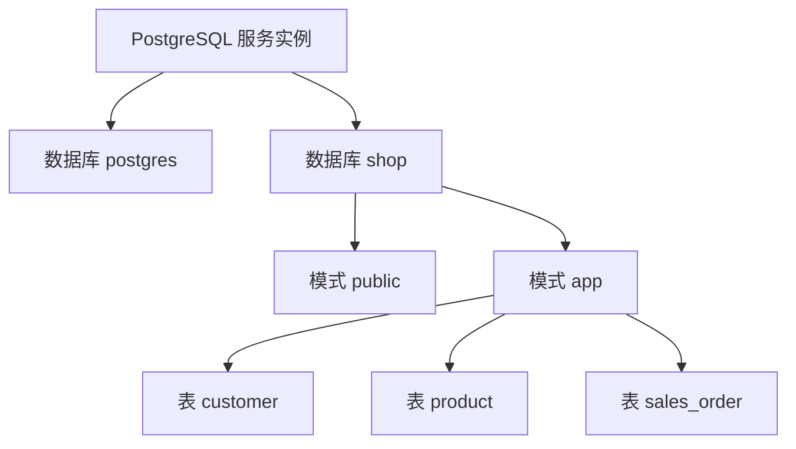
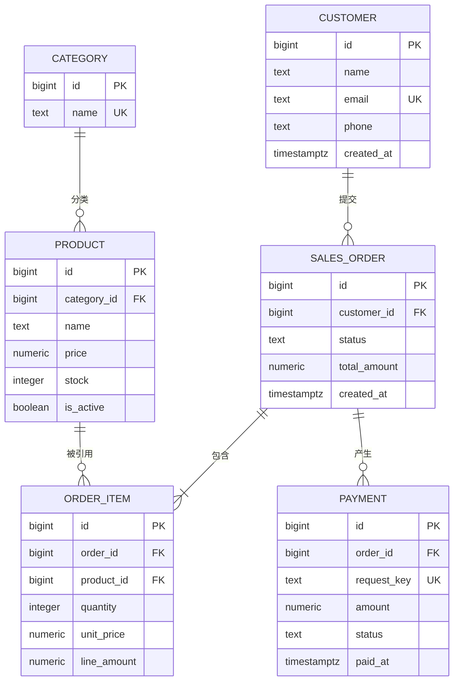
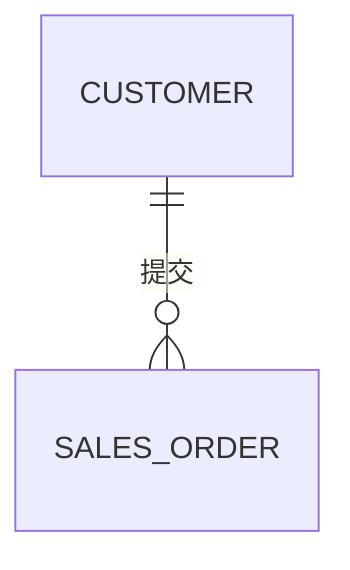
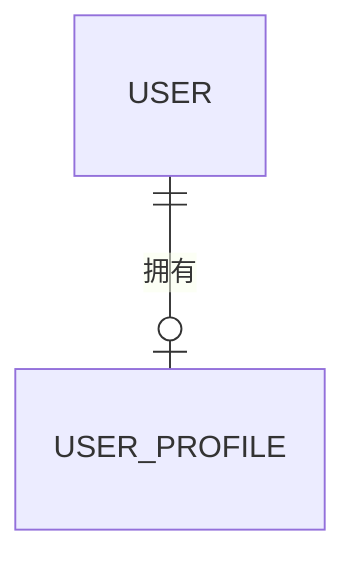
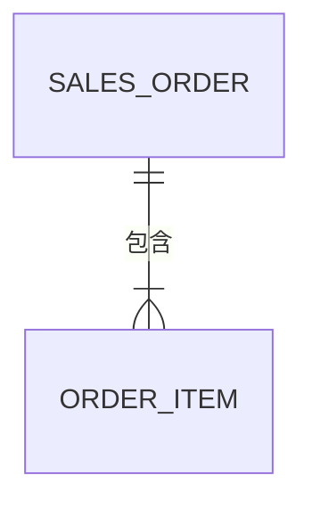
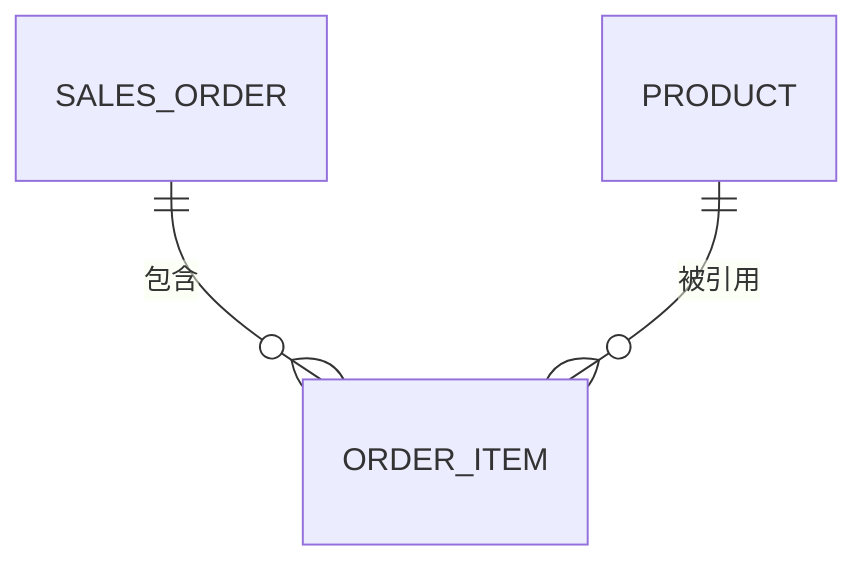
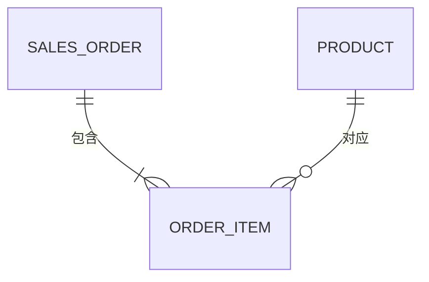
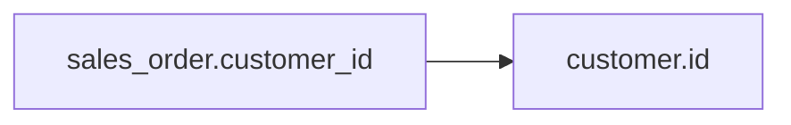
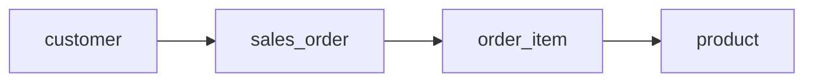
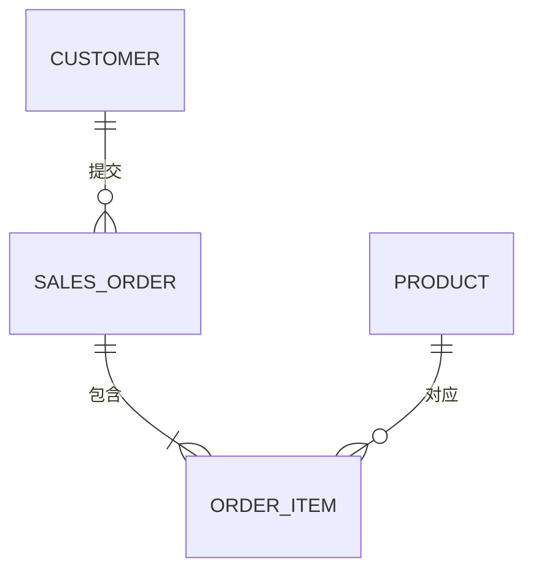

[toc]


## PostgreSQL 新手实操入门

下面按“**连接数据库 → 创建练习环境 → 管理对象 → 增删改查 → 权限 → 备份恢复 → 日常检查**”带你实际操作。建议逐段执行，不要一次性复制全部命令。

## 先理解你正在管理什么

PostgreSQL 中常见对象的层级如下：



可以简单理解为：

| 概念            | 英文              | 类比                             |
| --------------- | ----------------- | -------------------------------- |
| PostgreSQL 服务 | PostgreSQL Server | 一栋办公楼                       |
| 数据库          | Database          | 楼内一个独立公司                 |
| 模式            | Schema            | 公司里的部门                     |
| 表              | Table             | 部门中的档案表                   |
| 行              | Row               | 一条档案                         |
| 列              | Column            | 档案中的字段                     |
| 角色            | Role              | 可以进入并操作系统的用户或权限组 |

一个 PostgreSQL 服务中可以存在多个数据库。连接 PostgreSQL 时，必须指定一个数据库。

------

## 确认服务正常运行

如果你使用 Ubuntu 或 Debian，可以先执行：

```bash
sudo systemctl status postgresql
```

正常情况下应看到类似：

```text
active (exited)
```

或者：

```text
active (running)
```

Ubuntu 的 PostgreSQL 软件包可能同时管理多个集群，可以查看：

```bash
pg_lsclusters
```

输出可能类似：

```text
Ver Cluster Port Status Owner    Data directory              Log file
18  main    5432 online postgres /var/lib/postgresql/18/main /var/log/postgresql/postgresql-18-main.log
```

重点关注：

| 字段             | 含义                        |
| ---------------- | --------------------------- |
| `Ver`            | PostgreSQL 主版本           |
| `Cluster`        | 集群名称                    |
| `Port`           | 监听端口，默认是 `5432`     |
| `Status`         | `online` 表示正在运行       |
| `Owner`          | 系统用户，通常是 `postgres` |
| `Data directory` | 数据目录                    |

启动服务：

```bash
sudo systemctl start postgresql
```

重启服务：

```bash
sudo systemctl restart postgresql
```

停止服务：

```bash
sudo systemctl stop postgresql
```

新手阶段不要随意删除数据目录，也不要手动修改数据目录中的文件。

------

## 第一次进入 PostgreSQL

Ubuntu 安装完成后，系统通常会创建：

- Linux 系统用户：`postgres`
- PostgreSQL 超级用户角色：`postgres`
- 默认数据库：`postgres`

进入 PostgreSQL：

```bash
sudo -u postgres psql
```

> - **`sudo`**：以**超级管理员（root）**权限执行后续命令。它让你能临时切换到其他用户。
> - **`-u postgres`**：`-u` 参数指定要切换到的**目标用户名**。这里指定的是 `postgres`（PostgreSQL 默认的超级管理员账户）。
> - **`psql`**：PostgreSQL 的**交互式终端客户端**，用于连接数据库并执行 SQL 语句。
>
> **连起来的意思是**：**以系统用户 `postgres` 的身份，启动 `psql` 数据库客户端**。

成功后会看到提示符：

```text
postgres=#
```

其中：

- `postgres` 表示当前数据库名。
- `#` 通常表示当前角色是超级用户。
- 普通用户的提示符一般是 `>`。

退出：

```sql
\q
```

注意，`\q` 是 `psql` 元命令，不需要分号。

------

## 查看当前环境

进入 `psql` 后执行：

```sql
SELECT version();
```

查看当前连接：

```sql
\conninfo
```

查看当前用户和数据库：

```sql
SELECT
    current_user,
    current_database();
```

查看服务器端口：

```sql
SHOW port;
```

查看数据目录：

```sql
SHOW data_directory;
```

查看配置文件：

```sql
SHOW config_file;
```

查看认证规则文件：

```sql
SHOW hba_file;
```

这些命令不会修改数据库，可以放心执行。

------

## 认识 psql 常用命令

| 命令          | 用途                  |
| ------------- | --------------------- |
| `\l`          | 查看所有数据库        |
| `\c 数据库名` | 切换数据库            |
| `\dn`         | 查看所有模式          |
| `\dt`         | 查看当前可见的表      |
| `\dt app.*`   | 查看 `app` 模式中的表 |
| `\d 表名`     | 查看表结构            |
| `\du`         | 查看角色              |
| `\dx`         | 查看扩展              |
| `\df`         | 查看函数              |
| `\conninfo`   | 查看当前连接          |
| `\x`          | 切换纵向显示          |
| `\timing on`  | 显示 SQL 执行时间     |
| `\q`          | 退出                  |

查看帮助：

```sql
\?
```

查看 SQL 命令帮助：

```sql
\h CREATE TABLE
```

新手很容易混淆两类命令：

```sql
\dt
```

这是 `psql` 元命令，不需要分号。

```sql
SELECT current_database();
```

这是 SQL，需要分号。

------

## 创建自己的数据库用户

不要长期使用 `postgres` 超级用户开发业务。

先以 `postgres` 身份进入：

```bash
sudo -u postgres psql
```

创建一个登录角色：

```sql
CREATE ROLE shop_user
WITH
    LOGIN
    PASSWORD '请替换成强密码';
```

查看角色：

```sql
\du
```

你应该能看到 `shop_user`。

更改密码：

```sql
ALTER ROLE shop_user
PASSWORD '新的强密码';
```

不要在真实项目脚本、Git 仓库或聊天记录中保存真实生产密码。

------

## 创建练习数据库

创建一个名为 `shop` 的数据库，并指定所有者：

```sql
CREATE DATABASE shop
OWNER shop_user;
```

查看数据库：

```sql
\l
```

退出超级用户会话：

```sql
\q
```

使用新角色连接：

```bash
psql \
  --host=127.0.0.1 \
  --port=5432 \
  --username=shop_user \
  --dbname=shop
```

系统会要求输入密码。

连接成功后查看：

```sql
SELECT
    current_user,
    current_database();
```

结果应类似：

```text
 current_user | current_database
--------------+------------------
 shop_user    | shop
```

### 为什么使用 `127.0.0.1`

以下两个连接可能使用不同认证规则：

```bash
psql --username=shop_user --dbname=shop
```

这通常通过 Unix Socket 连接。

```bash
psql --host=127.0.0.1 --username=shop_user --dbname=shop
```

这会通过 TCP 连接。

如果一个能连接而另一个不能连接，通常是 `pg_hba.conf` 中的认证规则不同。

------

## 使用连接字符串

也可以写成：

```bash
psql "host=127.0.0.1 port=5432 dbname=shop user=shop_user"
```

或者 URI：

```bash
psql "postgresql://shop_user@127.0.0.1:5432/shop"
```

不建议把密码直接写在命令行 URI 中，因为密码可能进入：

- Shell 历史记录。
- 进程列表。
- 日志。
- 截图。

学习阶段直接交互输入密码即可。

------

## 创建业务模式

连接到 `shop` 数据库后创建专用模式：

```sql
CREATE SCHEMA app;
```

查看模式：

```sql
\dn
```

设置当前会话优先查找 `app`：

```sql
SET search_path TO app, public;
```

查看：

```sql
SHOW search_path;
```

为了每次连接都生效，可以设置角色默认值：

```sql
ALTER ROLE shop_user
IN DATABASE shop
SET search_path TO app, public;
```

重新连接后生效。

尽管设置了 `search_path`，在重要管理脚本中仍建议写完整名称：

```sql
app.customer
```

而不是只写：

```sql
customer
```

------

## 创建第一张表

创建客户表：

```sql
CREATE TABLE app.customer (
    id bigint GENERATED ALWAYS AS IDENTITY,
    name text NOT NULL,
    email text NOT NULL,
    phone text,
    created_at timestamptz NOT NULL DEFAULT now(),

    CONSTRAINT customer_pk
        PRIMARY KEY (id),

    CONSTRAINT customer_email_uq
        UNIQUE (email),

    CONSTRAINT customer_name_not_empty_ck
        CHECK (length(trim(name)) > 0)
);
```

查看表：

```sql
\dt app.*
```

查看表结构：

```sql
\d app.customer
```

这张表中：

| 定义                           | 含义                 |
| ------------------------------ | -------------------- |
| `bigint`                       | 大整数               |
| `GENERATED ALWAYS AS IDENTITY` | 自动生成递增编号     |
| `text`                         | 文本                 |
| `NOT NULL`                     | 不允许为空           |
| `DEFAULT now()`                | 默认使用当前时间     |
| `PRIMARY KEY`                  | 主键，唯一标识一行   |
| `UNIQUE`                       | 不允许重复           |
| `CHECK`                        | 检查数据是否满足条件 |

------

## 插入数据

插入一条记录：

```sql
INSERT INTO app.customer (
    name,
    email,
    phone
)
VALUES (
    '张三',
    'zhangsan@example.com',
    '13800000001'
);
```

推荐使用 `RETURNING` 查看数据库生成的值：

```sql
INSERT INTO app.customer (
    name,
    email,
    phone
)
VALUES (
    '李四',
    'lisi@example.com',
    '13800000002'
)
RETURNING
    id,
    name,
    email,
    created_at;
```

一次插入多条：

```sql
INSERT INTO app.customer (
    name,
    email,
    phone
)
VALUES
    ('王五', 'wangwu@example.com', NULL),
    ('赵六', 'zhaoliu@example.com', '13800000004'),
    ('钱七', 'qianqi@example.com', NULL)
RETURNING id, name;
```

SQL 中的空值使用：

```sql
NULL
```

而不是：

```text
'NULL'
```

`NULL` 表示没有值，`'NULL'` 是四个字符组成的文本。

------

## 查询数据

查询全部客户：

```sql
SELECT
    id,
    name,
    email,
    phone,
    created_at
FROM app.customer
ORDER BY id;
```

根据条件查询：

```sql
SELECT
    id,
    name,
    email
FROM app.customer
WHERE id = 1;
```

模糊查询：

```sql
SELECT
    id,
    name,
    email
FROM app.customer
WHERE name LIKE '张%';
```

不区分大小写匹配：

```sql
SELECT
    id,
    name,
    email
FROM app.customer
WHERE email ILIKE '%EXAMPLE.COM';
```

查询电话号码为空的客户：

```sql
SELECT
    id,
    name
FROM app.customer
WHERE phone IS NULL;
```

不能写成：

```sql
WHERE phone = NULL
```

因为 `NULL` 需要使用：

```sql
IS NULL
```

或者：

```sql
IS NOT NULL
```

------

## 排序与限制数量

按创建时间倒序：

```sql
SELECT
    id,
    name,
    created_at
FROM app.customer
ORDER BY created_at DESC, id DESC;
```

只查看前 3 行：

```sql
SELECT
    id,
    name
FROM app.customer
ORDER BY id
LIMIT 3;
```

跳过前 2 行：

```sql
SELECT
    id,
    name
FROM app.customer
ORDER BY id
LIMIT 3
OFFSET 2;
```

没有 `ORDER BY` 时，数据库不保证结果顺序。

------

## 修改数据

把张三的手机号改掉：

```sql
UPDATE app.customer
SET phone = '13900000001'
WHERE email = 'zhangsan@example.com'
RETURNING
    id,
    name,
    phone;
```

把手机号清空：

```sql
UPDATE app.customer
SET phone = NULL
WHERE email = 'zhangsan@example.com';
```

执行 `UPDATE` 前，建议先用相同条件执行 `SELECT`：

```sql
SELECT *
FROM app.customer
WHERE email = 'zhangsan@example.com';
```

确认命中范围后再执行更新。

危险命令：

```sql
UPDATE app.customer
SET phone = NULL;
```

因为没有 `WHERE`，它会修改所有行。

------

## 删除数据

先查看将被删除的数据：

```sql
SELECT *
FROM app.customer
WHERE email = 'qianqi@example.com';
```

再删除：

```sql
DELETE FROM app.customer
WHERE email = 'qianqi@example.com'
RETURNING
    id,
    name,
    email;
```

危险命令：

```sql
DELETE FROM app.customer;
```

它会删除表中所有记录，但保留表结构。

删除所有数据并快速重置表：

```sql
TRUNCATE TABLE app.customer
RESTART IDENTITY;
```

`TRUNCATE` 通常比逐行 `DELETE` 更快，但锁更强，使用前必须确认影响。

------

## 使用事务保护操作

事务（Transaction）可以把多条操作作为一个整体。

开始事务：

```sql
BEGIN;
```

执行修改：

```sql
UPDATE app.customer
SET phone = '11111111111'
WHERE id = 1;
```

在当前事务中查看：

```sql
SELECT *
FROM app.customer
WHERE id = 1;
```

不想保存：

```sql
ROLLBACK;
```

想保存：

```sql
COMMIT;
```

练习删除时，可以先使用：

```sql
BEGIN;

DELETE FROM app.customer
WHERE id = 2
RETURNING *;

ROLLBACK;
```

这样可以体验删除操作，但最终不会真正删除。

### 事务出错后的状态

如果事务中某条 SQL 出错：

```sql
BEGIN;

INSERT INTO app.customer (name, email)
VALUES ('测试用户', 'zhangsan@example.com');
```

由于邮箱重复，插入失败。之后事务会处于错误状态，继续执行其他 SQL 会看到类似：

```text
current transaction is aborted
```

这时需要：

```sql
ROLLBACK;
```

------

## 创建商品表

```sql
CREATE TABLE app.product (
    id bigint GENERATED ALWAYS AS IDENTITY,
    name text NOT NULL,
    price numeric(12, 2) NOT NULL,
    stock integer NOT NULL DEFAULT 0,
    is_active boolean NOT NULL DEFAULT true,
    created_at timestamptz NOT NULL DEFAULT now(),

    CONSTRAINT product_pk
        PRIMARY KEY (id),

    CONSTRAINT product_name_uq
        UNIQUE (name),

    CONSTRAINT product_price_ck
        CHECK (price >= 0),

    CONSTRAINT product_stock_ck
        CHECK (stock >= 0)
);
```

插入商品：

```sql
INSERT INTO app.product (
    name,
    price,
    stock
)
VALUES
    ('机械键盘', 399.00, 20),
    ('无线鼠标', 129.00, 50),
    ('显示器', 1699.00, 10),
    ('笔记本支架', 89.90, 0)
RETURNING *;
```

这里金额使用 `numeric(12, 2)`，适合精确存储人民币金额。

------

## 条件查询练习

价格大于等于 300 元：

```sql
SELECT
    id,
    name,
    price
FROM app.product
WHERE price >= 300
ORDER BY price DESC;
```

有库存且已上架：

```sql
SELECT
    id,
    name,
    stock
FROM app.product
WHERE stock > 0
  AND is_active = true;
```

价格位于 100 到 500 元：

```sql
SELECT
    id,
    name,
    price
FROM app.product
WHERE price BETWEEN 100 AND 500;
```

查询指定商品：

```sql
SELECT
    id,
    name,
    price
FROM app.product
WHERE name IN (
    '机械键盘',
    '无线鼠标'
);
```

------

## 聚合统计

统计商品数量：

```sql
SELECT count(*) AS product_count
FROM app.product;
```

统计库存总数：

```sql
SELECT sum(stock) AS total_stock
FROM app.product;
```

查看平均价格：

```sql
SELECT round(avg(price), 2) AS average_price
FROM app.product;
```

查看最低和最高价格：

```sql
SELECT
    min(price) AS minimum_price,
    max(price) AS maximum_price
FROM app.product;
```

按是否上架分组：

```sql
SELECT
    is_active,
    count(*) AS product_count,
    sum(stock) AS total_stock
FROM app.product
GROUP BY is_active
ORDER BY is_active DESC;
```

------

## 创建订单表

```sql
CREATE TABLE app.sales_order (
    id bigint GENERATED ALWAYS AS IDENTITY,
    customer_id bigint NOT NULL,
    status text NOT NULL DEFAULT 'pending',
    total_amount numeric(12, 2) NOT NULL DEFAULT 0,
    created_at timestamptz NOT NULL DEFAULT now(),

    CONSTRAINT sales_order_pk
        PRIMARY KEY (id),

    CONSTRAINT sales_order_customer_fk
        FOREIGN KEY (customer_id)
        REFERENCES app.customer (id),

    CONSTRAINT sales_order_status_ck
        CHECK (
            status IN (
                'pending',
                'paid',
                'cancelled',
                'completed'
            )
        ),

    CONSTRAINT sales_order_total_amount_ck
        CHECK (total_amount >= 0)
);
```

为外键列创建索引：

```sql
CREATE INDEX sales_order_customer_id_idx
ON app.sales_order (customer_id);
```

插入订单前先查看客户：

```sql
SELECT id, name
FROM app.customer
ORDER BY id;
```

假设客户 ID 为 1：

```sql
INSERT INTO app.sales_order (
    customer_id,
    status,
    total_amount
)
VALUES (
    1,
    'paid',
    528.00
)
RETURNING *;
```

如果使用不存在的 `customer_id`，外键会阻止插入：

```sql
INSERT INTO app.sales_order (
    customer_id,
    total_amount
)
VALUES (
    999999,
    100.00
);
```

这正是外键的作用：防止产生不存在客户的订单。

------

## 使用 JOIN 查询关联数据

查询订单及客户信息：

```sql
SELECT
    o.id AS order_id,
    c.name AS customer_name,
    c.email,
    o.status,
    o.total_amount,
    o.created_at
FROM app.sales_order AS o
JOIN app.customer AS c
    ON c.id = o.customer_id
ORDER BY o.id;
```

其中：

- `o` 是 `sales_order` 的别名。
- `c` 是 `customer` 的别名。
- `ON c.id = o.customer_id` 描述两张表的关联关系。

统计每个客户的订单数量：

```sql
SELECT
    c.id,
    c.name,
    count(o.id) AS order_count,
    coalesce(sum(o.total_amount), 0) AS total_amount
FROM app.customer AS c
LEFT JOIN app.sales_order AS o
    ON o.customer_id = c.id
GROUP BY
    c.id,
    c.name
ORDER BY c.id;
```

使用 `LEFT JOIN` 后，即使客户没有订单，也会出现在结果中。

------

## 查看表和索引大小

查看表大小：

```sql
SELECT
    pg_size_pretty(
        pg_total_relation_size('app.customer')
    ) AS total_size;
```

查看业务表大小：

```sql
SELECT
    schemaname,
    relname,
    pg_size_pretty(
        pg_total_relation_size(
            quote_ident(schemaname)
            || '.'
            || quote_ident(relname)
        )
    ) AS total_size
FROM pg_stat_user_tables
ORDER BY pg_total_relation_size(
    quote_ident(schemaname)
    || '.'
    || quote_ident(relname)
) DESC;
```

查看索引：

```sql
\di app.*
```

查看某个表的详细结构和索引：

```sql
\d app.sales_order
```

------

## 学习执行计划

先创建适合查询的索引：

```sql
CREATE INDEX product_price_idx
ON app.product (price);
```

查看查询计划：

```sql
EXPLAIN
SELECT
    id,
    name,
    price
FROM app.product
WHERE price >= 300;
```

实际执行并分析：

```sql
EXPLAIN (ANALYZE, BUFFERS)
SELECT
    id,
    name,
    price
FROM app.product
WHERE price >= 300;
```

由于当前表很小，PostgreSQL 可能仍选择：

```text
Seq Scan
```

即顺序扫描。这不代表索引无效。对于很小的表，直接读取整个表可能比使用索引更快。

不要通过关闭顺序扫描来强迫数据库使用索引。

------

## 修改表结构

为客户表增加状态列：

```sql
ALTER TABLE app.customer
ADD COLUMN is_active boolean NOT NULL DEFAULT true;
```

查看结构：

```sql
\d app.customer
```

重命名列：

```sql
ALTER TABLE app.customer
RENAME COLUMN phone TO mobile_phone;
```

重新改回来：

```sql
ALTER TABLE app.customer
RENAME COLUMN mobile_phone TO phone;
```

删除列：

```sql
ALTER TABLE app.customer
DROP COLUMN phone;
```

删除列会删除其中所有数据。练习时也应先确认影响。

------

## 创建只读用户

先以超级用户或具有管理权限的角色连接。

创建只读角色组：

```sql
CREATE ROLE shop_readonly NOLOGIN;
```

授予连接权限：

```sql
GRANT CONNECT
ON DATABASE shop
TO shop_readonly;
```

连接到 `shop` 数据库后授权模式：

```sql
GRANT USAGE
ON SCHEMA app
TO shop_readonly;
```

授权读取现有表：

```sql
GRANT SELECT
ON ALL TABLES IN SCHEMA app
TO shop_readonly;
```

设置未来新表的默认读取权限：

```sql
ALTER DEFAULT PRIVILEGES
FOR ROLE shop_user
IN SCHEMA app
GRANT SELECT
ON TABLES TO shop_readonly;
```

创建真正用于登录的用户：

```sql
CREATE ROLE analyst_user
WITH
    LOGIN
    PASSWORD '请替换成强密码';
```

把只读角色授予它：

```sql
GRANT shop_readonly TO analyst_user;
```

现在 `analyst_user` 可以读取数据，但不能修改业务表。

------

## 查看权限

查看角色：

```sql
\du
```

查看表权限：

```sql
\dp app.*
```

也可以查询：

```sql
SELECT
    grantee,
    table_schema,
    table_name,
    privilege_type
FROM information_schema.role_table_grants
WHERE table_schema = 'app'
ORDER BY
    grantee,
    table_name,
    privilege_type;
```

------

## 查看当前连接

```sql
SELECT
    pid,
    usename,
    datname,
    application_name,
    client_addr,
    state,
    query_start,
    query
FROM pg_stat_activity
ORDER BY query_start NULLS LAST;
```

重要字段：

| 字段          | 含义           |
| ------------- | -------------- |
| `pid`         | 后端进程编号   |
| `usename`     | 数据库用户     |
| `datname`     | 数据库         |
| `client_addr` | 客户端地址     |
| `state`       | 当前状态       |
| `query`       | 当前或最近 SQL |

常见状态：

| 状态                            | 含义                           |
| ------------------------------- | ------------------------------ |
| `active`                        | 正在执行 SQL                   |
| `idle`                          | 连接存在，但当前没有执行 SQL   |
| `idle in transaction`           | 事务已开始，但当前没有执行 SQL |
| `idle in transaction (aborted)` | 事务出错后没有回滚             |

`idle in transaction` 长时间存在通常不是好现象，因为它可能阻碍 VACUUM 清理旧数据。

查看长事务：

```sql
SELECT
    pid,
    usename,
    now() - xact_start AS transaction_age,
    state,
    query
FROM pg_stat_activity
WHERE xact_start IS NOT NULL
ORDER BY xact_start;
```

------

## 终止异常连接

取消正在执行的查询：

```sql
SELECT pg_cancel_backend(进程PID);
```

终止整个连接：

```sql
SELECT pg_terminate_backend(进程PID);
```

例如：

```sql
SELECT pg_cancel_backend(12345);
```

不要随意终止系统后台进程，也不要终止自己当前使用的连接。

优先尝试：

```sql
pg_cancel_backend
```

只有取消无效或必须释放连接时，再考虑：

```sql
pg_terminate_backend
```

------

## 查看锁和阻塞

查看被其他连接阻塞的会话：

```sql
SELECT
    pid,
    usename,
    pg_blocking_pids(pid) AS blocking_pids,
    wait_event_type,
    wait_event,
    query
FROM pg_stat_activity
WHERE cardinality(pg_blocking_pids(pid)) > 0;
```

### 手动制造一次阻塞

打开终端 A：

```bash
psql -h 127.0.0.1 -U shop_user -d shop
```

执行：

```sql
BEGIN;

UPDATE app.product
SET stock = stock - 1
WHERE id = 1;
```

先不要提交。

打开终端 B，连接同一数据库：

```bash
psql -h 127.0.0.1 -U shop_user -d shop
```

执行相同更新：

```sql
UPDATE app.product
SET stock = stock - 1
WHERE id = 1;
```

终端 B 会等待，因为终端 A 持有该行的锁。

在第三个终端查询阻塞情况：

```sql
SELECT
    pid,
    pg_blocking_pids(pid),
    wait_event_type,
    wait_event,
    query
FROM pg_stat_activity
WHERE cardinality(pg_blocking_pids(pid)) > 0;
```

回到终端 A：

```sql
COMMIT;
```

终端 B 随后会继续执行。

这个实验说明：

- PostgreSQL 允许多个连接并发访问数据库。
- 两个事务修改同一行时，需要进行锁协调。
- 长事务会延长锁持有时间。

------

## VACUUM 与 ANALYZE

查看表统计：

```sql
SELECT
    schemaname,
    relname,
    n_live_tup,
    n_dead_tup,
    last_autovacuum,
    last_autoanalyze
FROM pg_stat_user_tables
ORDER BY relname;
```

执行分析：

```sql
ANALYZE app.customer;
```

执行常规清理和分析：

```sql
VACUUM (ANALYZE) app.customer;
```

`ANALYZE` 用于更新查询优化器需要的统计信息。

`VACUUM` 用于清理 PostgreSQL 多版本并发控制留下的不再需要的旧行版本，并维护可见性信息。

正常情况下应保持 Autovacuum 开启：

```sql
SHOW autovacuum;
```

预期结果：

```text
on
```

不要把下面命令作为日常清理方式：

```sql
VACUUM FULL app.customer;
```

`VACUUM FULL` 会重写整张表，并获取较强的锁，只适合特殊空间治理场景。

------

## 逻辑备份

退出 `psql`，在 Shell 中执行：

```bash
pg_dump \
  --host=127.0.0.1 \
  --port=5432 \
  --username=shop_user \
  --format=custom \
  --file=shop.dump \
  shop
```

检查文件：

```bash
ls -lh shop.dump
```

查看备份内容：

```bash
pg_restore --list shop.dump
```

`--format=custom` 创建的是 PostgreSQL 自定义备份格式，不应直接用文本编辑器打开。

------

## 恢复备份

先创建新的数据库：

```bash
sudo -u postgres createdb \
  --owner=shop_user \
  shop_restore
```

恢复：

```bash
pg_restore \
  --host=127.0.0.1 \
  --port=5432 \
  --username=shop_user \
  --dbname=shop_restore \
  --verbose \
  shop.dump
```

连接恢复后的数据库：

```bash
psql \
  --host=127.0.0.1 \
  --username=shop_user \
  --dbname=shop_restore
```

检查：

```sql
\dt app.*

SELECT count(*)
FROM app.customer;

SELECT count(*)
FROM app.product;
```

备份是否成功，不能只看 `shop.dump` 文件是否存在。真正可靠的验证方式是：

1. 创建新数据库。
2. 恢复备份。
3. 检查表和数据。
4. 执行关键查询。
5. 记录恢复耗时。

------

## 导出和导入 CSV

在 `psql` 中导出：

```sql
\copy (
    SELECT
        id,
        name,
        email,
        created_at
    FROM app.customer
    ORDER BY id
) TO 'customer.csv'
WITH (
    FORMAT csv,
    HEADER true
);
```

这里的路径是客户端所在机器上的路径。

创建导入表：

```sql
CREATE TABLE app.customer_import (
    id bigint,
    name text,
    email text,
    created_at timestamptz
);
```

导入：

```sql
\copy app.customer_import (
    id,
    name,
    email,
    created_at
) FROM 'customer.csv'
WITH (
    FORMAT csv,
    HEADER true
);
```

检查：

```sql
SELECT *
FROM app.customer_import
ORDER BY id;
```

------

## 删除数据库对象

删除表：

```sql
DROP TABLE app.customer_import;
```

删除模式及其所有对象：

```sql
DROP SCHEMA app CASCADE;
```

`CASCADE` 会递归删除依赖对象，风险很高。

删除数据库时，不能连接在该数据库上。先切换：

```sql
\c postgres
```

再执行：

```sql
DROP DATABASE shop_restore;
```

删除角色前，要先确保角色：

- 不拥有数据库。
- 不拥有表或模式。
- 没有仍需保留的权限关系。

删除角色：

```sql
DROP ROLE analyst_user;
```

------

## 一套适合新手的安全操作习惯

### 修改前先查询

准备更新：

```sql
UPDATE app.product
SET price = price * 0.9
WHERE name LIKE '%鼠标%';
```

应先执行：

```sql
SELECT
    id,
    name,
    price
FROM app.product
WHERE name LIKE '%鼠标%';
```

确认范围后，再在事务中修改：

```sql
BEGIN;

UPDATE app.product
SET price = round(price * 0.9, 2)
WHERE name LIKE '%鼠标%'
RETURNING id, name, price;

COMMIT;
```

### 管理操作设置锁超时

避免 DDL 无限等待锁：

```sql
SET lock_timeout = '5s';
```

设置当前事务中的语句超时：

```sql
BEGIN;

SET LOCAL statement_timeout = '30s';
SET LOCAL lock_timeout = '5s';

ALTER TABLE app.product
ADD COLUMN description text;

COMMIT;
```

### 开启执行计时

```sql
\timing on
```

### 错误时停止脚本

在 `psql` 中：

```sql
\set ON_ERROR_STOP on
```

运行 SQL 文件：

```bash
psql \
  --host=127.0.0.1 \
  --username=shop_user \
  --dbname=shop \
  --set=ON_ERROR_STOP=on \
  --file=init.sql
```

------

## 一个完整练习脚本

把下面内容保存为 `shop_lab.sql`：

```sql
\set ON_ERROR_STOP on

BEGIN;

CREATE SCHEMA IF NOT EXISTS app;

CREATE TABLE IF NOT EXISTS app.category (
    id bigint GENERATED ALWAYS AS IDENTITY,
    name text NOT NULL,

    CONSTRAINT category_pk
        PRIMARY KEY (id),

    CONSTRAINT category_name_uq
        UNIQUE (name)
);

CREATE TABLE IF NOT EXISTS app.lab_product (
    id bigint GENERATED ALWAYS AS IDENTITY,
    category_id bigint NOT NULL,
    name text NOT NULL,
    price numeric(12, 2) NOT NULL,
    stock integer NOT NULL DEFAULT 0,
    created_at timestamptz NOT NULL DEFAULT now(),

    CONSTRAINT lab_product_pk
        PRIMARY KEY (id),

    CONSTRAINT lab_product_category_fk
        FOREIGN KEY (category_id)
        REFERENCES app.category (id),

    CONSTRAINT lab_product_price_ck
        CHECK (price >= 0),

    CONSTRAINT lab_product_stock_ck
        CHECK (stock >= 0)
);

CREATE INDEX IF NOT EXISTS
    lab_product_category_id_idx
ON app.lab_product (category_id);

INSERT INTO app.category (name)
VALUES
    ('电脑配件'),
    ('办公用品')
ON CONFLICT (name)
DO NOTHING;

INSERT INTO app.lab_product (
    category_id,
    name,
    price,
    stock
)
SELECT
    c.id,
    v.name,
    v.price,
    v.stock
FROM (
    VALUES
        ('电脑配件', '键盘', 399.00::numeric, 20),
        ('电脑配件', '鼠标', 129.00::numeric, 50),
        ('办公用品', '笔记本', 12.50::numeric, 100)
) AS v (
    category_name,
    name,
    price,
    stock
)
JOIN app.category AS c
    ON c.name = v.category_name
WHERE NOT EXISTS (
    SELECT 1
    FROM app.lab_product AS p
    WHERE p.name = v.name
);

COMMIT;

SELECT
    p.id,
    p.name AS product_name,
    c.name AS category_name,
    p.price,
    p.stock
FROM app.lab_product AS p
JOIN app.category AS c
    ON c.id = p.category_id
ORDER BY p.id;
```

执行：

```bash
psql \
  --host=127.0.0.1 \
  --username=shop_user \
  --dbname=shop \
  --file=shop_lab.sql
```

------

## 推荐你按这个顺序练习

### 第一轮：连接与查看

完成：

```sql
\conninfo
\l
\dn
\dt app.*
\du
```

目标：知道自己连接了哪个数据库、使用哪个角色。

### 第二轮：表和数据

完成：

- 创建 `customer` 表。
- 插入 5 条数据。
- 查询、排序和筛选。
- 修改一条数据。
- 在事务中删除一条数据，然后回滚。

目标：掌握基本 CRUD。

### 第三轮：关系与约束

完成：

- 创建 `product` 表。
- 创建 `sales_order` 表。
- 添加主键、唯一约束、检查约束和外键。
- 故意插入非法数据，观察数据库如何拒绝。

目标：理解数据库不仅保存数据，还保护数据。

### 第四轮：关联和统计

完成：

- 使用 `JOIN` 查询订单与客户。
- 使用 `GROUP BY` 统计每位客户订单数量。
- 使用 `sum()` 统计订单金额。

目标：掌握关系数据库的核心优势。

### 第五轮：管理和维护

完成：

- 查看连接。
- 模拟锁等待。
- 查看表大小。
- 执行 `ANALYZE`。
- 创建备份并恢复到新数据库。

目标：开始理解数据库管理工作。

------

## 每日检查命令

查看数据库大小：

```sql
SELECT
    datname,
    pg_size_pretty(
        pg_database_size(datname)
    ) AS database_size
FROM pg_database
ORDER BY pg_database_size(datname) DESC;
```

查看连接数：

```sql
SELECT
    datname,
    state,
    count(*) AS connection_count
FROM pg_stat_activity
GROUP BY
    datname,
    state
ORDER BY
    datname,
    state;
```

查看长事务：

```sql
SELECT
    pid,
    usename,
    now() - xact_start AS transaction_age,
    state,
    query
FROM pg_stat_activity
WHERE xact_start IS NOT NULL
ORDER BY xact_start;
```

查看维护状态：

```sql
SELECT
    schemaname,
    relname,
    n_live_tup,
    n_dead_tup,
    last_autovacuum,
    last_autoanalyze
FROM pg_stat_user_tables
ORDER BY n_dead_tup DESC;
```

查看阻塞：

```sql
SELECT
    pid,
    pg_blocking_pids(pid) AS blocking_pids,
    wait_event_type,
    wait_event,
    query
FROM pg_stat_activity
WHERE cardinality(pg_blocking_pids(pid)) > 0;
```

查看数据库版本：

```sql
SELECT version();
```

------

## 新手必须记住的原则

- 日常开发不要使用 `postgres` 超级用户。
- 执行 `UPDATE` 或 `DELETE` 前，先用相同的 `WHERE` 执行 `SELECT`。
- 重要修改放进事务，检查无误后再 `COMMIT`。
- 没有 `ORDER BY`，查询结果顺序不受保证。
- 不要用字符串拼接生成 SQL，应使用参数化查询。
- 主键、唯一性和外键应由数据库约束保护。
- 金额使用 `numeric`，不要随意使用浮点类型。
- 业务事件时间通常使用 `timestamptz`。
- 不要关闭 Autovacuum。
- 不要手动修改 PostgreSQL 数据目录中的文件。
- 复制不是备份。
- 备份必须实际恢复验证。
- 遇到性能问题先查看执行计划，不要先盲目调整参数。

建议先完整做完“创建用户、创建 `shop` 数据库、三张业务表、事务回滚、JOIN 查询、备份恢复”这条主线，再进入索引优化和服务器配置。


非常适合。对于 PostgreSQL 新手教程，**ER 图（Entity-Relationship Diagram，实体关系图）应作为核心辅助内容**，尤其适合解释表、主键、外键以及表之间的关系。

建议不要只放一张大图，而是随着教程逐步扩展：

- 创建单表时，先解释“实体”和“属性”。
- 创建外键前，展示两张表的关系。
- 学习 `JOIN` 前，用 ER 图说明连接路径。
- 完成练习项目后，再展示完整业务模型。

## 示例：商店数据库 ER 图



## 图中符号怎么理解

| 符号 | 含义                 | 示例                                   |
| ---- | -------------------- | -------------------------------------- |
| `||` | 必须且只能有一个     | 每个订单必须属于一个客户               |
| `o{` | 零个或多个           | 一个客户可以没有订单，也可以有多个订单 |
| `|{` | 一个或多个           | 一个完整订单通常包含至少一个订单明细   |
| `PK` | 主键（Primary Key）  | `customer.id`                          |
| `FK` | 外键（Foreign Key）  | `sales_order.customer_id`              |
| `UK` | 唯一键（Unique Key） | `customer.email`                       |


### ER 图中的关系符号怎么理解

Mermaid ER 图使用“鸡爪表示法”（Crow's Foot Notation）描述实体之间的数量关系。

阅读关系时，需要分别观察连线两端的符号。每一端都表达两个信息：

- 最少允许有几个关联对象。
- 最多允许有几个关联对象。

### 基本符号

```
||
```

表示“必须且只能有一个”，也就是数量为 **1**。

例如，一个订单必须属于一个客户：



在订单对应客户的一端，`||` 表示：

> 每个订单必须关联一个客户，而且只能关联一个客户。

------

```
o|
```

表示“零个或一个”，也就是数量为 **0 或 1**。

适用于可选的一对一关系。

例如，一个用户可以暂时没有个人资料，但最多只有一份个人资料：



含义是：

- 每份个人资料必须属于一个用户。
- 一个用户可以没有个人资料。
- 一个用户最多拥有一份个人资料。

------

```
|{
```

表示“一个或多个”，也就是数量至少为 **1**。

例如，规定一个订单创建后必须至少包含一条订单明细：



含义是：

- 每条订单明细只能属于一个订单。
- 一个订单必须至少包含一条订单明细。
- 一个订单可以包含多条订单明细。

需要注意，数据库外键本身通常只能保证“订单明细必须引用订单”，不能单独保证“订单至少有一条明细”。后一个规则通常还需要通过事务流程或额外业务逻辑保证。

------

```
o{
```

表示“零个或多个”，也就是数量为 **0 到任意多个**。

例如，一个客户可能还没有下过订单，也可能已经提交了多个订单：


含义是：

- 每个订单必须属于一个客户。
- 一个客户可以没有订单。
- 一个客户可以拥有多个订单。

### 如何完整阅读一条关系

以客户和订单的关系为例：


可以从两个方向阅读。

从客户到订单：

> 一个客户可以提交零个、一个或多个订单。

从订单到客户：

> 一个订单必须属于一个客户，而且只能属于一个客户。

这是一种典型的**一对多关系**（One-to-Many Relationship）。

在数据库中，通常把外键放在“多”的一方：

```text
customer.id
    被 sales_order.customer_id 引用
```

对应 SQL：

```sql
CREATE TABLE app.sales_order (
    id bigint GENERATED ALWAYS AS IDENTITY PRIMARY KEY,

    customer_id bigint NOT NULL
        REFERENCES app.customer (id)
);
```

其中：

- `customer.id` 是被引用的主键。
- `sales_order.customer_id` 是外键。
- `NOT NULL` 表示订单不能没有客户。
- 多条订单记录可以拥有相同的 `customer_id`。

### 常见关系类型

#### 一对一关系


含义：

- 一个用户最多拥有一份个人资料。
- 一份个人资料必须属于一个用户。

数据库中通常需要外键加唯一约束：

```sql
CREATE TABLE app.user_profile (
    id bigint GENERATED ALWAYS AS IDENTITY PRIMARY KEY,

    user_id bigint NOT NULL UNIQUE
        REFERENCES app.app_user (id)
);
```

这里的 `UNIQUE` 很关键。没有它，同一个用户可能关联多条个人资料，关系就会变成一对多。

#### 一对多关系


含义：

- 一个客户可以拥有多个订单。
- 一个订单只能属于一个客户。

外键放在订单表中：

```sql
customer_id bigint NOT NULL
    REFERENCES app.customer (id)
```

#### 多对多关系

一个订单可以包含多个商品，一个商品也可以出现在多个订单中：



关系数据库通常使用中间表实现多对多关系：

```text
sales_order
    一对多
order_item
    多对一
product
```

`order_item` 同时保存两个外键：

```sql
CREATE TABLE app.order_item (
    id bigint GENERATED ALWAYS AS IDENTITY PRIMARY KEY,

    order_id bigint NOT NULL
        REFERENCES app.sales_order (id),

    product_id bigint NOT NULL
        REFERENCES app.product (id),

    quantity integer NOT NULL
        CHECK (quantity > 0)
);
```

### 图中字段缩写

`PK` 表示主键（Primary Key）。

主键用于唯一标识表中的一行，例如：

```text
customer.id
```

`FK` 表示外键（Foreign Key）。

外键用于引用另一张表中的主键或唯一键，例如：

```text
sales_order.customer_id
引用
customer.id
```

`UK` 表示唯一键（Unique Key）。

唯一键用于保证某一列或一组列不能重复，例如：

```text
customer.email
```

### 一个简单记忆方法

可以把符号拆成两部分理解：

- `o` 表示可以没有，也就是最少为零。
- `|` 表示必须存在一个。
- `{` 或 `}` 表示可以有多个。

因此：

```text
o|  零个或一个
||  必须且只有一个
o{  零个或多个
|{  一个或多个
```

阅读 ER 图时，不要只看连线中间的文字，还要分别观察关系两端的符号。

例如：


表示：

- 一个订单只能属于一个客户。
- 一个客户可以有零个、一个或多个订单。

## ER 图如何映射到 PostgreSQL

ER 图中的关系最终主要通过外键实现。

| 业务关系         | 外键所在表    | 外键列        | 引用目标         |
| ---------------- | ------------- | ------------- | ---------------- |
| 客户拥有订单     | `sales_order` | `customer_id` | `customer.id`    |
| 分类包含商品     | `product`     | `category_id` | `category.id`    |
| 订单包含明细     | `order_item`  | `order_id`    | `sales_order.id` |
| 明细引用商品     | `order_item`  | `product_id`  | `product.id`     |
| 订单产生支付记录 | `payment`     | `order_id`    | `sales_order.id` |

例如，客户与订单的关系可写成：

```sql
CREATE TABLE app.customer (
    id bigint GENERATED ALWAYS AS IDENTITY,
    name text NOT NULL,
    email text NOT NULL,

    CONSTRAINT customer_pk
        PRIMARY KEY (id),

    CONSTRAINT customer_email_uq
        UNIQUE (email)
);
CREATE TABLE app.sales_order (
    id bigint GENERATED ALWAYS AS IDENTITY,
    customer_id bigint NOT NULL,
    status text NOT NULL DEFAULT 'pending',
    total_amount numeric(12, 2) NOT NULL DEFAULT 0,
    created_at timestamptz NOT NULL DEFAULT now(),

    CONSTRAINT sales_order_pk
        PRIMARY KEY (id),

    CONSTRAINT sales_order_customer_fk
        FOREIGN KEY (customer_id)
        REFERENCES app.customer (id)
);
```

对应关系是：

```text
sales_order.customer_id
引用
customer.id
```

## 为什么订单与商品之间需要中间表

从业务角度看：

- 一个订单可以包含多个商品。
- 一个商品也可以出现在多个订单中。

这是一种**多对多关系（Many-to-Many Relationship）**。

关系数据库通常不会直接保存多对多关系，而是增加中间表：



`order_item` 同时引用订单和商品：

```sql
CREATE TABLE app.order_item (
    id bigint GENERATED ALWAYS AS IDENTITY,
    order_id bigint NOT NULL,
    product_id bigint NOT NULL,
    quantity integer NOT NULL,
    unit_price numeric(12, 2) NOT NULL,

    CONSTRAINT order_item_pk
        PRIMARY KEY (id),

    CONSTRAINT order_item_order_fk
        FOREIGN KEY (order_id)
        REFERENCES app.sales_order (id),

    CONSTRAINT order_item_product_fk
        FOREIGN KEY (product_id)
        REFERENCES app.product (id),

    CONSTRAINT order_item_quantity_ck
        CHECK (quantity > 0),

    CONSTRAINT order_item_unit_price_ck
        CHECK (unit_price >= 0)
);
```

这样一行订单明细表示：

> 某个订单购买了某个商品，购买数量是多少，下单时单价是多少。

## ER 图也能辅助理解 JOIN

假设需要查询订单及客户姓名：



对应 SQL：

```sql
SELECT
    o.id AS order_id,
    c.name AS customer_name,
    o.status,
    o.total_amount
FROM app.sales_order AS o
JOIN app.customer AS c
    ON c.id = o.customer_id;
```

查询订单明细时，连接路径更长：



对应 SQL：

```sql
SELECT
    c.name AS customer_name,
    o.id AS order_id,
    p.name AS product_name,
    i.quantity,
    i.unit_price,
    i.quantity * i.unit_price AS line_amount
FROM app.customer AS c
JOIN app.sales_order AS o
    ON o.customer_id = c.id
JOIN app.order_item AS i
    ON i.order_id = o.id
JOIN app.product AS p
    ON p.id = i.product_id
ORDER BY o.id, i.id;
```

ER 图可以帮助新手先找到：

1. 查询涉及哪些表。
2. 表之间通过哪些字段关联。
3. 应该经过怎样的连接路径。
4. 哪一张表保存业务关系。

## 推荐加入原教程的位置

### 创建表之前

先展示简化模型：


用于解释：

- 什么是实体。
- 什么是主键。
- 什么是一对多关系。
- 外键应该放在哪一侧。

### 学习 JOIN 之前

展示完整连接路径：



用于解释为什么查询订单商品需要连接三到四张表。

### 学习约束时

结合 ER 图说明：

- `PK` 对应主键约束。
- `FK` 对应外键约束。
- `UK` 对应唯一约束。
- 一对一、一对多和多对多如何落地。

### 完成项目后

展示包含客户、商品、分类、订单、订单明细和支付记录的完整 ER 图，作为整个练习数据库的结构地图。

## 推荐的学习方式

每增加一个业务需求，就同步完成四步：

1. 在 ER 图中增加实体或关系。
2. 编写 `CREATE TABLE` 或 `ALTER TABLE`。
3. 插入测试数据。
4. 编写 `JOIN` 查询验证关系。

例如增加“商品分类”功能：


随后完成：

- 创建 `category` 表。
- 给 `product` 添加 `category_id`。
- 添加外键。
- 查询商品及其分类。
- 测试删除分类时外键如何保护数据。

这样能够把 **ER 图、数据库设计、DDL、约束和查询** 串联起来，比单独学习 SQL 命令更容易理解。