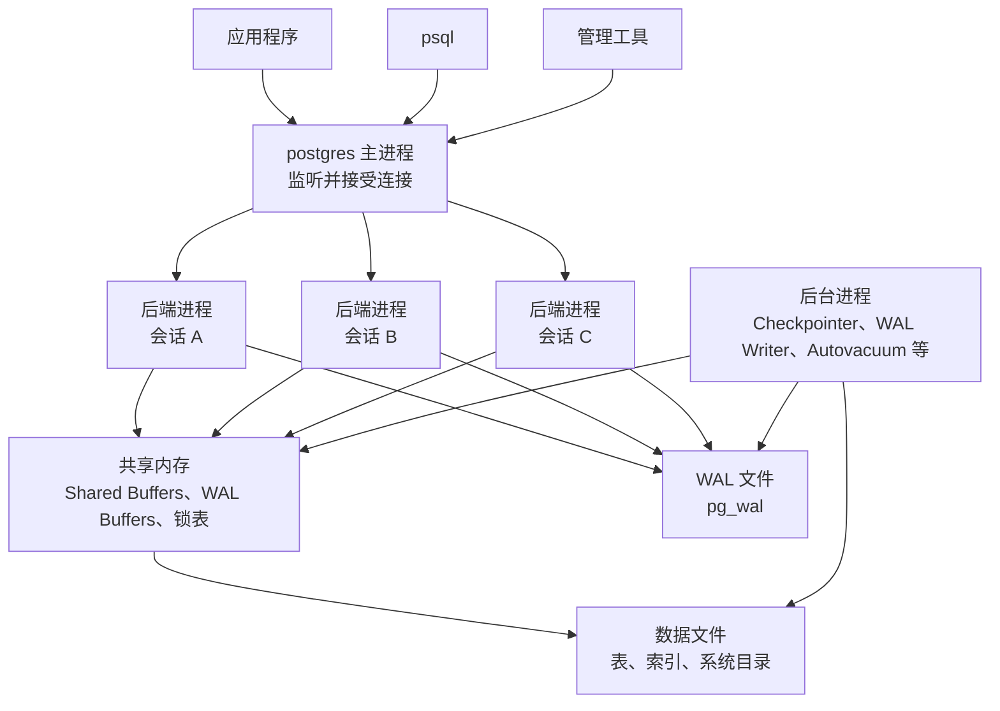
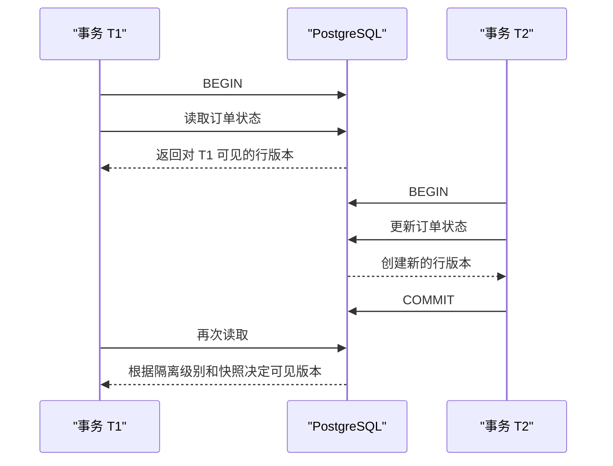
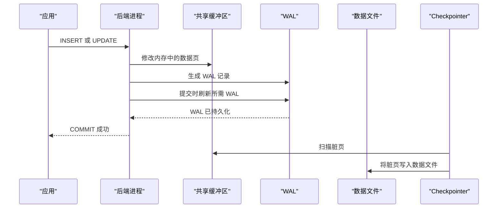
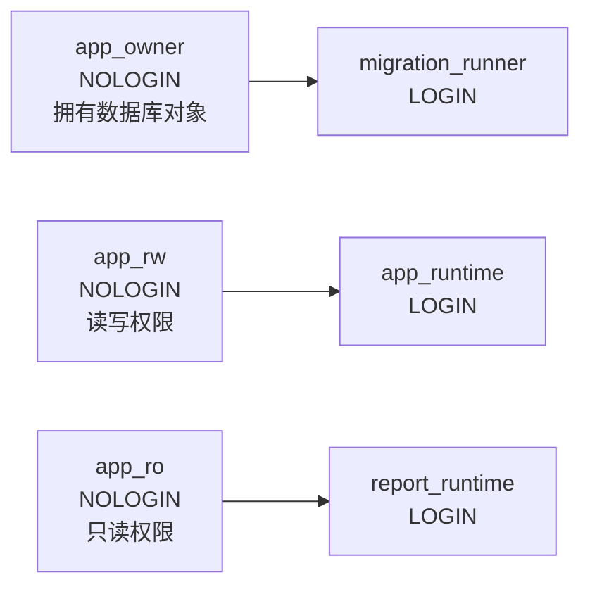
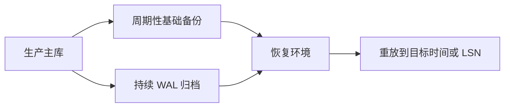
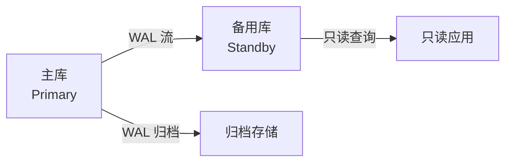

下面是一份可直接作为教程、知识库文章或课程目录使用的 PostgreSQL 系统学习指南。内容以 **PostgreSQL 18** 为主要参考版本，并兼顾仍受支持的 PostgreSQL 14–17。

## PostgreSQL 系统学习指南

## 阅读说明与版本基线

PostgreSQL 是一个开源的对象关系数据库管理系统（Object-Relational Database Management System，ORDBMS）。它以关系模型和 SQL 为基础，同时支持自定义数据类型、函数、运算符、索引访问方法和扩展机制，适用于事务系统、数据平台、地理信息、全文检索及混合数据模型等场景。([PostgreSQL](https://www.postgresql.org/docs/current/intro-whatis.html?utm_source=chatgpt.com))

截至 **2026 年 7 月 27 日**：

| 版本          | 当前小版本 | 社区支持状态           | 预计停止支持  |
| ------------- | ---------- | ---------------------- | ------------- |
| PostgreSQL 18 | 18.4       | 支持中，当前稳定主版本 | 2030 年 11 月 |
| PostgreSQL 17 | 17.10      | 支持中                 | 2029 年 11 月 |
| PostgreSQL 16 | 16.14      | 支持中                 | 2028 年 11 月 |
| PostgreSQL 15 | 15.18      | 支持中                 | 2027 年 11 月 |
| PostgreSQL 14 | 14.23      | 支持中，建议规划升级   | 2026 年 11 月 |

PostgreSQL 通常每年发布一个新的主版本，每个主版本由社区支持约五年。主版本包含新功能，小版本主要提供错误修复、安全修复和低风险改进。生产环境应运行当前主版本对应的最新小版本。PostgreSQL 19 Beta 2 已发布，但测试版不应作为新生产系统的默认选择。([PostgreSQL](https://www.postgresql.org/support/versioning/?utm_source=chatgpt.com))

本指南以 PostgreSQL 18 的语法和能力为主要基线。使用 PostgreSQL 14–17 时，应检查以下功能是否可用：

- 虚拟生成列（Virtual Generated Column）
- `uuidv7()` 函数
- PostgreSQL 18 的异步 I/O（Asynchronous I/O，AIO）
- B-tree 跳跃扫描（Skip Scan）
- DML `RETURNING` 中显式使用 `OLD` 和 `NEW`
- PostgreSQL 18 前端/后端协议 3.2

这些是 PostgreSQL 18 中较有代表性的现代化改进。([PostgreSQL](https://www.postgresql.org/docs/current/release-18.html?utm_source=chatgpt.com))

------

## 学习目标与推荐路线

学习 PostgreSQL 不应只停留在 SQL 语法层面。一个能够指导实际开发和运维的知识体系，应至少覆盖以下层次：


推荐按以下阶段学习：

| 阶段 | 重点                                 | 达成目标                         |
| ---- | ------------------------------------ | -------------------------------- |
| 入门 | 安装、`psql`、数据库、表、CRUD       | 能独立创建数据库并完成基本查询   |
| 基础 | 数据类型、约束、连接、聚合、窗口函数 | 能正确设计中小型业务表           |
| 核心 | 事务、MVCC、隔离级别、锁、死锁       | 能编写并发安全的业务逻辑         |
| 性能 | 索引、统计信息、执行计划、SQL 优化   | 能定位常见慢查询                 |
| 运维 | VACUUM、备份、恢复、日志、监控       | 能维护一个单节点生产实例         |
| 进阶 | 分区、复制、高可用、逻辑复制         | 能参与生产架构设计               |
| 深入 | WAL、页结构、TOAST、HOT、扩展        | 能解释 PostgreSQL 的内部工作机制 |

------

## PostgreSQL 适合解决什么问题

PostgreSQL 适合以下类型的系统：

- 企业业务系统，例如订单、库存、支付、账户和权限系统。
- 对事务一致性要求较高的系统。
- 同时需要结构化数据和半结构化 JSON 数据的系统。
- 需要复杂 SQL、窗口函数、递归查询或分析查询的系统。
- 需要全文检索、范围类型、数组、地理空间扩展或自定义类型的系统。
- 需要物理复制、逻辑复制、时间点恢复和高可用能力的系统。

PostgreSQL 并不意味着所有工作负载都应集中到一个数据库中。数据库选型仍需考虑数据规模、延迟目标、写入模式、查询模式、可用性要求、团队经验和运维能力。

### PostgreSQL 与常见系统的定位差异

| 系统类型   | 典型优势                     | 与 PostgreSQL 的关系                                      |
| ---------- | ---------------------------- | --------------------------------------------------------- |
| 关系数据库 | 事务、约束、连接和结构化查询 | PostgreSQL 的核心定位                                     |
| 键值数据库 | 简单键访问、极低延迟         | 可作为缓存或特定数据服务补充                              |
| 文档数据库 | 文档结构灵活                 | PostgreSQL 可通过 `jsonb` 支持部分文档场景                |
| 搜索引擎   | 倒排索引、相关性排序         | PostgreSQL 全文检索适合中等复杂度需求                     |
| 数据仓库   | 大规模列式分析               | PostgreSQL 可用于中小分析场景，但并非所有规模下的最佳选择 |
| 时序数据库 | 时间序列压缩、保留策略       | PostgreSQL 可通过分区和扩展构建时序方案                   |

最佳实践是先判断数据是否具有明确实体、关系和一致性规则。如果答案是肯定的，关系模型通常应作为首选，而不是一开始就把所有内容存入 JSON。

------

## 核心对象层次

理解 PostgreSQL 时，最容易混淆的是“实例、集群、数据库和模式”的关系。

| 对象       | 英文术语          | 说明                                                     |
| ---------- | ----------------- | -------------------------------------------------------- |
| 数据库集群 | Database Cluster  | 由一个 PostgreSQL 服务实例管理的一组数据库及共享系统对象 |
| 实例或服务 | Server Instance   | 正在运行的 `postgres` 服务及其进程、内存和配置           |
| 数据库     | Database          | 一个独立的逻辑数据库；普通连接一次只能访问其中一个数据库 |
| 模式       | Schema            | 数据库内部的命名空间                                     |
| 表         | Table             | 存储关系数据的对象                                       |
| 行         | Row、Tuple        | 表中的一条记录                                           |
| 列         | Column、Attribute | 行中的一个属性                                           |
| 角色       | Role              | 登录身份、权限主体或权限组                               |
| 表空间     | Tablespace        | 将数据库对象映射到特定文件系统位置的机制                 |

一个 PostgreSQL 集群可以包含多个数据库，角色等部分对象在集群范围共享；每个数据库又可以包含多个模式。一个普通连接只能直接查询当前连接数据库中的对象，不能像访问模式一样直接跨数据库查询。([PostgreSQL](https://www.postgresql.org/docs/current/ddl-schemas.html?utm_source=chatgpt.com))

推荐层次：

```text
PostgreSQL 服务
├── 数据库 app_prod
│   ├── 模式 app
│   │   ├── 表 customer
│   │   ├── 表 sales_order
│   │   └── 视图 active_customer
│   └── 模式 audit
│       └── 表 operation_log
└── 数据库 app_test
```

不要为每个微小业务模块创建独立数据库。模式通常更适合用于数据库内部的命名空间划分，而独立数据库更适合真正需要生命周期、连接权限或运维边界隔离的系统。

------

## PostgreSQL 的客户端与服务器架构

PostgreSQL 使用客户端/服务器模型。主 `postgres` 进程负责监听连接；传统架构下，每个客户端连接由一个独立后端进程处理。多个后端进程通过共享内存、WAL 和数据库文件协同工作。([PostgreSQL](https://www.postgresql.org/docs/16/tutorial-arch.html?utm_source=chatgpt.com))



### 这一架构带来的影响

每个连接都不是“零成本”的。连接会对应后端进程、会话状态和一定的内存开销，因此生产环境不应无限提高 `max_connections`。

应用程序应使用连接池，避免为每个请求重复创建数据库连接。需要大量短连接或无服务器函数连接时，可以在应用内连接池之外评估独立连接代理。

连接池不能解决慢 SQL、长事务或锁竞争问题。它只能管理连接数量和连接复用。

------

## 安装与环境准备

### Ubuntu 推荐安装方式

Ubuntu 自带 PostgreSQL 软件包，但 Ubuntu 发行版通常会固定一个 PostgreSQL 主版本。如果需要明确选择 PostgreSQL 18，推荐使用 PostgreSQL Global Development Group（PGDG）的官方 APT 仓库；它可以集成到系统的软件包更新机制，并在受支持周期内提供对应版本的软件更新。([PostgreSQL](https://www.postgresql.org/download/linux/ubuntu/?source=post_page---------------------------&utm_source=chatgpt.com))

### pgsql官方仓库安装

自动配置官方仓库：

```bash
sudo apt update
sudo apt install -y postgresql-common

sudo /usr/share/postgresql-common/pgdg/apt.postgresql.org.sh

sudo apt update
sudo apt install -y postgresql-18 postgresql-client-18
```

检查服务：

```bash
sudo systemctl status postgresql
pg_lsclusters
```

进入数据库：

```bash
sudo -u postgres psql
```

查看版本：

```sql
SELECT version();
SHOW server_version;
SHOW server_version_num;
```

### 包管理器简单安装

仅用于本地学习、并且不关心具体主版本时，可以直接安装 Ubuntu 提供的默认版本：

```bash
sudo apt update
sudo apt install -y postgresql
```

## 学习环境建议

推荐准备三套逻辑环境：

| 环境         | 目的               | 建议                     |
| ------------ | ------------------ | ------------------------ |
| 本地实验环境 | 学习 SQL、测试配置 | 可以使用本机软件包或容器 |
| 集成测试环境 | 测试迁移和并发行为 | 尽量接近生产版本与配置   |
| 恢复演练环境 | 验证备份是否可恢复 | 与生产隔离，定期重建     |

数据库备份不能只验证“文件是否存在”，必须实际执行恢复。

------

## `psql` 基础

`psql` 是 PostgreSQL 官方命令行客户端，也是学习 PostgreSQL 最重要的工具之一。

连接数据库：

```bash
psql "host=127.0.0.1 port=5432 dbname=app user=app_user"
```

常用元命令：

| 命令              | 作用                     |
| ----------------- | ------------------------ |
| `\l`              | 列出数据库               |
| `\c app`          | 切换数据库               |
| `\dn`             | 列出模式                 |
| `\dt app.*`       | 列出指定模式的表         |
| `\d app.customer` | 查看表结构               |
| `\du`             | 查看角色                 |
| `\dx`             | 查看扩展                 |
| `\conninfo`       | 查看当前连接             |
| `\timing on`      | 显示 SQL 执行时间        |
| `\x auto`         | 自动启用扩展结果显示     |
| `\watch 2`        | 每两秒重复执行上一条查询 |
| `\q`              | 退出                     |

建议在执行管理操作时启用：

```sql
\set ON_ERROR_STOP on
```

这样脚本遇到 SQL 错误时会停止，而不是继续执行后续语句。

------

## SQL 与关系模型基础

关系表不只是一个二维数据文件。一个设计良好的表应表达：

- 每一行代表什么实体或事实。
- 每一列的语义是什么。
- 哪些值必须存在。
- 哪些值必须唯一。
- 表之间是什么关系。
- 哪些状态组合是合法的。

### SQL 命令类别

| 类别         | 英文                            | 常见命令                                        |
| ------------ | ------------------------------- | ----------------------------------------------- |
| 数据定义语言 | Data Definition Language，DDL   | `CREATE`、`ALTER`、`DROP`                       |
| 数据操作语言 | Data Manipulation Language，DML | `SELECT`、`INSERT`、`UPDATE`、`DELETE`、`MERGE` |
| 数据控制语言 | Data Control Language，DCL      | `GRANT`、`REVOKE`                               |
| 事务控制     | Transaction Control             | `BEGIN`、`COMMIT`、`ROLLBACK`、`SAVEPOINT`      |

### 基础 CRUD

```sql
INSERT INTO app.customer (email, display_name)
VALUES ('alice@example.com', 'Alice')
RETURNING id, public_id, created_at;
SELECT id, email, display_name
FROM app.customer
WHERE email = 'alice@example.com';
UPDATE app.customer
SET display_name = 'Alice Chen'
WHERE email = 'alice@example.com'
RETURNING id, display_name;
DELETE FROM app.customer
WHERE email = 'alice@example.com'
RETURNING id;
```

`INSERT`、`UPDATE`、`DELETE` 和 `MERGE` 都支持 `RETURNING`。它可以减少“写入后再查询一次”的往返，并可靠地返回数据库生成的标识符或计算值。PostgreSQL 18 还可以在 `RETURNING` 中显式访问新旧值。([PostgreSQL](https://www.postgresql.org/docs/18/dml-returning.html?utm_source=chatgpt.com))

------

## 数据类型设计

PostgreSQL 提供了丰富的内置数据类型，包括整数、精确数值、文本、布尔值、日期时间、UUID、JSON、数组、范围、网络地址和全文检索类型。([PostgreSQL](https://www.postgresql.org/docs/current/datatype.htm?utm_source=chatgpt.com))

### 常见类型选择

| 业务含义             | 推荐类型                 | 说明                              |
| -------------------- | ------------------------ | --------------------------------- |
| 小范围整数           | `integer`                | 通用整数                          |
| 大范围标识符         | `bigint`                 | 适合大表主键和计数                |
| 金额                 | `numeric(p, s)`          | 十进制定点精确计算                |
| 浮点测量值           | `double precision`       | 允许浮点误差                      |
| 任意长度文本         | `text`                   | 通常不需要人为指定 `varchar(255)` |
| 有明确最大长度的文本 | `varchar(n)`             | 最大长度本身属于业务约束时使用    |
| 真或假               | `boolean`                | 不要用字符串保存布尔值            |
| 日期                 | `date`                   | 不含时间                          |
| 绝对时间点           | `timestamptz`            | 大多数业务事件时间的首选          |
| 本地墙上时间         | `timestamp`              | 不对应全球唯一时刻的本地时间      |
| 时间长度             | `interval`               | 持续时间或时间偏移                |
| 全局标识符           | `uuid`                   | 分布式标识或外部公开标识          |
| 半结构化数据         | `jsonb`                  | 可解析、可查询、可索引的 JSON     |
| IP 地址              | `inet`                   | 支持网络相关运算                  |
| 数值或时间区间       | `int8range`、`tstzrange` | 表达范围及边界                    |
| 全文检索文档         | `tsvector`               | PostgreSQL 全文检索               |

### `timestamp` 与 `timestamptz`

`timestamp` 实际表示 `timestamp without time zone`。它只保存日期和时间字段，不表示全球唯一时刻。

`timestamptz` 是 `timestamp with time zone` 的 PostgreSQL 简写。它表示一个确定的时间点，并根据会话时区进行输入解析和输出显示。([PostgreSQL](https://www.postgresql.org/docs/current/datatype-datetime.html?utm_source=chatgpt.com))

推荐规则：

- 订单创建时间、支付时间、登录时间、日志时间：使用 `timestamptz`。
- 每天上午 09:00 营业、生日、没有时区语义的日程模板：根据语义使用 `time`、`date` 或 `timestamp`。
- 应用、数据库和日志系统优先统一使用 UTC 保存和交换时间。
- 展示时再转换到用户时区。

```sql
CREATE TABLE app.event (
    id bigint GENERATED ALWAYS AS IDENTITY PRIMARY KEY,
    occurred_at timestamptz NOT NULL DEFAULT now()
);
```

### `numeric` 与浮点数

涉及金额、税率结算和必须精确比较的小数时，使用 `numeric`：

```sql
price numeric(12, 2) NOT NULL
```

科学计算、传感器测量或可接受浮点误差的场景，可以使用 `double precision`。

不要使用浮点类型直接判断货币金额是否完全相等。

### Identity 与 Serial

现代 PostgreSQL 表设计优先使用标准化的 Identity Column：

```sql
id bigint GENERATED ALWAYS AS IDENTITY
```

而不是：

```sql
id bigserial
```

两者都可以生成序列值，但 Identity Column 的约束语义更加清晰，并属于 SQL 标准化能力的一部分。PostgreSQL 的数据定义文档将 Identity Column 作为专门的列定义机制。([PostgreSQL](https://www.postgresql.org/docs/current/ddl.html?utm_source=chatgpt.com))

### UUID

PostgreSQL 原生支持 `uuid` 类型。PostgreSQL 18 可以直接生成 UUIDv4 和具有时间顺序特征的 UUIDv7。([PostgreSQL](https://www.postgresql.org/docs/current/datatype-uuid.html?utm_source=chatgpt.com))

```sql
CREATE TABLE app.customer (
    public_id uuid NOT NULL DEFAULT uuidv7()
);
```

常见设计选择：

| 方案                              | 优点                       | 注意事项                         |
| --------------------------------- | -------------------------- | -------------------------------- |
| `bigint` 自增主键                 | 索引紧凑、连接高效         | 不适合直接作为不可预测的外部标识 |
| UUIDv4 主键                       | 易于分布式生成             | 随机写入可能导致更分散的索引访问 |
| UUIDv7 主键                       | 可分布式生成且具有时间顺序 | 依赖 PostgreSQL 18 或其他生成端  |
| `bigint` 内部主键 + UUID 外部标识 | 兼顾内部性能和外部安全性   | 多维护一列及唯一索引             |

对多数业务系统，一个实用方案是使用 `bigint` 作为内部主键，并用唯一 UUID 作为 API 对外标识。

### JSON 与 JSONB

`json` 更接近原始文本保存；`jsonb` 会将 JSON 解析成内部二进制结构，适合比较、查询和索引。PostgreSQL 还实现了 SQL/JSON 数据模型和丰富的 JSON 操作函数。([PostgreSQL](https://www.postgresql.org/docs/current/datatype-json.html?utm_source=chatgpt.com))

```sql
CREATE TABLE app.customer (
    id bigint GENERATED ALWAYS AS IDENTITY PRIMARY KEY,
    metadata jsonb NOT NULL DEFAULT '{}'::jsonb
);
```

查询 JSON：

```sql
SELECT id, metadata ->> 'language' AS language
FROM app.customer
WHERE metadata @> '{"marketing_opt_in": true}'::jsonb;
```

GIN 索引：

```sql
CREATE INDEX customer_metadata_gin_idx
ON app.customer
USING gin (metadata);
```

JSONB 的合理用途：

- 第三方接口的扩展字段。
- 不同记录之间变化较大的可选属性。
- 暂时无法稳定建模的附加元数据。
- 需要保留完整事件载荷的审计或集成表。

JSONB 不应替代：

- 主键和外键。
- 必须唯一的业务属性。
- 经常用于连接、过滤和排序的稳定字段。
- 需要严格类型和约束的重要业务数据。

------

## 模式与 `search_path`

模式（Schema）是数据库内部的命名空间。使用模式可以组织表、视图、函数和类型，并隔离同名对象。

```sql
CREATE SCHEMA app;
CREATE SCHEMA audit;
```

使用限定名称：

```sql
SELECT *
FROM app.customer;
```

未限定对象名时，PostgreSQL 根据 `search_path` 依次搜索模式。第一个存在的模式也是默认创建对象的位置。将允许不可信用户创建对象的模式加入 `search_path`，会带来对象名称劫持和函数调用安全风险。([PostgreSQL](https://www.postgresql.org/docs/current/ddl-schemas.html?utm_source=chatgpt.com))

查看当前路径：

```sql
SHOW search_path;
```

生产角色可以设置为：

```sql
ALTER ROLE app_runtime
SET search_path = pg_catalog, app;
```

最佳实践：

- 应用对象放入专用模式，而不是全部堆在 `public`。
- 迁移脚本中尽量使用模式限定对象名。
- `search_path` 只包含可信模式。
- `SECURITY DEFINER` 函数必须显式设置安全的 `search_path`。
- 不要允许普通应用角色在共享模式中任意创建对象。
- 对多租户系统，不要仅依赖动态修改 `search_path` 实现安全隔离。

------

## 表设计与完整性约束

数据库约束是数据模型的一部分，不是可以全部交给应用层的“附加检查”。

PostgreSQL 支持：

- 非空约束（Not-Null Constraint）
- 检查约束（Check Constraint）
- 唯一约束（Unique Constraint）
- 主键（Primary Key）
- 外键（Foreign Key）
- 排他约束（Exclusion Constraint）

这些约束由数据库统一执行，可以覆盖来自应用、脚本、批处理任务和管理工具的所有写入路径。([PostgreSQL](https://www.postgresql.org/docs/current/ddl-constraints.html?utm_source=chatgpt.com))

### 示例业务模型

```sql
CREATE SCHEMA IF NOT EXISTS app;

CREATE TABLE app.customer (
    id bigint GENERATED ALWAYS AS IDENTITY PRIMARY KEY,
    public_id uuid NOT NULL DEFAULT uuidv7(),
    email text NOT NULL,
    display_name text NOT NULL,
    metadata jsonb NOT NULL DEFAULT '{}'::jsonb,
    created_at timestamptz NOT NULL DEFAULT now(),

    CONSTRAINT customer_public_id_uq UNIQUE (public_id),
    CONSTRAINT customer_email_uq UNIQUE (email),
    CONSTRAINT customer_email_nonempty_ck
        CHECK (length(trim(email)) >= 3)
);

CREATE TABLE app.sales_order (
    id bigint GENERATED ALWAYS AS IDENTITY PRIMARY KEY,
    customer_id bigint NOT NULL,
    status text NOT NULL DEFAULT 'pending',
    total_amount numeric(14, 2) NOT NULL,
    currency_code text NOT NULL,
    created_at timestamptz NOT NULL DEFAULT now(),
    updated_at timestamptz NOT NULL DEFAULT now(),

    CONSTRAINT sales_order_customer_fk
        FOREIGN KEY (customer_id)
        REFERENCES app.customer (id),

    CONSTRAINT sales_order_status_ck
        CHECK (status IN (
            'pending',
            'paid',
            'cancelled',
            'fulfilled'
        )),

    CONSTRAINT sales_order_total_amount_ck
        CHECK (total_amount >= 0),

    CONSTRAINT sales_order_currency_code_ck
        CHECK (currency_code ~ '^[A-Z]{3}$')
);
```

### 主键与业务唯一键

主键应满足：

- 非空。
- 唯一。
- 尽量稳定。
- 尽量短小。
- 不因业务属性变化而修改。

电子邮箱、手机号码、用户名等字段可能唯一，但通常不适合直接作为主键，因为它们可能变化、长度较大，并可能包含隐私信息。

推荐：

```sql
PRIMARY KEY (id)
UNIQUE (email)
```

### 外键索引

被外键引用的一侧通常已经具有主键或唯一索引。引用外键的一侧不会因为创建外键而自动获得普通索引。

删除父表记录或更新被引用值时，数据库需要在子表中查找关联记录，因此通常应为引用列建立索引。([PostgreSQL](https://www.postgresql.org/docs/current/ddl-constraints.html?utm_source=chatgpt.com))

```sql
CREATE INDEX sales_order_customer_id_idx
ON app.sales_order (customer_id);
```

### 约束命名

显式命名约束有利于：

- 阅读错误日志。
- 编写迁移脚本。
- 定位约束冲突。
- 保持不同环境一致。
- 在应用中映射特定业务错误。

推荐命名形式：

```text
<table>_<column>_<constraint-type>
```

例如：

```text
customer_email_uq
sales_order_customer_fk
sales_order_total_amount_ck
```

------

## 生成列

生成列（Generated Column）的值由其他列计算得到。PostgreSQL 18 支持存储生成列（Stored Generated Column）和虚拟生成列（Virtual Generated Column）；虚拟生成列是 PostgreSQL 18 的默认形式，在读取时计算，不占用普通列存储。([PostgreSQL](https://www.postgresql.org/docs/18/ddl-generated-columns.html?utm_source=chatgpt.com))

```sql
CREATE TABLE app.order_line (
    id bigint GENERATED ALWAYS AS IDENTITY PRIMARY KEY,
    quantity integer NOT NULL,
    unit_price numeric(12, 2) NOT NULL,
    line_amount numeric(14, 2)
        GENERATED ALWAYS AS (quantity * unit_price) STORED,

    CONSTRAINT order_line_quantity_ck CHECK (quantity > 0),
    CONSTRAINT order_line_unit_price_ck CHECK (unit_price >= 0)
);
```

适合生成列的场景：

- 确定性计算结果。
- 需要统一计算规则的派生值。
- 经常查询或索引的派生表达式。
- 希望避免应用重复计算的字段。

不适合：

- 依赖当前时间的值。
- 依赖其他行或其他表的值。
- 含有不稳定函数的计算。
- 需要手动覆盖的业务状态。

------

## 查询基础与连接

### 内连接

```sql
SELECT
    o.id,
    o.status,
    o.total_amount,
    c.email
FROM app.sales_order AS o
JOIN app.customer AS c
    ON c.id = o.customer_id
WHERE o.status = 'paid';
```

### 左连接

```sql
SELECT
    c.id,
    c.email,
    count(o.id) AS order_count
FROM app.customer AS c
LEFT JOIN app.sales_order AS o
    ON o.customer_id = c.id
GROUP BY c.id, c.email;
```

左连接后对右表字段的过滤位置非常重要：

```sql
SELECT c.id, o.id
FROM app.customer AS c
LEFT JOIN app.sales_order AS o
    ON o.customer_id = c.id
   AND o.status = 'paid';
```

如果把 `o.status = 'paid'` 放在 `WHERE` 中，无法匹配订单的客户行会被过滤掉，查询可能实际表现得像内连接。

### 聚合

```sql
SELECT
    customer_id,
    count(*) AS order_count,
    sum(total_amount) AS total_spent
FROM app.sales_order
WHERE status = 'paid'
GROUP BY customer_id
HAVING sum(total_amount) >= 1000;
```

### 窗口函数

窗口函数（Window Function）不会像普通聚合那样把多行压缩成一行。

```sql
SELECT
    customer_id,
    id AS order_id,
    total_amount,
    row_number() OVER (
        PARTITION BY customer_id
        ORDER BY created_at DESC, id DESC
    ) AS order_rank
FROM app.sales_order;
```

常见窗口函数：

| 函数               | 用途             |
| ------------------ | ---------------- |
| `row_number()`     | 行编号           |
| `rank()`           | 有并列跳号排名   |
| `dense_rank()`     | 有并列不跳号排名 |
| `lag()`            | 读取上一行       |
| `lead()`           | 读取下一行       |
| `sum() OVER (...)` | 累计和           |
| `avg() OVER (...)` | 移动或分组平均值 |

### 公共表表达式

公共表表达式（Common Table Expression，CTE）用于拆分复杂查询：

```sql
WITH paid_order AS (
    SELECT customer_id, total_amount
    FROM app.sales_order
    WHERE status = 'paid'
)
SELECT
    customer_id,
    sum(total_amount) AS total_spent
FROM paid_order
GROUP BY customer_id;
```

不要仅为了“看起来更整洁”而把每个子查询都改写成多层 CTE。应以可读性、执行计划和复用需求为依据。

------

## UPSERT 与 MERGE

### `INSERT ... ON CONFLICT`

对于单表唯一键冲突处理，通常使用：

```sql
INSERT INTO app.customer (
    email,
    display_name
)
VALUES (
    'alice@example.com',
    'Alice'
)
ON CONFLICT (email)
DO UPDATE SET
    display_name = EXCLUDED.display_name
RETURNING id, email, display_name;
```

`ON CONFLICT` 适合：

- 根据一个唯一键插入或更新。
- 简单幂等写入。
- 缓存表、聚合表或同步状态表。

### `MERGE`

`MERGE` 可以根据源数据与目标表的匹配情况执行插入、更新、删除或跳过操作。PostgreSQL 18 的 `MERGE` 支持 `RETURNING`，还可以通过 `merge_action()` 返回每一行实际执行的动作。([PostgreSQL](https://www.postgresql.org/docs/current/sql-merge.html?utm_source=chatgpt.com))

```sql
MERGE INTO app.inventory AS target
USING app.inventory_stage AS source
ON target.product_id = source.product_id

WHEN MATCHED AND source.quantity = 0 THEN
    DELETE

WHEN MATCHED THEN
    UPDATE SET
        quantity = source.quantity,
        updated_at = now()

WHEN NOT MATCHED THEN
    INSERT (
        product_id,
        quantity,
        updated_at
    )
    VALUES (
        source.product_id,
        source.quantity,
        now()
    )

RETURNING merge_action(), target.*;
```

选择原则：

| 需求                       | 建议                                 |
| -------------------------- | ------------------------------------ |
| 单行或少量行唯一键冲突处理 | `INSERT ... ON CONFLICT`             |
| 来源表到目标表的多分支同步 | `MERGE`                              |
| 复杂数据清洗               | 先分阶段写入临时表或暂存表           |
| 大规模数据同步             | 同时评估批处理大小、索引和事务日志量 |

------

## 事务

事务（Transaction）把一组操作视为一个原子单元。

```sql
BEGIN;

UPDATE app.account
SET balance = balance - 100
WHERE id = 1;

UPDATE app.account
SET balance = balance + 100
WHERE id = 2;

COMMIT;
```

出现错误时：

```sql
ROLLBACK;
```

事务通常具有 ACID 属性：

| 属性   | 英文        | 含义                                 |
| ------ | ----------- | ------------------------------------ |
| 原子性 | Atomicity   | 操作全部成功或全部回滚               |
| 一致性 | Consistency | 数据从一个有效状态进入另一个有效状态 |
| 隔离性 | Isolation   | 并发事务之间具有受控的可见性         |
| 持久性 | Durability  | 已提交结果在故障恢复后仍应存在       |

### 保存点

```sql
BEGIN;

INSERT INTO app.customer (email, display_name)
VALUES ('a@example.com', 'A');

SAVEPOINT before_order;

INSERT INTO app.sales_order (
    customer_id,
    status,
    total_amount,
    currency_code
)
VALUES (
    1,
    'pending',
    -1,
    'CNY'
);

ROLLBACK TO SAVEPOINT before_order;

COMMIT;
```

保存点允许回滚事务中的部分操作，但不能替代合理的事务边界。

### 事务边界最佳实践

- 事务应尽量短。
- 不要在事务中等待用户输入或调用高延迟外部服务。
- 不要打开事务后长时间空闲。
- 一个事务应围绕一个明确的业务一致性单元。
- 避免在单个事务中更新过多行。
- 批量任务应合理分批，并设计可恢复的进度记录。
- 应用必须明确处理提交失败，而不是只处理 SQL 执行失败。

------

## MVCC 多版本并发控制

PostgreSQL 使用多版本并发控制（Multi-Version Concurrency Control，MVCC）管理并发读写。

更新一行时，PostgreSQL 通常不会直接覆盖旧行，而是创建新的行版本。不同事务根据自己的快照（Snapshot）判断哪个版本可见。旧版本在不再被任何事务需要后，由 `VACUUM` 清理或标记空间为可复用。([PostgreSQL](https://www.postgresql.org/docs/current/mvcc.html?utm_source=chatgpt.com))



MVCC 带来的优势：

- 普通读取通常不会阻塞普通写入。
- 写入通常不会阻塞对旧版本的读取。
- 不同事务可以看到不同的、一致的数据快照。
- 崩溃恢复和事务回滚可以与 WAL 机制结合工作。

MVCC 带来的维护要求：

- 更新和删除会产生旧行版本。
- 长事务会延迟旧版本清理。
- `VACUUM` 和 Autovacuum 是正常运行的一部分。
- 表和索引可能因为大量更新而膨胀。
- 事务 ID 必须通过冻结机制防止回绕问题。

------

## 事务隔离级别

PostgreSQL 的默认事务隔离级别是 `READ COMMITTED`。([PostgreSQL](https://www.postgresql.org/docs/current/sql-set-transaction.html?utm_source=chatgpt.com))

| 隔离级别           | PostgreSQL 行为                | 典型用途               |
| ------------------ | ------------------------------ | ---------------------- |
| `READ UNCOMMITTED` | 按 `READ COMMITTED` 处理       | 通常不单独使用         |
| `READ COMMITTED`   | 每条语句获得新的已提交数据快照 | 默认业务事务           |
| `REPEATABLE READ`  | 事务内使用稳定快照             | 一致性报表、多步读取   |
| `SERIALIZABLE`     | 尝试提供等价于串行执行的效果   | 严格一致的复杂并发业务 |

PostgreSQL 的隔离行为和并发异常规则由 MVCC 与锁机制共同实现。([PostgreSQL](https://www.postgresql.org/docs/current/transaction-iso.html?utm_source=chatgpt.com))

### READ COMMITTED

```sql
BEGIN ISOLATION LEVEL READ COMMITTED;
```

同一事务中的两条查询可能看到其他事务在它们之间提交的数据。

适用于：

- 常规短事务。
- 单条更新语句。
- 允许在多条查询之间看到新提交结果的业务。

### REPEATABLE READ

```sql
BEGIN ISOLATION LEVEL REPEATABLE READ;
```

事务中的查询使用事务开始时形成的一致快照。它适合需要多次读取保持一致的场景。

### SERIALIZABLE

```sql
BEGIN ISOLATION LEVEL SERIALIZABLE;
```

Serializable 不意味着把所有事务实际排成单线程。PostgreSQL 会检测可能导致不可串行化结果的依赖关系，并在必要时中止某个事务。

应用必须准备重试 SQLSTATE `40001` 的序列化失败。([PostgreSQL](https://www.postgresql.org/docs/current/mvcc-serialization-failure-handling.html?utm_source=chatgpt.com))

伪代码：

```text
最多重试 3 至 5 次

开始 Serializable 事务
执行读取和写入
尝试提交

如果发生 serialization_failure
    短暂且随机退避
    重新执行整个事务
否则
    返回结果
```

重试时必须重新执行整个事务，不能只重试最后一条 SQL。

------

## 锁

即使有 MVCC，PostgreSQL 仍需要锁来协调并发修改、DDL 和部分一致性操作。

常见锁类型：

| 锁类别 | 示例                                             |
| ------ | ------------------------------------------------ |
| 表级锁 | `ALTER TABLE`、`LOCK TABLE`、普通 DML 获取的表锁 |
| 行级锁 | `SELECT ... FOR UPDATE`                          |
| 页级锁 | 内部短期使用                                     |
| 咨询锁 | Advisory Lock，由应用定义语义                    |
| 谓词锁 | Serializable 隔离的一部分                        |

PostgreSQL 提供表级锁、行级锁、页级锁、死锁检测和咨询锁机制。([PostgreSQL](https://www.postgresql.org/docs/current/explicit-locking.html?utm_source=chatgpt.com))

### 行锁

```sql
BEGIN;

SELECT id, status
FROM app.sales_order
WHERE id = 1001
FOR UPDATE;

UPDATE app.sales_order
SET status = 'paid'
WHERE id = 1001;

COMMIT;
```

常见行锁形式：

| 语法                | 典型用途                     |
| ------------------- | ---------------------------- |
| `FOR UPDATE`        | 将要更新或删除行             |
| `FOR NO KEY UPDATE` | 更新但通常不改变键值         |
| `FOR SHARE`         | 共享锁定行                   |
| `FOR KEY SHARE`     | 防止可能破坏引用关系的键修改 |

### 队列消费

```sql
SELECT id
FROM app.job
WHERE status = 'pending'
ORDER BY created_at, id
FOR UPDATE SKIP LOCKED
LIMIT 10;
```

`SKIP LOCKED` 适合多个工作进程竞争领取任务，但查询得到的是“当前未被锁定的可用任务”，不应将其误解为完整的一致性查询结果。

### 避免死锁

常见规则：

- 多个事务按相同顺序锁定资源。
- 根据主键排序后再批量更新。
- 缩短事务。
- 不在持锁期间调用外部服务。
- 对死锁和序列化失败设计有限次数重试。
- 监控等待事件和阻塞关系。

------

## WAL 与持久化

WAL 是预写式日志（Write-Ahead Logging）。

核心原则是：数据页修改写入数据文件之前，描述该修改的 WAL 记录必须先写入并持久化。这样数据库崩溃后可以通过重放 WAL 恢复一致状态。([PostgreSQL](https://www.postgresql.org/docs/current/wal-intro.html?utm_source=chatgpt.com))



### WAL 的主要用途

- 崩溃恢复。
- 物理流复制。
- 持续归档。
- 时间点恢复。
- 逻辑解码的基础。
- 增量备份及相关恢复能力。

### LSN

日志序列号（Log Sequence Number，LSN）表示 WAL 流中的位置。

```sql
SELECT pg_current_wal_lsn();
```

复制延迟、恢复位置和备份一致性常通过 LSN 进行比较。

### Checkpoint

检查点（Checkpoint）会确保检查点之前相关的脏页逐步写入数据文件，并建立恢复起点。

不要因为发现大量脏页就频繁手动执行：

```sql
CHECKPOINT;
```

手动 `CHECKPOINT` 会强制立即检查点，可能制造突发 I/O；通常应让系统根据配置自动管理。([PostgreSQL](https://www.postgresql.org/docs/current/sql-checkpoint.html?utm_source=chatgpt.com))

------

## 物理存储、页与 TOAST

PostgreSQL 的表和索引由数据页组成。常见构建下的数据页大小为 8 KiB。单个普通行不能跨多个页，因此较大的可变长度值可能被压缩或移动到 TOAST 存储。([PostgreSQL](https://www.postgresql.org/docs/current/storage.html?utm_source=chatgpt.com))

### 重要内部概念

| 概念           | 英文                                      | 作用                       |
| -------------- | ----------------------------------------- | -------------------------- |
| Heap           | Heap Table                                | PostgreSQL 默认表存储方式  |
| Page           | Database Page                             | 表和索引的基本存储页       |
| Tuple          | Tuple                                     | 一个物理行版本             |
| TOAST          | The Oversized-Attribute Storage Technique | 压缩或移出大字段           |
| Free Space Map | FSM                                       | 跟踪页面可用空间           |
| Visibility Map | VM                                        | 标记页面是否全可见或已冻结 |
| HOT            | Heap-Only Tuple                           | 特定更新情况下减少索引维护 |
| Fillfactor     | Fill Factor                               | 页面预留空间比例           |

### TOAST

对于较大的 `text`、`bytea`、`jsonb` 等值，PostgreSQL 可以：

- 在行内压缩。
- 将值移至关联的 TOAST 表。
- 同时进行压缩和外部存储。

这通常是自动机制，不需要应用拆分普通大文本字段。

但不应把 PostgreSQL 当作无限制对象存储。超大文件通常还需要评估：

- 备份和恢复时间。
- WAL 生成量。
- 复制带宽。
- 查询是否会重复读取整个值。
- 是否应使用对象存储并在数据库中保存元数据。

### HOT 更新

Heap-Only Tuple（HOT）是一种更新优化。如果更新没有修改需要维护的索引列，并且原页面有足够空间，PostgreSQL 可能不为新行版本创建新的普通索引条目。降低表的 `fillfactor` 可以为高频更新表预留页内空间，提高发生 HOT 更新的机会。([PostgreSQL](https://www.postgresql.org/docs/18/storage-hot.html?utm_source=chatgpt.com))

```sql
ALTER TABLE app.frequent_update_table
SET (fillfactor = 80);
```

不要把 `fillfactor = 80` 当作通用默认值。它以增加表占用空间为代价，应根据更新模式和监控结果决定。

------

## VACUUM、ANALYZE 与 Autovacuum

由于 MVCC 会保留旧行版本，PostgreSQL 需要周期性执行 `VACUUM`。

常规 `VACUUM` 的主要作用包括：

- 回收或复用更新、删除产生的空间。
- 更新可见性映射。
- 支持 Index-Only Scan。
- 防止事务 ID 回绕。
- 与 `ANALYZE` 配合维护优化器统计信息。

对多数实例，Autovacuum 应保持启用，并根据工作负载进行调整。([PostgreSQL](https://www.postgresql.org/docs/current/routine-vacuuming.html?utm_source=chatgpt.com))

### `VACUUM` 与 `VACUUM FULL`

| 命令             | 行为                       | 锁和影响                   |
| ---------------- | -------------------------- | -------------------------- |
| `VACUUM`         | 清理死元组并标记空间可复用 | 可与正常读写并发           |
| `VACUUM ANALYZE` | 清理并更新统计信息         | 常用维护方式               |
| `VACUUM FULL`    | 重写表并尽可能归还文件空间 | 需要 `ACCESS EXCLUSIVE` 锁 |
| `ANALYZE`        | 收集优化器统计信息         | 不负责清理死元组           |

常规维护应优先使用标准 `VACUUM`。`VACUUM FULL` 较慢、需要排他锁，应作为特殊治理手段，而不是日常计划任务。([PostgreSQL](https://www.postgresql.org/docs/current/routine-vacuuming.html?utm_source=chatgpt.com))

手动查看：

```sql
VACUUM (VERBOSE, ANALYZE) app.sales_order;
```

### 为什么 Autovacuum 会“跟不上”

常见原因：

- 大量更新或删除集中发生。
- 单张大表的默认触发阈值过高。
- Autovacuum worker 数量不足。
- I/O 成本限制过于保守。
- 长事务阻止旧版本被清理。
- 复制槽或逻辑解码长期保留旧数据。
- 表持续增长，默认比例阈值越来越大。

高更新表可以使用表级参数：

```sql
ALTER TABLE app.frequent_update_table
SET (
    autovacuum_vacuum_scale_factor = 0.02,
    autovacuum_analyze_scale_factor = 0.01
);
```

这些数值只是示例，必须根据表大小、更新速率和维护窗口确定。

### 监控表维护状态

```sql
SELECT
    schemaname,
    relname,
    n_live_tup,
    n_dead_tup,
    last_autovacuum,
    last_autoanalyze,
    autovacuum_count,
    autoanalyze_count
FROM pg_stat_user_tables
ORDER BY n_dead_tup DESC;
```

统计视图可用于观察表访问、维护和等待状态；`ANALYZE` 生成的统计信息会被查询规划器用于选择执行计划。([PostgreSQL](https://www.postgresql.org/docs/current/sql-analyze.html?utm_source=chatgpt.com))

------

## 索引

索引可以加快数据查找，但会占用空间并增加插入、更新、删除和 VACUUM 的成本，因此必须根据查询模式创建。([PostgreSQL](https://www.postgresql.org/docs/current/indexes.html?utm_source=chatgpt.com))

### PostgreSQL 索引类型

PostgreSQL 内置 B-tree、Hash、GiST、SP-GiST、GIN 和 BRIN 等索引访问方法；默认使用 B-tree。([PostgreSQL](https://www.postgresql.org/docs/current/indexes-types.html?utm_source=chatgpt.com))

| 索引类型 | 典型用途                     | 常见数据                |
| -------- | ---------------------------- | ----------------------- |
| B-tree   | 等值、范围、排序、前缀列匹配 | 数值、文本、日期、UUID  |
| Hash     | 等值比较                     | 特定纯等值查询          |
| GIN      | 一个值包含多个可搜索元素     | `jsonb`、数组、全文检索 |
| GiST     | 可扩展搜索、范围、几何、近邻 | Range、几何和扩展类型   |
| SP-GiST  | 空间分区型搜索结构           | 前缀树、四叉树类数据    |
| BRIN     | 对物理顺序相关的大表做块摘要 | 时间序列、追加型超大表  |

### B-tree

```sql
CREATE INDEX sales_order_created_at_idx
ON app.sales_order (created_at);
```

适合：

```sql
WHERE created_at = ...
WHERE created_at >= ...
ORDER BY created_at
```

### 复合索引

```sql
CREATE INDEX sales_order_customer_created_idx
ON app.sales_order (
    customer_id,
    created_at DESC
);
```

适配查询：

```sql
SELECT id, status, total_amount, created_at
FROM app.sales_order
WHERE customer_id = 100
ORDER BY created_at DESC
LIMIT 20;
```

复合 B-tree 索引的列顺序很重要。设计时应考虑：

- 等值条件列。
- 范围条件列。
- 排序列。
- 选择性。
- 查询返回数量。
- 是否需要支持多种查询。

不要机械采用“选择性最高的列永远放最前面”的规则。索引设计必须围绕实际查询形态。

PostgreSQL 18 增强了 B-tree 跳跃扫描，使部分不约束首列的查询也可能利用多列索引，但这不意味着可以忽略索引列顺序设计。([PostgreSQL](https://www.postgresql.org/docs/current/release-18.html?utm_source=chatgpt.com))

### 部分索引

```sql
CREATE INDEX sales_order_pending_created_idx
ON app.sales_order (created_at)
WHERE status = 'pending';
```

适合：

- 只有少量记录属于活跃状态。
- 查询条件稳定包含同一个谓词。
- 希望减少索引体积和维护成本。

### 表达式索引

```sql
CREATE UNIQUE INDEX customer_email_lower_uq
ON app.customer (lower(email));
```

查询必须使用可匹配的表达式：

```sql
SELECT id
FROM app.customer
WHERE lower(email) = lower('Alice@Example.com');
```

PostgreSQL 支持在表达式计算结果上建立索引。([PostgreSQL](https://www.postgresql.org/docs/current/sql-createindex.html?utm_source=chatgpt.com))

### 覆盖索引

```sql
CREATE INDEX sales_order_customer_cover_idx
ON app.sales_order (customer_id, created_at DESC)
INCLUDE (status, total_amount);
```

`INCLUDE` 列不参与 B-tree 排序键，但可以让索引携带查询所需的额外列。满足可见性等条件时，规划器可能选择 Index-Only Scan。B-tree 始终支持 Index-Only Scan，部分 GiST 和 SP-GiST 运算符类也支持。([PostgreSQL](https://www.postgresql.org/docs/current/indexes-index-only-scans.html?utm_source=chatgpt.com))

不要把大量宽列全部放入 `INCLUDE`，否则索引可能显著膨胀。

### GIN 与 JSONB

```sql
CREATE INDEX customer_metadata_gin_idx
ON app.customer
USING gin (metadata);
```

适合：

```sql
SELECT id
FROM app.customer
WHERE metadata @> '{"tier": "gold"}'::jsonb;
```

### BRIN

```sql
CREATE INDEX event_occurred_at_brin_idx
ON app.event
USING brin (occurred_at);
```

BRIN 适合：

- 表非常大。
- 数据按某列大致有序写入。
- 查询通常访问连续范围。
- 允许扫描部分数据块。

BRIN 索引体积通常很小，但精确定位能力不等同于 B-tree。

### 索引常见误区

- 给每个列都建立索引。
- 只根据列定义建立索引，不分析查询。
- 建立多个前缀高度重复的索引。
- 忽略索引写入成本。
- 忘记为外键引用列建立索引。
- 索引建好后不检查规划器是否使用。
- 看到顺序扫描就认为一定有问题。
- 在小表上强行追求索引扫描。
- 只看执行时间，不看返回行数和缓存状态。

------

## 查询规划器与统计信息

PostgreSQL 的查询规划器（Query Planner）根据：

- SQL 结构。
- 表和索引信息。
- 数据量。
- 列值分布。
- 选择性估算。
- 成本参数。
- 可用内存。
- 并行执行条件。

选择执行计划。

`ANALYZE` 会收集表内容统计信息并存储到系统目录，规划器使用这些统计信息估算不同执行方案的成本。([PostgreSQL](https://www.postgresql.org/docs/current/sql-analyze.html?utm_source=chatgpt.com))

### EXPLAIN

```sql
EXPLAIN
SELECT *
FROM app.sales_order
WHERE customer_id = 100;
```

`EXPLAIN` 默认只生成估算计划，不执行查询。

### EXPLAIN ANALYZE

```sql
EXPLAIN (ANALYZE, BUFFERS)
SELECT *
FROM app.sales_order
WHERE customer_id = 100;
```

`ANALYZE` 会真正执行查询。对 `UPDATE`、`DELETE`、`INSERT` 或 `MERGE` 使用时，会真的修改数据。

安全分析写操作：

```sql
BEGIN;

EXPLAIN (ANALYZE, BUFFERS, WAL)
UPDATE app.sales_order
SET updated_at = now()
WHERE customer_id = 100;

ROLLBACK;
```

PostgreSQL 18 中，`EXPLAIN ANALYZE` 默认自动包含 `BUFFERS` 信息。([PostgreSQL](https://www.postgresql.org/docs/current/using-explain.html?utm_source=chatgpt.com))

### 重点阅读字段

| 字段                     | 含义                     |
| ------------------------ | ------------------------ |
| `cost`                   | 规划器估算成本，不是毫秒 |
| `rows`                   | 规划器估算行数           |
| `actual rows`            | 实际返回行数             |
| `loops`                  | 节点执行次数             |
| `actual time`            | 实际时间                 |
| `Buffers: shared hit`    | 从共享缓冲区命中的块     |
| `Buffers: shared read`   | 需要读取的数据块         |
| `temp read/written`      | 临时文件 I/O             |
| `Rows Removed by Filter` | 被过滤掉的行数           |
| `Planning Time`          | 规划时间                 |
| `Execution Time`         | 执行时间                 |

`BUFFERS` 可以显示共享块、本地块和临时块的命中、读取、弄脏和写入情况。([PostgreSQL](https://www.postgresql.org/docs/current/sql-explain.html?utm_source=chatgpt.com))

### 常见执行节点

| 节点                | 说明                 |
| ------------------- | -------------------- |
| `Seq Scan`          | 顺序扫描表           |
| `Index Scan`        | 通过索引定位并访问表 |
| `Index Only Scan`   | 尽量只从索引返回数据 |
| `Bitmap Index Scan` | 建立匹配位置位图     |
| `Bitmap Heap Scan`  | 按位图访问表页       |
| `Nested Loop`       | 嵌套循环连接         |
| `Hash Join`         | 哈希连接             |
| `Merge Join`        | 排序归并连接         |
| `Sort`              | 排序                 |
| `HashAggregate`     | 哈希聚合             |
| `GroupAggregate`    | 有序分组聚合         |
| `Gather`            | 收集并行 worker 结果 |

### 优化重点

最重要的信号通常不是“用了哪种扫描”，而是：

- 估算行数与实际行数是否差异巨大。
- 一个节点是否被循环执行很多次。
- 是否产生大量临时文件。
- 是否读取了远多于返回量的数据块。
- 过滤掉的行是否过多。
- 是否存在不必要的排序。
- 连接顺序是否因统计估算错误而恶化。

当估算严重不准时，优先检查：

- `ANALYZE` 是否及时。
- 列统计目标是否足够。
- 多列之间是否存在相关性。
- 表达式或函数是否妨碍估算。
- 参数化查询是否使用了不理想的通用计划。
- 数据分布是否高度倾斜。

------

## 分区表

声明式分区（Declarative Partitioning）允许把逻辑表划分为多个物理分区。分区表本身不存储普通行，数据存储在具体分区中，插入时根据分区键路由。([PostgreSQL](https://www.postgresql.org/docs/current/ddl-partitioning.html?utm_source=chatgpt.com))

PostgreSQL 支持：

| 分区方式 | 英文               | 典型用途                   |
| -------- | ------------------ | -------------------------- |
| 范围分区 | Range Partitioning | 日期、时间、连续数值       |
| 列表分区 | List Partitioning  | 地区、租户类别、状态       |
| 哈希分区 | Hash Partitioning  | 均匀拆分、无法自然分段的键 |

### 时间范围分区

```sql
CREATE TABLE app.event (
    id bigint GENERATED ALWAYS AS IDENTITY,
    occurred_at timestamptz NOT NULL,
    event_type text NOT NULL,
    payload jsonb NOT NULL
)
PARTITION BY RANGE (occurred_at);
CREATE TABLE app.event_2026_07
PARTITION OF app.event
FOR VALUES FROM ('2026-07-01 00:00:00+00')
TO ('2026-08-01 00:00:00+00');
```

### 分区的合理用途

- 表已经非常大。
- 查询通常按分区键限定范围。
- 需要快速删除或归档整段数据。
- 单表维护窗口过长。
- 不同数据区间需要不同存储或索引策略。

### 不要过早分区

分区不会自动解决所有性能问题。分区会增加：

- 模式对象数量。
- 迁移和运维复杂度。
- 规划开销。
- 索引和约束管理成本。
- 分区创建、归档和删除调度。
- 唯一性设计限制。

一个几百万行但查询和索引设计良好的普通表，往往不需要分区。

### 分区裁剪

分区裁剪（Partition Pruning）是根据查询条件排除不相关分区。

为获得良好裁剪效果：

- 查询条件应能约束分区键。
- 避免对分区键使用难以推导的包装函数。
- 使用参数化查询时检查实际计划。
- 分区边界应与业务查询和保留策略一致。

------

## 视图与物化视图

### 普通视图

```sql
CREATE VIEW app.paid_order AS
SELECT
    id,
    customer_id,
    total_amount,
    created_at
FROM app.sales_order
WHERE status = 'paid';
```

普通视图主要保存查询定义，不保存查询结果。

适合：

- 封装复杂查询。
- 提供稳定的数据访问接口。
- 限制调用者可见列。
- 统一业务筛选逻辑。

### 物化视图

```sql
CREATE MATERIALIZED VIEW app.daily_sales AS
SELECT
    created_at::date AS sales_date,
    sum(total_amount) AS total_amount
FROM app.sales_order
WHERE status = 'paid'
GROUP BY created_at::date;
```

刷新：

```sql
REFRESH MATERIALIZED VIEW app.daily_sales;
```

物化视图保存查询结果，适合：

- 计算成本较高。
- 数据允许延迟更新。
- 查询远多于刷新。
- 结果集规模明显小于明细数据。

应明确设计：

- 刷新频率。
- 刷新期间的并发要求。
- 唯一索引。
- 数据延迟可接受范围。
- 失败重试与监控。

------

## 函数、过程与触发器

PostgreSQL 支持 SQL 函数、PL/pgSQL 函数、存储过程和多种扩展语言。

### SQL 函数

```sql
CREATE FUNCTION app.order_total_for_customer(p_customer_id bigint)
RETURNS numeric
LANGUAGE sql
STABLE
AS $$
    SELECT coalesce(sum(total_amount), 0)
    FROM app.sales_order
    WHERE customer_id = p_customer_id
      AND status = 'paid'
$$;
```

### PL/pgSQL 函数

```sql
CREATE FUNCTION app.cancel_order(p_order_id bigint)
RETURNS void
LANGUAGE plpgsql
AS $$
BEGIN
    UPDATE app.sales_order
    SET status = 'cancelled',
        updated_at = now()
    WHERE id = p_order_id
      AND status = 'pending';

    IF NOT FOUND THEN
        RAISE EXCEPTION
            'Order % is not pending or does not exist',
            p_order_id;
    END IF;
END;
$$;
```

### 触发器

触发器（Trigger）适合：

- 数据库级审计。
- 与一行写操作紧密相关的派生维护。
- 必须覆盖所有写入入口的规则。
- 兼容旧系统时的过渡逻辑。

不适合：

- 隐藏大型业务流程。
- 调用不稳定的外部网络服务。
- 执行高延迟批处理。
- 实现调用者难以感知的复杂副作用。

触发器越复杂，写入路径越难理解。优先使用：

1. 数据类型。
2. 约束。
3. 生成列。
4. 显式 SQL。
5. 最后再考虑触发器。

------

## 角色、权限与所有权

PostgreSQL 使用角色（Role）统一表示登录用户和权限组。角色可以具有 `LOGIN` 属性，也可以作为不允许登录的权限集合。角色之间可以授予成员关系。([PostgreSQL](https://www.postgresql.org/docs/18/user-manag.html?utm_source=chatgpt.com))

推荐角色模型：



### 创建角色

```sql
CREATE ROLE app_owner NOLOGIN;
CREATE ROLE app_rw NOLOGIN;
CREATE ROLE app_ro NOLOGIN;

CREATE ROLE app_runtime
LOGIN
PASSWORD 'replace-with-secret';

GRANT app_rw TO app_runtime;
```

### 授权

```sql
GRANT USAGE ON SCHEMA app TO app_rw;
GRANT SELECT, INSERT, UPDATE, DELETE
ON ALL TABLES IN SCHEMA app
TO app_rw;

GRANT USAGE, SELECT
ON ALL SEQUENCES IN SCHEMA app
TO app_rw;
```

默认权限：

```sql
ALTER DEFAULT PRIVILEGES
FOR ROLE app_owner
IN SCHEMA app
GRANT SELECT, INSERT, UPDATE, DELETE
ON TABLES TO app_rw;
```

### 推荐原则

- 应用不使用超级用户。
- 对象所有者角色通常设置为 `NOLOGIN`。
- 运行时角色不拥有表。
- 迁移角色和运行时角色分离。
- 只读账号只授予必要模式和表。
- 不向应用授予 `CREATE`、`CREATEROLE` 或 `SUPERUSER`。
- 密码不写入源码或镜像。
- 定期审计角色成员关系和默认权限。
- 使用 `SET ROLE` 或角色继承时，应明确当前权限来源。

------

## 行级安全

行级安全（Row-Level Security，RLS）允许根据角色或会话上下文限制可见和可修改的行。

```sql
ALTER TABLE app.document
ENABLE ROW LEVEL SECURITY;
CREATE POLICY document_tenant_policy
ON app.document
USING (
    tenant_id = current_setting(
        'app.current_tenant_id'
    )::bigint
)
WITH CHECK (
    tenant_id = current_setting(
        'app.current_tenant_id'
    )::bigint
);
```

RLS 适合：

- 多租户数据隔离。
- 部门或组织级访问控制。
- 用户只能访问自己的数据。
- 数据共享平台。

注意：

- 表所有者和具有 `BYPASSRLS` 的角色可能绕过策略。
- `USING` 控制已有行的可见性。
- `WITH CHECK` 控制新行或修改后行是否合法。
- 应测试 `SELECT`、`INSERT`、`UPDATE`、`DELETE` 的每种路径。
- 连接池环境必须可靠地设置并清理租户上下文。
- 不要只依赖应用 `WHERE tenant_id = ...` 作为安全边界。

PostgreSQL 的数据定义和系统目录包含行安全策略、角色和权限相关机制。([PostgreSQL](https://www.postgresql.org/docs/current/sql.html?utm_source=chatgpt.com))

------

## 客户端认证与 TLS

客户端连接认证主要由 `pg_hba.conf` 控制。规则会按顺序匹配连接类型、数据库、角色和客户端地址。PostgreSQL 支持 SCRAM-SHA-256、证书认证、GSSAPI 和其他认证方式。([PostgreSQL](https://www.postgresql.org/docs/current/auth-pg-hba-conf.html?utm_source=chatgpt.com))

示例：

```text
hostssl app app_runtime 10.20.0.0/16 scram-sha-256
```

### 推荐认证方式

- 密码认证优先使用 `scram-sha-256`。
- 跨主机连接使用 TLS。
- 客户端应验证服务器证书。
- 生产环境不要使用 `trust`。
- 数据库端口不要无条件暴露到公网。
- 网络访问控制和数据库认证应同时存在。

PostgreSQL 官方文档明确推荐 SCRAM，因为它是标准化且比 PostgreSQL 特有的 MD5 认证方式更安全。PostgreSQL 原生支持使用 TLS 加密客户端与服务器通信。([PostgreSQL](https://www.postgresql.org/docs/current/encryption-options.html?utm_source=chatgpt.com))

### `trust` 的风险

`trust` 认证表示能够连接服务器的人可以声明自己是任意数据库角色，包括超级用户角色，因此只能用于严格受控的本地实验环境。([PostgreSQL](https://www.postgresql.org/docs/current/auth-trust.html?utm_source=chatgpt.com))

### 客户端连接字符串

```text
host=db.example.internal
port=5432
dbname=app
user=app_runtime
sslmode=verify-full
```

生产环境至少应明确：

- 主机名。
- 数据库名。
- 用户名。
- 连接超时。
- TLS 验证模式。
- 应用名称。
- 会话超时或语句超时。

------

## 配置参数

PostgreSQL 配置主要来自：

- `postgresql.conf`
- `postgresql.auto.conf`
- `ALTER SYSTEM`
- 数据库级配置。
- 角色级配置。
- 当前会话的 `SET`。
- 启动参数。

查看配置：

```sql
SHOW shared_buffers;
SHOW work_mem;
SHOW max_connections;
SELECT
    name,
    setting,
    unit,
    source,
    pending_restart
FROM pg_settings
WHERE name IN (
    'shared_buffers',
    'work_mem',
    'maintenance_work_mem',
    'max_connections',
    'max_wal_size'
);
```

PostgreSQL 提供完整的服务器运行时配置体系，包括连接、内存、WAL、复制、统计和日志等参数。([PostgreSQL](https://www.postgresql.org/docs/current/runtime-config.html?utm_source=chatgpt.com))

### 重要参数

| 参数                                  | 含义                         | 常见风险               |
| ------------------------------------- | ---------------------------- | ---------------------- |
| `max_connections`                     | 最大连接数                   | 过大导致进程和内存压力 |
| `shared_buffers`                      | PostgreSQL 共享缓冲区        | 过大挤压操作系统缓存   |
| `work_mem`                            | 单个排序或哈希操作的内存预算 | 并发查询下总内存倍增   |
| `maintenance_work_mem`                | 维护操作内存                 | 多个维护任务并发时累积 |
| `effective_cache_size`                | 规划器对可用缓存的估算       | 它不是实际内存分配     |
| `max_wal_size`                        | 检查点间 WAL 规模的软目标    | 不是严格磁盘上限       |
| `checkpoint_timeout`                  | 检查点时间间隔               | 过短增加写入压力       |
| `wal_compression`                     | 压缩部分 WAL 内容            | 节省 I/O，但增加 CPU   |
| `statement_timeout`                   | 单条语句超时                 | 设置过低会中断合法任务 |
| `lock_timeout`                        | 等待锁的超时                 | 适合控制迁移和在线操作 |
| `idle_in_transaction_session_timeout` | 空闲事务超时                 | 防止遗留长事务         |

### `shared_buffers`

官方文档给出的专用数据库服务器起始参考值约为内存的 25%，并指出超过 40% 通常不一定更好，因为 PostgreSQL 同时依赖操作系统页缓存。该比例只是起点，不是固定公式。([PostgreSQL](https://www.postgresql.org/docs/current/runtime-config-resource.html?utm_source=chatgpt.com))

### `work_mem`

`work_mem` 不是“每个连接最多使用的内存”，而是单个查询执行节点中的排序、哈希等操作可能使用的预算。一个查询可能包含多个操作，一个会话也可能并行执行多个节点。

因此：

```text
总潜在内存
不等于
max_connections × work_mem
```

实际风险可能更高。不要为了消除某个查询的磁盘排序，直接把全局 `work_mem` 调到很大。优先采用：

- 会话级设置。
- 事务级设置。
- 针对报表角色设置。
- 优化 SQL 和索引。
- 控制并发。

```sql
BEGIN;
SET LOCAL work_mem = '128MB';

SELECT ...;

COMMIT;
```

------

## 连接管理

由于 PostgreSQL 通常为每个连接创建后端进程，连接数应作为受控资源。([PostgreSQL](https://www.postgresql.org/docs/16/tutorial-arch.html?utm_source=chatgpt.com))

### 连接池的作用

- 复用数据库连接。
- 降低频繁建连和认证成本。
- 限制数据库并发连接数量。
- 对突发应用请求进行缓冲。
- 提高短事务工作负载的稳定性。

### 连接池不能解决

- SQL 执行时间过长。
- 事务长时间不提交。
- 锁竞争。
- 数据库 CPU 或磁盘不足。
- 单条查询使用过多内存。
- 应用未正确关闭事务。
- 数据模型设计问题。

### 推荐超时

应用连接通常应设置：

- 连接建立超时。
- SQL 语句超时。
- 锁等待超时。
- 空闲事务超时。
- TCP 保活。
- 请求级取消机制。

不要使用无限等待作为默认容错策略。

------

## 监控与可观测性

PostgreSQL 提供累计统计系统、活动会话、等待事件、I/O 统计、表和索引统计等系统视图。([PostgreSQL](https://www.postgresql.org/docs/current/monitoring-stats.html?utm_source=chatgpt.com))

### 关键系统视图

| 视图                   | 用途                               |
| ---------------------- | ---------------------------------- |
| `pg_stat_activity`     | 当前会话、SQL、事务和等待状态      |
| `pg_stat_database`     | 数据库级事务、块访问和临时文件统计 |
| `pg_stat_io`           | PostgreSQL 18 中的详细 I/O 统计    |
| `pg_stat_user_tables`  | 用户表扫描、行变化和 VACUUM 状态   |
| `pg_stat_user_indexes` | 索引使用情况                       |
| `pg_locks`             | 当前锁                             |
| `pg_stat_replication`  | 主库上的物理复制状态               |
| `pg_replication_slots` | 复制槽状态                         |
| `pg_stat_wal`          | WAL 活动                           |
| `pg_stat_bgwriter`     | 后台写入与检查点相关统计           |
| `pg_stat_statements`   | 归一化 SQL 的规划和执行统计        |

### 当前会话

```sql
SELECT
    pid,
    usename,
    application_name,
    client_addr,
    state,
    wait_event_type,
    wait_event,
    xact_start,
    query_start,
    query
FROM pg_stat_activity
WHERE datname = current_database()
ORDER BY query_start NULLS LAST;
```

### 长事务

```sql
SELECT
    pid,
    usename,
    application_name,
    state,
    now() - xact_start AS transaction_age,
    wait_event_type,
    wait_event,
    query
FROM pg_stat_activity
WHERE xact_start IS NOT NULL
ORDER BY xact_start;
```

### 被阻塞会话

```sql
SELECT
    pid,
    usename,
    pg_blocking_pids(pid) AS blocking_pids,
    wait_event_type,
    wait_event,
    query
FROM pg_stat_activity
WHERE cardinality(pg_blocking_pids(pid)) > 0;
```

### 未使用索引候选

```sql
SELECT
    schemaname,
    relname,
    indexrelname,
    idx_scan,
    pg_size_pretty(
        pg_relation_size(indexrelid)
    ) AS index_size
FROM pg_stat_user_indexes
ORDER BY idx_scan, pg_relation_size(indexrelid) DESC;
```

`idx_scan = 0` 不等于索引可以立即删除。还应检查：

- 统计信息是否刚重置。
- 是否为主键或唯一约束索引。
- 是否服务于低频但重要的管理任务。
- 是否为外键或故障恢复流程所需。
- 是否只在特定月份或批处理窗口使用。

------

## pg_stat_statements

`pg_stat_statements` 用于统计服务器执行过的归一化 SQL 的规划和执行信息，是定位 SQL 性能问题的核心扩展之一。([PostgreSQL](https://www.postgresql.org/docs/current/pgstatstatements.html?utm_source=chatgpt.com))

配置：

```text
shared_preload_libraries = 'pg_stat_statements'
```

重启后：

```sql
CREATE EXTENSION IF NOT EXISTS pg_stat_statements;
```

查看总耗时最高的查询：

```sql
SELECT
    queryid,
    calls,
    total_exec_time,
    mean_exec_time,
    rows,
    shared_blks_hit,
    shared_blks_read,
    temp_blks_read,
    temp_blks_written,
    query
FROM pg_stat_statements
ORDER BY total_exec_time DESC
LIMIT 20;
```

不同排序视角：

| 排序字段            | 说明                     |
| ------------------- | ------------------------ |
| `total_exec_time`   | 对整体负载贡献最大的 SQL |
| `mean_exec_time`    | 单次平均最慢 SQL         |
| `calls`             | 调用最频繁 SQL           |
| `rows`              | 返回或处理行数           |
| `shared_blks_read`  | 物理块读取压力           |
| `temp_blks_written` | 临时文件写入压力         |

优化时不要只关注平均最慢 SQL。执行 5 毫秒但每秒调用数千次的查询，可能比偶尔执行一次的 5 秒报表对系统影响更大。

------

## 日志

建议生产环境关注：

- 连接和断开异常。
- 认证失败。
- 慢语句。
- 锁等待。
- 检查点。
- Autovacuum。
- 临时文件。
- 复制异常。
- 数据库启动、关闭和崩溃恢复。
- DDL 变更。

可评估的参数：

```text
log_min_duration_statement
log_lock_waits
deadlock_timeout
log_checkpoints
log_autovacuum_min_duration
log_temp_files
log_line_prefix
```

日志需要在可观测性和开销之间平衡。不要在高吞吐生产环境无条件记录所有 SQL 文本和参数，尤其要注意：

- 密码。
- 令牌。
- 身份证件。
- 支付数据。
- 医疗数据。
- 大型 JSON。
- 二进制内容。

------

## 备份与恢复

PostgreSQL 备份可分为逻辑备份和物理备份。

| 方案         | 工具或机制                  | 粒度           | 适用场景                       |
| ------------ | --------------------------- | -------------- | ------------------------------ |
| 逻辑备份     | `pg_dump`                   | 数据库或对象   | 迁移、选择性恢复、小中型数据库 |
| 全局对象备份 | `pg_dumpall --globals-only` | 角色、表空间等 | 配合逻辑数据库备份             |
| 物理基础备份 | `pg_basebackup`             | 整个集群       | PITR、物理副本初始化           |
| 持续归档     | WAL Archive                 | WAL 流         | 时间点恢复                     |
| 文件系统快照 | 存储层能力                  | 整个数据目录   | 需满足一致性和 WAL 条件        |

`pg_basebackup` 可以在数据库运行期间创建集群级基础备份，并可用于时间点恢复或初始化物理流复制备用服务器。([PostgreSQL](https://www.postgresql.org/docs/current/app-pgbasebackup.html?utm_source=chatgpt.com))

### 逻辑备份

自定义格式：

```bash
pg_dump \
  --format=custom \
  --file=app.dump \
  --dbname=app
```

恢复：

```bash
createdb app_restore

pg_restore \
  --dbname=app_restore \
  --jobs=4 \
  app.dump
```

自定义格式便于：

- 并行恢复。
- 选择对象。
- 查看归档内容。
- 调整恢复顺序。

### 全局对象

```bash
pg_dumpall \
  --globals-only \
  --file=globals.sql
```

逻辑数据库备份通常不自动完整覆盖整个集群级的角色和表空间定义，需要单独规划。

### 物理备份

```bash
pg_basebackup \
  --host=primary-db \
  --username=replicator \
  --pgdata=/backup/base \
  --format=plain \
  --wal-method=stream \
  --progress
```

### PITR

时间点恢复（Point-in-Time Recovery，PITR）通常需要：

1. 一个有效的物理基础备份。
2. 从基础备份开始连续保存所需 WAL。
3. 恢复目标时间、LSN 或事务。
4. 独立恢复环境。
5. 完整的恢复演练和切换流程。

持续归档允许将数据库恢复到基础备份之后的某个时间点。([PostgreSQL](https://www.postgresql.org/docs/current/continuous-archiving.html?utm_source=chatgpt.com))



### 备份最佳实践

- 同时保存数据库数据和恢复所需配置。
- 备份存储与数据库主机故障域隔离。
- 备份加密。
- 对备份访问执行最小权限。
- 制定保留周期。
- 监控基础备份和 WAL 归档连续性。
- 定期执行恢复。
- 记录恢复时间目标（RTO）。
- 记录恢复点目标（RPO）。
- 验证角色、扩展、表空间和外部依赖。

**复制不是备份。** 主库上的误删除、错误更新和部分逻辑损坏通常也会传播到副本。副本主要解决可用性和读扩展问题，备份与 PITR 解决历史恢复问题。

------

## 物理复制与高可用

PostgreSQL 支持日志传送、流复制、复制槽、级联复制、同步复制、故障切换和 Hot Standby。([PostgreSQL](https://www.postgresql.org/docs/current/high-availability.html?utm_source=chatgpt.com))

### 物理流复制



物理复制的特点：

- 复制数据库集群的物理变化。
- 备用节点可用于故障切换。
- Hot Standby 可以承担读查询。
- 默认流复制是异步的。([PostgreSQL](https://www.postgresql.org/docs/current/warm-standby.html?utm_source=chatgpt.com))
- 需要监控 WAL 发送、接收和重放延迟。
- 长时间离线副本可能需要重新获取基础备份。

### 同步复制

同步复制可以要求提交等待一个或多个同步备用节点确认。

权衡：

| 目标                   | 影响                       |
| ---------------------- | -------------------------- |
| 降低已提交事务丢失风险 | 增加提交延迟               |
| 等待备用节点写入 WAL   | 依赖网络和备用节点性能     |
| 等待备用节点重放完成   | 延迟更高，但读取可见性更强 |
| 多同步副本             | 可用性和一致性策略更复杂   |

同步复制不是越多越好。需要根据 RPO、延迟和故障场景设计。

### 复制槽

复制槽（Replication Slot）可防止主库过早删除副本或消费者仍需要的 WAL。

风险是：消费者停止推进时，复制槽可能导致 `pg_wal` 持续增长并填满磁盘。官方文档建议使用 `max_slot_wal_keep_size` 等机制限制保留量，并监控 `pg_replication_slots`。([PostgreSQL](https://www.postgresql.org/docs/current/runtime-config-replication.html?utm_source=chatgpt.com))

```sql
SELECT
    slot_name,
    slot_type,
    active,
    restart_lsn,
    confirmed_flush_lsn,
    wal_status
FROM pg_replication_slots;
```

### 高可用不只等于复制

完整高可用架构还要解决：

- 故障检测。
- 主节点选举。
- 防止双主。
- 虚拟地址或服务发现。
- 客户端重连。
- 旧主隔离。
- 故障转移后重新加入集群。
- 复制延迟门槛。
- 备份和 PITR。
- 定期故障演练。

------

## 逻辑复制

逻辑复制（Logical Replication）基于发布（Publication）和订阅（Subscription），以逻辑行变化为单位传输数据。初始化表时，通常会先复制表快照，再持续应用变化。([PostgreSQL](https://www.postgresql.org/docs/current/logical-replication.html?utm_source=chatgpt.com))

发布端：

```sql
CREATE PUBLICATION app_publication
FOR TABLE
    app.customer,
    app.sales_order;
```

订阅端：

```sql
CREATE SUBSCRIPTION app_subscription
CONNECTION 'host=source-db dbname=app user=replicator'
PUBLICATION app_publication;
```

适合：

- 选择性复制表。
- 数据汇聚。
- 数据分发。
- 版本升级迁移。
- 部分在线迁移场景。
- 将业务数据同步到其他 PostgreSQL 系统。

注意：

- DDL 通常需要单独管理。
- 表应具有适当的 Replica Identity。
- 冲突处理需要设计。
- 序列状态不能简单等同于表行复制。
- 订阅者写入可能造成冲突。
- 复制槽和 WAL 保留必须监控。
- 安全权限需要单独审计。

------

## 表膨胀与空间治理

表或索引膨胀通常意味着物理文件中存在较多暂时无法有效复用的空间。

常见原因：

- 高频更新和删除。
- 长事务阻止清理。
- Autovacuum 触发不及时。
- 更新索引列导致更多索引维护。
- 页面没有足够空间发生 HOT。
- 单次大规模数据修正。
- 数据分布和填充因子不合理。

治理顺序通常是：

1. 找到造成大量更新或长事务的业务原因。
2. 确认 Autovacuum 是否跟得上。
3. 调整高更新表的表级 Autovacuum 参数。
4. 优化更新语句和索引。
5. 调整 `fillfactor`。
6. 评估在线重建索引或表。
7. 最后才考虑停机或强锁操作。

不要把周期性 `VACUUM FULL` 当作膨胀治理方案。它可能暂时缩小文件，但不会解决造成膨胀的根因。

------

## DDL 与在线变更

PostgreSQL 的 DDL 是事务性的，这使得很多模式变更可以回滚。但 DDL 仍可能获取较强锁。

### 迁移基本原则

- 所有模式变更进入版本控制。
- 每次迁移尽量单一、可理解。
- 上线前在接近生产数据规模的环境测试。
- 明确所需锁级别。
- 设置合理的 `lock_timeout`。
- 将长时间数据回填与模式变更拆开。
- 设计向前兼容的应用发布顺序。
- 避免一个事务包含大量高风险 DDL。
- 为失败迁移准备恢复方案。

### 在线创建索引

```sql
CREATE INDEX CONCURRENTLY
sales_order_status_created_idx
ON app.sales_order (status, created_at);
```

并发创建索引可以减少对正常写入的阻塞，但：

- 耗时通常更长。
- 消耗更多资源。
- 不能在普通事务块中执行。
- 失败时可能留下无效索引。
- 仍需要检查磁盘空间和系统负载。

`CREATE INDEX` 提供普通、表达式、部分、覆盖以及并发创建等能力。([PostgreSQL](https://www.postgresql.org/docs/current/sql-createindex.html?utm_source=chatgpt.com))

### 添加大型约束

对大型已有表，可评估：

```sql
ALTER TABLE app.sales_order
ADD CONSTRAINT sales_order_customer_fk
FOREIGN KEY (customer_id)
REFERENCES app.customer (id)
NOT VALID;
```

随后：

```sql
ALTER TABLE app.sales_order
VALIDATE CONSTRAINT sales_order_customer_fk;
```

这样可以把约束创建和历史数据验证拆分，但仍必须测试不同步骤的锁行为和执行时间。

### 兼容式字段迁移

例如把一个旧字段替换为新字段：

1. 添加允许为空的新字段。
2. 新版本应用同时写旧字段和新字段。
3. 分批回填历史数据。
4. 验证新旧字段一致。
5. 读取切换到新字段。
6. 添加新约束。
7. 停止写旧字段。
8. 后续版本删除旧字段。

这种 Expand and Contract 模式通常比一次性改名或重写大表更安全。

------

## 应用开发最佳实践

### 使用参数化 SQL

错误做法：

```text
"SELECT * FROM customer WHERE email = '" + email + "'"
```

正确做法是使用驱动提供的参数绑定：

```sql
SELECT id, email
FROM app.customer
WHERE email = $1;
```

参数化 SQL 可以降低 SQL 注入风险，并避免自行处理字符串转义。

### 明确列名

避免在应用稳定接口中长期使用：

```sql
SELECT *
FROM app.customer;
```

推荐：

```sql
SELECT
    id,
    public_id,
    email,
    display_name,
    created_at
FROM app.customer;
```

这样可以：

- 明确数据契约。
- 减少无用网络传输。
- 降低添加列对映射代码的影响。
- 提高代码审查可读性。

### 显式排序

没有 `ORDER BY` 的查询，返回顺序不受保证。

错误假设：

```sql
SELECT id
FROM app.sales_order
LIMIT 20;
```

推荐：

```sql
SELECT id
FROM app.sales_order
ORDER BY created_at DESC, id DESC
LIMIT 20;
```

追加唯一字段作为最终排序键，可以保证稳定排序。

### Keyset Pagination

大偏移分页：

```sql
SELECT id, created_at
FROM app.sales_order
ORDER BY created_at DESC, id DESC
LIMIT 20 OFFSET 100000;
```

随着偏移增大，数据库通常仍需要处理和跳过大量前置记录。

Keyset Pagination：

```sql
SELECT
    id,
    created_at,
    status
FROM app.sales_order
WHERE (created_at, id) < ($1, $2)
ORDER BY created_at DESC, id DESC
LIMIT 20;
```

同时建立匹配索引：

```sql
CREATE INDEX sales_order_page_idx
ON app.sales_order (created_at DESC, id DESC);
```

### 批量操作

不要对数十万行逐行发送独立事务。

优先考虑：

- 多行 `INSERT`。
- `COPY`。
- 暂存表。
- 集合式 `UPDATE`。
- `INSERT ... SELECT`。
- 合理分批事务。

批量越大并不一定越好。需要平衡：

- WAL 量。
- 锁持有时间。
- 复制延迟。
- 回滚成本。
- 内存。
- 失败恢复。

### 幂等性

外部请求、消息消费和定时任务可能重复执行。

常见数据库级设计：

```sql
CREATE UNIQUE INDEX payment_request_key_uq
ON app.payment (request_key);
INSERT INTO app.payment (
    request_key,
    amount
)
VALUES ($1, $2)
ON CONFLICT (request_key)
DO NOTHING
RETURNING id;
```

唯一约束比“先查询是否存在，再插入”更能抵御并发竞态。

------

## 常见建模误区

| 误区                        | 问题                    | 推荐做法                          |
| --------------------------- | ----------------------- | --------------------------------- |
| 所有列都允许 `NULL`         | 数据语义模糊            | 默认考虑 `NOT NULL`               |
| 所有文本都是 `varchar(255)` | 长度常与业务无关        | 通常使用 `text`                   |
| 金额使用浮点数              | 存在二进制浮点误差      | 使用 `numeric` 或最小货币单位整数 |
| 时间全部使用 `timestamp`    | 缺少时区语义            | 事件时间优先 `timestamptz`        |
| 所有数据放入 JSONB          | 丢失关系和约束优势      | 稳定字段结构化，扩展字段 JSONB    |
| 使用邮箱作为主键            | 长、可变、敏感          | 内部稳定主键加唯一业务键          |
| 只在应用检查唯一性          | 存在并发竞态            | 数据库唯一约束                    |
| 不创建外键                  | 容易产生孤儿数据        | 核心关系使用外键                  |
| 每列都创建索引              | 写放大和空间浪费        | 围绕查询建立索引                  |
| 一出现慢查询就调参数        | 可能掩盖 SQL 和模型问题 | 先检查计划、行数和统计            |
| 定期执行 `VACUUM FULL`      | 强锁且未解决根因        | 优先治理 Autovacuum 和更新模式    |
| 应用使用超级用户            | 权限过大                | 最小权限运行时角色                |
| 有副本就不做备份            | 副本会复制误操作        | 独立备份、WAL 归档和恢复演练      |
| 过早分区                    | 增加复杂度              | 数据规模和维护需求明确后再分区    |

------

## 常见故障排查思路

### 数据库突然变慢

按顺序检查：

1. 当前是否存在阻塞和长事务。
2. CPU、内存和磁盘延迟是否异常。
3. `pg_stat_activity` 中等待事件是什么。
4. 是否出现大量新连接。
5. 是否发生检查点或 Autovacuum 峰值。
6. 是否有新的 SQL 或执行计划变化。
7. `pg_stat_statements` 中哪些 SQL 的总耗时上升。
8. 是否产生大量临时文件。
9. 表统计信息是否过旧。
10. 副本或复制槽是否造成 WAL 积压。

### 磁盘突然增长

重点检查：

- `pg_wal` 是否增长。
- 复制槽是否停滞。
- WAL 归档是否失败。
- 某张表或索引是否快速增长。
- 临时文件是否大量产生。
- 日志目录是否增长。
- 备份是否错误写入数据盘。
- 大事务是否仍在运行。

### 查询不使用索引

可能原因：

- 表很小，顺序扫描成本更低。
- 查询返回比例过高。
- 统计信息不准确。
- 条件包含函数，而索引是普通列索引。
- 数据类型发生隐式转换。
- 复合索引列顺序不匹配。
- 部分索引谓词无法被查询条件推导。
- 参数化查询选择了通用计划。
- 索引膨胀或相关性差。
- `ORDER BY` 与索引方向不匹配。

正确处理方法是查看：

```sql
EXPLAIN (ANALYZE, BUFFERS)
...
```

而不是关闭顺序扫描或强制索引。

### 连接数耗尽

检查：

```sql
SELECT
    state,
    count(*)
FROM pg_stat_activity
GROUP BY state
ORDER BY count(*) DESC;
```

重点判断：

- 应用是否泄漏连接。
- 连接池上限是否错误。
- 是否存在大量 `idle in transaction`。
- 慢查询是否让连接长期占用。
- 是否同时发生重试风暴。
- 是否有后台任务突然并发。
- `max_connections` 是否与硬件能力不匹配。

不要把立即提高 `max_connections` 作为唯一处理方式。

------

## 生产上线检查清单

### 数据模型

- 所有表有明确主键。
- 核心业务唯一性由唯一约束保证。
- 重要关系有外键。
- 外键引用列有必要索引。
- 事件时间正确使用 `timestamptz`。
- 金额没有错误使用浮点类型。
- 关键列使用 `NOT NULL`。
- JSONB 没有替代应结构化的核心数据。

### SQL 与事务

- 所有外部输入使用参数化 SQL。
- 事务边界清晰且短。
- 并发业务有唯一约束或锁策略。
- Serializable 或死锁失败有有限重试。
- 分页有稳定 `ORDER BY`。
- 大批量任务分批执行。
- 慢查询已通过实际执行计划分析。

### 索引

- 索引与真实查询匹配。
- 复合索引列顺序经过验证。
- 外键索引完整。
- 没有明显重复索引。
- 部分索引谓词与查询一致。
- 大表新索引采用合适的上线方式。

### 安全

- 应用不使用超级用户。
- 运行角色与对象所有者分离。
- 使用 SCRAM-SHA-256。
- 远程连接使用 TLS。
- `pg_hba.conf` 只开放必要网络。
- `search_path` 只包含可信模式。
- 密钥由专用秘密管理系统提供。
- 日志不会泄漏敏感参数。
- RLS 策略经过正向和反向测试。

### 运维

- Autovacuum 正常工作。
- 已启用必要统计和监控。
- 已监控长事务、锁等待和复制槽。
- 已配置慢 SQL 观测。
- 磁盘容量有明确告警。
- WAL 归档连续性有监控。
- 备份已实际恢复验证。
- 已定义 RPO 和 RTO。
- 已演练故障切换和恢复。
- PostgreSQL 主版本和小版本仍受社区支持。

------

## 综合实验项目

推荐通过一个简化电商系统完成学习闭环。

### 业务对象

- 客户 `customer`
- 商品 `product`
- 库存 `inventory`
- 订单 `sales_order`
- 订单行 `order_line`
- 支付 `payment`
- 作业队列 `job`
- 审计日志 `audit_log`

### 学习任务

#### 数据建模

- 创建专用 `app` 模式。
- 所有表使用主键。
- 邮箱、支付请求号添加唯一约束。
- 订单和客户建立外键。
- 金额使用 `numeric`。
- 时间使用 `timestamptz`。
- 商品扩展属性使用 `jsonb`。

#### SQL

- 查询客户最近 20 个订单。
- 使用窗口函数计算客户订单排名。
- 使用聚合统计每日销售额。
- 使用 CTE 生成客户消费分层。
- 使用 `RETURNING` 获取新订单 ID。
- 使用 `ON CONFLICT` 实现支付请求幂等。

#### 并发

- 使用 `SELECT ... FOR UPDATE` 锁定库存。
- 模拟两个事务同时扣减库存。
- 观察阻塞。
- 制造并分析死锁。
- 使用 `SKIP LOCKED` 实现任务领取。
- 使用 Serializable 实现严格一致的业务操作并编写重试。

#### 索引与性能

- 为客户订单查询设计复合索引。
- 为待处理任务设计部分索引。
- 为 JSONB 属性设计 GIN 索引。
- 使用 `EXPLAIN ANALYZE` 比较前后计划。
- 观察估算行数与实际行数。
- 使用 `pg_stat_statements` 找到总耗时最高 SQL。

#### 运维

- 观察 `pg_stat_activity`。
- 查看锁等待。
- 产生更新并观察死元组。
- 执行 `VACUUM ANALYZE`。
- 创建 `pg_dump` 备份。
- 恢复到新数据库。
- 建立基础备份和 WAL 归档实验。
- 模拟误删除并进行时间点恢复。

------

## 推荐学习顺序

### 第一阶段：SQL 与表设计

掌握：

- `psql`
- `CREATE TABLE`
- 数据类型
- CRUD
- 主键、唯一约束、外键和检查约束
- `JOIN`
- 聚合
- 子查询
- CTE
- 窗口函数

达成目标：能够设计并实现一个结构正确的小型业务数据库。

### 第二阶段：事务与并发

掌握：

- `BEGIN`、`COMMIT`、`ROLLBACK`
- MVCC
- 快照
- 隔离级别
- 行锁
- 死锁
- Serializable 重试
- 幂等性

达成目标：能够解释并解决库存、余额和重复请求等并发问题。

### 第三阶段：索引与查询优化

掌握：

- B-tree
- 复合索引
- 部分索引
- 表达式索引
- GIN
- BRIN
- `EXPLAIN ANALYZE`
- 统计信息
- 连接算法
- 排序、聚合和临时文件

达成目标：能够独立定位常见慢 SQL，并验证优化是否有效。

### 第四阶段：存储与维护

掌握：

- WAL
- Checkpoint
- 数据页
- TOAST
- HOT
- VACUUM
- Autovacuum
- 表和索引膨胀
- 事务 ID 冻结

达成目标：能够理解 PostgreSQL 为什么需要持续维护。

### 第五阶段：安全与运维

掌握：

- 角色
- 权限
- `pg_hba.conf`
- SCRAM
- TLS
- RLS
- 日志
- 监控
- 备份
- 恢复
- RPO 与 RTO

达成目标：能够维护单节点生产数据库并执行恢复演练。

### 第六阶段：复制与高可用

掌握：

- 物理流复制
- 同步复制
- Hot Standby
- 复制槽
- 故障切换
- WAL 归档
- PITR
- 逻辑复制

达成目标：能够理解 PostgreSQL 高可用架构中的主要组件和风险。

------

## 核心原则总结

学习和使用 PostgreSQL 时，应长期坚持以下原则：

- 先正确建模，再考虑缓存和反规范化。
- 让数据库约束保护数据，而不是只依赖应用检查。
- 事务越短越好，但必须覆盖完整业务一致性单元。
- 理解 MVCC，才能理解 VACUUM、膨胀和长事务。
- 索引围绕查询建立，不围绕列建立。
- 使用实际执行计划，而不是凭直觉优化。
- 不轻易关闭 Autovacuum。
- 复制不能替代备份。
- 备份必须通过恢复证明有效。
- 应用永远不要使用超级用户。
- 配置参数不存在适用于所有系统的固定最优值。
- 任何性能调整都应有监控数据、假设、实验和回滚方案。
- 使用受支持的主版本，并及时安装当前小版本。

