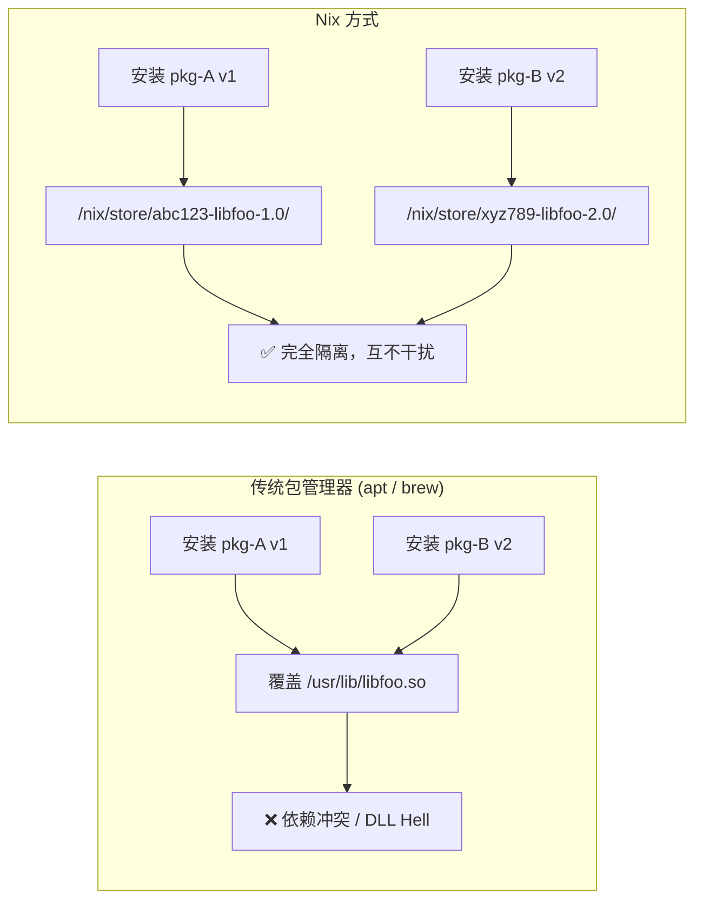
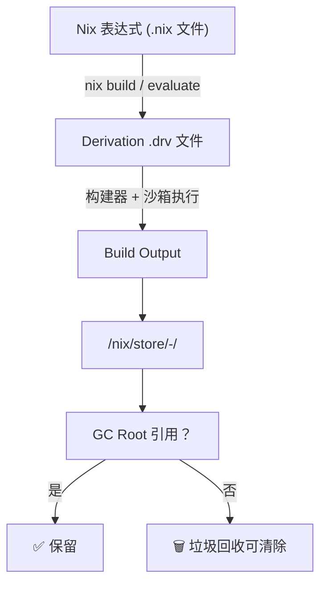
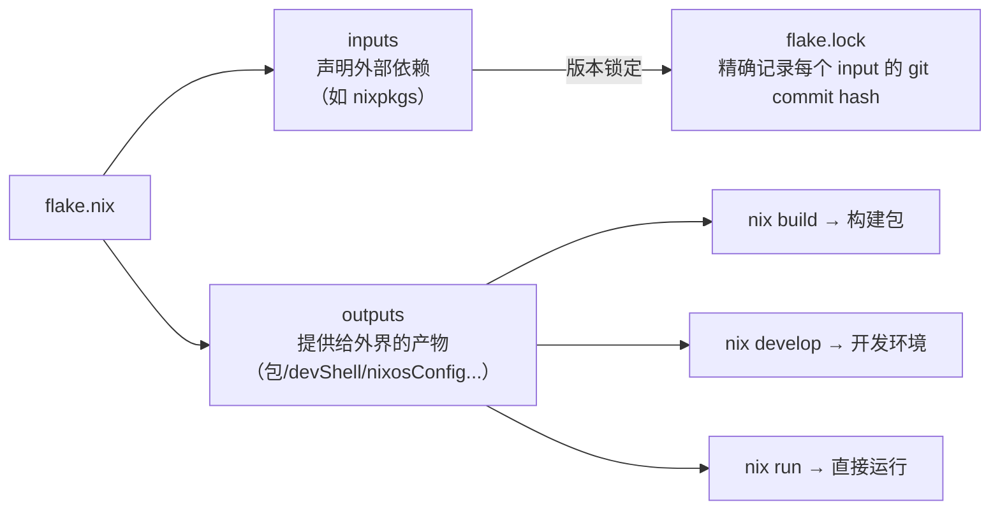
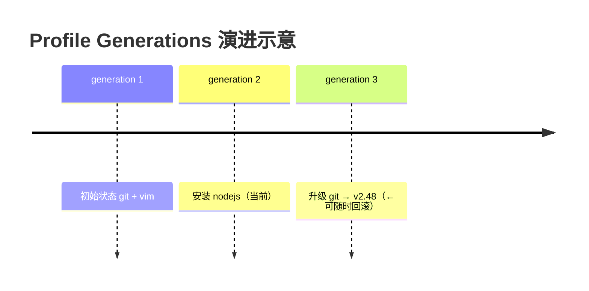
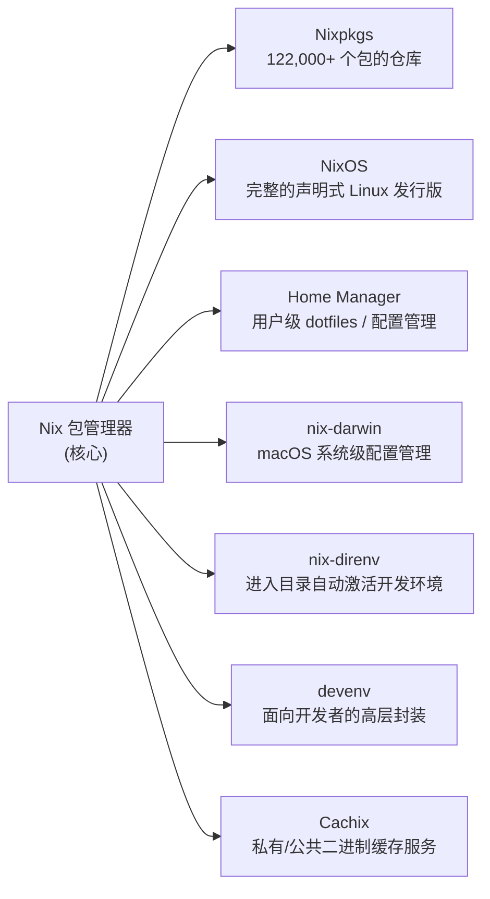
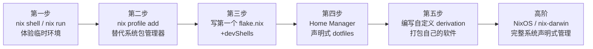

[toc]


# Nix 包管理器

## abstract

Nix 是一款采用独特方法进行**软件包管理和系统配置**的工具。

学习如何构建可复现、声明式且可靠的系统。

### 介绍:

- [Nix & NixOS | Declarative builds and deployments](https://nixos.org/)
- [学习 Nix | Nix 和 NixOS | Nix 和 NixOS --- Learn Nix | Nix & NixOS | Nix & NixOS](https://nixos.org/learn/)

---

### 什么是 Nix？

Nix 是一款跨平台的 Unix-like (`*nix`)系统包管理器，同时也是一门用于配置这些系统的函数式语言，由 Eelco Dolstra 于 2003 年发明。

Nix 从根本上重新设计了软件的构建、部署和管理方式。与 apt、yum 或 Homebrew 等传统包管理器不同，Nix 将包视为不可变的、纯函数式的单元，并使用密码学验证依赖项。

> 这种方式实现了真正的可复现性：如果一个包在某台机器上能构建，那它在任何其他机器上都会以完全相同的方式构建。

传统包管理器的核心痛点如下图所示：



---

> Nix 确实会比传统包管理器**在长期使用后占用更多空间**，这是其原子性回滚和不可变设计的直接代价——[3](https://www.aeanet.org/what-is-nix-os/)
>
> Nix 由于存储了多个包版本而占用比传统发行版更多的磁盘空间，但垃圾回收机制有助于缓解这一问题。
>
> 只要养成定期 GC + 开启自动去重的习惯，实际体验完全可控，**这个代价相对于它带来的可复现性和回滚能力而言是值得的**。

### 手册

[Introduction - Nix Reference Manual](https://nix.dev/manual/nix/2.28/)

> nix命令可以通过本地执行配合`--help`获取本地帮助

常用命令:(如果将nix当做传统的包管理器使用,来获取广泛的软件包,则建议了解如下命令)

- [Command Reference - Nix Reference Manual](https://nix.dev/manual/nix/2.28/command-ref/)

- [nix-channel - Nix 2.28.7 Reference Manual](https://nix.dev/manual/nix/2.28/command-ref/nix-channel.html)
- [nix profile - Nix 2.28.7 Reference Manual](https://nix.dev/manual/nix/2.28/command-ref/new-cli/nix3-profile.html)
- [nix registry - Nix 2.28.7 Reference Manual](https://nix.dev/manual/nix/2.28/command-ref/new-cli/nix3-registry.html)


## 核心设计哲学

Nix 建立在三大根本原则之上：

| 原则                             | 含义                                         | 对比传统方式                              |
| -------------------------------- | -------------------------------------------- | ----------------------------------------- |
| **纯函数式 (Purely Functional)** | 包是函数的输出，相同的输入永远产生相同的输出 | 传统方式是命令式的，结果依赖全局状态      |
| **声明式 (Declarative)**         | 描述你想要的状态，而非执行步骤               | 传统方式是 `apt install X` 这样的命令序列 |
| **可复现 (Reproducible)**        | 同一份配置在任何机器、任何时间都产生相同结果 | 传统方式因版本漂移而难以保证              |

Nix 的核心是声明式配置和可复现性两大基本原则。与命令式包管理器（用一系列命令来达到期望状态）不同，Nix 采用声明式模型：你在用 Nix 表达式语言编写的配置文件中定义系统的期望状态，这些文件精确描述应该安装哪些包、它们的具体版本以及依赖关系，乃至构建方式。

---

## Nix Store — 一切的基础

### 工作原理

Nix 包管理器采用的模型是：每个软件包都被安装到一个内容不可变的唯一目录中。这些目录名对应于密码学哈希值，该哈希值考虑了包的所有依赖项（包括其他由 Nix 管理的包）。因此，Nix 的包名具有内容标识性——名称相同的包必然拥有相同的输入和相同的构建平台，因此产生相同的构建结果。

一个典型的 Nix Store 路径形如：

```
/nix/store/lxrn8v5aamkikg6agxwdqd1jz7746wz4-firefox-98.0.2/
           └──────────────────────────────┘ └─────────────┘
                  依赖图的密码学哈希              包名 + 版本
```

### 哈希计算机制

Nix store 路径通常是 **输入寻址（input-addressed）** 的，这意味着 store 路径中的哈希值是从 derivation（即构建时依赖图）的内容中计算出来的。输入寻址的路径在被导入到另一个 store 时需要受信任的密钥签名。

相比之下，**内容寻址（content-addressed）** 的路径，其哈希值是从路径本身内容计算出来的，这使得无需额外信息（如签名）即可验证路径的内容。



### Derivation — 构建的基本单元

Nix 语言中声明的文件依赖关系会被自动追踪并持久化到"Nix store"中。Nix store 中的新文件通过"derivation"创建。Derivation 是一种持久化数据结构，它指定了一个可执行程序、调用时的参数和环境变量以及需要从 Nix store 读取的其他文件。该可执行程序随后在一个沙箱中运行，该沙箱禁止访问任何未明确指定的输入文件，并且只允许写入到指定的输出路径。

> 💡 **理解 Derivation**：可以把 Derivation 类比为一份"精确的施工图纸"——它规定了所有原材料（依赖）、施工工艺（构建命令）和最终验收标准（输出哈希），完全隔绝外部环境干扰。

---

## Nix 语言基础

包的构建配方（recipe）使用专门构建的"Nix 语言"编写，这是一门声明式、纯函数式、惰性求值、动态类型的编程语言。Nix 语言的显著特性包括：带有"context"的字符串、字符串插值、一等公民的文件系统路径以及"缩进字符串"，这些特性组合起来可以简洁地表达依赖关系。

### 语言核心语法速览

| 概念          | 语法示例                              | 说明                                    |
| ------------- | ------------------------------------- | --------------------------------------- |
| 字符串        | `"hello world"`                       | 普通字符串                              |
| 多行字符串    | `'' multi line ''`                    | 缩进字符串，自动去除公共缩进            |
| 整数          | `42`                                  | 整数字面量                              |
| 布尔          | `true` / `false`                      | 布尔值                                  |
| Attribute Set | `{ name = "nix"; version = "2.x"; }`  | 类似 JSON 对象，是 Nix 最核心的数据结构 |
| 列表          | `[ "a" "b" "c" ]`                     | 元素间用空格分隔（注意，不是逗号）      |
| Let 绑定      | `let x = 1; in x + 1`                 | 局部变量绑定                            |
| 函数          | `x: x * 2`                            | 单参数 lambda                           |
| 函数调用      | `f x` 或 `f { arg = val; }`           | 空格调用，或传入 attribute set          |
| 字符串插值    | `"Hello, ${name}!"`                   | 插入表达式                              |
| With 表达式   | `with pkgs; [ git vim ]`              | 将 attr set 的属性导入作用域            |
| Import        | `import ./other.nix`                  | 导入另一个 Nix 文件                     |
| 路径          | `./relative/path` 或 `/absolute/path` | 一等公民，不需要引号                    |

一个典型的 Nix 包定义（derivation）示例：

```nix
# hello.nix — 一个最简单的包定义
{ pkgs ? import <nixpkgs> {} }:

pkgs.stdenv.mkDerivation {
  pname = "my-hello";
  version = "1.0.0";

  src = ./src;  # 源代码路径

  buildInputs = [ pkgs.gcc ];

  buildPhase = ''
    gcc -o hello hello.c
  '';

  installPhase = ''
    mkdir -p $out/bin
    cp hello $out/bin/
  '';
}
```

> ⚠️ **新手注意**：Nix 语言是惰性求值的，函数参数用空格分隔而非括号，`{ }` 是 attribute set 而非代码块——这是初学者最容易混淆的地方。

---

## Nixpkgs — 世界上最大的包集合

Nixpkgs 是构建在 Nix 包管理器之上的包仓库。截至 2025 年 1 月，它包含超过 122,000 个包，是所有包仓库中拥有最多最新包的仓库。

> Nixpkgs 支持的操作系统主要是 Linux 和 Darwin，同时对 Windows 和 BSD 变体也有一定支持。

这些架构的包会由名为 Hydra 的持续集成服务定期构建，构建结果会被上传到公共二进制缓存。当 Nix 安装包时，它会检查这个缓存并下载二进制包，以避免在本地构建。

### Nixpkgs 的发布频道 (Channels)

| 频道                     | 描述                            | 适用场景               |
| ------------------------ | ------------------------------- | ---------------------- |
| `nixos-25.11` (当前稳定) | 每 6 个月发布一次，经过全面测试 | 生产环境、追求稳定     |
| `nixos-unstable`         | 追踪 nixpkgs master，更新最频繁 | 开发者、追求最新包     |
| `nixpkgs-unstable`       | 非 NixOS 系统上的 unstable      | macOS / 非 NixOS Linux |

### 搜索和获取可用包信息

💡 **最佳实践**：搜索包请访问 [search.nixos.org](https://search.nixos.org/)，搜索包最简单的方式是访问 https://search.nixos.org/ 并选择 unstable 频道以获取最新包版本。

---

## Nix Flakes — 现代化工作流的核心

### 为什么需要 Flakes？

传统 Nix 依赖于 channel，而 channel 可能会以不可预测的方式发生变化。 在 flakes 出现之前，Nix 配置的可复现性是理想而非保证——在两台不同机器上运行 `nix-build` 可能产生不同结果，这取决于每台机器各自锁定的 channel 版本。

Nix flakes 提供了一种标准方式来编写 Nix 表达式（以及包），其依赖项被版本锁定在一个锁文件中，从而提高了 Nix 安装的可复现性。

### Flake 的结构

一个 Nix flake 是一个在根目录包含 `flake.nix` 和 `flake.lock` 文件的目录，它输出 Nix 表达式，供他人用于构建包、运行程序、使用开发环境或搭建 NixOS 系统。

一个 flake 由两个关键部分组成：



flake 的基本结构如下：`inputs` 是你的依赖项，被锁定在 `flake.lock` 中；`outputs` 是你的 flake 向外界提供的内容。

```nix
# flake.nix — 一个完整的开发环境示例
{
  description = "我的项目开发环境";

  inputs = {
    # 锁定到一个具体的 nixpkgs 版本
    nixpkgs.url = "github:NixOS/nixpkgs/nixos-unstable";
    flake-utils.url = "github:numtide/flake-utils";
  };

  outputs = { self, nixpkgs, flake-utils }:
    flake-utils.lib.eachDefaultSystem (system:
      let
        pkgs = nixpkgs.legacyPackages.${system};
      in {
        # nix develop 进入的开发 shell
        devShells.default = pkgs.mkShell {
          packages = with pkgs; [
            nodejs_22
            go_1_22
            python3
            git
          ];
          # 自动设置环境变量
          shellHook = ''
            echo "🚀 开发环境已就绪"
            export MY_PROJECT_ROOT=$(pwd)
          '';
        };

        # nix build 构建的产物
        packages.default = pkgs.buildGoModule {
          pname = "my-app";
          version = "0.1.0";
          src = ./.;
          vendorHash = "sha256-...";
        };
      }
    );
}
```

### 启用 Flakes

在上游 Nix 项目中，flakes 仍被视为实验性功能，目前没有明确的稳定化时间表。因此，如果你使用上游 Nix，只有显式启用后才能使用 flakes。

将以下内容加入 `~/.config/nix/nix.conf` 或 `/etc/nix/nix.conf`：

```
experimental-features = nix-command flakes
```

> 💡 **推荐做法**：推荐使用 Determinate Nix Installer 安装 Nix。 Determinate Nix Installer 默认启用 flakes。

### flake.lock — 可复现性的保证

在 flakes 的世界里，每个 flake 必须显式声明其依赖，而这些依赖会被锁定到特定的版本修订（revision）。 这个版本信息被记录在一个名为 `flake.lock` 的锁文件中，该文件由 Nix 自动生成，并应当被提交到版本控制仓库。

---

## 配置优先级

按优先级从低到高

| 来源                 | 位置                                          | 说明                 |
| -------------------- | --------------------------------------------- | -------------------- |
| 系统级配置           | `/etc/nix/nix.conf`                           | 全局配置（所有用户） |
| 用户级配置           | `~/.config/nix/nix.conf` 或 `~/.nix/nix.conf` | 当前用户             |
| 环境变量             | `NIX_CONFIG`                                  | 临时覆盖             |
| NixOS 配置           | `configuration.nix`                           | declarative 管理     |
| flakes / nix command | CLI 参数                                      | 最高优先级           |

> `substituters` 是一个 **列表型选项（list option）**，默认是 **追加（append）而不是覆盖（override）**

Nix 本身不会直接告诉你“这个值来自哪个文件”，但你可以手动排查：

```bash
cat /etc/nix/nix.conf
cat ~/.config/nix/nix.conf
cat ~/.nix/nix.conf
```

还有：

```bash
echo $NIX_CONFIG
```

配置修改完后要重启`nix-daemon`服务.

### NIX_CONFIG

`$NIX_CONFIG` 是一个非常关键的环境变量。

简单来说，它的作用是：**允许你在不修改全局配置文件的情况下，直接通过命令行传递配置选项给 Nix。**

**开启实验性功能** 如果你想使用最新的 `nix flakes` 命令，但配置文件里没写，你可以这样运行：

```bash
export NIX_CONFIG="extra-experimental-features = flakes nix-command"
```


### nix.conf多配置融合和配置排查

我使用nix config show 发现substituters取值有多个?

```bash
substituters = https://mirrors.ustc.edu.cn/nix-channels/store https://mirror.sjtu.edu.cn/nix-channels/store https://mirrors.tuna.tsinghua.edu.cn/nix-channels/store https://cache.nixos.org

```

这可能配置在哪里?

`substituters` 有多个值，其实是 **Nix 的配置合并机制（configuration merging）** 在起作用。Nix 会从多个来源读取配置，然后“叠加”（merge）成最终结果，所以你会看到一个列表，而不是单一来源。

## 核心命令参考

### 现代 `nix` CLI（推荐）

Nix 2.0 之后引入了统一的新式命令行界面，是目前推荐的使用方式：

| 命令                            | 作用                            | 示例                                  |
| ------------------------------- | ------------------------------- | ------------------------------------- |
| `nix search nixpkgs <keyword>`  | 搜索包                          | `nix search nixpkgs ripgrep`          |
| `nix profile add nixpkgs#<pkg>` | 永久安装包到个人 profile        | `nix profile add nixpkgs#git`         |
| `nix profile remove <pkg>`      | 卸载包                          | `nix profile remove git`              |
| `nix profile upgrade '.*'`      | 升级所有包                      | —                                     |
| `nix shell nixpkgs#<pkg>`       | 临时进入含某包的 shell          | `nix shell nixpkgs#nodejs_22`         |
| `nix run nixpkgs#<pkg>`         | 不安装，直接运行                | `nix run nixpkgs#cowsay -- hello`     |
| `nix develop`                   | 进入 flake 定义的开发环境       | 在含 flake.nix 的目录执行             |
| `nix build`                     | 构建 flake 默认输出             | 在含 flake.nix 的目录执行             |
| `nix flake update`              | 更新所有 flake 输入并刷新锁文件 | —                                     |
| `nix flake show`                | 查看 flake 提供了哪些输出       | `nix flake show github:NixOS/nixpkgs` |
| `nix store gc`                  | 垃圾回收，清除未被引用的包      | —                                     |

### `nix run` — 一次性执行，零污染

需要一个一次性工具但不想污染系统？直接 `nix run` 就好。 不会有任何东西被安装到你的 profile，它被下载、缓存、运行，仅此而已。

```bash
# 不安装 jq，直接用它格式化 JSON
nix run nixpkgs#jq -- '.' data.json

# 同时使用 Node 20 和 Python 3，退出 shell 后恢复原样
nix shell nixpkgs#nodejs_20 nixpkgs#python3
```

### `nix develop` — 隔离的开发环境

执行 `nix develop` 即可进入开发 shell。每位队友都能获得完全相同版本的 Node、PostgreSQL 等工具，无论他们的系统上安装了什么。

---

## Generations — 原子升级与无风险回滚

Nix 追踪你的 profile 的不同"世代（generation）"。每次使用 `nix-env` 安装、升级或删除包时，都会创建一个新的 profile 世代。这使你可以在出现问题时轻松回滚到之前的状态。



```bash
# 查看所有世代
nix profile history

# 回滚到上一个世代
nix profile rollback

# 回滚到指定世代
nix profile rollback --to 2
```

如果你想撤销影响 profile 的操作，可以撤销最新的变更，或回滚到已知的良好版本。Nix 包是不可变的，因此升级或卸载操作都不具破坏性。

---

## 垃圾回收 (Garbage Collection)

由于 Nix Store 只增不减，需要定期清理不再引用的包：

Nix 通过扫描用于包目录名的特征哈希值来保留输出文件中的依赖信息。自动引用追踪确保了包的完整性，即使跨机器传输也是如此。这同时使得当没有其他包依赖某个包时，可以对其进行垃圾回收。

```bash
# 删除所有历史世代，只保留当前世代（释放空间前的必要步骤）
nix profile wipe-history

# 执行垃圾回收
nix store gc

# 查看可以回收多少空间（dry run）
nix store gc --dry-run
```

> ⚠️ **注意**：在执行 `nix store gc` 之前，应先删除不需要的 generation，否则旧版本的包仍会被 GC Roots 引用而无法清除。

---

## 生态系统工具链

现代 Nix 使用通常不止于包管理本身，以下是关键的生态配套工具：



### Home Manager — 声明式管理用户环境

Home Manager 是一个由 Nix 驱动的工具，用于可复现地管理用户 home 目录的内容，包括程序、配置文件、环境变量等。

Home Manager 是管理单用户声明式环境的首选方式。

```nix
# home.nix — Home Manager 配置示例
{ config, pkgs, ... }: {
  home.username = "alice";
  home.homeDirectory = "/home/alice";
  home.stateVersion = "25.11";

  # 声明式安装用户软件
  home.packages = with pkgs; [ ripgrep fd bat eza ];

  # 声明式管理 git 配置（自动生成 ~/.config/git/config）
  programs.git = {
    enable = true;
    userName = "Alice";
    userEmail = "alice@example.com";
    extraConfig.init.defaultBranch = "main";
  };

  # 声明式管理 zsh 配置
  programs.zsh = {
    enable = true;
    enableAutosuggestions = true;
    syntaxHighlighting.enable = true;
  };
}
```

### nix-darwin — macOS 的声明式系统配置

对于 macOS 上的系统配置，nix-darwin 是首选解决方案。

### nix-direnv — 进目录自动激活环境

nix-direnv 是 direnv 内置 `use_nix`/`use_flake` 的一个更快、持久化的实现。 每当进入配置了 `use flake` 的目录，shell 就会魔法般地拥有该项目所需的工具。

用法极为简单，在项目目录中创建 `.envrc`：

```bash
# .envrc
use flake
```

然后运行 `direnv allow`，之后每次 `cd` 进入该目录，开发环境都会自动激活。每次输入 `nix develop` 会很烦。将 flakes 与 nix-direnv 配合使用，shell 会自动加载。

---

## 安装 Nix

### 官方方案


### Determinate Nix Installer

推荐使用 **Determinate Nix Installer**，它比官方安装器更健壮：

```bash
curl --proto '=https' --tlsv1.2 -sSf \
  https://install.determinate.systems/nix | sh -s -- install
```

强烈推荐 Determinate Nix Installer，还可以使用图形安装界面。

官方安装器也可以用，但它无法在操作系统升级后幸存，也不会生成安装回执，导致需要卸载时更加困难。

### 国内可用的镜像源

目前国内高校维护了主要的 Nix 镜像，均提供 **binary cache（二进制缓存）** 和 **channel** 两类镜像：

| 镜像站            | Binary Cache 地址                                         | 稳定性     | 备注               |
| ----------------- | --------------------------------------------------------- | ---------- | ------------------ |
| **清华 TUNA**     | `https://mirrors.tuna.tsinghua.edu.cn/nix-channels/store` | ⭐⭐⭐ 最稳定 | 历史最久，覆盖最广 |
| **中科大 USTC**   | `https://mirrors.ustc.edu.cn/nix-channels/store`          | ⭐⭐⭐ 稳定   | 速度良好           |
| **上海交大 SJTU** | `https://mirror.sjtu.edu.cn/nix-channels/store`           | ⭐⭐ 较稳定  | 适合华东地区       |

> 还有北外(bfsu),南大(nju)也提供镜像;

> ⚠️ **镜像的局限性**：[12](https://seekstar.github.io/2023/02/04/使用国内源安装和使用nix包管理器/)镜像通常不会缓存旧版本，所以如果发现 cache 总是不命中，可以试试更新 channel 来安装最新版。当缓存未命中时，Nix 仍会回退到官方源下载。

> [添加二进制缓存服务器 | NixOS & Flakes Book](https://nixos-and-flakes.thiscute.world/zh/nix-store/add-binary-cache-servers) 此参考介绍了国内加速下载的各种方法,包括配置代理的有效方法;

Nix 通过 `substituters` 配置缓存服务器地址，按数组顺序依次查找。国内镜像站的内容直接从官方缓存服务器同步，因此它们的公钥与官方完全一致，无需额外配置公钥。

---

## 最佳实践总结

| 场景                        | 推荐做法                                                     |
| --------------------------- | ------------------------------------------------------------ |
| **新项目开发环境**          | 在项目根目录创建 `flake.nix` + `devShells`，用 `nix-direnv` 自动激活 |
| **管理个人工具和 dotfiles** | 使用 Home Manager，配置纳入 Git 仓库                         |
| **macOS 系统管理**          | 使用 nix-darwin + Home Manager 组合                          |
| **一次性使用某个工具**      | `nix run nixpkgs#<tool>` 或 `nix shell nixpkgs#<tool>`       |
| **锁定依赖版本**            | 始终将 `flake.lock` 提交到 Git                               |
| **定期清理磁盘空间**        | 定期运行 `nix profile wipe-history && nix store gc`          |
| **搜索包**                  | 先到 [search.nixos.org](https://search.nixos.org) 搜索       |
| **团队共享环境**            | flake 的 `devShells` + `nix-direnv`，同一 `flake.lock` 保证一致性 |
| **保密信息处理**            | 不要将未加密的机密放入 flake 文件中，因为 flake 文件内容会被复制到世界可读的 Nix store 目录。 改用 `sops-nix` 或 `agenix` 等密钥管理方案 |
| **git 仓库中的 flake**      | 对于 git 仓库中的 flake，只有工作树中的文件才会被复制到 store，因此创建新文件后要确保执行 `git add`。 |

---

## 学习路径建议




