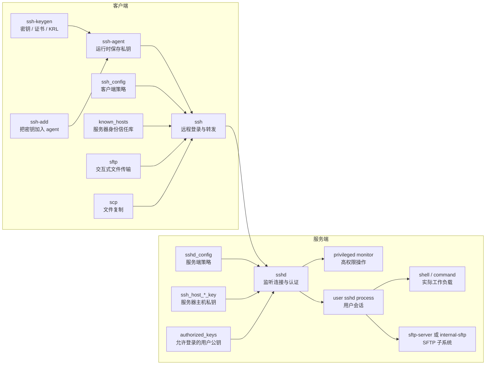
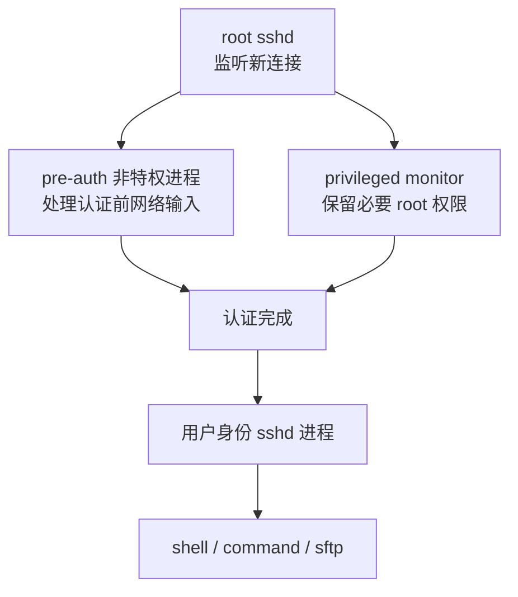
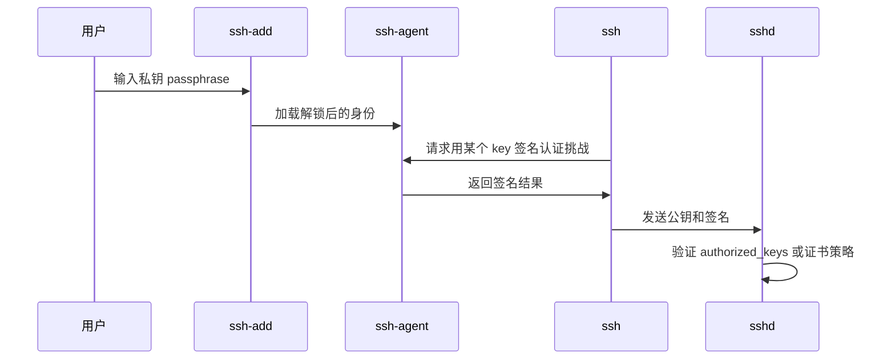
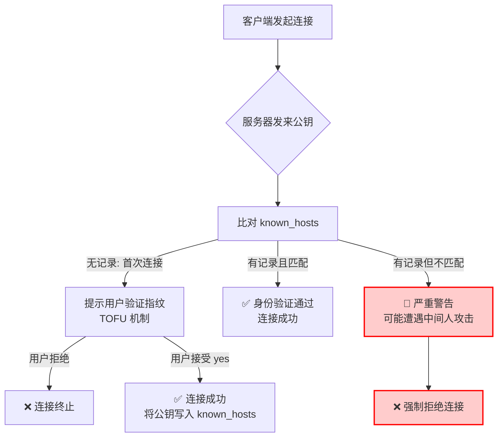
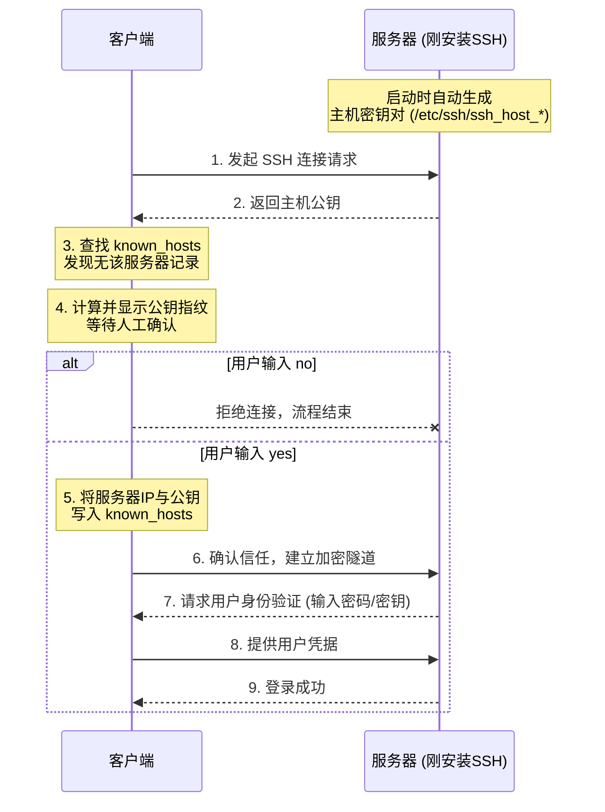
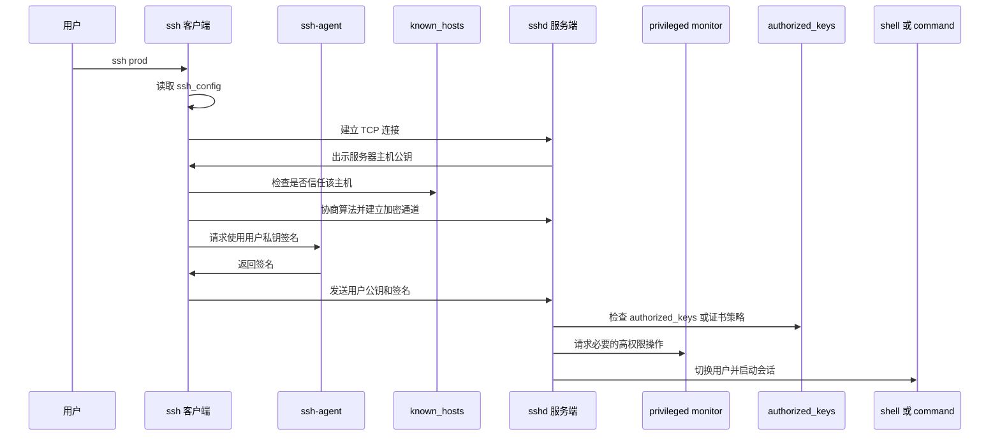
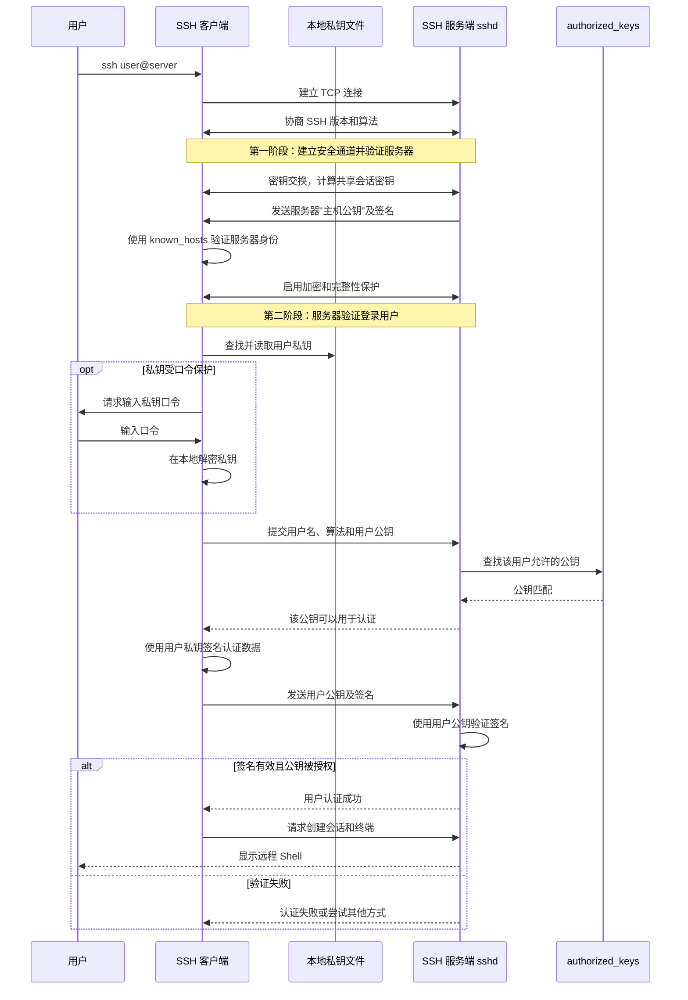
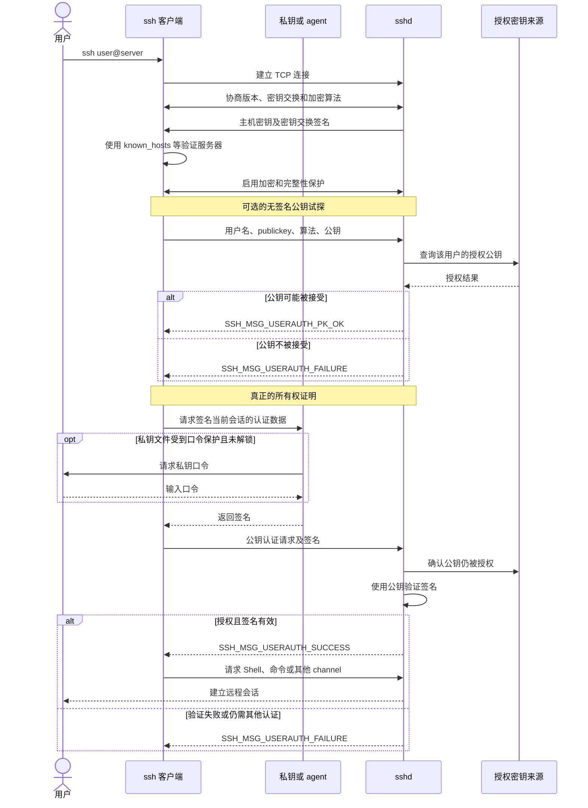
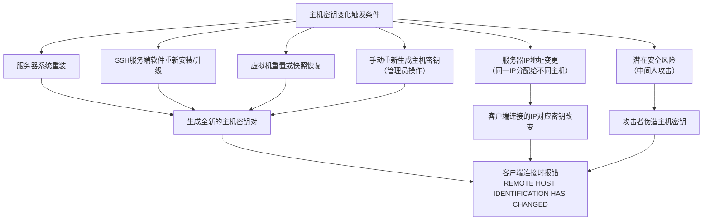
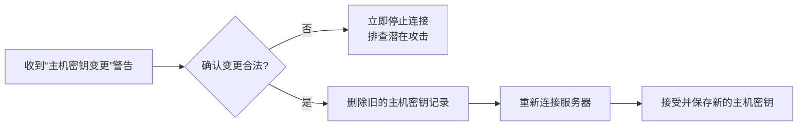

[toc]

## OpenSSH的各个功能模块

OpenSSH **不是一个单体程序**，而是一组**围绕 SSH 协议**协作的**程序、配置文件、密钥文件和辅助进程**。

包含客户端 `ssh`、服务端 `sshd`、文件传输工具 `scp` / `sftp`、密钥工具 `ssh-keygen`、运行时密钥存储 `ssh-agent` 以及若干辅助程序。([GitHub](https://github.com/openssh/openssh-portable/blob/master/README.md))

可以从三层理解它为什么要拆分：

| 拆分层次      | 拆分对象                                                   | 核心目的                                         |
| ------------- | ---------------------------------------------------------- | ------------------------------------------------ |
| 协议层拆分    | transport、user authentication、connection                 | 让加密传输、用户认证、会话/转发复用各自独立演进  |
| 程序角色拆分  | `ssh`、`sshd`、`sftp`、`scp`、`ssh-keygen`、`ssh-agent` 等 | 每个工具只负责一类任务，降低复杂度               |
| 权限/进程拆分 | 监听进程、特权 monitor、非特权会话进程、用户 shell         | 缩小高权限代码范围，降低漏洞变成 root 权限的概率 |

官方手册也明确说明 SSH2 协议本身由三层组成：transport layer 负责算法协商、密钥交换、服务器认证和加密连接；user authentication layer 在已建立的安全连接上完成用户认证；connection layer 在认证连接上复用多个 channel，用于登录会话、TCP 转发等。([OpenSSH](https://www.openssh.com/manual.html))

1. 客户端工具

- **`ssh`**：核心客户端程序。用于远程登录到主机，或在远程主机上执行命令。
- **`scp`**：基于 SSH 协议的文件复制程序，用于在本地与远程主机之间安全地复制文件。
- **`sftp`**：安全文件传输协议客户端。提供交互式的文件传输会话，类似于传统的 FTP，但完全加密。
- **`ssh-keyscan`**：用于收集多台主机的 SSH 公钥，通常用于自动化脚本中，避免首次连接时的交互式确认。
- **`ssh-keygen`**：密钥生成与管理工具。用于生成 RSA、DSA、ECDSA 或 Ed25519 等类型的公钥/私钥对，并进行密钥管理。
- **`ssh-agent`**：认证代理。在后台运行，将解密的私钥保存在内存中，避免用户在每次使用 SSH 时重复输入密码短语。
- **`ssh-add`**：向 `ssh-agent` 添加私钥的工具，也可以用于列出或删除 agent 中的密钥。

2. 服务端工具

- **`sshd`**：SSH 守护进程（服务端）。监听客户端的连接请求，进行身份验证并提供建立安全会话的服务。
- **`sftp-server`**：SFTP 服务端子系统。通常由 `sshd` 调用，为 `sftp` 客户端提供文件传输服务。

3. 辅助与支持工具

- **`ssh-copy-id`**：便捷脚本。用于将本地用户的公钥自动追加到远程主机的 `~/.ssh/authorized_keys` 文件中，实现免密登录。
- **`known_hosts` / `authorized_keys`**：虽非可执行程序，但是 OpenSSH 体系中的核心文件。前者用于验证服务端身份（防中间人攻击），后者用于验证客户端身份（公钥认证）。

无论是远程登录 (`ssh`)、文件传输 (`scp`, `sftp`) 还是密钥管理 (`ssh-agent`)，底层都依赖并遵循标准的 SSH 协议（主要是 SSH-2），保证了互通性。

OpenSSH 不仅仅是一个远程登录工具，而是一个**以 SSH 协议为核心、覆盖认证、控制、传输等多个维度的完整安全通信生态**。

- **从功能上看**：它通过 `ssh` 解决安全远程控制问题，通过 `scp/sftp` 解决安全文件传输问题，通过 `ssh-keygen/ssh-agent` 解决身份认证与密钥管理问题。
- **从架构上看**：它采用了 C/S（客户端/服务端）架构，工具之间相互协作（例如 `ssh` 客户端自动调用 `ssh-agent` 获取密钥，`sshd` 调用 `sftp-server` 提供服务）。
- **从价值上看**：它彻底取代了早期不安全的明文协议（如 Telnet, rlogin, FTP, rcp），是现代系统管理员、开发者和自动化运维不可或缺的基石。

## 为什么要这样设计

### 降低复杂度

如果把远程登录、密钥生成、私钥缓存、文件传输、跳板转发、主机密钥扫描、服务端认证、SFTP 子系统全部塞进一个程序，配置、权限和故障边界都会非常混乱。

拆成多个工具后，新手可以这样理解：

| 你想做什么             | 用哪个部分                       |
| ---------------------- | -------------------------------- |
| 登录远程机器           | `ssh`                            |
| 让别人登录这台机器     | `sshd`                           |
| 生成密钥               | `ssh-keygen`                     |
| 临时缓存解锁后的私钥   | `ssh-agent` + `ssh-add`          |
| 复制文件               | `scp`                            |
| 交互式传文件           | `sftp`                           |
| 给 SFTP 客户端提供服务 | `sftp-server` 或 `internal-sftp` |
| 批量收集服务器主机公钥 | `ssh-keyscan`                    |
| 使用基于主机身份的认证 | `ssh-keysign`                    |

这符合非常典型的 Unix 工具设计思想：小程序做清楚的一件事，组合起来完成复杂任务。

### 分离不同信任边界

SSH 涉及多种身份和信任关系：

| 对象           | 代表什么身份           | 存在哪里                         | 谁使用             |
| -------------- | ---------------------- | -------------------------------- | ------------------ |
| 用户私钥       | “我是这个用户”         | 客户端 `~/.ssh/id_*`             | `ssh`、`ssh-agent` |
| 用户公钥       | “允许这个用户登录”     | 服务端 `~/.ssh/authorized_keys`  | `sshd`             |
| 服务器主机私钥 | “我是这台服务器”       | 服务端 `/etc/ssh/ssh_host_*_key` | `sshd`             |
| 已知主机公钥   | “我信任这些服务器身份” | 客户端 `known_hosts`             | `ssh`              |
| CA 公钥        | “我信任这个证书签发者” | 客户端或服务端配置               | `ssh`、`sshd`      |

这些东西的保密级别不同、读写位置不同、生命周期也不同。拆分后，客户端不需要知道服务端的主机私钥，服务端不需要保存用户私钥，`ssh-agent` 可以专门负责保护私钥使用，`ssh-keygen` 可以专门负责密钥和证书管理。

### 缩小高权限攻击面

`sshd` 需要监听网络、认证用户、读取系统级主机密钥、切换用户身份、启动 shell 或子系统。这些操作中，有些必须有 root 权限，有些不应该长期带着 root 权限执行。

OpenSSH 的 privilege separation 机制就是为了解决这个问题：需要 root 权限的操作由单独的 privileged monitor process 执行，目标是把损坏限制在非特权进程内，防止漏洞直接升级为高权限控制。([GitHub](https://github.com/openssh/openssh-portable/blob/master/README.privsep))

官方说明中还提到，pre-authentication 阶段 `sshd` 会 chroot 到 `/var/empty` 并切换到非特权 `sshd` 用户；一个典型登录会话会包含监听进程、特权 monitor、用户拥有的 `sshd` 进程以及最终 shell 进程。([GitHub](https://github.com/openssh/openssh-portable/blob/master/README.privsep))

### 支持独立演进和兼容

文件复制、交互式文件管理、登录 shell、端口转发、证书、FIDO 硬件密钥、agent 转发、主机密钥扫描，这些功能变化速度不同。拆分后，某个功能可以独立增强，而不必让所有用户都暴露在同一复杂入口里。

一个很典型的例子是 `scp`：现代 OpenSSH 的 `scp` 默认已经使用 SFTP protocol over SSH 连接传输数据，只有在兼容旧服务器时才用 `-O` 强制 legacy SCP protocol。([OpenBSD 手册](https://man.openbsd.org/scp))

## 整体结构图



## 核心组件作用

### `ssh`：客户端主程序

`ssh` 是 OpenSSH 的远程登录客户端，用于登录远程机器、执行远程命令，并在不可信网络上提供安全加密通信；它还可以在同一安全通道上转发 X11、任意 TCP 端口和 Unix-domain socket。([OpenBSD 手册](https://man.openbsd.org/ssh))

它主要负责：

| 职责           | 说明                                             |
| -------------- | ------------------------------------------------ |
| 建立连接       | 连接目标主机和端口                               |
| 校验服务器身份 | 检查服务器主机密钥是否可信                       |
| 选择算法       | 协商 KEX、cipher、MAC、签名算法                  |
| 用户认证       | 密码、公钥、证书、GSSAPI、键盘交互等             |
| 启动会话       | 登录 shell 或执行远程命令                        |
| 端口转发       | `-L`、`-R`、`-D`、`-W`、`ProxyJump`              |
| 连接复用       | `ControlMaster`、`ControlPath`、`ControlPersist` |
| 读取客户端配置 | `~/.ssh/config`、`/etc/ssh/ssh_config`           |

新手可以把 `ssh` 理解成“发起连接的一端”。你日常输入的：

```bash
ssh user@example.com
```

背后做了这些事：读取配置、找私钥、连接服务器、验证服务器主机密钥、协商加密算法、向服务器证明用户身份、打开远程 shell。

### `sshd`：服务端守护进程

`sshd` 是服务端 daemon。它监听客户端连接，为两个不可信主机之间提供安全加密通信；通常系统启动时启动，收到新连接后 fork 出新的 daemon 处理该连接，处理内容包括密钥交换、加密、认证、命令执行和数据交换。([OpenBSD 手册](https://man.openbsd.org/sshd))

它主要负责：

| 职责           | 说明                                                  |
| -------------- | ----------------------------------------------------- |
| 监听端口       | 默认通常监听 TCP 22                                   |
| 证明服务器身份 | 使用 `/etc/ssh/ssh_host_*_key` 进行主机认证           |
| 认证用户       | 检查密码、公钥、证书、PAM、MFA 等                     |
| 应用访问策略   | 读取 `sshd_config`、`AllowUsers`、`Match`、转发限制等 |
| 创建用户会话   | 切换到目标用户身份，启动 shell、命令或子系统          |
| 提供转发能力   | 本地/远程/动态端口转发、Unix socket 转发              |
| 提供子系统入口 | 例如启动 `sftp-server` 或 `internal-sftp`             |

`ssh` 和 `sshd` 的关系可以类比为浏览器和 Web 服务器：`ssh` 主动连接，`sshd` 被动监听；`ssh` 使用用户私钥证明“我是我”，`sshd` 使用主机私钥证明“我是这台服务器”。

### privilege separation：`sshd` 内部的权限隔离

这不是一个普通用户直接调用的命令，而是 `sshd` 的重要安全架构。它把需要 root 权限的操作和处理网络输入的大量逻辑隔离开。

典型模型可以这样看：



这样做的意义是：认证前的网络输入最不可信，如果这部分代码出现漏洞，攻击者也更难直接拿到 root 权限。OpenSSH 官方 README.privsep 明确说明，其目标是通过把需要 root 权限的操作放进单独的 privileged monitor process，防止 privilege escalation。([GitHub](https://github.com/openssh/openssh-portable/blob/master/README.privsep))

### `ssh_config`：客户端策略

`ssh_config` 不是程序，而是客户端策略文件。它决定 `ssh`、`scp`、`sftp` 连接某个目标时应该使用什么用户名、端口、私钥、跳板机、算法、转发策略等。

它解决的问题是：**不要把所有参数都写在命令行里**。

例如：

```sshconfig
Host prod
    HostName 203.0.113.10
    User deploy
    IdentityFile ~/.ssh/id_ed25519_prod
    ProxyJump bastion
```

之后只需要：

```bash
ssh prod
```

### `sshd_config`：服务端策略

`sshd_config` 是服务端策略文件。`sshd` 可以通过命令行选项或配置文件配置，默认配置文件是 `sshd_config`；命令行选项会覆盖配置文件中的值，`sshd` 收到 `SIGHUP` 后会重新执行自身并重读配置。([OpenBSD 手册](https://man.openbsd.org/sshd))

它解决的问题是：**谁能登录、怎么登录、登录后能做什么**。

常见策略包括：

| 策略                     | 配置项示例                                   |
| ------------------------ | -------------------------------------------- |
| 是否允许 root 登录       | `PermitRootLogin no`                         |
| 是否允许密码登录         | `PasswordAuthentication no`                  |
| 是否允许公钥认证         | `PubkeyAuthentication yes`                   |
| 哪些用户或组可登录       | `AllowUsers`、`AllowGroups`                  |
| 是否允许转发             | `AllowTcpForwarding`、`AllowAgentForwarding` |
| 是否强制 SFTP            | `ForceCommand internal-sftp`                 |
| 是否按用户或来源区别策略 | `Match User`、`Match Address`                |

### `ssh-keygen`：密钥、证书和吊销工具

`ssh-keygen` 用于生成、管理和转换 SSH 认证密钥；如果不带参数运行，当前官方手册说明它默认生成 Ed25519 key。它还可用于生成 DH-GEX 相关 groups、生成和更新 Key Revocation Lists，并可测试密钥是否被吊销。([OpenBSD 手册](https://man.openbsd.org/ssh-keygen))

它的职责不只是“生成一对 key”：

| 功能               | 示例用途                               |
| ------------------ | -------------------------------------- |
| 生成用户密钥       | `ssh-keygen -t ed25519`                |
| 生成服务器主机密钥 | 系统初始化时生成 `/etc/ssh/ssh_host_*` |
| 查看指纹           | `ssh-keygen -lf key.pub`               |
| 从私钥导出公钥     | `ssh-keygen -y -f id_ed25519`          |
| 管理 `known_hosts` | 查找、删除、哈希主机记录               |
| 签发 OpenSSH 证书  | 用户证书、主机证书                     |
| 生成 KRL           | 吊销泄露或过期的 key / certificate     |
| 使用 FIDO 硬件密钥 | `ed25519-sk`、`ecdsa-sk`               |

OpenSSH 证书体系也依赖 `ssh-keygen`：它可以用 CA key 签发用户或主机证书，使客户端或服务端只需信任 CA key，而不是逐个信任大量用户 key 或主机 key。([OpenBSD 手册](https://man.openbsd.org/ssh-keygen))

### 密钥管理

#### `ssh-agent`：运行时私钥代理

`ssh-agent` 是保存私钥的认证代理。官方手册说明，它通过环境变量被定位，并在用户登录其他机器时被自动用于认证。([OpenBSD 手册](https://man.openbsd.org/ssh-agent))

它解决的问题是：**私钥有 passphrase，不能每次连接都输入；但也不希望私钥长期明文暴露给每个程序。**

工作方式大致如下：



重点是：`ssh-agent` 通常不把私钥直接交给 `ssh`，而是帮它完成签名操作。这样可以减少私钥在各个进程之间复制和暴露的机会。

#### `ssh-add`：管理 agent 里的身份

`ssh-add` 负责把**私钥身份**加入 `ssh-agent`。

> 官方手册说明，不带参数时它会尝试加入**默认身份文件**，例如 `~/.ssh/id_rsa`、`id_ecdsa`、`id_ecdsa_sk`、`id_ed25519`、`id_ed25519_sk`；
>
> 如果私钥需要 passphrase，`ssh-add` 会向用户询问。([OpenBSD 手册](https://man.openbsd.org/ssh-add))

常见用途：

| 命令                        | 作用                     |
| --------------------------- | ------------------------ |
| `ssh-add ~/.ssh/id_ed25519` | 加载指定私钥             |
| `ssh-add -l`                | 列出 agent 中 key 的指纹 |
| `ssh-add -L`                | 列出 agent 中 key 的公钥 |
| `ssh-add -D`                | 清空 agent               |
| `ssh-add -t 1h key`         | 加入 key，并设置生命周期 |
| `ssh-add -c key`            | 每次使用 key 前需要确认  |

现代 OpenSSH 的 `ssh-add` 还支持 destination-constrained keys，也就是把 key 限制为只能用于特定目标或特定跳转路径；官方手册说明该能力加入于 OpenSSH 8.9，并且在 agent 转发场景中要求远端 SSH client 和 server 都支持。([OpenBSD 手册](https://man.openbsd.org/ssh-add))

### `sftp`：交互式安全文件传输客户端

`sftp` 是类似 FTP 的文件传输程序，但所有操作都运行在加密的 `ssh` transport 之上，并且可以使用 `ssh` 的公钥认证、压缩等能力。([OpenBSD 手册](https://man.openbsd.org/sftp))

它适合：

| 场景              | 为什么用 `sftp`                    |
| ----------------- | ---------------------------------- |
| 交互式上传下载    | 有 `put`、`get`、`ls`、`cd` 等命令 |
| 批处理传输        | 支持 `-b batchfile`                |
| 需要走跳板机      | 支持 `-J`，直接传给 `ssh`          |
| 需要复用 SSH 配置 | 支持 `-F`、`-o` 等选项             |

`sftp` 本身不是重新实现一套认证系统，而是复用 `ssh` 的认证、加密和配置。这就是拆分的好处：文件传输工具可以专注文件操作，安全通道由 `ssh` 负责。

### `sftp-server` / `internal-sftp`：服务端 SFTP 子系统

`sftp-server` 是服务端 SFTP 子系统。官方手册说明，它通过 stdin/stdout 说 SFTP 协议，不应该由用户直接调用，而应由 `sshd` 通过 `Subsystem` 配置启动。([OpenBSD 手册](https://man.openbsd.org/sftp-server))

服务端常见配置：

```sshconfig
Subsystem sftp internal-sftp
```

或者：

```sshconfig
Subsystem sftp /usr/lib/openssh/sftp-server
```

区别可以这样理解：

| 形式                         | 特点                                             |
| ---------------------------- | ------------------------------------------------ |
| 外部 `sftp-server`           | 单独可执行程序，由 `sshd` 启动                   |
| `internal-sftp`              | 内置在 `sshd` 中，常用于 chroot / SFTP-only 用户 |
| `ForceCommand internal-sftp` | 强制用户只能进入 SFTP 子系统，不能拿 shell       |

### `scp`：安全文件复制工具

`scp` 用于在网络主机之间复制文件。现代 OpenSSH 的 `scp` 默认使用 SFTP protocol over an `ssh` connection，并提供与登录会话相同的认证和安全性。([OpenBSD 手册](https://man.openbsd.org/scp))

它适合简单复制：

```bash
scp file.txt user@example.com:/tmp/
scp -r ./dir user@example.com:/srv/upload/
```

需要注意：`scp` 的名字来自早期的 SCP/rcp 风格工具，但现代 OpenSSH 里默认已经转向 SFTP 协议。只有需要兼容旧服务器时才使用 `scp -O` 选择 legacy SCP protocol；官方手册也说明 OpenSSH 9.0 起 `scp` 默认使用 SFTP 协议。([OpenBSD 手册](https://man.openbsd.org/scp))

### `ssh-keyscan`：批量收集主机公钥

`ssh-keyscan` 用于收集多个服务器的 SSH public host keys，设计目标是帮助构建和验证 `ssh_known_hosts` 文件；它使用非阻塞 socket I/O 并行联系多个主机，所以很适合批量扫描。([OpenBSD 手册](https://man.openbsd.org/ssh-keyscan))

它常用于：

| 场景                   | 示例                        |
| ---------------------- | --------------------------- |
| 初始化 `known_hosts`   | 部署前收集服务器主机公钥    |
| CI/CD 避免首次交互确认 | 预置可信主机 key            |
| 企业资产盘点           | 扫描一批 SSH 服务端主机 key |
| 检测主机 key 变化      | 与已有基线比较              |

但要注意：`ssh-keyscan` 只是“拿到对方声称的主机公钥”，本身不证明这个 key 一定可信。真正可信还需要通过安全渠道核对指纹、DNSSEC SSHFP、主机证书或配置管理系统。

### `ssh-keysign`：基于主机认证的辅助程序

`ssh-keysign` 用于 host-based authentication。官方手册说明，它由 `ssh` 调用，用来访问本地主机密钥并生成主机认证所需的数字签名；它默认禁用，只能通过全局客户端配置 `/etc/ssh/ssh_config` 中的 `EnableSSHKeysign yes` 启用。([OpenBSD 手册](https://man.openbsd.org/ssh-keysign))

新手一般很少需要它。它的场景更偏企业内网、传统 Unix 信任模型或特殊自动化环境。因为它涉及读取本地主机私钥，权限要求非常敏感。

### `known_hosts`的作用

1. **核心目的：防范中间人攻击**
   SSH 协议不仅要验证“用户是谁”，还必须验证“服务器是谁”。`known_hosts` 是 SSH 用于验证服务器身份的机制，**防止攻击者伪装成目标服务器窃取凭据**。
2. **机制模型：TOFU（Trust On First Use，信任首次使用）**
   SSH 没有采用 HTTPS 那样的权威 CA 中心，而是采用去中心化的 TOFU 模型：首次连接时人工确认并信任服务器公钥，后续连接自动比对。
3. **服务器端：开机自带公钥**
   远程服务器刚安装 SSH 服务时，会自动生成主机密钥对（保存在 `/etc/ssh/` 下），用于建立加密隧道和身份标识。
4. **客户端：首次连接的交互与记录**
   - 首次连接时，因本地无记录，客户端会**展示服务器公钥的“指纹”**要求用户确认。
   - 用户确认（输入 `yes`）后，该主机的公钥被写入 `known_hosts` 文件。
   - 后续连接时，若公钥不匹配，SSH 会直接拒绝连接并发出严重警告。
5. **安全演进：哈希化保护隐私**
   现代 OpenSSH 默认对 `known_hosts` 中的主机名进行哈希处理，防止文件泄露后暴露用户连接过的服务器清单。

---

### Mermaid 示意图

#### 1. 核心防御逻辑图（为什么需要 known_hosts）
该图展示了中间人攻击的威胁，以及 `known_hosts` 如何作为防火墙阻断威胁。



#### 2. 首次连接时序图
该图展示了服务器刚安装 SSH 后，客户端首次接入时的完整数据交互与状态变化。



## 一次 SSH 登录示意图(时序图)🎈



这个流程体现了 OpenSSH 拆分的核心价值：

| 阶段           | 负责部分                          | 为什么不混在一起             |
| -------------- | --------------------------------- | ---------------------------- |
| 读取客户端策略 | `ssh_config` + `ssh`              | 用户可以按主机定制行为       |
| 保存私钥       | 私钥文件 + `ssh-agent`            | 私钥保护独立于网络连接       |
| 证明用户身份   | `ssh` + `ssh-agent`               | 客户端只发送签名，不发送私钥 |
| 证明服务器身份 | `sshd` + host key + `known_hosts` | 防止连接到伪造服务器         |
| 服务端认证     | `sshd` + `authorized_keys`        | 服务端决定谁能登录           |
| 高权限操作     | privileged monitor                | 减少 root 权限暴露           |
| 实际工作       | shell / command / SFTP            | 登录后工作负载与认证逻辑分离 |

### ssh利用私钥登录的时序图

下面以最常见的 OpenSSH 场景为例：

```bash
ssh user@server
```




> “先询问公钥是否可接受，再发送签名”是 SSH 协议支持的优化流程。
>
> 但客户端也可以跳过询问，直接发送带签名的认证请求。([The Secure Shell (SSH) Authentication Protocol](https://datatracker.ietf.org/doc/html/rfc4252?utm_source=chatgpt.com))

**两套密钥不要混淆**

| 密钥                              | 属于谁   | 主要位置                         | 用途                   |
| --------------------------------- | -------- | -------------------------------- | ---------------------- |
| 主机密钥(服务器主机公钥,而非私钥) | 服务器   | 服务器 `/etc/ssh/ssh_host_*_key` | 让客户端确认服务器身份 |
| 用户密钥                          | 登录用户 | 客户端 `~/.ssh/id_ed25519`       | 让服务器确认用户身份   |

因此，SSH 实际进行了双向确认：

1. 客户端检查：“我连接的是真服务器吗？”
2. 服务器检查：“这个客户端确实掌握该用户的私钥吗？”

SSH 密钥交换会建立共享会话密钥；服务器还会用主机密钥签名密钥交换结果，以证明服务器身份。([datatracker.ietf.org](https://datatracker.ietf.org/doc/html/rfc4253?utm_source=chatgpt.com))

**三个容易混淆的文件**

```text
客户端
├── ~/.ssh/id_ed25519       用户私钥，必须保密
├── ~/.ssh/id_ed25519.pub   用户公钥，可以公开
└── ~/.ssh/known_hosts      客户端信任的服务器主机公钥

服务器
└── ~/.ssh/authorized_keys  允许登录该账户的用户公钥
```

`authorized_keys` 可以理解为服务器账户的“公钥准入名单”。它默认位于目标用户的 `~/.ssh/authorized_keys`。([OpenBSD manual pages](https://man.openbsd.org/sshd.8?utm_source=chatgpt.com))

**私钥并没有发送给服务器**

认证的核心不是“把私钥交给服务器比较”，而是：

1. 客户端使用私钥对本次会话相关数据签名。
2. 服务器使用 `authorized_keys` 中的公钥验证签名。
3. 验证成功说明客户端掌握对应私钥。

签名包含本次 SSH 会话的标识和认证请求内容，因此捕获旧签名通常不能直接拿到另一次连接中重放。([The Secure Shell (SSH) Authentication Protocol](https://datatracker.ietf.org/doc/html/rfc4252?utm_source=chatgpt.com))

私钥口令也不是服务器账户密码。它只用于在客户端本地解密私钥文件，不会发送给服务器。整个流程无需 `ssh-agent`；使用 agent 时，只是把“读取私钥并完成签名”的工作交给 agent。


## SSH 公钥认证的核心流程(技术细节)

> 客户端证明自己能够使用与已授权公钥对应的私钥完成签名，而私钥始终不离开客户端。

服务器不仅要验证签名正确，还要确认该公钥确实被授权登录目标账户。([The Secure Shell (SSH) Authentication Protocol](https://datatracker.ietf.org/doc/html/rfc4252?utm_source=chatgpt.com))

客户端使用私钥对包含本次会话标识的认证请求签名；服务器确认公钥已被授权，并使用该公钥验证签名。

### 1. 建立安全通道并验证服务器

客户端与服务器先完成：

- SSH 版本和算法协商
- 密钥交换
- 服务器主机身份验证
- 会话加密密钥和完整性密钥派生

密钥交换产生共享秘密 `K` 和交换哈希 `H`。第一次密钥交换产生的 `H` 同时成为本连接的 `session identifier`。后续用户认证签名会包含这个标识。([datatracker.ietf.org](https://datatracker.ietf.org/doc/html/rfc4253?utm_source=chatgpt.com))

客户端还应通过 `known_hosts`、主机证书等方式验证服务器主机密钥。只建立加密连接却不验证服务器身份，仍可能遭受中间人攻击。

### 2. 客户端选择用户密钥

客户端选择准备使用的密钥，例如：

```text
~/.ssh/id_ed25519
~/.ssh/id_rsa
```

密钥来源也可能是：

- `ssh-agent`
- 硬件安全密钥
- PKCS#11 设备
- 系统密钥链

客户端获得的是公钥，以及使用对应私钥进行签名的能力。

### 3. 可选：先试探公钥是否可用

客户端可以先发送一个**不带签名**的认证请求，其中包括：

- 用户名
- 目标服务，通常为 `ssh-connection`
- 认证方式 `publickey`
- 公钥算法
- 完整公钥或用户证书

服务器检查该公钥是否可能被目标账户接受。如果可以，返回 `SSH_MSG_USERAUTH_PK_OK`。

这只是避免客户端无谓地解锁私钥和执行签名，并不是认证成功。客户端也可以跳过试探，直接发送带签名的请求。([The Secure Shell (SSH) Authentication Protocol](https://datatracker.ietf.org/doc/html/rfc4252?utm_source=chatgpt.com))

### 4. 服务器检查公钥是否被授权

最常见情况下，`sshd` 检查目标账户的：

```text
~/.ssh/authorized_keys
```

但这不是唯一来源。实际位置可以通过 `AuthorizedKeysFile` 修改，也可以使用 `AuthorizedKeysCommand` 从数据库、目录服务或外部程序获取公钥。还可能使用 SSH 用户证书和受信任 CA。([OpenBSD manual pages](https://man.openbsd.org/sshd_config?utm_source=chatgpt.com))

服务器还会检查：

- 用户是否存在并允许登录
- 公钥算法是否允许
- 文件所有者和权限是否安全
- `authorized_keys` 中的限制条件
- 公钥或证书是否满足登录策略

### 5. 客户端生成签名

客户端实际签名的数据主要是：

```text
session identifier
+ SSH_MSG_USERAUTH_REQUEST
+ 用户名
+ 服务名
+ "publickey"
+ 公钥算法
+ 公钥
```

`session identifier` 来自本次连接的第一次密钥交换，因此签名与当前 SSH 会话绑定，可以防止把捕获到的旧签名直接用于另一条连接。([The Secure Shell (SSH) Authentication Protocol](https://datatracker.ietf.org/doc/html/rfc4252?utm_source=chatgpt.com))

如果私钥文件受到口令保护：

- 直接使用私钥时，`ssh` 请求用户输入**私钥口令**
- 使用 `ssh-agent` 时，`ssh` 请求 agent 完成签名
- 使用硬件密钥时，签名可能在硬件内部完成

私钥口令不是服务器账户密码，只用于本地保护私钥。

### 6. 服务器验证签名

客户端将公钥和签名发送给服务器。服务器进行两个独立检查：

1. 该公钥是否被授权用于登录目标账户。
2. 该签名能否由该公钥正确验证。

签名验证不是“用公钥解密签名”。从密码学语义上，应称为：

```text
私钥执行签名
公钥验证签名
```

如果两项检查都通过，说明客户端具备使用对应私钥签名的能力。

### 7. 认证完成并创建会话

认证成功后，服务器返回：

```text
SSH_MSG_USERAUTH_SUCCESS
```

随后客户端可以申请：

- 交互式 Shell
- 执行远程命令
- SFTP
- 端口转发
- 其他 SSH channel

服务器也可以配置多因素认证，例如要求“公钥 + 密码”或“公钥 + 一次性验证码”。因此公钥验证成功不一定代表整个用户认证已经完成。

**时序图**




### 验证过程中涉及的"公钥"

SSH服务端在向客户端证明自己身份时，发送的是 **公钥**，而不是指纹。

1. 发送的是公钥

当客户端第一次连接服务端时，服务端会将其 **主机公钥（Host Public Key）** 明文发送给客户端。客户端收到后，会做两件事：

- **提示你确认**：在命令行中显示该公钥的 **指纹（Fingerprint）**，并询问你是否信任。你看到的是一串像 `SHA256:abcdefg...` 或 `MD5:12:34:56...` 的短字符串，这就是指纹。
- **存储公钥**：如果你确认“是”，客户端会将服务端的 **公钥** 保存在本地的 `~/.ssh/known_hosts` 文件中（而不是保存指纹）。

2. 为什么要发公钥，而不是指纹？

- **公钥是“锁”**：服务端把公钥发给你，相当于给你一把“锁”。后续你的客户端会用这把“锁”加密一个临时的会话密码，发回给服务端。
- **指纹是“锁的编号”**：指纹是公钥经过哈希算法（如SHA-256）生成的简短摘要。因为公钥本身是一长串文本（几百个字符），人类难以直接比对，所以SSH程序**把公钥算成短指纹**显示在屏幕上，**方便你肉眼核对**，避免中间人攻击。

3. 后续验证（两者分工不同）

- **身份验证阶段（登录时）**：登录验证用的是你个人的 **用户公钥**（存放在服务端 `~/.ssh/authorized_keys` 里），这和你刚才看到的服务器**主机公钥**是**两个不同的东西**。
- **主机验证阶段（连接时）**：为了防止你连上假冒的服务器，第二次连接时，客户端会自动拿本地 `known_hosts` 里保存的 **公钥** 与服务器发来的 **公钥** 做比对。如果匹配，就不再提示；如果不匹配（说明公钥变了），就会警告你。

4. 一个常见的误区

很多人以为“存的是指纹”，其实不是。你在 `known_hosts` 文件里打开看到的，是一长串以 `ssh-rsa` 或 `ecdsa-sha2-nistp256` 开头的 **公钥原文**，而不是指纹。**指纹只是第一次连接时给你“看一眼”确认用的**，**不会被保存**用于后续比对。

### ssh服务端发送给客户端的公钥

ssh服务端发送给客户端的"主机公钥"会不会变化?什么时候变化?

### 主机密钥的基本格式

SSH服务端在首次连接时，会向客户端发送其**主机公钥**。这个公钥的格式遵循SSH协议规范，主要由三部分组成：

```
<密钥类型> <Base64编码的公钥数据> <可选注释>
```

#### 1. 密钥类型

密钥类型标识了公钥所使用的加密算法。常见的类型及其安全性见下表：

| 密钥类型            | 算法  | 安全性等级       | 兼容性            | 说明                                                    |
| :------------------ | :---- | :--------------- | :---------------- | :------------------------------------------------------ |
| **ssh-ed25519**     | EdDSA | **高**           | 较新客户端/服务端 | **现代推荐**，基于椭圆曲线，安全性高且性能优异          |
| ecdsa-sha2-nistp256 | ECDSA | 中高             | 广泛支持          | 基于椭圆曲线，但依赖NIST曲线，存在一定争议              |
| rsa-sha2-256/512    | RSA   | 中               | 需配置启用        | 使用SHA-2哈希算法的RSA，比传统ssh-rsa更安全             |
| ssh-rsa             | RSA   | **低（已弃用）** | 几乎所有系统      | 使用SHA-1哈希，**已被OpenSSH 8.8+默认禁用**，不推荐使用 |

#### 2. Base64编码的公钥数据

这是公钥的核心数据，是一长串Base64编码的字符串，例如：

```
AAAAB3NzaC1yc2EAAAADAQABAAABAQC8...
```

#### 3. 可选注释

通常用于标识密钥的来源或用途，例如用户名或主机名，对认证过程无影响。

```
user@example.com
```

#### 完整示例

一个典型的Ed25519主机公钥在客户端的`~/.ssh/known_hosts`文件中可能看起来像这样：

```
192.168.1.30 ssh-ed25519 AAAAC3NzaC1lZDI1NTE5AAAAIOMqqnkVzrm0SdG6UOoqKLsabgH5C9okWi0dh2l9GKJl
```

或者，一个ECDSA类型的主机公钥可能像这样：

```
192.168.1.30 ecdsa-sha2-nistp256 AAAAE2VjZHNhLXNoYTItbmlzdHAyNTYAAAAIbmlzdHAyNTYAAABBBDCSZVXIgOQwQDZ9iNLtuB7bi//IOYxYe/3vo68Bpn+5lOtn9NvpIMwjmGXb94MRlPPWBzVqZPr4K+Y9/X561Co=
```

### 主机密钥不变性

**主机密钥(主机公钥)在正常使用中是固定不变的**，这是SSH安全机制的核心——通过**不变性**来建立信任。

> 这里的主机密钥属于公钥而不是私钥,可以发送给客户端提,供客户端用户检查服务端身份.

然而，在某些特定情况下，它会发生变化：



#### 1. 正常情况：密钥固定不变

一旦服务器生成主机密钥对（通常在安装SSH服务时自动生成），只要不重装系统或手动干预，**公钥会保持不变**。客户端首次连接时接受并保存这个公钥后，后续每次连接都会核对此公钥，确保连接的是同一台服务器，防止中间人攻击。

#### 2. 密钥变化的常见原因

服务器主机密钥发生变化，通常意味着服务器的“身份”发生了改变。主要原因包括：

*   **操作系统重装**：重装系统会生成全新的主机密钥。
*   **SSH服务端软件重装或升级**：重新安装`openssh-server`软件包可能会生成新密钥。
*   **虚拟机重置或快照恢复**：恢复到之前的快照，其主机密钥可能会变回快照时的状态，或如果重新生成则变化。
*   **IP地址变更或复用**：同一IP地址被分配给了另一台服务器，新服务器有自己的主机密钥。
*   **手动重新生成**：管理员出于安全考虑，手动删除旧密钥并重新生成（例如，怀疑密钥泄露）。

#### 3. 客户端的反应：警告与拒绝

当客户端（如你的电脑）发现服务器发来的主机公钥与本地`~/.ssh/known_hosts`文件中保存的不一致时，SSH会认为可能存在中间人攻击或服务器身份已变更，从而**拒绝连接**并发出警告：

```
@@@@@@@@@@@@@@@@@@@@@@@@@@@@@@@@@@@@@@@@@@@@@@@@@@@@@@@@@@@
@    WARNING: REMOTE HOST IDENTIFICATION HAS CHANGED!     @
@@@@@@@@@@@@@@@@@@@@@@@@@@@@@@@@@@@@@@@@@@@@@@@@@@@@@@@@@@@
IT IS POSSIBLE THAT SOMEONE IS DOING SOMETHING NASTY!
Someone could be eavesdropping on you right now (man-in-the-middle attack)!
...
```

这是SSH的一项重要安全功能，旨在保护你的连接安全。


### 遇到“主机密钥变更”警告怎么办

当你确认服务器密钥变更是合法的（例如你刚重装了服务器系统），需要更新本地记录。**切勿简单粗暴地清空整个`known_hosts`文件**，这会使你失去对所有服务器的信任验证，非常不安全。

#### 推荐处理流程



1. **精准删除旧记录**：使用`ssh-keygen -R`命令删除特定主机的旧记录。这是**最安全、最推荐**的方法。

   ```bash
   ssh-keygen -R 服务器IP或域名
   # 例如：ssh-keygen -R 192.168.1.30
   # 如果使用非标准端口，需加方括号：ssh-keygen -R [192.168.1.30]:2222
   ```

2. **手动编辑`known_hosts`文件**（可选）：如果你知道确切行号，也可以手动打开`~/.ssh/known_hosts`文件，删除对应服务器的那一行。

3. **重新连接**：再次使用`ssh`或`scp`连接服务器。系统会提示你接受新的主机密钥指纹，输入`yes`确认，新密钥就会被保存，连接恢复正常。

> **小贴士**：`known_hosts`文件中的每条记录对应一个主机（可能通过IP或域名访问）。系统会为每个主机保存其公钥指纹，**不会因为使用次数增多而变化**，只在服务器端密钥变化时需要更新。

## 新手最容易混淆的几个点

| 容易混淆                           | 正确理解                                                     |
| ---------------------------------- | ------------------------------------------------------------ |
| `ssh` 和 `sshd`                    | `ssh` 是客户端，`sshd` 是服务端                              |
| 用户 key 和主机 key                | 用户 key 证明“用户是谁”；主机 key 证明“服务器是谁”           |
| `authorized_keys` 和 `known_hosts` | `authorized_keys` 在服务端，决定谁能登录；`known_hosts` 在客户端，决定信任哪些服务器 |
| `ssh-agent` 和私钥文件             | agent 只是运行时帮你使用私钥，私钥根源仍是磁盘文件或硬件安全密钥 |
| `scp` 和 `sftp`                    | 现代 `scp` 默认也走 SFTP 协议，但界面更像复制命令；`sftp` 更像交互式文件管理器 |
| `sftp-server` 和 `sftp`            | `sftp` 是客户端；`sftp-server` 是服务端子系统                |
| `ssh-keygen` 和 `ssh-agent`        | `ssh-keygen` 生成/管理 key；`ssh-agent` 运行时保存已加载身份 |

### ssh-agent和ssh-add不是必须的

初学者使用ssh远程登录现有的服务器(包含ssh服务),利用`username@host`+密码登录可能只接触到ssh这个命令.

或者仅使用ssh-keygen并在服务端配置authorized_key后免密登录.
这个过程没有用到ssh-agent和ssh-add.

1. 密码登录

```bash
ssh 用户名@主机
```

输入的是服务器账户密码。认证由客户端 `ssh` 和服务端 `sshd` 完成，与 `ssh-agent`、`ssh-add` 无关。

2. 直接使用密钥登录

```bash
ssh-keygen
# 将公钥写入服务器的 ~/.ssh/authorized_keys
ssh 用户名@主机
```

默认情况下，`ssh` 会直接读取本地的私钥文件，例如：

```text
~/.ssh/id_ed25519
~/.ssh/id_rsa
```

因此同样不必使用 `ssh-agent` 或 `ssh-add`。服务器只保存公钥，**客户端用私钥完成签名**，私钥不会发送给服务器。([OpenBSD manual pages](https://man.openbsd.org/ssh-keygen.1?utm_source=chatgpt.com))

### `ssh-agent` 和 `ssh-add` 何时参与？

当私钥设置了口令时，直接使用私钥可能每次连接都要输入口令：

```bash
ssh 用户名@主机
Enter passphrase for key ...
```

可以让代理暂时保管已经解锁的私钥：

```bash
eval "$(ssh-agent -s)"
ssh-add ~/.ssh/id_ed25519
ssh 用户名@主机
```

两者分工是：

- `ssh-agent`：后台进程，保管已解锁的私钥并代替 `ssh` 完成签名。
- `ssh-add`：把私钥加入 `ssh-agent`，以及查询或删除其中的密钥。
- `ssh`：发现 `SSH_AUTH_SOCK` 后，可以自动向 agent 请求签名。([OpenBSD manual pages](https://man.openbsd.org/ssh-add.1?utm_source=chatgpt.com))

所以可以简单理解为：

| 登录方式                       | `ssh-agent` / `ssh-add` 是否必需 |
| ------------------------------ | -------------------------------- |
| 账户密码登录                   | 否                               |
| 无口令私钥直接登录             | 否                               |
| 有口令私钥，每次手动输入       | 否                               |
| 有口令私钥，只解锁一次         | 是，或使用系统自带的密钥代理     |
| 保存多把密钥、智能卡或转发代理 | 通常会用                         |

另外，现代桌面环境、macOS、IDE 或密码管理器可能已经自动启动了兼容的 agent。此时用户虽然没有手动执行 `ssh-agent` 和 `ssh-add`，实际登录过程仍可能通过 agent 完成。

## 最重要的设计思想总结

OpenSSH 拆分不是“为了复杂而复杂”，而是为了把不同职责放到合适的位置：

| 设计思想                 | 在 OpenSSH 中的体现                                  |
| ------------------------ | ---------------------------------------------------- |
| 客户端和服务端分离       | `ssh` 连接，`sshd` 监听                              |
| 协议层分离               | transport、authentication、connection 三层           |
| 密钥生命周期分离         | `ssh-keygen` 生成，文件保存，`ssh-agent` 运行时使用  |
| 用户身份和服务器身份分离 | 用户 key 与 host key 是两套体系                      |
| 文件传输和登录分离       | `sftp`、`scp` 复用 SSH 安全通道                      |
| 高权限和低权限分离       | `sshd` privilege separation                          |
| 策略和程序分离           | `ssh_config`、`sshd_config` 让行为可配置             |
| 自动化和人工操作分离     | `ssh-keyscan`、证书、KRL、批处理 SFTP 支持大规模管理 |

对新手来说，最好的学习路径是先掌握这条主线：**`ssh` 发起连接，`sshd` 接受连接，host key 证明服务器，user key 证明用户，`ssh-agent` 帮你安全使用私钥，`sftp` / `scp` 复用同一条 SSH 安全通道做文件传输。**