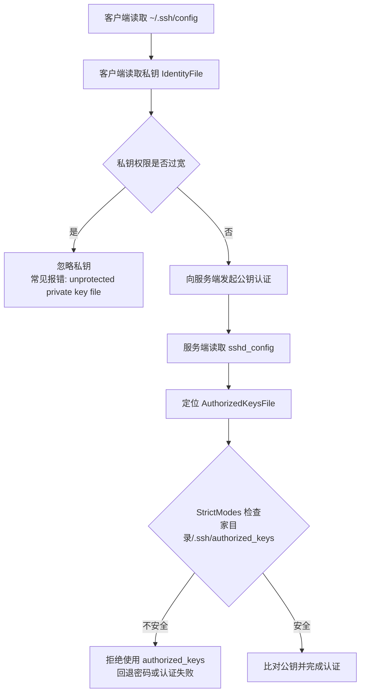

[toc]


## 大纲

- SSH 权限问题的本质
- Linux/OpenSSH 常见文件与目录权限速查
- 客户端侧：`~/.ssh/config`、私钥、公钥、`known_hosts`
- 服务端侧：家目录、`~/.ssh`、`authorized_keys`、系统级配置、主机密钥
- `StrictModes` 的工作机制
- 常见故障现象与定位思路
- 一键检查与修复命令
- Windows OpenSSH 的特殊权限规则
- 最佳实践与新手常见误区

## 核心结论

SSH 权限检查的核心原则是：**能决定登录行为的文件，不能被其他用户篡改；含有私钥的文件，不能被其他用户读取。**

OpenSSH 服务端的 `StrictModes` 默认开启，它会在接受登录前检查**用户家目录**、`.ssh` 目录及相关文件的权限和属主，防止用户误把目录或密钥授权文件设为可被他人写入。

> 若 `authorized_keys`、`.ssh` 或用户家目录可被其他用户写入(可能被其他用户为陌生设备开后门)，`sshd` 默认不会使用该 `authorized_keys` 文件。([OpenBSD手册](https://man.openbsd.org/sshd_config)) 
>
> OpenSSH 客户端也会检查私钥文件，若私钥能被其他用户访问(存在被盗用或泄露的风险)，`ssh` 会直接忽略该私钥。([OpenBSD手册](https://man.openbsd.org/ssh.1))



## Linux/OpenSSH 权限速查表

以下以普通用户 `alice` 为例。实际使用时把 `alice` 替换为对应用户名。

| 路径                               | 类型 | 推荐属主      | 推荐权限                  | 作用                               | 权限错误后果                                             |
| ---------------------------------- | ---- | ------------- | ------------------------- | ---------------------------------- | -------------------------------------------------------- |
| `/home/alice`                      | 目录 | `alice:alice` | `755`、`750` 或 `700`     | 用户家目录                         | 若可被其他用户写入，服务端可能拒绝使用 `authorized_keys` |
| `/home/alice/.ssh`                 | 目录 | `alice:alice` | `700`                     | 用户 SSH 配置与认证目录            | 过宽，尤其可写时，公钥登录可能失效                       |
| `/home/alice/.ssh/authorized_keys` | 文件 | `alice:alice` | `600`                     | 服务端允许登录该用户的公钥列表     | 可被他人写入时，`sshd` 默认不使用它                      |
| `/home/alice/.ssh/config`          | 文件 | `alice:alice` | `600`，最低不能被他人写入 | 客户端用户级配置                   | 可能报 `Bad owner or permissions`                        |
| `/home/alice/.ssh/id_ed25519`      | 文件 | `alice:alice` | `600` 或 `400`            | 客户端私钥                         | 权限过宽时，客户端忽略私钥                               |
| `/home/alice/.ssh/id_ed25519.pub`  | 文件 | `alice:alice` | `644`                     | 公钥，可放入远端 `authorized_keys` | 通常不敏感，可被读取                                     |
| `/home/alice/.ssh/known_hosts`     | 文件 | `alice:alice` | `644` 或 `600`            | 记录已信任的服务端主机公钥         | 可写权限过宽有被篡改风险                                 |
| `/home/alice/.ssh/rc`              | 文件 | `alice:alice` | `600`                     | 登录后执行的用户初始化脚本         | 可写权限过宽有执行风险                                   |
| `/home/alice/.ssh/environment`     | 文件 | `alice:alice` | `600`                     | 用户环境变量文件                   | 默认通常不启用，若启用需严控写权限                       |
| `/etc/ssh/ssh_config`              | 文件 | `root:root`   | `644`                     | 系统级客户端默认配置               | 应可全局读取，但只能由 root 修改                         |
| `/etc/ssh/sshd_config`             | 文件 | `root:root`   | `644`                     | 服务端配置                         | 若被普通用户写入，存在严重风险                           |
| `/etc/ssh/ssh_host_*_key`          | 文件 | `root:root`   | `600` 或 `400`            | 服务端主机私钥                     | 若组或其他用户可访问，`sshd` 可能无法启动                |
| `/etc/ssh/ssh_host_*_key.pub`      | 文件 | `root:root`   | `644`                     | 服务端主机公钥                     | 可公开读取                                               |

OpenSSH 官方文档说明，`~/.ssh` 推荐仅用户本人可读写执行；`authorized_keys` 虽然不是高度敏感文件，但推荐仅用户本人可读写；若 `authorized_keys`、`.ssh` 或家目录可被其他用户写入，`sshd` 在 `StrictModes` 未关闭时不会使用它。([OpenBSD手册](https://man.openbsd.org/sshd.8)) 私钥文件如 `id_ed25519`、`id_rsa` 包含敏感数据，应只允许用户本人读取，若能被他人访问，`ssh` 会忽略该私钥。([OpenBSD手册](https://man.openbsd.org/ssh.1))

## 权限数字怎么理解

Linux 文件权限常用八进制表示：

| 权限  | 含义                                           |
| ----- | ---------------------------------------------- |
| `700` | 仅属主可读、写、进入目录                       |
| `600` | 仅属主可读、写                                 |
| `644` | 属主可写，其他人只读                           |
| `755` | 属主可写，其他人可读和进入目录                 |
| `400` | 仅属主可读                                     |
| `777` | 所有人可读、写、执行，SSH 场景中通常是危险权限 |

目录和文件的权限含义不同。目录要能进入，必须有执行权限 `x`。所以 `.ssh` 目录不能设成 `600`，因为目录没有 `x` 时，用户自己也无法进入目录。`.ssh` 目录常用 `700`，而私钥文件常用 `600` 或 `400`。

## 客户端侧权限要求

客户端侧主要影响“我能不能拿自己的私钥去登录远端”。

### 用户级客户端配置

`~/.ssh/config` 是 SSH 客户端的用户级配置文件。OpenSSH 文档明确说明它必须有严格权限：用户本人可读写，且不能被其他用户写入。([man7.org](https://man7.org/linux/man-pages/man5/ssh_config.5.html)) 实务中建议：

```bash
chmod 700 ~/.ssh
chmod 600 ~/.ssh/config
chown "$USER:$USER" ~/.ssh ~/.ssh/config
```

示例配置：

```sshconfig
Host myserver
    HostName 192.168.1.10
    User alice
    IdentityFile ~/.ssh/id_ed25519
    IdentitiesOnly yes
```

`IdentityFile` 指定认证私钥；若未指定，OpenSSH 默认会尝试 `~/.ssh/id_rsa`、`~/.ssh/id_ecdsa`、`~/.ssh/id_ed25519` 等默认私钥文件。`IdentitiesOnly yes` 可限制客户端只使用配置中指定的身份文件，避免 `ssh-agent` 里密钥太多导致认证混乱。([man7.org](https://man7.org/linux/man-pages/man5/ssh_config.5.html)) ([man7.org](https://man7.org/linux/man-pages/man5/ssh_config.5.html))

### 私钥文件

私钥文件如：

- `~/.ssh/id_ed25519`
- `~/.ssh/id_rsa`
- `~/.ssh/id_ecdsa`
- 云服务器下载的 `.pem` 文件

推荐权限：

```bash
chmod 600 ~/.ssh/id_ed25519
# 或更严格
chmod 400 ~/.ssh/id_ed25519
```

典型错误：

```text
WARNING: UNPROTECTED PRIVATE KEY FILE!
Permissions are too open.
This private key will be ignored.
```

意思是：私钥文件可能被其他用户读取，SSH 客户端出于安全考虑拒绝使用它。

### 公钥文件

公钥文件如：

- `~/.ssh/id_ed25519.pub`
- `~/.ssh/id_rsa.pub`

公钥不是秘密，可读权限通常可以宽一些：

```bash
chmod 644 ~/.ssh/id_ed25519.pub
```

但公钥不是拿来登录时指定给 `ssh -i` 的文件。`ssh -i` 后面通常应跟**私钥文件**，不是 `.pub` 文件。

### known_hosts

`~/.ssh/known_hosts` 记录远端服务器主机公钥，用于防止中间人攻击。它可以是 `644` 或 `600`，关键是不要让其他用户写入：

```bash
chmod 644 ~/.ssh/known_hosts
# 或
chmod 600 ~/.ssh/known_hosts
```

如果服务端重装系统或主机密钥变化，常见报错是：

```text
WARNING: REMOTE HOST IDENTIFICATION HAS CHANGED!
```

修复时不要直接清空整个 `known_hosts`，更稳妥的是删除对应主机记录：

```bash
ssh-keygen -R 192.168.1.10
```

然后重新连接并确认新指纹。

## 服务端侧权限要求

服务端侧主要影响“远端服务器愿不愿意接受你的公钥登录”。

### authorized_keys

`~/.ssh/authorized_keys` 是服务端文件，里面放的是**允许登录该用户的客户端公钥**。OpenSSH 文档说明，默认 `AuthorizedKeysFile` 为 `.ssh/authorized_keys .ssh/authorized_keys2`，路径相对于用户家目录。([man7.org](https://man7.org/linux/man-pages/man5/sshd_config.5.html))

推荐修复命令：

```bash
sudo chown -R alice:alice /home/alice/.ssh
sudo chmod 700 /home/alice/.ssh
sudo chmod 600 /home/alice/.ssh/authorized_keys
```

追加公钥时应使用：

```bash
cat id_ed25519.pub >> /home/alice/.ssh/authorized_keys
```

不要把私钥内容放进去。`authorized_keys` 中每一行是一把公钥，基本格式通常是：

```text
ssh-ed25519 AAAAC3NzaC1lZDI1NTE5AAAA... comment
```

### 用户家目录

很多新手只修复 `.ssh` 和 `authorized_keys`，却忽略了用户家目录本身。若家目录可被其他用户写入，例如：

```bash
chmod 777 /home/alice
```

即使 `.ssh/authorized_keys` 是 `600`，`sshd` 仍可能认为路径不安全。推荐：

```bash
sudo chmod 755 /home/alice
# 或更严格
sudo chmod 750 /home/alice
sudo chmod 700 /home/alice
```

不要让家目录具有组写或其他用户写权限。

### 系统级配置文件

`/etc/ssh/sshd_config` 控制服务端行为，常见相关项：

```sshconfig
PubkeyAuthentication yes
AuthorizedKeysFile .ssh/authorized_keys
StrictModes yes
PasswordAuthentication yes
```

检查配置语法：

```bash
sudo sshd -t
```

查看最终生效配置：

```bash
sudo sshd -T | grep -E 'pubkeyauthentication|authorizedkeysfile|strictmodes|passwordauthentication'
```

OpenSSH 的 `sshd -t` 用于检查配置文件和密钥合理性，`sshd -T` 可输出最终生效配置，适合排查 `Match` 块导致的配置变化。([OpenBSD手册](https://man.openbsd.org/sshd.8))

### 服务端主机密钥

服务端主机私钥通常在：

```text
/etc/ssh/ssh_host_ed25519_key
/etc/ssh/ssh_host_rsa_key
/etc/ssh/ssh_host_ecdsa_key
```

这些不是用户登录私钥，而是服务器证明“我是这台服务器”的主机密钥。OpenSSH 文档说明，主机私钥应由 root 拥有，仅 root 可读，且若组或其他用户可访问，`sshd` 不会启动。([OpenBSD手册](https://man.openbsd.org/sshd.8))

修复示例：

```bash
sudo chown root:root /etc/ssh/ssh_host_*_key
sudo chmod 600 /etc/ssh/ssh_host_*_key
sudo chmod 644 /etc/ssh/ssh_host_*_key.pub
sudo systemctl restart sshd
```

部分发行版服务名是 `ssh` 而不是 `sshd`：

```bash
sudo systemctl restart ssh
```

## 故障排查流程

### 先从客户端看

使用详细日志：

```bash
ssh -vvv alice@192.168.1.10
```

重点观察这些信息：

| 客户端日志关键词                   | 可能原因                             |
| ---------------------------------- | ------------------------------------ |
| `Offering public key`              | 客户端正在尝试某把公钥               |
| `Server accepts key`               | 服务端接受该公钥，后续应进入签名验证 |
| `Permission denied publickey`      | 服务端未接受公钥或后续验证失败       |
| `Bad owner or permissions`         | 客户端配置文件或相关文件权限异常     |
| `UNPROTECTED PRIVATE KEY FILE`     | 私钥权限过宽，被客户端忽略           |
| `Too many authentication failures` | 客户端或 agent 尝试了太多密钥        |

若 agent 中密钥过多，可临时指定私钥并限制只用该私钥：

```bash
ssh -i ~/.ssh/id_ed25519 -o IdentitiesOnly=yes alice@192.168.1.10
```

### 再从服务端看

在服务端查看日志：

```bash
sudo journalctl -u sshd -n 100 --no-pager
```

Debian/Ubuntu 可能是：

```bash
sudo journalctl -u ssh -n 100 --no-pager
```

传统日志位置可能是：

```bash
sudo tail -n 100 /var/log/auth.log
sudo tail -n 100 /var/log/secure
```

重点观察：

| 服务端日志关键词                                 | 可能原因                                                    |
| ------------------------------------------------ | ----------------------------------------------------------- |
| `Authentication refused: bad ownership or modes` | 家目录、`.ssh` 或 `authorized_keys` 权限/属主错误           |
| `Failed publickey`                               | 公钥不匹配、权限错误、用户不对或配置未启用                  |
| `User not allowed`                               | `AllowUsers`、`AllowGroups`、`DenyUsers`、`DenyGroups` 限制 |
| `Could not open authorized keys`                 | 文件不存在、权限不对、路径不对、SELinux/AppArmor 拦截       |
| `Connection closed by authenticating user`       | 客户端放弃、认证方法不匹配或服务端拒绝                      |

## 一键检查命令

在服务端以 root 或有 sudo 权限的用户执行：

```bash
USER_NAME=alice
USER_HOME=$(eval echo "~$USER_NAME")

namei -l "$USER_HOME/.ssh/authorized_keys"
stat -c '%A %a %U:%G %n' "$USER_HOME" "$USER_HOME/.ssh" "$USER_HOME/.ssh/authorized_keys"
```

`namei -l` 会逐级显示路径上每一级目录的属主和权限，特别适合排查“家目录上层目录权限不安全”的问题。

检查 `authorized_keys` 内容格式：

```bash
grep -nEv '^(ssh-ed25519|ssh-rsa|ecdsa-sha2-|sk-ssh-ed25519|sk-ecdsa-sha2-)' /home/alice/.ssh/authorized_keys
```

如果输出了某些行，说明这些行可能不是标准公钥行，或前面带了 `command=`、`from=`、`restrict` 等高级选项。高级选项本身不一定错误，但新手排障时应特别检查。

## 一键修复模板🎈

### 修复普通用户公钥登录

为指定用户建立一个符合 OpenSSH `StrictModes` 安全要求的公钥登录目录环境，使 `sshd` 能安全、可信地读取该用户的 `authorized_keys` 文件。

> 例如,当前用户为`root`,为一个名为`alice`的用户修复目录.
>
> 如果本身就是root,且要为自己修复ssh目录,将`alice`改为`root`即可.
>
> > `touch`命令在文件已经存在的情况下不会覆盖,可以放心执行.

```bash
USER_NAME=alice # 更改为目标用户名.
USER_HOME=$(eval echo "~$USER_NAME")

sudo mkdir -p "$USER_HOME/.ssh"
sudo chown "$USER_NAME:$USER_NAME" "$USER_HOME/.ssh"
sudo chmod 700 "$USER_HOME/.ssh"

sudo touch "$USER_HOME/.ssh/authorized_keys"
sudo chown "$USER_NAME:$USER_NAME" "$USER_HOME/.ssh/authorized_keys"
sudo chmod 600 "$USER_HOME/.ssh/authorized_keys"

sudo chmod go-w "$USER_HOME"
```

最后一行 `chmod go-w "$USER_HOME"` 的意思是去掉 group 和 others 对家目录的写权限。

### 修复客户端私钥权限

```bash
chmod 700 ~/.ssh
chmod 600 ~/.ssh/config 2>/dev/null || true
chmod 600 ~/.ssh/id_ed25519 2>/dev/null || true
chmod 600 ~/.ssh/id_rsa 2>/dev/null || true
chmod 644 ~/.ssh/*.pub 2>/dev/null || true
```

### 修复服务端主机密钥权限

```bash
sudo chown root:root /etc/ssh/ssh_host_*_key /etc/ssh/ssh_host_*_key.pub
sudo chmod 600 /etc/ssh/ssh_host_*_key
sudo chmod 644 /etc/ssh/ssh_host_*_key.pub
sudo sshd -t
sudo systemctl restart sshd
```

## SELinux 相关排查

在 RHEL、CentOS、Fedora、Rocky Linux、AlmaLinux 等启用 SELinux 的系统中，即使传统权限完全正确，SELinux 上下文错误也可能导致 `sshd` 无法读取 `authorized_keys`。可先查看上下文：

```bash
ls -Zd ~/.ssh ~/.ssh/authorized_keys
```

常见修复：

```bash
restorecon -Rv ~/.ssh
```

若用户家目录在非标准路径，例如 `/data/home/alice`，可能需要为该路径配置正确的 SELinux 文件上下文，然后再 `restorecon`。这类问题的表现通常是传统 `chmod/chown` 看起来都正确，但公钥登录仍失败，且 `/var/log/audit/audit.log` 中有 SELinux 拒绝记录。

## Windows OpenSSH 的特殊规则

Windows OpenSSH 使用 ACL，而不是 Linux 的 `chmod` 语义。Windows OpenSSH 支持本地账户和 Active Directory 域账户的基于密钥认证，但不支持 Microsoft Entra ID 账户的密钥认证。([微软学习](https://learn.microsoft.com/en-us/windows-server/administration/openssh/openssh_keymanagement))

普通用户的公钥通常放在：

```text
C:\Users\username\.ssh\authorized_keys
```

管理员组用户比较特殊。Microsoft 文档说明，如果用户属于管理员组，默认使用：

```text
C:\ProgramData\ssh\administrators_authorized_keys
```

并且该文件只能有 `NT Authority\SYSTEM` 和 `BUILTIN\Administrators` 的权限项，其中 `SYSTEM` 必须有完全控制权限。([微软学习](https://learn.microsoft.com/en-us/windows-server/administration/openssh/openssh-server-configuration))

修复管理员公钥文件 ACL：

```powershell
icacls.exe "C:\ProgramData\ssh\administrators_authorized_keys" /inheritance:r /grant "Administrators:F" /grant "SYSTEM:F"
Restart-Service sshd
```

Windows OpenSSH 的系统配置文件通常在：

```text
C:\ProgramData\ssh\sshd_config
```

Windows OpenSSH 的用户级客户端配置通常在：

```text
%USERPROFILE%\.ssh\config
```

## 常见误区

| 误区                                         | 正确理解                                                     |
| -------------------------------------------- | ------------------------------------------------------------ |
| 把 `.ssh` 目录设为 `600`                     | 目录需要执行权限才能进入，`.ssh` 应用 `700`                  |
| 把 `.pub` 文件当作 `ssh -i` 的文件           | `ssh -i` 通常指定私钥，不是公钥                              |
| 只修复 `authorized_keys`，不看家目录         | 家目录可被他人写入也会触发 `StrictModes` 问题                |
| 为了省事把 `.ssh` 设为 `777`                 | 这会让 SSH 认为认证材料不可信                                |
| 关闭 `StrictModes` 解决问题                  | 不推荐。应修复权限，而不是关闭安全检查                       |
| 以 root 创建普通用户的 `.ssh` 后忘记 `chown` | 会导致普通用户无法正常读写，服务端也可能拒绝                 |
| Windows 上照搬 `chmod 600` 思维              | Windows 应检查 ACL，尤其是管理员账户的 `administrators_authorized_keys` |

## 推荐的安全基线

个人用户或普通服务器，建议使用以下基线：

```bash
chmod 700 ~/.ssh
chmod 600 ~/.ssh/config
chmod 600 ~/.ssh/authorized_keys
chmod 600 ~/.ssh/id_ed25519
chmod 644 ~/.ssh/id_ed25519.pub
chmod 644 ~/.ssh/known_hosts
chmod go-w ~
```

服务端系统级文件：

```bash
sudo chmod 644 /etc/ssh/sshd_config
sudo chmod 600 /etc/ssh/ssh_host_*_key
sudo chmod 644 /etc/ssh/ssh_host_*_key.pub
sudo chown root:root /etc/ssh/sshd_config /etc/ssh/ssh_host_*_key /etc/ssh/ssh_host_*_key.pub
```

最实用的排查顺序是：**客户端 `ssh -vvv` 看私钥是否被使用，服务端日志看 `bad ownership or modes`，再用 `namei -l` 逐级检查路径权限，最后检查 SELinux 或 Windows ACL。**