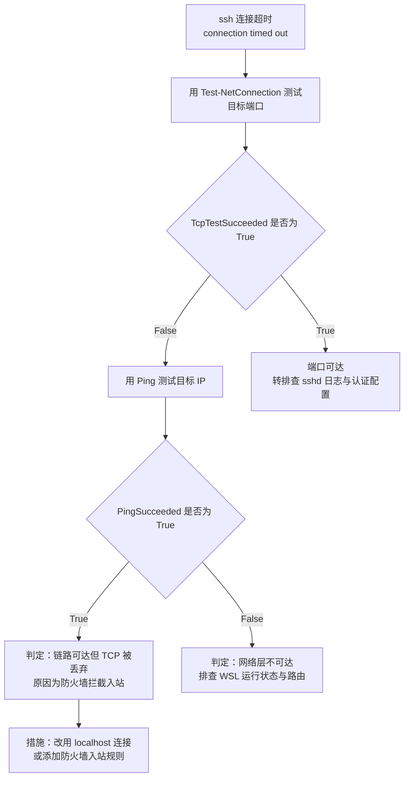

[toc]

## 概述

**背景**：本指南说明在同一台 Windows 主机上，通过 **SSH**(Secure Shell，安全外壳协议)客户端登录 **WSL2**(Windows Subsystem for Linux 2，适用于 Linux 的 Windows 子系统第 2 版)中 **sshd**(SSH daemon，SSH 服务守护进程)的方法。WSL2 侧的 sshd 已启动并监听 22 端口，但通过 WSL2 的 IP 地址直接连接会失败，原因是 Windows 防火墙拦截了入站连接。

**适用读者**：需要从 Windows 主机或局域网其他主机登录 WSL2 Linux 环境的技术人员。

**适用环境**：Windows 主机上的 WSL2 Ubuntu，且 WSL2 处于**镜像网络模式**(mirrored networking mode)。实测基线见“环境现状(实测)”。

**非目标**：本文档不涉及 sshd 的安装、密钥对生成、免密登录配置与 WSL2 本体的安装。未覆盖事项见“待确认事项”。

## 术语与缩略语

关键术语首次出现时采用中文(英文)形式标注，后文直接使用中文或缩写。

| 术语 | 英文 | 说明 |
| --- | --- | --- |
| WSL2 | Windows Subsystem for Linux 2 | 通过轻量级虚拟机运行完整 Linux 内核的 Windows 子系统第 2 版 |
| 镜像网络模式 | mirrored networking mode | WSL2 与 Windows 主机共享网络协议栈的网络模式，在 `.wslconfig` 中以 `networkingMode=Mirrored` 启用 |
| sshd | SSH daemon | Linux 侧的 SSH 服务守护进程，默认监听 22 端口 |
| 环回 | loopback | 指向本机的网络流量，地址如 `127.0.0.1`，主机名如 `localhost` |
| 入站规则 | inbound rule | Windows 防火墙中放行或阻止外部连接进入本机的策略 |
| 公用网络类别 | Public | Windows 网络位置类型之一，默认阻止入站连接 |
| 端口代理 | port proxy | 通过 `netsh`(network shell)命令将一个端口的流量转发到另一地址与端口的机制 |
| NAT 模式 | Network Address Translation | WSL2 的另一种网络模式，WSL2 位于独立的虚拟子网 |
| TCP | Transmission Control Protocol | 传输控制协议，SSH 基于 TCP 传输 |
| socket 统计 | socket statistics | Linux 命令 `ss` 的功能，用于查看套接字监听与连接状态 |

## 环境现状(实测)

以下数据来自本次会话的实测命令输出，可作为复现与核对的基线。

| 项目 | 实测值 | 采集命令 |
| --- | --- | --- |
| WSL2 的 IPv4 地址(当前) | `192.168.0.105`(另含 IPv6 地址) | `wsl hostname -I` |
| sshd 监听状态 | `0.0.0.0:22` 与 `[::]:22` | `ss -tln`(WSL2 内执行) |
| WSL2 内 sshd 版本标识 | `SSH-2.0-OpenSSH_9.6p1 Ubuntu-3ubuntu13.19` | 抓取 SSH 握手横幅 |
| Linux 用户名 | `opcxxu` | `whoami` |
| 网络模式 | 镜像网络模式 | 读取 `C:\Users\opcxxu\.wslconfig` |
| 到 WSL2 地址的路由出口 | ifIndex 14(物理网卡) | `Find-NetRoute -RemoteIPAddress 192.168.0.105` |
| 物理网卡网络类别 | 公用网络类别 | `Get-NetConnectionProfile` |
| 端口代理配置 | 未配置 | `netsh interface portproxy show all` |
| `localhost` 的 22 端口可达性 | 可达 | `Test-NetConnection -ComputerName localhost -Port 22` |
| Windows 侧 SSH 客户端版本 | OpenSSH for Windows 9.5p2 | 用户侧 `ssh -v` 输出 |

`C:\Users\opcxxu\.wslconfig` 的当前内容：

```ini
[wsl2]
networkingMode=Mirrored
defaultVhdSize=314572800000
```

其中 `defaultVhdSize` 为虚拟磁盘上限(字节数，约 293 GiB)，与网络连接无关。

## 核心结论

在镜像网络模式下，从 Windows 主机连接 WSL2 的 sshd 应使用 `localhost`，不应使用 WSL2 的 IP 地址。依据如下：

1. 镜像网络模式下，WSL2 与 Windows 主机共享同一网络协议栈。WSL2 内监听 `0.0.0.0:22` 的 sshd，对 Windows 主机本地 `localhost:22` 的请求同样可见，实测 SSH 握手横幅确认为 WSL2 内 Ubuntu 的 sshd。
2. 环回流量默认不受公用网络类别的入站限制，因此无需修改防火墙即可连通。
3. 直接连接 `192.168.0.105:22` 时，流量由物理网卡(实测 ifIndex 14)承载；该网卡的网络类别为公用网络类别，入站 TCP 连接被默认策略拦截，表现为连接超时而非拒绝。

## 连接方式

### 方式一：通过 localhost 连接(推荐)

**适用条件**：SSH 客户端与 WSL2 位于同一台 Windows 主机，且 WSL2 处于镜像网络模式。

**操作步骤**：

1. 在 WSL2 内确认 sshd 已监听(预期输出包含 `0.0.0.0:22`)：

   ```bash
   ss -tln
   ```

2. 在 PowerShell 中发起连接：

   ```powershell
   ssh opcxxu@localhost
   ```

3. 首次连接出现主机指纹提示时，核对指纹后输入 `yes`，随后输入 Linux 用户密码完成认证。

**边界说明**：该方式仅对本机客户端有效，局域网内其他主机无法通过本机的 `localhost` 访问 WSL2 的 sshd。

### 方式二：通过局域网 IP 连接

**适用条件**：需要从局域网内其他主机登录本机的 WSL2。

**前提认知**：物理网卡处于公用网络类别时，直接连接会被防火墙拦截而超时，必须先添加入站规则。

**操作步骤**：

1. 在管理员 PowerShell 中添加入站规则(需要管理员权限，权限不足时命令失败)：

   ```powershell
   New-NetFirewallRule -DisplayName "WSL sshd 22" -Direction Inbound -Protocol TCP -LocalPort 22 -Action Allow
   ```

2. 发起连接：

   ```powershell
   ssh opcxxu@192.168.0.105
   ```

**安全注意事项**：

- 镜像网络模式下，该入站规则会同时将物理网卡的 22 端口对局域网开放，即局域网内任意主机均可尝试登录该 Linux 用户。
- 建议通过 `-RemoteAddress` 参数限定来源地址范围，仅允许受信任网段访问。
- 启用该规则前，应确认 sshd 已配置密钥认证或强密码，相关配置状态见“待确认事项”。

### 方式三：端口转发(仅 NAT 模式)

**适用条件**：WSL2 处于 NAT 模式，且希望通过固定端口访问。

**镜像模式下的失效原因**：镜像模式下 WSL2 没有独立的虚拟子网地址，端口转发的目标地址无从填写，该方式不适用。镜像模式下应使用方式一或方式二。

**操作步骤**(仅 NAT 模式)：

1. 添加端口转发，将本机 `2222` 端口转发到 WSL2 的 22 端口(将 `<WSL2_IP>` 替换为实测地址)：

   ```powershell
   netsh interface portproxy add v4tov4 listenport=2222 listenaddress=0.0.0.0 connectport=22 connectaddress=<WSL2_IP>
   ```

2. 发起连接时指定端口：

   ```powershell
   ssh opcxxu@localhost -p 2222
   ```

**边界说明**：若 WSL2 的 IP 发生变化，需重新执行第 1 步；该命令需要管理员权限。

### 方式对比

下表汇总三种方式的适用性，辅助选型。

| 维度 | 方式一：localhost | 方式二：局域网 IP | 方式三：端口转发 |
| --- | --- | --- | --- |
| 访问范围 | 仅本机 | 局域网 | 取决于防火墙规则 |
| 是否需要修改防火墙 | 否 | 是 | 视规则而定 |
| 镜像模式下是否适用 | 适用 | 适用 | 不适用 |

## 连接失败诊断

### 超时与拒绝的判据

区分两类失败是诊断的起点，每类对应不同的排查方向。

- **连接超时**(connection timed out)：TCP 连接请求被中途丢弃，常见原因为防火墙拦截或网络设备过滤。本次故障属于此类。
- **连接被拒绝**(connection refused)：目标主机可达，但目标端口无进程监听，常见原因为 sshd 未启动或监听地址不符。

### 诊断流程

本次故障(`ssh opcxxu@192.168.0.105 -v` 报告 connection timed out)的诊断过程存在分支，用流程图表示。



图中「链路可达但 TCP 被丢弃」与「原因为防火墙拦截入站」对应本次实测结果：Ping 成功而 22 端口测试失败，说明链路可达但 TCP 被拦截。沿该分支得出的措施是改用 `localhost` 连接；若需局域网访问，则添加防火墙入站规则。若测试显示端口可达，问题不在网络层，应转向 sshd 日志与认证配置。

## 验证方法

以下命令用于确认连接链路各环节的状态，预期结果一并列出。

| 验证目的 | 命令 | 预期结果 |
| --- | --- | --- |
| WSL2 是否运行 | `wsl -l -v` | Ubuntu 的状态为 Running |
| 获取 WSL2 的地址 | `wsl hostname -I` | 返回 IPv4 地址 |
| sshd 是否监听 | `ss -tln`(WSL2 内执行) | 输出包含 `0.0.0.0:22` |
| `localhost` 的 22 端口是否可达 | `Test-NetConnection -ComputerName localhost -Port 22` | `TcpTestSucceeded` 为 `True` |
| 22 端口是否为 WSL2 的 sshd | 抓取 SSH 握手横幅(命令见下) | 返回 `SSH-2.0-OpenSSH_9.x` 且含 Ubuntu 标识 |

抓取横幅以验证服务归属的命令：

```powershell
$c = New-Object System.Net.Sockets.TcpClient("127.0.0.1", 22)
$s = $c.GetStream()
Start-Sleep -Milliseconds 400
$buf = New-Object byte[] 256
$n = $s.Read($buf, 0, 256)
[Text.Encoding]::ASCII.GetString($buf, 0, $n)
$c.Close()
```

## 安全注意事项

- 通过 IP 连接所需的入站规则会放大 WSL2 的暴露面，添加前应确认 sshd 认证方式足够强健。
- 优先使用密钥认证；使用密码认证时应确保 Linux 用户密码具备足够强度。
- 通过 `-RemoteAddress` 限定入站规则的来源地址范围，避免对全网段开放 22 端口。
- 22 端口一旦对公网可达，会持续受到自动化扫描与暴力破解尝试，不应将此配置直接用于公网可达的主机。

## 常见问题

- **连接超时但 Ping 通，如何处理？** 说明链路可达而 TCP 被拦截。若客户端与 WSL2 同机，改用 `ssh opcxxu@localhost`；若需跨主机访问，添加防火墙入站规则。
- **WSL2 的 IP 会变化吗？** WSL2 的 IP 并非固定不变，由网络动态分配。使用 `localhost` 连接可避免依赖该 IP。
- **连接时提示连接被拒绝，如何处理？** 说明端口未监听。在 WSL2 内执行 `ss -tln` 确认 sshd 状态；若未监听，启动 sshd 服务。
- **如何确认连上的确实是 WSL2 中的 Linux？** 抓取 22 端口的 SSH 横幅，其中包含 Ubuntu 与 OpenSSH 版本标识，详见“验证方法”。

## 待确认事项

以下事项在本次会话中未验证，需补充确认后再纳入正文。

1. sshd 是否随 WSL2 启动自动运行(未检查 `systemctl is-enabled ssh` 或等价启动项)。
2. sshd 的认证配置实际取值：`PasswordAuthentication` 与 `PubkeyAuthentication` 的当前状态未取到，需在 WSL2 内检查 `/etc/ssh/sshd_config`。
3. 是否需要配置免密登录(密钥对)，以及 `/etc/ssh/sshd_config` 中的 `ListenAddress` 与 `AllowUsers` 是否限制登录。
4. 镜像网络模式对 Windows 版本的最低要求未联网核验；如文档需对外发布，建议补充官方来源。
5. `defaultVhdSize=314572800000` 是否为预期配置(该值为虚拟磁盘上限，与网络连接无关)。
6. 局域网访问的来源地址限定范围，需由使用者根据网络拓扑决定。
