[toc]

## abstract

Android 磁盘使用、存储管理、系统更新与现代 Root：系统化学习指南

> 本文以 **现代 Android，重点是 Android 10 之后的架构** 为主，并结合截至 **2026 年 7 月**仍有效的 AOSP 官方设计与 Magisk、Kerne([Android Open Source Project](https://source.android.com/docs/security/features/selinux?utm_source=chatgpt.com)) 首发版本、是否采用 GKI、是否支持动态分区、文件系统类型都会造成差异，因此不要把某一台 Pixel、小米或三星设备观察到的布局当成 Android 的唯一标准。

------

## 详细学习大纲

建议按照以下路径学习，而不是直接从 `/system`、`/data` 等目录死记硬背。

### 建立整体心智模型

- “磁盘”“分区”“文件系统”“挂载点”“目录”分别是什么
- Android 为什么不能简单理解成普通 Linux 的单块根文件系统
- 物理块设备、GPT 分区、逻辑分区、Device Mapper 的关系
- `/sdcard` 为什么通常不是一张真正的 SD 卡

### 理解现代 Android 的存储栈

- eMMC、UFS 等闪存设备
- Linux Block Layer
- GPT 物理分区
- `super` 动态分区
- `dm-linear`
- `dm-verity`
- `dm-snapshot`、Virtual A/B COW
- FBE、元数据加密
- ext4、F2FS、EROFS
- `init`、`fs_mgr`、`fstab`
- `vold`
- FUSE 与模拟共享存储

### 掌握核心分区

- `boot`
- `init_boot`
- `vendor_boot`
- `vbmeta`
- `super`
- `system`
- `system_ext`
- `product`
- `vendor`
- `odm`
- `userdata`
- `metadata`
- `recovery`
- `misc`

### 理解用户数据管理

- 应用私有目录
- Device Encrypted 与 Credential Encrypted
- 模拟外部存储
- Scoped Storage
- MediaStore
- Storage Access Framework
- 多用户隔离
- SD 卡、USB、Adoptable Storage

### 理解安全与完整性

- 文件权限
- Android UID 沙箱
- SELinux
- FBE
- Metadata Encryption
- AVB
- `dm-verity`
- Rollback Protection

### 理解磁盘空间管理

- 文件大小与块占用
- inode
- quota
- cache
- `df` 与 `du`
- TRIM
- 闪存磨损
- OTA 临时空间与快照空间

### 理解系统更新

- Full OTA
- Incremental OTA
- Non-A/B
- Legacy A/B
- Virtual A/B
- Dynamic Partitions
- Snapshot 与 COW
- `update_engine`
- 启动成功确认
- Snapshot Merge
- 自动回滚
- Mainline
- APK 与 APEX

### 理解现代 Root

- Root 与 Bootloader Unlock 的区别
- Root 与 AVB 的区别
- Root 与 SELinux 的关系
- Systemless Root
- Magisk
- KernelSU
- APatch
- OTA 与 Root 的冲突
- Root 的最佳实践与恢复策略

------

## 先建立最重要的心智模型

很多初学者看到：

```text
/system
/vendor
/data
/sdcard
```

会自然认为：

> 这些就是磁盘上的几个文件夹。

这在现代 Android 中是不够准确的。

更合理的模型是：

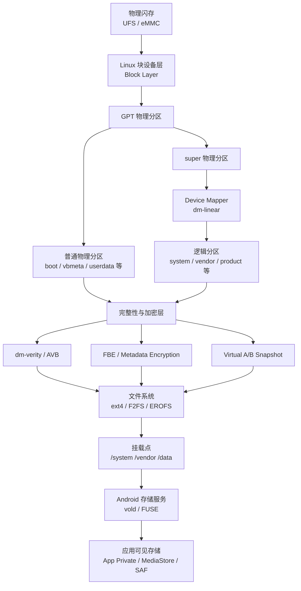

现代 Android 的关键变化是：**文件系统下面往往还存在多层虚拟块设备**。例如动态分区使用 Linux Device Mapper 的 `dm-linear`；Virtual A/B 更新又可能在逻辑分区之上加入 Snapshot/COW 层。AOSP 明确说明 `super` 中保存动态分区元数据，第一阶段 `init` 据此创建逻辑块设备。([source.android.com](https://source.android.com/docs/core/ota/dynamic_partitions/implement?utm_source=chatgpt.com))

因此：

> `/system` 是挂载点，不等于“GPT 中一定存在一个名为 system 的固定物理分区”。

这是理解现代 Android 的第一道门槛。

------

## 核心术语速查

| 术语       | 英文                    | 含义                                   |
| ---------- | ----------------------- | -------------------------------------- |
| 块设备     | Block Device            | 按块读写的存储设备抽象                 |
| 物理分区   | Physical Partition      | GPT 等分区表直接描述的区域             |
| 逻辑分区   | Logical Partition       | 由软件映射出的虚拟块设备               |
| 动态分区   | Dynamic Partition       | 可在 OTA 中调整大小的 Android 逻辑分区 |
| 超级分区   | Super Partition         | 容纳多个动态逻辑分区的物理容器         |
| 设备映射器 | Device Mapper           | Linux 的虚拟块设备框架                 |
| 挂载点     | Mount Point             | 文件系统接入目录树的位置               |
| 文件系统   | File System             | ext4、F2FS、EROFS 等                   |
| 文件级加密 | File-Based Encryption   | 不同文件可使用不同密钥的加密机制       |
| 验证启动   | Verified Boot           | 验证启动链及系统内容完整性             |
| 无缝更新   | Seamless Update         | 后台更新，主要停机时间是重启           |
| 写时复制   | Copy-on-Write           | 原块修改时保留旧数据或记录新数据       |
| OTA        | Over-the-Air            | 空中下载系统更新                       |
| APEX       | Android Pony EXpress    | Android 底层系统模块容器格式           |
| FUSE       | Filesystem in Userspace | 用户空间文件系统机制                   |
| AVB        | Android Verified Boot   | Android Verified Boot 2.0              |
| GKI        | Generic Kernel Image    | 通用内核镜像架构                       |

------

# 存储硬件到 Android 文件：逐层理解

## 物理闪存层

现代手机内部存储通常建立在：

- UFS
- eMMC
- 其他厂商专用闪存控制器方案

之上。

在操作系统看来，它们最终表现为某种 **块设备（Block Device）**。

典型设备节点可能类似：

```text
/dev/block/sda
/dev/block/mmcblk0
/dev/block/by-name/boot
```

但必须注意：

> 设备节点名称高度依赖硬件平台和厂商。

UFS 设备未必就是 `/dev/block/sda`，eMMC 也不保证所有设备采用完全相同命名。

------

## GPT 物理分区

传统 PC 用户熟悉：

```text
磁盘
├── 分区 1
├── 分区 2
└── 分区 3
```

Android 同样可以有 GPT 分区，但现代设备上的 GPT 物理分区数量和用途通常比普通 PC 更复杂。

可能存在：

```text
boot_a
boot_b
vbmeta_a
vbmeta_b
vendor_boot_a
vendor_boot_b
super
userdata
metadata
misc
```

实际布局由设备决定。

Android 官方把分区分为系统相关分区、厂商相关分区等类别；现代布局中 `boot`、`init_boot` 属于核心系统分区，而 `vendor`、`vendor_boot`、`odm` 等承载厂商与设备相关内容。([Android Open Source Project](https://source.android.com/docs/core/architecture/partitions?utm_source=chatgpt.com))代 Android 核心分区

下面的表是理解系统更新和 Root 的基础。

> 并非所有设备都具有表中的每一个分区，也不保证它们都是 GPT 物理分区。

| 分区          | 主要用途                               | 常见性质                    |
| ------------- | -------------------------------------- | --------------------------- |
| `boot`        | Linux Kernel，以及取决于架构的启动内容 | 常参与 A/B                  |
| `init_boot`   | 某些现代设备中的通用初始 ramdisk       | Root 工具常关注             |
| `vendor_boot` | Vendor ramdisk、DTB 等厂商启动内容     | GKI 架构重要                |
| `vbmeta`      | AVB 验证元数据                         | 启动信任链核心              |
| `super`       | 动态分区容器                           | 物理分区                    |
| `system`      | Android Framework 与核心系统内容       | 常为只读逻辑分区            |
| `system_ext`  | System 的扩展组件                      | 常为动态分区                |
| `product`     | 产品级配置与组件                       | 常为动态分区                |
| `vendor`      | HAL、厂商库等                          | Treble 架构重要             |
| `odm`         | ODM 设备特定组件                       | 设备相关                    |
| `userdata`    | 用户和应用可变数据                     | 挂载到 `/data`              |
| `metadata`    | 加密、启动等元数据                     | 小型独立分区常见            |
| `recovery`    | 独立恢复环境                           | A/B 设备可能无独立 recovery |
| `misc`        | Bootloader、Recovery 等状态通信        | 小型控制分区                |

Android 11 引入 GKI 相关启动布局后，`vendor_boot` 用于分离厂商启动内容；Android 12 的 Boot Image Header v4 又支持多个 vendor ramdisk fragment。不同 Android 首发版本的 `boot`、`init_boot`、`vendor_boot` 组合不能一概而论。([Android Open Source Project](https://source.android.com/docs/core/architecture/partitions/vendor-boot-partitions?utm_source=chatgpt.com))态分区：现代 Android 最关键的变化之一

## 传统固定分区的问题

假设设备预先划分：

```text
system   4 GiB
vendor   1 GiB
product  2 GiB
```

两年后 OTA 需要：

```text
system   4.4 GiB
vendor   0.8 GiB
product  1.6 GiB
```

虽然整体空间够，但 `system` 的固定物理分区只有 4 GiB。

于是出现：

> 总空间够，但某个分区装不下。

这就是固定分区布局的重要缺陷。

------

## `super` 与动态分区

现代方案更接近：

```text
super
├── system
├── system_ext
├── product
├── vendor
└── odm
```

其中：

- `super` 是大的物理容器
- `system` 等是逻辑分区
- 它们可共享 `super` 的可分配空间

AOSP 从 Android 10 开始提供动态分区架构；核心实现利用 Linux `dm-linear`，`super` 元数据描述各逻辑分区对应的块范围，第一阶段 `init` 创建相应虚拟块设备。([Android Open Source Project](https://source.android.com/docs/core/ota/dynamic_partitions/implement?utm_source=chatgpt.com))
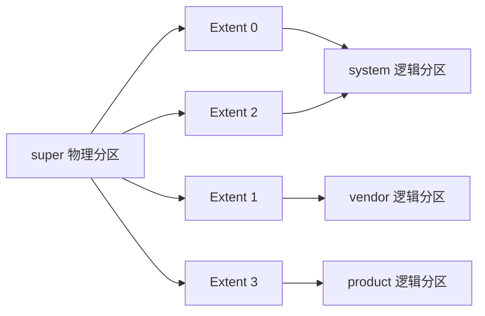
注意一个重要点：

> 一个逻辑分区并不要求在物理介质中占据单个连续区域。

`dm-linear` 可以把多个物理区间组合为一个逻辑块设备。

---

## 你可能看到的设备节点

例如 A/B 设备中可能出现：

```text
/dev/block/mapper/system_a
/dev/block/mapper/vendor_a
/dev/block/mapper/product_a
```

而底部是：

```text
/dev/block/by-name/super
```

AOSP 的 Virtual A/B 文档明确给出了这种层次：底层 `super`，中间 `dm-linear`，上层形成 `system_a` 等 mapper 设备。([Android Open Source Project](https://source.android.com/docs/core/ota/virtual_ab?utm_source=chatgpt.com))evice Mapper 到底是什么

Device Mapper 是 Linux 的虚拟块设备框架。

可以把它想象成：

> 在真正的磁盘块设备和文件系统之间插入可组合的“块级转换层”。

现代 Android 中非常重要。

| Device Mapper 技术  | 用途                           |
| ------------------- | ------------------------------ |
| `dm-linear`         | 拼接、映射动态逻辑分区         |
| `dm-verity`         | 块级完整性验证                 |
| `dm-default-key`    | 某些元数据加密场景             |
| Snapshot/COW 相关层 | Virtual A/B                    |
| `dm-bow`            | 某些 User Data Checkpoint 实现 |

于是一个现代系统分区可能概念上是：

```text
ext4 / EROFS
    |
dm-verity
    |
dm-linear
    |
super
    |
UFS
```

更新过程中甚至可能是：

```text
文件系统
    |
verity / snapshot 视图
    |
COW
    |
dm-linear
    |
super
```

这就是为什么只看：

```bash
mount
```

并不能完整理解实际磁盘布局。

------

# 文件系统：ext4、F2FS、EROFS

Android 不是“什么 Linux 文件系统都随便用”。

AOSP 明确指出，Android 的测试、OTA、安全与隐私要求依赖特定文件系统能力，例如 `fscrypt` 与 `fs-verity`；并不是所有 Linux 文件系统都适合 Android 生产设备。([Android Open Source Project](https://source.android.com/docs/core/architecture/android-kernel-file-system-support?utm_source=chatgpt.com))

| 文件系统        | 常见用途              | 特点                     |
| --------------- | --------------------- | ------------------------ |
| ext4            | `/data`、系统分区等   | 成熟、稳定、生态广       |
| F2FS            | `/data`、闪存数据分区 | 面向闪存设计             |
| EROFS           | 只读系统镜像          | 只读、支持压缩、偏读性能 |
| vfat / exFAT 等 | 可移动介质            | 视设备和厂商实现         |

EROFS 是 Linux 只读文件系统，支持压缩与去重，并针对读取性能优化；现代设备可能把部分系统只读镜像放在 EROFS 上。([Android Open Source Project](https://source.android.com/docs/core/architecture/kernel/erofs?utm_source=chatgpt.com))结论：

> Android 的 `/system` 一定是 ext4。

不一定。

同样：

> `/data` 一定是 F2FS。

也不一定。

------

# Android 开机时如何挂载磁盘

## `fstab`

普通 Linux 用户可能熟悉 `/etc/fstab`。

Android 也有 fstab 概念，但位置、构建方式和设备实现更复杂。

例如逻辑分区配置可能概念上包含：

```text
system   /system   ext4   ro   wait,slotselect,avb=vbmeta,logical,first_stage_mount
```

关键标志：

| 标志                | 含义                       |
| ------------------- | -------------------------- |
| `wait`              | 等待设备出现               |
| `slotselect`        | 根据当前 A/B slot 选分区   |
| `logical`           | 这是动态逻辑分区           |
| `first_stage_mount` | 第一阶段 init 挂载         |
| `avb`               | 接入 Android Verified Boot |
| `formattable`       | 必要时允许格式化           |
| `quota`             | 启用配额能力               |
| `fileencryption`    | FBE 相关配置               |

AOSP 对动态分区明确要求 `logical`、`first_stage_mount` 等 fs_mgr 标志，并支持在第一阶段 `init` 初始化 AVB 后再挂载。([Android Open Source Project](https://source.android.com/docs/core/ota/dynamic_partitions/implement?utm_source=chatgpt.com))为什么必须 First Stage Init

存在一个“鸡生蛋”问题：

```text
要启动完整 Android
    需要挂载 /system

要挂载 /system
    需要解析动态分区

要解析动态分区
    需要早期用户空间代码
```

因此现代 Android 使用第一阶段 `init`：

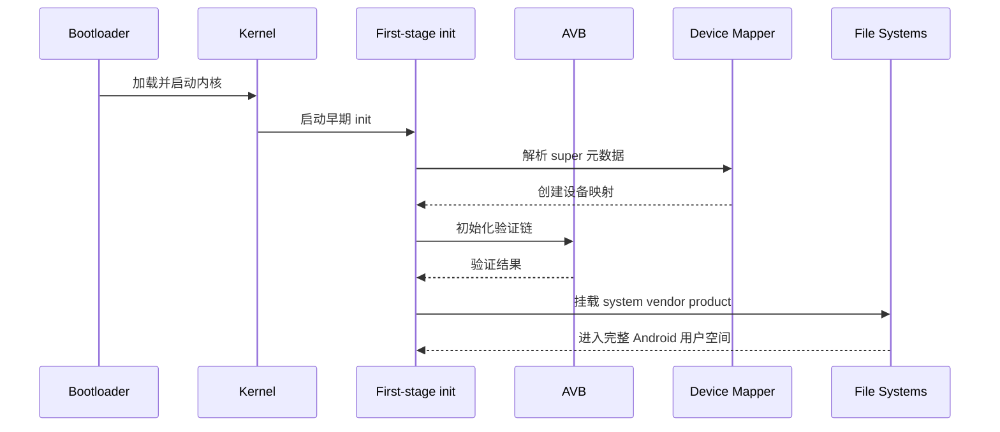

Android 10 动态分区架构把逻辑系统分区挂载工作交由第一阶段 `init` 完成。([Android Open Source Project](https://source.android.com/docs/core/architecture/partitions/system-as-root?utm_source=chatgpt.com))/data`：真正承载日常变化的核心区域

对于普通用户和应用开发者，最重要的可写分区通常是：

```text
userdata
```

其文件系统通常挂载为：

```text
/data
```

注意：

```text
userdata  = 块设备 / 分区概念
/data     = 挂载点概念
```

二者不是同一种东西。

------

## `/data` 中通常有什么

概念上常见：

```text
/data
├── app
├── user
├── user_de
├── media
├── system
├── misc
├── vendor
└── adb
```

实际细节随版本与厂商变化。

典型应用私有数据：

```text
/data/user/0/com.example.app/
```

设备加密阶段可访问的数据常见于：

```text
/data/user_de/0/com.example.app/
```

主用户共享模拟存储后端通常与：

```text
/data/media/0/
```

有关。

但是最佳实践是：

> 应用程序不要硬编码这些内部路径。

应用应使用 Android Framework API。

------

# “内部存储”和“外部存储”是最容易误解的词

Android 语境中的：

```text
External Storage
```

并不必然等于：

```text
可拔出的 SD 卡
```

这是一项极重要的历史兼容概念。

AOSP 明确区分：

- Portable Storage
- Emulated Storage
- Adoptable Storage

其中 Emulated Storage 是在内部存储的一部分之上提供模拟层。([Android Open Source Project](https://source.android.com/docs/core/storage?utm_source=chatgpt.com))

```text
/sdcard
```

很可能根本没有对应真实 SD 卡。

------

## 常见关系

主用户下概念上可能是：

```text
/data/media/0
      |
  FUSE / 存储模拟层
      |
/storage/emulated/0
      |
    /sdcard
```

因此：

```text
/sdcard/DCIM
```

可能最终还是占用内部 UFS 闪存。

------

# FUSE 在现代共享存储中的作用

FUSE：

> Filesystem in Userspace

它允许用户空间守护进程参与文件系统请求处理。

Android 曾长期使用 FUSE 支持：

- 模拟存储
- 权限视图
- 应用隔离
- 路径访问控制

AOSP 描述的传统 FUSE 请求路径类似：

```text
App
 |
VFS
 |
FUSE Kernel Driver
 |
FUSE Daemon
 |
VFS
 |
Lower Filesystem
 |
Storage
```

这会带来上下文切换和额外开销，因此 Android 12 又支持 FUSE Passthrough，以在适用设备上降低开销；具体是否启用取决于内核与设备实现。([Android Open Source Project](https://source.android.com/docs/core/storage/fuse-passthrough?utm_source=chatgpt.com))vold`：Android 的卷管理核心

`vold` 可以理解为：

> Volume Daemon

它参与管理：

- 可移动存储
- SD 卡
- USB 存储
- Adoptable Storage
- 某些加密与卷生命周期
- 挂载和卸载

因此 Android 的存储管理不只是 Kernel 自己：

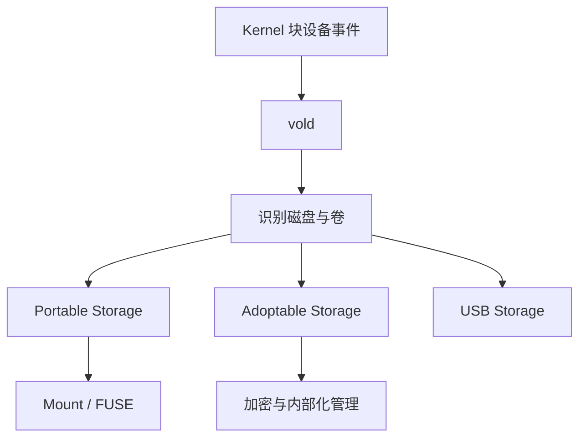

AOSP 的存储配置文档中可以看到 `voldmanaged` 配置和由 `vold` 管理介质插拔的设计。([Android Open Source Project](https://source.android.com/docs/core/storage/config-example?utm_source=chatgpt.com))ortable Storage 与 Adoptable Storage

## Portable Storage

典型：

- SD 卡
- USB U 盘

特点：

- 可拔出
- 可在其他设备读取
- 不属于设备内部可信存储的一部分
- 文件系统和权限能力可能有限

------

## Adoptable Storage

Android 6.0 开始支持。

它把外部介质“收编”为：

> 类似内部存储的一部分。

典型特点：

- 重新格式化
- 与特定设备绑定
- 加密
- 可存放应用和私有数据
- 介质移除可能导致应用不可用

Android 9 及以后，FBE 可以与 Adoptable Storage 配合；AOSP 还建议闪存型 Adopted Media 考虑 F2FS。([Android Open Source Project](https://source.android.com/docs/core/storage/adoptable?utm_source=chatgpt.com))

> 不要因为 SD 卡容量大就盲目 Adopt。

低质量 SD 卡可能造成：

- 应用启动缓慢
- I/O 卡顿
- 数据损坏风险
- 介质损坏后大量应用同时失效

------

# 应用如何使用存储

这是“Android 管理磁盘”的上层规则。

## 应用私有内部存储

通过：

```kotlin
context.filesDir
context.cacheDir
```

典型用途：

- 数据库
- 配置
- token
- 应用私有文件
- 缓存

普通第三方应用不能随意读取其他应用私有目录。

------

## App-Specific External Storage

通过：

```kotlin
context.getExternalFilesDir(null)
context.externalCacheDir
```

典型路径表现可能类似：

```text
/storage/emulated/0/Android/data/com.example.app/files
```

但应用应通过 API 获取，而不是拼字符串。

Android 官方建议应用按照数据生命周期和共享需求选择内部私有存储、应用专属外部目录、MediaStore 或 SAF。([Android Developers](https://developer.android.com/training/data-storage?utm_source=chatgpt.com))coped Storage

Scoped Storage 可翻译为：

> 分区存储、作用域存储

其核心思想不是“磁盘真的再切分一次”，而是：

> 每个应用拥有受约束的存储访问视图。

Android 10 引入这一模型；在 Android 11 及以后，面向 API 30 或更高版本的应用必须采用 Scoped Storage。([Android Developers](https://developer.android.com/training/data-storage/use-cases?utm_source=chatgpt.com))Scoped Storage 下的思维方式

旧思维：

```text
拿到存储权限
    |
扫描整个 /sdcard
    |
随意读写各种目录
```

现代思维：

```text
应用自己的文件
    |
App-Specific Storage

用户照片视频
    |
MediaStore

用户主动选择文档
    |
SAF

真正的文件管理器
    |
受严格限制的 MANAGE_EXTERNAL_STORAGE
```

------

## 推荐 API

| 数据类型            | 首选方案                    |
| ------------------- | --------------------------- |
| 应用私有永久数据    | `filesDir`                  |
| 应用缓存            | `cacheDir`                  |
| App-specific 大文件 | `getExternalFilesDir()`     |
| 照片、视频、音乐    | MediaStore                  |
| 用户文档            | SAF                         |
| 用户主动选择目录    | `ACTION_OPEN_DOCUMENT_TREE` |
| 真正全盘文件管理    | 特殊 All-files Access       |

Storage Access Framework 允许用户通过系统选择器明确授予应用某个文档或目录树访问权。([Android Developers](https://developer.android.com/training/data-storage/shared/documents-files?utm_source=chatgpt.com))`MANAGE_EXTERNAL_STORAGE` 不是“万能 Root”

即使应用拥有：

```text
MANAGE_EXTERNAL_STORAGE
```

它仍然不是 Linux root。

它主要提供共享存储范围的广泛访问，并受到 Android 平台与应用商店政策限制。Android 官方建议只有文件管理、备份恢复、文档管理等核心场景才考虑该权限。([Android Developers](https://developer.android.com/training/data-storage/manage-all-files?utm_source=chatgpt.com))取：

```text
/data/user/0/other.app
```

------

# 多用户如何影响存储

Android 支持：

- 主用户
- 次用户
- 工作资料
- 其他受管理配置文件
- 新版本中的私密空间等

因此：

```text
/storage/emulated/0
```

中的 `0` 是有意义的。

它通常对应主用户。

另一个用户可能对应：

```text
/storage/emulated/10
```

具体 ID 不应硬编码。

------

# 文件加密：FBE

FBE：

> File-Based Encryption
> 文件级加密

Android 7.0 开始支持；AOSP 要求所有以 Android 10 或更高版本首发的设备使用 FBE。([Android Open Source Project](https://source.android.com/docs/security/features/encryption/file-based?utm_source=chatgpt.com))为什么 FBE 比老式 FDE 更灵活

老式 Full-Disk Encryption：

```text
整个数据卷
    |
一个大的解锁状态
```

FBE：

```text
不同文件
    |
不同加密策略
    |
不同密钥
    |
可以分阶段解锁
```

因此产生两个重要概念。

### DE

Device Encrypted Storage

设备启动后、用户尚未输入锁屏凭据时，可访问的受保护数据。

### CE

Credential Encrypted Storage

需要用户凭据解锁后才能访问的数据。

------

## Direct Boot

于是设备可以：

```text
开机
 |
进入锁屏界面
 |
DE 数据可用
 |
闹钟等 Direct Boot-aware 服务工作
 |
用户输入 PIN / 密码
 |
CE 数据解锁
 |
完整用户环境可用
```

这就是 Direct Boot。([Android Open Source Project](https://source.android.com/docs/security/features/encryption/file-based?utm_source=chatgpt.com))etadata Encryption

FBE 主要解决：

> 文件内容如何加密。

但文件系统还存在元数据，例如：

- 文件名
- 目录结构
- inode 相关信息
- 某些属性

因此现代 Android 还有：

> Metadata Encryption

AOSP 的现代实现可以在块层使用 `dm-default-key`；内部存储与 Adoptable Storage 的具体要求随设备首发版本而变化。([Android Open Source Project](https://source.android.com/docs/security/features/encryption/metadata?utm_source=chatgpt.com))密和完整性验证不是一回事

这是非常重要的概念。

| 技术                | 解决的问题             |
| ------------------- | ---------------------- |
| FBE                 | 别人能否读取用户数据   |
| Metadata Encryption | 文件系统元数据是否泄露 |
| AVB                 | 启动的软件是否可信     |
| `dm-verity`         | 系统块内容是否被篡改   |
| SELinux             | 进程是否有权执行某操作 |

一句话：

> Encryption 主要保护 Confidentiality，Verified Boot 主要保护 Integrity 和 Authenticity。

------

# Android Verified Boot

AVB：

> Android Verified Boot

Android 8.0 及以后提供 AVB 参考实现，即 Verified Boot 2.0。([Android Open Source Project](https://source.android.com/docs/security/features/verifiedboot/avb?utm_source=chatgpt.com))

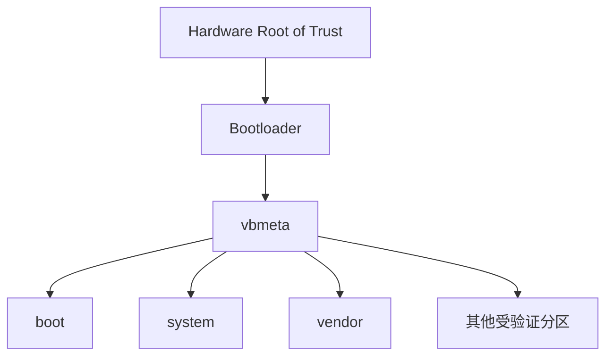

Verified Boot 的目标是建立完整信任链，让每一阶段验证下一阶段。([Android Open Source Project](https://source.android.com/docs/security/features/verifiedboot?utm_source=chatgpt.com))dm-verity`

`dm-verity` 在块设备层提供完整性验证。

粗略模型：

```text
system block data
        |
      hash
        |
 Merkle Hash Tree
        |
 expected root hash
        |
 trusted metadata
```

读取某个数据块时，可以验证：

> 这个块是否与签名认可的系统镜像一致。

AOSP 将 `dm-verity` 定义为验证块设备内容是否符合预期配置的机制。([Android Open Source Project](https://source.android.com/docs/security/features/verifiedboot/dm-verity?utm_source=chatgpt.com))/system` 会遇到现代 Android 的根本障碍：

- 文件系统可能只读
- 动态分区
- AVB
- `dm-verity`
- A/B
- OTA 一致性要求

这也是现代 Root 强调：

> Systemless

的重要原因。

------

# SELinux：为什么 root 也不一定能做任何事

传统 Linux 教程经常说：

```text
uid 0 = 无所不能
```

Android 上这不够准确。

Android 使用 SELinux：

> Security-Enhanced Linux

执行强制访问控制：

> Mandatory Access Control，MAC

AOSP 明确说明 SELinux 对所有进程执行 MAC，包括拥有 root/superuser 权限的进程。([Android Open Source Project](https://source.android.com/docs/security/features/selinux?utm_source=chatgpt.com))：

```text
uid = 0
```

仍可能因 SELinux policy 被拒绝。

例如：

```text
DAC 判断：允许
SELinux 判断：拒绝
最终结果：拒绝
```

所以：

> Android Root ≠ 关闭 SELinux。

实际上，把生产设备长期改成 Permissive 是很差的安全实践；AOSP 也说明 production device 不支持 permissive，兼容性测试要求 enforcing。([Android Open Source Project](https://source.android.com/docs/security/features/selinux/validate?utm_source=chatgpt.com))ndroid 如何统计和限制磁盘使用

## `df` 与 `du` 是不同问题

`df`：

> 文件系统整体还有多少块空间。

`du`：

> 某个目录树中的文件累计占用了多少空间。

所以出现：

```text
df: 磁盘很满
du: 找不到那么多文件
```

不一定是异常。

可能原因：

- 已删除但仍被进程打开的文件
- 文件系统保留空间
- 元数据
- Snapshot/COW
- 权限导致 `du` 无法遍历
- 不同挂载点
- inode 问题
- 稀疏文件
- quota 视图差异

------

## Quota

Android 8.0 起，AOSP 支持利用 ext4 quota 快速获取存储统计。

在启用相应实现时，quota 还可以防止单一应用占用过高比例的磁盘空间或 inode；AOSP 的 faster stats 设计提到 90% 磁盘空间与 50% inode 的应用级限制机制。([Android Open Source Project](https://source.android.com/docs/core/storage/faster-stats?utm_source=chatgpt.com))不应被理解成所有厂商、所有分区都机械执行同一简单规则。

它属于 Android 存储统计与稳定性机制的一部分。

------

# inode：磁盘有空间为什么还不能创建文件

一个文件系统不仅需要：

```text
数据块
```

还需要保存：

```text
文件元数据
```

如果产生数百万小文件，可能：

```text
剩余容量还有很多
```

但：

```text
inode 或元数据资源耗尽
```

于是无法继续创建文件。

这类问题特别容易由：

- 日志泄漏
- 小缓存文件泄漏
- 应用错误生成海量临时文件

造成。

------

# Cache 与真正的数据不同

应用开发时应明确：

| 类型      | 示例             | 系统是否可合理回收 |
| --------- | ---------------- | ------------------ |
| 用户数据  | 文档、项目       | 不应随意删除       |
| 应用状态  | 数据库           | 通常不可随意删除   |
| Cache     | 缩略图、下载副本 | 可以重新生成       |
| Temporary | 临时转换结果     | 生命周期短         |

Android 应用不应该：

```text
把重要用户数据放进 cacheDir
```

因为 Cache 的语义就是：

> 必要时可以清理。

Android 11 以后，Scoped Storage 应用只能直接访问自己的 app-specific cache；系统还提供存储管理 Intent 让用户参与空间清理。([Android Developers](https://developer.android.com/about/versions/11/privacy/storage?utm_source=chatgpt.com))RIM、闪存 GC 与磨损

闪存不能像机械硬盘那样无限直接覆盖。

底层会涉及：

- Erase Block
- Garbage Collection
- Wear Leveling
- Write Amplification
- TRIM / DISCARD

Android 对 Adoptable Storage 的空闲维护会执行相应 trim 操作；闪存介质本身还依赖固件的 Wear Leveling。([Android Open Source Project](https://source.android.com/docs/core/storage/adoptable?utm_source=chatgpt.com))

- 高频 `fsync` 风暴
- 无限日志
- 不断重写巨大文件
- 海量小文件抖动
- 磁盘长期接近 100% 满

因为长期低剩余空间会让：

- GC 更困难
- 写放大增加
- OTA 临时空间不足
- 应用数据库维护困难

------

# 为什么“256 GB 手机”可用空间少很多

可以把容量消耗分成：

```text
标称物理容量
- 十进制与二进制显示差异
- GPT 和固定分区
- super 中系统镜像
- boot 与 A/B 启动分区
- 文件系统元数据
- 加密元数据
- 厂商预装内容
- OTA Snapshot 临时空间
- Cache 和应用数据
= 用户可见剩余空间
```

尤其 Virtual A/B 更新期间，COW Snapshot 需要额外临时空间；Android 12 起支持压缩 Virtual A/B Snapshot 以降低这一开销。([Android Open Source Project](https://source.android.com/docs/core/ota/virtual_ab?utm_source=chatgpt.com))用磁盘诊断方法

## 基础检查

Android 官方的 `adb` 提供设备 Unix shell 访问能力。([Android Developers](https://developer.android.com/tools/adb?utm_source=chatgpt.com))：

```bash
adb shell df -h
```

重点观察：

```text
/data
/system
/vendor
/product
```

但现代系统可能显示 mapper 设备。

------

## 查看挂载关系

```bash
adb shell mount
```

或：

```bash
adb shell cat /proc/mounts
```

关注：

```text
/dev/block/mapper/...
/data
/system
/vendor
```

------

## 查看块设备

```bash
adb shell cat /proc/partitions
```

某些设备可以：

```bash
adb shell ls -l /dev/block/by-name
```

权限和路径依设备而异。

------

## 查看当前 Slot

```bash
adb shell getprop ro.boot.slot_suffix
```

可能得到：

```text
_a
```

或：

```text
_b
```

还可以尝试：

```bash
fastboot getvar current-slot
```

具体 Bootloader 支持情况不同。

------

## 查看目录使用量

例如：

```bash
adb shell du -h -d 1 /sdcard
```

但：

- Toybox 参数支持可能随版本不同
- 普通 shell 看不到许多私有目录
- Scoped Storage 与 SELinux 会限制结果

因此不要看到：

```text
Permission denied
```

就认为文件不存在。

------

## 一个推荐的排查顺序

```text
df -h
 |
确认哪个文件系统满
 |
确认挂载设备
 |
区分 /data 与 /sdcard
 |
检查可访问目录 du
 |
检查大型应用
 |
检查 cache
 |
考虑 Snapshot / OTA
 |
考虑权限不可见数据
 |
Root 环境再做底层检查
```

------

# 应用开发的存储最佳实践

## 根据“数据语义”选位置

不要根据：

> 哪个目录写得进去

决定存储位置。

应根据：

> 数据属于谁、是否共享、卸载后是否保留、是否敏感

决定。

推荐决策：

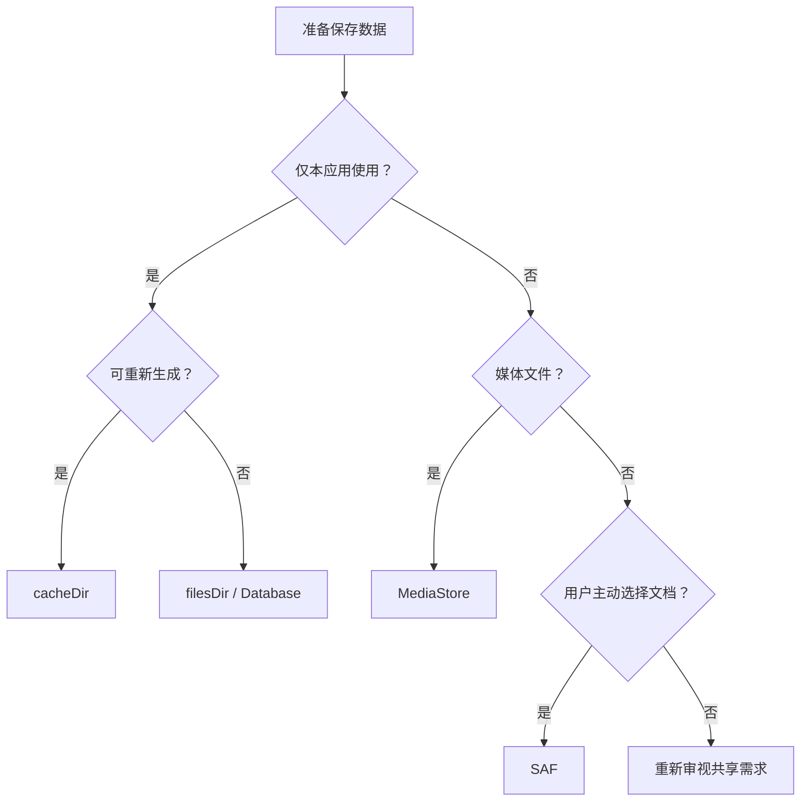

Android 官方存储指南正是按这种数据归属和共享需求组织 API。([Android Developers](https://developer.android.com/training/data-storage?utm_source=chatgpt.com))不要硬编码 `/sdcard`

差：

```kotlin
File("/sdcard/MyApp/data.json")
```

更好：

```kotlin
val file = File(context.filesDir, "data.json")
```

共享文档则使用 SAF。

------

## 不要请求超出需求的权限

尤其：

```text
MANAGE_EXTERNAL_STORAGE
```

不是普通应用的便利开关。([Android Developers](https://developer.android.com/training/data-storage/manage-all-files?utm_source=chatgpt.com))敏感数据不要随意放共享存储

旧版 Android 的广泛共享存储权限模型曾导致其他应用可访问敏感文件；现代 Scoped Storage 虽显著改善隔离，但安全设计仍应优先使用应用私有存储。([Android Developers](https://developer.android.com/privacy-and-security/risks/sensitive-data-external-storage?utm_source=chatgpt.com))统更新：先建立总图

Android 更新不是一种机制。

至少应区分：

| 更新类型     | 更新对象               |
| ------------ | ---------------------- |
| 应用商店更新 | 普通 APK               |
| OEM OTA      | 完整 Android 系统      |
| A/B OTA      | Slot 系统镜像          |
| Virtual A/B  | Snapshot 式系统更新    |
| Mainline     | 模块化系统组件         |
| APEX 更新    | 底层系统模块           |
| DSU          | 临时试运行其他系统镜像 |

AOSP 目前明确将 Virtual A/B 描述为 Android 的主要更新机制，并指出 Non-A/B 在 Android 15 中已进入弃用路径；现代设备还可以通过 Mainline 独立更新部分系统组件。([Android Open Source Project](https://source.android.com/docs/core/ota/virtual_ab?utm_source=chatgpt.com))ull OTA 与 Incremental OTA

## Full OTA

完整更新包含目标系统最终状态。

概念：

```text
当前版本是什么
    |
只要满足 OTA 前置条件
    |
写入完整目标版本
```

优点：

- 对源版本依赖较低
- 恢复能力强

缺点：

- 下载大

------

## Incremental OTA

增量更新描述：

```text
版本 A
  |
变化
  |
版本 B
```

优点：

- 下载小

缺点：

- 严格依赖源版本
- 源镜像被修改后容易失败

AOSP 的 OTA 工具能够生成 Full 和 Incremental OTA；Full OTA 包含目标设备最终状态，而增量包依赖源构建。([Android Open Source Project](https://source.android.com/docs/core/ota/tools?utm_source=chatgpt.com)) 用户常遇到的问题：

> 你修改了系统环境后，增量 OTA 不再满足预期源状态。

------

# 传统 Non-A/B 更新

老式模型大致：

```text
当前系统
 |
下载 OTA
 |
重启 Recovery
 |
原地修改 system
 |
重启
```

问题：

- 更新期间设备不能正常使用
- 失败可能破坏当前唯一系统
- Recovery 阶段耗时

这已经不是理解现代设备的最佳中心模型。

------

# Legacy A/B 更新

A/B：

```text
Slot A
Slot B
```

假设当前运行：

```text
A
```

更新：

```text
A 当前运行
 |
后台写 B
 |
重启
 |
Bootloader 选择 B
 |
B 成功
```

如果 B 启动失败：

```text
回到 A
```

AOSP 将这种机制称为 Seamless Update：更新可在当前系统运行时进行，真正停机时间主要是重启，而且失败可退回旧 Slot。([Android Open Source Project](https://source.android.com/docs/core/ota/ab?utm_source=chatgpt.com))Legacy A/B 图

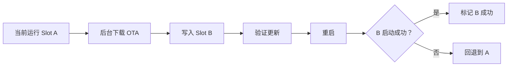

------

## Legacy A/B 的代价

如果：

```text
system_a
system_b
vendor_a
vendor_b
product_a
product_b
```

都保存完整两份，会产生显著空间开销。

于是出现：

> Virtual A/B

------

# Virtual A/B：现代更新的核心

这是全文更新机制中最重要的部分。

首先纠正一个误解：

> Virtual A/B 并不是简单地“所有大型动态分区仍保存两份完整物理副本”。

AOSP 明确指出，Virtual A/B 对动态分区并没有真正的额外完整 Slot；更新差异写入 Snapshot/COW，确认新系统成功后再合并回 Base Partition。([Android Open Source Project](https://source.android.com/docs/core/ota/virtual_ab?utm_source=chatgpt.com))核心思想

启动关键分区仍可能保持 A/B：

```text
boot_a
boot_b
```

但是大型动态分区：

```text
system
vendor
product
```

主要使用：

```text
Base Partition
+
Snapshot COW
```

模拟新版本视图。

------

## 简化模型

更新前：

```text
Base = Old System
```

更新过程中：

```text
Base = Old System
COW  = New Changes
```

新系统启动时看到：

```text
Virtual View = Base + COW
```

启动成功：

```text
COW Merge into Base
```

------

## Mermaid 图

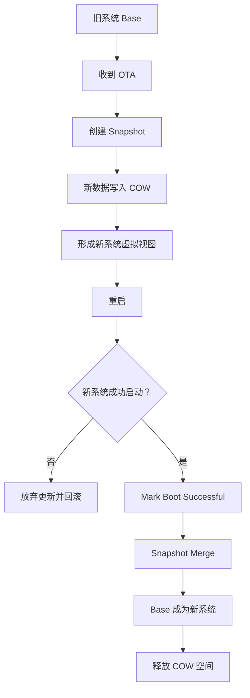

------

# Virtual A/B 的完整更新时序

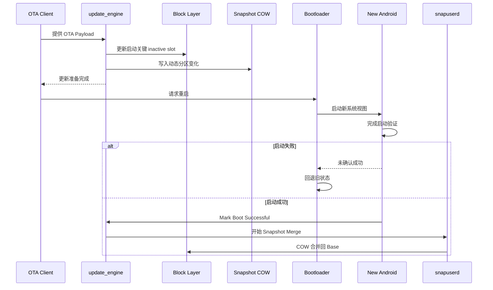

AOSP 描述的实现使用 Android Snapshot 格式；动态分区更新数据进入 COW，之后由 `snapuserd` 等用户空间组件参与合并。([Android Open Source Project](https://source.android.com/docs/core/ota/virtual_ab?utm_source=chatgpt.com))update_engine`

A/B 和 Virtual A/B 系统中，一个核心组件是：

```text
update_engine
```

它负责更新 Payload 的实际应用过程。

高层流程：

```text
OTA Client
    |
下载 / 流式获取 Payload
    |
update_engine
    |
检查操作
    |
写 inactive slot 或 snapshot
    |
post-install
    |
准备重启
```

Legacy A/B 支持 Streaming Update，因此并非总要把完整 OTA ZIP 先存进 `/data`；AOSP 还支持在写入后的系统上运行 Post-install 操作。([Android Open Source Project](https://source.android.com/docs/core/ota/ab?utm_source=chatgpt.com))oot Successful 为什么重要

更新完成后不能立即认定：

> 新系统永久有效。

因为它可能：

- Kernel panic
- Framework bootloop
- 核心服务启动失败

因此：

```text
启动新版本
 |
观察是否成功
 |
Mark Boot Successful
```

只有成功确认后，系统才进一步进入稳定状态和合并流程。

Virtual A/B 的合并时机与 Boot Successful 状态紧密相关。([Android Open Source Project](https://source.android.com/docs/core/ota/virtual_ab/implement-patches?utm_source=chatgpt.com))新失败为什么可以回滚

## Slot 层回退

新 Slot 启动失败：

```text
B fails
 |
Bootloader retry policy
 |
A
```

------

## Snapshot 层回退

如果新动态分区虚拟视图有问题，而 Merge 尚未进入不可逆状态：

```text
Base Old
+
COW New
```

可以放弃 Snapshot，恢复旧状态。

Virtual A/B 官方目标之一正是提供可回滚更新。([Android Open Source Project](https://source.android.com/docs/core/ota/virtual_ab?utm_source=chatgpt.com))ollback 与 Downgrade 不是同一回事

这是非常关键的区别。

### 更新失败回滚

```text
新版本尚未被正式确认
    |
失败
    |
返回先前可工作版本
```

### 恶意降级

```text
已经运行并确认新版
    |
攻击者刷入有已知漏洞旧版
```

第二种需要：

> Rollback Protection

Android Verified Boot 可以利用防篡改存储记录版本信息，拒绝启动低于已记录 rollback index 的镜像。([Android Open Source Project](https://source.android.com/docs/security/features/verifiedboot/verified-boot?utm_source=chatgpt.com))/B FAQ 还特别解释：新系统尚未成功确认之前回到旧 Slot，与成功升级后恶意降级不是同一种情况。([Android Open Source Project](https://source.android.com/docs/core/ota/ab/ab_faqs?utm_source=chatgpt.com))/data` 怎么办：系统回滚不等于用户数据回滚

假设：

```text
系统 A
 |
升级到系统 B
 |
B 修改数据库格式
```

然后 B 启动失败。

即使系统分区回到 A：

```text
/data
```

可能已经被 B 修改。

怎么办？

Android 10 引入：

> User Data Checkpoint，UDC

用于在 OTA 失败场景保护用户数据状态。F2FS 可利用文件系统 checkpoint；其他场景可以使用 `dm-bow` 等块层机制。([Android Open Source Project](https://source.android.com/docs/core/ota/user-data-checkpoint?utm_source=chatgpt.com))理解的原则：

> “系统镜像可回滚”与“用户数据可安全回滚”是两个独立问题。

------

# Dynamic Partitions 与 Virtual A/B 的关系

它们不是同一技术。

| 技术                | 解决的问题                    |
| ------------------- | ----------------------------- |
| Dynamic Partitions  | 分区大小如何动态管理          |
| A/B                 | 更新如何保留可启动旧系统      |
| Virtual A/B         | 如何减少 A/B 大型分区双份空间 |
| Snapshot            | 如何保存更新差异              |
| AVB                 | 如何验证系统可信              |
| Rollback Protection | 如何阻止恶意降级              |

典型组合：

```text
super
 |
Dynamic Partitions
 |
dm-linear
 |
Virtual A/B Snapshot
 |
Filesystem
```

------

# Mainline：系统更新不再只有“大 OTA”

Android 10 引入 Mainline。

目标：

> 将部分 Android 系统组件模块化，使其可以脱离完整平台 OTA 周期单独更新。

([Android Open Source Project](https://source.android.com/docs/core/ota/modular-system?utm_source=chatgpt.com))ndroid 更新可能分为：

```text
OEM Firmware OTA
+
Mainline Module Update
+
普通 App Update
```

------

## 为什么 Mainline 很重要

传统：

```text
一个底层系统库有严重漏洞
 |
等 OEM 做完整 OTA
 |
运营商测试
 |
用户收到更新
```

Mainline：

```text
组件被模块化
 |
独立构建和测试
 |
通过支持的分发基础设施更新
```

当然：

- 哪些模块可更新
- 谁分发
- 设备是否支持
- OEM 如何集成

仍依设备生态而异。

------

# APEX

APEX：

> Android Pony EXpress

这是为普通 APK 模型不适合承载的底层系统组件设计的容器格式。

典型对象可能包括：

- Native Service
- Native Library
- Runtime
- Class Library

AOSP 从 Android 10 引入 APEX 作为底层系统模块更新格式。([Android Open Source Project](https://source.android.com/docs/core/ota/apex?utm_source=chatgpt.com))APK 与 APEX 的概念区别

| 项目            | APK          | APEX                |
| --------------- | ------------ | ------------------- |
| 主要对象        | Android 应用 | 底层系统模块        |
| Java App 模型   | 是           | 不以普通 App 为中心 |
| Native 底层组件 | 有限制       | 主要用途之一        |
| 启动早期可用性  | 较有限       | 可用于底层系统      |
| 完整性保护      | APK 签名     | APEX 签名与验证机制 |

APEX 还结合 hash tree 与 `dm-verity` 提供内容完整性保护。([Android Open Source Project](https://source.android.com/docs/core/ota/apex?utm_source=chatgpt.com))SU 不是正常 OTA

DSU：

> Dynamic System Updates

用于：

> 临时下载并试运行另一个 Android System Image。

它更偏：

- 开发
- 测试
- GSI
- 系统验证

不是普通用户意义上的日常 OEM 更新。

AOSP 描述 DSU 的目标就是让用户试运行系统镜像，而不破坏当前系统镜像。([Android Open Source Project](https://source.android.com/docs/core/ota/dynamic-system-updates?utm_source=chatgpt.com))新机制总结图

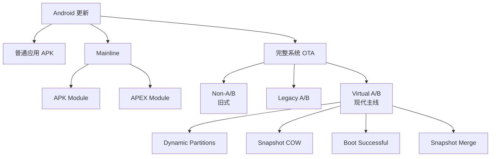

------

# 现代 Root：先纠正最常见的概念混淆

Root 至少涉及五件不同事情：

```text
Bootloader Unlock
Root Privilege
Verified Boot
System Modification
Root Detection
```

它们不是一个东西。

------

## Bootloader Unlock

解锁 Bootloader 的含义更接近：

> 允许设备接受用户自行刷入的软件镜像。

AOSP 把设备状态分为：

```text
LOCKED
UNLOCKED
```

LOCKED 阻止随意刷写新软件；UNLOCKED 允许修改。([Android Open Source Project](https://source.android.com/docs/security/features/verifiedboot/device-state?utm_source=chatgpt.com))``bash
fastboot flashing unlock

```
但只有设备厂商支持并允许时才有效。

---

## 解锁为什么通常清空数据

这是安全需求，不只是“厂商故意折腾用户”。

假设：

```text
偷到一台锁屏手机
 |
解锁 Bootloader
 |
刷入恶意系统
 |
读取原 /data
```

如果解锁不擦除数据，就存在严重风险。

因此 AOSP 设计要求用户确认解锁时执行 Factory Data Reset 来防止未授权数据访问。([Android Open Source Project](https://source.android.com/docs/core/architecture/bootloader/locking_unlocking?utm_source=chatgpt.com))Root 是什么

Linux 层面通常意味着：

```text
UID 0
```

但 Android Root 框架实际还要解决：

- 谁能调用 `su`
- 如何鉴权
- SELinux 如何配合
- 启动时如何注入
- 如何加载模块
- 如何修改只读系统视图

所以现代 Root 不是简单复制一个：

```text
/system/bin/su
```

------

# Root、Unlock、AVB 的关系

推荐这样理解：

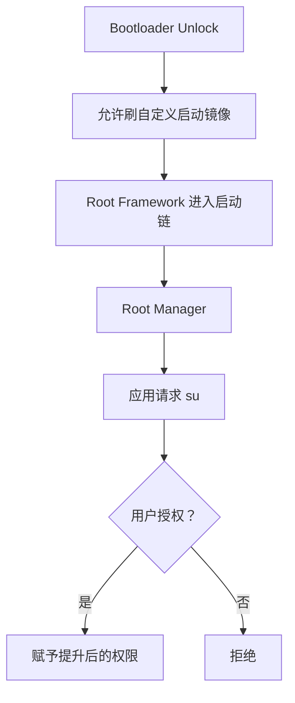

解锁 Bootloader：

> 打开“安装自定义底层软件”的门。

Root Framework：

> 在启动后的 Android 中提供权限提升机制。

------

# 为什么现代 Root 强调 Systemless

传统方式：

```text
直接修改 /system
```

现代问题：

- `/system` 常为只读
- Dynamic Partitions
- `dm-verity`
- AVB
- A/B OTA
- Incremental OTA
- EROFS 可能本身不可写

因此现代 Root 倾向：

```text
保持原 system 镜像
 |
启动时建立覆盖视图
 |
让进程“看到修改后的系统”
```

这种思想称：

> Systemless Modification

它不是说：

> 磁盘完全没有任何修改。

Root 往往仍会修改：

- `boot`
- `init_boot`
- Kernel
- ramdisk

“Systemless”重点通常是：

> 不直接改写 `/system` 等只读系统镜像。

------

# Magisk

Magisk 是当前最成熟的现代 Android Root 与修改框架之一。

官方项目列出的核心能力包括：

- MagiskSU
- Magisk Modules
- MagiskBoot
- Zygisk

([GitHub](https://github.com/topjohnwu/Magisk?utm_source=chatgpt.com))Magisk 的基本原理

高层模型：

```text
官方 boot / init_boot / recovery image
 |
Magisk App Patch
 |
生成 patched image
 |
刷入对应分区
 |
启动时 Magisk 进入早期用户空间
 |
启动 Magisk 服务
 |
提供 su 和模块机制
```

具体修补对象取决于设备布局。

Magisk 官方安装文档明确要求根据设备 ramdisk 与分区布局选择：

```text
boot.img
init_boot.img
recovery.img
```

而不是所有设备都无脑刷 `boot.img`。([Topjohnwu](https://topjohnwu.github.io/Magisk/install.html?utm_source=chatgpt.com))Magisk 架构示意

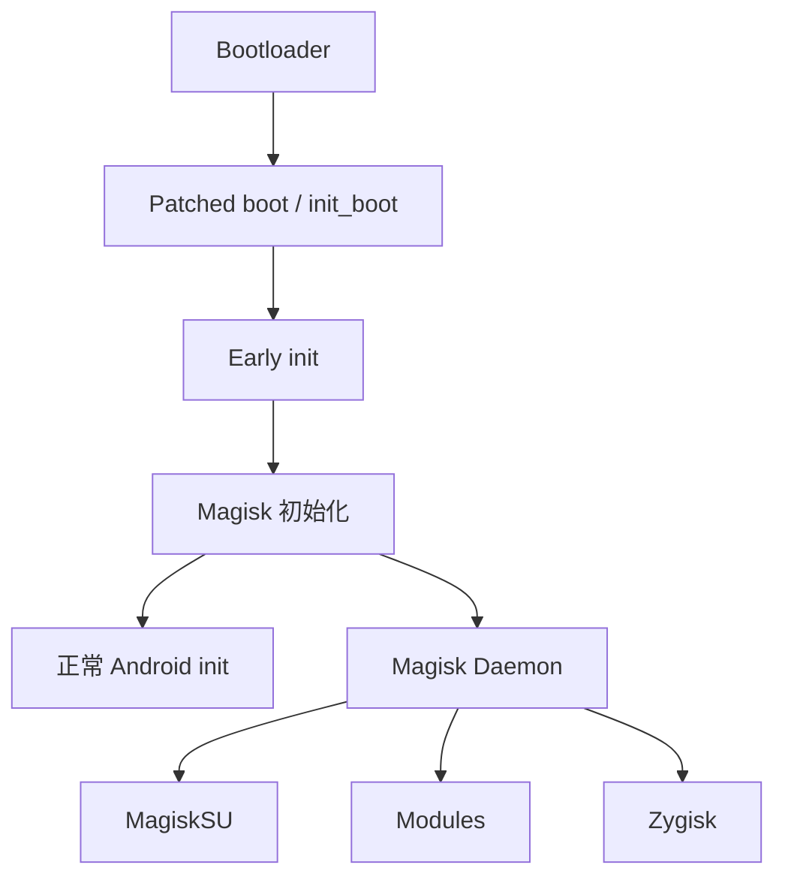

------

## MagiskSU

核心作用：

```text
普通应用
 |
请求 su
 |
Magisk 管理层
 |
检查授权策略
 |
允许或拒绝
```

这比：

```text
任何应用都能直接 uid 0
```

安全得多。

------

## Magisk Modules

模块可以提供：

- 替换文件视图
- 添加文件
- 属性修改
- 启动脚本
- SELinux 规则扩展

Magisk 官方开发文档描述了模块目录、Systemless 文件替换、`system.prop`、`sepolicy.rule` 等机制。([Topjohnwu](https://topjohnwu.github.io/Magisk/guides.html?utm_source=chatgpt.com))Zygisk

Zygisk：

> 让模块代码在 Android 应用进程完成 specialization 之前进入相应 Zygote 派生流程。

Magisk 官方描述为：

> 模块开发者可以在应用进程完成 specialization 并运行之前执行代码。

([Topjohnwu](https://topjohnwu.github.io/Magisk/guides.html?utm_source=chatgpt.com))- 应用进程级 Hook 框架

- 特殊模块

但也意味着：

- 进程稳定性风险
- 模块兼容性问题
- 攻击面扩大

------

# KernelSU

KernelSU 的核心区别是：

> Root 权限核心工作进入 Kernel Space。

官方定义是：

> 在 Kernel Mode 中工作，并直接在内核空间向用户空间应用授予 Root 权限。

([kernelsu.org](https://kernelsu.org/guide/what-is-kernelsu.html?utm_source=chatgpt.com))架构模型

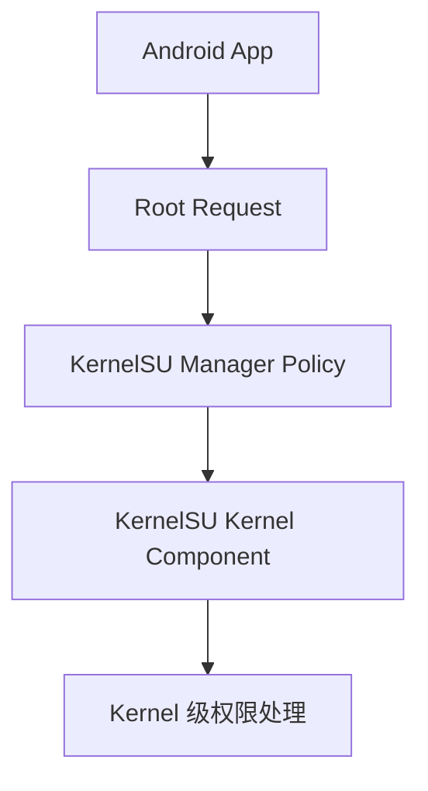

与 Magisk 的中心差异可以粗略理解为：

```text
Magisk:
Boot / Init 用户空间路径为核心

KernelSU:
Kernel 中的 Root 能力为核心
```

这是架构层面的简化，不代表 KernelSU 完全没有用户空间组件。

------

## KernelSU 现代兼容性

截至当前官方文档：

- 官方支持重点是 GKI 设备
- 官方 FAQ 指向 GKI Linux Kernel 5.10+
- 需要解锁 Bootloader
- 非 GKI 的旧式集成已经不属于当前官方主要支持范围

([kernelsu.org](https://kernelsu.org/guide/faq.html?utm_source=chatgpt.com))：

```text
我的手机是 Android 14
```

就直接推导：

```text
一定支持 KernelSU
```

必须检查：

- Kernel Version
- GKI
- KMI
- 设备架构
- Boot Image
- 官方 Manager 检测

------

## GKI Mode 与 LKM Mode

当前 KernelSU 官方安装体系还区分不同模式。

### GKI Mode

概念：

```text
运行包含 KernelSU 能力的 GKI Kernel
```

### LKM Mode

概念：

```text
利用 Loadable Kernel Module 路径
```

KernelSU 官方安装文档说明 LKM 模式可通过官方固件镜像进行 Patch；在具有 `init_boot` 布局的现代设备上，所操作镜像可能不同于传统 `boot`。([kernelsu.org](https://kernelsu.org/guide/installation.html?utm_source=chatgpt.com))照搬命令。

------

## KernelSU App Profile

KernelSU 的一个有价值设计是 App Profile。

对于获得 Root 的应用，可以限制：

- UID
- GID
- Groups
- Linux Capabilities
- SELinux Rules

([kernelsu.org](https://kernelsu.org/guide/app-profile.html?utm_source=chatgpt.com)) Root 最佳实践：

> 不要把“Root”理解为只能二选一：无权限或无限权限。

可以尽量实践：

> Principle of Least Privilege
> 最小权限原则

------

## KernelSU 模块系统

KernelSU 当前官方架构强调：

> Metamodule

也就是把某些模块挂载基础设施从核心中抽离为插件机制。普通模块若需要修改 `/system` 视图，可以依赖相应 Metamodule。([kernelsu.org](https://kernelsu.org/guide/what-is-kernelsu.html?utm_source=chatgpt.com))

> KernelSU 就是“内核版 Magisk”。

两者模块架构和 Root 执行位置并不完全相同。

------

# APatch

APatch 是另一种现代 Kernel-based Root 方案。

官方定位：

> Kernel-based root solution

并依赖：

> KernelPatch

([apatch.dev](https://apatch.dev/?utm_source=chatgpt.com))高层模型

```text
boot.img
 |
提取 Kernel
 |
KernelPatch
 |
注入 APatch / KP 能力
 |
重新打包 boot.img
 |
启动 patched kernel
```

APatch 官方安装流程确实以选择 `boot.img`、Patch Kernel、生成新镜像为核心。([apatch.dev](https://apatch.dev/install.html?utm_source=chatgpt.com))SuperKey

APatch 使用：

> SuperKey

作为其 Root 权限体系中的关键认证元素。

官方安装文档要求设置强 SuperKey，并明确拒绝弱密钥。([apatch.dev](https://apatch.dev/install.html?utm_source=chatgpt.com)) SuperKey 不是可以随便写 `12345678` 的普通 UI 密码。

它应视为高敏感凭据。

------

## APatch 当前兼容边界

截至 2026 年官方安装文档：

- ARM64
- Android Kernel 3.18 至 6.12
- 某些 Kernel 版本和品牌仍有实际兼容性限制

([apatch.dev](https://apatch.dev/install.html?utm_source=chatgpt.com))内核版本数字在范围内”不等于“你的设备一定安全兼容”。

------

# 三大现代 Root 方案比较

| 特征               | Magisk                                 | KernelSU            | APatch                |
| ------------------ | -------------------------------------- | ------------------- | --------------------- |
| 主要架构中心       | Boot/Init 用户空间                     | Kernel              | Kernel Patch          |
| 常见安装对象       | `boot`、`init_boot`、部分设备 recovery | Kernel/GKI/LKM 路径 | `boot.img` 中 Kernel  |
| Root 管理          | MagiskSU                               | Kernel 级能力       | Kernel 级能力         |
| 模块               | 成熟 Magisk Module                     | Module + Metamodule | APModule              |
| Kernel Module 扩展 | 不是核心定位                           | 架构相关            | KPM                   |
| Zygote 注入        | Zygisk                                 | 非核心原生定位      | 非 Magisk Zygisk 模型 |
| 新手难度           | 相对较低                               | 中等                | 中高                  |
| 设备依赖           | 中等                                   | 强依赖 Kernel/GKI   | 强依赖 Kernel         |
| 生态成熟度         | 很高                                   | 高且快速发展        | 较新                  |

对应当前项目官方资料：Magisk 提供 MagiskSU、Modules、Zygisk；KernelSU 在内核空间授予 Root，并采用 Metamodule 架构；APatch 基于 KernelPatch 并支持 APModule/KPModule。([GitHub](https://github.com/topjohnwu/Magisk?utm_source=chatgpt.com))oot 为什么经常影响 OTA

假设当前：

```text
Slot A 正常运行
```

你 Root 了：

```text
boot_a
```

OTA 更新可能：

```text
写 boot_b
```

然后重启：

```text
进入 Slot B
```

`boot_b` 是官方原版。

于是：

```text
Root 消失
```

这不是神秘 Bug。

而是：

> 你 Root 的是 A，更新后启动 B。

------

## Virtual A/B 仍然有同类问题

即使大型动态分区采用 Snapshot：

- `boot`
- `init_boot`
- 其他启动关键物理分区

仍可能按 Slot 更新。

所以 Root 与 OTA 的关系仍需围绕：

```text
当前 Slot
Inactive Slot
目标 Boot Image
```

理解。

------

# Magisk 与 OTA

典型思想是：

```text
当前 A 已 Root
 |
OTA 写 B
 |
B 还是 Stock
 |
在重启进入 B 前
 |
对目标 inactive slot 做正确处理
 |
重启 B
```

但具体操作高度依赖：

- 设备
- Magisk 版本
- OTA 客户端
- 是否 Virtual A/B
- `boot` 或 `init_boot`
- 厂商 Bootloader

因此本文不建议把任何：

```text
“OTA 后点这个按钮，100% 保 Root”
```

视为通用规则。

------

# Root 与 AVB 的真实关系

很多旧教程会让用户直接：

```bash
fastboot --disable-verity --disable-verification ...
```

这是一种非常粗暴的思路。

不应形成：

> Root 必须关闭所有 AVB。

这种结论。

现代 Root 方案往往尽量在特定启动镜像路径工作，而不是要求用户无差别禁用所有验证。

Magisk 官方安装文档虽然记录了某些独立 `vbmeta` 设备的可选处理方式，但也明确是设备相关路径。([Topjohnwu](https://topjohnwu.github.io/Magisk/install.html?utm_source=chatgpt.com)) 没有设备级必要性时，不要凭旧教程随意刷 `vbmeta --disable-verity --disable-verification`。

------

# 解锁状态与 AVB Boot State

AOSP 的 Boot Flow 定义了典型状态：

- GREEN
- YELLOW
- ORANGE
- RED

其中：

> UNLOCKED 设备通常表现为 ORANGE 状态警告。

([Android Open Source Project](https://source.android.com/docs/security/features/verifiedboot/boot-flow?utm_source=chatgpt.com))镜像能启动：

```text
设备仍可能明确知道 Bootloader 是 Unlocked
```

这也是为什么：

> Root 隐藏

和：

> Bootloader Unlock 隐藏

是不同难度的问题。

------

# Root Hide 不等于 Root 原理

新手常把 Root 教程变成：

```text
怎么让银行 App 看不见
```

这实际上是另一个领域：

- Boot State
- Attestation
- Play Integrity
- Kernel 特征
- Mount Namespace
- Process Injection
- Package Detection
- Filesystem Artifacts

这些检测方式不断变化。

因此：

> Root 是否成功

与：

> 某 App 是否检测到 Root

是两个独立问题。

本文不建议把“绕过检测”当成学习 Root 原理的主线。

------

# Root 最佳实践

## 必须保留原厂镜像

至少保存与你当前 Build 完全匹配的：

```text
boot.img
init_boot.img
vendor_boot.img
vbmeta.img
```

不一定每台设备都需要全部，但保留完整原厂固件最安全。

------

## Patch 当前 Build 对应镜像

最危险的常见错误：

```text
手机运行 Build B
 |
下载 Build A 的 boot.img
 |
Patch
 |
刷入
```

可能造成：

- Bootloop
- Kernel module 不匹配
- Vendor 不匹配
- KMI 不匹配

原则：

> 优先使用与当前正在运行的固件 Build 精确匹配的原始镜像。

Magisk 和 KernelSU 官方安装流程都围绕从设备对应固件获取正确 Boot Image 展开。([Topjohnwu](https://topjohnwu.github.io/Magisk/install.html?utm_source=chatgpt.com))永远知道当前 Slot

Root 前检查：

```bash
adb shell getprop ro.boot.slot_suffix
```

或 Bootloader 支持时：

```bash
fastboot getvar current-slot
```

否则很容易：

```text
你以为刷 A
实际上设备启动 B
```

------

## 不要随意锁回 Bootloader

极重要。

如果设备当前运行：

```text
修改过的 boot
```

你直接：

```bash
fastboot flashing lock
```

锁回 Bootloader 后，验证链可能拒绝该镜像。

可能造成：

- 无法启动
- 数据擦除
- 恢复困难

原则：

> 只有在完整恢复厂商认可的、与设备当前版本匹配的签名镜像之后，才考虑重新 Lock。

设备 Locked/Unlocked 状态直接决定刷写能力和验证行为。([Android Open Source Project](https://source.android.com/docs/core/architecture/bootloader/locking_unlocking?utm_source=chatgpt.com))不要关闭 SELinux 解决所有问题

差的做法：

```bash
setenforce 0
```

然后：

> 好了，模块能跑了。

这等于把安全问题藏起来。

更合理：

```text
查看 AVC Denial
 |
确定真正需要的访问
 |
最小化 Policy 修改
 |
保持 Enforcing
```

AOSP 明确不支持生产设备长期 Permissive。([Android Open Source Project](https://source.android.com/docs/security/features/selinux/validate?utm_source=chatgpt.com))Root 授权遵循最小权限

不要：

```text
任何 App 请求 root
 |
Allow Forever
```

尤其避免给：

- 闭源来源不明工具
- 破解 APK
- 随机清理器
- 不可信模块

Root。

KernelSU App Profile 对 UID、GID、Capabilities 和 SELinux Rules 的限制正体现了最小权限思想。([kernelsu.org](https://kernelsu.org/guide/app-profile.html?utm_source=chatgpt.com))模块比 Root 本体更容易引发 Bootloop

很多故障不是 Root 核心造成，而是：

- Module 修改 `system_server`
- Zygisk Module 崩溃
- 错误 SELinux Policy
- Boot Script 死循环
- Overlay 错误
- Native Library ABI 不匹配

因此模块安装策略：

```text
一次只装一个
 |
重启
 |
验证稳定性
 |
再装下一个
```

并提前学习对应 Root 框架的 Rescue / Safe Mode。

------

# 推荐的新手实验路线

## 第一阶段：完全不 Root

先掌握：

```bash
adb devices
adb shell
adb shell df -h
adb shell mount
adb shell cat /proc/mounts
adb shell getprop
```

目标：

> 理解目录、挂载、Block Device 是三种概念。

------

## 第二阶段：观察分区

检查：

```bash
adb shell ls -l /dev/block/by-name
```

如果权限允许。

理解：

```text
boot
super
userdata
vbmeta
```

------

## 第三阶段：理解 Mapper

观察：

```text
/dev/block/mapper
```

尝试把：

```text
system
vendor
product
```

与：

```text
super
```

建立联系。

------

## 第四阶段：理解 A/B

检查：

```bash
adb shell getprop ro.boot.slot_suffix
```

学习：

```text
A 当前
B inactive
```

然后理解 OTA。

------

## 第五阶段：理解 Boot Image

学习：

```text
boot.img
init_boot.img
vendor_boot.img
```

的职责区别。

不要先刷。

先理解。

------

## 第六阶段：再研究 Root

建议顺序：

```text
Magisk 原理
 |
Systemless Mount
 |
Root Authorization
 |
SELinux
 |
OTA Slot
 |
KernelSU
 |
GKI / KMI
 |
APatch / KernelPatch
```

------

# 一套完整的最终心智模型

把整篇文章压缩成一幅图：

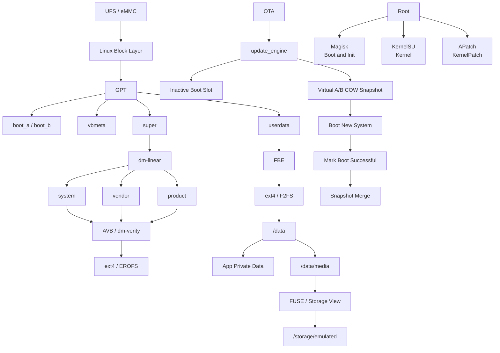

------

# 最关键的结论

### 关于磁盘

现代 Android 不是：

```text
一块磁盘
+
几个固定文件夹
```

而是：

```text
物理闪存
+
GPT
+
动态分区
+
Device Mapper
+
验证与加密
+
文件系统
+
挂载命名空间
+
Android 存储权限模型
```

------

### 关于 `/system`

现代 `/system`：

- 不一定是独立物理分区
- 可能来自 `super`
- 可能经过 `dm-linear`
- 可能受 AVB 与 `dm-verity` 保护
- 可能是 ext4 或 EROFS
- 通常不应直接修改

------

### 关于 `/sdcard`

`/sdcard`：

- 不一定是真 SD 卡
- 通常是模拟共享存储视图
- 可能最终使用 `/data` 的内部闪存空间
- 受 Scoped Storage 和 FUSE 等机制影响

------

### 关于加密

必须分清：

```text
FBE
```

保护数据机密性；

```text
AVB / dm-verity
```

保护系统完整性；

```text
SELinux
```

控制进程权限。

三者不是替代关系。

------

### 关于 OTA

现代 Android 的中心模型是：

```text
Dynamic Partitions
+
Virtual A/B
+
Snapshot COW
+
Boot Success Confirmation
+
Merge
+
Rollback
```

而不是简单：

```text
Recovery 解压 ZIP 覆盖 /system
```

AOSP 当前明确把 Virtual A/B 定义为 Android 的主要更新机制。([Android Open Source Project](https://source.android.com/docs/core/ota/virtual_ab?utm_source=chatgpt.com)) 关于 Root

现代 Root 不再应理解为：

```text
往 /system/bin 放一个 su
```

而应理解为：

```text
控制启动链或 Kernel
+
提供受管理的权限提升
+
利用 Systemless Modification
+
处理 SELinux
+
适应 AVB
+
适应 A/B 和 OTA
```

Magisk、KernelSU、APatch 分别代表了不同的现代实现方向。([GitHub](https://github.com/topjohnwu/Magisk?utm_source=chatgpt.com))推荐的进一步学习顺序

下一步最值得继续深入的是一条完整“实战型”路线：

**从真实 `adb shell` 输出出发，逐条分析 `df`、`mount`、`/proc/mounts`、`/dev/block/by-name`、`/dev/block/mapper`、Slot、`super`、Virtual A/B Snapshot，并进一步讲解如何安全分析一台真实 Android 设备的磁盘拓扑。**