[toc]


下面把它们统一放到 **Linux 块设备栈** 里理解。严格说，LVM、dm-crypt、dm-thin、dm-cache 通常不是“文件系统内部层”，而是位于 **文件系统下面、物理磁盘上面** 的可选块设备映射层。文件系统并不关心下面是真磁盘、加密设备、逻辑卷、thin volume 还是缓存卷，它只看到一个可读写的块设备。

------

## 1. 总体位置：文件系统下面的可选映射层

典型 I/O 路径可以这样看：

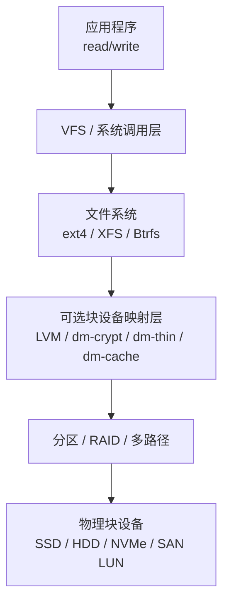

Linux 的 Device Mapper 是内核中的块设备映射框架，可以创建“映射设备”，这些设备可以被上层当作普通块设备使用；`dmsetup` 的手册也说明，它通过为逻辑设备的扇区加载映射表来创建设备。([红帽文档](https://docs.redhat.com/en/documentation/red_hat_enterprise_linux/6/html/logical_volume_manager_administration/device_mapper?utm_source=chatgpt.com))

一个更贴近实际的例子是：

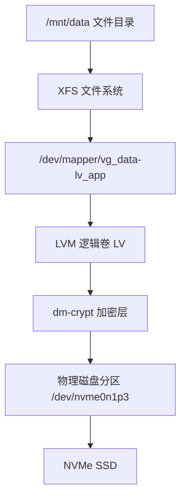

从上往下看，是“越来越接近物理设备”；从下往上看，是“越来越接近用户和文件”。

------

## 2. LVM：把多个磁盘抽象成灵活的存储池

LVM 的核心作用是 **逻辑卷管理**。它把一个或多个物理设备抽象成**存储池**，然后再从池子里切出逻辑卷。

> Red Hat 文档把 LVM 描述为一种存储虚拟化软件，可以动态创建、调整大小、删除虚拟存储设备；
>
> 它的**基本结构**是 PV、VG、LV：物理卷组成卷组，卷组里分配逻辑卷。([红帽文档](https://docs.redhat.com/en/documentation/red_hat_enterprise_linux/9/html/configuring_and_managing_logical_volumes/index))

可以用三层来记：

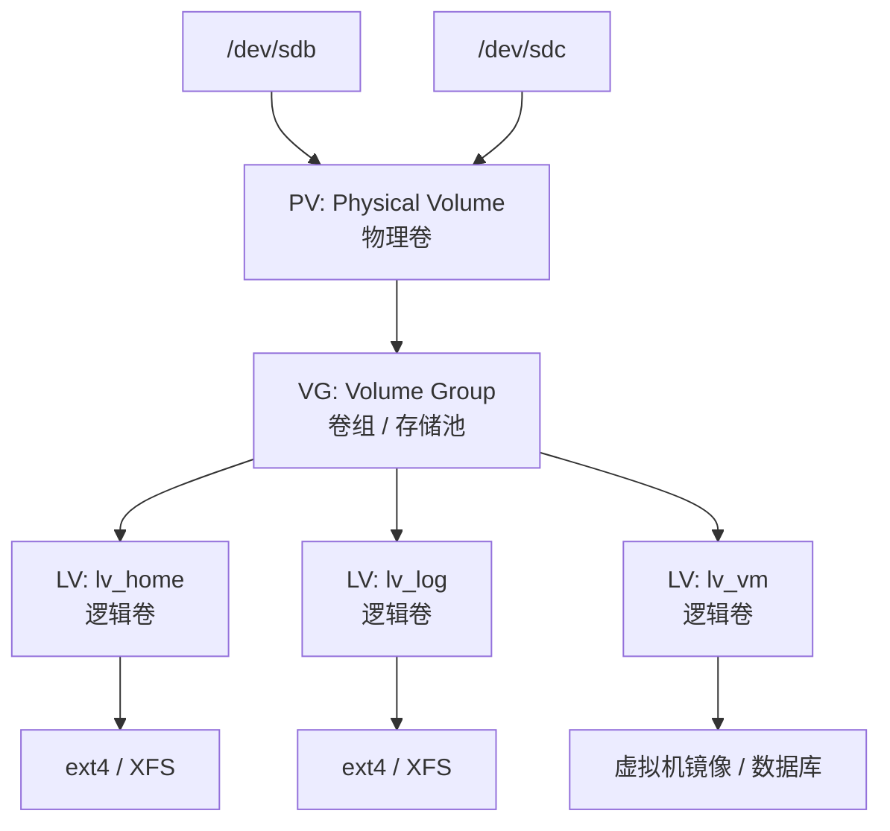

物理卷(PV)和逻辑卷(LV)中间包含一个卷组(VG)

> 1. 简单来说：**`/dev/sdb` 和 `/dev/sdc` 是 Linux 系统中连接的第二块和第三块 SCSI/SATA/USB 硬盘（或固态硬盘）的设备文件**
> 2. 命名结构拆解
>
> 这个路径遵循 `/[目录]/[前缀][字母]` 的格式：
>
> - **`/dev/`**：这是 Linux 中的**设备目录**。在 Linux 哲学中“一切皆文件”，所有硬件设备都会在这个目录下体现为特殊的文件（设备节点）。
> - **`sd`**：代表 **SCSI Disk**（SCSI 磁盘）。虽然全称是 SCSI，但现在它泛指绝大多数使用 **SATA**、**SAS**（服务器硬盘接口）、**USB**（U盘/移动硬盘）以及 **VMware/VirtualBox** 虚拟磁盘的块设备。
> - **`b` 和 `c`**：代表**磁盘序号**，从 `a` 开始排序。
>
> 2. 核心命名规则（重点）
>
> - **`sda`** = 第一块硬盘（通常是系统盘，即安装操作系统的盘）。
> - **`sdb`** = 第二块硬盘（你挂载的第一块额外数据盘）。
> - **`sdc`** = 第三块硬盘（你挂载的第二块额外数据盘）。

### 核心概念

**PV，Physical Volume，物理卷**
可以是一整块磁盘，也可以是一个分区，例如 `/dev/sdb`、`/dev/nvme0n1p3`。它是 LVM 能识别和管理的**底层空间**。

**VG，Volume Group，卷组**
可以理解为“存储池”。**多个 PV 加入同一个 VG 后，空间会被统一管理**。

**LV，Logical Volume，逻辑卷**
从 VG 中切出来的逻辑块设备。文件系统通常建在 LV 上，例如 `/dev/vg_data/lv_app`。

**PE / LE，Physical Extent / Logical Extent**
LVM 内部按**固定大小的小块**分配空间。Red Hat 文档提到 extent 是 LVM 分配空间的最小单位，默认大小常见为 4 MiB。([红帽文档](https://docs.redhat.com/en/documentation/red_hat_enterprise_linux/9/html/configuring_and_managing_logical_volumes/managing-lvm-volume-groups_configuring-and-managing-logical-volumes?utm_source=chatgpt.com))

### 例子 1：两块硬盘组成一个数据池

假设服务器有两块新盘：

```bash
/dev/sdb  1TB
/dev/sdc  1TB
```

可以用 LVM 组成一个 2TB 左右的卷组：

```bash
pvcreate /dev/sdb /dev/sdc
vgcreate vg_data /dev/sdb /dev/sdc
lvcreate -n lv_app -L 800G vg_data
mkfs.xfs /dev/vg_data/lv_app
mount /dev/vg_data/lv_app /data/app
```

这时文件系统看到的是：

```bash
/dev/vg_data/lv_app
```

而不是直接看到 `/dev/sdb` 或 `/dev/sdc`。

后续如果空间不够，又加了一块 `/dev/sdd`，可以：

```bash
pvcreate /dev/sdd #初始化新设备为LVM物理卷(pv)
vgextend vg_data /dev/sdd # 扩展卷组vg_data:将/dev/sdd添加到vg_data卷组中
lvextend -r -L +500G /dev/vg_data/lv_app # 扩展逻辑卷lv_app(/dev/vg_data/lv_app),并同时尝试扩展逻辑卷上的文件系统(例如ext4,xfs等).
```

这里 `-r` 通常表示同时尝试扩展文件系统。

实际生产环境执行前应备份，并确认文件系统类型是否支持在线扩容。(常见文件系统基本都支持扩容,但是缩容则不一定.)

#### 案例命令详解

```bash
pvcreate /dev/sdb /dev/sdc
```

将 `/dev/sdb`、`/dev/sdc` 初始化为 LVM 物理卷 PV。
作用：让普通磁盘具备被 LVM 管理的能力。
风险：会写入 LVM 元数据，原磁盘数据可能被破坏。


```bash
vgcreate vg_data /dev/sdb /dev/sdc
```

创建卷组 `vg_data`，并把 `/dev/sdb`、`/dev/sdc` 加入其中。
作用：把多个物理卷合并成一个统一的存储池。


```bash
lvcreate -n lv_app -L 800G vg_data
```

从卷组 `vg_data` 中创建一个名为 `lv_app` 的逻辑卷，大小为 800G。
作用：从存储池中切出一块可供文件系统使用的逻辑磁盘(逻辑卷)。(得到`/dev/vg_data`)


```bash
mkfs.xfs /dev/vg_data/lv_app
```

在逻辑卷 `lv_app` 上创建 XFS 文件系统(使用`mkfs.xfs`命令进行格式化)。
作用：把逻辑卷格式化，使其可以存放文件。
风险：会清空目标设备上的原有数据。


```bash
mkdir -p /data/app
```

创建挂载目录 `/data/app`。
作用：为后续挂载文件系统准备目录。


```bash
mount /dev/vg_data/lv_app /data/app
```

将逻辑卷挂载到 `/data/app`。
作用：之后访问 `/data/app`，实际就是在使用 `lv_app` 这个逻辑卷。


```bash
pvcreate /dev/sdd
```

将新磁盘 `/dev/sdd` 初始化为 LVM 物理卷。
作用：让新磁盘可以加入已有 LVM 存储池。

---

扩展卷组合逻辑卷

> 使用`vgextend`命令扩展卷组

```bash
vgextend vg_data /dev/sdd
```

把 `/dev/sdd` 加入已有卷组 `vg_data`。
作用：扩大 `vg_data` 存储池的总容量。


```bash
lvextend -r -L +500G /dev/vg_data/lv_app
```

逻辑卷扩展命令`lvextend`,给逻辑卷 `lv_app` 增加 500G 空间，并尝试同步扩展文件系统。
作用：让 `/data/app` 可用空间变大。
注意：`+500G` 表示“增加 500G”，不是“变成 500G”。

简化流程：

```text
磁盘 /dev/sdb、/dev/sdc
→ pvcreate 变成 PV
→ vgcreate 合成 VG 存储池
→ lvcreate 切出 LV
→ mkfs.xfs 创建文件系统
→ mount 挂载到目录
→ 后续可用 vgextend、lvextend 扩容
```

### FAQ

#### 为什么格式化后必须挂载？

在逻辑卷上格式化出一个文件系统后,需要挂载到某个目录下吗?这是必须的吗?

在 Linux 中，**格式化**和**挂载**是两个截然不同但紧密相连的步骤。格式化只是“准备空地”，而挂载是“铺设道路”，让系统能走进去使用这块地。

- **Linux 的目录树结构**：Windows 以盘符（C:、D:）为单位，每个盘独立。但 Linux 只有一个根目录（`/`），所有的存储设备都必须“附着”在根目录下的某个文件夹上，系统才能通过这个文件夹路径访问数据。
- **不挂载 = 无法访问**：格式化（如 `mkfs.ext4 /dev/sdb1`）只是把硬盘写入了文件系统元数据，但它此时只是一个“孤立”的设备节点。如果没有挂载点，你和系统中的任何应用程序都无法往里面读写文件，因为它不在目录树里。

有一个情况看起来像“没挂载也能用”，那就是 **Swap（交换分区）**。

- Swap 分区格式化后**不需要**挂载到目录，因为它不存文件，是作为内存扩展使用的，系统用 `swapon` 命令激活它。
- **但除 Swap 外**，所有包含文件系统（ext4、xfs、fat32 等）的逻辑卷或硬盘，**必须挂载才能使用**。

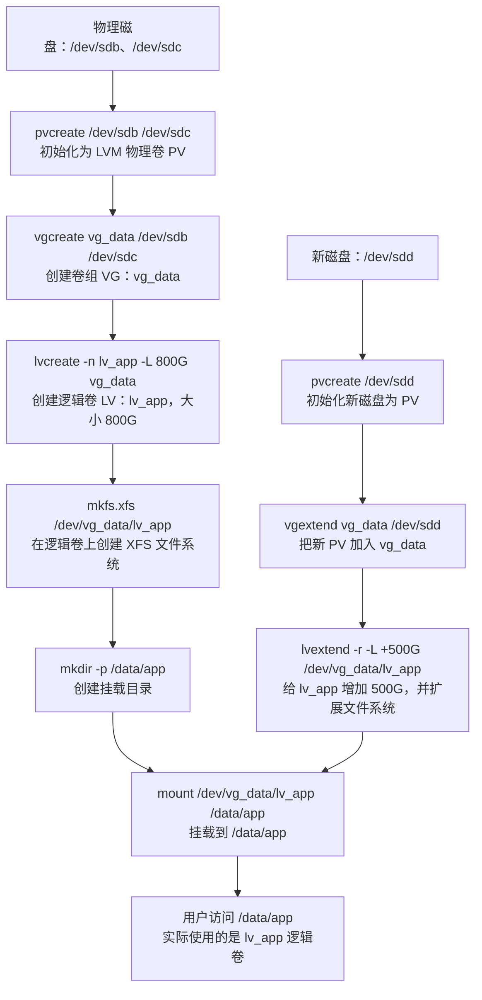

更偏“层级关系”的版本：

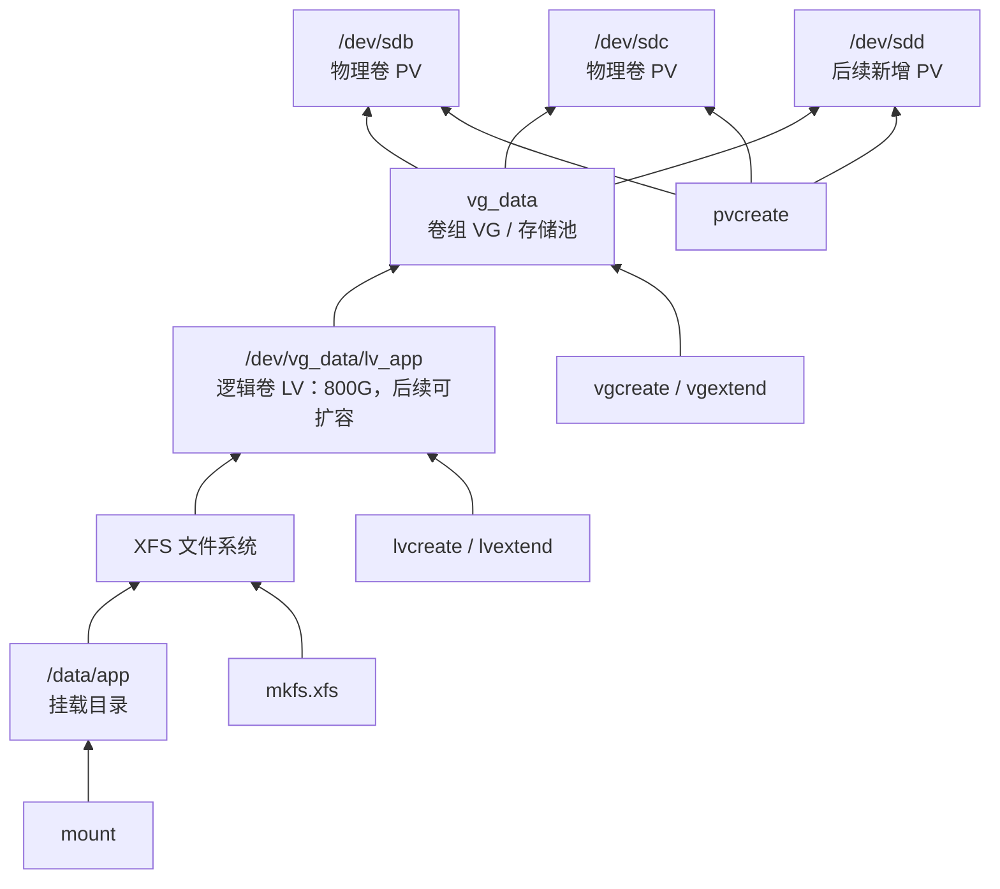


#### LVM 是默认启用的吗？

分情况：

| 场景                                             | 是否默认使用 LVM                                             |
| ------------------------------------------------ | ------------------------------------------------------------ |
| RHEL / CentOS / Rocky / AlmaLinux 等服务器发行版 | 很常见，自动分区时经常默认用 LVM；早期 RHEL 文档明确写过 LVM 是默认磁盘分区方式。([红帽文档](https://docs.redhat.com/en/documentation/red_hat_enterprise_linux/5/html/deployment_guide/s1-lvm-diskdruid-auto?utm_source=chatgpt.com)) |
| Ubuntu Server                                    | 安装器通常会提供 “Set up this disk as an LVM group” 之类选项；Ubuntu 官方把 LVM 定义为比传统分区更灵活的存储管理方式。([Ubuntu](https://ubuntu.com/server/docs/explanation/storage/about-lvm/?utm_source=chatgpt.com)) |
| Ubuntu Desktop / Debian / Arch / Gentoo 等       | 不一定默认用，很多情况下是普通分区，LVM 需要手动选择或手动配置。Arch Wiki 也把 LVM 作为一种需要在分区和格式化之间配置的方案。([Arch Wiki](https://wiki.archlinux.org/title/LVM?utm_source=chatgpt.com)) |
| 云服务器镜像                                     | 不一定，很多云镜像直接用普通分区，方便扩容根盘。             |
| 容器环境                                         | 通常不直接关心 LVM，容器看到的是宿主机提供的文件系统。       |

所以准确说：

> **LVM 不是 Linux 内核或文件系统“天然必启”的组件，而是安装时或后期根据存储规划选择的一种块设备管理方案。**

------

#### LVM 是必须的吗？

**不是必须。**

Linux 完全可以不用 LVM，直接这样部署：

```text
物理磁盘 /dev/sda
→ 分区 /dev/sda1
→ 文件系统 ext4 / XFS
→ 挂载到 /
```

------

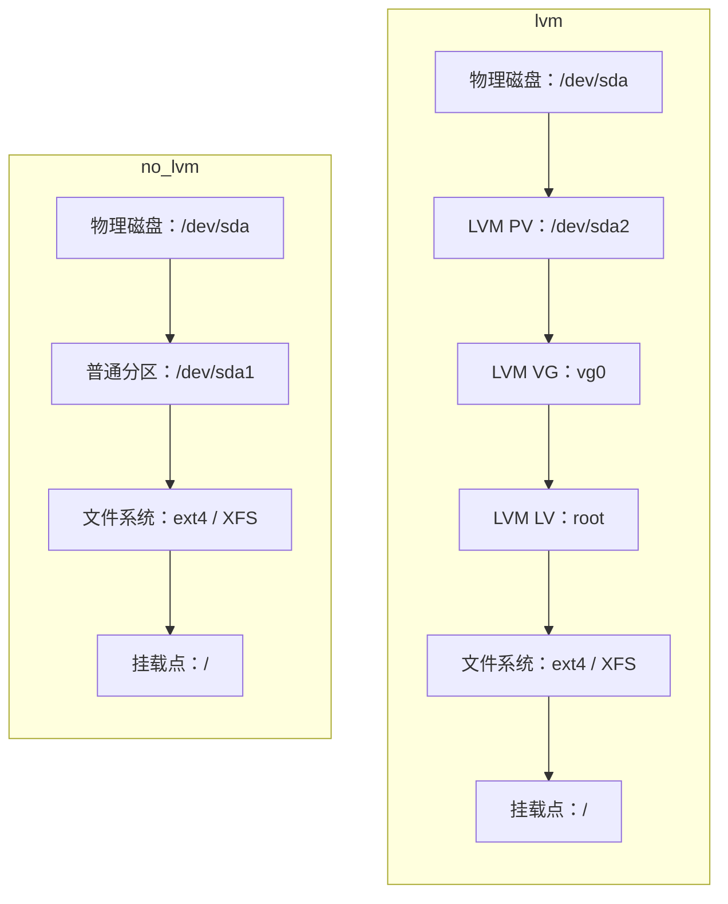


#### 不用 LVM 会怎样？

可以正常使用系统。

不用 LVM 的优点：

- 结构简单
- 排障直观
- 启动链路短
- 适合小型机器、云主机、单盘系统

不用 LVM 的缺点：

- 后期扩容不如 LVM 灵活
- 多个磁盘合并管理不方便
- 在线扩展、迁移、快照能力弱一些

------

#### 用 LVM 的好处是什么？

LVM 的主要价值是 **灵活管理空间**：

- 可以把多块磁盘合成一个存储池
- 可以方便扩展逻辑卷
- 可以把某个 LV 移动到另一块磁盘
- 可以做快照
- 可以配合 dm-thin、dm-cache、dm-crypt

典型适用场景：

- 服务器
- 数据库机器
- 虚拟化宿主机
- 多磁盘存储池
- 需要频繁扩容的业务目录
- 需要快照或在线迁移的环境

------

#### 怎么判断当前系统有没有用 LVM？

常用命令：

```bash
lsblk
```

如果看到类似：

```text
sda
├─sda1
└─sda2
  └─vg0-root
```

说明用了 LVM。

也可以查：

```bash
pvs
vgs
lvs
```

如果有输出，说明系统中存在 LVM 的 PV、VG、LV。

还可以看根目录 `/` 挂载在哪里：

```bash
findmnt /
```

如果结果类似：

```text
/  /dev/mapper/vg0-root
```

说明根文件系统在 LVM 逻辑卷上。

如果是：

```text
/  /dev/sda1
```

通常就是普通分区。

------

#### 简单结论

- LVM 默认不默认：取决于发行版和安装方式。
- LVM 是否必须：不是必须。
- 不用 LVM：Linux 可以正常运行。
- 用 LVM：主要是为了后期扩容、迁移、快照、多磁盘管理更方便。

一句话：

> **个人电脑、简单云主机可以不用 LVM；服务器、多磁盘、需要灵活扩容的场景建议用 LVM。**


## 3. dm-crypt：块设备透明加密层

dm-crypt 是 Device Mapper 的加密 target。Linux 内核文档说明，dm-crypt 通过内核 crypto API 为块设备提供透明加密。([Linux内核文档](https://docs.kernel.org/admin-guide/device-mapper/dm-crypt.html))

可以这样理解：

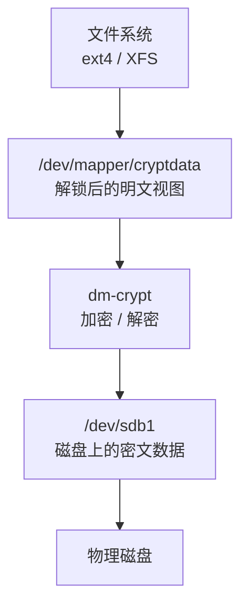

上层文件系统读写 `/dev/mapper/cryptdata`，感觉像普通磁盘；但真正落到 `/dev/sdb1` 上的数据是密文。`cryptsetup` 手册也说明，解锁加密卷后会创建一个新的设备映射，应用程序可以像访问普通存储设备一样访问它，实际加解密由内核 dm-crypt 驱动透明完成。([man7.org](https://man7.org/linux/man-pages/man8/cryptsetup.8.html))

### LUKS 和 dm-crypt 的关系

实际使用中经常听到 **LUKS**。可以这样区分：

| 名称       | 作用                                             |
| ---------- | ------------------------------------------------ |
| dm-crypt   | 内核里的加密映射机制                             |
| cryptsetup | 用户态管理工具                                   |
| LUKS       | 磁盘加密格式，负责密钥槽、头部元数据、口令管理等 |

Red Hat 文档说明，LUKS 可以加密块设备，并支持多个用户密钥解密主密钥；LUKS 使用 Device Mapper 内核子系统。([红帽文档](https://docs.redhat.com/en/documentation/red_hat_enterprise_linux/8/html/security_hardening/encrypting-block-devices-using-luks_security-hardening))

### 例子 2：加密一块数据盘

```bash
cryptsetup luksFormat /dev/sdb1
cryptsetup open /dev/sdb1 cryptdata
mkfs.xfs /dev/mapper/cryptdata
mount /dev/mapper/cryptdata /secure-data
```

映射关系是：

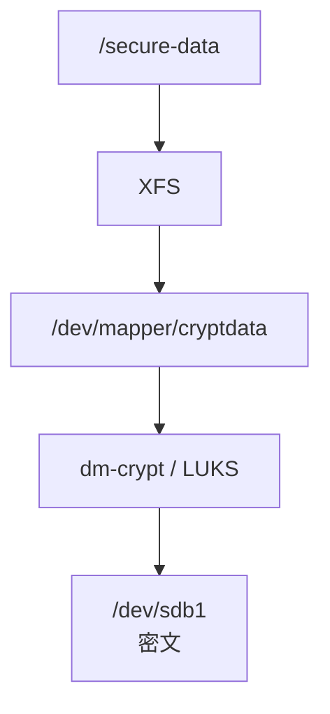

### 例子 3：LVM 和 dm-crypt 的两种常见组合

#### 方案 A：先加密，再做 LVM

适合整机加密、笔记本、服务器整盘保护。

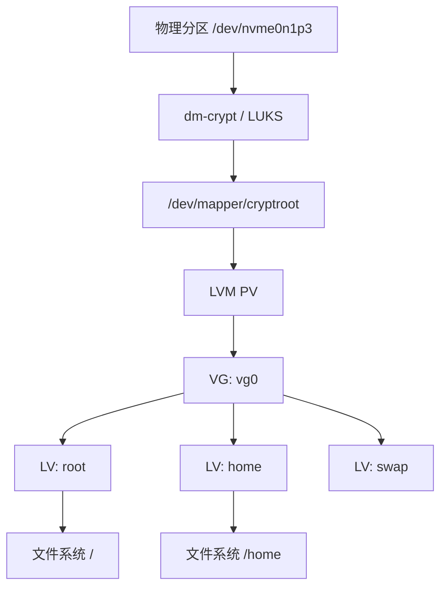

优点是整个 LVM 池都被加密，只需要解锁一次。缺点是不同 LV 不容易使用不同密钥。

#### 方案 B：先做 LVM，再加密某个 LV

适合只加密部分数据，比如只加密 `/secret`。

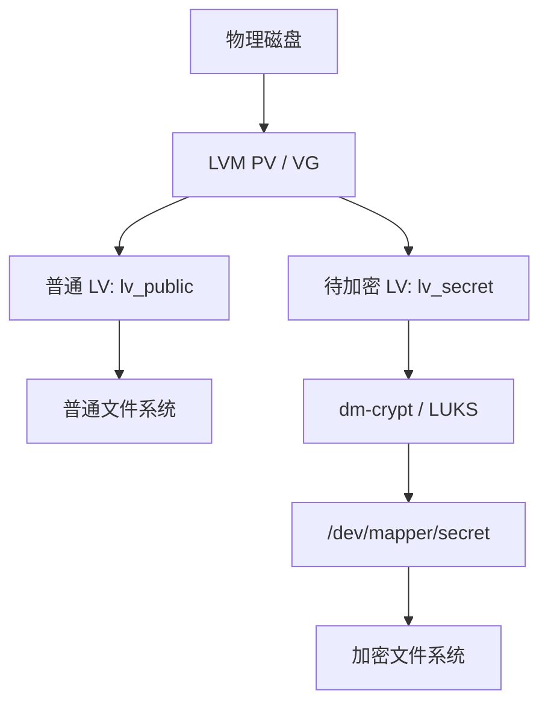

优点是可以只加密关键数据，甚至不同 LV 使用不同密钥。缺点是管理上更复杂。

------

## 4. dm-thin：精简配置、按需分配空间

dm-thin，也叫 **thin provisioning**，是一种 **按需分配块空间** 的机制。Linux 内核文档说明，thin provisioning 由一组 Device Mapper target 实现，并支持 thin provisioning 和快照；它允许多个虚拟设备共享同一个数据卷，从而减少磁盘使用。([Linux内核档案](https://www.kernel.org/doc/html/v6.9/admin-guide/device-mapper/thin-provisioning.html))

普通 LVM 是“先切多少，就占多少逻辑空间”。dm-thin 的思路是：

> 先承诺给你一个很大的虚拟磁盘，但只有真正写入数据时，才从 thin pool 里分配物理块。

### 基本结构

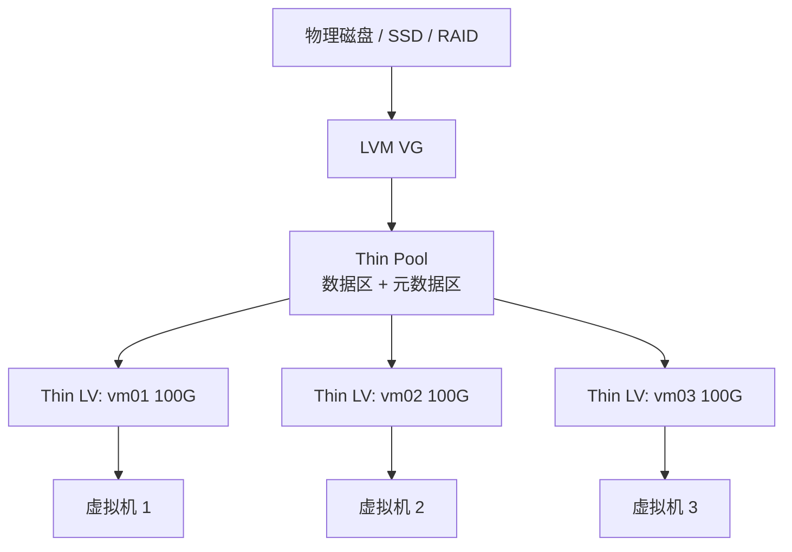

关键点是：`vm01`、`vm02`、`vm03` 每个都可以显示为 100G，但它们实际占用的物理空间取决于写入了多少数据。

### 例子 4：虚拟化场景

假设你有一个 1TB 的物理空间，但你要创建 20 台虚拟机，每台虚拟机分配 100GB 系统盘。普通厚置备需要 2TB，而 thin provisioning 可以先创建 20 个 100GB 的 thin volume，只要它们实际写入总量没有超过 thin pool 的真实容量即可。

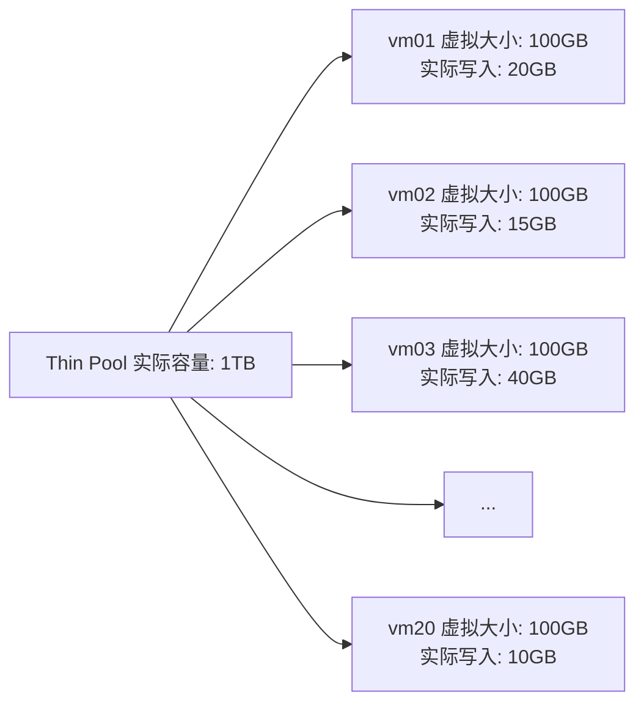

示意命令：

```bash
lvcreate -L 1T -T vg_vm/thinpool
lvcreate -V 100G -T vg_vm/thinpool -n vm01
lvcreate -V 100G -T vg_vm/thinpool -n vm02
```

这里 `-L 1T` 是 thin pool 的真实池容量，`-V 100G` 是 thin volume 暴露给上层的虚拟容量。

### dm-thin 的风险

dm-thin 最大的风险是 **超分配**。例如 thin pool 真实只有 1TB，但你创建了总虚拟容量 3TB 的 thin volume。如果所有虚拟机都大量写入，thin pool 被写满，可能导致 I/O 错误、文件系统异常、虚拟机暂停甚至数据损坏。

所以生产环境必须监控：

```bash
lvs
lvs -a -o +seg_monitor,data_percent,metadata_percent
```

重点看：

```text
Data%
Metadata%
```

------

## 5. dm-cache：用快设备给慢设备做块级缓存

dm-cache 是 Device Mapper 的缓存 target。Linux 内核文档说明，dm-cache 的目标是通过把部分数据动态迁移到更快、更小的设备，例如 SSD，来提升较慢块设备，例如机械硬盘，的性能。([Linux内核文档](https://docs.kernel.org/admin-guide/device-mapper/cache.html))

它通常需要三个部分：

| 部分            | 作用                                       |
| --------------- | ------------------------------------------ |
| origin device   | 原始慢设备，例如 HDD 上的大容量 LV         |
| cache device    | 快速缓存设备，例如 SSD / NVMe              |
| metadata device | 记录哪些块在缓存里、哪些块是脏数据等元数据 |

内核文档也说明，dm-cache target 由 origin device、cache device 和 metadata device 三类子设备构成。([Linux内核文档](https://docs.kernel.org/admin-guide/device-mapper/cache.html))

### 基本结构

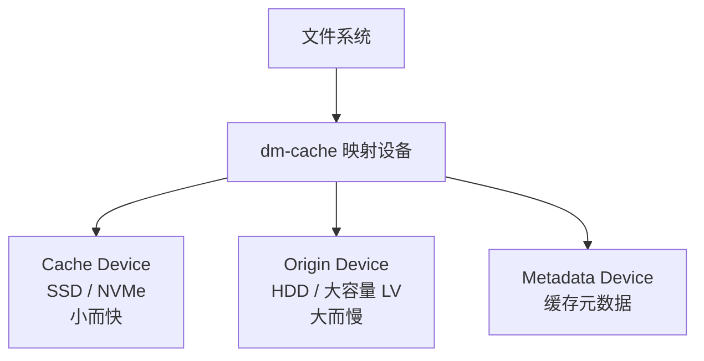

### 例子 5：HDD 大容量数据盘 + SSD 缓存

假设：

```text
/dev/sdb  8TB HDD
/dev/nvme0n1  500GB NVMe
```

你希望大数据仍然放在 HDD 上，但热点数据放到 NVMe 缓存里：

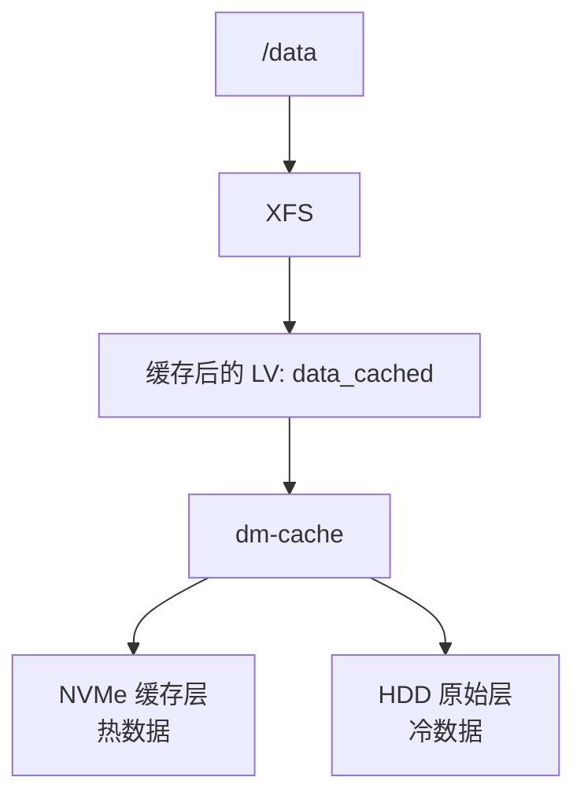

示意命令，不同发行版和 LVM 版本语法可能略有差异：

```bash
# 创建 HDD 上的大容量逻辑卷
pvcreate /dev/sdb
vgcreate vg_data /dev/sdb /dev/nvme0n1
lvcreate -n lv_big -L 6T vg_data /dev/sdb

# 创建 NVMe 上的缓存卷
lvcreate -n cachevol -L 300G vg_data /dev/nvme0n1

# 把 cachevol 转换为 lv_big 的缓存
lvconvert --type cache --cachevol cachevol vg_data/lv_big
```

适合的场景是：数据总量很大，但热点数据集中。例如文件服务器、编译缓存、虚拟机镜像仓库、读多写少的数据集。

不适合的场景是：访问模式完全随机且热点不明显，或者写入一致性要求极高但没有配置好缓存策略。

------

## 6. 四者之间的关系

这四个概念不是平级的“文件系统功能”，而是不同目的的块设备映射能力。

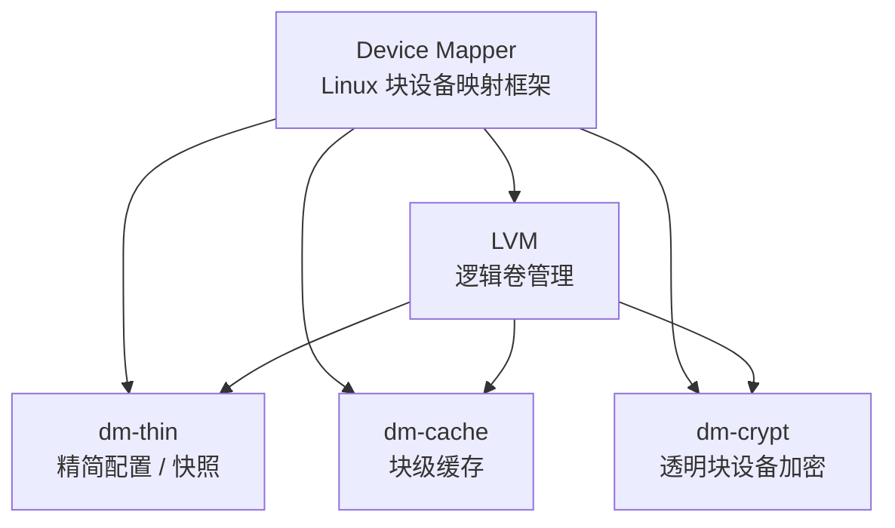

更准确地说：

| 层 / 技术 | 主要解决什么问题   | 关键词                                    |
| --------- | ------------------ | ----------------------------------------- |
| LVM       | 空间管理不灵活     | PV、VG、LV、扩容、缩容、迁移              |
| dm-crypt  | 磁盘丢失后数据泄露 | 加密、LUKS、密钥、透明解密                |
| dm-thin   | 预分配空间浪费     | 按需分配、超分配、快照、虚拟化            |
| dm-cache  | 慢盘性能不足       | SSD 缓存、热数据、origin、cache、metadata |

------

## 7. 组合示例：一台虚拟化宿主机的存储设计

假设你有：

```text
2 块 8TB HDD：放虚拟机数据
1 块 1TB NVMe：做缓存
需要加密
需要给很多虚拟机分配磁盘
```

一种可能的设计是：

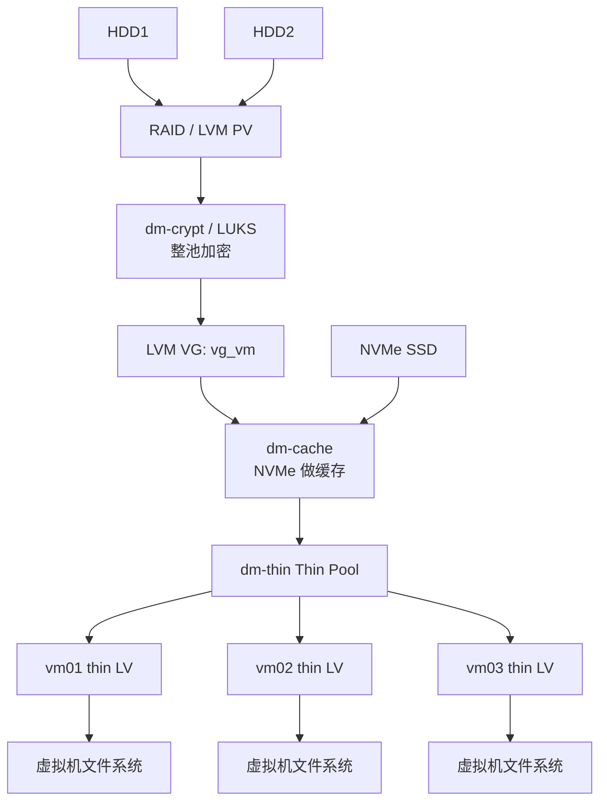

这套组合的逻辑是：

先用 HDD 提供大容量，再用 dm-crypt 保护落盘数据，然后用 LVM 做统一管理，再用 dm-cache 利用 NVMe 加速热点块，最后用 dm-thin 给虚拟机灵活分配虚拟磁盘。需要注意的是，实际生产中缓存、加密、thin pool 的先后顺序要结合安全目标和性能目标决定。Linux 内核文档也提到 dm-cache 可以插入到 dm stack 的不同层级，例如 thin-provisioning pool 的数据设备之上。([Linux内核文档](https://docs.kernel.org/admin-guide/device-mapper/cache.html))

------

## 8. 层级顺序怎么选？

### 场景 A：个人电脑整盘加密

推荐思路：

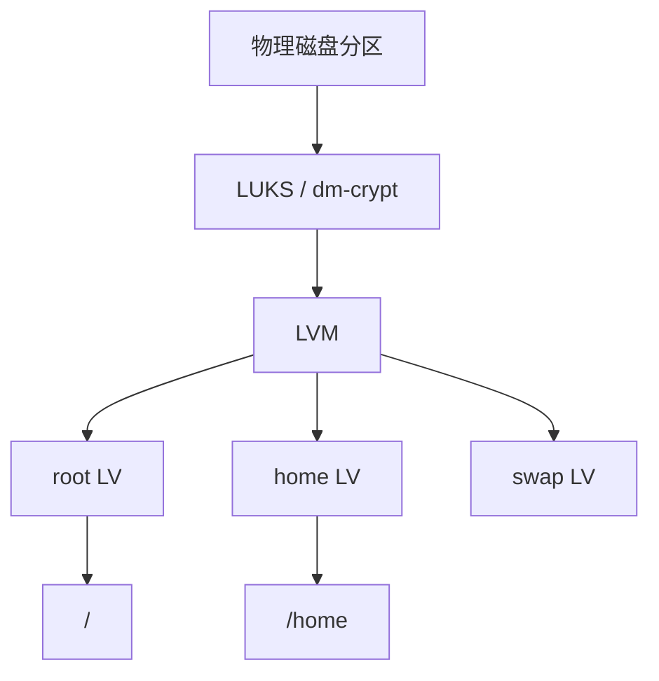

特点：只需解锁一次，整个系统主要数据都在加密层之上。

------

### 场景 B：服务器只加密敏感目录

推荐思路：

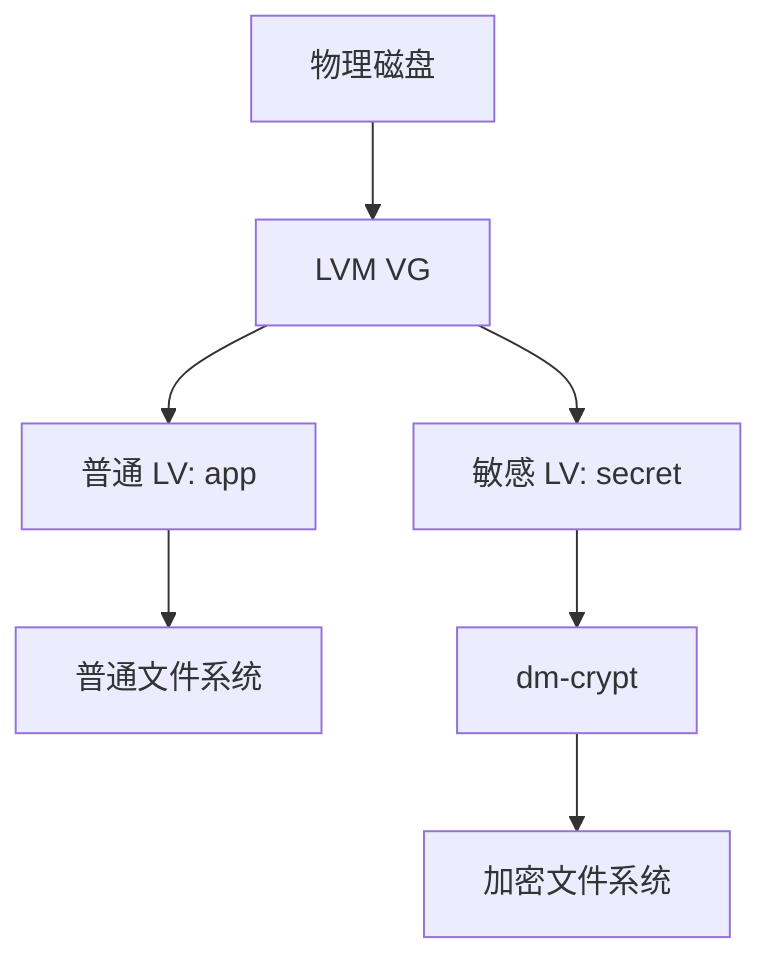

特点：普通业务数据不加密，敏感数据单独加密，性能和安全之间折中。

------

### 场景 C：虚拟机平台节省空间

推荐思路：

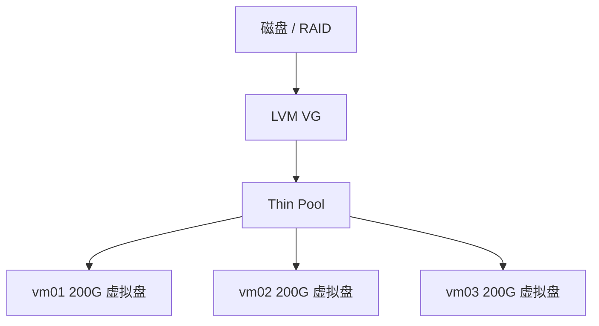

特点：每台虚拟机看到较大的磁盘，但底层只按实际写入量占空间。必须监控 thin pool，防止写满。

------

### 场景 D：大容量机械盘加速

推荐思路：

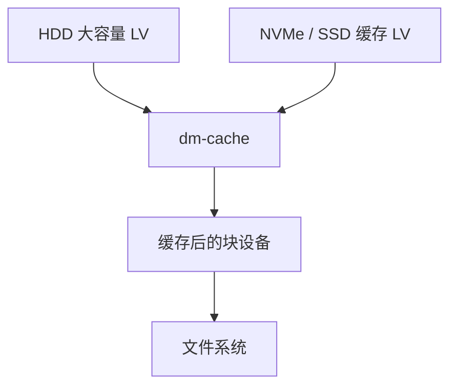

特点：容量来自 HDD，热点性能来自 SSD。

------

## 9. 一个简洁记忆法

可以这样记：

**LVM 管空间，dm-crypt 管保密，dm-thin 管承诺，dm-cache 管速度。**

更具体地说：

```mermaid
mindmap
  root((块设备映射层))
    LVM
      把磁盘做成池
      灵活创建 LV
      方便扩容迁移
    dm-crypt
      块级加密
      LUKS 管理密钥
      解锁后暴露普通块设备
    dm-thin
      按需分配
      支持快照
      适合虚拟机
      需要防止池写满
    dm-cache
      SSD 加速 HDD
      热数据迁移
      需要缓存元数据
```

------

## 10. 最后总结

LVM、dm-crypt、dm-thin、dm-cache 都可以被理解为文件系统下面的“可选块设备映射层”。文件系统只负责“文件如何组织”；这些映射层负责“下面这个块设备到底从哪里来、是否加密、是否精简分配、是否有缓存”。

实际工程中最常见的组合是：

```mermaid
flowchart TD
    A[应用] --> B[文件系统]
    B --> C[LVM LV]
    C --> D[dm-thin / dm-cache / dm-crypt<br/>按需求组合]
    D --> E[物理磁盘 / SSD / RAID]
```

选择原则很简单：

- 需要灵活扩容、合并磁盘：用 **LVM**。
- 需要防止磁盘丢失后泄露数据：用 **dm-crypt / LUKS**。
- 需要给虚拟机、容器、大量卷节省预分配空间：用 **dm-thin**。
- 需要用 SSD/NVMe 加速 HDD 或慢速后端：用 **dm-cache**。