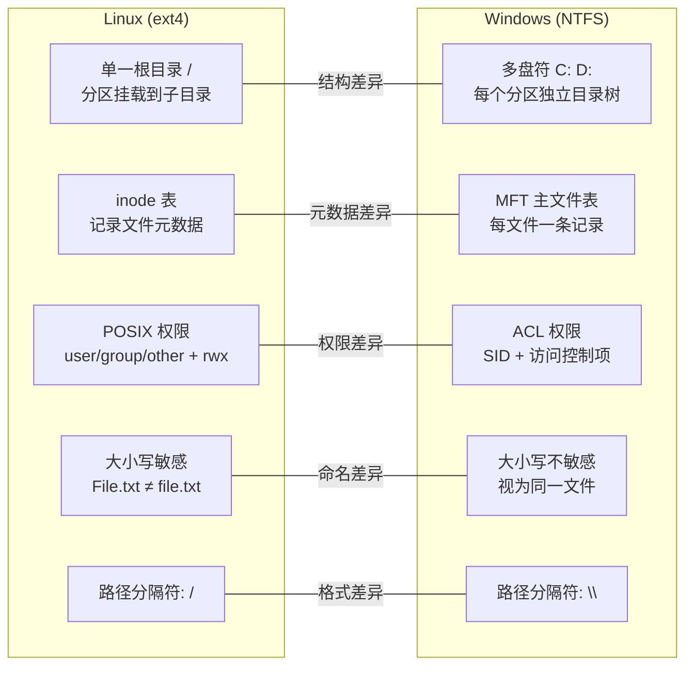

[toc]


## 基础概念

- **磁盘**：物理硬盘、SSD、U盘等设备。
- **分区**：在磁盘上划分出来的一段连续空间，例如 GPT 分区。
- **文件系统**：组织分区内文件和目录的数据结构，例如 ext4、NTFS、FAT32。

可以简单理解为：

```text
物理磁盘
├── 分区1 → NTFS
├── 分区2 → ext4
├── 分区3 → FAT32
└── 分区4 → Linux swap
```

所以，**分区不是文件系统，格式化才是在分区上创建文件系统**。

------

## ext4 和 NTFS 的共性

ext4 与 NTFS 都是成熟的通用磁盘文件系统，基本功能十分相似：

| 共性               | 说明                                                   |
| ------------------ | ------------------------------------------------------ |
| 层级目录结构       | 都使用目录、子目录和文件构成树状结构                   |
| 文件名与路径       | 都通过路径定位文件                                     |
| 大文件和大容量支持 | 都比 FAT32 更适合现代硬盘和大文件                      |
| 日志功能           | 都属于日志文件系统，可降低异常断电后文件系统损坏的风险 |
| 权限管理           | 都可以记录文件所有者和访问权限                         |
| 文件时间信息       | 都保存创建、修改、访问等时间信息，但具体语义不同       |
| 硬链接和符号链接   | 两者均有相关支持，不过 Windows 和 Linux 的使用方式不同 |
| 稀疏文件           | 都可以让大文件中未实际写入的区域不占用真实磁盘空间     |
| 扩展元数据         | 都能保存普通文件内容以外的附加属性                     |
| 磁盘配额           | 都能够限制用户或目录等对象的存储空间使用量             |
| 崩溃恢复           | 都有一致性检查和修复工具                               |

因此，两者在“保存文件”这一基本目标上并没有本质差异，主要差别在于它们为各自操作系统提供了不同的权限语义、命名规则和管理功能。

------

## ext4 与 NTFS 的显著差异




### 1. 权限模型不同

#### ext4 在 Linux 中

Linux 通常使用 Unix 权限模型：

```text
所有者 user
所属组 group
其他用户 others
```

每一类都有：

```text
r：读取
w：写入
x：执行
```

例如：

```text
-rwxr-x---
```

ext4 还可结合 POSIX ACL、扩展属性、SELinux 标签等机制。

#### NTFS 在 Windows 中

NTFS 主要使用 Windows ACL。它的访问控制项通常更加细致，可以针对不同用户和用户组设置：

- 读取
- 写入
- 修改
- 删除
- 遍历目录
- 更改权限
- 取得所有权
- 权限继承

所以不能把 Linux 的 `rwx` 权限和 Windows 的 NTFS ACL 简单一一对应。Linux 访问 NTFS 时，驱动程序通常需要进行权限映射或模拟。

------

### 2. 大小写处理不同

Linux 上的 ext4 默认：

```text
File.txt
file.txt
FILE.txt
```

可以是三个不同的文件。

Windows 上的 NTFS 通常：

- 会保存文件名原本的大小写；
- 但在常规 Windows 应用中默认不区分大小写。

例如，通常不能在同一目录下同时创建：

```text
File.txt
file.txt
```

需要注意，**是否区分大小写不完全由磁盘格式决定，也受到操作系统和挂载方式的影响**。

------

### 3. 文件名规则不同

Windows 对文件名限制较多。常规情况下不能使用：

```text
\ / : * ? " < > |
```

并且存在一些历史保留名称，例如：

```text
CON
PRN
AUX
NUL
COM1
LPT1
```

Linux/ext4 的限制相对少：

- 文件名不能包含 `/`；
- 文件名不能包含空字符；
- 其他很多在 Windows 中非法的字符，在 Linux 中可以使用。

这会带来兼容性问题。例如，在 Linux 的 ext4 分区上创建名为：

```text
report?.txt
```

的文件后，把它复制到 Windows NTFS 分区时可能失败。

------

### 4. 路径表示方式不同

Linux：

```text
/home/user/document.txt
```

- 使用 `/`
- 整个系统只有一棵统一的目录树
- 磁盘和分区通过“挂载”加入这棵目录树

Windows：

```text
C:\Users\User\document.txt
```

- 通常使用 `\`
- 通常通过盘符表示不同卷，如 `C:`、`D:`、`E:`
- 也可以将卷挂载到 NTFS 目录，但普通用户较少这样使用

------

### 5. 文件身份和目录结构的实现不同

ext4 使用 **inode** 表示文件对象。目录主要保存：

```text
文件名 → inode 编号
```

一个 inode 保存文件的权限、所有者、大小、数据块位置等信息。

NTFS 使用 **MFT，主文件表**。文件和目录通常对应一个 MFT 记录，记录中包含属性、文件名、权限以及数据位置等信息。较小的文件内容甚至可能直接存放在 MFT 记录中。

概念上两者很相似：

```text
ext4 inode ≈ NTFS MFT 记录
```

但内部格式和实现并不兼容。

------

### 6. 日志机制不同

两者都有日志，但记录策略不同：

- **ext4** 主要对文件系统元数据进行日志保护，并提供不同的数据日志模式。
- **NTFS** 通过其日志机制维护元数据操作的一致性。

这里的“日志”不等于文件备份。日志主要保证文件系统结构不会因为突然断电而严重混乱，但刚刚编辑的文件内容仍可能丢失。

------

### 7. 特有功能存在差异

NTFS 通常提供：

- 文件或目录透明压缩
- EFS 文件加密
- 备用数据流
- 重解析点
- Windows ACL
- 硬链接和符号链接
- 稀疏文件

ext4 通常提供：

- Unix 所有者和权限
- POSIX ACL
- 扩展属性
- 硬链接和符号链接
- 稀疏文件
- 项目配额
- 基于 `fscrypt` 的文件或目录加密
- 与 Linux 命名空间和安全标签较自然的结合

ext4 本身没有类似 NTFS 的通用透明压缩功能。Linux 若需要压缩、校验和或快照等功能，通常会选择 Btrfs、ZFS 等其他文件系统，或者在文件系统之下使用 LVM。

------

### 8. 系统兼容性不同

- Linux 原生、完整地支持 ext4。
- Windows 原生、完整地支持 NTFS。
- Linux 可以读写 NTFS，但某些 Windows 特有属性和权限语义不一定能被完全还原。
- 常规 Windows 环境通常不能像使用 NTFS 那样直接使用 ext4，需要额外的软件、虚拟机或 Linux/WSL 环境。

跨系统交换数据时，常见选择是：

- **exFAT**：适合移动硬盘和大文件交换。
- **FAT32**：兼容性极好，但单文件通常不能超过 4 GiB。
- **NTFS**：适合以 Windows 为主、Linux 偶尔访问的场景。

------

## 同一个磁盘能同时使用不同文件系统

通常做法是把磁盘划分为多个分区，每个分区使用不同的文件系统：

```text
1 TB SSD，GPT 分区表

分区1：512 MB   FAT32    EFI 系统分区
分区2：200 GB   NTFS     Windows 系统
分区3：300 GB   NTFS     共享数据
分区4：450 GB   ext4     Linux 根文件系统
分区5：约49 GB  swap     Linux 交换空间
```

双系统电脑经常采用这种布局。

### 一个分区只能使用一种文件系统

正常情况下，**一个普通分区在同一时刻只有一个文件系统**。

例如：

```text
/dev/nvme0n1p3 → ext4
```

不能同时又把它当成 NTFS 使用。除非格式化为新的文件系统,但是重新格式化成另一种文件系统通常会破坏原有数据(如果需要格式化请提前做好数据备份)。

不过存在一些特殊的分层技术：

```text
磁盘分区
└── LUKS 加密层
    └── LVM 逻辑卷
        └── ext4 文件系统
```

这里一个分区中可以包含**卷管理器、加密容器或虚拟磁盘文件**，但最终**每个实际挂载的普通卷**通常仍对应一个文件系统。

------

## Linux 和 Windows 的分区方式

严格来说，**分区本身通常没有 Linux 分区和 Windows 分区的本质区别**。

分区只是磁盘上的一段地址范围：

```text
从扇区 A 到扇区 B
```

真正的区别主要来自以下几方面。

### 1. 分区表标准基本相同

Linux 和 Windows 都可以使用：

- MBR
- GPT

现代计算机通常使用 GPT。GPT 是**通用标准**，不专属于 Linux 或 Windows。

因此同一块 GPT 磁盘可以同时包含：

```text
EFI 分区 + Windows NTFS 分区 + Linux ext4 分区
```

------

### 2. 分区类型标识不同

GPT 中，每个分区可以带有“**分区类型 GUID**”，用于说明用途，例如：

- EFI System Partition
- Microsoft Basic Data
- Microsoft Reserved Partition
- Windows Recovery
- Linux filesystem
- Linux swap
- Linux LVM

这些标识告诉操作系统或工具“这个分区大概用来做什么”，但它不等同于文件系统本身。

例如，一个被标记为“Linux filesystem”的分区，里面可能是：

- ext4
- XFS
- Btrfs

一个“Microsoft Basic Data”分区中可能是：

- NTFS
- FAT32
- exFAT

------

### 3. Windows 和 Linux 的卷管理习惯不同

Windows 常见布局：

```text
EFI 系统分区
Microsoft Reserved 分区
C: NTFS 系统卷
D: NTFS 数据卷
恢复分区
```

Windows 还存在：

- 基本磁盘
- 动态磁盘
- 存储空间

Linux 常见布局：

```text
EFI 系统分区
/boot
/
 /home
swap
```

Linux 还广泛使用：

- LVM
- 软件 RAID
- LUKS 磁盘加密

例如 Linux 的 LVM 可以这样组织：

```text
物理分区
└── LVM 物理卷
    └── 卷组
        ├── root 逻辑卷 → ext4
        ├── home 逻辑卷 → XFS
        └── swap 逻辑卷 → swap
```

所以常说的“Linux 分区方式更灵活”，很多时候指的是 Linux 常用挂载点、LVM、RAID 和加密层，而不是底层分区原理不同。

------

### 盘符与挂载点

这是普通用户最容易感受到两种系统在文件系统上的区别。

#### Windows

```text
C:
D:
E:
```

**每个卷**通常分配一个**盘符**。

#### Linux

所有文件都位于从 `/` 开始的统一目录树中：

```text
/
├── home
├── var
├── boot
└── mnt
```

不同分区可以挂载到不同目录：

```text
ext4 分区 → /
另一个 ext4 分区 → /home
NTFS 分区 → /mnt/windows
U盘 → /media/user/USB
```

假设 `/home` 是一个单独分区，用户访问：

```text
/home/alice/file.txt
```

时通常感受不到 `/home` 实际位于另一块硬盘或另一个分区。

------

## 一个典型的 Windows + Linux 双系统磁盘

```text
GPT 磁盘
│
├── EFI 系统分区
│   └── FAT32
│       ├── Windows 启动文件
│       └── Linux 启动文件
│
├── Windows 系统分区
│   └── NTFS
│       └── Windows 的 C:
│
├── 共享数据分区
│   └── NTFS 或 exFAT
│       ├── Windows 可访问
│       └── Linux 可访问
│
├── Linux 根分区
│   └── ext4
│       └── 挂载到 /
│
└── Linux 交换空间
    └── swap
```

EFI 分区可以由两个系统共同使用，但它保存的是各自独立的启动程序，并不是说 Windows 和 Linux 共用同一套系统文件。

------

## 核心结论

1. **ext4 和 NTFS 都是日志型、支持权限和大文件的现代文件系统。**
2. **显著差异主要在权限模型、大小写规则、文件名规则、元数据和操作系统集成。**
3. **同一个磁盘完全可以有多个分区，并分别使用 NTFS、ext4、FAT32、exFAT 等文件系统。**
4. **一个普通分区通常只能有一个文件系统，重新格式化会替换原文件系统。**
5. **Linux 与 Windows 的分区底层原理基本相同，通常都使用 GPT 或 MBR。**
6. 所谓“Linux 分区”和“Windows 分区”的差别，主要是**分区类型、内部文件系统、卷管理方式以及挂载方式**，而不是物理分区机制不同。