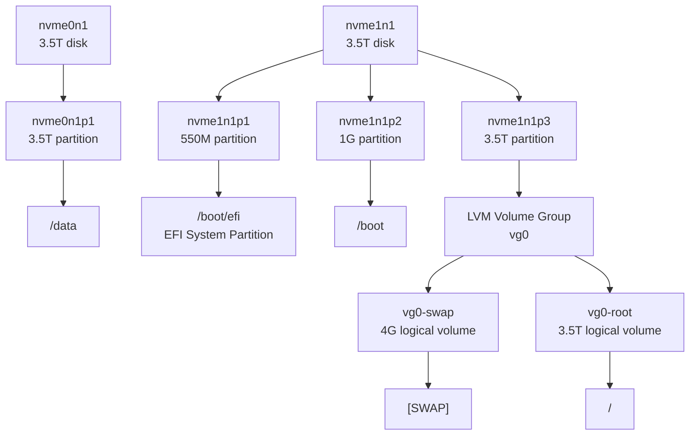
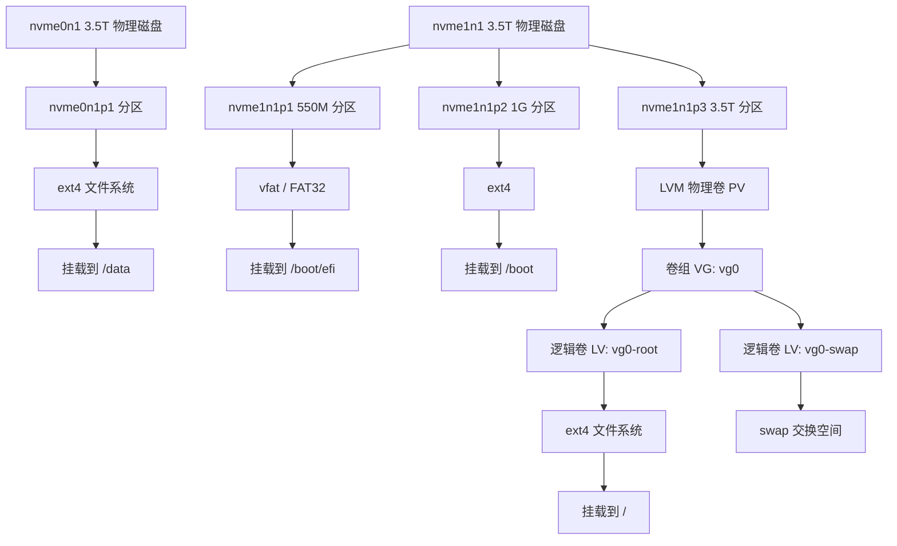

[toc]

下面这段 `lsblk` 输出展示了一个典型的 Linux 块设备层级：**物理磁盘 → 分区 → LVM 逻辑卷 → 挂载点**。

```text
NAME         MAJ:MIN RM  SIZE RO TYPE MOUNTPOINTS
loop0          7:0    0 63.8M  1 loop /snap/core20/2769
...
nvme0n1      259:0    0  3.5T  0 disk
└─nvme0n1p1  259:2    0  3.5T  0 part /data
nvme1n1      259:1    0  3.5T  0 disk
├─nvme1n1p1  259:3    0  550M  0 part /boot/efi
├─nvme1n1p2  259:4    0    1G  0 part /boot
└─nvme1n1p3  259:5    0  3.5T  0 part
  ├─vg0-swap 253:0    0    4G  0 lvm  [SWAP]
  └─vg0-root 253:1    0  3.5T  0 lvm  /
```

## 1. `lsblk` 每列含义

| 列名          | 含义                                               |
| ------------- | -------------------------------------------------- |
| `NAME`        | 设备名或逻辑卷名                                   |
| `MAJ:MIN`     | 主设备号和次设备号，内核用来区分设备驱动和具体设备 |
| `RM`          | 是否可移动设备，`1` 表示可移动，`0` 表示不可移动   |
| `SIZE`        | 设备容量                                           |
| `RO`          | 是否只读，`1` 表示只读                             |
| `TYPE`        | 设备类型，如 `disk`、`part`、`lvm`、`loop`         |
| `MOUNTPOINTS` | 挂载点，可能有多个，所以是复数                     |

其中树形结构非常重要：

```text
nvme1n1
├─nvme1n1p1
├─nvme1n1p2
└─nvme1n1p3
  ├─vg0-swap
  └─vg0-root
```

表示 `nvme1n1` 是一块物理磁盘，下面有三个分区，其中第三个分区又被 LVM 使用，进一步划分成 `swap` 和 `/` 根文件系统。

------

## 2. Linux 块设备命名规则

Linux 中块设备通常位于 `/dev` 目录下，例如：

```bash
/dev/nvme0n1
/dev/nvme0n1p1
/dev/sda
/dev/sda1
/dev/mapper/vg0-root
```

### 2.1 NVMe 磁盘命名

你的系统中使用的是 NVMe 磁盘：

```text
nvme0n1
nvme1n1
```

NVMe 命名格式一般是：

```text
nvmeXnYpZ
```

含义如下：

| 部分   | 含义                            |
| ------ | ------------------------------- |
| `nvme` | NVMe 设备                       |
| `X`    | 第几个 NVMe 控制器，从 `0` 开始 |
| `nY`   | 第几个 namespace，通常是 `n1`   |
| `pZ`   | 第几个分区                      |

例如：

```text
nvme0n1      第一块 NVMe 设备的第一个 namespace
nvme0n1p1    nvme0n1 上的第 1 个分区

nvme1n1      第二块 NVMe 设备的第一个 namespace
nvme1n1p3    nvme1n1 上的第 3 个分区
```

注意：`nvme0n1`、`nvme1n1` 的编号并不一定永久稳定。硬件顺序、BIOS/UEFI、内核扫描顺序变化后，编号可能变化。因此在 `/etc/fstab` 中更推荐使用：

```bash
UUID=...
PARTUUID=...
/dev/disk/by-id/...
```

而不是直接写死 `/dev/nvme0n1p1`。

------

### 2.2 SATA/SCSI/USB 磁盘命名

传统磁盘常见命名是：

```text
sda
sdb
sdc
```

含义是：

| 名称        | 含义                                  |
| ----------- | ------------------------------------- |
| `/dev/sda`  | 第一块被识别到的 SCSI/SATA/USB 类磁盘 |
| `/dev/sdb`  | 第二块                                |
| `/dev/sda1` | `/dev/sda` 的第 1 个分区              |
| `/dev/sda2` | `/dev/sda` 的第 2 个分区              |

NVMe 分区名中间有 `p`，例如：

```text
nvme0n1p1
```

而 SATA/SCSI 分区通常直接加数字：

```text
sda1
sda2
```

这是因为 `nvme0n1` 本身已经以数字结尾，如果直接写成 `nvme0n11` 会产生歧义，所以用 `p1` 表示第 1 个分区。

------

### 2.3 虚拟磁盘命名

在虚拟化环境中还可能看到：

| 设备名         | 场景                                           |
| -------------- | ---------------------------------------------- |
| `vda`, `vdb`   | VirtIO 虚拟磁盘，常见于 KVM/QEMU               |
| `xvda`         | Xen 虚拟磁盘                                   |
| `dm-0`, `dm-1` | device-mapper 设备，如 LVM、加密盘、多路径设备 |
| `md0`          | Linux 软件 RAID                                |
| `loop0`        | loop 回环设备，常用于挂载镜像文件、Snap 包     |

------

## 3. 解读你的这台机器

你的系统大致有两块 3.5T NVMe 磁盘：

```text
nvme0n1    3.5T
nvme1n1    3.5T
```

### 第一块盘：`nvme0n1`

```text
nvme0n1      3.5T disk
└─nvme0n1p1  3.5T part /data
```

这块盘只有一个分区：

```text
/dev/nvme0n1p1
```

它被挂载到了：

```text
/data
```

也就是说，这块磁盘主要作为数据盘使用。

------

### 第二块盘：`nvme1n1`

```text
nvme1n1      3.5T disk
├─nvme1n1p1  550M part /boot/efi
├─nvme1n1p2  1G   part /boot
└─nvme1n1p3  3.5T part
  ├─vg0-swap 4G   lvm [SWAP]
  └─vg0-root 3.5T lvm /
```

这块盘是系统盘。

它包含三个分区：

| 分区        | 大小 | 用途                              |
| ----------- | ---- | --------------------------------- |
| `nvme1n1p1` | 550M | EFI 系统分区，挂载到 `/boot/efi`  |
| `nvme1n1p2` | 1G   | `/boot` 分区                      |
| `nvme1n1p3` | 3.5T | LVM 物理卷，用于承载根分区和 swap |

其中：

```text
nvme1n1p1 -> /boot/efi
```

这是 UEFI 启动所需的 EFI System Partition，通常是 FAT32 文件系统，里面放置启动引导程序，例如 GRUB 的 EFI 文件。

```text
nvme1n1p2 -> /boot
```

这里通常存放 Linux 内核、initramfs、GRUB 配置等启动相关文件。

```text
nvme1n1p3 -> LVM
```

第三个分区没有直接挂载，而是作为 LVM 的物理卷使用。它下面创建了两个逻辑卷：

```text
vg0-swap -> [SWAP]
vg0-root -> /
```

`vg0-root` 是根文件系统，也就是 Linux 系统的 `/`。

------

## 4. Mermaid 示意图



------

## 5. `loop` 设备是什么？

你输出中还有很多 `loop` 设备：

```text
loop0  63.8M  loop /snap/core20/2769
loop1  63.8M  loop /snap/core20/2866
loop2  91.7M  loop /snap/lxd/38469
...
```

这些不是物理硬盘，而是 **loop 回环设备**。

在 Ubuntu 系统中，Snap 包通常会以只读 SquashFS 镜像形式挂载，因此你会看到很多类似：

```text
/snap/core20/2769
/snap/lxd/38469
/snap/snapd/26382
```

它们的特点是：

```text
TYPE = loop
RO = 1
```

表示它们是 loop 设备，并且只读。

这类设备一般不用手动管理，属于 Snap 软件包机制的一部分。

------

## 6. LVM 相关解读

你的系统用了 LVM：

```text
nvme1n1p3
  ├─vg0-swap
  └─vg0-root
```

LVM 的三层概念是：

| 层级 | 名称                    | 你的系统中的例子       |
| ---- | ----------------------- | ---------------------- |
| PV   | Physical Volume，物理卷 | `/dev/nvme1n1p3`       |
| VG   | Volume Group，卷组      | `vg0`                  |
| LV   | Logical Volume，逻辑卷  | `vg0-root`, `vg0-swap` |

可以理解为：

```text
物理分区 nvme1n1p3
  ↓
加入卷组 vg0
  ↓
划分出逻辑卷 root 和 swap
```

LVM 的好处是后期更容易扩容、缩容、快照和迁移。例如，如果以后再加一块盘，可以把新盘加入 `vg0`，然后扩容 `vg0-root`。

常见查看命令：

```bash
pvs     # 查看物理卷
vgs     # 查看卷组
lvs     # 查看逻辑卷
```

------

## 7. 更推荐的查看方式

为了看到文件系统类型、UUID、挂载点，可以用：

```bash
lsblk -f
```

为了看到更完整的层级和路径：

```bash
lsblk -o NAME,PATH,FSTYPE,SIZE,TYPE,MOUNTPOINTS,UUID
```

为了查看持久化设备名：

```bash
ls -l /dev/disk/by-id/
ls -l /dev/disk/by-uuid/
ls -l /dev/disk/by-partuuid/
```

查看挂载配置：

```bash
cat /etc/fstab
```

------

## 8. 总结这台系统的磁盘布局

你的系统可以概括为：

```text
nvme1n1 = 系统盘
  ├─ nvme1n1p1 = EFI 分区，挂载 /boot/efi
  ├─ nvme1n1p2 = /boot 分区
  └─ nvme1n1p3 = LVM 物理卷
       ├─ vg0-root = 根文件系统 /
       └─ vg0-swap = swap

nvme0n1 = 数据盘
  └─ nvme0n1p1 = /data

loop0~loop5 = Snap 软件包挂载出来的只读镜像
```

核心理解是：**Linux 块设备命名反映了设备类型、枚举顺序和分区层级；而 `lsblk` 展示的是从底层磁盘到上层文件系统挂载点的完整关系。**

```shell
# root @ s6 in /data [16:45:55]
$ pvs
  PV             VG  Fmt  Attr PSize PFree
  /dev/nvme1n1p3 vg0 lvm2 a--  3.49t    0
(base)
# root @ s6 in /data [16:45:59]
$ lsblk
NAME         MAJ:MIN RM  SIZE RO TYPE MOUNTPOINTS
loop0          7:0    0 63.8M  1 loop /snap/core20/2769
loop1          7:1    0 63.8M  1 loop /snap/core20/2866
loop2          7:2    0 91.7M  1 loop /snap/lxd/38469
loop3          7:3    0 91.7M  1 loop /snap/lxd/38800
loop5          7:5    0 49.3M  1 loop /snap/snapd/26865
loop6          7:6    0 50.1M  1 loop /snap/snapd/27406
nvme0n1      259:0    0  3.5T  0 disk
└─nvme0n1p1  259:2    0  3.5T  0 part /data
nvme1n1      259:1    0  3.5T  0 disk
├─nvme1n1p1  259:3    0  550M  0 part /boot/efi
├─nvme1n1p2  259:4    0    1G  0 part /boot
└─nvme1n1p3  259:5    0  3.5T  0 part
  ├─vg0-swap 253:0    0    4G  0 lvm  [SWAP]
  └─vg0-root 253:1    0  3.5T  0 lvm  /
(base)
# root @ s6 in /data [16:46:06]
$ lsblk -f
NAME         FSTYPE      FSVER    LABEL UUID                                   FSAVAIL FSUSE% MOUNTPOINTS
loop0        squashfs    4.0                                                         0   100% /snap/core20/2769
loop1        squashfs    4.0                                                         0   100% /snap/core20/2866
loop2        squashfs    4.0                                                         0   100% /snap/lxd/38469
loop3        squashfs    4.0                                                         0   100% /snap/lxd/38800
loop5        squashfs    4.0                                                         0   100% /snap/snapd/26865
loop6        squashfs    4.0                                                         0   100% /snap/snapd/27406
nvme0n1
└─nvme0n1p1  ext4        1.0            d0c917c5-192c-472f-afc7-dbde924323ac      1.4T    55% /data
nvme1n1
├─nvme1n1p1  vfat        FAT32    efi   B49E-C4E9                               542.8M     1% /boot/efi
├─nvme1n1p2  ext4        1.0            c32088a8-43b4-48c2-9c5d-0884bf2c0eb9    646.7M    27% /boot
└─nvme1n1p3  LVM2_member LVM2 001       ek0Udw-YTlN-T7E1-kbYR-DOEZ-4zb3-lQQR1m
  ├─vg0-swap swap        1              c3f0615a-fedb-4e90-8620-4a01d8546b42                  [SWAP]
  └─vg0-root ext4        1.0            3e04256d-a5c5-4546-99fa-6376d6fce1a3        2T    37% /
(base)
# root @ s6 in /data [16:52:20]
$ findmnt /
TARGET SOURCE               FSTYPE OPTIONS
/      /dev/mapper/vg0-root ext4   rw,relatime
```

下面按初学者视角，把你的输出拆开看。

## 先看整体结论

你的系统里有 **两块 3.5T NVMe 硬盘**：

```text
nvme0n1  3.5T
└─nvme0n1p1  ext4  挂载到 /data

nvme1n1  3.5T
├─nvme1n1p1  vfat   挂载到 /boot/efi
├─nvme1n1p2  ext4   挂载到 /boot
└─nvme1n1p3  LVM2_member
  ├─vg0-swap  swap  交换分区
  └─vg0-root  ext4  挂载到 /
```

可以理解成：

```text
第一块盘 nvme0n1：
物理盘 → 分区 nvme0n1p1 → ext4 文件系统 → /data

第二块盘 nvme1n1：
物理盘 → p1 → EFI 启动分区 → /boot/efi
      → p2 → Linux 启动分区 → /boot
      → p3 → LVM 物理卷 PV → 卷组 vg0
                               ├─ 逻辑卷 root → ext4 → /
                               └─ 逻辑卷 swap → swap
```

------

## 先认识几个核心概念

### 1. 磁盘 disk

例如：

```text
nvme0n1
nvme1n1
```

这是两块真实的 NVMe 硬盘。

`lsblk` 中显示：

```text
nvme0n1      3.5T  disk
nvme1n1      3.5T  disk
```

`TYPE=disk` 表示它们是整块磁盘。

------

### 2. 分区 part

例如：

```text
nvme0n1p1
nvme1n1p1
nvme1n1p2
nvme1n1p3
```

这些是磁盘上的分区。

命名规则是：

```text
/dev/nvme1n1    整块 NVMe 磁盘
/dev/nvme1n1p1  第 1 个分区
/dev/nvme1n1p2  第 2 个分区
/dev/nvme1n1p3  第 3 个分区
```

也就是：

```text
nvme1n1 + p1 = nvme1n1p1
nvme1n1 + p2 = nvme1n1p2
nvme1n1 + p3 = nvme1n1p3
```

其中 `p` 表示 partition。

------

### 3. 文件系统 filesystem

分区本身只是“一块空间”，要存文件，还需要格式化成文件系统。

你的系统里有这些文件系统：

```text
ext4
vfat
swap
squashfs
LVM2_member
```

含义如下：

| 类型             | 含义                                           |
| ---------------- | ---------------------------------------------- |
| `ext4`           | Linux 常见文件系统，用于 `/`、`/boot`、`/data` |
| `vfat` / `FAT32` | EFI 启动分区常用文件系统                       |
| `swap`           | 交换空间，不存普通文件                         |
| `squashfs`       | Snap 软件包使用的只读文件系统                  |
| `LVM2_member`    | 表示这个分区不是直接存文件，而是交给 LVM 管理  |

重点是：

```text
nvme1n1p3 不是直接挂载的 ext4 分区，
它是 LVM 的底层物理卷。
真正挂载到 / 的是 vg0-root。
```

------

### 4. 挂载点 mountpoint

Linux 不是像 Windows 那样用 C 盘、D 盘，而是把不同磁盘或分区“挂载”到目录上。

例如：

```text
/          根目录
/data      数据目录
/boot      启动文件目录
/boot/efi  EFI 启动目录
```

你的输出中：

```text
nvme0n1p1  挂载到 /data
vg0-root   挂载到 /
nvme1n1p2  挂载到 /boot
nvme1n1p1  挂载到 /boot/efi
```

也就是说：

| 目录        | 实际来源               |
| ----------- | ---------------------- |
| `/`         | `/dev/mapper/vg0-root` |
| `/data`     | `/dev/nvme0n1p1`       |
| `/boot`     | `/dev/nvme1n1p2`       |
| `/boot/efi` | `/dev/nvme1n1p1`       |

------

## 系统磁盘结构图

可以这样理解：



------

## 逐条解释你的输出

## 1. `pvs`

你的输出：

```text
PV             VG  Fmt  Attr PSize PFree
/dev/nvme1n1p3 vg0 lvm2 a--  3.49t    0
```

`pvs` 是查看 LVM 物理卷的命令。

逐列解释：

| 列      | 含义                                  |
| ------- | ------------------------------------- |
| `PV`    | Physical Volume，LVM 物理卷           |
| `VG`    | Volume Group，所属卷组                |
| `Fmt`   | LVM 格式版本                          |
| `Attr`  | 属性                                  |
| `PSize` | 物理卷大小                            |
| `PFree` | 这个物理卷在 LVM 中还剩多少未分配空间 |

所以这行的意思是：

```text
/dev/nvme1n1p3 是一个 LVM 物理卷，
它属于 vg0 这个卷组，
总大小约 3.49T，
LVM 层面已经没有空闲空间可分配。
```

注意：

```text
PFree = 0
```

不等于系统磁盘满了。

它只是说：

```text
vg0 这个 LVM 卷组里的空间都已经分配给逻辑卷了。
```

但逻辑卷里的文件系统仍然可能有大量空闲空间。

你的 `/` 就是这种情况：

```text
vg0-root ext4  2T 可用  37% 已用
```

------

## 2. `lsblk`

你的输出中最重要的是：

```text
nvme0n1      3.5T  disk
└─nvme0n1p1  3.5T  part /data
```

意思是：

```text
第一块 3.5T 磁盘 nvme0n1
只有一个分区 nvme0n1p1
这个分区挂载到了 /data
```

再看第二块盘：

```text
nvme1n1      3.5T  disk
├─nvme1n1p1  550M  part /boot/efi
├─nvme1n1p2  1G    part /boot
└─nvme1n1p3  3.5T  part
  ├─vg0-swap 4G    lvm  [SWAP]
  └─vg0-root 3.5T  lvm  /
```

意思是：

```text
第二块 3.5T 磁盘 nvme1n1
分成了三个分区：

p1：EFI 启动分区，挂载到 /boot/efi
p2：Linux boot 分区，挂载到 /boot
p3：交给 LVM 使用

在 p3 里面，通过 LVM 创建了两个逻辑卷：

vg0-swap：4G，作为 swap
vg0-root：约 3.5T，作为根目录 /
```

------

## 3. `lsblk -f`

`lsblk -f` 比 `lsblk` 多显示文件系统信息。

例如：

```text
nvme0n1p1  ext4  UUID=...  FSAVAIL=1.4T  FSUSE%=55%  /data
```

意思是：

```text
/data 所在分区是 ext4 文件系统，
还有 1.4T 可用，
已经使用 55%。
```

再看根目录：

```text
vg0-root ext4 UUID=... FSAVAIL=2T FSUSE%=37% /
```

意思是：

```text
/ 根目录在 vg0-root 这个 LVM 逻辑卷上，
文件系统是 ext4，
还有约 2T 可用，
已经使用 37%。
```

再看启动分区：

```text
nvme1n1p1  vfat  FAT32  LABEL=efi  /boot/efi
nvme1n1p2  ext4         /boot
```

说明：

```text
/boot/efi 是 EFI 启动分区，FAT32 格式
/boot 是 Linux 内核、initramfs 等启动文件所在位置，ext4 格式
```

------

## 4. `findmnt /`

你的输出：

```text
TARGET SOURCE               FSTYPE OPTIONS
/      /dev/mapper/vg0-root ext4   rw,relatime
```

意思是：

```text
根目录 / 的来源是 /dev/mapper/vg0-root
文件系统类型是 ext4
挂载参数是 rw,relatime
```

其中：

| 项        | 含义           |
| --------- | -------------- |
| `TARGET`  | 挂载到哪里     |
| `SOURCE`  | 从哪个设备挂载 |
| `FSTYPE`  | 文件系统类型   |
| `OPTIONS` | 挂载选项       |

`rw` 表示 read-write，可读可写。

`relatime` 是一种访问时间更新策略，比传统 `atime` 更节省磁盘写入。

------

# LVM 是什么？

LVM 可以理解成 Linux 的“磁盘空间管理层”。

普通方式是：

```text
磁盘 → 分区 → 文件系统 → 挂载点
```

LVM 方式是：

```text
磁盘 → 分区 → PV → VG → LV → 文件系统 → 挂载点
```

分别是：

| 缩写 | 全称            | 含义                             |
| ---- | --------------- | -------------------------------- |
| PV   | Physical Volume | 物理卷，LVM 的底层空间           |
| VG   | Volume Group    | 卷组，把多个 PV 汇总成一个资源池 |
| LV   | Logical Volume  | 逻辑卷，从 VG 里划出的“虚拟分区” |

你的系统中：

```text
PV: /dev/nvme1n1p3
VG: vg0
LV: vg0-root, vg0-swap
```

也就是：

```text
/dev/nvme1n1p3 → vg0 → vg0-root → /
```

------

## 六、为什么 `/dev/nvme1n1p3` 没有直接挂载？

因为它的类型是：

```text
LVM2_member
```

这表示它是 LVM 的底层成员，不是直接存普通文件的 ext4 文件系统。

真正挂载的是它下面的逻辑卷：

```text
/dev/mapper/vg0-root
```

所以：

```text
/dev/nvme1n1p3
```

不是给你直接访问文件的。

而：

```text
/dev/mapper/vg0-root
```

才是根目录 `/` 的实际设备。

------

## 七、`/dev/mapper/vg0-root` 是什么？

这是 LVM 逻辑卷的设备映射路径。

你的逻辑卷在 `lsblk` 中显示为：

```text
vg0-root
```

在 `findmnt` 中显示为：

```text
/dev/mapper/vg0-root
```

它们指的是同一个东西。

通常 LVM 逻辑卷有两种路径：

```text
/dev/mapper/vg0-root
/dev/vg0/root
```

可以用下面命令验证：

```bash
ls -l /dev/mapper/
ls -l /dev/vg0/
```

------

# 命名规则总结

## 1. NVMe 磁盘命名

```text
/dev/nvme0n1
/dev/nvme1n1
```

拆开看：

```text
nvme0  第 0 个 NVMe 控制器/设备编号
n1     第 1 个 namespace
```

一般你可以简单理解为：

```text
nvme0n1 = 第一块 NVMe 盘
nvme1n1 = 第二块 NVMe 盘
```

分区命名：

```text
/dev/nvme0n1p1
/dev/nvme1n1p1
/dev/nvme1n1p2
/dev/nvme1n1p3
```

其中：

```text
p1 = 第 1 个分区
p2 = 第 2 个分区
p3 = 第 3 个分区
```

------

## 2. SATA/SAS 磁盘常见命名

如果是传统 SATA/SAS 磁盘，通常叫：

```text
/dev/sda
/dev/sdb
/dev/sdc
```

分区叫：

```text
/dev/sda1
/dev/sda2
/dev/sdb1
```

对比一下：

```text
SATA: /dev/sda1
NVMe: /dev/nvme0n1p1
```

NVMe 分区中间多了一个 `p`。

------

## 3. LVM 命名

你的 LVM 逻辑卷叫：

```text
vg0-root
vg0-swap
```

含义是：

```text
vg0-root = vg0 卷组里的 root 逻辑卷
vg0-swap = vg0 卷组里的 swap 逻辑卷
```

其中：

```text
vg0
```

是卷组名。

```text
root
swap
```

是逻辑卷名。

------

## 4. loop 设备

你的输出中还有：

```text
loop0
loop1
loop2
loop3
loop5
loop6
```

这些不是物理硬盘，而是 Snap 软件包挂载出来的只读镜像。

例如：

```text
loop0  squashfs  /snap/core20/2769
loop2  squashfs  /snap/lxd/38469
```

这类通常不用管。它们显示 `100%` 使用率也正常，因为 squashfs 是只读镜像，本身就是满的。

------

# 如何判断哪个盘是系统盘，哪个盘是数据盘？

看挂载点。

你的系统中：

```text
vg0-root 挂载到 /
```

所以系统根目录在：

```text
nvme1n1p3 → vg0-root → /
```

因此：

```text
nvme1n1 是系统盘
```

而：

```text
nvme0n1p1 挂载到 /data
```

所以：

```text
nvme0n1 是数据盘
```

简单结论：

| 磁盘      | 用途                               |
| --------- | ---------------------------------- |
| `nvme1n1` | 系统盘，包含 EFI、boot、root、swap |
| `nvme0n1` | 数据盘，挂载到 `/data`             |

------

# 如何看磁盘剩余空间？

## 看文件系统使用情况

最常用：

```bash
df -hT
```

含义：

```text
df      查看文件系统空间
-h      human readable，用 G/T 显示
-T      显示文件系统类型
```

重点看：

```text
Filesystem
Type
Size
Used
Avail
Use%
Mounted on
```

你的 `lsblk -f` 已经显示：

```text
/data  可用 1.4T，已用 55%
/      可用 2T，已用 37%
```

------

## 看某个目录占用多少

例如查看 `/data` 下谁占空间：

```bash
du -h --max-depth=1 /data
```

按大小排序：

```bash
du -h --max-depth=1 /data | sort -h
```

查看根目录各一级目录占用：

```bash
du -h --max-depth=1 /
```

有些目录可能权限不足，作为 root 执行会更完整。

------

# 查询更多信息的常用命令

## 1. 查看块设备树

```bash
lsblk
```

更详细一点：

```bash
lsblk -f
```

自定义显示列：

```bash
lsblk -o NAME,SIZE,TYPE,FSTYPE,LABEL,UUID,MOUNTPOINTS
```

------

## 2. 查看挂载关系

查看所有挂载：

```bash
findmnt
```

查看根目录 `/` 来自哪里：

```bash
findmnt /
```

查看 `/data` 来自哪里：

```bash
findmnt /data
```

------

## 3. 查看文件系统空间

```bash
df -hT
```

查看指定目录：

```bash
df -hT /
df -hT /data
df -hT /boot
```

------

## 4. 查看 UUID 和文件系统类型

```bash
blkid
```

这个命令常用于确认：

```text
设备名
UUID
文件系统类型
LABEL
```

例如：

```bash
blkid /dev/nvme0n1p1
blkid /dev/mapper/vg0-root
```

------

## 5. 查看 LVM 信息

查看物理卷：

```bash
pvs
pvdisplay
```

查看卷组：

```bash
vgs
vgdisplay
```

查看逻辑卷：

```bash
lvs
lvdisplay
```

推荐初学者先用：

```bash
pvs
vgs
lvs
```

这三个最简洁。

你可以这样看完整 LVM 关系：

```bash
pvs
vgs
lvs -a -o +devices
```

其中：

```bash
lvs -a -o +devices
```

可以看到逻辑卷具体落在哪些物理设备上。

------

## 6. 查看分区表

只读查看：

```bash
fdisk -l
```

或者：

```bash
parted -l
```

注意：

```bash
fdisk -l
```

是查看，不会修改。

但直接运行：

```bash
fdisk /dev/nvme1n1
```

进入交互模式后就要非常小心，不懂不要写入。

------

## 7. 查看开机自动挂载配置

```bash
cat /etc/fstab
```

这个文件决定系统启动时哪些设备自动挂载到哪些目录。

里面经常使用 UUID，例如：

```text
UUID=xxxx  /data  ext4  defaults  0  2
```

这比直接写 `/dev/nvme0n1p1` 更稳定，因为设备名可能变化，但 UUID 通常不变。

------

## 8. 查看 swap

```bash
swapon --show
```

或者：

```bash
free -h
```

你的 swap 是：

```text
vg0-swap  4G
```

------

## 9. 查看 NVMe 硬盘健康信息

如果安装了 `nvme-cli`：

```bash
nvme list
nvme smart-log /dev/nvme0n1
nvme smart-log /dev/nvme1n1
```

如果安装了 `smartmontools`：

```bash
smartctl -a /dev/nvme0n1
smartctl -a /dev/nvme1n1
```

这些可以看：

- 硬盘型号
- 序列号
- 温度
- 通电时间
- 写入量
- 健康状态
- 错误计数


------

