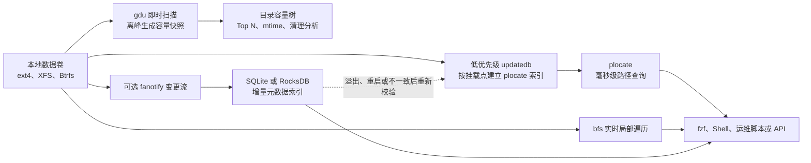

[toc]

## abstract

Windows上有wiztree 和everything这类快速分析磁盘占用以及快速查找文件的工具。在linux上有类似快速地分析过查找工具吗？ 实现的前提和机制是怎样的? 文件量级和零散程度相近的前提下，可以匹敌windows这两款工具吗？ 有评测实验对比吗？  

本文介绍对linux服务器做分析和查找的现代化极致性能方案。

Linux 上有对应工具，但不是由一款软件完整替代：

- **Everything 的最佳服务器端替代是 `plocate`**：建立文件名索引后，可以在数千万文件中实现毫秒级路径查询。
- **WizTree 的最佳终端替代是 `gdu`**：适合 SSD、多核服务器上的高速并行磁盘占用扫描。

其他:

- **无索引、要求结果绝对实时的路径搜索，优先考虑 `bfs`**；`fd` 更易用，但不保证比 `bfs` 或 GNU `find` 更快。
- **需要重复查看磁盘占用时，使用 `duc` 或 `gdu` 持久化快照**，不要每次重新遍历。
- **要求像 Everything 一样近实时更新时，需要 fanotify 增量索引加周期性全量校验**。Linux 目前没有一个跨 ext4、XFS、Btrfs、NFS 的通用工具，能够完全复刻 NTFS MFT 加 USN Journal 的组合。

因此，Linux 服务器上的极致方案不是单一工具，而是：

> `plocate + gdu + bfs + fzf + systemd 定时索引`
> 对实时性有更高要求时，再增加 `fanotify + SQLite/RocksDB` 增量元数据索引。

------

## Windows 工具为什么特别快

Everything 和 WizTree 快，并不只是因为代码优化，而是因为 **NTFS 提供了非常适合全盘枚举的集中式元数据结构**。

| 工具               | 核心机制                        | 初次扫描               | 后续更新                  |
| ------------------ | ------------------------------- | ---------------------- | ------------------------- |
| Everything         | 从 NTFS 元数据建立文件名数据库  | 读取集中式文件记录     | 使用 USN Journal 增量更新 |
| WizTree            | 直接解析 NTFS Master File Table | 无须逐目录调用文件 API | 扫描后可监控变化          |
| Linux `find`、`du` | 逐目录读取目录项和 inode 属性   | 必须遍历目录树         | 每次通常重新遍历          |
| Linux `plocate`    | 预先遍历并生成压缩倒排索引      | 首次仍需遍历           | `updatedb` 周期性更新     |
| Linux `gdu`        | 多线程并行遍历目录树            | 首次仍需遍历           | 可保存结果供以后读取      |

- Everything 官方说明，它只索引文件和目录名称，使用 NTFS USN Journal 保持索引实时更新；即使 Everything 没有运行，系统仍然维护 USN Journal，因此重新启动后也可以补齐变化。其官方数据是约 100 万文件占用约 100 MB 内存和 45 MB 索引空间。([Voidtools](https://www.voidtools.com/faq/))
- WizTree 则明确说明，在管理员权限下直接读取 NTFS 的 MFT，而不是通过普通目录遍历接口枚举每个目录。([WizTree](https://diskanalyzer.com/?utm_source=chatgpt.com))

Linux 的 ext4 并不存在完全相同的集中式路径目录。ext4 的 inode 保存大部分文件元数据，但**文件名及其对应 inode 编号存放在各个目录的数据块中**；要还原完整路径，仍需读取目录树中的目录项。([Linux Kernel 文档](https://docs.kernel.org/filesystems/ext4/directory.html?utm_source=chatgpt.com))

这意味着：

> 在通用 ext4、XFS 或 Btrfs 上，Linux 工具很难在“第一次全盘扫描”这个项目上，从结构上匹敌 WizTree 直接读取 NTFS MFT。

但在“已经建立索引后的文件名查询”项目上，Linux 完全可以达到同一级别。

------

## Linux 工具如何选择

| 使用场景                 | 推荐工具                   | 是否索引 | 主要优势                              | 主要限制                           |
| ------------------------ | -------------------------- | -------- | ------------------------------------- | ---------------------------------- |
| 全服务器按文件名查找     | `plocate`                  | 是       | 数千万文件毫秒级查询                  | 结果取决于索引更新时间             |
| 交互式模糊查找           | `plocate + fzf`            | 是       | 接近 Everything 的交互体验            | 不直接索引大小、mtime 等完整元数据 |
| 刚创建文件的实时查找     | `bfs`                      | 否       | 高性能实时目录遍历                    | 每次都要读目录树                   |
| 易用的项目目录查找       | `fd`                       | 否       | 语法简单、并行、自动忽略 `.gitignore` | 公平条件下不一定最快               |
| SSD 磁盘占用分析         | `gdu`                      | 否或快照 | 并行扫描、终端交互、可排序和删除      | 首次仍需遍历                       |
| HDD 磁盘占用分析         | `gdu --sequential`、`ncdu` | 否       | 避免过多随机寻道                      | HDD 上并行收益较低                 |
| 定期保存容量分析结果     | `duc`                      | 是       | 查询历史索引，无须每次扫描            | 索引构建需要时间                   |
| 只求目录总大小           | `diskus`                   | 否       | 极简、通常非常快                      | 没有交互式目录树                   |
| 图形界面 Everything 替代 | `FSearch`                  | 是       | 即输即搜、正则和过滤                  | 更适合桌面，不适合无头服务器       |
| 文件内容查找             | `ripgrep`                  | 否       | 文本和代码搜索极快                    | 不是文件名数据库                   |

FSearch 的定位就是受 Everything 启发的 Unix 图形文件搜索工具，支持即时结果、通配符、正则和过滤；但它主要是 GTK 桌面应用，数据库刷新及实时监控能力也不像 NTFS USN Journal 那样天然完整。([GitHub](https://github.com/cboxdoerfer/fsearch?utm_source=chatgpt.com))

------

## `plocate` 为什么是 Everything 的最佳对应物

`plocate` 不会线性扫描全部路径，而是针对路径字符串中的三字节组合建立倒排索引。查询时先求多个 posting list 的交集，将候选路径缩小，再验证完整匹配；在支持的系统上还会使用 `io_uring` 异步读取索引。([Plocate](https://plocate.sesse.net/))

官方给出的示例中：

- 数据库包含约 **2700 万条路径**
- `mlocate` 查询耗时约 **20.1 秒**
- `plocate` 查询耗时约 **8 毫秒**
- mlocate 数据库约 **1.1 GB**
- plocate 数据库约 **466 MB**

这不是 Linux 和 Everything 的直接横向评测，但足以说明 plocate 的索引查询已经进入毫秒级。([Plocate](https://plocate.sesse.net/))

需要注意三个问题：

- 少于三个字节的短查询无法充分利用 trigram 索引。
- 正则查询通常会迫使 plocate 线性扫描整个数据库。
- 索引默认并非实时更新，而是由 `updatedb` 和 systemd timer 定期更新。([Plocate](https://plocate.sesse.net/plocate.1.html))

`updatedb` 会复用旧数据库的信息，避免重新读取它认为没有变化的目录，因此更新通常比第一次构建更快。([Plocate](https://plocate.sesse.net/updatedb.8.html))

### 基本部署

Debian、Ubuntu 一类系统：

```bash
sudo apt install plocate fzf
sudo updatedb
```

普通查询：

```bash
plocate nginx.conf
plocate -i backup
plocate -b '*.qcow2'
plocate -e application.log
```

其中：

- `-i`：忽略大小写。
- `-b`：只匹配 basename。
- `-e`：查询时再次确认文件仍然存在。
- `-l 100`：最多返回 100 条。

交互式选择：

```bash
plocate -0 -i report |
  fzf --read0 --print0 |
  xargs -0 -r ls -lh --
```

### 按存储卷拆分数据库

数千万到上亿文件时，推荐按数据卷分开建库：

```bash
sudo mkdir -p /var/lib/plocate-custom

sudo updatedb \
  -U /srv/data \
  -o /var/lib/plocate-custom/data.db
```

查询指定数据库：

```bash
plocate \
  -d /var/lib/plocate-custom/data.db \
  simulation-result
```

多个数据库可以一起查询：

```bash
plocate \
  -d /var/lib/plocate-custom/data.db \
  -d /var/lib/plocate-custom/archive.db \
  report
```

`updatedb` 官方支持通过 `-U` 限定根目录，通过 `-o` 指定输出文件；`plocate -d` 可以同时指定多个数据库。([Plocate](https://plocate.sesse.net/updatedb.8.html))

------

## `gdu` 能否匹敌 WizTree

### 首次扫描

通常不能保证匹敌。

WizTree 读取的是集中式 MFT；`gdu` 仍然要访问每个目录项及文件属性。文件越零散、目录层级越深、小文件越多，这个结构差异越明显。

### 与普通 Linux 工具相比

`gdu` 非常有竞争力。它面向 SSD 设计，通过并行目录遍历尽可能压满存储元数据吞吐能力；对于机械硬盘也可以使用顺序模式。([GitHub](https://github.com/dundee/gdu?utm_source=chatgpt.com))

gdu 项目的公开测试使用：

- 90 GB 目录
- 10 万个目录
- 40 万个文件
- 500 GB SSD

冷缓存结果如下。([GitHub](https://github.com/dundee/gdu))

| 工具        | 冷缓存耗时 | 相对速度 |
| ----------- | ---------- | -------- |
| `diskus`    | 4.489 秒   | 1.00     |
| `gdu`       | 4.716 秒   | 1.05     |
| `pdu`       | 5.969 秒   | 1.33     |
| `dua`       | 6.030 秒   | 1.34     |
| `dust`      | 6.181 秒   | 1.38     |
| `du`        | 30.608 秒  | 6.82     |
| `duc index` | 32.897 秒  | 7.33     |
| `ncdu`      | 33.163 秒  | 7.39     |

暖缓存下：

| 工具     | 暖缓存耗时  | 相对速度 |
| -------- | ----------- | -------- |
| `diskus` | 270.8 毫秒  | 1.00     |
| `pdu`    | 299.1 毫秒  | 1.10     |
| `gdu`    | 466.1 毫秒  | 1.72     |
| `dust`   | 578.7 毫秒  | 2.14     |
| `dua`    | 590.6 毫秒  | 2.18     |
| `du`     | 1255.2 毫秒 | 4.63     |
| `ncdu`   | 2222.4 毫秒 | 8.21     |

这是项目方自己的单机测试，不是独立第三方评测，也不是与 WizTree 的同数据集对比，因此不能把比例直接套用到所有服务器。但它能够说明：**在 Linux 原生目录遍历工具中，gdu 对大量文件的处理速度明显优于传统 du 和 ncdu。**

### 安全的服务器用法

只读分析，禁止误删和查看文件内容：

```bash
sudo gdu \
  --no-delete \
  --no-view-file \
  --no-cross \
  --max-cores 8 \
  /srv/data
```

机械硬盘：

```bash
sudo gdu \
  --sequential \
  --no-delete \
  --no-cross \
  /srv/archive
```

只显示最大的 100 个项目：

```bash
sudo gdu \
  --non-interactive \
  --no-progress \
  --no-cross \
  --top 100 \
  /srv/data
```

区分两种容量口径：

```bash
# 默认：实际占用的磁盘空间
gdu /srv/data

# apparent size：文件逻辑长度
gdu --show-apparent-size /srv/data
```

gdu 会避免重复计算硬链接，并支持限定文件系统、控制最大核心数、按 mtime 筛选、导出 JSON 和保存数据库。([GitHub](https://github.com/dundee/gdu))

------

## 推荐的服务器架构



### 日常查询路径

先查索引：

```bash
plocate -i checkpoint
```

索引中没有，而且文件可能刚刚创建时，只扫描相关数据根：

```bash
bfs /srv/data \
  -xdev \
  -iname '*checkpoint*'
```

不建议一遇到查找需求就运行：

```bash
find / -name '*checkpoint*'
```

因为它会触发根文件系统、容器目录、网络挂载、临时目录等大量无关元数据访问。

------

## 索引刷新策略

### 普通服务器

建议每 15 至 60 分钟刷新一次。

```ini
# /etc/systemd/system/data-plocate.service

[Unit]
Description=Update plocate index for data volume

[Service]
Type=oneshot
ExecStart=/usr/bin/ionice -c 3 /usr/bin/nice -n 19 /usr/bin/updatedb -U /srv/data -o /var/lib/plocate-custom/data.db
# /etc/systemd/system/data-plocate.timer

[Unit]
Description=Periodically update data plocate index

[Timer]
OnBootSec=10min
OnUnitActiveSec=15min
RandomizedDelaySec=2min
Persistent=true

[Install]
WantedBy=timers.target
```

启用：

```bash
sudo systemctl daemon-reload
sudo systemctl enable --now data-plocate.timer
```

查看：

```bash
systemctl list-timers data-plocate.timer
journalctl -u data-plocate.service
```

`ionice -c 3` 使用 idle I/O 调度类别，`nice -n 19` 降低 CPU 调度优先级，能减少索引更新对业务的干扰。

### 排除目录

不要直接照搬一个全局排除清单，应根据服务器用途配置。典型容器服务器可以考虑：

```ini
# /etc/updatedb.conf

PRUNEFS = "proc sysfs devtmpfs tmpfs cgroup cgroup2 overlay squashfs"
PRUNENAMES = ".git node_modules __pycache__"
PRUNEPATHS = "/tmp /var/tmp /var/cache /var/lib/docker/overlay2"
PRUNE_BIND_MOUNTS = "yes"
```

但要注意：

- 需要查找容器层文件时，不应排除 `overlay`。
- 需要索引 NFS、CIFS 时，不应将它们加入 `PRUNEFS`。
- Btrfs 子卷挂载在内核层可能表现得类似 bind mount，启用 `PRUNE_BIND_MOUNTS` 可能跳过部分子卷。([Plocate](https://plocate.sesse.net/updatedb.conf.5.html))

------

## 是否值得做实时索引

### Linux 现成机制

Linux 主要有两个通知机制：

| 机制     | 适合场景                   | 问题                                                   |
| -------- | -------------------------- | ------------------------------------------------------ |
| inotify  | 单个应用目录、小型目录树   | 目录监视非递归，需要为每个子目录建立 watch             |
| fanotify | 挂载点或整个文件系统级监控 | 实现复杂，需要处理权限、文件句柄、队列溢出和一致性恢复 |

inotify 监控目录不是递归的。大型目录树需要为每个子目录建立 watch，初始化耗时且受系统 watch 数量限制；事件队列溢出时还会丢失事件，可靠程序必须重建部分或全部缓存。([man7.org](https://man7.org/linux/man-pages/man7/inotify.7.html?utm_source=chatgpt.com))

fanotify 可以标记挂载点或整个文件系统，并能接收创建、删除、移动和重命名事件，但同样存在事件队列溢出状态，应用必须有恢复机制。([man7.org](https://man7.org/linux/man-pages/man2/fanotify_mark.2.html?utm_source=chatgpt.com))

### 推荐判断

| 新文件可见延迟要求   | 推荐方案                                           |
| -------------------- | -------------------------------------------------- |
| 24 小时以内          | 默认每日 `updatedb`                                |
| 15 至 60 分钟        | systemd timer 定期运行 `updatedb`                  |
| 1 至 5 分钟          | 高频分卷索引，避免每次扫整个 `/`                   |
| 数秒以内             | fanotify 增量索引加定期校验                        |
| 严格实时且不能漏事件 | 结合业务写入链路维护数据库，而不是依赖文件系统通知 |

真正可靠的实时架构应该是：

1. 首次遍历建立完整数据库。
2. fanotify 接收增删改名事件。
3. 变更事务写入 SQLite、LMDB 或 RocksDB。
4. 记录事件序号和检查点。
5. 队列溢出时标记索引不可信。
6. 周期性对目录 mtime、inode 数或分区快照执行校验。
7. 不一致时重扫相关目录或整个挂载点。

它可以接近 Everything 的使用体验，但实现和运维成本明显高于 USN Journal 方案。

------

## 容量分析的持久化方案

对于 5000 万以上文件，不建议管理员每次进入服务器都重新运行完整 gdu 扫描。

### gdu 快照

```bash
sudo mkdir -p /var/cache/gdu

sudo gdu \
  --no-cross \
  --output-file /var/cache/gdu/data-current.json \
  /srv/data
```

以后直接读取：

```bash
gdu \
  --input-file /var/cache/gdu/data-current.json
```

压缩快照：

```bash
sudo gdu --no-cross --output-file - /srv/data |
  gzip -1 > /var/cache/gdu/data-current.json.gz
```

查看：

```bash
gzip -dc /var/cache/gdu/data-current.json.gz |
  gdu --input-file -
```

### gdu 数据库

```bash
sudo gdu \
  --db /var/cache/gdu/data.sqlite \
  --no-cross \
  /srv/data
```

读取已有数据库：

```bash
gdu \
  --read-from-storage \
  --db /var/cache/gdu/data.sqlite
```

数据库模式会牺牲初次构建速度。gdu 自己的公开测试也显示，SQLite 或 BadgerDB 持久化扫描明显慢于纯内存模式，因此应放在离峰任务中运行。([GitHub](https://github.com/dundee/gdu))

### `duc`

`duc` 的设计目标就是维护目录累计大小数据库，然后使用 CLI、图形界面或其他前端反复查询，而不是每次重新扫描。([GitHub](https://github.com/zevv/duc?utm_source=chatgpt.com))

它更适合：

- 每晚生成容量索引；
- 追踪不同数据卷；
- 管理员白天瞬时查询；
- 保存历史容量趋势。

但单次扫描追求最低延迟时，优先使用 gdu。

------

## 与 Windows 能否匹敌

| 对比项目                          | Linux 是否可匹敌   | 判断                                         |
| --------------------------------- | ------------------ | -------------------------------------------- |
| 索引后按名称查询                  | 可以               | plocate 可达到毫秒级                         |
| 数千万文件模糊交互查找            | 可以               | plocate 配合 fzf                             |
| 初次扫描 ext4、XFS 大量小文件     | 通常不可以         | Linux 仍需遍历目录树                         |
| SSD 暖缓存目录占用扫描            | 有机会接近         | gdu、pdu、diskus 都很快                      |
| HDD 冷缓存大量零散文件            | 通常弱于 WizTree   | 随机读取目录元数据成本高                     |
| 实时增量更新                      | 部分可以           | fanotify 可实现，但不如 USN Journal 简单可靠 |
| 文件大小、mtime、路径统一实时过滤 | 需要自建元数据索引 | plocate 主要索引路径名                       |
| NFS、CIFS、CephFS 远程目录        | 双方都会明显下降   | 应在存储服务端本地建立索引                   |
| 容器 overlay 文件系统             | 需要专门排除和去重 | 否则会重复扫描大量镜像层                     |

不存在很有说服力的公开实验，在完全相同硬件、相同文件集合、相同缓存状态下，直接比较 Everything、WizTree、plocate 和 gdu。现有数据主要是各项目针对同平台工具的自测，因此适合用于筛选工具，不适合得出跨操作系统的绝对排名。

------

## 推荐的极致性能组合

### 通用生产服务器

| 模块           | 工具                | 建议                               |
| -------------- | ------------------- | ---------------------------------- |
| 全局文件名索引 | `plocate`           | 按挂载点拆库，每 15 至 60 分钟更新 |
| 交互查询       | `fzf`               | 读取 plocate 的 NUL 分隔输出       |
| 最新文件补查   | `bfs`               | 只扫描热点目录，不扫描整个根目录   |
| 即时容量分析   | `gdu`               | SSD 使用 4 至 16 个核心            |
| HDD 容量分析   | `gdu --sequential`  | 避免并发随机访问                   |
| 容量快照       | `gdu` JSON 或 `duc` | 离峰生成                           |
| 文本内容查询   | `ripgrep`           | 限制在明确的数据根中               |
| 实时索引       | fanotify 自建服务   | 仅在秒级新鲜度确有必要时采用       |

### 文件数量特别大的服务器

当文件数超过数千万时，应进一步采用：

- 每个挂载点独立 plocate 数据库；
- 不对 `/` 做无差别扫描；
- 容器层、缓存、临时目录单独排除；
- 索引文件放在本地 NVMe，而不是同一机械盘；
- 查询服务与索引构建任务分离；
- 容量扫描并发数从 4、8、16 逐级实测，而不是直接使用全部 CPU；
- NFS 或分布式存储在存储节点本地建立索引，再通过 SSH 或内部 API 查询；
- 将 plocate 用于名称查询，将元数据数据库用于大小、mtime、UID、GID、inode、扩展名和哈希查询。

------

## 建议执行的本机评测

不要直接在生产高峰期清空缓存。冷缓存测试应在测试机、快照卷或维护窗口进行。

### 文件名查询测试

```bash
hyperfine \
  --warmup 3 \
  'plocate -d /var/lib/plocate-custom/data.db checkpoint >/dev/null' \
  'bfs /srv/data -xdev -iname "*checkpoint*" >/dev/null' \
  'fd --hidden --no-ignore --ignore-case checkpoint /srv/data >/dev/null'
```

测试前要确保：

- 三个命令搜索相同根目录；
- 大小写规则一致；
- `fd` 没有默认跳过隐藏目录或 `.gitignore` 文件；
- 返回结果数量相同；
- 不把第一次运行和暖缓存运行混在一起。

`bfs` 作者在约 760 万文件的暖缓存目录遍历测试中，报告 bfs 3.0.1 为 2.416 秒、GNU find 为 7.021 秒、fd 为 8.209 秒；但这是作者自己的特定目录及特定命令测试，不能直接外推到所有文件系统。([Tavianator](https://tavianator.com/2023/bfs_3.0.html?utm_source=chatgpt.com))

### 磁盘占用暖缓存测试

```bash
hyperfine \
  --warmup 2 \
  'gdu -npc -x /srv/data' \
  'du -sx /srv/data' \
  'ncdu -0 -x -o /dev/null /srv/data'
```

### 磁盘占用冷缓存测试

先保持 sudo 凭据：

```bash
sudo -v
```

然后：

```bash
hyperfine \
  --runs 5 \
  --prepare 'sudo sh -c "sync; echo 3 > /proc/sys/vm/drop_caches"' \
  'gdu -npc -x /srv/data' \
  'du -sx /srv/data' \
  'ncdu -0 -x -o /dev/null /srv/data'
```

同时记录：

```bash
iostat -xz 1
pidstat -d 1
```

最终应比较：

| 指标               | 意义                     |
| ------------------ | ------------------------ |
| 墙钟时间           | 管理员实际等待时间       |
| 读取 IOPS          | 元数据随机访问强度       |
| 读取带宽           | 是否受吞吐能力限制       |
| CPU system time    | 系统调用和目录遍历成本   |
| 最大 RSS           | 大目录树的内存压力       |
| 返回结果数         | 确保比较条件公平         |
| 冷缓存与暖缓存差值 | 判断瓶颈是存储还是 CPU   |
| 业务延迟变化       | 判断工具是否干扰生产负载 |

综合来看，**最值得立即部署的是分卷 plocate 索引、低优先级 systemd 刷新、gdu 只读容量分析以及 bfs 热点目录补查**。这套方案在索引查询上可以匹敌 Everything，在 Linux 原生磁盘分析工具中也接近目前最优水平；唯一无法完全消除的是通用 Linux 文件系统首次目录遍历与 NTFS MFT 直接扫描之间的结构性差距。

# v1

原因不是工具差，而是 Windows 这两款工具吃了 NTFS 的结构红利：WizTree 直接读 NTFS 的 MFT；Everything 的数据库本质上也接近 NTFS MFT 缓存，并结合 USN Journal 做增量更新。

> MFT 对每个 NTFS 文件都有记录，USN Journal 又提供卷级文件变化日志。([WizTree](https://diskanalyzer.com/?utm_source=chatgpt.com))

## 能否匹敌？

**文件名查找：可以非常接近，甚至查询阶段能匹敌 Everything。**
服务器上首选 **plocate**。官方示例里，plocate 在 2700 万文件中查 2 个结果用了约 **0.008 秒**，同例 mlocate 约 **20.118 秒**，数据库也更小：466 MB vs 1.1 GB。它用 trigram 倒排索引，并在可用时用 io_uring 做异步 I/O。([Plocate](https://plocate.sesse.net/))
但区别是：Everything 在 NTFS 上有更自然的实时增量更新；Linux 的 plocate 通常依赖 `updatedb` 定时更新。要近实时，需要另建监听/增量索引层。

**磁盘占用分析：常规任意目录扫描很难完全匹敌 WizTree。**
WizTree 的优势来自直接读 MFT，不必像普通工具那样递归 `stat()` 每个目录/文件。Linux 上的 `gdu`、`dua`、`diskus` 已经很快，尤其 NVMe/SSD + 热缓存，但对任意目录的精确 size tree 通常仍要遍历元数据。`gdu` 官方 benchmark 在 90 GB、10 万目录、40 万文件、SSD 上：冷缓存 `gdu -npc` 约 **4.7s**，`du -hs` 约 **30.6s**，`ncdu` 约 **33.2s**；热缓存 `gdu` 约 **466 ms**，`du` 约 **1255 ms**，`ncdu` 约 **2222 ms**。([GitHub](https://raw.githubusercontent.com/dundee/gdu/master/README.md))
所以在 Linux 上，“扫描型”方案可以很快，但 WizTree 那种 NTFS-MFT 级别的任意全盘秒扫，不应默认期待。

## Linux 服务器推荐栈

| 需求                | 首选                                  | 说明                                                         |
| ------------------- | ------------------------------------- | ------------------------------------------------------------ |
| 文件名极速查找      | **plocate**                           | 服务器上最接近 Everything 的 CLI 方案；适合全盘/大目录路径名索引 |
| 交互式磁盘分析      | **gdu** 或 **dua**                    | gdu 适合 TUI/脚本/导出 JSON/SQLite；dua Rust 实现、默认并行、会尽量打满 SSD ([GitHub](https://raw.githubusercontent.com/Byron/dua-cli/main/README.md)) |
| 稳定远程 TUI        | **ncdu 2.x**                          | 经典 SSH 场景，2.x 支持可选并行扫描、二进制导出；适合巡检报告 ([Yorhel](https://dev.yorhel.nl/ncdu)) |
| GUI 类 Everything   | **FSearch**                           | 桌面端很像 Everything：即时输入结果、正则/通配/过滤/索引目录；但不是我会给服务器优先选的核心组件 ([GitHub](https://raw.githubusercontent.com/cboxdoerfer/fsearch/master/README.md)) |
| 内容搜索，非索引    | **ripgrep / rg**                      | 查文本内容的现代 grep，递归、快、默认尊重 ignore 文件 ([GitHub](https://github.com/burntsushi/ripgrep?utm_source=chatgpt.com)) |
| 代码全文索引        | **Zoekt**                             | 大代码库 trigram 索引搜索，设计目标包括大代码库低延迟查询 ([GitHub](https://github.com/sourcegraph/zoekt/blob/main/doc/design.md?utm_source=chatgpt.com)) |
| 预定义项目/租户用量 | **XFS project quota / Btrfs qgroups** | 这是绕过反复扫描的关键：让文件系统持续记账。XFS project quota 可对目录树统计 blocks/inodes；Btrfs qgroups 统计 subvolume referenced/exclusive space ([man7.org](https://man7.org/linux/man-pages/man8/xfs_quota.8.html)) |

## 我会给你的“极致性能”方案

### 1. 文件名查找：plocate 分库 + 高频更新

不要只用一个全系统库。对大服务器建议按业务根目录建多个库，例如 `/data`、`/srv`、`/home`、`/var/log` 分开。好处是更新快、查询更准、权限边界更清楚。

示例思路：

```bash
# 全局安装
sudo apt install plocate fd-find ripgrep gdu ncdu

# 调整 updatedb 排除项
sudoedit /etc/updatedb.conf
```

`updatedb.conf` 支持 `PRUNEFS`、`PRUNENAMES`、`PRUNEPATHS`、`PRUNE_BIND_MOUNTS`，可以排除 proc、sys、dev、run、容器 overlay、临时目录、备份挂载点等。([Arch手册页](https://man.archlinux.org/man/updatedb.conf.5.en))

典型策略：

```conf
PRUNEFS = "proc sysfs devtmpfs devpts tmpfs overlay squashfs nfs nfs4 cifs smbfs fuse.sshfs"
PRUNEPATHS = "/tmp /var/tmp /proc /sys /dev /run /mnt/backup /data/cache"
PRUNENAMES = ".git node_modules .cache __pycache__"
PRUNE_BIND_MOUNTS = "yes"
```

查询时：

```bash
plocate keyword
plocate -i keyword
plocate -b filename
plocate -l 50 keyword
```

如果你要“接近实时”，做两层：`plocate` 做全量稳定索引；再用 Watchman/inotify/fanotify 做最近变更增量缓存。Linux 的 inotify 是监控文件或目录的 API，但大树下会遇到 watch 数量和溢出问题；Watchman 可以递归 watch 多个目录树，但失去同步时会 recrawl。([man7.org](https://man7.org/linux/man-pages/man7/inotify.7.html?utm_source=chatgpt.com))

### 2. 磁盘分析：扫描型 + 记账型结合

临时分析：

```bash
gdu -x /data
gdu -npc -x /data | head
gdu -t 50 -x /data
dua i /data
ncdu -x /data
```

长期服务器治理不要只靠扫描。对业务目录、用户目录、租户目录、项目目录，用 **XFS project quota** 或 **Btrfs subvolume/qgroups** 预先分层。这样你查“哪个项目占多少”时，不需要每次跑完整 `du/gdu`。XFS project quota 明确支持目录树 quota，可跟踪目录树空间和 inode 用量；Btrfs qgroups 跟踪 subvolume 的 referenced/exclusive space。([man7.org](https://man7.org/linux/man-pages/man8/xfs_quota.8.html))

建议：

```text
/data/projects/<project_id>   -> XFS project quota
/data/users/<uid>             -> XFS project quota
/data/containers/<id>         -> 独立 subvolume 或 project quota
```

这才是 Linux 上超越“工具扫描”的现代化做法。

### 3. 内容搜索：按数据类型分层

普通文本、日志、配置：

```bash
rg "pattern" /data
rg -uuu "pattern" /data       # 包括隐藏/二进制过滤放宽
rg -g '*.log' "ERROR" /var/log
```

代码库：用 `rg` 日常查，用 **Zoekt** 做长期索引。
Office/PDF/邮件类文档：用 Recoll、OpenSearch、Meilisearch、Tantivy 这类全文索引，而不是期望 Everything/FSearch 类工具解决内容检索。

## 评测实验

1. **磁盘占用工具有直接 benchmark。** `gdu` 官方 benchmark 覆盖 cold/warm cache、90 GB、40 万文件量级，并对比 `diskus/gdu/pdu/dua/dust/du/duc/ncdu`。结论是现代并行工具在 SSD 上可比传统 `du/ncdu` 快很多，但它仍是扫描型实验。([GitHub](https://raw.githubusercontent.com/dundee/gdu/master/README.md))
2. **plocate 有官方性能示例。** 2700 万文件查询几毫秒，且数据库比 mlocate 小很多；这说明 Linux 的“文件名查询阶段”完全可以做到 Everything 级体验。([Plocate](https://plocate.sesse.net/))
3. **严格的 WizTree/Everything vs Linux 工具横向评测很少有公认结论。** 因为底层机制不等价：Windows/NTFS 工具利用 MFT/USN；Linux 工具取决于 ext4/XFS/Btrfs/ZFS、缓存冷热、NVMe/HDD、目录形态、权限过滤、是否已有索引。直接比“软件名”容易误导，应该比“冷启动建索引、热查询、增量更新、任意目录 size tree、权限隔离”这些指标。

## 方案总结

- 文件名搜索核心：plocate
- 快速路径过滤：fd + fzf
- 内容搜索：ripgrep
- 磁盘临时分析：gdu + dua
- 远程报告/可复查：ncdu export 或 gdu JSON/SQLite
- 长期空间治理：XFS project quota 或 Btrfs subvolume/qgroups
- 近实时变更：Watchman/inotify/fanotify + 自建小型增量索引

总结

- 查找可以接近 Everything；
- 磁盘分析在扫描型工具上很快但不等价于 WizTree；要达到服务器级“极致”，必须把文件系统记账、索引分库、定时/增量更新一起设计，而不是只装一个工具。