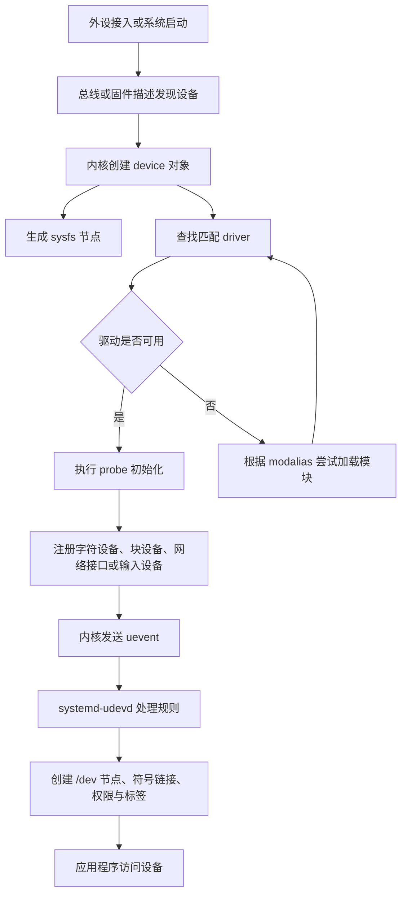
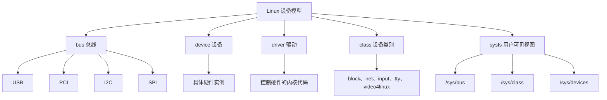
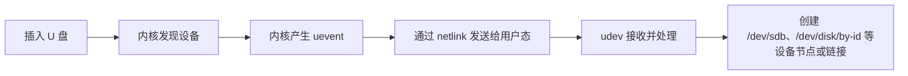
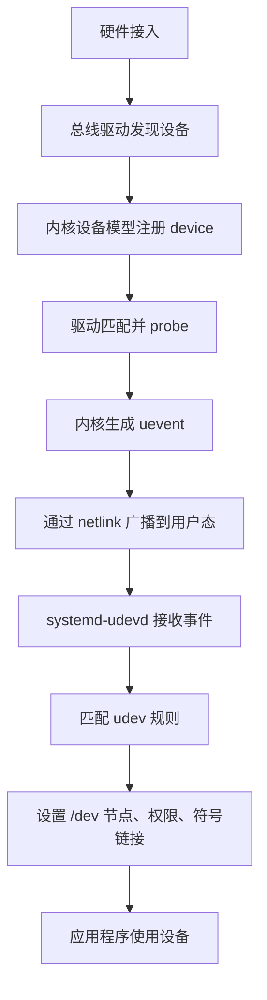
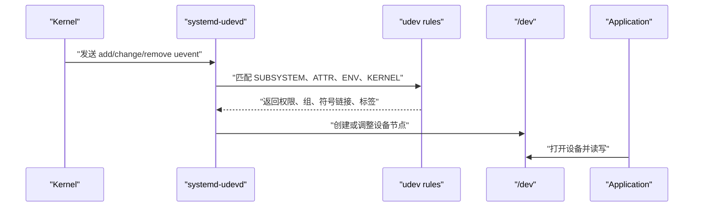
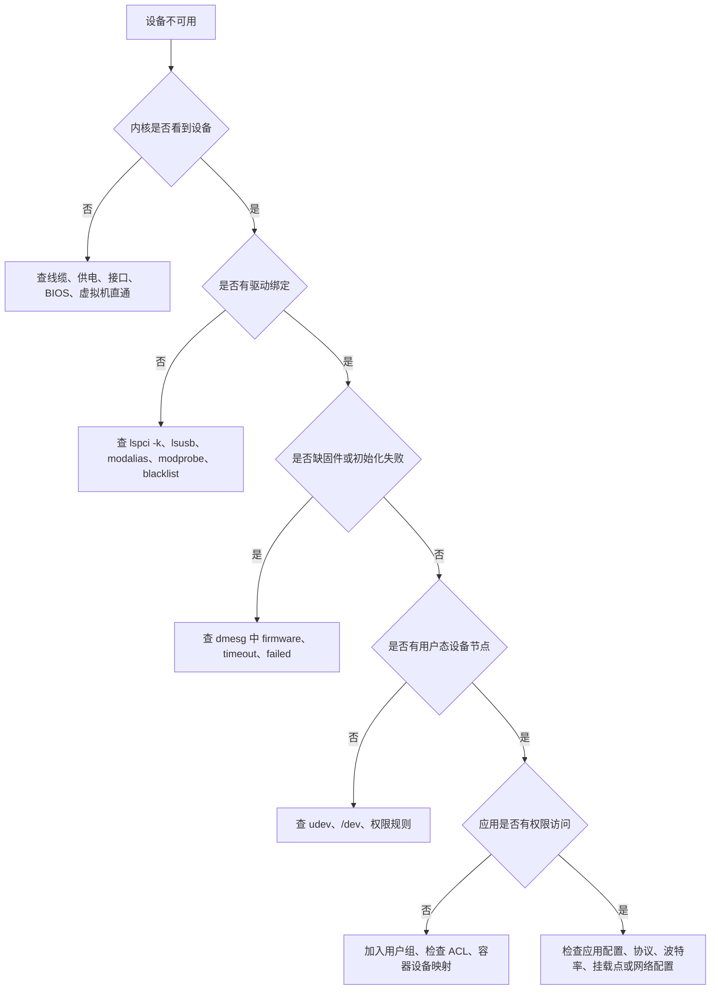

[toc]


## abstract

下面按“硬件被发现 → 内核建模 → 驱动匹配 → 用户态管理 → 应用访问 → 排障定位”的主线介绍。Linux 识别外设的本质不是“系统发现了一个设备”这么简单，而是**总线、固件描述、内核驱动模型、模块加载、udev 规则、设备文件和权限管理共同协作的过程**。

| 模块                 | 学习目标                | 重点问题                                              |
| -------------------- | ----------------------- | ----------------------------------------------------- |
| 外设识别的整体链路   | 建立全局认知            | 插入设备后 Linux 到底做了什么                         |
| 硬件发现与设备枚举   | 理解设备从哪里来        | USB、PCIe、I2C、SPI、ACPI、Device Tree 如何描述设备   |
| 内核设备模型         | 理解 Linux 如何抽象硬件 | `device`、`driver`、`bus`、`class`、`sysfs` 是什么    |
| 驱动匹配与绑定       | 理解设备如何找到驱动    | `modalias`、模块自动加载、`probe`、`bind`、`unbind`   |
| 设备节点与用户态管理 | 理解 `/dev` 从哪里来    | `devtmpfs`、`udev`、设备权限、持久化命名              |
| 常见外设类型         | 建立分类思维            | USB 设备、串口、网卡、磁盘、声卡、摄像头、GPIO        |
| 观察与排障方法       | 学会实际定位问题        | `dmesg`、`lsusb`、`lspci`、`udevadm`、`journalctl`    |
| 最佳实践             | 避免新手常见坑          | 不要写死 `/dev/sdX`，不要 `chmod 777`，优先用稳定标识 |

## Linux 识别外设的整体过程

外设接入 Linux 后，通常会经历以下阶段：

1. 硬件层产生连接或上电事件；
2. 总线驱动发现设备；
3. 内核创建设备对象；
4. 驱动核心尝试匹配合适驱动；
5. 驱动执行初始化；
6. 内核向用户态发送事件；
7. `udev` 根据规则创建符号链接、设置权限或触发后续动作；
8. 最后应用程序通过 `/dev`、网络接口、图形栈、声音栈或其他 API 使用该设备。

Linux 内核文档将“驱动绑定”（driver binding）定义为把设备与能够控制它的设备驱动关联起来的过程；当新设备在内核中注册时，内核设备模型还会产生 uevent 通知用户态。([Linux Kernel 文档](https://docs.kernel.org/driver-api/driver-model/device.html?utm_source=chatgpt.com))



## 核心术语速查

| 术语         | 英文                        | 简要解释                                                   |
| ------------ | --------------------------- | ---------------------------------------------------------- |
| 外设         | Peripheral Device           | CPU 和内存之外的硬件设备，如鼠标、键盘、U 盘、网卡、摄像头 |
| 总线         | Bus                         | 连接设备与系统的通道，如 USB、PCIe、I2C、SPI、SATA         |
| 枚举         | Enumeration                 | 系统发现设备并读取其身份、能力、资源需求的过程             |
| 驱动         | Driver                      | 内核中控制硬件的软件模块                                   |
| 设备模型     | Device Model                | Linux 内核统一管理设备、驱动、总线和类别的框架             |
| 绑定         | Binding                     | 把某个设备交给某个驱动控制                                 |
| 探测函数     | Probe                       | 驱动匹配成功后执行的初始化函数                             |
| **uevent**   | Kernel Uevent               | **内核通知用户态“设备新增、移除、变化”的事件**             |
| **udev**     | Userspace Device Manager    | **用户态设备管理器**，常见实现是 `systemd-udevd`           |
| **sysfs**    | System Filesystem           | 通常挂载在 `/sys`，用于展示**内核设备模型信息**            |
| **devtmpfs** | Device Temporary Filesystem | 通常挂载在 `/dev`，用于承载设备节点                        |
| 设备节点     | Device Node                 | `/dev` 下的特殊文件，如 `/dev/ttyUSB0`、`/dev/sda`         |
| 主设备号     | Major Number                | 标识由哪类驱动处理设备操作                                 |
| 次设备号     | Minor Number                | 标识同一驱动下的具体设备实例                               |
| 固件         | Firmware                    | 某些设备运行所需的二进制程序，如 Wi-Fi、蓝牙、GPU 固件     |

## 硬件发现：设备从哪里来

Linux 发现外设主要有三类来源：**可枚举总线**、**固件描述**、**静态平台设备**。

| 来源        | 典型场景                             | 特点                                                      |
| ----------- | ------------------------------------ | --------------------------------------------------------- |
| USB         | 鼠标、键盘、U 盘、USB 转串口、摄像头 | 热插拔能力强，设备会主动提供描述符                        |
| PCIe        | 显卡、NVMe、网卡、声卡控制器         | 常见于 PC 和服务器，设备有 vendor ID 与 device ID         |
| ACPI        | 笔记本、台式机、服务器               | 固件向操作系统描述主板设备、电源、热管理等                |
| Device Tree | ARM 开发板、嵌入式 Linux             | 用 `.dtb` 描述硬件地址、中断、时钟、GPIO、兼容字符串      |
| I2C、SPI    | 传感器、屏幕、触摸芯片、Flash        | 设备通常不能完全自描述，需要 ACPI 或 Device Tree 告诉内核 |
| UART        | 串口设备、蓝牙模块、调试口           | 多数场景需要平台描述或用户配置                            |

ACPI 与 Device Tree 的核心区别是：ACPI 更常见于 PC、服务器和现代笔记本，Device Tree 更常见于 ARM、RISC-V 和嵌入式开发板。Linux 内核文档说明，ACPI 会枚举 platform、SPI、I2C 以及部分 UART 后面的设备，并将它们与 ACPI 命名空间中的句柄关联；Device Tree 则常通过 `compatible` 字符串表达设备能被哪些驱动识别。([Linux Kernel 文档](https://docs.kernel.org/firmware-guide/acpi/enumeration.html?utm_source=chatgpt.com))

## 内核设备模型：Linux 如何“看见”设备

Linux 不会把所有外设都当成一堆散乱硬件处理，而是用统一的**设备模型**组织它们。可以把它理解成一个树状结构：根节点下面挂着各种总线，总线下面挂设备，设备再关联驱动、类别和属性。



其中最关键的是三组关系：**设备挂在总线上**，**驱动注册到总线上**，**驱动和设备通过 ID 表或匹配规则绑定**。内核文档中的 driver model 正是围绕 device、driver、bus、class 等结构建立的。([Linux Kernel 文档](https://docs.kernel.org/driver-api/infrastructure.html?utm_source=chatgpt.com))

常见路径含义如下：

| 路径                   | 作用                       |
| ---------------------- | -------------------------- |
| `/sys/devices`         | 按真实设备拓扑展示硬件层级 |
| `/sys/bus/usb/devices` | 展示 USB 总线上的设备      |
| `/sys/bus/pci/devices` | 展示 PCI/PCIe 设备         |
| `/sys/class/net`       | 展示网络接口类别           |
| `/sys/class/block`     | 展示块设备类别             |
| `/sys/class/tty`       | 展示串口、终端相关设备     |
| `/sys/module`          | 展示已加载内核模块         |
| `/dev`                 | 给用户程序访问设备的入口   |

需要注意：`/sys` 主要是**设备属性和控制接口**，`/dev` 主要是**数据读写入口**。

例如查看 USB 设备厂商 ID 通常去 `/sys`，读写串口数据通常打开 `/dev/ttyUSB0`。

## 驱动匹配：设备如何找到驱动

驱动匹配的基本逻辑是：设备提供身份信息，驱动声明自己支持哪些设备，内核驱动核心比较二者是否匹配。

匹配成功后，驱动的 `probe` 函数会被调用，用来初始化硬件、申请资源、注册接口。

| 总线     | 典型匹配依据                                  | 示例                             |
| -------- | --------------------------------------------- | -------------------------------- |
| USB      | Vendor ID、Product ID、接口类别               | USB 鼠标匹配 HID 驱动            |
| PCIe     | Vendor ID、Device ID、Class Code              | Intel 网卡匹配 `e1000e` 或 `igc` |
| I2C      | 设备名、ACPI ID、Device Tree compatible       | 温度传感器匹配对应 I2C 驱动      |
| SPI      | 设备名、Device Tree compatible                | SPI Flash 匹配 `m25p80` 等驱动   |
| Platform | ACPI ID、Device Tree compatible、平台注册信息 | GPIO 控制器、时钟控制器          |
| HID      | HID usage、设备描述符                         | 键盘、鼠标、游戏手柄             |

驱动绑定不是 udev 完成的，而是**内核完成的**。udev 更多负责用户态命名、权限、符号链接和附加动作。内核文档明确将 driver binding 描述为设备与驱动的关联过程，而系统中的 `systemd-udevd` 是监听内核 uevent 后执行匹配规则的用户态服务。([Linux Kernel 文档](https://docs.kernel.org/driver-api/driver-model/binding.html?utm_source=chatgpt.com))

## 模块自动加载：为什么插上设备后驱动会自己出现

很多驱动不是一开始就编进内核，而是以内核模块（Kernel Module）的形式存在。设备出现后，内核会生成包含设备身份的 `modalias` 信息，用户态工具可以据此调用 `modprobe` 加载合适模块。现代发行版通常已经把这条链路配置好，所以新手会感觉“插上就能用”。

可以这样观察：

```bash
# 查看 USB 设备
lsusb

# 查看 PCI 设备和绑定的驱动
lspci -k

# 查看已加载模块
lsmod

# 查看某个模块信息
modinfo usbserial

# 查看设备的 modalias
cat /sys/bus/usb/devices/1-1/modalias
```

模块自动加载失败时，常见原因包括：内核没有编译该驱动、模块包未安装、设备 ID 太新、驱动被 blacklist、Secure Boot 阻止未签名模块、固件缺失。

## 驱动初始化：probe 阶段做什么

`probe` 是驱动真正接管设备的关键阶段。它通常会完成这些工作：

| 动作                   | 说明                                           |
| ---------------------- | ---------------------------------------------- |
| 读取设备寄存器或描述符 | 确认设备型号、版本、能力                       |
| 申请硬件资源           | 如 I/O 地址、中断 IRQ、DMA、GPIO、时钟、复位线 |
| 加载固件               | 某些 Wi-Fi、蓝牙、GPU、声卡 DSP 需要 firmware  |
| 初始化硬件             | 设置工作模式、缓冲区、队列、中断处理函数       |
| 注册内核子系统接口     | 如 input、net、tty、block、video4linux、ALSA   |
| 创建用户态可见接口     | 生成 sysfs 属性、设备节点或网络接口            |
| 处理电源管理           | 支持 suspend、resume、runtime power management |

对于需要固件的设备，驱动常通过 Linux firmware API 请求固件文件；内核文档中 `request_firmware` 系列接口就是为驱动加载固件准备的。实际系统里，固件通常由发行版的 `linux-firmware` 或厂商包提供。([Linux Kernel 文档](https://docs.kernel.org/driver-api/firmware/request_firmware.html?utm_source=chatgpt.com))

## uevent,netlink和udev

**uevent 是消息，netlink 是通道，udev 是处理消息的用户态程序。**

### 核心区别

| 名称      | 全称/含义                       | 所在位置             | 本质作用                                         |
| --------- | ------------------------------- | -------------------- | ------------------------------------------------ |
| `uevent`  | kernel user event，内核用户事件 | 内核发出，用户态接收 | 表示“设备发生了变化”                             |
| `netlink` | Netlink Socket                  | 内核与用户态之间     | 传递 uevent 的通信通道之一                       |
| `udev`    | userspace device manager        | 用户态               | 接收 uevent 后，创建设备节点、设置权限、命名设备 |

### 用一句话理解

当你插入一个 U 盘时：



### uevent 是什么

`uevent` 是**内核发出的设备事件通知**。

它告诉用户态：

> 有设备新增、移除、改变了。

常见事件类型包括：

| uevent 动作 | 含义           |
| ----------- | -------------- |
| `add`       | 新设备出现     |
| `remove`    | 设备被移除     |
| `change`    | 设备状态变化   |
| `bind`      | 设备绑定到驱动 |
| `unbind`    | 设备从驱动解绑 |

例如插入 U 盘后，内核可能产生类似信息：

```bash
ACTION=add
SUBSYSTEM=block
DEVNAME=sdb
DEVTYPE=disk
```

这表示：

> 新增了一个块设备，它的设备名是 `sdb`。

### netlink 是什么

`netlink` 是 Linux 提供的一种**内核与用户态通信机制**。

它不是专门为 udev 设计的，而是一种通用通信通道。很多系统功能都会用到 netlink，例如：

| 使用场景     | 说明                                   |
| ------------ | -------------------------------------- |
| 设备事件通知 | 内核把 uevent 发给 udev                |
| 网络配置     | `ip link`、`ip route` 与内核网络栈通信 |
| 防火墙、路由 | 用户态工具和内核模块交换信息           |
| 审计、监控   | 内核向用户态发送状态变化               |

可以把 netlink 理解成：

> 内核和用户态之间的“消息管道”。

在外设识别场景中，内核通过 netlink 把 `uevent` 发给 `systemd-udevd`。

### udev 是什么

`udev` 是用户态设备管理器。现在大多数 Linux 发行版中，它通常由 `systemd-udevd` 提供。

它的工作是：

| udev 任务       | 例子                               |
| --------------- | ---------------------------------- |
| 接收内核 uevent | 收到 `ACTION=add`                  |
| 读取设备属性    | 查看厂商 ID、产品 ID、设备类型     |
| 匹配 udev 规则  | 匹配 `/etc/udev/rules.d/*.rules`   |
| 创建设备节点    | 生成 `/dev/ttyUSB0`、`/dev/sdb`    |
| 设置权限        | 设置用户组为 `dialout`、`video` 等 |
| 创建稳定链接    | 生成 `/dev/serial/by-id/...`       |
| 触发额外动作    | 插入设备后执行某些脚本             |

例如 USB 转串口插入后，udev 可能创建：

```bash
/dev/ttyUSB0
/dev/serial/by-id/usb-xxx
```

### 三者关系

| 问题                         | 答案                                                         |
| ---------------------------- | ------------------------------------------------------------ |
| 谁发现设备？                 | 内核                                                         |
| 谁发出设备变化通知？         | uevent                                                       |
| 通知通过什么传输？           | netlink                                                      |
| 谁在用户态处理通知？         | udev                                                         |
| 谁创建 `/dev` 下的设备文件？ | 通常是内核 devtmpfs 创建基础节点，udev 再调整权限、符号链接和规则 |
| 应用程序最终访问哪里？       | `/dev/xxx`、网络接口、input 设备等                           |

### 更准确的链路



### 举个具体例子：插入 USB 转串口

插入设备后：

| 阶段              | 发生什么                                    |
| ----------------- | ------------------------------------------- |
| 内核发现 USB 设备 | 读取 USB 描述符                             |
| 驱动匹配          | 例如匹配到 `ch341` 或 `cp210x` 驱动         |
| 内核注册 tty 设备 | 生成串口设备                                |
| 内核发出 uevent   | `ACTION=add`、`SUBSYSTEM=tty`               |
| netlink 传递事件  | 把事件发给用户态                            |
| udev 处理         | 设置权限，创建 `/dev/ttyUSB0`               |
| 用户程序使用      | 串口助手、Python、C 程序打开 `/dev/ttyUSB0` |

### 常用观察命令

查看 uevent 和 udev 事件：

```bash
udevadm monitor --kernel --udev --property
```

其中：

| 参数         | 含义                   |
| ------------ | ---------------------- |
| `--kernel`   | 显示内核发出的 uevent  |
| `--udev`     | 显示 udev 处理后的事件 |
| `--property` | 显示事件携带的属性     |

查看某个设备的 udev 属性：

```bash
udevadm info --attribute-walk --name=/dev/ttyUSB0
```

查看内核日志：

```bash
dmesg -w
```

### 最容易混淆的一点

`uevent` 和 `udev` 不是同一个东西。

| 容易混淆点 | 正确理解                       |
| ---------- | ------------------------------ |
| `uevent`   | 是内核发出的事件消息           |
| `udev`     | 是用户态处理这些事件的服务     |
| `netlink`  | 是这些消息传递时用到的通信机制 |

可以类比成：

| 类比           | Linux 对应          |
| -------------- | ------------------- |
| 快递内容       | `uevent`            |
| 快递通道       | `netlink`           |
| 收件并处理的人 | `udev`              |
| 最终放好的物品 | `/dev/xxx` 设备节点 |

所以最简洁的结论是：

> **内核发现设备后产生 uevent，uevent 通过 netlink 传给用户态，udev 接收后根据规则管理 `/dev` 下的设备节点、权限和符号链接。**


## uevent 与 udev：从内核事件到用户可用设备

当设备新增、移除或状态变化时，内核会发送 uevent。`systemd-udevd` 接收这些事件，然后根据 udev 规则匹配设备属性，执行设置权限、创建符号链接、添加标签等操作。`udev(7)` 手册说明，udev 会在收到内核设备事件后，将配置规则与设备属性进行匹配，并可存储额外设备信息或创建有意义的符号链接。([man7.org](https://man7.org/linux/man-pages/man7/udev.7.html?utm_source=chatgpt.com))



udev 常见作用如下：

| 作用              | 示例                                      |
| ----------------- | ----------------------------------------- |
| 设置权限          | 让普通用户访问串口、摄像头、声卡          |
| 设置用户组        | 如 `dialout`、`video`、`input`、`plugdev` |
| 创建稳定符号链接  | 如 `/dev/serial/by-id/...`                |
| 重命名网络接口    | 如 `enp3s0`、`wlp2s0`                     |
| 触发外部程序      | 插入设备后执行脚本，但不建议做耗时任务    |
| 给 systemd 打标签 | 让设备成为 systemd 可跟踪对象             |

## `/dev`、`/sys`、`/proc` 的区别

| 位置        | 主要用途           | 新手理解                         |
| ----------- | ------------------ | -------------------------------- |
| `/dev`      | 设备访问入口       | 程序真正读写设备的地方           |
| `/sys`      | 设备模型与属性     | 查看设备拓扑、驱动绑定、硬件属性 |
| `/proc`     | 进程和内核运行信息 | 查看系统状态、内核参数、进程信息 |
| `/run/udev` | udev 运行时数据库  | udev 保存设备事件和属性的地方    |

新手最容易混淆 `/dev` 和 `/sys`：`/dev/ttyUSB0` 是可以打开读写的串口设备；`/sys/class/tty/ttyUSB0` 是这个串口设备在内核设备模型中的属性视图。

## 常见外设识别案例

| 外设         | 识别链路                                | 常见设备名                        |
| ------------ | --------------------------------------- | --------------------------------- |
| USB 鼠标键盘 | USB 枚举，HID 驱动绑定，注册 input 设备 | `/dev/input/eventX`               |
| U 盘         | USB 存储驱动，SCSI 层，块设备层         | `/dev/sdX`、`/dev/disk/by-id/...` |
| USB 转串口   | USB 串口驱动绑定，注册 tty 设备         | `/dev/ttyUSB0`、`/dev/ttyACM0`    |
| 摄像头       | USB 枚举，UVC 驱动，Video4Linux2        | `/dev/video0`                     |
| 网卡         | PCIe 或 USB 枚举，net 驱动注册接口      | `enp3s0`、`wlan0`、`wlp2s0`       |
| NVMe SSD     | PCIe 枚举，NVMe 驱动，块设备层          | `/dev/nvme0n1`                    |
| 声卡         | PCIe 或 USB 枚举，ALSA 驱动             | `/dev/snd/...`                    |
| 蓝牙适配器   | USB 或 UART，蓝牙 HCI 子系统            | `hci0`                            |
| GPIO 芯片    | ACPI 或 Device Tree，GPIO 子系统        | `/dev/gpiochip0`                  |

现代 Linux 中，网卡名称常使用 systemd/udev 的 predictable network interface names，例如 `enp3s0`、`wlp2s0`，其目标是避免传统 `eth0`、`wlan0` 在多网卡环境中顺序不稳定的问题。systemd 文档说明，udev 会基于稳定设备属性生成网络接口名称。([自由桌面](https://www.freedesktop.org/wiki/Software/systemd/PredictableNetworkInterfaceNames/?utm_source=chatgpt.com))

## 外设识别的关键观察命令

| 目标              | 命令                                                | 说明                            |
| ----------------- | --------------------------------------------------- | ------------------------------- |
| 看内核日志        | `dmesg -w`                                          | 插拔设备时实时观察内核输出      |
| 看系统日志        | `journalctl -k -f`                                  | 跟踪内核日志，适合 systemd 系统 |
| 查看 USB          | `lsusb`                                             | 看 USB 设备 ID                  |
| 查看 USB 详细信息 | `lsusb -v`                                          | 查看描述符，需要权限时加 `sudo` |
| 查看 PCI          | `lspci`                                             | 看 PCIe 设备                    |
| 查看 PCI 驱动     | `lspci -k`                                          | 看设备绑定了哪个驱动            |
| 查看块设备        | `lsblk -f`                                          | 看磁盘、分区、文件系统、UUID    |
| 查看输入设备      | `libinput list-devices`                             | 看鼠标、键盘、触摸板            |
| 查看串口          | `ls /dev/ttyUSB* /dev/ttyACM*`                      | 查看 USB 串口设备               |
| 查看 udev 事件    | `udevadm monitor --kernel --udev --property`        | 观察内核事件和 udev 处理结果    |
| 查看设备属性      | `udevadm info --attribute-walk --name=/dev/ttyUSB0` | 写 udev 规则时常用              |
| 重新触发规则      | `sudo udevadm trigger`                              | 修改规则后重新触发设备事件      |
| 重载规则          | `sudo udevadm control --reload-rules`               | 修改 udev 规则后执行            |

`udevadm` 手册说明，它可用于监控内核 uevent 与 udev 处理后的事件，并可通过属性输出辅助分析设备匹配过程。([man7.org](https://man7.org/linux/man-pages/man8/udevadm.8.html?utm_source=chatgpt.com))

## 新手排障路线

遇到“外设插上没反应”，不要一上来就改配置。建议按层次排查：



可以按下面顺序执行：

```bash
# 插入设备前先打开日志观察
sudo dmesg -w

# 另一个终端查看 udev 事件
udevadm monitor --kernel --udev --property

# USB 设备
lsusb

# PCIe 设备
lspci -k

# 查看设备节点
ls -l /dev/ttyUSB0
ls -l /dev/video0

# 查看块设备
lsblk -f

# 查看当前用户所属组
groups
```

## 典型问题与判断方法

| 现象                                | 可能原因                        | 建议检查                                |
| ----------------------------------- | ------------------------------- | --------------------------------------- |
| `lsusb` 看不到设备                  | 线缆、供电、接口、Hub、硬件损坏 | 换线、换接口、看 `dmesg -w`             |
| `lsusb` 能看到但无 `/dev/ttyUSB0`   | 驱动未绑定或设备不是串口类      | 查 `dmesg`、`lsmod`、`modinfo`          |
| 摄像头有 `/dev/video0` 但软件打不开 | 权限或被其他程序占用            | 查 `ls -l /dev/video0`、用户组          |
| U 盘出现 `/dev/sdb` 但不能挂载      | 文件系统错误或权限问题          | 查 `lsblk -f`、`journalctl -k`          |
| Wi-Fi 设备存在但不可用              | 固件缺失、rfkill、驱动问题      | 查 `dmesg` 中 `firmware`、`rfkill list` |
| 网卡名字不是 `eth0`                 | predictable naming 生效         | 使用 `ip link` 查看真实名称             |
| 串口能打开但无数据                  | 波特率、校验位、接线、协议错误  | 检查 baud rate、TX/RX 交叉              |
| 虚拟机里看不到 USB                  | 未做 USB 直通                   | 检查虚拟机管理器设置                    |
| Docker 容器里看不到设备             | 未映射设备或 cgroup 限制        | 使用 `--device` 或合适权限配置          |

## udev 规则的基本写法

udev 规则常放在：

```bash
/etc/udev/rules.d/
```

例如给某个 USB 串口设备创建稳定名称：

```bash
SUBSYSTEM=="tty", ATTRS{idVendor}=="1a86", ATTRS{idProduct}=="7523", SYMLINK+="my_serial", GROUP="dialout", MODE="0660"
```

修改后执行：

```bash
sudo udevadm control --reload-rules
sudo udevadm trigger
```

然后查看：

```bash
ls -l /dev/my_serial
```

这里的关键思想是：不要依赖 `/dev/ttyUSB0` 这种顺序编号，因为它可能随插入顺序变化。更推荐用 `/dev/serial/by-id/...`，或者用 udev 创建稳定符号链接。

## `/dev/sdX` 为什么不能写死

U 盘、SATA 硬盘、USB 移动硬盘常显示为 `/dev/sda`、`/dev/sdb`。但这个名字取决于识别顺序，并不稳定。生产环境或脚本中更推荐使用：

| 稳定方式      | 示例                     | 适用场景            |
| ------------- | ------------------------ | ------------------- |
| UUID          | `/dev/disk/by-uuid/...`  | 文件系统挂载        |
| LABEL         | `/dev/disk/by-label/...` | 人工命名的磁盘      |
| by-id         | `/dev/disk/by-id/...`    | 物理磁盘或 USB 设备 |
| by-path       | `/dev/disk/by-path/...`  | 固定接口位置        |
| systemd mount | `.mount` 单元            | 服务器自动挂载      |

推荐查看：

```bash
lsblk -f
ls -l /dev/disk/by-id/
ls -l /dev/disk/by-uuid/
```

## 网络设备识别

网络设备比较特殊：普通网卡通常不会以 `/dev/eth0` 形式出现，而是注册为网络接口，通过 `ip`、NetworkManager、systemd-networkd 等管理。

常用命令：

```bash
ip link
ip addr
ethtool enp3s0
nmcli device status
```

现代系统中，接口名可能是：

| 名称     | 含义                       |
| -------- | -------------------------- |
| `lo`     | 回环接口                   |
| `enp3s0` | PCIe 有线网卡              |
| `wlp2s0` | PCIe 无线网卡              |
| `enx...` | 基于 MAC 地址的 USB 网卡名 |
| `wwp...` | 移动网络设备               |

若要固定命名，优先考虑 systemd `.link` 文件或发行版推荐的网络配置方式，而不是随意改旧式 udev 规则。

## 嵌入式 Linux 中的外设识别

嵌入式场景和 PC 最大的区别是：很多设备不能自描述。比如 I2C 温度传感器、SPI 屏幕、GPIO 按键，内核无法像 USB 那样自动读取完整身份信息。因此必须通过 Device Tree 或 ACPI 告诉内核：

| 信息         | 作用                                |
| ------------ | ----------------------------------- |
| `compatible` | 告诉内核匹配哪个驱动                |
| `reg`        | 设备地址，如 I2C 地址、寄存器基地址 |
| `interrupts` | 中断号和触发方式                    |
| `clocks`     | 所需时钟                            |
| `resets`     | 复位控制线                          |
| `gpios`      | 相关 GPIO 管脚                      |
| `pinctrl`    | 引脚复用和电气配置                  |
| `status`     | 是否启用该节点                      |

Device Tree 里 `compatible` 写错，是嵌入式外设“不识别”的高频原因。即使驱动已经存在，只要 `compatible` 与驱动的匹配表不一致，驱动也不会绑定。

## 最佳实践

| 场景         | 推荐做法                                           | 避免做法                   |
| ------------ | -------------------------------------------------- | -------------------------- |
| 串口设备     | 使用 `/dev/serial/by-id/...` 或自定义 udev symlink | 写死 `/dev/ttyUSB0`        |
| 磁盘挂载     | 使用 UUID、LABEL、by-id                            | 写死 `/dev/sdb1`           |
| 权限配置     | 把用户加入 `dialout`、`video`、`input` 等组        | `chmod 777 /dev/xxx`       |
| 驱动安装     | 优先使用发行版内核和官方包                         | 随意复制未知 `.ko` 模块    |
| 固件问题     | 安装发行版 firmware 包，查 `dmesg`                 | 盲目重装系统               |
| udev 规则    | 用 `udevadm info` 获取准确属性                     | 凭猜测写规则               |
| 网络命名     | 接受 predictable names 或使用 `.link` 固定         | 假设永远有 `eth0`          |
| 嵌入式外设   | 核对 Device Tree、pinmux、时钟、中断               | 只检查驱动代码             |
| 容器访问设备 | 显式传入设备和权限                                 | 假设容器自动看到宿主机硬件 |
| 安全启动     | 使用签名模块或关闭 Secure Boot 测试                | 忽略模块加载失败日志       |

## 推荐学习路线

先掌握“观察设备”的命令：`dmesg`、`lsusb`、`lspci`、`lsblk`、`ip link`。然后理解 `/sys` 和 `/dev` 的区别。接着学习 udev 规则，解决串口、摄像头、U 盘这类常见设备的稳定命名和权限问题。最后再深入内核驱动模型，学习 `device`、`driver`、`bus`、`probe`、`remove`、`modalias`、`MODULE_DEVICE_TABLE` 等机制。

最适合新手的实践顺序是：

| 阶段     | 实践任务                                               |
| -------- | ------------------------------------------------------ |
| 入门     | 插拔 U 盘、鼠标、USB 串口，观察 `dmesg -w`             |
| 基础     | 用 `lsusb` 和 `lspci -k` 查看设备 ID 与驱动            |
| 进阶     | 给 USB 串口写 udev 规则，创建固定名称                  |
| 深入     | 查看 `/sys/bus/usb/devices` 与 `/sys/class/tty` 的关系 |
| 嵌入式   | 修改 Device Tree，启用 I2C、SPI、GPIO 外设             |
| 驱动开发 | 阅读简单字符设备驱动和 platform driver                 |

## 一句话总结

Linux 识别外设的核心机制是：**总线或固件描述负责发现设备，内核设备模型负责组织设备，驱动匹配机制负责绑定驱动，udev 负责把内核事件转化为用户态可用的设备节点、权限和稳定名称，应用程序最终通过 `/dev`、网络接口或专用子系统访问设备。**

