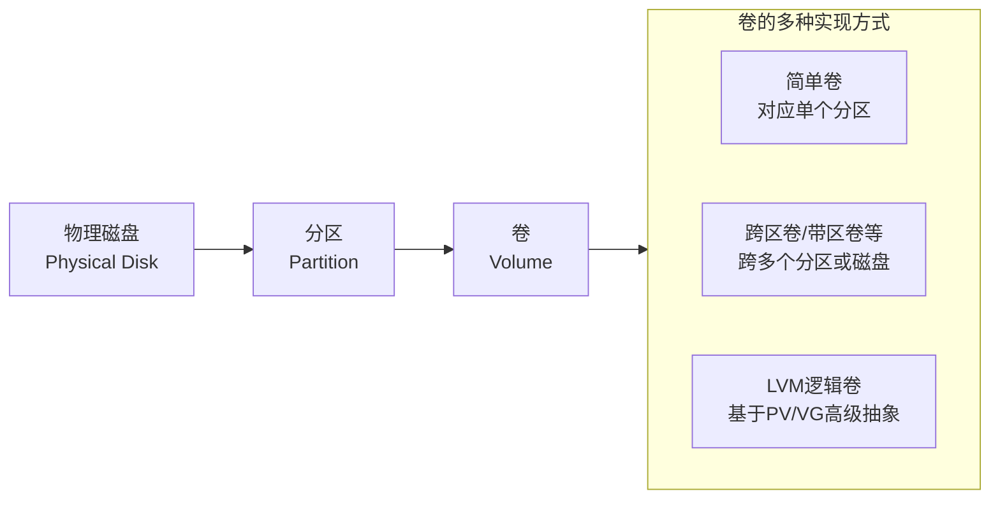
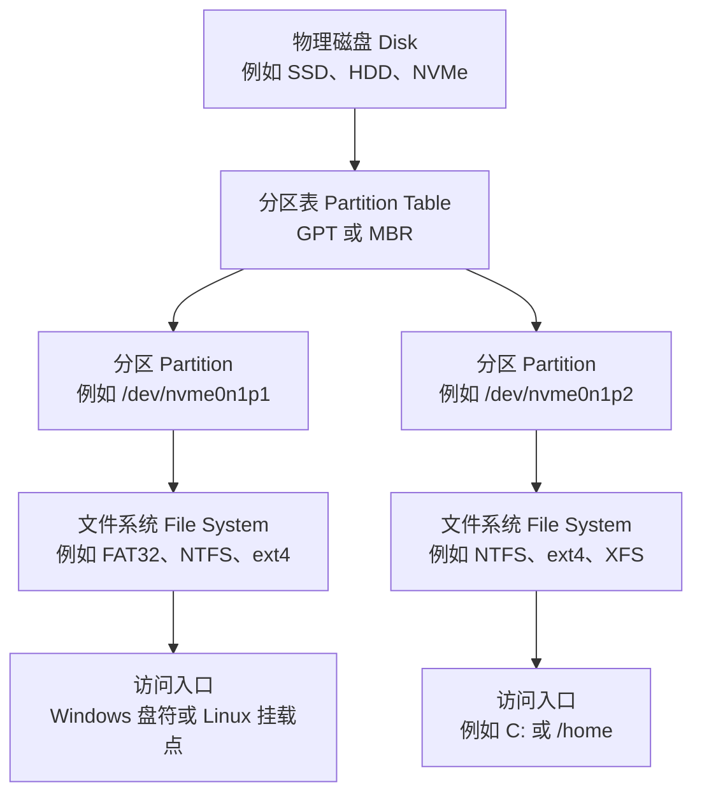
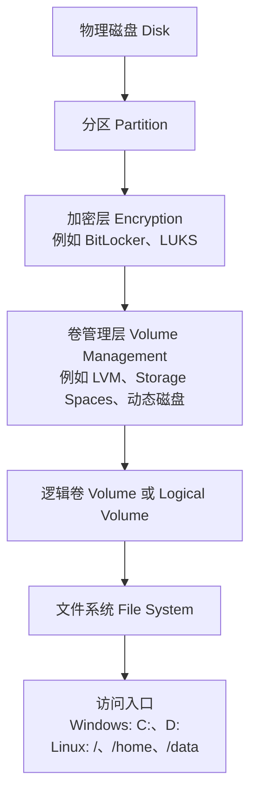
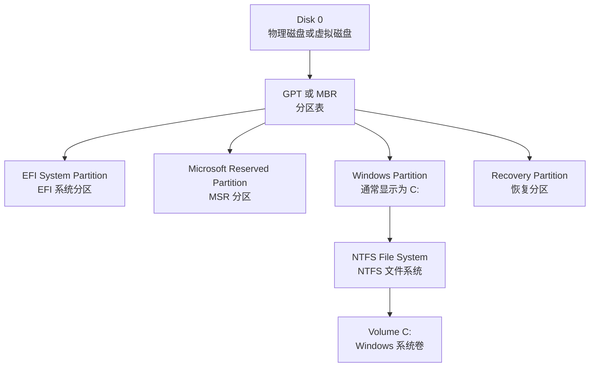
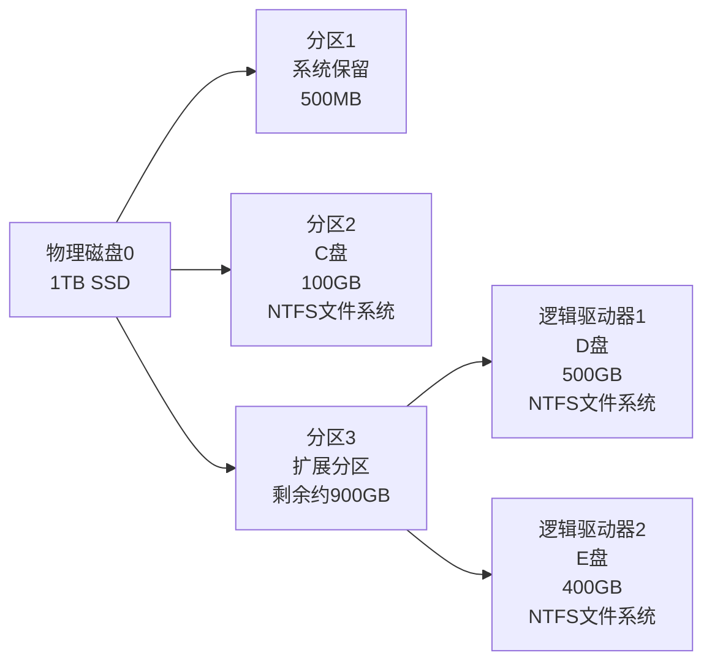
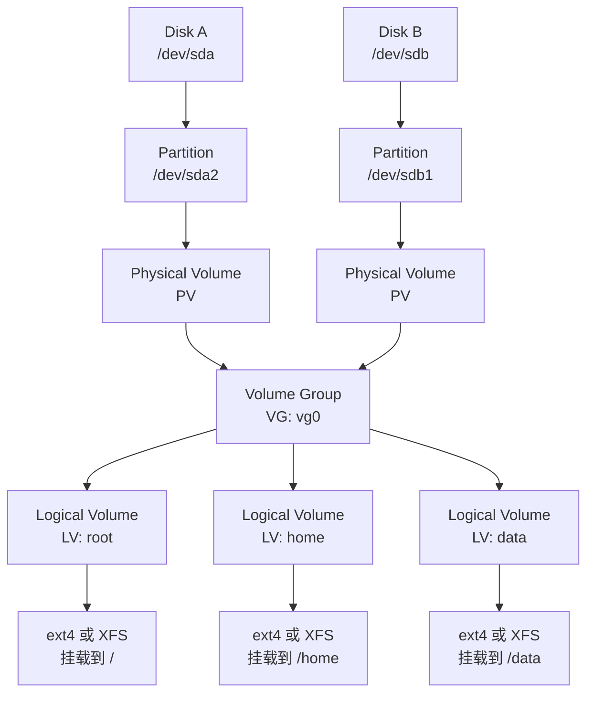
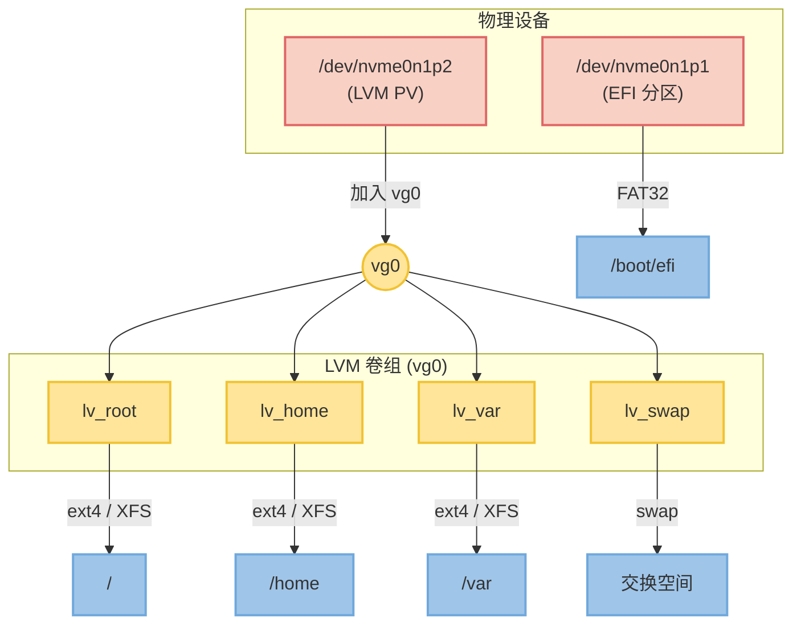
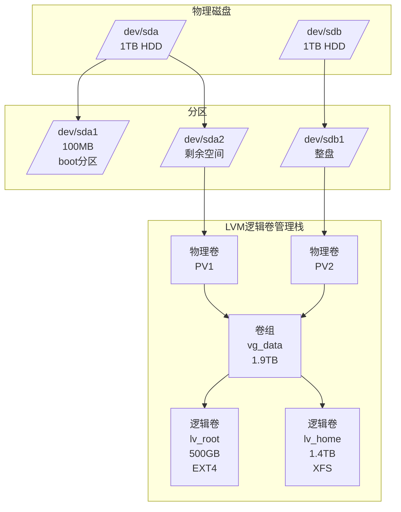
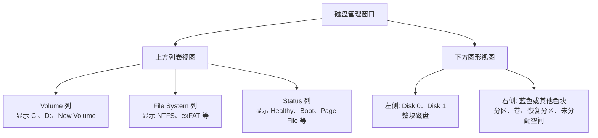

[toc]


## abstract

分区是磁盘上的边界，卷是操作系统拿来存放文件的逻辑存储对象；

> 物理磁盘是基础，分区是对磁盘的物理划分，卷是建立在分区（或直接在磁盘）之上的逻辑存储单元。简单来说，卷是操作系统“看”到的、可格式化使用的存储空间，而分区是卷的物理基础或组成部分之一。

在简单场景里二者常常一一对应，但在 LVM、Storage Spaces、动态磁盘、RAID、加密、容器化文件系统等场景里，它们会分离。



- **物理磁盘**：整个文件柜本身。
- **分区**：文件柜里的一个抽屉，是一个物理上连续的存储空间。你可以把不同类别的文件放入不同抽屉。
- **卷**：一个或多个抽屉组合而成的一个“**逻辑上的文件箱**”。这个文件箱可以只包含一个抽屉，也可以跨越多个抽屉（甚至其他文件柜的抽屉），但**对操作系统来说，它就是一个统一的存储空间**，可以贴上标签（盘符）、分配文件系统（如NTFS、EXT4），然后往里面存放文件。

### 学习目标

学完后应能回答这些问题：

- 磁盘、分区、卷、文件系统、挂载点、盘符分别是什么。
- 为什么 Windows 里常说“卷”，Linux 里常说“分区、文件系统、挂载点、逻辑卷”。
- 为什么一个分区不一定等于一个卷。
- 在 Windows 磁盘管理、Linux 工具中分别在哪里看到这些对象。
- 如何安全地规划新硬盘、扩容、重装系统、双系统和数据盘。

### 概念路径


- 物理层：磁盘、SSD、HDD、NVMe、SATA、USB 存储。
- 分区层：分区表、GPT、MBR、主分区、EFI 系统分区、恢复分区。
- 卷层：Windows Volume、Linux LVM Logical Volume、Storage Spaces、RAID、加密卷。
- 文件系统层：NTFS、exFAT、FAT32、ext4、XFS、Btrfs。
- 访问入口：Windows 盘符和挂载文件夹；Linux 挂载点。
- 管理工具：Windows Disk Management、PowerShell、diskpart；Linux lsblk、fdisk、parted、mkfs、mount、LVM 工具。
- 最佳实践：备份、GPT 优先、避免随意删除隐藏分区、扩容前看清未分配空间位置。

## 总体层次关系

最常见的基础层次如下：



但在现代系统中，常见情况更接近这样：




## 核心术语对照表

| 中文术语   | 英文术语          | Windows 中的理解                           | Linux 中的理解                        | 新手记忆方式                     |
| ---------- | ----------------- | ------------------------------------------ | ------------------------------------- | -------------------------------- |
| 磁盘       | Disk 或 Drive     | 磁盘 0、磁盘 1、基本磁盘、动态磁盘         | `/dev/sda`、`/dev/nvme0n1` 等块设备   | 一整块物理或虚拟存储设备         |
| 分区表     | Partition Table   | GPT 或 MBR                                 | GPT 或 MBR                            | 磁盘上的“目录”，记录分区边界     |
| 分区       | Partition         | EFI 分区、MSR 分区、C 盘所在分区、恢复分区 | `/dev/sda1`、`/dev/nvme0n1p2`         | 从磁盘上切出来的一段连续区域     |
| 卷         | Volume            | 最常用概念，如 C:、D:、New Volume          | 不一定是常用口语，常见于 LVM 的逻辑卷 | 系统可用于存放文件的逻辑存储对象 |
| 逻辑卷     | Logical Volume    | 动态磁盘、Storage Spaces 中有类似概念      | LVM 的 LV，例如 `/dev/vg0/root`       | 比普通分区更灵活的“虚拟分区”     |
| 文件系统   | File System       | NTFS、exFAT、FAT32、ReFS                   | ext4、XFS、Btrfs、FAT32、exFAT、NTFS  | 给存储空间建立“文件和目录规则”   |
| 盘符       | Drive Letter      | C:、D:、E:                                 | 无盘符概念                            | Windows 的访问入口               |
| 挂载点     | Mount Point       | 可把卷挂到空 NTFS 文件夹，但不如盘符常见   | `/`、`/home`、`/mnt/data`             | Linux 的访问入口                 |
| 未分配空间 | Unallocated Space | 尚未分区或尚未加入卷的空间                 | 未被分区或未被 LVM 使用的空间         | 还没被正式使用的空地             |

## 最核心的区别：分区和卷

### 分区是什么

**分区（Partition）**是磁盘分区表中记录的一段空间范围。

例如一块 1 TB SSD 可以被切成：

| 分区         | 大小             | 用途                      |
| ------------ | ---------------- | ------------------------- |
| EFI 系统分区 | 100 MB 到数百 MB | UEFI 启动文件             |
| MSR 分区     | 16 MB            | Windows GPT 保留用途      |
| Windows 分区 | 800 GB           | C 盘，安装 Windows 和软件 |
| 恢复分区     | 500 MB 到数 GB   | Windows 恢复环境          |
| 数据分区     | 剩余空间         | D 盘或数据区              |

分区本身只是“划地盘”。它不一定能直接存文件。想存文件，通常还要格式化为某种文件系统，例如 NTFS、ext4、XFS。

Windows 现代 UEFI/GPT 机器的默认布局通常包括系统分区、MSR、Windows 分区和恢复工具分区，这是 Microsoft 文档给出的默认分区布局。([微软学习](https://learn.microsoft.com/en-us/windows-hardware/manufacture/desktop/configure-uefigpt-based-hard-drive-partitions?view=windows-11&utm_source=chatgpt.com))

### 卷是什么

**卷（Volume）**是操作系统用于存储文件的逻辑存储单元。

在简单 Windows 基本磁盘中：

```text
一个分区 + 一个文件系统 + 一个盘符 = 常见意义上的一个卷
```

例如：

```text
磁盘 0 的某个 NTFS 分区 = C: 卷
磁盘 1 的某个 exFAT 分区 = E: 卷
```

但卷并不总是等于分区。Microsoft 对基本磁盘的描述是：基本磁盘包含分区，分区通常会被格式化为文件系统，然后成为用于文件存储的卷。([微软学习](https://learn.microsoft.com/en-us/windows/win32/fileio/basic-and-dynamic-disks?utm_source=chatgpt.com))

更复杂时：

- 一个卷可以来自一个普通分区。
- 一个卷可以来自多个磁盘组合出的虚拟磁盘。
- 一个卷可以建立在 LVM 逻辑卷上。
- 一个卷可以先经过加密层再暴露给系统。
- 一个分区也可以没有文件系统，因此不是普通数据卷。
- 一个卷可以没有盘符，但仍然存在。

## 用一句话区分

| 问题                 | 答案                               |
| -------------------- | ---------------------------------- |
| 分区关注什么         | 磁盘空间的边界和位置               |
| 卷关注什么           | 操作系统如何把一块存储空间拿来使用 |
| 文件系统关注什么     | 文件、目录、权限、元数据如何组织   |
| 盘符或挂载点关注什么 | 用户从哪里访问这些文件             |

可以这样类比：

| 存储概念     | 类比                         |
| ------------ | ---------------------------- |
| 磁盘         | 一整栋楼                     |
| 分区表       | 楼层平面图                   |
| 分区         | 被划出来的房间               |
| 卷           | 准备投入使用的房间功能区     |
| 文件系统     | 房间里的货架、编号和管理规则 |
| 盘符或挂载点 | 房间门牌号                   |

## Windows 中如何理解

### Windows 的常见层次



在 Windows 里，普通用户最常接触的是：

- C: 卷
- D: 卷
- E: 卷
- 新加硬盘创建的 New Volume
- 未分配空间
- EFI 系统分区
- 恢复分区

Windows 的“磁盘管理（Disk Management）”是内置的高级存储工具，可用于初始化新磁盘、创建和格式化卷、修改盘符、扩展或压缩卷。([微软支持](https://support.microsoft.com/en-us/windows/experience/storage-filemanagement/disk-management-in-windows?utm_source=chatgpt.com))

### 在磁盘管理中处于什么位置

打开方式：

- 右键开始菜单，选择“磁盘管理”。
- 搜索“创建并格式化硬盘分区”。
- 运行 `diskmgmt.msc`。
- 计算机管理中的“存储 > 磁盘管理”。

Microsoft 文档也说明，Disk Management 可以查看每个驱动器的信息以及每个驱动器中的所有分区，并显示分区的详细信息、已分配和已使用空间等。([微软学习](https://learn.microsoft.com/en-us/windows-server/storage/disk-management/overview-of-disk-management?utm_source=chatgpt.com))

磁盘管理界面通常分两部分：

| 位置             | 看到什么                                       | 对应概念                     |
| ---------------- | ---------------------------------------------- | ---------------------------- |
| 上方列表         | 卷、布局、类型、文件系统、状态、容量、可用空间 | 更偏向 Volume 视角           |
| 下方图形区域左侧 | 磁盘 0、磁盘 1、基本、联机、容量               | Disk 视角                    |
| 下方图形区域右侧 | EFI 分区、C:、D:、恢复分区、未分配空间         | Partition 和 Volume 混合视角 |

### Windows 典型例子

假设一台 Windows 11 笔记本有一块 1 TB NVMe SSD。

磁盘管理可能显示：

| 磁盘管理显示       | 类型              | 是否通常有盘符 | 说明                                         |
| ------------------ | ----------------- | -------------- | -------------------------------------------- |
| 磁盘 0             | Disk              | 否             | 整块物理 SSD                                 |
| EFI 系统分区       | Partition         | 否             | UEFI 固件读取启动文件                        |
| MSR 分区           | Partition         | 否             | Microsoft Reserved Partition，通常不显示盘符 |
| Windows C:         | Volume            | 是             | NTFS 文件系统，系统和软件主要在这里          |
| Recovery Partition | Partition         | 否             | Windows 恢复环境                             |
| 未分配空间         | Unallocated Space | 否             | 还没创建分区或卷                             |

这里的 C: 既可以被说成“C 盘”，也可以更准确地说成：

> 磁盘 0 上某个 GPT 分区，(创建为简单卷)被格式化为 NTFS 文件系统，并被 Windows 分配了 C: 盘符，因此它表现为一个卷。

又比如,一块1T SSD可以被这样管理和使用:



**卷与分区的关系**：在**基本磁盘**上，**每个分区格式化后就直接成为了一个卷**。C盘、D盘、E盘既是分区也是卷，两者概念在此高度重合。系统保留分区是一个特殊的主分区，通常没有盘符，它也是一个卷。

> 在windows系统中,使用一个卷通常有两种方案,分配盘符是最常见的方案,也可以挂载到某个NTFS文件夹下(装入空白NTFS文件夹中);
>
> > 在windows的磁盘管理工具中,对一个未分配分区进行"新建简单卷"向导,会提示:为了便于访问，可以给磁盘分区分配驱动器号(盘符)或**驱动器路径**。
> >
> > 其实不分配驱动器号或驱动器路径也是允许的.然后就是格式化卷,可以选择文件系统(例如NTFS,FAT,FAT32等).
> >
> > 设置"卷标"可以方便用户辨认,但这不是必须的.(卷标不同于盘符,后者通常是简单字母,前者可以是复杂短语)

### Windows 中分区和卷常见关系

| 场景             | 分区和卷的关系                             |
| ---------------- | ------------------------------------------ |
| 基本磁盘上的 C:  | 通常一个分区对应一个卷                     |
| 基本磁盘上的 D:  | 通常一个分区对应一个卷                     |
| EFI 分区         | 是分区，但不是普通用户数据卷               |
| MSR 分区         | 是分区，通常无文件系统、无盘符             |
| 恢复分区         | 是特殊用途分区，通常无盘符                 |
| 动态磁盘简单卷   | 可能类似普通分区，但属于动态磁盘管理       |
| 跨区卷、带区卷   | 一个卷可能跨多个磁盘                       |
| Storage Spaces   | 多个物理磁盘组成存储池，再创建虚拟磁盘和卷 |
| BitLocker 加密卷 | 卷之上启用加密，解锁后访问文件系统         |

Windows Storage Spaces 可以把多个物理驱动器聚合为一个逻辑存储池，并从中创建虚拟磁盘，再创建卷，提供冗余和弹性。([微软学习](https://learn.microsoft.com/en-us/windows-server/storage/storage-spaces/overview?utm_source=chatgpt.com))

## Linux 中如何理解

### Linux 的基本层次

Linux 不使用 C:、D: 这种盘符。Linux 把磁盘、分区、逻辑卷都视为**块设备（Block Device）**，通常出现在 `/dev` 目录下。

常见命名：

| 设备名                 | 含义                                       |
| ---------------------- | ------------------------------------------ |
| `/dev/sda`             | 第一块 SATA、SCSI、USB 类磁盘              |
| `/dev/sda1`            | `/dev/sda` 的第一个分区                    |
| `/dev/sdb`             | 第二块类似磁盘                             |
| `/dev/nvme0n1`         | 第一块 NVMe 磁盘                           |
| `/dev/nvme0n1p1`       | 第一块 NVMe 磁盘的第一个分区               |
| `/dev/mapper/vg0-root` | LVM、加密或 device-mapper 暴露出的逻辑设备 |
| `/dev/dm-0`            | device-mapper 设备的底层名称               |

Linux 中更常见的表达是：

```text
磁盘 -> 分区 -> 文件系统 -> 挂载点
```

例如：

```text
/dev/nvme0n1
  /dev/nvme0n1p1 -> FAT32 -> /boot/efi
  /dev/nvme0n1p2 -> ext4  -> /
  /dev/nvme0n1p3 -> ext4  -> /home
```

`lsblk` 的作用正是列出可用块设备的信息；它会从 sysfs 和 udev 数据库收集设备信息。([man7.org](https://man7.org/linux/man-pages/man8/lsblk.8.html?utm_source=chatgpt.com))

### Linux 中的卷

Linux 里“卷”这个词没有 Windows 那么统一。它可能指：

| 说法                 | 英文                     | 含义                                       |
| -------------------- | ------------------------ | ------------------------------------------ |
| 普通分区上的文件系统 | File System on Partition | 例如 `/dev/sda1` 上的 ext4                 |
| LVM 逻辑卷           | Logical Volume           | 例如 `/dev/vg0/root`                       |
| 加密卷               | Encrypted Volume         | 例如 LUKS 解锁后的 `/dev/mapper/cryptroot` |
| Btrfs 子卷           | Btrfs Subvolume          | 文件系统内部的子卷，不是传统块设备         |
| RAID 卷              | RAID Volume 或 Array     | mdadm RAID 或硬件 RAID 暴露出的逻辑设备    |

在 Linux 新手阶段，建议把“卷”先理解为：

> 一个可以被格式化、挂载、存放文件的逻辑存储对象。

这可能是普通分区，也可能是 LVM 逻辑卷、RAID 设备或加密解锁后的设备。

### Linux LVM 的层次

LVM 是 Logical Volume Manager，逻辑卷管理器。Red Hat 文档说明，LVM 在物理存储之上创建抽象层，使创建逻辑存储卷更灵活，也能隐藏硬件存储配置，从而便于调整大小和移动。([红帽文档](https://docs.redhat.com/en/documentation/red_hat_enterprise_linux/9/html/configuring_and_managing_logical_volumes/overview-of-logical-volume-management_configuring-and-managing-logical-volumes?utm_source=chatgpt.com))

典型 LVM 层次如下：



> `/home`可能不是单独的分区挂载点,也可能是`/`下的一个普通目录,这种情况下:
>
> 1. **空间共用**：`/home` 和 `/` 共用空间,往 `/home` 里存文件，会直接消耗 `/` 的可用容量。
> 2. **重装系统的风险**：如果将来您重装系统并格式化 `/`所在分区，`/home` 里的所有个人数据（文档、下载、配置等）都会丢失。如果希望重装保留数据，通常建议把 `/home` 单独分区。

LVM 的关键术语：

| 中文     | 英文                | 作用                               |
| -------- | ------------------- | ---------------------------------- |
| 物理卷   | Physical Volume，PV | 被 LVM 接管的磁盘或分区            |
| 卷组     | Volume Group，VG    | 把多个 PV 合成一个存储池           |
| 逻辑卷   | Logical Volume，LV  | 从 VG 中切出来给系统使用的逻辑空间 |
| 物理区块 | Physical Extent，PE | LVM 分配空间的基本单位             |
| 逻辑区块 | Logical Extent，LE  | LV 内部对应的分配单位              |

### Linux 典型例子

假设一台 Linux 服务器有一块 500 GB NVMe SSD。

#### 普通分区方案

| 设备             | 文件系统    | 挂载点       | 用途       |
| ---------------- | ----------- | ------------ | ---------- |
| `/dev/nvme0n1p1` | FAT32       | `/boot/efi`  | UEFI 启动  |
| `/dev/nvme0n1p2` | ext4 或 XFS | `/`          | 根文件系统 |
| `/dev/nvme0n1p3` | ext4 或 XFS | `/home`      | 用户数据   |
| `/dev/nvme0n1p4` | swap        | 无普通挂载点 | 交换空间   |

#### LVM 方案

| 底层对象         | 上层对象  | 文件系统       | 挂载点      |
| ---------------- | --------- | -------------- | ----------- |
| `/dev/nvme0n1p1` | EFI 分区  | FAT32          | `/boot/efi` |
| `/dev/nvme0n1p2` | LVM PV    | 无普通文件系统 | 加入 `vg0`  |
| `vg0`            | `lv_root` | ext4 或 XFS    | `/`         |
| `vg0`            | `lv_home` | ext4 或 XFS    | `/home`     |
| `vg0`            | `lv_var`  | ext4 或 XFS    | `/var`      |
| `vg0`            | `lv_swap` | swap           | 交换空间    |

这个例子里，`/dev/nvme0n1p2` 是一个分区，但它不是直接挂载到目录。

它先成为 LVM 的 Physical Volume，然后在 Volume Group 里创建多个 Logical Volume。**真正挂载的是这些 Logical Volume**。



又比如:在一台服务器上，有两块硬盘（/dev/sda和/dev/sdb），管理员希望灵活地管理空间。




## Windows 与 Linux 的关键差异

| 主题             | Windows                                      | Linux                                                   |
| ---------------- | -------------------------------------------- | ------------------------------------------------------- |
| 用户访问入口     | 盘符，如 C:、D:                              | 挂载点，如 `/`、`/home`、`/mnt/data`                    |
| 常用管理界面     | 磁盘管理、设置、PowerShell、diskpart         | lsblk、fdisk、parted、gparted、GNOME Disks、LVM 命令    |
| 对“卷”的日常使用 | 很常见，Disk Management 中直接显示 Volume    | 不如 Windows 统一，更多说分区、文件系统、挂载点、逻辑卷 |
| 系统启动分区     | EFI System Partition、MSR、Windows、Recovery | EFI System Partition、`/boot`、根分区或根逻辑卷         |
| 文件系统         | NTFS、exFAT、FAT32、ReFS                     | ext4、XFS、Btrfs、FAT32、exFAT、NTFS                    |
| 扩容方式         | 磁盘管理中扩展卷，通常要求相邻未分配空间     | 普通分区扩容较谨慎；LVM、Btrfs、XFS、ext4 各有流程      |
| 隐藏分区         | EFI、MSR、Recovery 常见                      | EFI、boot、LUKS、LVM PV 等常见                          |
| 一块磁盘多个系统 | 常见双系统，但要谨慎处理 EFI                 | 常见，通常共享 EFI 分区但各自有根文件系统               |

Windows 扩展基本卷时，未分配空间通常需要紧邻要扩展的卷之后，并且在同一磁盘上；如果中间隔着其他卷，磁盘管理通常无法直接扩展该卷。([微软学习](https://learn.microsoft.com/en-us/windows-server/storage/disk-management/extend-a-basic-volume?utm_source=chatgpt.com))

Linux 中，块设备与文件系统并不总是一对一关系；`lsblk` 甚至区分 `MOUNTPOINT` 和 `MOUNTPOINTS`，因为同一个文件系统可能有多个挂载路径，或者文件系统可能使用多个块设备。([Debian Manpages](https://manpages.debian.org/trixie/util-linux/lsblk.8.en.html?utm_source=chatgpt.com))

## “在磁盘管理中处于什么位置”的统一理解

### Windows 磁盘管理中的位置

可以这样看：



理解规则：

| 你在界面中看到 | 应该理解为                 |
| -------------- | -------------------------- |
| 磁盘 0         | 一整块物理或虚拟磁盘       |
| 基本           | Basic Disk，普通磁盘类型   |
| 联机           | 系统能访问这块磁盘         |
| C:             | 一个已格式化并分配盘符的卷 |
| NTFS           | 这个卷上的文件系统         |
| EFI 系统分区   | 启动相关分区，不要随便删除 |
| 恢复分区       | 恢复环境分区，不要随便删除 |
| 未分配         | 还没有被分区或卷使用的空间 |

### Linux 工具中的位置

Linux 没有一个完全等价于 Windows 磁盘管理的唯一工具，但可以用下面的命令组合理解：

| 工具                | 作用                                   | 新手用途               |
| ------------------- | -------------------------------------- | ---------------------- |
| `lsblk -f`          | 查看磁盘、分区、文件系统、UUID、挂载点 | 首选查看工具           |
| `fdisk -l`          | 查看磁盘和分区表                       | 看 GPT、MBR、分区边界  |
| `parted -l`         | 查看分区表和分区信息                   | 适合 GPT 场景          |
| `blkid`             | 查看文件系统类型、UUID、标签           | 配置 `/etc/fstab` 常用 |
| `df -hT`            | 查看已挂载文件系统的容量和类型         | 看当前正在使用的空间   |
| `findmnt`           | 查看挂载树                             | 理解挂载点关系         |
| `pvs`、`vgs`、`lvs` | 查看 LVM 的 PV、VG、LV                 | 管理逻辑卷             |
| GNOME Disks         | 图形化磁盘工具                         | 桌面 Linux 新手友好    |
| GParted             | 图形化分区工具                         | 调整分区常用，但要谨慎 |

典型 `lsblk -f` 输出可以这样理解：

```text
NAME        FSTYPE      LABEL   UUID        MOUNTPOINTS
nvme0n1
├─nvme0n1p1 vfat        EFI     xxxx-xxxx   /boot/efi
├─nvme0n1p2 crypto_LUKS         ...         
│ └─cryptroot
│   ├─vg0-root ext4             ...         /
│   └─vg0-home ext4             ...         /home
└─nvme0n1p3 swap                ...         [SWAP]
```

解释：

| 行          | 含义                                            |
| ----------- | ----------------------------------------------- |
| `nvme0n1`   | 整块 NVMe 磁盘                                  |
| `nvme0n1p1` | 第一个分区，FAT32，用作 EFI，挂载到 `/boot/efi` |
| `nvme0n1p2` | 第二个分区，被 LUKS 加密                        |
| `cryptroot` | 加密解锁后的映射设备                            |
| `vg0-root`  | LVM 逻辑卷，挂载为 `/`                          |
| `vg0-home`  | LVM 逻辑卷，挂载为 `/home`                      |
| `nvme0n1p3` | swap 分区                                       |

## 经典场景详解

### 场景：新买一块硬盘放到 Windows 里

流程通常是：


Microsoft 文档中初始化新磁盘的流程就是先用管理员权限打开 Disk Management，再进行初始化；也可以用 PowerShell 的 `Initialize-Disk`。([微软学习](https://learn.microsoft.com/en-us/windows-server/storage/disk-management/initialize-new-disks?utm_source=chatgpt.com))

新手建议：

| 需求                        | 推荐                                   |
| --------------------------- | -------------------------------------- |
| Windows 内置数据盘          | GPT + NTFS                             |
| Windows 和 macOS 间移动硬盘 | exFAT                                  |
| 超过 2 TB 的磁盘            | GPT                                    |
| 系统盘                      | UEFI + GPT                             |
| 老旧 BIOS 机器              | 可能需要 MBR，但新机器不推荐优先选 MBR |

### 场景：Linux 新增一块数据盘

典型流程：


示例命令：

```bash
lsblk -f
sudo parted /dev/sdb
sudo mkfs.ext4 /dev/sdb1
sudo mkdir -p /data
sudo mount /dev/sdb1 /data
df -hT
```

生产环境或长期使用时，不建议在 `/etc/fstab` 中写 `/dev/sdb1` 这种可能变化的名字，更建议使用 UUID。

查看 UUID：

```bash
blkid /dev/sdb1
```

`lsblk` 和相关工具会显示文件系统、UUID、挂载点等信息，适合用来确认设备关系。([man7.org](https://man7.org/linux/man-pages/man8/lsblk.8.html?utm_source=chatgpt.com))

### 场景：Linux 使用 LVM 方便扩容

普通分区像“固定房间”，LVM 像“可调整隔断的办公空间”。

假设一开始：

| 对象            | 大小   |
| --------------- | ------ |
| `/dev/sdb1`     | 100 GB |
| LVM VG `vgdata` | 100 GB |
| LV `lv_data`    | 80 GB  |
| 挂载点 `/data`  | 80 GB  |

以后新增一块 200 GB 磁盘，可以：

```text
新磁盘 -> 创建 PV -> 加入 VG -> 扩展 LV -> 扩展文件系统
```

LVM 的优点：

- 更容易扩容。
- 可以把多个磁盘合成一个存储池。
- 可以给不同用途分配逻辑卷。
- 在某些场景支持快照、迁移、条带化等能力。

注意：

- LVM 不是备份。
- LVM 横跨多块盘时，任意一块盘损坏都可能影响整个卷组，除非使用 RAID 或其他冗余。
- 扩容前仍要备份关键数据。

### 场景：Windows C 盘扩容失败

常见原因：

```text
C: 后面不是未分配空间，而是恢复分区或其他分区
```

例如：

```text
EFI | MSR | C: | Recovery | Unallocated
```

即使磁盘末尾有未分配空间，C: 和未分配空间之间隔着 Recovery 分区，Windows 磁盘管理通常不能直接扩展 C:。Microsoft 文档也说明，扩展卷所需的未分配空间通常必须紧接在要扩展的卷之后。([微软学习](https://learn.microsoft.com/en-us/windows-server/storage/disk-management/extend-a-basic-volume?utm_source=chatgpt.com))

新手不要随便删除恢复分区。更安全的做法是：

- 先完整备份。
- 使用 Windows 自带工具或可靠的分区工具。
- 看清 EFI、MSR、Recovery、C: 的位置。
- 笔记本厂商恢复分区尤其要谨慎。

## 常见误区

| 误区                            | 正确理解                                                 |
| ------------------------------- | -------------------------------------------------------- |
| C 盘就是一块硬盘                | C: 通常只是某块磁盘上的一个卷                            |
| D 盘一定是第二块硬盘            | D: 可能只是同一块硬盘上的另一个分区或卷                  |
| 删除没有盘符的分区没影响        | EFI、MSR、Recovery 通常没有盘符，但很重要                |
| 分区后就能存文件                | 通常还要格式化为文件系统                                 |
| 格式化等于分区                  | 分区是划空间，格式化是建立文件系统                       |
| Linux 的 `/home` 一定是单独分区 | 可以是单独分区，也可以只是根文件系统里的目录             |
| 挂载点就是分区                  | 挂载点是目录入口，背后可以是分区、逻辑卷、网络文件系统等 |
| LVM 可以代替备份                | LVM 提供灵活性，不等于数据安全                           |
| RAID 可以代替备份               | RAID 提供可用性或性能，不等于防误删、防勒索、防逻辑损坏  |

## GPT 与 MBR 的现代选择

| 对比项            | GPT                    | MBR                    |
| ----------------- | ---------------------- | ---------------------- |
| 英文              | GUID Partition Table   | Master Boot Record     |
| 推荐程度          | 现代系统优先推荐       | 旧系统兼容用途         |
| 典型启动方式      | UEFI                   | Legacy BIOS            |
| 大容量磁盘支持    | 更适合大于 2 TB 的磁盘 | 传统限制较多           |
| 分区数量          | 通常更多、更灵活       | 传统主分区数量限制明显 |
| 可靠性            | 有主备分区表和校验机制 | 结构较老               |
| Windows 11 新机器 | 通常 UEFI + GPT        | 不推荐作为新装首选     |

现代新机器、新硬盘、新系统安装，一般优先选择：

```text
UEFI + GPT
```

除非你明确需要兼容非常老的 BIOS 系统。

## 文件系统和卷的关系

卷只是“可用空间对象”，文件系统才决定文件如何存。

| 文件系统 | 常见系统              | 适合场景                     |
| -------- | --------------------- | ---------------------------- |
| NTFS     | Windows               | Windows 系统盘、内置数据盘   |
| FAT32    | Windows、Linux、UEFI  | EFI 系统分区、小容量兼容场景 |
| exFAT    | Windows、macOS、Linux | 移动硬盘、U 盘跨平台         |
| ext4     | Linux                 | 通用 Linux 桌面和服务器      |
| XFS      | Linux                 | 大文件、服务器、RHEL 系常见  |
| Btrfs    | Linux                 | 快照、子卷、校验、灵活布局   |
| ReFS     | Windows Server 等     | 特定 Windows 存储场景        |

注意：

- Windows 可以很好地读写 NTFS、exFAT、FAT32。
- Linux 可以读写 ext4、XFS、Btrfs，也可支持 NTFS、exFAT。
- UEFI 启动常用 FAT32 的 EFI System Partition。
- 文件系统选择会影响权限、日志、快照、修复工具和跨平台兼容性。

## 启动相关分区特别说明

### Windows UEFI/GPT 常见布局


各自作用：

| 分区                 | 是否可删除 | 说明                                 |
| -------------------- | ---------- | ------------------------------------ |
| EFI System Partition | 不建议     | 存放 UEFI 启动文件，删错可能无法启动 |
| MSR                  | 不建议     | Windows GPT 磁盘保留用途             |
| Windows Partition    | 不能随意   | C: 系统和数据主要所在                |
| Recovery Partition   | 不建议     | Windows 恢复环境                     |

Microsoft 的 UEFI/GPT 默认布局包括系统分区、MSR、Windows 分区和恢复工具分区。([微软学习](https://learn.microsoft.com/en-us/windows-hardware/manufacture/desktop/configure-uefigpt-based-hard-drive-partitions?view=windows-11&utm_source=chatgpt.com))

### Linux UEFI 常见布局

| 分区或卷             | 挂载点       | 说明                            |
| -------------------- | ------------ | ------------------------------- |
| EFI System Partition | `/boot/efi`  | 存放引导加载器文件              |
| boot 分区            | `/boot`      | 有些发行版单独设置，有些不需要  |
| root 文件系统        | `/`          | Linux 根目录                    |
| home 文件系统        | `/home`      | 用户数据，可单独分区或逻辑卷    |
| swap                 | 无普通挂载点 | 交换空间，可用分区、文件或 zram |

## 新手最佳实践

### 规划磁盘前先问自己

| 问题                 | 建议                                        |
| -------------------- | ------------------------------------------- |
| 这是系统盘还是数据盘 | 系统盘保留启动和恢复分区，数据盘可简单规划  |
| 是否需要跨平台       | 需要跨 Windows 和 macOS，优先考虑 exFAT     |
| 是否需要扩容灵活性   | Linux 可考虑 LVM 或 Btrfs                   |
| 是否需要快照         | Linux 可考虑 Btrfs、LVM snapshot 或备份系统 |
| 是否需要加密         | Windows 用 BitLocker，Linux 常用 LUKS       |
| 是否大于 2 TB        | 优先 GPT                                    |
| 是否是生产服务器     | 规划备份、监控、冗余、恢复演练              |

### Windows 建议

- 新磁盘优先 GPT。
- 普通内置数据盘优先 NTFS。
- 移动盘跨平台优先 exFAT。
- 不要随意删除 EFI、MSR、Recovery 分区。
- 扩展 C: 前先看未分配空间是否紧邻 C:。
- 操作分区前先备份，尤其是调整大小、移动分区、转换分区表。
- 不熟悉动态磁盘时，不要轻易把基本磁盘转换为动态磁盘。
- 多盘池化需求优先了解 Storage Spaces，而不是随意创建复杂动态卷。

### Linux 建议

- 先用 `lsblk -f` 看清楚设备关系。
- 对数据盘使用 UUID 写入 `/etc/fstab`。
- 不要在没确认的情况下对 `/dev/sda`、`/dev/nvme0n1` 执行格式化。
- 桌面新手可以用 GNOME Disks 或 GParted，但仍需先备份。
- 服务器建议熟悉 LVM，尤其是 `/var`、`/home`、`/data` 等增长明显的目录。
- 根分区不宜过小。
- `/home` 是否单独分区取决于重装系统和数据隔离需求。
- XFS 扩容方便但通常不能在线缩小；ext4 支持面广；Btrfs 功能强但要理解子卷和快照。
- 加密、LVM、RAID 叠加时，务必画出层次图再操作。

## 推荐的学习命令和观察方法

### Windows

查看磁盘和卷：

```powershell
Get-Disk
Get-Partition
Get-Volume
```

查看某个卷：

```powershell
Get-Volume -DriveLetter C
```

打开磁盘管理：

```text
diskmgmt.msc
```

命令行分区工具：

```text
diskpart
```

但 `diskpart` 破坏性较强，新手不要复制不理解的命令。

### Linux

查看整体结构：

```bash
lsblk -f
```

查看已挂载文件系统空间：

```bash
df -hT
```

查看挂载树：

```bash
findmnt
```

查看分区表：

```bash
sudo parted -l
```

查看文件系统 UUID：

```bash
blkid
```

查看 LVM：

```bash
sudo pvs
sudo vgs
sudo lvs
```

## 一个完整对比例子

### 同一块 1 TB SSD 在 Windows 中

| 层级     | 示例                                 |
| -------- | ------------------------------------ |
| 磁盘     | 磁盘 0，1 TB，GPT                    |
| 分区     | EFI、MSR、Windows、Recovery、Data    |
| 卷       | C:、D:                               |
| 文件系统 | C: 为 NTFS，D: 为 NTFS               |
| 访问入口 | `C:\`、`D:\`                         |
| 管理位置 | 磁盘管理下方的 Disk 0 行和右侧分区块 |

### 同一块 1 TB SSD 在 Linux 中

| 层级     | 示例                                                 |
| -------- | ---------------------------------------------------- |
| 磁盘     | `/dev/nvme0n1`                                       |
| 分区     | `/dev/nvme0n1p1`、`/dev/nvme0n1p2`、`/dev/nvme0n1p3` |
| 逻辑卷   | `/dev/vg0/root`、`/dev/vg0/home`                     |
| 文件系统 | FAT32、ext4、XFS                                     |
| 访问入口 | `/boot/efi`、`/`、`/home`                            |
| 管理位置 | `lsblk -f`、GNOME Disks、GParted、LVM 工具           |

## 判断一个对象到底是什么

看到一个名字时，可以这样判断：

| 名字                    | 大概率是什么                                  |
| ----------------------- | --------------------------------------------- |
| 磁盘 0                  | Windows 中的一整块磁盘                        |
| C:                      | Windows 卷，通常有 NTFS 文件系统              |
| EFI System Partition    | 启动分区                                      |
| Recovery Partition      | 恢复分区                                      |
| Unallocated             | 未分配空间                                    |
| `/dev/sda`              | Linux 整块磁盘                                |
| `/dev/sda1`             | Linux 分区                                    |
| `/dev/nvme0n1`          | Linux NVMe 整盘                               |
| `/dev/nvme0n1p1`        | Linux NVMe 分区                               |
| `/dev/mapper/cryptroot` | 加密、LVM 或 device-mapper 映射设备           |
| `/dev/vg0/home`         | LVM 逻辑卷                                    |
| `/home`                 | 挂载点或普通目录，需要用 `findmnt /home` 判断 |

## 最后总结

分区和卷的关系可以归纳为：

- 磁盘提供原始空间。
- 分区表记录空间如何切分。
- 分区是磁盘上的固定范围。
- 卷是操作系统可使用的逻辑存储对象。
- 文件系统让卷能够存放文件和目录。
- Windows 用盘符访问卷。
- Linux 把文件系统挂载到目录树中访问。

对新手最实用的判断方法是：

- 在 Windows 中，看“磁盘管理”：左边是磁盘，右边的块是分区或卷，上方列表更偏向卷。
- 在 Linux 中，先看 `lsblk -f`：树根是磁盘，子节点是分区，再往下可能是加密层、LVM 逻辑卷，最后看文件系统和挂载点。
- 遇到 EFI、MSR、Recovery、LUKS、LVM、unknown、unallocated，不要急着删除或格式化。
- 任何调整分区、缩容、转换分区表、移动分区之前，先备份。