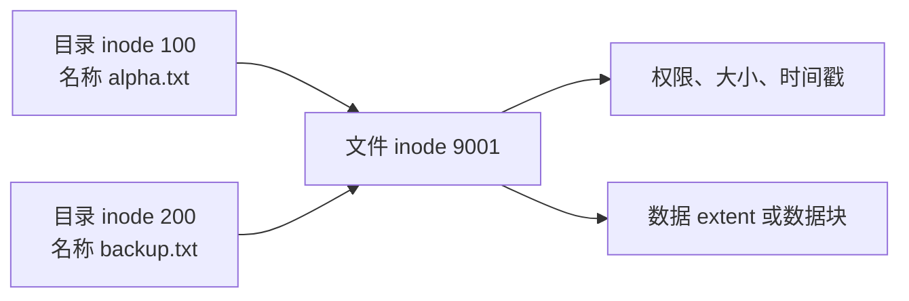
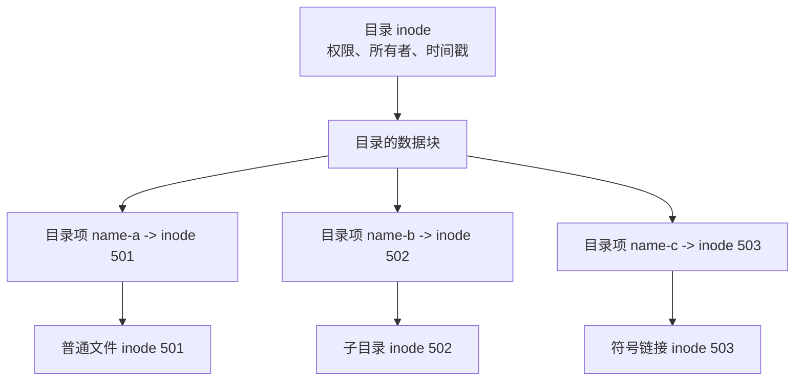
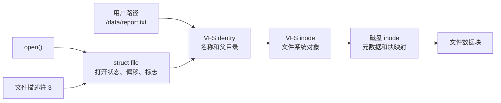
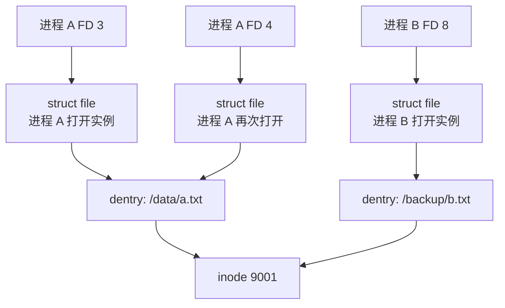
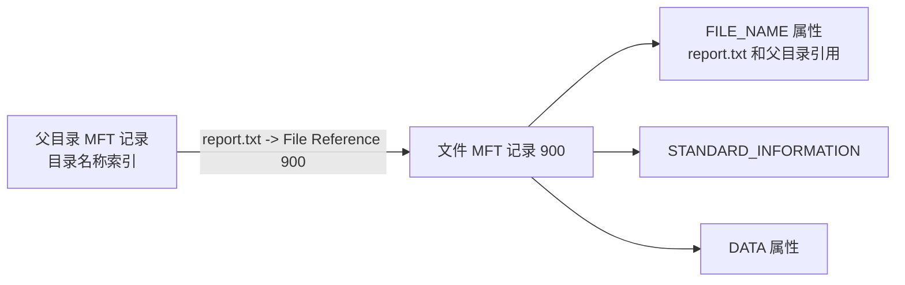
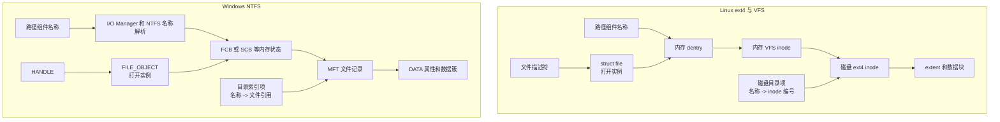

[toc]


## 先给出核心结论

在 Linux/Unix 文件系统中，可以把文件组织理解成两层：

- **目录项（directory entry）负责名字**：记录“这个目录里的某个名字，对应哪个 inode”。
- **inode（index node）负责对象**：记录“这个文件对象是什么、权限如何、大小多少、数据存在哪里”。

最重要的关系是：

- 目录项：文件名 -> inode 编号
- inode：文件元数据 -> 文件数据位置

Windows NTFS 也采用了非常相似的“名称与文件对象分离”设计，只是术语和磁盘结构不同：

- Linux/ext4 的 **inode**，大致对应 NTFS 的 **MFT 文件记录（MFT File Record）**。
- Linux/ext4 的磁盘目录项，大致对应 NTFS 目录中的 **文件名索引项（directory index entry）**。
- Linux 的 inode 编号，大致对应 NTFS 的 **文件引用号或文件 ID（File Reference/File ID）**。
- Linux 的打开文件 `struct file`，大致对应 Windows 的 **FILE_OBJECT**。
- Linux 用户态文件描述符（file descriptor），大致对应 Windows 用户态句柄（handle）。

但它们只是概念相似，**不能简单地说 NTFS MFT 记录就是 Windows inode**。NTFS 将名称、数据流、权限和目录索引都建模成不同类型的属性，结构比传统 Unix inode 模型更加“属性化”。

------

## 必须先区分三种容易混淆的“目录项”

Linux 中至少有三种容易都被叫作“目录项”的东西。

| 名称                   | 所在位置                       | 是否持久化 | 主要作用                             |
| ---------------------- | ------------------------------ | ---------- | ------------------------------------ |
| 文件系统磁盘目录项     | ext4、XFS 等文件系统的数据块中 | 是         | 保存名称与文件对象编号的关联         |
| Linux VFS dentry       | 内核内存                       | 否         | 缓存一次路径组件解析结果             |
| 用户态 `struct dirent` | 应用读取目录时获得             | 否         | `readdir()` 向程序返回的目录枚举结果 |

它们不是同一个结构。

### 磁盘目录项

以 ext4 为例，目录本身是一个特殊文件。它的数据内容不是普通文本，而是一组由 ext4 解释的目录记录。

一个简化的 ext4 目录项大致包含：

| 字段        | 含义                   |
| ----------- | ---------------------- |
| `inode`     | 目标 inode 编号        |
| `rec_len`   | 该目录项记录占用的长度 |
| `name_len`  | 文件名长度             |
| `file_type` | 文件类型的缓存值       |
| `name`      | 文件名本身             |

ext4 官方文档明确将目录描述为“从名称字节串到 inode 编号的映射”。现代 ext4 目录项还会缓存文件类型，以便枚举目录时不必为了确认每个项目类型而立即加载所有 inode。([Linux Kernel 文档](https://docs.kernel.org/filesystems/ext4/directory.html?utm_source=chatgpt.com))

例如目录中存在：

```text
report.txt -> inode 48192
images     -> inode 48197
latest     -> inode 48203
```

磁盘上并不是保存完整路径：

```text
/home/alice/project/report.txt
```

而是逐层保存：

```text
根目录：
home -> inode 100

inode 100 对应的目录：
alice -> inode 231

inode 231 对应的目录：
project -> inode 810

inode 810 对应的目录：
report.txt -> inode 48192
```

因此路径是运行时逐级解析出来的，不是 inode 里直接保存的一串绝对路径。

------

## inode 是什么

inode 全称通常写作：

> Index Node，索引节点

它是 Unix 文件系统中表示一个文件系统对象的核心数据结构。

文件系统对象不只是普通文件，还可能是：

- 普通文件
- 目录
- 符号链接
- 字符设备
- 块设备
- FIFO
- Unix 域套接字

Linux VFS 文档将 inode 定义为文件系统中的对象表示；磁盘文件系统的 inode 会在需要时加载进内存，同一个 inode 可以被多个 dentry 指向，这正是硬链接的基础。([Linux Kernel 文档](https://docs.kernel.org/filesystems/vfs.html))

### inode 中通常有什么

不同文件系统实现不同，但一般包括：

| 信息           | 典型内容                              |
| -------------- | ------------------------------------- |
| 文件类型       | 普通文件、目录、符号链接、设备等      |
| 权限模式       | 所有者、组、其他用户的 rwx 位         |
| 所有者         | UID                                   |
| 所属组         | GID                                   |
| 逻辑大小       | 文件对应用呈现的字节长度              |
| 分配信息       | 数据块映射或 extent 树                |
| 链接计数       | 有多少个硬链接目录项指向它            |
| 时间戳         | atime、mtime、ctime，可能还有创建时间 |
| 扩展属性位置   | xattr、ACL、安全标签                  |
| 特殊标志       | immutable、append-only 等             |
| 版本或代数信息 | 用于 NFS、陈旧引用识别等              |

ext4 inode 中包括硬链接计数、块数量、标志、数据块映射或 extent 树等字段。([Linux Kernel 文档](https://docs.kernel.org/filesystems/ext4/inodes.html))

### inode 中通常没有什么

传统 Unix inode 最值得记住的特点是：

> **inode 通常不保存普通文件名，也不保存完整路径。**

文件名位于父目录的目录项中。

因此同一个 inode 可以拥有多个名称：



这两个名称是同一个文件的两个硬链接。

------

## inode 编号是什么

inode 编号是某个文件系统内部用于定位 inode 的编号。

Linux 上执行：

```bash
ls -li file.txt
```

可能得到：

```text
48192 -rw-r--r-- 1 alice users 1024 Jul 10 10:00 file.txt
```

开头的 `48192` 就是 inode 编号。

但 inode 编号只在当前文件系统中有意义。两个不同文件系统都可能有 inode 48192。

更可靠的本地文件身份通常是：

```text
文件系统设备标识 + inode 编号
```

查看：

```bash
stat file.txt
```

或者输出简化标识：

```bash
stat -c 'device=%d inode=%i links=%h name=%n' file.txt
```

### inode 编号不是永久 UUID

inode 编号不能作为业务数据库中的永久身份标识，因为：

- 文件删除后，inode 编号可能被复用；
- 复制到另一个文件系统会获得新 inode；
- 备份恢复后编号可能变化；
- 网络文件系统不一定暴露稳定 inode；
- OverlayFS、容器和快照可能提供合成编号；
- 某些文件系统挂载方式可能影响应用观察到的 inode 值。

业务系统需要长期身份时，应使用：

- UUID
- 数据库主键
- 内容哈希
- 业务对象 ID

而不是直接持久化 inode 编号。

------

## 目录本身也有 inode

目录不是 inode 的外部容器。目录自身也是一个具有 inode 的文件系统对象。

例如：

```bash
stat /srv/data
```

会显示 `/srv/data` 自己的：

- inode 编号
- 所有者
- 权限
- 时间戳
- 链接计数
- 占用块数

其数据内容由文件系统解释为目录项。

所以更准确的结构是：



普通程序不能像写普通文本一样任意改写目录数据。目录内容的创建、删除和修改必须通过：

- `mkdir()`
- `open()` 加创建标志
- `link()`
- `unlink()`
- `rename()`
- `symlink()`

等文件系统操作完成，否则目录索引、一致性和日志事务会被破坏。

------

## Linux VFS dentry 是什么

这里是最容易产生误解的地方。

Linux 内核中的 **dentry** 不是 ext4 磁盘上的目录项。

dentry 全称是：

> Directory Entry，目录项缓存对象

它属于 Linux 的虚拟文件系统层：

> Virtual File System，VFS

dentry 存放在内存中，用于缓存：

```text
父 dentry + 路径组件名称 -> inode
```

例如系统解析：

```text
/usr/local/bin/python
```

可能在内存中形成：

```text
/       -> 根 dentry
usr     -> dentry
local   -> dentry
bin     -> dentry
python  -> dentry
```

每个 dentry 描述当前名称在某个父目录下的解析结果。

Linux 内核文档明确说明，dentry cache 用于把路径名快速转换为具体 dentry；dentry 只存在于 RAM 中，不保存到磁盘。([Linux Kernel 文档](https://docs.kernel.org/filesystems/vfs.html))

### dentry 为什么必须记录父目录

文件名本身不唯一。

例如：

```text
/home/alice/config.json
/etc/myapp/config.json
```

两个文件的最后一个名称都叫 `config.json`。

所以 dentry 的身份不能只是：

```text
config.json
```

而要包含：

```text
父目录对象 + config.json
```

也就是：

```text
/home/alice 下面的 config.json
```

和：

```text
/etc/myapp 下面的 config.json
```

是两个不同的 dentry。

### 正 dentry 和负 dentry

dentry 不一定指向一个存在的 inode。

#### 正 dentry

表示名称存在：

```text
父目录 + report.txt -> inode 48192
```

#### 负 dentry

表示系统已经查过，该名称目前不存在：

```text
父目录 + missing.txt -> 不存在
```

Linux 会缓存这种“不存在”的结果，因为应用可能反复检查同一个路径。

例如程序不断执行：

```text
检查 /run/myapp/ready 是否存在
```

如果每次都读取磁盘目录，会造成无意义的开销。负 dentry 允许内核快速回答“仍然不存在”。

Linux VFS 的 `lookup()` 在没有找到目标 inode 时，可以把空 inode 放入 dentry，这就形成 negative dentry。([Linux Kernel 文档](https://docs.kernel.org/filesystems/vfs.html))

当后来创建该文件时，原来的负 dentry 可以被转化为正 dentry。

------

## dentry、inode 和打开文件对象的完整关系

Linux 内核中至少应区分：

| 层次       | 内核对象        | 表示什么                 |
| ---------- | --------------- | ------------------------ |
| 名称解析层 | `struct dentry` | 一个父目录下的名称       |
| 文件对象层 | `struct inode`  | 文件系统中的对象         |
| 打开实例层 | `struct file`   | 某次打开操作的运行时状态 |
| 用户进程层 | 文件描述符整数  | 进程文件描述符表中的索引 |

完整关系可以表示为：



Linux VFS 文档指出，打开文件时会分配一个 `struct file`，它指向相应 dentry，并被放入进程的文件描述符表。([Linux Kernel 文档](https://docs.kernel.org/filesystems/vfs.html))

### 同一个 inode 可以对应多少个对象

一个 inode 可能同时对应：

- 多个磁盘目录项，因为有硬链接；
- 多个内存 dentry，因为这些名称不同；
- 多个 `struct file`，因为多个进程或同一进程多次打开；
- 多个文件描述符，因为 `dup()` 或进程继承。

例如：



所以：

> 文件描述符不是 inode 编号，dentry 也不是 inode。

------

## 一次路径查找是怎样完成的

假设程序执行：

```c
open("/home/alice/report.txt", O_RDONLY);
```

大致过程如下。

### 从进程根目录开始

因为路径以 `/` 开头，所以从进程所见命名空间的根目录开始。

这里要注意：容器中的根目录不一定是宿主机根目录。

### 查找 `home`

内核先检查 dentry cache：

```text
根 dentry + "home"
```

如果缓存命中，就直接获得对应 dentry 和 inode。

如果未命中，VFS 调用具体文件系统的目录查找方法：

1. 读取根目录 inode；
2. 查找根目录的数据块；
3. 找到名称为 `home` 的磁盘目录项；
4. 得到 inode 编号；
5. 加载相应 inode；
6. 建立内存 dentry。

### 查找 `alice`

以 `home` 的 dentry 和 inode 为父对象，重复相同过程。

### 查找 `report.txt`

最终得到：

```text
dentry: report.txt
inode: 48192
```

### 创建打开文件对象

内核为这次打开创建 `struct file`，记录：

- 打开标志
- 当前文件偏移
- 文件操作方法
- 对 dentry 和 inode 的引用
- 同步、追加、直接 I/O 等状态

### 返回文件描述符

进程获得：

```text
3
```

以后调用：

```c
read(3, buffer, size);
```

就不需要再次解析原来的完整路径。

------

## 文件改名时发生什么

假设：

```bash
mv report.txt final.txt
```

如果在同一个文件系统内，核心变化通常是：

```text
之前：
report.txt -> inode 48192

之后：
final.txt -> inode 48192
```

inode 通常不变，数据块也不需要复制。

变化的是目录名称关系。

如果从一个目录移动到同一文件系统的另一个目录：

```bash
mv /data/report.txt /archive/final.txt
```

可以理解为：

```text
从 /data 目录删除：
report.txt -> inode 48192

向 /archive 目录加入：
final.txt -> inode 48192
```

这些修改由文件系统作为改名事务处理。

这也解释了为什么进程已经打开文件后，文件被改名通常仍可以继续读取：进程通过打开对象引用 inode，而不是每次重新按旧文件名寻找。

------

## 文件删除时发生什么

执行：

```bash
rm report.txt
```

在 Unix 模型中，核心操作叫：

> unlink，解除链接

它主要删除：

```text
父目录中的 report.txt -> inode 48192
```

然后将 inode 的硬链接计数减一。

### 链接计数仍然大于零

若还有另一个硬链接：

```text
backup.txt -> inode 48192
```

那么文件继续存在。

### 链接计数变成零，但文件仍被打开

若仍有进程持有该 inode 的打开文件对象，则数据暂时不会释放。

此时：

- 路径已经找不到；
- 文件仍占空间；
- 进程仍可以继续读写；
- 最后一个打开引用关闭后，inode 和数据才可回收。

这就是 Linux 上“删除日志后磁盘空间没有释放”的原因。

排查：

```bash
sudo lsof +L1
```

------

## 硬链接为什么与 inode 紧密相关

创建硬链接：

```bash
ln original.txt second-name.txt
```

结果：

```text
original.txt    -> inode 7000
second-name.txt -> inode 7000
```

inode 中的链接计数从 1 变成 2。

ext4 文档明确指出，多个目录项可以引用同一个 inode，这些就是硬链接；由于目录项只保存本文件系统中的 inode 编号，硬链接无法跨文件系统。([Linux Kernel 文档](https://docs.kernel.org/filesystems/ext4/directory.html?utm_source=chatgpt.com))

### 为什么硬链接不能跨文件系统

文件系统 A 的目录项只能解释文件系统 A 的 inode 编号。

假设：

```text
ext4 文件系统 A 的 inode 500
XFS 文件系统 B 的 inode 500
```

二者毫无关系。

因此 B 不能简单建立：

```text
name -> inode 500
```

来引用 A 中的对象。

### 为什么普通用户不能随意硬链接目录

如果允许任意目录硬链接，会形成：

- 目录环；
- 多父目录；
- `..` 语义不明确；
- 递归遍历无法正常终止；
- 链接计数和文件系统检查极其复杂。

所以普通硬链接主要用于普通文件。

------

## 符号链接与 inode

符号链接也是一个独立文件系统对象，因此通常有自己的 inode。

例如：

```bash
ln -s /srv/releases/v2 current
```

结构不是：

```text
current -> v2 的 inode
```

而更接近：

```text
目录项 current -> 符号链接 inode 8100
符号链接 inode 8100 的内容 -> "/srv/releases/v2"
```

路径解析器遇到符号链接后，再解析其保存的目标路径。

因此符号链接可以：

- 跨文件系统；
- 指向不存在的目标；
- 指向目录；
- 在目标删除后继续存在，只是变成悬空链接。

硬链接和符号链接的本质区别：

| 特性               | 硬链接                   | 符号链接         |
| ------------------ | ------------------------ | ---------------- |
| 是否指向同一 inode | 是                       | 否               |
| 自己是否有 inode   | 不是独立文件对象         | 是               |
| 保存的内容         | 不保存目标路径           | 保存目标路径文本 |
| 能否跨文件系统     | 否                       | 能               |
| 目标删除后         | 只要仍有硬链接，文件存在 | 链接变成悬空链接 |
| 修改目标内容       | 所有硬链接都看到变化     | 通过路径访问目标 |

------

## `.` 和 `..` 与目录链接计数

传统 Unix 目录中有两个特殊目录项：

```text
.   -> 当前目录
..  -> 父目录
```

以 ext4 为例，目录数据结构中明确存在 `.` 和 `..` 对应的 inode 信息。([Linux Kernel 文档](https://docs.kernel.org/filesystems/ext4/directory.html))

这解释了传统目录链接计数的计算方式。

假设一个目录没有子目录：

```text
project/
```

其链接计数通常至少为 2：

- 父目录中的 `project` 指向它；
- 它自己的 `.` 指向它。

每增加一个直接子目录，子目录的 `..` 又会指向父目录，所以父目录的链接计数通常增加 1。

例如：

```text
project/
├── src/
├── docs/
└── README
```

`project` 的传统链接计数通常是：

```text
2 + 直接子目录数量
= 2 + 2
= 4
```

普通文件 `README` 不增加父目录的目录链接计数。

不过现代文件系统为了支持超大量子目录，可能使用特殊表示，不能在所有文件系统上把目录链接数绝对当作“子目录数加二”。ext4 的 `DIR_NLINK` 特性就允许在链接数过大时用特殊值表示数量未知。([Linux Kernel 文档](https://docs.kernel.org/filesystems/ext4/inodes.html))

------

## inode 会不会用完

有些文件系统在创建时会规划 inode 数量，最典型的是 ext4。

可能出现：

```text
磁盘容量还有很多
但无法创建新文件
```

因为 inode 已经耗尽。

检查：

```bash
df -h
df -i
```

其中：

- `df -h` 查看数据块空间；
- `df -i` 查看 inode 数量。

### 哪类工作负载容易耗尽 inode

- 海量小缓存文件
- 邮件队列
- PHP session
- 容器层
- 包管理缓存
- 数百万零字节或几字节文件
- 不受控制的临时文件
- 每个请求生成独立文件的服务

假设有：

- 1000 万个 1 KiB 文件；
- 每个至少占一个数据块；
- 每个还需要 inode 和目录项；

实际元数据和块空间开销会远大于简单的 10 GB 内容总量。

### inode 用尽后的处理原则

不应立即考虑“增加磁盘容量”，而应先：

1. 使用 `df -i` 确认 inode 使用率；
2. 找出文件数量异常的目录；
3. 检查缓存和临时文件策略；
4. 将海量小对象改为数据库、对象存储、归档文件或分层目录；
5. 必要时重新规划文件系统格式化参数。

------

## Windows 是否也有类似设计

有，而且 NTFS 与 Unix inode 模型在“名称和对象分离”这个核心思想上非常接近。

NTFS 的核心是：

> Master File Table，MFT，主文件表

NTFS 卷中的每个文件和目录至少有一个 MFT 条目，包括 MFT 自身。文件大小、时间戳、权限和内容，要么直接存放在 MFT 记录中，要么存放在外部空间并由 MFT 记录描述。([Microsoft Learn](https://learn.microsoft.com/en-us/windows/win32/fileio/master-file-table?utm_source=chatgpt.com))

------

## NTFS 的 MFT 文件记录

可以将 MFT 想象成一个由固定记录组成的核心表：

```text
MFT 记录 42   -> 某个目录
MFT 记录 100  -> 某个普通文件
MFT 记录 101  -> 某个普通文件
MFT 记录 102  -> 某个符号链接或重解析点
```

每个文件记录由若干属性组成。

典型 NTFS 属性包括：

| NTFS 属性                             | 大致用途                           |
| ------------------------------------- | ---------------------------------- |
| `$STANDARD_INFORMATION`               | 标准属性、时间戳、链接计数等       |
| `$FILE_NAME`                          | 文件名及父目录引用                 |
| `$DATA`                               | 文件数据流                         |
| `$SECURITY_DESCRIPTOR` 或相关安全信息 | 权限和安全描述                     |
| `$ATTRIBUTE_LIST`                     | 记录放不下时定位扩展记录           |
| `$INDEX_ROOT`                         | 小型目录索引的根                   |
| `$INDEX_ALLOCATION`                   | 较大目录的索引数据                 |
| `$BITMAP`                             | 目录索引等结构的分配状态           |
| `$REPARSE_POINT`                      | 联接、符号链接、云占位等重解析信息 |

在 NTFS 中，文件名、所有者、时间戳和文件内容都被建模为文件属性，其中普通数据是 `$DATA` 属性，文件名是 `$FILE_NAME` 属性。([Microsoft Learn](https://learn.microsoft.com/en-us/openspecs/windows_protocols/ms-fscc/a82e9105-2405-4e37-b2c3-28c773902d85?utm_source=chatgpt.com))

这和传统 inode 模型有所不同：

- Unix 倾向于说“inode 有固定核心字段和数据块映射”。
- NTFS 倾向于说“文件记录由一组有类型的属性组成”。

------

## MFT 记录为什么只是“大致类似 inode”

Linux inode 和 NTFS MFT 记录都承担：

- 文件对象身份；
- 元数据保存；
- 数据位置描述；
- 文件类型表示；
- 链接计数等。

但存在重要差别。

| 对比           | Linux/ext4 inode               | NTFS MFT 文件记录                         |
| -------------- | ------------------------------ | ----------------------------------------- |
| 核心组织       | 固定 inode 字段加块映射、xattr | 多个带类型的属性                          |
| 普通文件名     | 通常不在 inode 中              | `$FILE_NAME` 属性位于文件记录中           |
| 文件内容       | inode 指向 extent 或数据块     | `$DATA` 属性，可 resident 或 non-resident |
| 目录索引       | 位于目录文件的数据块           | `$INDEX_ROOT`、`$INDEX_ALLOCATION` 等属性 |
| 多数据流       | 不是传统通用模型               | 一个文件可有多个命名 `$DATA` 流           |
| 超出主记录容量 | 使用外部块和 xattr 等结构      | 可使用额外 MFT 记录和 `$ATTRIBUTE_LIST`   |

所以最准确的说法是：

> MFT 文件记录承担了 inode 类似的“对象记录”职责，但 NTFS 的内部属性模型与 Unix inode 并不相同。

------

## NTFS 中的“目录项”在哪里

NTFS 目录不是简单的线性名称列表，而是维护一个按文件名组织的索引。

概念上可以表示为：

```text
目录 MFT 记录
├── 名称 alpha.txt  -> 文件引用 100
├── 名称 beta.txt   -> 文件引用 105
└── 名称 images     -> 文件引用 210
```

小型目录索引可以放在 `$INDEX_ROOT` 属性中；目录变大后，可以通过 `$INDEX_ALLOCATION` 扩展到记录之外。Microsoft 的 NTFS 属性定义明确说明，`$INDEX_ROOT` 用于目录及其他索引，`$INDEX_ALLOCATION` 是目录索引流。([Microsoft Learn](https://learn.microsoft.com/en-us/openspecs/windows_protocols/ms-fscc/a82e9105-2405-4e37-b2c3-28c773902d85?utm_source=chatgpt.com))

这大致对应 Linux 的：

```text
目录项名称 -> inode 编号
```

但 NTFS 通常使用：

```text
目录索引中的文件名 -> MFT 文件引用
```

------

## NTFS 名称关系是双向记录的

NTFS 中一个名称关系通常同时涉及：

- 父目录中的名称索引；
- 子文件 MFT 记录中的 `$FILE_NAME` 属性。

`$FILE_NAME` 属性包含：

- 文件名；
- 指向父目录的文件引用；
- 名称类型等信息。

Microsoft 文档指出，一个文件每被加入一个目录，就具有一个对应的文件名属性；该属性还保存索引该名称的父目录引用。([Microsoft Learn](https://learn.microsoft.com/en-us/windows/win32/devnotes/file-name?utm_source=chatgpt.com))

可以抽象为：



Linux ext4 中普通文件名主要放在父目录项里；NTFS 则还会在文件自身记录中保存相应 `$FILE_NAME` 属性。这是两者的重要结构差异。

------

## NTFS 文件引用号与 inode 编号

NTFS 目录索引不只是保存一个简单 MFT 数组下标，而是使用文件引用：

> File Reference 或 MFT Segment Reference

文件引用通常包含：

- MFT 记录位置；
- 一个序列号。

序列号用于检测陈旧引用。

假设：

1. MFT 记录 100 原来属于文件 A；
2. 文件 A 被删除；
3. 记录 100 被回收；
4. 后来记录 100 被文件 B 重用。

如果引用中只有数字 100，旧引用可能错误地指向 B。

因此文件引用带有序列信息：

```text
MFT 记录编号 100 + 序列号 7
```

重用后可能变成：

```text
MFT 记录编号 100 + 序列号 8
```

Microsoft 文档说明，MFT segment reference 由 MFT 地址和循环使用的序列号组成；如果引用中的序列号与记录当前序列号不匹配，该引用就是错误或已经陈旧。([Microsoft Learn](https://learn.microsoft.com/en-us/windows/win32/devnotes/mft-segment-reference?utm_source=chatgpt.com))

这比单独使用传统 inode 编号更明确地包含了陈旧引用检测信息。

------

## NTFS 硬链接如何实现

NTFS 同样支持多个名称指向一个文件对象。

例如：

```text
C:\Data\a.txt       -> MFT 文件记录 900
C:\Backup\copy.txt  -> MFT 文件记录 900
```

对应关系大致是：

- 两个父目录中各有一个目录索引项；
- 文件记录 900 中存在相应 `$FILE_NAME` 属性；
- 链接计数反映名称数量；
- 两个路径访问相同的数据流。

Microsoft 文档说明，在 NTFS 卷上，一个文件可以具有多个硬链接，同一文件可以出现在不同目录或同一目录中的不同名称下；只有所有硬链接都被删除后，文件才从文件系统中删除。([Microsoft Learn](https://learn.microsoft.com/en-us/windows-server/administration/windows-commands/fsutil-hardlink?utm_source=chatgpt.com))

因此在这个方面：

```text
Linux：
多个目录项 -> 同一个 inode

NTFS：
多个目录名称索引和 FILE_NAME 属性 -> 同一个 MFT 文件记录
```

两者思想高度相似。

------

## NTFS 的 resident 和 non-resident 数据

NTFS 的一个现代特点是，小属性可以直接放在 MFT 文件记录内部。

### Resident 属性

如果文件内容很小，`$DATA` 属性可能直接驻留在 MFT 记录中。

概念上：

```text
MFT 记录
├── 文件名
├── 时间戳
├── 权限信息
└── 小文件内容
```

此时读取小文件可能不必再访问额外数据簇。

### Non-resident 属性

文件内容较大时，MFT 记录不保存全部数据，而保存数据运行映射，描述内容位于卷上的哪些簇。

概念上：

```text
MFT 记录
└── DATA 属性
    ├── 逻辑范围 0-999   -> 簇范围 A
    ├── 逻辑范围 1000-1999 -> 簇范围 B
    └── 逻辑范围 2000-...  -> 簇范围 C
```

Microsoft 的 MFT 文档说明，文件信息可能直接位于 MFT 条目中，也可能位于 MFT 外部并由 MFT 条目描述。([Microsoft Learn](https://learn.microsoft.com/en-us/windows/win32/fileio/master-file-table?utm_source=chatgpt.com))

这在概念上类似 ext4 inode：

```text
inode -> extent 树 -> 数据块
```

------

## Windows 内存中的对应对象

磁盘结构之外，还应比较内核运行时对象。

### Windows FILE_OBJECT

Windows 内核中的 `FILE_OBJECT` 表示一次打开的文件、目录、设备或卷实例。

它保存或关联：

- 打开访问状态；
- 共享读、共享写、共享删除状态；
- 当前文件偏移；
- 缓存相关上下文；
- 文件系统驱动维护的上下文；
- 删除待定等状态。

Microsoft 文档将 `FILE_OBJECT` 描述为一个文件、目录、设备或卷的打开实例。([Microsoft Learn](https://learn.microsoft.com/en-us/windows-hardware/drivers/ddi/wdm/ns-wdm-_file_object?utm_source=chatgpt.com))

它更接近 Linux 的：

```text
struct file
```

而不是 inode。

对应关系是：

| Linux               | Windows                                |
| ------------------- | -------------------------------------- |
| 用户态文件描述符 FD | 用户态 HANDLE                          |
| 内核 `struct file`  | 内核 `FILE_OBJECT`                     |
| VFS inode           | 文件系统驱动 FCB、SCB 等状态，概念近似 |
| 磁盘 inode          | NTFS MFT 文件记录，概念近似            |
| VFS dentry          | 没有完全公开的一一对应通用结构         |
| 磁盘目录项          | NTFS 目录名称索引项                    |

### Windows FCB

Windows 文件系统驱动通常维护：

> File Control Block，FCB

FCB 表示文件系统驱动眼中的某个文件对象或流的共享状态。多个打开操作可以共享同一个 FCB。

Microsoft 驱动文档说明，指向同一个 FCB 的操作实际上作用于同一个文件，因此同步通常基于 FCB；对于 NTFS 这种支持多数据流的文件系统，相关上下文也可能是 Stream Control Block，SCB。([Microsoft Learn](https://learn.microsoft.com/en-us/windows-hardware/drivers/ddi/wdm/ns-wdm-_file_object?utm_source=chatgpt.com))

因此非常粗略地说：

```text
Linux VFS inode
约等于
Windows 文件系统驱动的 FCB 或 NTFS SCB 的部分职责
```

但 FCB 是驱动实现结构，不是 NTFS 磁盘格式中固定存在的“Windows inode”。

### Windows 有没有 dentry cache

Windows 内核和文件系统驱动当然也会缓存：

- 路径解析结果；
- 目录查找结果；
- 文件控制块；
- 名称信息；
- 文件数据。

但 Windows 没有向普通开发者提供一个与 Linux `struct dentry` 完全一致的统一公共抽象。

Linux VFS 明确把 dentry 作为跨文件系统通用对象；Windows 则更多通过：

- I/O Manager
- Object Manager
- Cache Manager
- 文件系统驱动
- Filter Manager
- NTFS 内部结构

协作完成名称解析和缓存。

因此不应强行建立：

```text
Windows 某一个结构 = Linux dentry
```

更准确的是：

> 两者都缓存名称解析，但内核架构和公开抽象边界不同。

------

## Linux 与 NTFS 的整体对应图



------

## 两套设计的关键对比

| 问题                       | Linux/ext4                            | Windows/NTFS                        |
| -------------------------- | ------------------------------------- | ----------------------------------- |
| 文件对象的磁盘核心记录     | inode                                 | MFT 文件记录                        |
| 目录名称查找               | 目录项或 htree                        | 目录文件名索引                      |
| 对象编号                   | inode number                          | file reference、file ID             |
| 名称是否与对象分离         | 是                                    | 是                                  |
| 文件名主要放在哪里         | 父目录项                              | 父目录索引，并有 `$FILE_NAME` 属性  |
| 硬链接                     | 多目录项指向同一 inode                | 多名称关系指向同一 MFT 文件记录     |
| 小文件内容能否放核心记录内 | ext4 可有 inline data，但不是所有文件 | `$DATA` 可 resident                 |
| 大文件数据定位             | extent 树等                           | non-resident `$DATA` 运行映射       |
| 内存名称缓存               | VFS dentry cache                      | 由 Windows 内核和文件系统栈内部缓存 |
| 打开实例                   | `struct file`                         | `FILE_OBJECT`                       |
| 用户态引用                 | FD 整数                               | HANDLE                              |
| 变化追踪                   | inotify、fanotify 等                  | NTFS USN Journal                    |
| 全卷元数据集中程度         | inode 表与分散目录数据                | MFT 高度集中                        |

NTFS 的 MFT 集中保存每个文件的核心记录，而 ext4 的文件名仍分散在各目录的数据块中。这也是 Everything 和 WizTree 能直接利用 MFT 获得高性能全卷枚举的重要结构基础。

------

## 动手实验：观察 Linux 目录项和 inode

### 创建文件

```bash
mkdir -p /tmp/inode-lab
cd /tmp/inode-lab

printf 'hello\n' > alpha.txt
ls -li alpha.txt
stat alpha.txt
```

记录 inode 编号。

### 改名

```bash
mv alpha.txt beta.txt
ls -li beta.txt
```

通常会看到 inode 编号不变。

说明改变的是名称关系，不是文件对象。

### 创建硬链接

```bash
ln beta.txt gamma.txt
ls -li beta.txt gamma.txt
```

应看到：

- 两个名称 inode 相同；
- 链接计数变为 2。

查看：

```bash
stat -c 'inode=%i links=%h name=%n' beta.txt gamma.txt
```

### 修改其中一个名称

```bash
printf 'world\n' >> gamma.txt
cat beta.txt
```

`beta.txt` 也会看到修改，因为二者是同一 inode。

### 删除其中一个名称

```bash
rm beta.txt
cat gamma.txt
stat gamma.txt
```

文件仍存在，链接计数回到 1。

### 创建符号链接

```bash
ln -s gamma.txt symbolic.txt
ls -li gamma.txt symbolic.txt
```

这一次 inode 不相同，因为符号链接是独立文件对象。

查看链接本身：

```bash
stat symbolic.txt
```

跟随链接查看目标：

```bash
stat -L symbolic.txt
```

------

## 动手实验：观察 Windows NTFS 文件 ID 和硬链接

在 NTFS 卷上创建文件：

```powershell
New-Item -ItemType Directory -Path C:\Temp\ntfs-lab -Force
Set-Content -Path C:\Temp\ntfs-lab\alpha.txt -Value "hello"
```

查询文件 ID：

```cmd
fsutil file queryfileid C:\Temp\ntfs-lab\alpha.txt
```

创建硬链接：

```cmd
fsutil hardlink create C:\Temp\ntfs-lab\beta.txt C:\Temp\ntfs-lab\alpha.txt
```

列出硬链接：

```cmd
fsutil hardlink list C:\Temp\ntfs-lab\alpha.txt
```

修改一个名称：

```powershell
Add-Content -Path C:\Temp\ntfs-lab\beta.txt -Value "world"
Get-Content C:\Temp\ntfs-lab\alpha.txt
```

`alpha.txt` 会看到相同变化，因为两个名称引用同一个 NTFS 文件对象。

删除一个名称：

```powershell
Remove-Item C:\Temp\ntfs-lab\alpha.txt
Get-Content C:\Temp\ntfs-lab\beta.txt
```

剩余硬链接仍然有效。

具体命令权限和可用性会受到 Windows 版本、卷格式及当前账户权限影响。

------

## 实际排障时怎样使用这些知识

### 文件删除了但空间不释放

Linux 思路：

```text
目录项已删除
但 inode 仍被打开文件对象引用
```

检查：

```bash
sudo lsof +L1
```

### 同一内容出现多个路径，磁盘是否占了多份

先检查 inode：

```bash
stat -c 'device=%d inode=%i links=%h name=%n' path-a path-b
```

设备和 inode 都相同，说明是硬链接，内容通常只保存一份。

### 文件改名后程序为什么还能继续读

因为程序持有：

```text
文件描述符 -> struct file -> dentry/inode
```

它不必重新用旧路径查找。

### 一个目录为什么查找很慢

可能原因包括：

- 目录项数量巨大；
- dentry cache 冷；
- inode cache 冷；
- 目录索引退化或冲突；
- 网络文件系统往返；
- 每项还需要 `stat()`；
- 权限、ACL、xattr 查询；
- HDD 随机访问；
- 容器 OverlayFS 多层合并。

### 为什么 `ls` 有时比预期慢

单纯枚举名称和为每个项目读取完整属性不是同一工作量。

例如：

```bash
ls
```

主要枚举名称。

而：

```bash
ls -l
```

通常需要为大量项目获取：

- 权限
- 所有者
- 组
- 大小
- 时间戳

这可能触发大量 inode 查询、用户组名称解析或网络请求。

------

## 最应记住的模型

```text
Linux：

目录的数据
    保存目录项

目录项
    保存名称和 inode 编号

inode
    保存对象元数据和数据位置
    通常不保存普通文件名

dentry
    是内存中的名称解析缓存
    不是磁盘目录项

struct file
    是一次打开实例

文件描述符
    是进程引用打开实例的整数
```

对应到 Windows NTFS：

```text
NTFS：

目录 MFT 记录
    保存目录名称索引

目录索引项
    保存名称和文件引用

MFT 文件记录
    保存文件属性和数据位置
    包括 FILE_NAME、DATA 等属性

FCB 或 SCB
    是文件系统驱动维护的对象或流状态

FILE_OBJECT
    是一次打开实例

HANDLE
    是用户进程持有的引用
```

最终可以浓缩为一句话：

> **目录项回答“这个名字指向谁”，inode 或 MFT 记录回答“这个对象是什么”，dentry 或名称缓存回答“最近这个名字解析到了谁”，打开文件对象回答“某个进程当前怎样使用它”。**