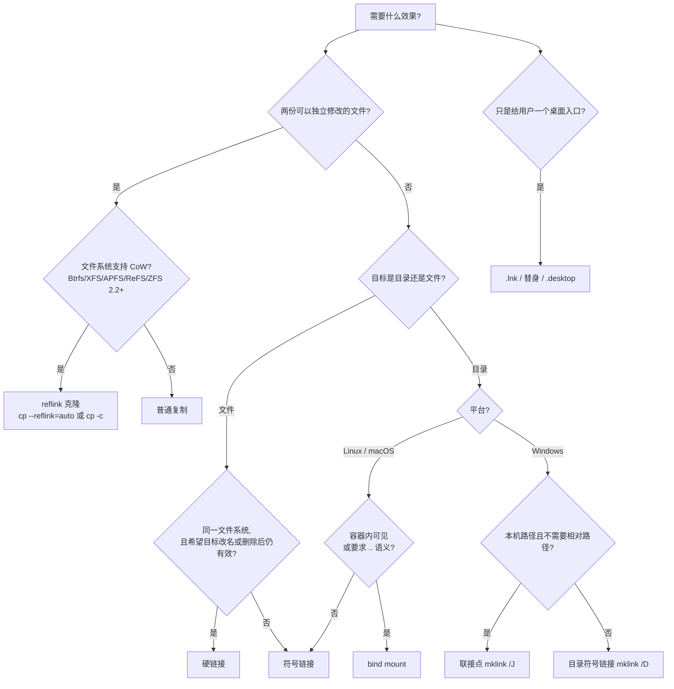
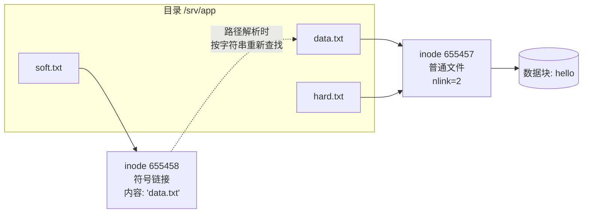
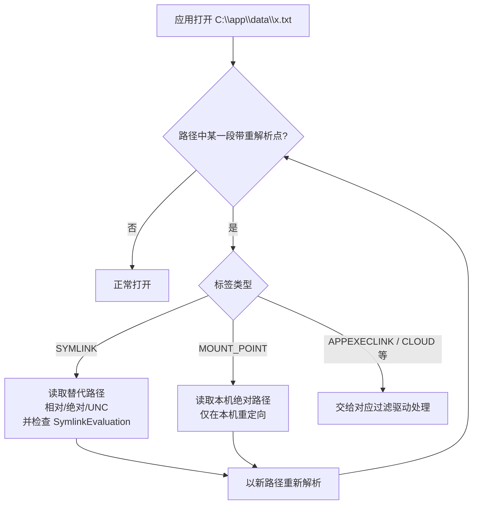
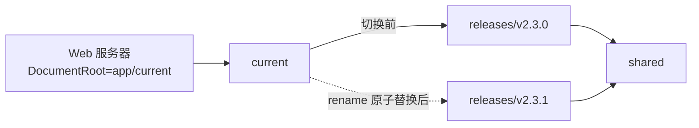
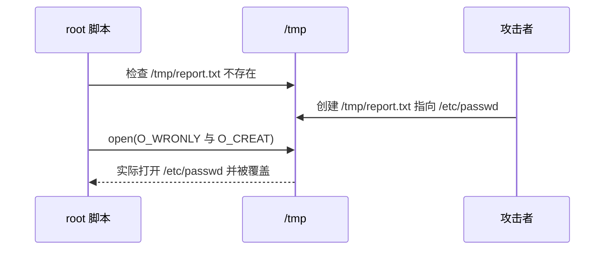

[toc]

文件系统里的**链接**只解决一件事：让同一份数据或同一个位置，可以通过多个名字访问，而不必复制数据。围绕这个能力派生出两类完全不同的需求——**共享同一份内容**（硬链接、写时复制克隆）和**保存一条路径、访问时重定向**（符号链接、联接点、挂载）。混淆这些机制的语义，是跨平台项目里反复出现的故障来源：版本切换脚本把新链接建进了旧版本目录、`rm -rf` 带了一个尾斜杠就清空了目标、Windows 上克隆仓库后发现"链接变成了一行文字"。

本文先给选型结论与底层模型，再分别展开 Linux、Windows、macOS 的实现与坑点，最后落到工具链行为、典型场景、安全防线和速查表。**reflink 克隆与 bind mount** 严格说不是链接，但它们解决的是同一类问题、又最常被误当作链接使用，因此单列一章放在一起比较。标注**实测**的结论来自本机验证环境：Linux 侧为 WSL2 Ubuntu 24.04（coreutils 9.4、ext4），Windows 侧为 Windows 11 26100（PowerShell 5.1.26100 与 pwsh 7.5.4、NTFS）。

## 结论速览

先按需求选机制，再按平台选实现。

| 需求 | 首选手段 | 说明 |
| --- | --- | --- |
| 同一份内容出现在多个位置但不占双份空间 | 硬链接、reflink | 硬链接是同一对象；reflink 是两个对象共享数据块 |
| 版本切换、`current` 指向某个版本 | 符号链接 | 配合"临时链接 + `mv -T`"可做到原子切换 |
| 把大目录挪到别的磁盘，原路径保持不变 | Windows 用**联接点**，Linux 用符号链接或 bind mount | 联接点免特权、旧程序兼容性最好 |
| 快速复制大文件，之后各自修改 | reflink / 克隆 | 修改互不影响，比硬链接安全 |
| 兼容旧路径（系统或软件改过目录布局） | 符号链接、联接点 | usrmerge、`update-alternatives`、`C:\Documents and Settings` 都是这个用法 |
| 在容器或 chroot 内部可见、要求 `..` 语义正确 | bind mount | 对进程完全透明，`readlink` 看不到 |
| 给最终用户一个桌面入口 | `.lnk`、Finder 替身、`.desktop` | 属于应用层，命令行不跟随 |

各平台的默认选择：

- **Linux / macOS**：项目内、可能整体搬迁的链接用**相对符号链接**；指向系统固定位置用绝对路径；只有在明确需要"多个名字共享同一数据生命周期"时才用硬链接。
- **Windows**：目录重定向优先**联接点**（`mklink /J`），免特权、兼容性好；需要指向文件、网络路径或使用相对路径时才用**符号链接**。
- **任何平台**：要"省空间的副本"优先 reflink，不要用硬链接代替。



判读顺序很固定：先分清要**独立副本**还是**共享同一份**，这一步就把克隆和链接分开了；再看目标是文件还是目录、在哪个平台、是否需要跨卷或跨网络。

## 核心模型：名字、对象与数据

理解一切链接的前提，是把文件系统拆成三层。

| 概念 | 含义 | 类比 |
| --- | --- | --- |
| **数据块**（data blocks） | 文件内容真正所在的磁盘空间 | 仓库里的货物 |
| **inode**（索引节点；NTFS 对应 MFT 记录，APFS 对应 inode 对象） | 描述对象的元数据：类型、权限、属主、大小、时间戳、数据块位置、**链接计数** | 货物的登记卡 |
| **目录项**（directory entry，dentry） | 目录中"名字到 inode 号"的映射 | 货架上的标签 |

文件名只是目录项，目录项指向 inode，inode 才"拥有"数据。于是只剩两种做法：

- **硬链接**：再给同一个 inode 添加一个目录项。两个名字完全平等，没有"原件/副本"之分。
- **符号链接**：创建一个**独立的、类型为链接的 inode**，其内容是**一段路径字符串**；访问时由内核把这段字符串代入路径解析。

把所有"看起来像链接"的机制按**在哪一层解耦**归类，可以避免把它们混为一谈：

| 层次 | 机制 | 谁能感知 |
| --- | --- | --- |
| 名字层：多个名字指向同一对象 | 硬链接 | 所有程序 |
| 路径层：保存一条路径，访问时重定向 | 符号链接、NTFS 联接点、macOS firmlink | 所有程序 |
| 数据层：不同文件共享数据块 | reflink / 块克隆 / APFS 克隆 | 所有程序，但无法识别为"链接" |
| 挂载层：目录树嫁接 | bind mount、Windows 卷挂载点 | 所有程序，路径里看不到任何链接 |
| 应用层：由 Shell 或桌面解释 | `.lnk`、Finder 替身、`.desktop` | 只有资源管理器、Finder 这类图形程序 |

越靠上（名字层、路径层），对程序越**透明**：任何调用 `open()` 的程序都会受影响。应用层的快捷方式只对图形外壳生效，命令行程序把它们当作普通文件——这是"为什么脚本里点不开快捷方式"的根本原因。



实测（ext4，coreutils 9.4）与此一致：

```bash
echo hello > data.txt
ln data.txt hard.txt
ln -s data.txt soft.txt
stat -c '%n inode=%i links=%h type=%F size=%s' data.txt hard.txt soft.txt
# data.txt inode=655457 links=2 type=regular file size=6
# hard.txt inode=655457 links=2 type=regular file size=6
# soft.txt inode=655458 links=1 type=symbolic link size=8
```

`soft.txt` 的大小正好等于字符串 `data.txt` 的长度，这是"内容就是路径"最直接的证据。

**路径解析**（path resolution）逐段查找目录项，遇到符号链接就把链接内容替换进来继续解析。Linux 内核单次解析最多跟随 **40 个符号链接**（实测：40 层级联成功，第 41 层返回 `ELOOP`，即 `Too many levels of symbolic links`），这也是循环链接 `a -> b -> a` 的表现。

另一条常被忽略的限制是单条路径的总长度：**`PATH_MAX` 在多数 Linux 上为 4096 字节**，逐层展开后超限返回 `ENAMETOOLONG`。它与层数限制彼此独立——层数没超但目标字符串很长时，失败原因会是长度而不是 `ELOOP`。

## Linux / POSIX：硬链接

创建方式：`ln <目标文件> <新名字>`，GNU `cp -l` 可成批创建硬链接而不复制数据。

### 语义

- **没有主从之分**：删除任意一个名字只是 `unlink`，`nlink` 减 1。
- **数据释放条件**：`nlink` 归零**且没有进程仍打开该文件**时，数据才真正释放。
- **改名或移动不影响**：硬链接直接指向对象，不指向路径。
- **元数据共享**：权限、属主、时间戳存在 inode 上，从任一名字修改，其他名字立即可见。
- **数量上限**由文件系统决定：ext4 约 65000，XFS/btrfs 远高，FAT32/exFAT 完全不支持。

### 限制

| 限制 | 原因 |
| --- | --- |
| 不能跨文件系统或跨卷 | inode 号只在所属文件系统内有意义 |
| 不能对目录创建 | 会让目录树变成有环图，`..` 的含义不再唯一（`.` 与 `..` 是内核维护的例外） |
| 部分文件系统不支持 | FAT32、exFAT 没有硬链接 |
| `fs.protected_hardlinks=1` 时受限 | 普通用户只能为自己拥有或有读写权限的文件创建硬链接 |

对目录尝试硬链接会得到明确拒绝（实测）：

```bash
ln d d2
# ln: d: hard link not allowed for directory
ln -d d d2
# ln: failed to create hard link 'd2' => 'd': Operation not permitted
```

即便用 `-d` 放开用户态检查，内核仍然拒绝。

### 指向符号链接时，硬链接的是链接本身

`ln` 的 `-P`/`-L` 决定当 `TARGET` 本身是符号链接时怎么处理，默认是 `-P`（实测）：

```bash
echo hello > real.txt; ln -s real.txt s1
ln s1 hard_default      # 默认 -P：硬链接"符号链接对象"
ln -L s1 hard_L         # -L：解引用到最终文件
stat -c '%n %F %h inode=%i' real.txt s1 hard_default hard_L
# real.txt     regular file   2  9482
# s1           symbolic link  2  9484
# hard_default symbolic link  2  9484   ← 与 s1 同 inode
# hard_L       regular file   2  9482   ← 与 real.txt 同 inode
```

`hard_default` 这个"硬链接"的 `stat` 结果显示它仍是符号链接，且与 `s1` 共享 inode。想拿到"指向真实文件的新名字"，必须写 `ln -L` 或直接用 `cp -l`。

### 常见陷阱：一次"原子保存"就让硬链接分道扬镳

很多编辑器和工具保存文件时采用"写临时文件再 `rename()` 替换"，例如 `sed -i`、部分 IDE、vim 的某些配置。保存完成后，原名字指向**新的 inode**，原来那组硬链接就不再共享内容了。

- **应该**：依赖硬链接共享内容时，先用 `stat -c '%i %h'` 确认 inode 号与链接数没有变化。
- **避免**：用硬链接管理需要频繁编辑的配置文件（dotfiles 是典型反例），这类场景用符号链接。

### 实用命令

| 目的 | Linux / macOS | Windows |
| --- | --- | --- |
| 创建 | `ln TARGET LINK` | `mklink /H LINK TARGET` 或 `New-Item -ItemType HardLink` |
| 查看链接数 | `stat -c %h FILE`（macOS 用 `stat -f %l FILE`） | `fsutil hardlink list FILE` |
| 找出同一对象的所有名字 | `find /path -xdev -samefile FILE` | `fsutil hardlink list FILE` |
| 找出所有多链接文件 | `find . -type f -links +1` | — |

一个与链接计数相关的经典运维问题：**`df` 显示磁盘满、`du` 却统计不出来**。原因通常是文件已被删除（`nlink=0`）但仍被进程打开，空间没有释放。用 `lsof +L1` 或 `ls -l /proc/*/pid/fd` 找带 `(deleted)` 标记的文件，重启或重载对应进程即可回收。

## Linux / POSIX：符号链接

`symlink(7)` 的定义是：符号链接是一种特殊文件，**内容是另一个文件的路径名字符串**。它指向"另一个名字"，所以**可以指向目录、可以跨文件系统**。被指向的路径**不要求存在**，指向不存在路径的链接称为**悬空链接**（dangling symlink）。

### 关键特性

- **权限位无意义**：Linux 上符号链接自身权限恒为 `lrwxrwxrwx` 且无法修改，实际权限看目标。
- **属主有用**：`lchown` 可改属主；属主在两种场景下生效——在带粘滞位的目录中删除或改名链接，以及 `fs.protected_symlinks` 生效时。
- **存储方式**：目标字符串较短时直接存进 inode（fast symlink），较长才分配数据块。ext4 实测以 60 字节为界：59 字节时 `blocks=0`，60 字节时 `blocks=8`。
- **尾部斜杠改变语义**：`ls dirlink/` 列出的是目标目录内容，`rm dirlink` 删的是链接本身。

### `ln` 的四种语法

GNU `ln` 的用法分为四种（`ln --help` 输出中的 `Usage` 段），`TARGET`（被指向者）永远不可省略，`LINK_NAME` 可省略：

```bash
Usage: ln [OPTION]... [-T] TARGET LINK_NAME
  or:  ln [OPTION]... TARGET
  or:  ln [OPTION]... TARGET... DIRECTORY
  or:  ln [OPTION]... -t DIRECTORY TARGET...
```

| 用法 | 形式 | 行为 |
| --- | --- | --- |
| 一 | `ln [OPTION]... [-T] TARGET LINK_NAME` | 创建名为 `LINK_NAME` 的链接指向 `TARGET` |
| 二 | `ln [OPTION]... TARGET` | 在当前目录创建与 `TARGET` 同名的链接 |
| 三 | `ln [OPTION]... TARGET... DIRECTORY` | 为一个或多个 `TARGET` 创建链接，放进 `DIRECTORY`，名字沿用 `TARGET` 的末节 |
| 四 | `ln [OPTION]... -t DIRECTORY TARGET...` | 与用法三等价，但用 `-t` 显式指定目录，语序更清晰 |

用法四只是用法三的"换个说法"（实测等价）：

```bash
ln -sf installer.sh uninstaller.sh /path/to/shs
ln -sf -t /path/to/shs installer.sh uninstaller.sh
```

### 相对路径的解析基准

`TARGET` 写进链接的是**原始字符串**，相对路径**以链接所在目录为基准**解析，而不是以执行命令时的当前目录为基准。这是初学者最常出错的地方（实测）：

```bash
mkdir -p d/sub
ln -s ../moved.txt d/rel        # 以 d/ 为基准 → ./moved.txt，存在
ln -s ../moved.txt d/sub/rel    # 以 d/sub/ 为基准 → d/moved.txt，不存在
cat d/rel                       # hello
cat d/sub/rel                   # No such file or directory
```

两条命令写进链接的字符串完全相同，解析结果却因链接所在位置而异。GNU 扩展 `-r`（`--relative`）可由工具自动计算相对路径：

```bash
ln -sr app/releases/v1 app/current
readlink app/current            # releases/v1
```

macOS 自带的 BSD `ln` 没有 `-r`，需要手写或用 coreutils 的 `gln`。

### 进入目录链接后，`..` 指向哪里

`cd` 进一个目录符号链接之后 `..` 指到哪，取决于**谁在解释路径**（实测）：

- **shell 维护逻辑路径**：`cd shortcut` 后 `pwd` 显示 `.../shortcut`，`cd ..` 回到链接所在的目录。`pwd` 内建默认打印 `$PWD` 这个字符串，并不查内核。
- **内核只认物理路径**：`cd -P shortcut` 后 `pwd` 显示真实目录，`cd ..` 到的是目标的上一级。

推论是：任何**不经 shell**、把 `../x` 直接交给内核的程序——`cat ../x`、编译器的 `-I../x`、Makefile 里的相对路径——都按**物理**路径解析，与你在交互式 shell 里看到的位置无关。这是"在 shell 里明明能 ls 到，构建却找不到头文件"的一类根因。

脚本要定位自身所在目录时，先取物理路径，否则调用方用链接改变了 `$0` 的层次，同级资源文件就找不到了：

```bash
here=$(cd "$(dirname "$(readlink -f "$0")")" && pwd -P)
```

这样无论脚本被 `ln -s` 到 `/usr/local/bin`、还是被多层链接调用，都能拿到真实位置。`/usr/local/bin/xxx -> /opt/xxx/bin/xxx` 这种部署方式能正常加载同级配置，前提就是脚本这样写。

### `-T`、`-n` 与"链接名已是目录"的歧义

这是 `ln` 最需要吃透的一处：`ln [option] p q` 中，`q` 是否已存在、是不是目录，会让命令在**用法一**与**用法三**之间切换。

| `q` 的状态 | 不带 `-T` | 带 `-T` |
| --- | --- | --- |
| 不存在 | 创建链接 `q` 指向 `p`（用法一） | 同上 |
| 已存在且是普通文件 | 报错 | 报错 |
| 已存在且是目录 | **在 `q` 内创建 `q/p`**（用法三） | 报错 `File exists` |

实测对照：

```bash
mkdir dir
ln -s -T /path/to/f1 dir    # ln: failed to create symbolic link 'dir': File exists
ln -s /path/to/f1 dir       # 创建 dir/f1 -> /path/to/f1
```

由此产生两个必须记住的结论：

- **更新指向目录的链接时必须加 `-n` 或 `-T`**。否则 `ln -sf new current` 会在 `current` 指向的旧版本目录里新建一个链接，而 `current` 本身纹丝未动（实测：`readlink current` 仍是旧值，旧版本目录里多出一个 `v2`）。
- **`-n` 与 `-T` 的差别**在半严格程度上：`-n` 只在目标是指向目录的**符号链接**时把它当普通文件；`-T` 更彻底，永远把链接名当文件。脚本里推荐 `-T`，交互时 `-n` 够用。

BSD/macOS 的 `ln` 没有 `-T`，对应做法是 `-h`（与 `-n` 同义）配 `-f`：

```bash
ln -snfv /path/to/target /path/to/link
```

### 尾斜杠会强制按"目录"解释

链接名末尾带 `/` 时，`ln` 会把该路径当作已存在的目录（用法三），目录不存在就直接报错（实测）：

```bash
ln -s /path/to/sh /www/ -v
# ln: failed to create symbolic link '/www/': No such file or directory
mkdir /www
ln -s /path/to/sh /www/ -v
# '/www/sh' -> '/path/to/sh'
```

去掉尾斜杠且 `/www` 不存在时，创建的是名为 `/www` 的链接本身。

### 重复执行导致的自我嵌套

用法一与用法三的切换还有一个危险后果：对同一个位置连续执行两次，会造出"进不到头"的路径（实测）。

```bash
ln -s /path/to/proj/sh /path/to/www/x     # 用法一：www/x -> proj/sh
ln -s /path/to/proj/sh /path/to/www/x     # www/x 已是目录链接，于是建 www/x/sh
```

此时 `x` 与 `x/sh` 都指向同一个目录，而后者又在该目录里，形成 `www/x/sh/sh/sh/...` 无限延伸。实测可以一直 `cd` 进去得到 `www/x/sh/sh/sh`，遍历目录的工具可能因此跑不到头或报错。

两种防御方式：

- 加 `-T`，强制按用法一解释。
- 在 shell 里先判断目标是否存在，存在则先删除再创建。

### 悬空链接与诊断

目标不存在时（从未存在过，或被删除、改名），链接本身依然在。识别手段：

```bash
file dangling            # dangling: broken symbolic link to /nonexistent
ls -F                    # 名字后带 @ 表示符号链接
find . -xtype l          # 只列出悬空的符号链接
readlink link            # 只打印存储的目标字符串
readlink -f link         # 递归解析为最终绝对路径（等价 realpath）
readlink -e link         # 同 -f，但要求每一段都真实存在
readlink -m link         # 允许任意一段不存在，只做字面规范化
namei -l /path/to/link   # 逐级显示每个路径分量的类型和权限
stat -c '%i %h %F' f     # inode、链接计数、类型；加 -L 则跟随链接
```

`readlink` 三个解析变体的差别只在**是否要求存在**：`-f` 允许最后一段不存在（新建前检查常用），`-e` 要求全部存在，`-m` 连断掉的中间段也不管，只把路径字面展开成绝对形式。用 `-f` 判断"目标是否存在"会出错，这是脚本里的常见来源。

`namei -l` 在排查"为什么访问不到"时最好用，它会逐段告诉你哪一级断了、哪一级权限不够。

**魔法链接**（magic links）：`/proc/self/exe`、`/proc/<pid>/cwd`、`/proc/<pid>/fd/N` 在 `ls -l` 中显示为符号链接，但它们由内核直接指向内部对象，即使原文件已被删除也能打开。安全敏感程序可用 `openat2` 的 `RESOLVE_NO_MAGICLINKS` 拒绝跟随。

### 删除：一个尾斜杠就能清空目标

原则是"操作对象必须是链接本身，不能是它指向的路径"。实测（coreutils 9.4，`lnk -> tgt`，`tgt` 内含两个文件）：

| 命令 | 链接 | 目标内容 | 结论 |
| --- | --- | --- | --- |
| `unlink lnk` | 删除 | 保留 | 最稳妥 |
| `rm lnk` | 删除 | 保留 | 日常够用 |
| `rm -rf lnk` | 删除 | 保留 | 不带斜杠即安全 |
| `rm lnk/`、`rm -f lnk/` | 保留 | 保留，报 `Is a directory` | 被目录检查拦下 |
| `rm -rf lnk/` | 保留 | **被清空**，退出码 0 | 高危 |
| `rm -r lnk/`、`rm -R lnk/` | 保留 | **被清空**，退出码 1（末尾报 `Not a directory`） | 高危，`-f` 并非必要条件 |
| `rm -rf lnk/*` | 保留 | **被清空** | 通配符展开的是目标内容 |

两处必须看仔细：

- **`-f` 不是尾斜杠危险的必要条件**。`rm -r lnk/` 会先进入目标目录删光内容，最后才因"`lnk/` 不是目录"报错退出 1；退出码非零会让人误以为"没删成"，实际目标已经空了。`-f` 只是把这条报错静音，让退出码变成 0。
- **失败的删除也可能是破坏性删除**。脚本里不能以退出码判断"是否动过目标"。

因此脚本里删除链接一律写 `rm lnk` 或 `unlink lnk`，并对变量做保护，例如 `"${root:?}"`，防止空变量展开成 `rm -rf /`。

### 硬链接与符号链接的实测对照

```bash
printf 'abc' > p1
ls -li                    # 1835411 -rw-rw-r-- 1 ... p1
ln p1 p2_hard
ls -li                    # 1835411 ... 2 ... p1 / p2_hard   链接计数变为 2，inode 不变
ln -s p1 file3_symbolic
ls -li                    # 1835412 lrwxrwxrwx 1 ... file3_symbolic -> p1   独立 inode
rm p1
ls -li                    # p2_hard 仍在；file3_symbolic 悬空
```

`ls -l` 的第二列就是**硬链接计数**，第五列是大小，符号链接的大小等于目标字符串长度。

## Windows / NTFS

Windows 的复杂度来自三点：三种机制并存、符号链接的创建受特权限制、以及远程访问时另有一套求值策略。

### 重解析点：统一的底层机制

NTFS 的符号链接与联接点都基于**重解析点**（reparse point）：文件或目录上附着一段带**标签**（tag）的数据，I/O 管理器遇到它时把请求交给对应的文件系统过滤驱动处理。

| 标签 | 用途 | 说明 |
| --- | --- | --- |
| `IO_REPARSE_TAG_SYMLINK`（`0xA000000C`） | NTFS 符号链接 | 文件或目录；可相对、可绝对、可 UNC |
| `IO_REPARSE_TAG_MOUNT_POINT`（`0xA0000003`） | **联接点**及卷挂载点 | 仅目录，仅本机绝对路径 |
| `IO_REPARSE_TAG_APPEXECLINK` | Microsoft Store 应用执行别名 | 看起来像 0 字节文件，`CreateProcess` 能运行但普通读取拿不到内容，是"为什么 python.exe 是 0 字节"的常见疑问来源 |
| `IO_REPARSE_TAG_CLOUD*` | OneDrive 等云盘占位文件 | 内容按需下载，备份与索引工具需特殊处理 |
| `IO_REPARSE_TAG_LX_SYMLINK` | WSL 创建的 Linux 风格符号链接 | 视版本与位置而定，Windows 程序可能无法跟随 |
| `IO_REPARSE_TAG_DEDUP` | Server 端数据去重 | 对应用透明 |
| `IO_REPARSE_TAG_PROJFS` | 投影文件系统（ProjFS） | VFS for Git、Windows 容器镜像分层；内容按需"投影"出来，不是本地实体文件 |



查看手段：

```bat
fsutil reparsepoint query <路径>
dir /AL <路径>
```

实测 `dir /AL` 会把符号链接显示为 `<SYMLINK>`、目录符号链接显示为 `<SYMLINKD>`、联接点显示为 `<JUNCTION>`，并在方括号里给出目标；`fsutil reparsepoint query` 则直接打印标签值，符号链接为 `0xa000000c`、联接点为 `0xa0000003`。

### 三种链接与快捷方式

Windows 引入符号链接的主要目的是**帮助迁移并与 UNIX 兼容**，因此语义上更接近 POSIX 符号链接；联接点（Windows 2000 起）是更早、更受限的本机目录重定向机制。选型时不要因为"看起来都能指向目录"就认为二者可以互换。

| 特性 | 硬链接 | 联接点 Junction | 符号链接（文件 / 目录） | 快捷方式 `.lnk` |
| --- | --- | --- | --- | --- |
| 作用对象 | 仅文件 | 仅目录 | 文件或目录，**创建时必须区分** | 任意 |
| 跨卷 | 否 | 可以，仅限本机 | 可以 | 可以 |
| 指向 UNC 网络路径 | 否 | **否** | 可以，受策略限制 | 可以 |
| 相对路径 | 不适用 | 不支持，存为绝对路径 | 支持，按字面存储 | 由 Shell 解析 |
| 创建特权 | 不需要 | **不需要** | 默认需 `SeCreateSymbolicLinkPrivilege` | 不需要 |
| 目标被删除或移动 | 数据仍在 | 悬空 | 悬空 | 失效，可能被链接跟踪服务找回 |
| 对命令行程序透明 | 是 | 是 | 是 | **否**，就是一个普通文件 |
| 引入版本 | NT 时代 | Windows 2000 | Vista | Windows 95 |
| 存储要求 | NTFS；ReFS 3.5 格式起 | NTFS / ReFS | NTFS / ReFS | 任意 |

实测的边界行为：

- 联接点不能指向文件：`New-Item -ItemType Junction -Target <文件>` 返回 `A directory is required for the operation`。
- 联接点不能用于网络位置，且两种创建方式表现不同：`mklink /J <链接> \\server\share\dir` 直接失败并报 `Local volumes are required to complete the operation`；`New-Item -ItemType Junction -Target \\server\share` 会"成功"创建，但该链接**读不出内容**（`Get-ChildItem` 返回 0 项、`dir` 退出码 1）。指向网络驱动器（如 `S:\`）时同理。要跨网络做目录映射，只能用符号链接或映射盘本身。
- 符号链接可以指向 UNC，也允许指向不存在的目标（`mklink` 直接放行）；实测指向 `\\cxxudesk\df` 的符号链接能正常列出 17 个条目。
- 硬链接跨卷失败，报 `The system cannot move the file to a different disk drive`。这条错误信息容易被误读为"路径不存在"，排查跨卷问题时应先确认目标与链接是否在同一卷。

### `mklink`：cmd 内置命令

```bat
mklink [/D] [/H] [/J] <链接名> <目标>
```

| 选项或占位符 | 含义 |
| --- | --- |
| 无选项 | 创建**文件**符号链接 |
| `/D` | 创建**目录**符号链接 |
| `/H` | 创建硬链接，仅文件 |
| `/J` | 创建目录联接点 |
| `<链接名>` | 新建的链接路径，**在前** |
| `<目标>` | 被指向的路径，**在后** |

三个必须记住的差异：

- **参数顺序与 `ln -s` 相反**：`ln -s 目标 链接名`，而 `mklink 链接名 目标`。
- **符号链接要区分文件与目录**，建错类型的链接虽然能被创建，行为却不一致（见下）。
- `mklink` 是 `cmd.exe` 内置命令，在 PowerShell 里必须写成 `cmd /c mklink ...`，或者改用 `New-Item`。

类型建错的后果（实测）：

```bat
mklink filelink realdir
dir filelink\             :: 能列出目录内容
cd filelink               :: 失败：The directory name is invalid
```

```powershell
Test-Path filelink -PathType Container   # False
Test-Path filelink -PathType Leaf        # True
```

反过来把目录符号链接指向文件，`Get-Content` 与目录枚举都拿不到内容，`[System.IO.File]::OpenRead` 报拒绝访问。也就是说**建错类型不会立刻报错，而是在使用路径的那一刻以莫名其妙的方式失败**。

### PowerShell 的 `New-Item`

脚本中推荐 `New-Item`：参数名自解释、返回对象可继续管道处理。

```powershell
New-Item -ItemType SymbolicLink -Path C:\work\current -Target C:\work\releases\v2
New-Item -ItemType Junction     -Path $env:LOCALAPPDATA\BigApp -Target D:\Relocated\BigApp
New-Item -ItemType HardLink     -Path C:\data\b.bin -Target C:\data\a.bin
Get-Item C:\work\current | Select-Object Name, LinkType, Target
```

配合"在目标目录内取绝对路径"的写法，可以避免相对路径被按当前工作目录解析：

```powershell
Set-Location C:\path\to\target
New-Item -ItemType SymbolicLink C:\msys2 -Target (Resolve-Path ./) -Force -Verbose
```

`rvpa` 是 `Resolve-Path` 的别名，`(Resolve-Path ./)`（简写 `(rvpa ./)`）先算出绝对路径再交给 `-Target`，效果等同于填写绝对路径。反之，`-Target` 里堆叠多层中间变量容易解析失败，保持在不超过一层中转。

需要注意：Windows 符号链接存的是**字面路径**，5.1 的 `New-Item` 还会在创建时把相对 `-Target` 解析成绝对路径写进去。这意味着同一份脚本在不同用户的机器上执行时，链接里会固化**执行者当时的绝对路径**；把这类链接交给其他用户或服务账户使用，容易指向不存在的位置。多用户共享的场景应显式构造目标路径（如基于 `$env:USERPROFILE`），而不是依赖相对路径被自动解析。

### 查看链接类型：`LinkType` 与 `Mode` 字母

PowerShell 里判断一个项目是不是链接、是哪一类，看 `LinkType` 属性最可靠：

```powershell
Get-ChildItem | Select-Object Mode, Name, LinkType, LinkTarget | Format-Table -AutoSize
```

`Mode` 列的首字母 `l` 表示"这是链接"，但它对**硬链接**的标识随版本变化（详见下一节对照表）；`LinkTarget` 在 PowerShell 7.x 中可用，5.1 上符号链接的该字段为空。PowerShell 7 还提供 `Format-Table -View ChildrenWithHardlink` 视图，会把硬链接与符号链接的 `Mode` 一并标出：

```powershell
Get-ChildItem | Format-Table -View ChildrenWithHardlink
```

实测该视图在 7.5 正常输出、在 Windows PowerShell 5.1 上因缺少对应视图定义而报 `The pipeline has been stopped`，因此不适合写进需要跨版本的脚本。脚本里一律用 `(Get-Item $path -Force).LinkType` 判断。

### PowerShell 5.1 与 7.x 的实测差异

同一段脚本在两个版本下结果不同，不能凭记忆写：

| 行为 | Windows PowerShell 5.1 | PowerShell 7.5 |
| --- | --- | --- |
| `New-Item` 目标不存在（悬空链接） | 报 `Cannot find path ...`，拒绝创建 | 正常创建，`Test-Path` 返回 `True` |
| `New-Item -Target` 写相对路径 | 存为**解析后的绝对路径** | 按字面**存为相对路径** |
| `New-Item -ItemType Junction` 用相对目标 | 接受，转成绝对路径 | 报 `Creating a junction requires an absolute path for the target` |
| 硬链接的 `Mode` 列 | `-a----`（无 `l`） | `la---` |
| 文件符号链接的 `Mode` 列 | `-a---l` | `la---` |
| 硬链接的 `.Target` | 返回目标路径 | 返回空 |
| `Get-Item` 读取悬空链接 | 失败 | 成功，`LinkType` 仍是 `SymbolicLink` |

由此得到一条实践规则：**判断链接类型只用 `LinkType`，不要解析 `Mode` 字母**；跨版本脚本中，联接点的 `-Target` 一律传绝对路径。

### 创建权限：为什么 `mklink` 说"没有足够的权限"

创建 NTFS 符号链接需要 `SeCreateSymbolicLinkPrivilege`（本地安全策略中的"创建符号链接"），**默认只授予 Administrators，且受 UAC 约束**——即使你是管理员，非提升的终端也会失败。这曾经导致 Windows 开发者几乎不用符号链接，跨平台工具在 Windows 上普遍退化。

从 **Windows 10 1703（Creators Update）** 起，开启"开发者模式"后，普通用户可在非提升命令行中创建符号链接；API 层面需要传入 `SYMBOLIC_LINK_FLAG_ALLOW_UNPRIVILEGED_CREATE`，`mklink` 与新版 PowerShell 已内置。

三条可选路径：

- **个人开发机**：设置 > 系统 > 开发者选项 > 开启"开发人员模式"（注册表项 `HKLM\SOFTWARE\Microsoft\Windows\CurrentVersion\AppModelUnlock\AllowDevelopmentWithoutDevLicense=1`），生效后建议注销重登。
- **企业批量管理**：用组策略把"创建符号链接"用户权限分配给开发组；本地验证可用 `secpol.msc` 的"本地策略 > 用户权限分配"，改完需注销重登才生效。
- **只是想把目录搬到别的盘**：直接用**联接点**，不需要任何特权，兼容性也最好。

有一处已知的例外要记牢：**即使开发者模式已经开启，PowerShell 5.1 的 `New-Item -ItemType SymbolicLink` 仍可能报权限错误**（MSYS2 文档记录）。此时不要怀疑开发者模式没生效，改用 PowerShell 7 或退到 `cmd /c mklink` 创建，能立刻排除掉这类假故障。

### `SymlinkEvaluation`：远程符号链接策略

`fsutil behavior query SymlinkEvaluation` 显示四项开关：

| 开关 | 含义 | 实测默认值 |
| --- | --- | --- |
| `L2L` | 本地链接指向本地目标 | ENABLED |
| `L2R` | 本地链接指向远程目标 | ENABLED |
| `R2L` | 远程链接指向本地目标 | DISABLED |
| `R2R` | 远程链接指向远程目标 | DISABLED |

也就是说，通过 SMB 访问共享目录时，共享里的符号链接默认不被客户端跟随。在共享盘上部署含符号链接的目录（Node 项目是常见例子）出现"找不到文件"，这是首先要查的一项。修改需管理员：`fsutil behavior set SymlinkEvaluation R2L:1 R2R:1`，此项有安全含义，仅在可信网络中启用。

联接点不受这项策略约束，因为它在服务器端就被解析掉了——这是共享目录里优先用联接点的实际理由。

### 删除链接的安全方式

实测各种删除方式对"指向目录的链接"的影响：

| 命令 | 链接本身 | 目标内容 | 结论 |
| --- | --- | --- | --- |
| `rmdir <目录链接>` | 删除 | 保留 | 推荐 |
| `rd /s /q <目录链接>` | 删除 | 保留 | 本机实测安全，仍不建议依赖 |
| `del /s /q <目录链接>` | 保留 | **被清空** | 高危：把链接当目录递归删内容 |
| `Remove-Item <链接> -Recurse`（5.1 与 7.5） | 删除 | 保留 | 本机实测安全，历史版本曾有递归进目标的问题 |
| `(Get-Item <链接>).Delete()` | 删除 | 保留 | 最可控，适合脚本 |

实践建议：

- 命令行删目录链接与联接点用 `rmdir`，**不加 `/s`**；删文件符号链接用 `del`。
- **避免**对目录链接执行 `del`，它会沿着链接进入目标。
- PowerShell 中先 `Get-Item ... | Select-Object LinkType` 确认类型，再删除；宁可多一步确认。
- **复制与扫描同样会踩进目标**：`robocopy` 默认跟随符号链接与联接点，不加 `/XJ` 会在 `AppData\Local\Application Data` 这类**自引用兼容性联接**上无限递归；要保留链接本身而不实体化，用 `/SL`。杀毒、磁盘清理、搜索索引对联接点的递归策略各不相同，因此不要把"只能删一次"的东西放在联接点目标里。

### 快捷方式不是文件系统链接

资源管理器里的"快捷方式"是一个**普通文件**，内容为 Shell Link 二进制格式，只有资源管理器和理解该格式的程序会跟随它；命令行、编程 API 都把它当普通文件。macOS 的 Finder 替身（alias）性质类似。**不要在脚本或构建系统里依赖它们**。

## macOS / APFS

APFS 的硬链接与符号链接与 POSIX 语义一致（`ln` / `ln -s`），此外还有几个 Apple 特有概念。

| 机制 | 创建方式 | 本质 | 典型用途 |
| --- | --- | --- | --- |
| 硬链接 | `ln` | 同 POSIX；APFS 不支持目录硬链接 | 少用 |
| 符号链接 | `ln -s` | 同 POSIX；BSD `ln` 无 `-r`，用 `-h`/`-n` 避免跟随已有链接 | 开发、Homebrew（`/opt/homebrew/bin/xxx -> ../Cellar/...`） |
| Finder 替身（alias） | 资源管理器"制作替身"或 AppleScript | 普通文件加书签数据，**按文件 ID 追踪目标**，目标移动后仍可能找到 | 面向用户的快捷方式；命令行不识别 |
| 克隆（clone） | `cp -c`、`clonefile(2)`、Finder 复制 | 写时复制副本，初始共享数据块，修改后分离 | 快速复制大文件；**不是链接**，是独立文件 |
| firmlink | 系统预置（`/usr/share/firmlinks`） | 只读系统卷与可写数据卷之间的**双向**连接 | 把 `/Applications`、`/Users`、`/Library` 从 Data 卷"缝合"到根目录 |
| `/etc/synthetic.conf` | 系统启动时读取 | 在只读根目录下声明合成目录或符号链接 | Nix 用它创建 `/nix` |

对开发者的实际影响：

- 从 macOS 10.15 Catalina 起**不能直接在根目录创建文件或符号链接**（系统卷只读）。需要 `/data`、`/nix` 这类根级目录时，编辑 `/etc/synthetic.conf`，每行一项，**名字与目标之间用 Tab 分隔**（用空格不生效），之后重启或执行 `apfs.util -B`。只写一个名字表示在根创建一个空目录挂载点；写"名字 Tab 目标路径"表示创建指向该目标的符号链接。
- 替身文件不能被 `ln -s` 替代，shell 与构建工具也不跟随它；脚本中一律用符号链接。
- `cp -c` 克隆与硬链接的本质区别：克隆是**独立 inode、独立修改**，硬链接是**同一 inode、共享修改**。
- **符号链接与 macOS 的隐私机制不契合**：TCC 授权与沙盒按真实路径或书签判断归属，链接不能"借"到权限；这也是 Apple 逐步从"以路径指定文件"转向书签的根因，以及 Finder 替身比符号链接更健壮的原因。面向前台用户的场景用替身，自动化场景用符号链接。

## 相邻概念：reflink、bind mount 与挂载点

这些机制经常用来解决与链接相同的问题，但语义不同，混用会导致"以为共享实际复制"或"以为复制实际共享"。它们被一并收进本文，是因为选型时总要在"用链接还是用它们"之间做判断。

| 概念 | 是什么 | 与链接的区别 |
| --- | --- | --- |
| **reflink / 块克隆**（`cp --reflink=auto`，btrfs/XFS/bcachefs/APFS/ReFS） | 新文件共享旧文件的数据块，写入时才分离 | 两个独立文件、独立 inode，**修改互不影响** |
| **bind mount**（Linux `mount --bind`） | 把一棵目录树再次挂载到另一位置 | 由挂载表实现，对 `realpath`、`..` 完全透明，`readlink` 看不到 |
| **卷挂载点**（Windows `mountvol` / 磁盘管理） | 把整个卷挂到某个空 NTFS 目录 | 卷级映射，不是目录项级别的指向 |
| **overlay / union 文件系统** | 多层合并视图 | 文件级合并，不是指向 |
| **`update-alternatives`**（Debian 系）/ `alternatives`（RHEL 系） | 符号链接的管理层：`/usr/bin/python -> /etc/alternatives/python -> /usr/bin/python3.12` | 本质仍是符号链接，由工具维护优先级 |

### bind mount 与符号链接的取舍

两者都能让"另一个位置出现同一份内容"，但实现层次不同，选型按这几个维度判断：

| 维度 | 符号链接 | bind mount |
| --- | --- | --- |
| 实现层次 | 文件系统对象（目录项） | 内核 VFS 挂载表 |
| 创建权限 | 对链接所在目录有写权限即可 | 需要 root 或 `CAP_SYS_ADMIN` |
| 持久性 | 落在磁盘上，一直有效 | 重启即消失，需写 `/etc/fstab`（`bind` 选项）或 systemd mount unit |
| 程序能否察觉 | 能，`lstat` 一看就是链接 | 不能，就是普通目录，`readlink` 也看不到 |
| 是否可只读 | 否 | 可以，但 `mount --bind -o ro` 要两步：先 `mount --bind`，再 `mount -o remount,ro,bind` |
| 对 chroot 与容器 | 容易被用来逃出 chroot 根 | 正是容器卷（`docker -v`）的实现方式 |

选型规则：应用对"是不是真目录"敏感（拒绝跟随符号链接的 Web 服务器、FTP 服务、部分数据库的数据目录检查），或在容器、chroot 中需要正确的 `..` 语义——用 bind mount；普通用户、需要持久化、希望 `ls -l` 一眼看出指向——用符号链接。

### GNU `cp` 的默认行为已改为写时复制

GNU Coreutils 9.0 起，`cp` 与 `install` 默认采用 `--reflink=auto`：能克隆就克隆，不能就退回普通复制（coreutils 9.4 的 `--help` 尚未同步这句说明，2025 年 6 月的补丁才补上文字，但 `NEWS` 早已记录该变更）。

| `--reflink=WHEN` | 含义 |
| --- | --- |
| `auto`（默认） | 能克隆就克隆，不能则普通复制 |
| `always` 或不带值的 `--reflink` | 必须克隆，否则报错。实测在 ext4 上返回 `failed to clone ... Operation not supported` |
| `never` | 强制完整复制数据 |

支持情况：

| 平台或文件系统 | 支持 | 使用方式 |
| --- | --- | --- |
| Linux Btrfs | 原生支持 | `cp --reflink`，底层为 `FICLONE`/`FICLONERANGE` |
| Linux XFS | 支持（较新的 `mkfs.xfs` 默认 `reflink=1`） | 同上 |
| OpenZFS | 2.2 起提供块克隆（BRT） | 同上，注意版本缺陷，见下 |
| ext4、tmpfs、NTFS | **不支持** | 自动退回普通复制 |
| macOS APFS | 支持 | `cp -c`、`clonefile(2)`、Finder 复制 |
| Windows ReFS / Dev Drive | 支持块克隆（Windows 11 24H2 起 Dev Drive 也支持） | 复制操作可自动利用 |

OpenZFS 需特别说明：2.2 引入块克隆，但 2.2.0 存在可能导致数据损坏的块克隆缺陷（#15526），2.2.1 因此**默认禁用**块克隆并建议全部升级。依赖块克隆前，确认版本与 `zfs_bclone_enabled` 的当前状态。

### 三条必须记住的边界

- **克隆不能当备份**：源与目标在修改前共享数据块，其中一份遇到 I/O 错误，另一份也受影响。要"物理上多一份"，必须 `--reflink=never` 或复制到另一块盘。
- **空间统计会失真**：`du` 按逻辑大小统计，看不出共享。Btrfs 用 `compsize`，ZFS 看 `bcloneused`/`bclonesaved`。
- **符号链接与 bind mount 的分工**：判断依据见上一节对照表，核心是两点——程序是否要求"这是真目录"，以及是否需要免 root、可持久化。容器、chroot、要绕开 Web 服务器的"禁止跟随链接"策略时用 bind mount；普通路径重定向用符号链接。

## 跨平台总对比

| 维度 | POSIX 硬链接 | POSIX 符号链接 | NTFS 符号链接 | NTFS 联接点 | NTFS 硬链接 | APFS 克隆 | `.lnk` / 替身 |
| --- | --- | --- | --- | --- | --- | --- | --- |
| 目标可为目录 | 否 | 是 | 是（`/D`） | 是（仅目录） | 否 | 否 | 是 |
| 跨文件系统或卷 | 否 | 是 | 是 | 本机内可以 | 否 | 否 | 是 |
| 指向 UNC | 不适用 | 不适用 | 是 | 否 | 否 | 不适用 | 是 |
| 相对路径 | 不适用 | 是 | 是 | 否 | 不适用 | 不适用 | Shell 解析 |
| 目标不存在时可创建 | 否 | 是 | 是 | 否 | 否 | 不适用 | 是 |
| 普通用户可创建 | 是 | 是 | 默认否 | 是 | 是 | 是 | 是 |
| 删除目标后 | 数据保留 | 悬空 | 悬空 | 悬空 | 数据保留 | 互相独立 | 失效 |
| 修改内容 | 所有名字同时可见 | 修改的就是目标 | 修改的就是目标 | 修改的就是目标 | 所有名字同时可见 | **各自独立** | 不适用 |
| 识别出"这是链接" | **不能** | 能 | 能 | 能 | **不能** | 不能 | 能 |
| FAT32 / exFAT | 否 | 否 | 否 | 否 | 否 | 否 | 是 |
| Git 可提交 | 否，关系丢失 | 是，模式 `120000` | 是，需 `core.symlinks` | 否 | 否 | 否 | 否 |

## 工具链如何处理链接

这一节是日常踩坑最密集的地方：复制、打包、同步、搜索类工具**默认是否跟随链接各不相同**。

| 工具 | 默认行为 | 关键选项 |
| --- | --- | --- |
| `ls` | 显示 `link -> target`；符号链接大小等于目标字符串长度 | `-L` 跟随，`-i` 看 inode |
| `cp` | 非递归时或加 `-l` 时跟随链接；递归时保留链接为链接，但硬链接关系丢失（实测 `cp -r` 后 `h` 成独立副本） | `-P` 复制链接本身，`-L` 跟随，`-H` 只跟随命令行参数，`-a` 归档（实测完整保留硬链接与链接），`-l`/`-s` 改为建链接 |
| `rsync` | `-a` 含 `-l`，链接原样复制；**不含 `-H`**（实测 `-a` 下硬链接关系丢失、`-aH` 保留） | `-H` 保留硬链接，`-L` 跟随，`--safe-links` 忽略树外链接，`--copy-unsafe-links` 实体化树外链接，`--link-dest=DIR` 未变化文件直接硬链接 |
| `tar` | 符号链接存为链接，硬链接在归档内则存为硬链接条目 | `-h` 跟随（实测遇悬空链接直接失败），`--hard-dereference` 展开硬链接 |
| `find` | 不跟随（`-P`） | `-L` 跟随，`-H` 只跟随命令行参数，`-type l` 找链接，`-xtype l` 找悬空链接 |
| `du` | 不跟随；同一统计中硬链接只算一次（实测 1MiB 文件加硬链接计 1024K，`-l` 则计两次） | `-L` 跟随，`-l` 每个名字都计 |
| `zip` / `unzip` | `zip` 默认跟随，存的是内容 | `zip -y` 存链接；7-Zip 用 `-snl` |
| `git` | 符号链接以模式 `120000` 存为目标字符串；**不记录硬链接** | Windows 上由 `core.symlinks` 控制 |
| Python `shutil.copytree` | 默认 `symlinks=False`，即复制链接指向的内容 | `symlinks=True` 保留链接 |
| Python `shutil.rmtree` | 不进入符号链接指向的目录 | — |
| Python `zipfile` | **不创建符号链接**，把目标字符串当文件内容写出 | 需要链接请用 `tarfile` |
| Python `tarfile` | 3.12 起推荐 `extractall(filter='data')`，拒绝指向解压目录外的链接（已回移植到 3.8+ 安全版本） | 旧代码应显式加 `filter` |
| Node `fs.symlink` | 第三参数 `type`：`'file'` / `'dir'` / `'junction'`，**仅 Windows 有效** | `fs.realpath` 解析，`fs.lstat` 取链接本身 |
| Docker 构建 | 构建上下文内的链接原样复制，指向上下文外的链接在镜像中悬空 | 跨边界改用 bind mount |

Docker 另有两处细节值得记住：镜像层用 overlayfs 拼装，**硬链接在同一层内保留、跨层被打断**，所以镜像体积统计与层内去重效果要按层看；`docker -v` 挂载时，宿主侧路径若本身是符号链接会**先被解析成真实路径**，而卷内部指向卷外的链接在容器里是悬空路径——指望这两种情况"自动生效"都会失败。

编程语言的原生 API：

| 语言 | 创建 | 读取或判断 |
| --- | --- | --- |
| Python | `os.symlink(target, link, target_is_directory=False)`、`Path.symlink_to()`、`os.link()`、`Path.hardlink_to()`（3.10+） | `os.readlink`、`Path.is_symlink()`、`os.lstat`、`Path.resolve(strict=True)` |
| Node.js | `fs.symlink(target, path, type)` | `fs.readlink`、`fs.lstat`、`fs.realpath` |
| C（POSIX） | `symlink`、`symlinkat`、`link`、`linkat` | `readlink`、`lstat`、`realpath` |
| Go | `os.Symlink(old, new)`、`os.Link()` | `os.Readlink`、`os.Lstat`、`filepath.EvalSymlinks`；1.23 起 `os.Root` 提供"解析不得逃出指定目录"的受限句柄 |
| Rust | `std::os::unix::fs::symlink`、`std::fs::hard_link`；Windows 侧区分 `symlink_file` / `symlink_dir` | `std::fs::read_link`、`std::fs::symlink_metadata`（不跟随）、`std::fs::canonicalize` |
| Win32 | `CreateSymbolicLinkW`（`SYMBOLIC_LINK_FLAG_DIRECTORY`、`..._ALLOW_UNPRIVILEGED_CREATE`）、`CreateHardLinkW` | `GetFileAttributesW` 查 `FILE_ATTRIBUTE_REPARSE_POINT`、`DeviceIoControl(FSCTL_GET_REPARSE_POINT)` 读标签、`GetFinalPathNameByHandleW` 取真实路径；**联接点没有专门 API**，只能手工构造 `REPARSE_DATA_BUFFER` 或调 `mklink /J` |

Python 在 Windows 上由 `target_is_directory` 决定创建文件链接还是目录链接，与 `mklink` 的 `/D` 等价。

## 链接被移动或复制时会发生什么

这一节最容易被忽略：**移动链接**通常只动链接，**复制链接**却常常变成复制目标内容。实测结果如下（Linux 侧 coreutils 9.4，Windows 侧 PowerShell 5.1/7.5）。

| 操作 | 符号链接 | 目录链接 / 联接点 | 硬链接 |
| --- | --- | --- | --- |
| 同卷移动（`mv` / `Move-Item`） | 仍是链接，目标不变；相对目标按新位置重新解析 | 仍是链接（实测 `LinkType` 保持 `Junction`） | 仍指向同一 inode，只是换了个名字 |
| 跨文件系统移动（Linux） | 链接本身被搬走，存储的字符串不变；绝对目标仍可用，**相对目标按新位置解析而失效** | 同左 | 目标文件被复制到新文件系统，旧文件系统里的其他硬链接继续指向原数据 |
| 复制文件符号链接（`cp` 不带 `-P`、`Copy-Item`） | **变成目标内容的独立副本**（实测 `cp` 与 `Copy-Item` 后 `LinkType` 为空、内容与目标相同） | — | 变成独立副本 |
| 复制目录链接（`cp -r` / `cp -a` / `Copy-Item -Recurse`） | — | `cp -r`、`cp -a` 都**保留链接**（实测）；`Copy-Item -Recurse` **解引用并递归复制目标内容**，得到普通目录 | — |
| 保留链接的复制 | `cp -P`（`-a` 已含） | `cp -a` | 只能靠 `cp -al` 或 `rsync -aH` |

**相对链接在跨文件系统搬迁时会断**（实测）：`../f` 这种目标在 `/tmp/r3/d/` 下有效，搬到另一个文件系统后仍按字面存为 `../f`，于是指向新位置旁边的 `f`，读不出来。搬动含相对链接的目录时，务必**整体搬迁而不是只搬链接**。

Windows 上还有两个需要单独记住的行为：

- **把目录链接或联接点移动到网络共享**：`Move-Item` 会**解引用**该链接，把目标目录的内容整体搬到共享上，源目录变空，链接消失。实测中一个指向 `keepdir` 的联接点被移动到映射盘后，`keepdir` 里的文件全部转移到了共享，链接本身不再存在。这类操作不可用撤销键恢复，跨网络移动链接前应先复制再删除链接。
- **把文件符号链接移动到网络共享**：链接保留（`LinkType` 仍是 `SymbolicLink`，目标路径不变），但从客户端读取会失败并报 `The symbolic link cannot be followed because its type is disabled`——这正是 `SymlinkEvaluation` 的 `R2L` 默认关闭在起作用。

因此：**迁移含链接的目录时用 `cp -a` / `rsync -aH`，或在 Windows 上逐项判断类型后复制，不要用"移动"**；需要搬走整个项目时，先打包成 `tar` 或 zip 再传输，比逐个移动链接安全。

## 典型应用场景

### 原子化版本切换

符号链接最经典、也最值得掌握的用法。目录约定：

| 路径 | 作用 |
| --- | --- |
| `app/releases/<版本>/` | 每个版本的完整目录 |
| `app/current -> releases/<版本>` | **相对符号链接**，Web 服务器根目录指向它 |
| `app/shared/` | 跨版本共享的上传文件、日志 |
| `app/releases/<版本>/storage -> ../../shared` | 每个版本内指向共享数据的符号链接 |



原子性的来源是 `rename(2)`：先建临时链接，再用 `mv -T` 重命名覆盖。任何时刻 `current` 要么指向旧版本、要么指向新版本；`ln -sfn` 内部是"先 unlink 再 symlink"两步，存在极短的窗口 `current` 不存在，请求会得到 404。

实测两个必须加选项的理由：

```bash
# 缺 -n：链接被建到旧版本目录里，current 根本没切换
ln -sf releases/v2 current
readlink current                 # releases/v1
ls releases/v1                   # v2      ← 多出来的链接

# 缺 -T：临时链接被 mv 进目标目录
mv .tmp current                  # current 仍是 releases/v1，releases/v1/.tmp 出现
```

完整脚本（`deploy` / `rollback` / `prune` 三个子命令，已实测）：

```bash
#!/usr/bin/env bash
# release.sh - 基于符号链接的原子切换发布与回滚
# 用法:
#   release.sh deploy   <app_root> <artifact_dir>
#   release.sh rollback <app_root>
#   release.sh prune    <app_root> [keep]
# 依赖: GNU coreutils / findutils; rsync 可选(有则启用硬链接去重)
set -euo pipefail

die() { printf 'error: %s\n' "$*" >&2; exit 1; }

# 原子地把 <app_root>/current 指向 releases/<name>
switch_to() {
  local root=$1 name=$2
  [[ -d "$root/releases/$name" ]] || die "release not found: $name"
  # 先建临时链接(相对路径, 整个 app_root 可整体搬迁)
  ln -sfn "releases/$name" "$root/.current.tmp"
  # rename(2) 原子替换
  mv -T "$root/.current.tmp" "$root/current"
  printf 'current -> %s\n' "$(readlink "$root/current")"
}

deploy() {
  local root artifact name prev
  root=$(realpath -m "$1"); artifact=$(realpath "$2")
  [[ -d "$artifact" ]] || die "artifact dir not found: $artifact"
  mkdir -p "$root/releases" "$root/shared"
  name=$(date +%Y%m%d%H%M%S)
  prev=""
  [[ -L "$root/current" ]] && prev=$(basename "$(readlink "$root/current")")
  if [[ -n "$prev" ]] && command -v rsync >/dev/null; then
    # 未变化的文件直接硬链接到上一版本, 变化的文件写新 inode
    rsync -a --link-dest="$root/releases/$prev" "$artifact"/ "$root/releases/$name"/
  else
    cp -a "$artifact" "$root/releases/$name"
  fi
  # 共享目录通过符号链接挂入每个版本
  rm -rf "${root:?}/releases/$name/storage"
  ln -s ../../shared "$root/releases/$name/storage"
  switch_to "$root" "$name"
}

rollback() {
  local root=$1 cur prev
  cur=$(basename "$(readlink "$root/current")")
  prev=$(find "$root/releases" -mindepth 1 -maxdepth 1 -type d -printf '%f\n' \
           | sort | awk -v c="$cur" '$0 < c' | tail -n 1)
  [[ -n "$prev" ]] || die "no previous release before $cur"
  switch_to "$root" "$prev"
}

prune() {
  local root=$1 keep=${2:-5} cur
  cur=$(basename "$(readlink "$root/current")")
  find "$root/releases" -mindepth 1 -maxdepth 1 -type d -printf '%f\n' \
    | sort -r | tail -n +"$((keep + 1))" \
    | while IFS= read -r old; do
        [[ "$old" == "$cur" ]] && continue
        # 目标是 releases 下的真实目录, 路径不带尾部斜杠
        rm -rf -- "${root:?}/releases/$old"
        printf 'pruned %s\n' "$old"
      done
}

case ${1:-} in
  deploy)   [[ $# -eq 3 ]] || die "usage: $0 deploy <app_root> <artifact_dir>"; deploy "$2" "$3" ;;
  rollback) [[ $# -eq 2 ]] || die "usage: $0 rollback <app_root>"; rollback "$2" ;;
  prune)    [[ $# -ge 2 ]] || die "usage: $0 prune <app_root> [keep]"; prune "$2" "${3:-5}" ;;
  *) die "usage: $0 {deploy|rollback|prune} ..." ;;
esac
```

上线时还有两件容易漏的事：

- **让服务端重新加载**。PHP-FPM 的 realpath 缓存、OPcache，以及多数常驻进程都会缓存**解析后的真实路径**，进程的工作目录也会留在旧版本里。切换后应 reload 对应服务。
- **NGINX 用 `$realpath_root`**，让每个请求按当前链接解析，例如 `fastcgi_param SCRIPT_FILENAME $realpath_root$fastcgi_script_name;`。

### 把大目录迁移到其他磁盘（Windows）

**首选应用自身支持的路径配置**：`GRADLE_USER_HOME`、`npm config set cache`、`pip config set global.cache-dir`。应用不支持改路径时再用联接点：

```bat
:: 关闭使用该目录的程序
robocopy "C:\Users\me\AppData\Local\BigApp" "D:\Relocated\BigApp" /E /MOVE
mklink /J "C:\Users\me\AppData\Local\BigApp" "D:\Relocated\BigApp"
```

选联接点的理由：本机跨卷、无需特权、旧程序兼容性最好、服务账户访问不受 `SymlinkEvaluation` 影响。只有当目标是网络路径或需要相对路径时，才改用目录符号链接。

同类思路的三个延伸用法：

- **目录别名**：`mklink /J D:\org "D:\OneDrive - school.edu.cn"`，把带空格的长目录名映射成短名，不必改原路径、也不破坏同步映射。
- **重定向安装目录**：某些软件不允许改安装位置，先在其默认位置建符号链接指向目标盘，再执行安装，文件会落到被映射的位置。
- **聚合共享目录**：把 `C:\share` 作为唯一共享入口，内部用符号链接指向分散在各处的目录。注意严格控制权限的目录更适合单独建共享，可用"开放目录用链接聚合、敏感目录单独共享"的混合做法。

还有一个反向用法：把某些软件的下载目录通过符号链接指向 OneDrive 等同步目录，从而在不支持改路径的前提下实现自动同步。前提是该软件写入时**先写临时文件再改名**或用追加写——若它依赖 `rename` 原子替换，链接目标必须落在同一文件系统，否则改名会退化成跨卷复制。

### dotfiles 管理

把配置文件集中放在一个 Git 仓库，再用符号链接"投放"到各自位置。

```bash
git clone https://github.com/<you>/dotfiles ~/dotfiles
ln -sfn ~/dotfiles/nvim ~/.config/nvim
ln -sf  ~/dotfiles/gitconfig ~/.gitconfig
```

```powershell
New-Item -ItemType SymbolicLink -Path $HOME\.gitconfig -Target $HOME\dotfiles\gitconfig -Force
New-Item -ItemType SymbolicLink -Path $env:LOCALAPPDATA\nvim -Target $HOME\dotfiles\nvim -Force
```

- **推荐**：链接较多时用 GNU Stow（按目录批量建立**相对符号链接**）或 chezmoi（模板化复制，原生支持 Windows，避开符号链接特权问题）。
- **避免**：用硬链接管理 dotfiles，原子保存会断开链接关系。

### 包管理器

- **pnpm**：包文件存在全局内容寻址存储中，项目里通过**硬链接**（支持时优先克隆）引用，再用**符号链接**构造 `node_modules` 依赖结构；Windows 上目录链接用联接点，因此不需要开发者模式。
- **Nix / Homebrew**：`/nix/store` 或 `Cellar` 存放实际文件，`bin/` 下全是符号链接；`nix-store --optimise` 用硬链接去重。Nix 的 profile 是一串链接，升级与回滚都是改指向。
- **Python venv**：Linux/macOS 上 `venv/bin/python` 是指向系统解释器的符号链接（`--copies` 可改为复制）；Windows 上是小型启动器可执行文件，不用链接。
- **`update-alternatives`**：多版本共存的标准做法，不要手工 `ln -sf /usr/bin/python3` 覆盖系统链接。

硬链接不能跨卷，所以 pnpm 的存储目录与项目必须在同一卷，否则自动退回复制。同理，**不要直接修改 `node_modules` 里的文件**，它与全局存储共享 inode。

### 硬链接增量备份

```bash
rsync -a --delete --link-dest=/path/to/backup/yesterday /home/ /path/to/backup/today/
```

`--link-dest` 让与上一份相同的文件直接硬链接过来，不再复制。结果是**每天的目录看起来都是完整备份，实际只为变化的部分占空间**；删除任意一天的目录都不影响其他日期，因为数据要等最后一个名字消失才释放。rsnapshot 与旧版 Time Machine 用的都是这个思路。

两条边界：rsync 默认"写临时文件再重命名"，因此更新文件不会改写与旧版本共享的 inode——**不要加 `--inplace`**，否则会连旧版本一起改掉；所有日期共享未变化文件的 inode，某个块损坏会同时影响多个快照，所以它只能防误删，**不能代替异地或异盘备份**。

### 系统层合并与兼容

现代 Linux 发行版的 usrmerge（`/bin -> usr/bin`、`/lib -> usr/lib`）与 macOS 的 firmlink，都是用链接在**不打破兼容路径**的前提下重组系统布局。动态库同理：

```bash
ls -l /usr/lib/x86_64-linux-gnu/libz.so*
# libz.so   -> libz.so.1.3.0   开发链接, 链接器 -lz 时查找
# libz.so.1 -> libz.so.1.3.0   SONAME 链接, 运行时加载器使用
# libz.so.1.3.0                真实文件
```

SONAME 链接让小版本升级时，已编译的程序无需重新链接。

同一机制还支撑着几个运维高频场景：

- **systemd 的启动开关就是链接**：`systemctl enable foo.service` 创建 `/etc/systemd/system/multi-user.target.wants/foo.service -> /usr/lib/systemd/system/foo.service`；`systemctl mask` 则是把它链到 `/dev/null`。知道这点，多数"服务不自启""怎么都禁用不掉"的问题可以直接用 `ls -l` 定位。
- **`/etc/alternatives` 是两级链接**：`/usr/bin/editor -> /etc/alternatives/editor -> /usr/bin/vim.basic`，中间那层由 `update-alternatives` 维护，手工改外层会被工具覆盖。
- **稳定设备名**：udev 用**相对**符号链接给出 `/dev/disk/by-uuid/<uuid> -> ../../sda1`，这样换接口、换盘位不影响挂载配置。这里的相对形式是刻意的——设备树本身会变，绝对路径反而更脆。

## 安全注意事项

链接最大的风险是**"你检查的路径"和"你操作的路径"可能不是同一个对象**（TOCTOU，time-of-check to time-of-use）。攻击者用链接把特权进程的写操作重定向到敏感文件。



典型攻击模式：

- **`/tmp` 符号链接竞争**：特权程序在 `/tmp` 写可预测文件名，攻击者预先放置同名链接。
- **硬链接提权**：对不可写的 setuid 二进制或敏感配置建硬链接，等有漏洞的程序通过新名字修改它。
- **归档解压（Zip Slip 变体）**：归档里先放指向解压目录外的符号链接，再放"通过该链接"的文件。GNU tar 自 1.29 起把符号链接**延迟到解压末尾**创建，并拒绝通过链接写入，这正是老版本 tar 与自研解压逻辑缺掉的那一环；用自己写的 zip/tar 处理代码时不能假设有这个保护。
- **容器 `docker cp` 竞争**（CVE-2018-15664）：守护进程解析容器内路径与实际复制之间，容器内换成指向宿主机的链接。
- **Windows**：服务以 SYSTEM 身份在用户可写目录操作文件，用户用联接点把它导向系统目录。

### 内核保护开关

| 参数 | 含义 | 建议值 |
| --- | --- | --- |
| `fs.protected_symlinks` | 为 1 时，在带粘滞位的全局可写目录（如 `/tmp`）中，仅当跟随者 uid 等于链接属主，或目录属主等于链接属主时才允许跟随 | 1 |
| `fs.protected_hardlinks` | 为 1 时，用户只能为自己拥有或有读写权限的文件创建硬链接 | 1 |
| `fs.protected_regular` / `fs.protected_fifos` | 限制在粘滞目录中用 `O_CREAT` 打开他人拥有的普通文件 / FIFO | 1 或 2 |

主流发行版默认开启，但**容器与精简镜像可能关闭**：本机 WSL 实测为 `protected_symlinks=1`、`protected_hardlinks=1`、`protected_regular=2`、`protected_fifos=1`；早期容器环境常见 `protected_symlinks=0`。生产主机应执行 `sysctl fs.protected_symlinks fs.protected_hardlinks` 确认，并写入 `/etc/sysctl.d/`。

### 程序设计层面的防御

- 打开文件时使用 `O_NOFOLLOW`（末段不跟随）、`O_CREAT` 配 `O_EXCL`（原子地"必须新建"），用 `lstat` 或 `AT_SYMLINK_NOFOLLOW` 判断类型。
- 需要绝对路径约束时用 `openat2(2)`（Linux 5.6+）：

| 标志 | 作用 |
| --- | --- |
| `RESOLVE_NO_SYMLINKS` | 整条路径不跟随任何符号链接 |
| `RESOLVE_NO_MAGICLINKS` | 禁止魔法链接 |
| `RESOLVE_BENEATH` | 解析不得越出指定目录 |
| `RESOLVE_IN_ROOT` | 把指定目录当作根，类似 chroot |
| `RESOLVE_NO_XDEV` | 不得跨挂载点 |

- 解压不可信归档：Python 用 `tarfile.extractall(path, filter='data')`；自行实现时对每个条目先清洗路径，拒绝任何指向外部的链接，并在创建目标前检查已有路径是否为链接。
- Web 服务：NGINX 用 `disable_symlinks on` 或 `if_not_owner`；Apache 用 `Options -FollowSymLinks` 或更温和的 `SymLinksIfOwnerMatch`，共享主机**必须**用后者。
- 特权程序不在用户可写目录中使用可预测文件名，改用 `mkstemp` 一类接口。
- Windows：保持 `SymlinkEvaluation` 的 `R2L`/`R2R` 关闭，不随意把"创建符号链接"权限授予服务账户。

## 跨平台与环境差异

### Git

Git 把符号链接记录为模式 `120000`、内容为目标字符串的 blob，**不记录目标内容**，也不区分目标是文件还是目录。

| `core.symlinks` | 检出结果 |
| --- | --- |
| `true` | 创建真正的符号链接（Windows 上需开发者模式或特权） |
| `false` | **检出成内容是目标路径的普通文本文件**，构建脚本因此"找不到文件" |

要点：

- Git for Windows 仅在检测到"可无提升创建符号链接"时默认启用 `core.symlinks=true`；否则手动设置 `git config --global core.symlinks true` 或用 `git clone -c core.symlinks=true <url>`。
- 由于 Git 不知道目标是文件还是目录，目标尚未检出时可能建错类型；可在 `.gitattributes` 中用 `symlink` 属性指定，例如 `docs/current symlink=dir`。
- Git 不保留硬链接关系，提交后变成两个独立文件。
- Git Bash（MSYS2）中的 `ln -s` **默认是复制**；设置 `MSYS=winsymlinks:nativestrict` 才会创建原生 NTFS 符号链接（失败即报错，不回退为复制）。
- 换行转换会把链接文本当普通文本处理，切回 Linux 后可能因 `CRLF` 结尾变成悬空链接，这类路径建议在 `.gitattributes` 标 `-text`。

### WSL

- WSL2 的 Linux 文件系统（`ext4.vhdx`）内完全是原生 POSIX 语义。
- 在 `/mnt/c`（DrvFs）上创建符号链接时，WSL 会尝试创建**原生 NTFS 符号链接**（需要 Windows 侧权限或开发者模式），否则回退为 `LX_SYMLINK` 重解析点。本机实测（已开启开发者模式）：`ln -s target/f.txt wslsyslink` 在 Windows 侧显示为 `<SYMLINK>`，`fsutil reparsepoint query` 标签为 `0xa000000c`，即原生符号链接而非 `LX_SYMLINK`。
- Windows 侧的联接点在 WSL 中表现为指向目标的符号链接，可正常进入并读文件；Windows 符号链接的目标会被换算成 `/mnt/c/...` 形式显示。
- 跨系统共享的项目建议放在 Linux 侧，避免 DrvFs 往返与两侧语义差异。

### 共享与同步

| 场景 | 差异与建议 |
| --- | --- |
| SMB | 符号链接受客户端 `SymlinkEvaluation` 约束；**联接点在服务器端解析，客户端透明**；严格权限下共享目录里的符号链接可能被拒绝访问。服务端 Samba 默认 `follow symlinks = yes` 但 `wide links = no`（不允许跟随指向共享之外的链接），改成 `yes` 会**连带禁用 `unix extensions`**；Linux 客户端要在挂载点上创建可用的链接，需启用 `mfsymlinks` |
| NFS | 原生支持链接，但**链接内容在客户端解析**：服务器侧的绝对路径在客户端通常不存在，导出目录内一律用相对链接 |
| 云同步盘（OneDrive、iCloud、坚果云等） | 多数不同步链接本身，或当作普通文件处理；指向同步目录之外的链接通常不跟随。含链接的项目不要放在同步目录内，或反过来用链接指向它 |
| 可移动介质 | FAT32/exFAT 不支持任何链接，`ln -s` 直接报错。U 盘分发项目前先 `tar` 打包 |
| 大小写不敏感文件系统 | 名字只差大小写的链接或文件会冲突，这也是多个 Git 安全漏洞的成因（如 CVE-2024-32002） |
| 非 ASCII 路径 | 链接目标是字节串（Linux）或 UTF-16（Windows），两侧不做编码转换；跨平台项目中**链接目标尽量使用 ASCII 路径**，具体失效原因见下一节 |

### 路径编码与长度

除编码本身，还有三条具体的失效原因值得单独记：

- **macOS 的 Unicode 规范化**：APFS 对 NFC/NFD 不敏感，但会把原始字节原样保留。若链接内容与目录项的规范化形式不同（中文、日文、带重音字符的路径，从压缩包或另一台机器拷入时尤其容易发生），部分工具会解析不到。这类路径尽量避免用符号链接指向，或统一规范化为 NFC。
- **Windows 的 260 字符上限**：未启用长路径支持时，创建或解析深层链接会失败，报错往往与权限无关，容易误判。个人机器可设 `HKLM\SYSTEM\CurrentControlSet\Control\FileSystem\LongPathsEnabled=1`，域环境用组策略"启用 Win32 长路径"。
- **Windows 的控制台代码页**：`mklink` 在 `cmd` 里处理中文路径取决于当前代码页，必要时 `chcp 65001`，或直接改用 PowerShell 7。

Linux 侧路径只是字节串，不做编码转换；非 UTF-8 locale 下 `ls` 会把中文显示成 `???`，但链接本身仍然有效，不影响解析。

跨平台工具链的落地做法可以归纳为四条：仓库里**只提交相对符号链接**并用 `.gitattributes` 声明类型与 `-text`；CI 中加一步 `find . -xtype l`，发现悬空链接即失败；Windows 端在 README 注明需开启开发者模式或启用 Git 符号链接，并提供脚本把"文本链接"修复为联接点；团队共享盘上不放这类仓库。

## 命令速查

| 操作 | Linux（GNU） | macOS | Windows cmd | Windows PowerShell |
| --- | --- | --- | --- | --- |
| 创建文件符号链接 | `ln -s T L` | `ln -s T L` | `mklink L T` | `New-Item -ItemType SymbolicLink -Path L -Target T` |
| 创建目录符号链接 | `ln -s T L` | `ln -s T L` | `mklink /D L T` | 同上 |
| 自动计算相对路径 | `ln -sr T L` | 无，需手写 | 手写 | 手写 |
| 替换已有的目录链接 | `ln -sfn T L` | `ln -sfh T L` | `rmdir L` 后重建 | `-Force` 参数 |
| 创建硬链接 | `ln T L` | `ln T L` | `mklink /H L T` | `New-Item -ItemType HardLink` |
| 创建联接点 | — | — | `mklink /J L T` | `New-Item -ItemType Junction` |
| 克隆文件 | `cp --reflink=always S D` | `cp -c S D` | ReFS/Dev Drive 上普通复制可自动克隆 | 同左 |
| 读取链接目标 | `readlink L` | `readlink L` | `dir /AL`、`fsutil reparsepoint query L` | `(Get-Item L).Target`，硬链接在 7.x 为空 |
| 解析最终路径 | `realpath P` / `readlink -f P` | `realpath P`（新版本） | — | `Resolve-Path`（不展开链接，以实测为准） |
| 列出所有链接 | `find . -type l` | 同左 | `dir /AL /S` | `Get-ChildItem -Recurse -Attributes ReparsePoint` |
| 查找悬空链接 | `find . -xtype l` | `find -L . -type l` | — | 遍历后 `Test-Path` 检测目标 |
| 判断链接类型 | `stat -c %F` / `ls -l` | `stat -f %HT` | `dir /AL` | `(Get-Item L).LinkType` |
| 删除链接 | `rm L` / `unlink L` | 同左 | 文件 `del L`，目录 `rmdir L` | `(Get-Item L).Delete()` |

## 常见问题

### 硬链接为什么不能用于目录

四个层次的原因，从结构到实现：

- **目录树不能变成图**。文件系统的遍历、备份、`find`、`rsync` 都假定目录是树。允许目录硬链接后，A 里含 B、B 里又含 A 的环就可能出现（符号链接也会造环，但它能被单独识别，工具可以拒绝跟随；硬链接产生的环在目录项层面无从分辨）。
- **`..` 会失去唯一含义**。一个目录有多个父名时，`..` 指向哪一个取决于从哪个名字进来，路径规范化与相对解析都会变得不可判定。
- **链接计数的含义会被破坏**。目录的链接计数原本反映子目录数量（`.` 与各子目录的 `..`），实测新建 `d` 且含子目录 `sub` 时 `d` 的链接数为 3、`sub` 为 2。允许任意目录硬链接后，这个计数不再能用于一致性检查。
- **权限与所有权冲突**。多个父目录可能分属不同属主与权限模型，对同一目录的访问控制将难以收敛。

这也是 `.` 与 `..` 之所以是"内核维护的例外"、并且在 POSIX 上被规范固定下来的原因。

### 如何重定向一个已存在的符号链接

Linux 与 macOS 直接重建即可，关键是别漏 `-n`/`-T`：

```bash
ln -sfn /path/to/new-target /path/to/link    # 替换链接本身
```

Windows 上没有"改 target"的原生操作，可用"改名、重建、删旧"三步变通：

```powershell
Rename-Item ./link ./link.old                  # 先改名腾出原名
New-Item -ItemType Junction -Path ./link -Target D:\new-target
Remove-Item ./link.old                         # 确认无误后删除旧链接
```

`New-Item ... -Force` 也能覆盖已存在的链接，但对**联接点**在 PowerShell 5.1 上会报 `cannot be removed because it is not empty`，而符号链接可以正常替换；因此脚本中"先删后建"比依赖 `-Force` 更可靠。

### 共享文件夹里为什么符号链接打不开

链接在共享目录里的可见性由**两端**共同决定：

- **客户端**：Windows 有 `SymlinkEvaluation` 的 `L2R`/`R2L`/`R2R` 四项开关，默认关闭后两项，于是共享里的符号链接不被跟随。
- **服务端**：Samba 有 `follow symlinks`、`wide links` 等开关，默认不允许指向共享之外的链接（`wide links = yes` 会连带禁用 `unix extensions`）；严格权限下即使指向共享内也可能被拒绝。Linux 客户端要在 SMB 挂载点上创建可用的链接，需启用 `mfsymlinks`。

实测联接点在共享场景更稳定：它在服务器端被解析成普通目录，客户端拿到的就是真实路径，不触发客户端求值策略。实践结论是**共享盘上的目录映射优先用联接点**，必须用符号链接时先在目标客户端与服务器两侧验证一遍。

## 最佳实践清单

**必须**

- 删除链接**不带尾部斜杠**：`rm L` 或 `unlink L`；Windows 上目录链接用 `rmdir L` 且**不加 `/s`**，不用 `del`。
- 更新指向目录的链接时加 `-n` 或 `-T`；要求零中断时用"临时链接 + `mv -T`"。
- 记住参数顺序：`ln -s TARGET LINK`，`mklink LINK TARGET`，**两者相反**。
- Windows 上区分文件符号链接与目录符号链接（`/D`），建错类型的链接虽然存在但不可用。
- 特权程序不得在公共可写目录中使用可预测文件名，用 `mkstemp` 或 `O_CREAT|O_EXCL`，必要时加 `O_NOFOLLOW` 或 `openat2`。
- 解压不可信归档时拒绝指向目录外的链接（Python 用 `filter='data'`）。
- **reflink 副本与硬链接快照都不是备份**，它们与原件共享物理数据。

**应该 / 推荐**

- 默认使用相对符号链接，并可用 `ln -sr` 自动计算；指向系统固定位置时才用绝对路径。
- Windows 本机目录重定向优先用**联接点**，需要指向文件、网络路径或相对路径时才用符号链接；开发机开启开发者模式。
- 复制或备份前先确定链接策略：完整保留用 `cp -a`、`rsync -aH`；需要实体化用 `-L`。
- 判断 Windows 链接类型只看 `LinkType`，不解析 `Mode` 字母，跨版本脚本中联接点的 `-Target` 传绝对路径。
- 定期用 `find . -xtype l` 清理悬空链接；排查访问失败用 `namei -l` 逐级查看。
- 脚本需要"自己所在目录"时取物理路径：`cd "$(dirname "$(readlink -f "$0")")" && pwd -P`，避免调用方通过链接改变相对路径的含义。
- Linux 上复制大文件可利用 Btrfs/XFS 的 reflink，`cp` 默认的 `auto` 即会自动使用。
- 用 bind mount 满足容器、chroot 或 Web 服务器禁止跟随链接的场景。

**可以**

- 用 GNU Stow 或 chezmoi 管理 dotfiles；用 `rsync --link-dest` 做本地增量快照。
- 用硬链接做只读去重（备份快照、Nix store 优化），前提是内容不再被就地修改。
- 在 macOS 通过 `/etc/synthetic.conf` 创建根级目录（`/nix`、`/data`），记得用 Tab 分隔。
- Node 项目在 Windows 上用 `fs.symlink(..., 'junction')` 作为无权限时的回退。

**避免**

- 用硬链接管理需要编辑的文件：原子保存会让硬链接关系断开。
- 在链接名后加 `/`，或用 `rm -r`、`del /s` 穿过链接操作。
- 把含链接的仓库放在 OneDrive 等同步目录或 SMB 共享上。
- 依赖 `.lnk` 快捷方式或 Finder 替身做自动化。
- 在 Windows 上手工 `mklink` 而不处理权限问题，导致 CI 或其他机器无法重现。
- 为了方便全局打开 `R2L` 求值，或在生产主机上关闭 `fs.protected_*` 系列选项。

## 待确认事项

以下结论来自文档而非本机实测，跨平台部署前建议自行验证：

- **Dev Drive 上的硬链接**：微软 ReFS 总览表把硬链接列为支持特性，`[MS-FSA]` 说明 3.5 格式（Windows Server 2022 起）支持；社区反馈 Dev Drive 上硬链接不可用。两者不一致，实际行为取决于格式版本与系统版本。
- **NTFS 硬链接数量上限**：`CreateHardLink` 文档写"每文件最多 1023 个"，同系列文档另一处又称目录项表本身不限。以 API 行为为准，超限会直接报错。
- **macOS 相关条目**：firmlink、`/etc/synthetic.conf` 的 Tab 分隔要求、`cp -c` 与 Finder 复制的克隆行为、Unicode 规范化（NFC/NFD）对链接解析的影响，均依据官方文档与社区资料整理，本机无 macOS 环境可验证。
- **Samba 与 NFS 的链接行为**：`follow symlinks`/`wide links`/`unix extensions`/`mfsymlinks` 的默认值与联动关系、NFS 在客户端解析链接，均依据服务器文档与社区资料，未在本机搭环境验证。
- **WSL 在 DrvFs 上创建链接的确切回退条件**：本次实测（开发者模式已开启）得到原生 `SYMLINK`；未开启开发者模式时是否回退为 `LX_SYMLINK`，取决于 WSL 版本，需要按目标环境确认。
- **`fsutil behavior set SymlinkEvaluation` 在 SMB over QUIC 场景下**是否同样生效，缺少可查证资料。
- **OpenZFS 块克隆的恢复状态**：2.2.1 默认禁用后，后续小版本是否重新启用，需按所用发行版的内核模块版本核对 `zfs_bclone_enabled`。

## 参考来源

合并时用于核对的官方文档与资料：

- [Hard links and junctions](https://learn.microsoft.com/en-us/windows/win32/fileio/hard-links-and-junctions)，Microsoft Learn
- [CreateHardLinkA function](https://learn.microsoft.com/en-us/windows/win32/api/winbase/nf-winbase-createhardlinka)，Microsoft Learn（1023 上限）
- [Block cloning on ReFS](https://learn.microsoft.com/en-us/windows-server/storage/refs/block-cloning)，Microsoft Learn
- [Resilient File System (ReFS) overview](https://learn.microsoft.com/en-us/windows-server/storage/refs/refs-overview)，Microsoft Learn
- [\[MS-FSA\] Appendix A: Product Behavior](https://learn.microsoft.com/en-us/openspecs/windows_protocols/ms-fsa/4e3695bd-7574-4f24-a223-b4679c065b63)，Microsoft Learn（ReFS 3.5 起支持硬链接）
- [Set up a Dev Drive on Windows 11](https://learn.microsoft.com/en-us/windows/dev-drive/)，Microsoft Learn
- [mklink](https://learn.microsoft.com/en-us/windows-server/administration/windows-commands/mklink)，Microsoft Learn
- [symlink(7)](https://man.archlinux.org/man/symlink.7.en)，Linux man-pages
- [symlink(3p)](https://man7.org/linux/man-pages/man3/symlink.3p.html)，POSIX
- [ln invocation](https://www.gnu.org/software/coreutils/manual/html_node/ln-invocation.html)，GNU Coreutils 手册
- [cp invocation](https://www.gnu.org/software/coreutils/manual/html_node/cp-invocation.html)，GNU Coreutils 手册
- [coreutils NEWS](https://github.com/coreutils/coreutils/blob/master/NEWS)，`cp` 自 9.0 起默认 `--reflink=auto`
- [doc: cp --help 补充 --reflink=auto 默认值](https://lists.nongnu.org/archive/html/coreutils/2025-06/msg00000.html)，coreutils 邮件列表
- [Git for Windows 与符号链接](https://gitforwindows.org/symbolic-links.html)
- [Symbolic Links（git-for-windows wiki）](https://github.com/git-for-windows/git/wiki/Symbolic-Links) 与 [How does Git handle symbolic links?](https://stackoverflow.com/questions/954560/how-does-git-handle-symbolic-links)
- [Create Symbolic Link in Windows with PowerShell](https://winaero.com/create-symbolic-link-windows-10-powershell/)，Winaero
- [PowerShell Issue #7967](https://github.com/PowerShell/PowerShell/issues/7967)，`SYMBOLIC_LINK_FLAG_ALLOW_UNPRIVILEGED_CREATE` 相关问题
- [Symlinks in Windows 10](https://blogs.windows.com/windowsdeveloper/2016/12/02/symlinks-windows-10/)，Windows Developer Blog
- [NTFS Hard Links, Junctions & Symbolic Links](https://www.2brightsparks.com/resources/articles/ntfs-hard-links-junctions-and-symbolic-links.html)
- [OpenZFS 2.2 发布报道](https://www.phoronix.com/news/OpenZFS-2.2-Released) 与 [zfs-2.2.1 版本说明](https://github.com/openzfs/zfs/releases/tag/zfs-2.2.1)
- [Links and aliases: which are best?](https://eclecticlight.co/2025/07/28/links-and-aliases-which-are-best/)，Eclectic Light Co.
- [APFS hard links, symlinks, aliases and clone files: a summary](https://eclecticlight.co/2023/04/28/apfs-hard-links-symlinks-aliases-and-clone-files-a-summary/)，Eclectic Light Co.
- [How macOS depends on firmlinks](https://eclecticlight.co/2023/07/22/how-macos-depends-on-firmlinks/)，Eclectic Light Co.
- [What's New in Apple File Systems（WWDC 2019 Session 710）](https://developer.apple.com/videos/play/wwdc2019/710)，Apple
- [Symlinks](https://www.msys2.org/docs/symlinks/)，MSYS2 文档（PowerShell 5.1 建符号链接的已知问题）
- [path_resolution(7)](https://man7.org/linux/man-pages/man7/path_resolution.7.html)，Linux man-pages（`..` 的物理路径语义）
