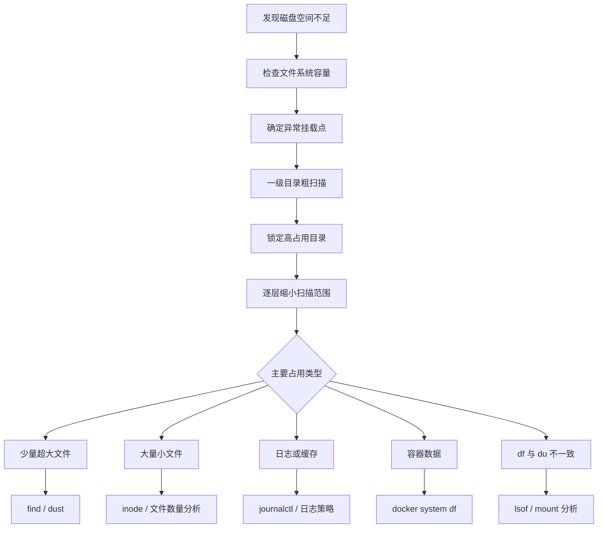
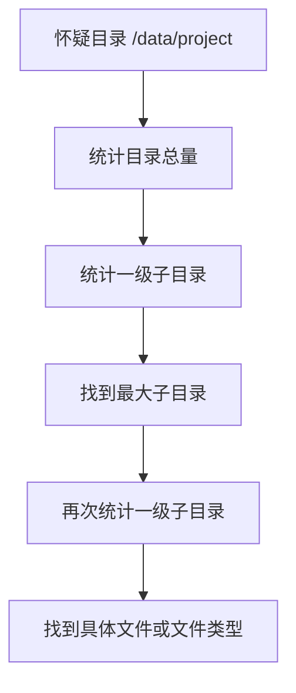
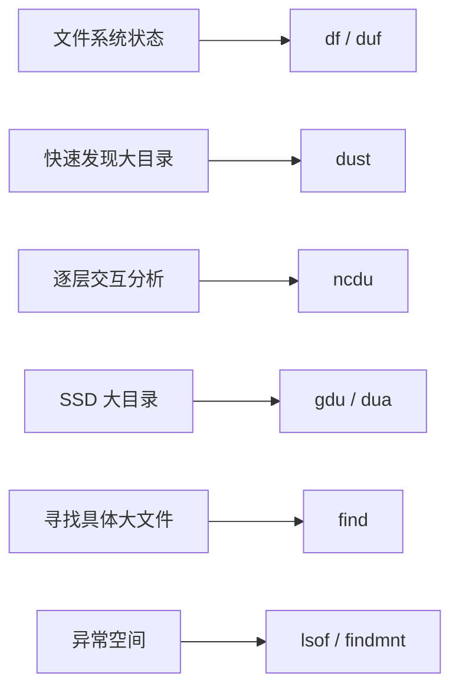

[toc]


## abstract

**先判断“哪块文件系统出问题”，再定位“哪个一级目录”，然后逐层缩小范围，最后分析“大文件、大量小文件、日志、容器、已删除未释放文件”等异常类型。**

在文件和目录非常多的服务器上，**扫描范围设计往往比“换一个更快的工具”更重要**。

------

- 磁盘占用分析到底在分析什么
- `df` 与 `du` 为什么经常对不上
- Linux 磁盘分析工具全景
- 传统工具 `df`、`du`、`find`
- 现代工具 `duf`、`dust`、`ncdu`、`gdu`、`dua`
- 大型服务器最高效的分析流程
- 已经怀疑某个目录时如何快速确认
- 如何排除不需要分析的目录
- 如何避免跨文件系统扫描
- 如何寻找超大文件
- 如何分析“海量小文件”
- inode 耗尽问题
- `df` 很满但 `du` 找不到空间的原因
- 已删除但仍被进程占用的文件
- 日志目录分析
- Docker 磁盘占用分析
- 扫描 SSD、HDD、NFS 时的性能策略
- 生产服务器低影响扫描
- 安全清理原则
- 一套推荐的实战命令流程
- 工具选择速查

------

## 先建立正确的磁盘分析模型

磁盘满时，新手最容易犯的错误是：

```bash
sudo du -ah / | sort -h
```

然后等待很久。

对于文件数量巨大的服务器，这通常是一个非常低效的起点。

真正应该回答的是四个不同的问题：

| 问题             | 关注对象                | 推荐工具                   |
| ---------------- | ----------------------- | -------------------------- |
| 哪块盘满了       | 文件系统 File System    | `df`、`duf`                |
| 哪个目录最大     | 目录树 Directory Tree   | `du`、`dust`               |
| 具体哪些文件最大 | 文件 File               | `find`、`dust -F`          |
| 为什么空间对不上 | 文件描述符、挂载、inode | `lsof`、`findmnt`、`df -i` |

可以把整个过程理解成：



核心原则是：

> **由粗到细，由文件系统到目录，由目录到文件。**

不要一上来扫描所有文件。

------

## `df` 和 `du` 分析的不是同一个东西

这是整个磁盘分析中最重要的基础知识。

### `df` 看文件系统

`df` 的目标是查看 **文件系统空间使用情况（File System Space Usage）**。

例如：

```bash
df -hT
```

可能看到：

```text
Filesystem     Type   Size  Used Avail Use% Mounted on
/dev/sda2      ext4    98G   89G  4.0G  96% /
/dev/sdb1      xfs    1.8T  1.2T  600G  67% /data
```

你立即可以知道：

```text
/
```

所在文件系统快满了。

GNU `df` 报告的是文件所在文件系统的容量和可用空间，而不是逐目录遍历计算。 ([man7.org](https://man7.org/linux/man-pages/man1/df.1.html?utm_source=chatgpt.com))

常用命令：

```bash
df -hT
```

参数含义：

| 参数 | 含义                         |
| ---- | ---------------------------- |
| `-h` | Human Readable，人类可读单位 |
| `-T` | 显示文件系统类型             |

另外建议：

```bash
df -ih
```

这里的：

```text
-i
```

表示分析 **inode（索引节点）**。

后面会详细解释 inode。

------

### `du` 看目录和文件

`du` 是：

> Disk Usage

它通过遍历目录树，统计目录中文件实际占用的文件系统空间。

例如：

```bash
du -sh /var
```

输出：

```text
38G    /var
```

因此：

```text
df
```

回答：

> 哪块文件系统满了？

而：

```text
du
```

回答：

> 哪些目录或文件占用了空间？

这是两个层次的问题。

------

## 磁盘分析工具全景

先建立工具地图。

| 工具      | 类型     | 最大特点           | 推荐场景            |
| --------- | -------- | ------------------ | ------------------- |
| `df`      | 基础工具 | 文件系统容量       | 第一步检查          |
| `du`      | 基础工具 | 精确目录统计       | 通用服务器          |
| `find`    | 基础工具 | 按条件搜索文件     | 找大文件            |
| `findmnt` | 基础工具 | 查询挂载关系       | 判断文件属于哪块盘  |
| `lsof`    | 系统工具 | 查看进程打开文件   | `df` 与 `du` 不一致 |
| `duf`     | 现代工具 | 更友好的 `df`      | 快速看磁盘          |
| `dust`    | 现代 CLI | 自动突出最大目录   | 快速发现大目录      |
| `ncdu`    | TUI      | 交互式目录浏览     | SSH 服务器          |
| `gdu`     | TUI      | 并行扫描           | SSD、大型目录       |
| `dua`     | TUI/CLI  | 并行分析与交互清理 | SSD、大目录         |

这里可以简单理解：

```text
df / duf
    文件系统层

du / dust
    目录分析层

ncdu / gdu / dua
    交互式分析层

find
    文件搜索层

lsof
    异常诊断层
```

------

## `df`：永远应该先运行的命令

推荐：

```bash
df -hT
```

例如：

```text
Filesystem     Type   Size  Used Avail Use% Mounted on
/dev/sda2      ext4   100G   95G  5.0G  95% /
/dev/sdb1      xfs    2.0T  800G  1.2T  40% /data
tmpfs          tmpfs   16G     0   16G   0% /dev/shm
```

这里已经非常清楚：

```text
/
```

存在问题。

因此后续应该分析：

```bash
/
```

而不是：

```bash
/data
```

这一点看起来简单，但在大型服务器上非常重要。

假设 `/data` 有：

```text
2 亿个文件
```

但它只使用了 40%。

扫描 `/data` 纯粹是浪费时间和 I/O。

------

## `duf`：现代化的 `df`

如果喜欢更现代的终端工具，可以使用：

```bash
duf
```

`duf` 提供分组、排序、文件系统过滤和 JSON 输出，本质上属于更友好的文件系统容量查看工具，而不是目录递归分析器。官方项目也将其定位为 Disk Usage/Free Utility。 ([GitHub](https://github.com/muesli/duf))

例如：

```bash
duf
```

或者只查看：

```bash
duf / /data
```

按使用量排序：

```bash
duf --sort usage
```

查看 inode：

```bash
duf --inodes
```

隐藏某些挂载点：

```bash
duf --hide-mp /boot,/dev
```

### 什么时候推荐 `duf`

日常服务器检查：

```bash
duf
```

体验通常比：

```bash
df -hT
```

更直观。

但是自动化脚本中，我仍然更推荐：

```bash
df
```

原因是：

- 基础系统普遍存在
- 输出语义成熟
- 不需要额外安装

------

## `du`：目录占用分析的核心工具

最经典的命令：

```bash
du -sh /var
```

表示：

```text
统计 /var 总占用
```

参数：

| 参数 | 含义                  |
| ---- | --------------------- |
| `-s` | summarize，只显示汇总 |
| `-h` | human-readable        |

但是：

```bash
du -sh /var
```

只能告诉你：

```text
/var 很大
```

无法告诉你：

```text
/var 下面谁最大
```

因此真正实用的是：

```bash
du -h --max-depth=1 /var
```

简写：

```bash
du -hd1 /var
```

GNU `du` 的 `--max-depth=1` 表示仅显示扫描根目录及其下一层目录的汇总；根目录本身视为深度 0。 ([GNU官方网站](https://www.gnu.org/software/coreutils/manual/coreutils.html))

例如：

```text
2.1G    /var/cache
1.8G    /var/lib
35G     /var/log
39G     /var
```

立即发现：

```text
/var/log
```

最值得分析。

然后继续：

```bash
du -hd1 /var/log
```

这就是：

> **逐层钻取（Drill Down）**

------

## 最推荐的 `du` 分析方式

我的推荐模板是：

```bash
du -xhd1 / 2>/dev/null | sort -h
```

然后：

```bash
du -xhd1 /var 2>/dev/null | sort -h
```

然后：

```bash
du -xhd1 /var/log 2>/dev/null | sort -h
```

假设最终发现：

```text
18G    /var/log/myapp
```

继续：

```bash
du -xhd1 /var/log/myapp 2>/dev/null | sort -h
```

整个分析过程：

```text
/
└── var
    └── log
        └── myapp
            └── archive
```

本质上是一个搜索树。

### 为什么这种方法效率高

假设服务器有：

```text
2 亿个文件
```

但你第一轮发现：

```text
/var = 800G
/home = 30G
/usr = 8G
```

目标只是清理 `/var`。

那么第二次直接：

```bash
du -xhd1 /var
```

后续根本不用分析：

```text
/home
/usr
```

也就是说：

> **每轮扫描都尽量减少搜索空间。**

------

## `-x` 是服务器分析中非常重要的参数

推荐：

```bash
du -xhd1 /
```

这里：

```text
-x
```

等价于：

```text
--one-file-system
```

意思是：

> 不跨文件系统。

GNU Coreutils 文档明确规定，`du -x` 会跳过位于不同文件系统上的目录。 ([GNU官方网站](https://www.gnu.org/software/coreutils/manual/coreutils.html))

假设：

```text
/
├── var
├── home
├── data
└── backup
```

实际挂载：

```text
/dev/sda2  /
/dev/sdb1  /data
10.0.0.10:/backup  /backup
```

运行：

```bash
du -hd1 /
```

可能进入：

```text
/data
/backup
```

甚至扫描远程 NFS。

但：

```bash
du -xhd1 /
```

只统计根文件系统。

这在服务器上非常重要。

### 一个原则

分析：

```text
/dev/sda2
```

时：

```bash
du -x ...
```

分析：

```text
/dev/sdb1
```

时：

```bash
du -x ... /data
```

即：

> **一个文件系统一个文件系统分析。**

------

## 如何确认某个目录属于哪块文件系统

使用：

```bash
findmnt -T /var/lib/docker
```

例如：

```text
TARGET SOURCE    FSTYPE OPTIONS
/      /dev/sda2 ext4   rw,relatime
```

说明：

```text
/var/lib/docker
```

属于：

```text
/dev/sda2
```

`findmnt --target` 可以接受普通文件或目录路径，并查找包含该路径的文件系统。 ([man7.org](https://man7.org/linux/man-pages/man8/findmnt.8.html))

推荐查看指定字段：

```bash
findmnt -T /var/lib/docker -o TARGET,SOURCE,FSTYPE,OPTIONS
```

大型服务器经常存在：

- bind mount
- NFS
- CephFS
- GlusterFS
- OverlayFS
- Docker mount
- Kubernetes volume

不要仅通过目录名字猜挂载关系。

------

## 已经怀疑某个目录时怎么做

假设你怀疑：

```text
/data/project
```

不要分析整个服务器。

直接：

```bash
du -xhd1 /data/project | sort -h
```

例如：

```text
5G      /data/project/code
12G     /data/project/result
600G    /data/project/cache
617G    /data/project
```

然后：

```bash
du -xhd1 /data/project/cache | sort -h
```

继续向下。

### 怀疑目录时的标准流程



命令：

```bash
du -sh /data/project
```

然后：

```bash
du -xhd1 /data/project | sort -h
```

然后：

```bash
du -xhd1 /data/project/cache | sort -h
```

------

## 不要习惯使用 `du -sh *`

很多教程喜欢：

```bash
du -sh *
```

问题之一是：

```text
*
```

默认不匹配隐藏文件。

例如：

```text
.cache
.local
.npm
.conda
```

可能完全不在结果中。

用户目录中，这些恰恰可能非常大。

例如：

```text
/home/user/.cache
/home/user/.conda
/home/user/.local
```

所以分析整个目录层级，我更推荐：

```bash
du -hd1 .
```

而不是：

```bash
du -sh *
```

------

## 如何排除不需要分析的目录

这是大型服务器中非常重要的能力。

### 使用 `du --exclude`

例如不分析缓存：

```bash
du -hd1 --exclude='cache' /data
```

排除所有 `.git`：

```bash
du -hd2 --exclude='.git' /data
```

排除日志文件：

```bash
du -ah --exclude='*.log' /data
```

GNU `du --exclude=pattern` 会在递归时跳过匹配模式的目录或文件；多个规则可以重复指定。 ([GNU官方网站](https://www.gnu.org/software/coreutils/manual/coreutils.html))

例如：

```bash
du -xhd2 \
    --exclude='.git' \
    --exclude='node_modules' \
    --exclude='cache' \
    /data
```

------

### 使用排除规则文件

目录很多时：

```bash
cat > exclude.txt <<'EOF'
.git
node_modules
cache
tmp
*.log
EOF
```

然后：

```bash
du -xhd2 --exclude-from=exclude.txt /data
```

对应参数：

```text
-X
--exclude-from
```

例如：

```bash
du -xhd2 -X exclude.txt /data
```

这种方式适合：

- 长期维护服务器
- 定期分析
- 自动化脚本

------

## 一个非常重要的原则：排除应该尽早发生

例如：

```text
/data
├── important
├── projects
└── backup
```

其中：

```text
backup = 30 TB
```

你已经知道：

```text
backup 不需要分析
```

不要：

```bash
du -h /data | grep -v backup
```

这是一个很常见的错误。

因为：

```text
grep -v
```

只是：

> 不显示结果。

但 `du` 之前已经把：

```text
/data/backup
```

完整扫描了。

正确方法：

```bash
du --exclude='backup' -hd2 /data
```

即：

> **在遍历阶段排除，而不是在输出阶段过滤。**

这是分析亿级文件目录时非常重要的性能原则。

------

## `dust`：最快速看出“大分支”的工具之一

`dust` 的设计目标就是：

> 不再手动组合 `du`、`sort`、`head`，直接给出最值得关注的目录分支。

官方说明中，`dust` 会优先展示最大的目录或文件，并智能向较大的目录树分支递归。 ([GitHub](https://github.com/bootandy/dust/blob/master/README.md))

使用：

```bash
dust /var
```

例如可能看到类似：

```text
  40G ┌── log
  12G ├── lib
 4.0G ├── cache
  58G └─┬ var
```

它非常适合：

> 我不知道哪里大，先让我看一眼。

### 显示更多结果

```bash
dust -n 30 /var
```

显示 30 项。

### 控制深度

```bash
dust -d 3 /var
```

### 只看目录

```bash
dust -D /var
```

### 只看文件

```bash
dust -F /var
```

这对于寻找大文件非常方便。

### 不跨文件系统

```bash
dust -x /
```

### 排除指定名字

```bash
dust -X node_modules /data
```

### 排除正则匹配

例如忽略 `.log`：

```bash
dust -v '\.log$' /data
```

### 设置最低大小

例如只关注大于 1 GiB 的对象：

```bash
dust -z 1G /data
```

------

## 我什么时候推荐 `dust`

例如服务器报警：

```text
/data 95%
```

我会先：

```bash
dust -x -n 30 /data
```

如果只找大文件：

```bash
dust -x -F -n 50 /data
```

`dust` 很适合：

```text
发现异常
```

但不一定适合：

```text
长期交互式浏览目录
```

后者更推荐：

```text
ncdu
gdu
dua
```

------

## `ncdu`：SSH 服务器非常实用的工具

`ncdu`：

> NCurses Disk Usage

是终端交互式磁盘分析工具。

使用：

```bash
ncdu /var
```

然后在终端中：

```text
/var
  35.0 GiB [##########] log
   8.2 GiB [##        ] lib
   2.1 GiB [          ] cache
```

可以使用方向键：

```text
进入目录
返回上级
排序
查看文件
```

`ncdu` 官方手册将其定位为基于 curses 的 `du` 类工具，并支持单文件系统、排除规则以及扫描结果导出和重新载入。 ([Yorhel的项目](https://dev.yorhel.nl/ncdu/man/1_19?utm_source=chatgpt.com))

### 基本使用

```bash
ncdu /data
```

### 不跨文件系统

```bash
ncdu -x /
```

我非常推荐服务器使用：

```bash
ncdu -x /
```

而不是：

```bash
ncdu /
```

------

### 只读模式

生产服务器建议：

```bash
ncdu -r -x /
```

这里：

```text
-r
```

用于只读浏览。

原因是 `ncdu` 的交互界面可以提供删除能力。

对于生产服务器：

> **分析工具和删除操作最好分离。**

推荐：

```text
ncdu 只负责发现
```

然后：

```text
rm
systemctl
journalctl
docker
```

负责实际处理。

------

### 排除目录

例如：

```bash
ncdu -x \
    --exclude node_modules \
    --exclude .git \
    /data
```

规则很多：

```bash
ncdu -x -X excludes.txt /data
```

------

### 扫描一次，以后慢慢分析

这是 `ncdu` 在大型服务器上的一个非常有价值的功能。

扫描：

```bash
ncdu -x -o scan.ncdu /data
```

以后打开：

```bash
ncdu -f scan.ncdu
```

扫描数据导出后可以脱离原始目录树进行浏览；官方手册同时明确指出，导入的扫描结果会禁用刷新、删除和 shell 操作，以避免把历史扫描数据误认为实时文件系统。 ([Yorhel的项目](https://dev.yorhel.nl/ncdu/man/1_19?utm_source=chatgpt.com))

例如：

```text
生产服务器
    扫描一次

scan.ncdu
    保存结果

分析机器
    慢慢查看
```

甚至可以：

```bash
ncdu -x -o- /data | gzip > scan.ncdu.gz
```

分析：

```bash
zcat scan.ncdu.gz | ncdu -f-
```

对于百万、千万级文件：

> **不要每次发现一个问题就重新扫描整个目录。**

扫描结果复用非常重要。

------

## `gdu`：SSD 大型目录扫描值得重点考虑

`gdu` 是 Go 编写的磁盘分析工具。

官方项目明确说明：

> 主要面向 SSD，通过并行处理充分利用存储能力。

同时，`gdu` 的非交互模式在不要求 `--top` 或 `--depth` 时，只追踪顶层目录总量，其目录树分析内存占用不会随完整树规模增长；需要完整树结构时才会建立目录树。 ([GitHub](https://github.com/dundee/gdu?utm_source=chatgpt.com))

使用：

```bash
gdu /data
```

### 忽略目录

例如：

```bash
gdu -i /data/backup,/data/cache /data
```

`gdu` 官方支持：

```text
--ignore-dirs
```

路径既可以是绝对路径，也可以是相对于当前目录的路径。当前官方文档列出的默认忽略目录包括 `/proc`、`/dev`、`/sys` 和 `/run`。 ([GitHub](https://github.com/dundee/gdu))

也可以使用路径模式：

```bash
gdu --ignore-dirs-pattern '*/node_modules/*' /data
```

实际语法请以：

```bash
gdu --help
```

显示的当前版本规则为准。

------

### 只显示最大的对象

例如：

```bash
gdu --top 50 /data
```

### 限制目录深度

```bash
gdu --depth 2 /data
```

### 导出扫描结果

```bash
gdu -o report.json /data
```

载入：

```bash
gdu -f report.json
```

压缩：

```bash
gdu -o- /data | gzip -c > report.json.gz
```

查看：

```bash
zcat report.json.gz | gdu -f-
```

`gdu` 还支持将扫描数据存入 SQLite 或 BadgerDB，再加载已有分析数据，而无需重新遍历目录。 ([GitHub](https://github.com/dundee/gdu))

例如：

```bash
gdu --db analysis.sqlite /data
```

以后：

```bash
gdu -r --db analysis.sqlite /
```

对于大型服务器，这种：

> **扫描与浏览分离**

的思想非常值得采用。

------

## `dua`：并行扫描和交互清理

`dua`：

> Disk Usage Analyzer

官方说明明确指出其默认并行扫描，并以充分利用 SSD 扫描能力作为设计重点。 ([GitHub](https://github.com/byron/dua-cli))

基本使用：

```bash
dua /data
```

当前目录：

```bash
dua
```

交互模式：

```bash
dua i
```

或者：

```bash
dua interactive
```

官方文档说明交互模式用于探索目录，也支持通过多阶段流程删除文件和目录。 ([GitHub](https://github.com/byron/dua-cli))

我的建议仍然是：

生产服务器先：

```text
分析
```

确认后再用对应服务工具清理。

不要养成：

```text
看到大目录
立即按删除
```

的习惯。

------

## 现代工具应该怎么选

### SSH 登录服务器快速找问题

推荐：

```text
ncdu
```

原因：

- 操作简单
- 交互清楚
- 支持导入导出
- 排除目录方便

推荐命令：

```bash
ncdu -r -x /
```

------

### SSD 上目录非常大

优先尝试：

```text
gdu
```

或者：

```text
dua
```

两者官方都明确采用并行扫描思路，并强调 SSD 场景。 ([GitHub](https://github.com/byron/dua-cli))

------

### 只是想一分钟看出谁最大

推荐：

```text
dust
```

例如：

```bash
dust -x -n 30 /data
```

------

### 只允许系统自带工具

推荐：

```text
df
du
find
findmnt
```

完全够用。

------

## 服务器文件非常多时，最高效的分析流程

下面是我最推荐的一套流程。

### 先确定哪块文件系统满

```bash
df -hT
```

再检查 inode：

```bash
df -ih
```

假设：

```text
/dev/sda2  95%  /
```

只分析：

```text
/
```

------

### 查看根目录一级占用

```bash
sudo du -xhd1 / 2>/dev/null | sort -h
```

假设结果：

```text
1.2G    /opt
4.8G    /usr
8.3G    /home
75G     /var
91G     /
```

目标：

```text
/var
```

------

### 缩小到 `/var`

```bash
sudo du -xhd1 /var 2>/dev/null | sort -h
```

结果：

```text
2.0G    /var/cache
12G     /var/lib
58G     /var/log
```

目标：

```text
/var/log
```

------

### 分析 `/var/log`

```bash
sudo du -xhd1 /var/log 2>/dev/null | sort -h
```

例如：

```text
1.2G    /var/log/journal
52G     /var/log/myapp
```

然后：

```bash
sudo du -xhd1 /var/log/myapp 2>/dev/null | sort -h
```

------

### 查看具体超大文件

```bash
find /var/log/myapp -xdev -type f -size +1G -print
```

显示大小：

```bash
find /var/log/myapp -xdev -type f -size +1G \
    -printf '%s\t%p\n' | sort -n
```

例如：

```text
5368709120    /var/log/myapp/app.log
21474836480   /var/log/myapp/debug.log
```

------

## 使用 `find` 寻找超大文件

例如找超过：

```text
10 GiB
```

的文件：

```bash
find /data -xdev -type f -size +10G -print
```

超过：

```text
1 GiB
```

：

```bash
find /data -xdev -type f -size +1G -print
```

### 同时显示字节大小

```bash
find /data -xdev -type f -size +1G \
    -printf '%s\t%p\n' | sort -n
```

查看最大的 50 个：

```bash
find /data -xdev -type f -printf '%s\t%p\n' \
    | sort -n \
    | tail -n 50
```

这个命令非常经典。

但是有一个问题：

> 如果服务器有 2 亿个文件，`sort` 需要处理 2 亿行。

因此不要无脑：

```bash
find / -type f -printf ...
```

更推荐：

```bash
find /var/log -xdev -type f -size +1G ...
```

先设置大小门槛：

```text
-size +1G
```

大幅减少输出。

------

## 文件数量巨大时，不要轻易全局排序

假设：

```text
100,000,000 个文件
```

下面的命令：

```bash
find /data -type f -printf '%s %p\n' | sort -n
```

存在两个巨大成本：

```text
find
    遍历一亿文件

sort
    排序一亿行
```

这属于：

> 全量扫描 + 全量排序。

更好的方法是：

```bash
find /data -xdev -type f -size +10G -printf '%s\t%p\n'
```

如果结果只有：

```text
500 个文件
```

再：

```bash
sort -n
```

即：

```bash
find /data -xdev -type f -size +10G \
    -printf '%s\t%p\n' | sort -n
```

这是典型的：

> **先过滤，再排序。**

------

## 大文件和大目录是两个不同的问题

例如：

```text
/data/cache = 1 TB
```

可能是：

### 情况 A

```text
1 个 1 TB 文件
```

这种情况：

```bash
find
```

非常容易定位。

### 情况 B

```text
10 亿个 1 KB 文件
```

单文件搜索：

```bash
find -size +1G
```

结果：

```text
0
```

但目录依然巨大。

因此：

```text
大目录
```

不等于：

```text
大文件
```

分析应该同时考虑：


------

## 海量小文件怎么分析

首先：

```bash
df -ih
```

例如：

```text
Filesystem     Inodes IUsed IFree IUse% Mounted on
/dev/sda2        6.4M  6.3M  100K   99% /
```

这表示：

```text
磁盘容量可能还有空间
```

但是：

```text
inode 快耗尽
```

GNU `df -i` 查看 inode 使用，而 GNU `du --inodes` 可以根据目录树中的 inode 数量分析哪些目录包含大量文件。 ([GNU官方网站](https://www.gnu.org/software/coreutils/manual/coreutils.html))

------

## inode 是什么

inode：

> Index Node，索引节点。

可以粗略理解为：

```text
每个文件或目录
    需要一个文件系统元数据记录
```

inode 包含诸如：

- 文件所有者
- 权限
- 时间信息
- 数据位置相关信息

因此：

```text
1000 万个 1 KB 文件
```

可能只占：

```text
约 10 GB 文件内容
```

但却消耗：

```text
1000 万个 inode
```

于是可能出现：

```bash
df -h
```

显示：

```text
磁盘还有 100G
```

但是创建文件失败：

```text
No space left on device
```

原因：

```text
inode 耗尽
```

------

## 用 `du --inodes` 找海量小文件目录

推荐：

```bash
du --inodes -x -d1 / | sort -n
```

例如：

```text
1234       /usr
28301      /home
5800000    /var
```

继续：

```bash
du --inodes -x -d1 /var | sort -n
```

例如：

```text
3000       /var/cache
5750000    /var/spool
```

继续：

```bash
du --inodes -x -d1 /var/spool | sort -n
```

这个思路与空间分析完全一样：

```text
空间分析
du -xhd1

文件数量分析
du --inodes -x -d1
```

GNU `du` 甚至支持 inode 阈值过滤，例如官方文档给出了对根文件系统查找 inode 数超过特定阈值的目录树统计方法。 ([GNU官方网站](https://www.gnu.org/software/coreutils/manual/coreutils.html))

例如：

```bash
du --inodes -x --threshold=100000 /var
```

------

## `du` 的“实际占用”和“表面大小”

这里涉及一个重要概念：

> Apparent Size

中文通常称：

- 表面大小
- 逻辑大小
- 文件长度

例如：

```bash
ls -lh file.img
```

显示：

```text
100G file.img
```

但：

```bash
du -h file.img
```

可能显示：

```text
4.0K file.img
```

原因可能是：

> Sparse File，稀疏文件。

GNU Coreutils 对 `--apparent-size` 的定义是文件逻辑长度；默认 `du` 更关注文件系统报告的空间使用。官方示例明确说明，一个逻辑大小为 2 GiB 的稀疏文件可能几乎不占实际磁盘块。 ([GNU官方网站](https://www.gnu.org/software/coreutils/manual/coreutils.html))

例如：

```bash
truncate -s 100G test.img
```

查看：

```bash
ls -lh test.img
```

可能：

```text
100G
```

但：

```bash
du -h test.img
```

可能：

```text
0
```

比较：

```bash
du -h test.img
```

实际磁盘占用。

```bash
du -h --apparent-size test.img
```

逻辑大小。

------

## 为什么清理磁盘时通常看默认 `du`

因为你的目标是：

> 释放真正的文件系统空间。

因此通常：

```bash
du
```

比：

```bash
du --apparent-size
```

更符合磁盘清理目标。

例如：

```text
虚拟机稀疏镜像
数据库稀疏文件
容器 sparse file
```

逻辑大小：

```text
1 TB
```

实际占用：

```text
100 GB
```

删除它真正释放的空间，更接近：

```text
du
```

看到的占用。

------

## `df` 很满，但 `du` 找不到空间

这是运维中非常经典的问题。

例如：

```bash
df -h /
```

显示：

```text
Used 95G
```

但是：

```bash
du -xsh /
```

显示：

```text
60G
```

差：

```text
35G
```

这时不要继续盲目：

```bash
du
du
du
```

因为问题可能根本不在可见目录树。

常见原因包括：

| 原因               | 说明                   |
| ------------------ | ---------------------- |
| 已删除文件仍被打开 | 进程持有文件描述符     |
| 挂载覆盖目录       | 原目录内容被新挂载隐藏 |
| 文件系统预留空间   | 文件系统层面保留       |
| 快照或 CoW         | Btrfs、ZFS 等          |
| 容器 OverlayFS     | 容器存储层统计复杂     |
| 权限问题           | `du` 未读取部分目录    |

其中最经典的是：

> Deleted but Open File

------

## 已删除但仍被进程占用的文件

假设应用：

```text
app
```

正在写：

```text
/var/log/app.log
```

文件已经达到：

```text
100 GB
```

管理员运行：

```bash
rm /var/log/app.log
```

目录中：

```text
app.log
```

消失了。

但是应用仍然保持：

```text
file descriptor
```

文件可能继续存在于文件系统中。

所以：

```bash
du
```

找不到。

但：

```bash
df
```

空间没有释放。

Linux 上 `lsof` 用于列出进程当前打开的文件；打开文件与路径名称是两个相关但并不完全等价的概念，文件描述符仍可继续持有已经移除目录项的对象。 ([man7.org](https://man7.org/linux/man-pages/man8/lsof.8.html?utm_source=chatgpt.com))

检查：

```bash
sudo lsof +L1
```

常见输出：

```text
COMMAND  PID USER FD TYPE DEVICE SIZE/OFF NLINK NAME
java    1234 app  10w REG  8,2  80G      0 /var/log/app.log (deleted)
```

重点：

```text
(deleted)
```

和：

```text
80G
```

------

## 如何处理已删除未释放文件

首先确认进程：

```bash
ps -fp 1234
```

如果是 systemd 服务：

```bash
systemctl status myapp
```

正确做法通常是：

```bash
systemctl restart myapp
```

或者让应用：

```text
重新打开日志
```

例如某些服务支持：

```text
reload
reopen logs
```

当旧文件描述符关闭后：

```text
文件系统才真正释放空间
```

### 不推荐直接做什么

网上经常能看到：

```bash
echo > /proc/PID/fd/FD
```

虽然特定情况下能够截断打开文件，但对于：

- 数据库
- 写入偏移敏感应用
- 日志框架
- 多进程服务

可能产生应用层异常。

生产环境应该优先：

```text
识别服务
确认文件用途
通过服务正常重启或日志 reopen
```

------

## 挂载覆盖导致 `du` 看不到文件

假设：

```text
/data
```

原来有：

```text
500 GB
```

数据。

然后执行：

```bash
mount /dev/sdb1 /data
```

现在：

```text
/data
```

显示 `/dev/sdb1` 的内容。

原来的：

```text
500 GB
```

仍在根文件系统。

但是被新挂载：

```text
遮挡
```

正常：

```bash
du /
```

很难从当前目录视图看到原数据。

检查：

```bash
findmnt -T /data
```

查看挂载树：

```bash
findmnt
```

`findmnt` 会从内核挂载信息等来源查询当前挂载关系，并默认以树状方式显示挂载文件系统。 ([man7.org](https://man7.org/linux/man-pages/man8/findmnt.8.html))

这种情况应在维护窗口：

```text
停止相关服务
卸载挂载点
检查底层目录
```

不要在生产系统中随意：

```bash
umount /data
```

------

## 日志目录应该怎样分析

首先：

```bash
du -xhd1 /var/log | sort -h
```

寻找：

```text
journal
应用日志
审计日志
容器日志
```

### 查看 systemd journal

```bash
journalctl --disk-usage
```

systemd 官方文档提供：

```text
--disk-usage
```

用于查看 journal 当前磁盘占用。 ([自由桌面](https://www.freedesktop.org/software/systemd/man/journalctl.html?utm_source=chatgpt.com))

例如：

```text
Archived and active journals take up 12.0G
```

清理到：

```text
2G
```

：

```bash
sudo journalctl --vacuum-size=2G
```

清理较旧日志：

```bash
sudo journalctl --vacuum-time=7d
```

`--vacuum-size` 删除最旧的归档 journal，直到归档日志下降到指定大小附近；需要注意其针对归档 journal，而 `--disk-usage` 统计还包括活动 journal，因此两者数字不一定完全相同。 ([自由桌面](https://www.freedesktop.org/software/systemd/man/journalctl.html?utm_source=chatgpt.com))

### 长期限制 journal

配置：

```text
/etc/systemd/journald.conf
```

例如关注：

```text
SystemMaxUse=
SystemKeepFree=
```

systemd 官方文档说明 `SystemMaxUse=` 控制持久 journal 最大空间，而 `SystemKeepFree=` 用于为文件系统保留可用空间。 ([自由桌面](https://www.freedesktop.org/software/systemd/man/journald.conf.html?utm_source=chatgpt.com))

修改后应根据系统版本和部署规范重新加载或重启对应 journal 服务。

------

## 不要直接 `rm -rf /var/log/*`

这是典型的危险操作。

原因包括：

- 服务可能依赖目录存在
- 日志目录权限可能特殊
- SELinux 上下文可能特殊
- 某些程序仍持有打开文件
- 删除 journal 文件不如使用 journal 工具
- logrotate 状态可能受到影响

更好的思路是：

```text
systemd journal
    journalctl

应用日志
    logrotate / 应用自身策略

Docker
    Docker 日志策略

数据库
    数据库自身日志管理机制
```

即：

> **由产生数据的系统管理数据。**

------

## Docker 磁盘占用怎么分析

如果发现：

```text
/var/lib/docker
```

很大，不要第一反应：

```bash
rm -rf /var/lib/docker/*
```

这是非常危险的。

首先：

```bash
docker system df
```

Docker 官方定义该命令为查看 Docker daemon 使用的磁盘空间。 ([Docker Documentation](https://docs.docker.com/reference/cli/docker/system/df/?utm_source=chatgpt.com))

详细：

```bash
docker system df -v
```

分析：

```text
Images
Containers
Local Volumes
Build Cache
```

------

### 查看未使用资源

根据实际情况：

```bash
docker image prune
```

清理 dangling image。

更激进：

```bash
docker image prune -a
```

Docker 官方警告，`-a` 会删除没有至少一个容器关联的镜像。 ([Docker Documentation](https://docs.docker.com/reference/cli/docker/image/prune/?utm_source=chatgpt.com))

容器：

```bash
docker container prune
```

volume：

```bash
docker volume prune
```

系统：

```bash
docker system prune
```

Docker 官方说明 `docker system prune` 会清理未使用的容器、网络、镜像及构建缓存；volume 默认并不会随系统 prune 一起删除，除非明确加入对应选项。 ([Docker Documentation](https://docs.docker.com/reference/cli/docker/system/prune/?utm_source=chatgpt.com))

例如：

```bash
docker system prune --volumes
```

必须非常谨慎。

### 我的推荐顺序

```text
docker system df -v
        |
        v
确定谁占空间
        |
        v
image prune / container prune
        |
        v
确认 volume
        |
        v
最后才考虑 system prune
```

不要把：

```bash
docker system prune -a --volumes
```

当作日常清理命令。

------

## 容器日志也是常见大户

查看：

```bash
du -xhd2 /var/lib/docker/containers | sort -h
```

或者找大的 JSON 日志：

```bash
find /var/lib/docker/containers \
    -type f \
    -name '*-json.log' \
    -size +1G \
    -printf '%s\t%p\n' \
    | sort -n
```

如果频繁出现：

```text
20G
50G
100G
```

容器日志，应解决：

```text
日志轮转配置
```

而不是每天手工：

```text
删除日志
```

磁盘清理最好的结果不是：

> 今天多出 100 GB。

而是：

> 下个月不会再次出现相同问题。

------

## SSD、HDD、NFS 的扫描策略不同

### SSD

特点：

```text
随机访问成本相对低
并发能力较强
```

可以优先尝试：

```text
gdu
dua
```

这两类工具明确采用并行扫描设计并强调 SSD 利用率。 ([GitHub](https://github.com/byron/dua-cli))

例如：

```bash
gdu /data
```

------

### HDD

机械硬盘：

```text
大量随机目录访问
```

可能导致磁头频繁寻道。

这时：

```text
线程更多
```

并不必然：

```text
更快
```

我更倾向：

```text
du
ncdu
```

加上：

```text
缩小扫描范围
```

比如不要：

```bash
gdu /
```

而是先：

```bash
df -hT
```

然后：

```bash
du -xhd1 /data
```

锁定目录。

------

### NFS、CephFS 等远程文件系统

最需要谨慎。

一个：

```text
stat()
```

可能涉及：

```text
网络请求
元数据服务器
```

亿级文件扫描可能对：

- NFS Server
- Metadata Server
- 网络
- 其他客户端

造成压力。

所以首先：

```bash
findmnt -T /path
```

确认文件系统。

GNU Findutils 文档也明确讨论了利用文件系统类型和剪枝规则避免搜索不希望进入的远程文件系统。 ([GNU官方网站](https://www.gnu.org/software/findutils/manual/html_node/find_html/Filesystems.html?utm_source=chatgpt.com))

对于远程存储：

> **更应该使用范围限制和目录排除。**

例如：

```bash
du -hd1 /mnt/nfs/projectA
```

不要轻易：

```bash
du -h /mnt/nfs
```

------

## 生产服务器如何降低扫描影响

目录扫描本质上可能产生大量：

```text
metadata I/O
```

因此线上服务器应避免高峰期疯狂扫描。

### 使用 `nice`

例如：

```bash
nice -n 19 du -xhd1 /data
```

降低 CPU 调度优先级。

### 使用 `ionice`

例如：

```bash
ionice -c 3 du -xhd1 /data
```

`ionice` 用于设置或查询进程的 I/O 调度类别和优先级。 ([man7.org](https://man7.org/linux/man-pages/man1/ionice.1.html?utm_source=chatgpt.com))

组合：

```bash
nice -n 19 ionice -c 3 du -xhd1 /data
```

但是需要注意：

> `ionice` 的实际效果受到 Linux 内核、块设备和 I/O 调度器配置影响。

不能把它理解为：

```text
用了 ionice 就完全不会影响业务
```

------

## 不要同时启动多个全盘扫描

例如：

终端 A：

```bash
du -h /
```

终端 B：

```bash
ncdu /
```

终端 C：

```bash
find / -type f
```

终端 D：

```bash
gdu /
```

这实际上意味着：

```text
四次遍历
```

尤其在：

```text
HDD
NFS
CephFS
```

上可能非常糟糕。

推荐：

```text
扫描一次
```

保存结果。

例如：

```bash
ncdu -o scan.ncdu /data
```

或者：

```bash
gdu -o report.json /data
```

然后反复分析。

------

## 为什么“限制深度”不一定意味着扫描更少

这是一个非常容易误解的问题。

例如：

```bash
du -d1 /data
```

有人认为：

> 只扫描一层，所以很快。

实际上为了计算：

```text
/data/project = 500 GB
```

`du` 仍然需要知道：

```text
/data/project
```

下面文件的占用。

所以：

```text
-d1
```

主要控制：

> 输出深度。

不等于：

> 只访问一层目录。

GNU `du` 文档对 `--max-depth` 的定义也是“显示不超过指定深度的统计结果”，并不是停止对子目录进行占用统计。 ([GNU官方网站](https://www.gnu.org/software/coreutils/manual/coreutils.html))

真正减少扫描量的方法是：

```text
缩小起始目录
排除目录
不跨文件系统
```

也就是：

```bash
du -x --exclude='backup' /data/project
```

而不是单纯：

```bash
du -d1 /
```

------

## 三种优化措施的本质区别

| 方法          | 减少磁盘扫描 | 减少输出 |
| ------------- | ------------ | -------- |
| `--max-depth` | 通常否       | 是       |
| `--exclude`   | 是           | 是       |
| `-x`          | 是           | 是       |
| 缩小起始目录  | 是           | 是       |
| `grep -v`     | 否           | 是       |
| `head`        | 通常否       | 是       |

例如：

```bash
du -ah / | head
```

不要认为只扫描了 10 个文件。

同样：

```bash
du -ah / | grep -v backup
```

并没有避免扫描 backup。

所以最重要的优化发生在：

> **遍历器进入目录之前。**

------

## 一个大型服务器的推荐分析案例

假设：

```text
根分区 98%
服务器文件数量巨大
怀疑 Docker 和日志
/data 是独立 20 TB 文件系统
```

### 查看文件系统

```bash
df -hT
```

结果：

```text
/dev/sda2    ext4    100G    98G    2G    98% /
/dev/sdb1    xfs      20T     9T   11T    45% /data
```

立即得出：

```text
不要扫描 /data
```

------

### 检查 inode

```bash
df -ih /
```

假设：

```text
IUse% 15%
```

说明不是 inode 问题。

------

### 一级目录

```bash
sudo du -xhd1 / 2>/dev/null | sort -h
```

结果：

```text
3G      /usr
8G      /home
82G     /var
```

------

### 查看 `/var`

```bash
sudo du -xhd1 /var 2>/dev/null | sort -h
```

结果：

```text
4G      /var/log
76G     /var/lib
```

------

### 查看 `/var/lib`

```bash
sudo du -xhd1 /var/lib 2>/dev/null | sort -h
```

结果：

```text
72G     /var/lib/docker
```

------

### 使用 Docker 自己的工具

```bash
docker system df -v
```

发现：

```text
Build Cache    45GB
Unused Images  20GB
```

然后根据业务情况分别处理。

这个流程只进行了：

```text
/
    第一层

/var
    第一层

/var/lib
    第一层
```

最后转交 Docker 工具。

这比：

```bash
du -ah / | sort -h
```

合理得多。

------

## 清理前一定要区分“文件类型”和“数据所有者”

建议建立一个意识：

| 目录               | 应优先使用的管理方式     |
| ------------------ | ------------------------ |
| `/var/log/journal` | `journalctl`             |
| Docker 数据        | Docker CLI               |
| 包缓存             | 包管理器                 |
| 数据库数据         | 数据库工具               |
| 应用日志           | logrotate 或应用日志策略 |
| 临时业务文件       | 业务确认后删除           |
| 用户文件           | 用户确认                 |
| Core dump          | coredump 管理工具        |

例如：

```text
看到 /var/lib/docker 100G
```

不要：

```bash
rm -rf /var/lib/docker/*
```

看到：

```text
PostgreSQL WAL 100G
```

不要：

```bash
rm -f pg_wal/*
```

看到：

```text
journal 30G
```

优先：

```bash
journalctl --vacuum-size
```

核心原则：

> **谁创建数据，优先让谁管理数据。**

------

## 一套我最推荐的服务器磁盘分析命令

发现磁盘报警后，我通常按下面顺序。

### 文件系统空间

```bash
df -hT
```

### inode

```bash
df -ih
```

### 查询问题路径所在文件系统

```bash
findmnt -T /path/to/check -o TARGET,SOURCE,FSTYPE,OPTIONS
```

### 一级目录分析

```bash
sudo du -xhd1 /path 2>/dev/null | sort -h
```

### 继续进入大目录

```bash
sudo du -xhd1 /path/big-directory 2>/dev/null | sort -h
```

### 搜索超过 1 GiB 的文件

```bash
find /path -xdev -type f -size +1G \
    -printf '%s\t%p\n' | sort -n
```

### inode 目录分析

```bash
du --inodes -x -d1 /path | sort -n
```

### 检查已删除未释放文件

```bash
sudo lsof +L1
```

### systemd 日志

```bash
journalctl --disk-usage
```

### Docker

```bash
docker system df -v
```

### 现代快速目录分析

```bash
dust -x -n 30 /path
```

或者：

```bash
ncdu -r -x /path
```

SSD 大目录：

```bash
gdu /path
```

------

## 我的工具推荐组合

对于普通 Linux 服务器，我建议掌握：

```text
df
du
find
findmnt
lsof
```

安装：

```text
ncdu
dust
```

SSD 大型存储服务器再增加：

```text
gdu
```

也就是说：



------

## 最终工具选择速查

| 我的需求            | 首选                      |
| ------------------- | ------------------------- |
| 哪块盘满            | `df -hT`                  |
| 界面更漂亮地看磁盘  | `duf`                     |
| 哪个一级目录最大    | `du -xhd1`                |
| 快速看到最大目录树  | `dust`                    |
| SSH 交互式分析      | `ncdu`                    |
| SSD 上快速扫描      | `gdu`                     |
| 并行扫描和交互分析  | `dua`                     |
| 找超过 10G 文件     | `find -size +10G`         |
| inode 满            | `df -i`、`du --inodes`    |
| `df` 与 `du` 对不上 | `lsof +L1`                |
| 判断目录属于哪块盘  | `findmnt -T`              |
| journal 太大        | `journalctl --disk-usage` |
| Docker 太大         | `docker system df -v`     |

------

## 最值得记住的实践原则

不要从：

```bash
du -ah / | sort -h
```

开始。

推荐从：

```bash
df -hT
```

开始。

然后：

```bash
du -xhd1 /
```

再：

```bash
du -xhd1 /最大的目录
```

继续：

```bash
du -xhd1 /最大的目录/最大的子目录
```

直到定位。

如果文件系统规模非常大，则优先考虑：

- 明确挂载点
- 限制文件系统
- 缩小起始路径
- 提前排除目录
- 设置大小阈值
- 避免全量排序
- 扫描结果复用

可以把这套方法浓缩成一句话：

> **先用 `df` 找盘，用 `du` 或 `dust` 找目录，用 `find` 找文件；目录巨大时逐层缩小，SSD 可以用 `gdu` 或 `dua` 加速，SSH 交互优先 `ncdu`；如果 `df` 和 `du` 对不上，立刻转向 `lsof` 和挂载关系分析，而不是继续重复扫描。**