[toc]


下面给出一套以 **Linux 为主、面向“快速定位磁盘占用并安全清理空间”** 的系统教程。

我建议不要把“磁盘分析”简单理解为“学会 `du`”。更准确的思路是：

> **先确定哪个文件系统有问题，再确定哪个目录增长，再确定具体文件或资源类型，最后使用对应系统的清理机制。**

这套方法既适合个人 Linux 桌面，也适合服务器、开发机、Docker 主机和日常运维。

------

## 内容大纲

- 磁盘占用分析到底在分析什么
- `df` 与 `du` 为什么经常“对不上”
- 逻辑大小、实际占用、稀疏文件与共享数据
- 磁盘分析工具如何分类
- 现代化快速工具选型
  - `duf`
  - `dust`
  - `dua`
  - `gdu`
  - `ncdu`
  - `erdtree`
  - `diskonaut`
- 使用 `df` 判断哪个文件系统满了
- 使用 `du` 逐层定位大目录
- 使用现代工具快速分析目录树
- 查找超大文件
- 按文件类型、时间、用户分析空间
- inode 耗尽问题
- “文件删除了但空间没回来”的问题
- `/var`、日志、缓存等重点目录
- Docker 与容器磁盘占用
- Btrfs、快照与 CoW 文件系统
- 软件包缓存清理
- 一套推荐的磁盘排查流程
- 安全清理原则
- 常用命令速查

------

## 先建立正确的磁盘占用模型

Linux 中谈“磁盘占用”，实际上可能在讨论完全不同的问题。

| 问题                 | 真正要分析的对象         | 常用工具             |
| -------------------- | ------------------------ | -------------------- |
| 哪块盘快满了         | 文件系统容量             | `df`、`duf`          |
| 哪个目录最大         | 目录树累计占用           | `du`、`dust`         |
| 想交互式逐层查看     | 目录树                   | `ncdu`、`gdu`、`dua` |
| 哪些文件特别大       | 单文件                   | `find`               |
| 小文件太多           | inode                    | `df -i`              |
| 删除文件后空间没回来 | 打开的已删除文件         | `lsof`               |
| Docker 占空间        | 镜像、容器、卷、构建缓存 | `docker system df`   |
| Btrfs 空间异常       | extents、快照、共享空间  | `btrfs filesystem`   |
| 系统日志太大         | systemd journal          | `journalctl`         |

因此，第一条重要原则是：

> **不要看到磁盘满了，就直接执行 `du -ah /`。**

因为你甚至还没有确定：

- 是 `/` 满了；
- 还是 `/home` 满了；
- 还是 `/var` 单独挂载的文件系统满了；
- 还是 inode 满了；
- 或者是 Docker、Btrfs 快照、已删除文件造成的特殊占用。

正确的分析过程应该是：

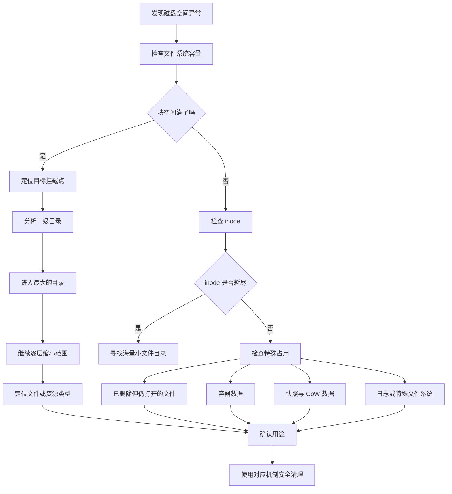

------

## `df` 和 `du` 到底有什么区别

这是理解 Linux 磁盘占用最重要的知识之一。

简单来说：

- `df` 问的是：**文件系统认为用了多少空间？**
- `du` 问的是：**从这个目录树遍历下来，文件占了多少空间？**

GNU Coreutils 将 `df` 定义为报告文件系统空间使用情况，而 `du` 会递归汇总文件或目录的设备占用。 ([man7.org](https://man7.org/linux/man-pages/man1/df.1.html?utm_source=chatgpt.com))

可以想象为：

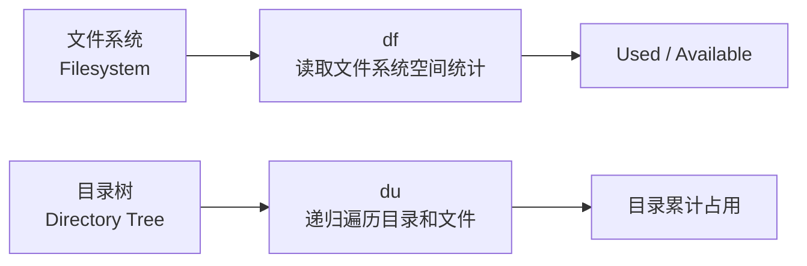

例如：

```bash
df -h /
```

得到：

```text
Filesystem      Size  Used Avail Use% Mounted on
/dev/nvme0n1p2  200G  180G   10G  95% /
```

这里告诉你：

> 根文件系统 `/` 已经使用 180 GB。

但是它没有告诉你：

> 这 180 GB 到底在哪里。

于是继续：

```bash
sudo du -xhd1 /
```

可能看到：

```text
8.0G    /usr
95G     /var
42G     /home
2.1G    /opt
148G    /
```

现在就知道应该调查：

```text
/var
```

然后：

```bash
sudo du -xhd1 /var
```

继续逐层缩小。

这就是最经典的：

> **文件系统定位 -> 目录定位 -> 文件定位**

分析模型。

------

## 理解逻辑大小与实际磁盘占用

分析磁盘时还有两个很容易混淆的概念。

### Apparent Size

表观大小、逻辑大小（Apparent Size / Logical Size）。

可以粗略理解为：

> 一个程序读取这个文件时，认为这个文件有多大。

例如：

```bash
ls -lh file.img
```

显示：

```text
100G file.img
```

逻辑大小是：

```text
100 GB
```

### Disk Usage

实际磁盘占用、设备占用（Disk Usage / Physical Usage）。

表示：

> 文件系统实际上给这个文件分配了多少存储空间。

GNU `du` 默认报告设备使用量；`--apparent-size` 则报告表观大小。官方文档特别指出，稀疏文件（Sparse File）等情况可能造成两者明显不同。 ([man7.org](https://man7.org/linux/man-pages/man1/du.1.html?utm_source=chatgpt.com))

例如：

```bash
truncate -s 100G test.img
```

查看：

```bash
ls -lh test.img
```

可能显示：

```text
100G test.img
```

但是：

```bash
du -h test.img
```

可能显示：

```text
0 test.img
```

再看：

```bash
du -h --apparent-size test.img
```

可能显示：

```text
100G test.img
```

原因是 `truncate` 可以创建一个 **稀疏文件（Sparse File）**。

逻辑上：

```text
文件长度 = 100 GB
```

物理上：

```text
实际分配数据块 ≈ 0
```

可以理解为：

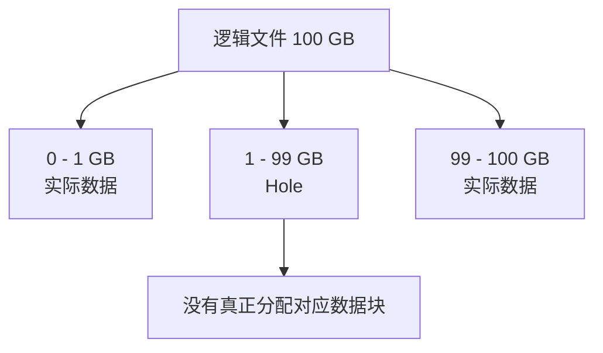

因此：

```bash
ls -lh
```

和：

```bash
du -h
```

回答的是不同问题。

### 实用判断

想知道：

> 删除这个文件大概能释放多少实际磁盘空间？

优先看：

```bash
du -h FILE
```

想知道：

> 应用程序看到的文件长度是多少？

可以看：

```bash
ls -lh FILE
```

或：

```bash
du --apparent-size -h FILE
```

现代工具 `dust` 也明确区分实际占用和 apparent size，并提供 `-s` 查看后者。 ([GitHub](https://github.com/bootandy/dust))

------

## 磁盘分析工具地图

目前比较实用的一组工具如下。

| 工具        | 定位         | 主要优势              | 推荐场景      |
| ----------- | ------------ | --------------------- | ------------- |
| `df`        | 文件系统容量 | 标准、普遍存在        | 第一轮检查    |
| `duf`       | 现代 `df`    | 输出清晰、排序、inode | 快速看磁盘    |
| `du`        | 目录占用     | 标准、脚本友好        | 通用分析      |
| `dust`      | 现代 `du`    | 自动突出大目录        | 快速定位      |
| `ncdu`      | TUI 分析器   | 稳定、简单、远程友好  | SSH 服务器    |
| `gdu`       | 高性能 TUI   | 并行扫描              | SSD、大目录树 |
| `dua`       | 高性能分析器 | 默认并行、交互模式    | SSD、开发机   |
| `erdtree`   | 文件系统分析 | 多线程、树形、元数据  | 开发目录      |
| `diskonaut` | Treemap TUI  | 可视化面积图          | 视觉分析      |
| `find`      | 文件筛选     | 条件能力极强          | 查大文件      |
| `fd`        | 现代文件搜索 | 并行遍历、语法友好    | 日常文件搜索  |

其中，`dua` 默认进行并行扫描，项目明确将充分利用 SSD；`gdu` 同样主要针对 SSD 的并行扫描优化，HDD 也可使用，但性能收益通常没有 SSD 明显。 ([GitHub](https://github.com/byron/dua-cli))

### 我的实际推荐

普通 Linux 用户：

```text
duf + dust + ncdu
```

服务器：

```text
df + du + ncdu
```

NVMe / SSD 开发机：

```text
duf + dust + gdu
```

超大代码目录：

```text
erdtree + gdu
```

Docker 主机：

```text
duf + gdu + docker system df
```

如果只能安装一个额外工具：

> **安装 `ncdu`。**

如果想要最快地“一眼看到大户”：

> **使用 `dust`。**

如果 SSD 中有数百万文件，需要尽量快地扫描：

> **考虑 `gdu` 或 `dua`。**

------

## 先用 `df` 找到出问题的文件系统

最基本的命令：

```bash
df -h
```

推荐：

```bash
df -hT
```

其中：

- `-h`：Human-readable，人类可读单位；
- `-T`：显示文件系统类型。

例如：

```text
Filesystem     Type   Size  Used Avail Use% Mounted on
/dev/nvme0n1p2 ext4   100G   92G  3.0G  97% /
/dev/nvme0n1p3 ext4   500G  180G  295G  38% /home
tmpfs          tmpfs   16G   20M   16G   1% /run
```

这里不要看到：

```text
/home 180G
```

就认为 `/home` 有问题。

真正应该优先关注：

```text
Use%
Avail
```

上例中：

```text
/       97%
/home   38%
```

因此问题是根文件系统 `/`。

`df` 官方定义就是报告文件所在文件系统的空间情况；不给参数时会显示当前挂载文件系统的统计。 ([man7.org](https://man7.org/linux/man-pages/man1/df.1.html?utm_source=chatgpt.com))

### 指定路径查询

非常实用：

```bash
df -h /var/lib/docker
```

或者：

```bash
df -h ~/Downloads
```

它回答的是：

> 这个路径位于哪个文件系统，这个文件系统还有多少空间？

例如：

```bash
df -h /var/lib/docker
```

比：

```bash
df -h
```

然后人工找挂载点更方便。

------

## 使用 `duf` 替代日常 `df`

`duf` 的定位非常明确：

> Disk Usage/Free Utility，现代化 `df` 替代工具。

项目支持按 size、used、available、usage、inode 等字段排序，也能够直接显示 inode 信息和 JSON 输出。 ([GitHub](https://github.com/muesli/duf))

直接运行：

```bash
duf
```

通常比：

```bash
df -hT
```

更加直观。

按使用率排序：

```bash
duf --sort usage
```

只显示关注字段：

```bash
duf --output mountpoint,size,used,avail,usage
```

查看 inode：

```bash
duf --inodes
```

自动化处理：

```bash
duf --json
```

### `duf` 不是什么

特别注意：

> `duf` 不是目录分析工具。

它回答：

```text
哪个文件系统满了？
```

不回答：

```text
/var 里面哪个目录最大？
```

所以经典组合是：

```text
duf
  |
  +-- 发现 / 快满
        |
        +-- dust /
             或
        +-- ncdu /
```

------

## 使用 `du` 逐层定位大目录

这是 Linux 上最应该掌握的方法。

### 查看当前目录总大小

```bash
du -sh .
```

解释：

- `-s`：summarize，只显示汇总；
- `-h`：human-readable。

例如：

```text
53G     .
```

### 查看指定目录

```bash
du -sh /var
```

### 查看一级子目录

```bash
du -h --max-depth=1 /var
```

GNU Coreutils 也支持短选项：

```bash
du -hd1 /var
```

GNU `du` 的 `--max-depth=N` 只显示距离起始参数不超过 N 层的汇总；`--max-depth=0` 等价于汇总模式。 ([man7.org](https://man7.org/linux/man-pages/man1/du.1.html?utm_source=chatgpt.com))

输出：

```text
1.2G    /var/cache
18G     /var/lib
5.4G    /var/log
200M    /var/tmp
25G     /var
```

现在知道：

```text
/var/lib
```

最大。

继续：

```bash
du -hd1 /var/lib
```

这就是所谓的：

> **逐层钻取（Drill Down）**

------

## 分析根目录时强烈建议使用 `-x`

经典命令：

```bash
sudo du -xhd1 /
```

这里最重要的是：

```text
-x
```

也就是：

```text
--one-file-system
```

含义：

> 不跨越文件系统边界。

GNU `du` 和 `ncdu` 都提供 one-file-system 语义；`ncdu -x` 明确表示扫描时不跨文件系统。 ([man7.org](https://man7.org/linux/man-pages/man1/du.1.html?utm_source=chatgpt.com))

假设：

```text
/
├── home
│   └── 实际挂载 /dev/nvme0n1p3
├── mnt
│   └── NAS
└── var
```

如果运行：

```bash
sudo du -hd1 /
```

可能连：

```text
/home
/mnt/nas
```

一起扫描。

结果可能是：

```text
8 TB /
```

但根文件系统实际上只有：

```text
100 GB
```

这是因为 `du` 穿过了挂载点。

所以调查：

```text
根文件系统为什么满
```

推荐：

```bash
sudo du -xhd1 /
```

其思想是：

```text
df 发现哪个文件系统满
             |
             v
du -x 只调查这个文件系统
```

这是非常重要的最佳实践。

------

## 推荐的 `du` 大目录定位命令

查看根目录一级占用：

```bash
sudo du -xhd1 / 2>/dev/null
```

排序：

```bash
sudo du -xhd1 / 2>/dev/null | sort -h
```

最大的显示在最后。

例如：

```text
4.0K    /mnt
16M     /etc
5.1G    /opt
12G     /usr
71G     /var
90G     /
```

进入 `/var`：

```bash
sudo du -xhd1 /var 2>/dev/null | sort -h
```

假设：

```text
500M    /var/cache
4.2G    /var/log
61G     /var/lib
66G     /var
```

继续：

```bash
sudo du -xhd1 /var/lib 2>/dev/null | sort -h
```

可能出现：

```text
2.4G    /var/lib/snapd
8.0G    /var/lib/flatpak
43G     /var/lib/docker
54G     /var/lib
```

那么问题已经基本定位：

```text
Docker
```

整个过程可能只有三条命令。

------

## 为什么不推荐一上来 `du -ah /`

很多教程喜欢：

```bash
du -ah / | sort -h
```

我不推荐把它当成第一步。

原因有几个。

### 输出量巨大

`-a` 表示显示所有文件。

如果系统有：

```text
3,000,000 个文件
```

就可能产生数百万行输出。

### 排序需要处理全部数据

```bash
sort
```

需要接收整个结果集。

### 容易跨挂载点

如果没有：

```text
-x
```

可能扫描：

- NAS；
- NFS；
- USB 磁盘；
- Docker mount；
- 其他文件系统。

### 信息密度低

真正的问题可能只是：

```text
/var/lib/docker
```

却遍历了整个系统。

正确方法是：

```text
df
 |
 v
du depth=1
 |
 v
最大目录
 |
 v
继续 depth=1
```

复杂度从“全盘找针”变成“二分式缩小范围”。

------

## `dust`：我最推荐的现代 `du`

`dust` 是 Rust 编写的现代目录占用分析工具，其设计目标就是：

> 不需要手工组合 `du + sort + head`，快速显示目录树中最大的空间消费者。

官方 README 表示，它会根据终端高度显示较大的目录或文件，并智能地向大目录递归。 ([GitHub](https://github.com/bootandy/dust))

直接：

```bash
dust
```

分析目录：

```bash
dust /var
```

限制显示数量：

```bash
dust -n 20 /var
```

查看 50 个主要空间消费者：

```bash
dust -n 50 /
```

限制目录深度：

```bash
dust -d 3 /var
```

只看目录：

```bash
dust -D /var
```

显示完整路径：

```bash
dust -p /var
```

### 为什么 `dust` 很适合新手

传统操作：

```bash
du -h --max-depth=2 /var | sort -h
```

使用 `dust`：

```bash
dust /var
```

核心价值不只是“命令短”。

而是它在做：


因此你更容易看到：

```text
/var
 ├─ lib
 │   └─ docker
 │       └─ overlay2
 └─ log
     └─ journal
```

而不是得到一大堆平铺行。

### 一个推荐习惯

发现根文件系统满：

```bash
dust -n 30 /
```

发现 `/var` 可疑：

```bash
dust -n 30 /var
```

发现 Docker：

```bash
dust -n 30 /var/lib/docker
```

不过，一旦确认是 Docker：

> 不建议继续手工删除 `/var/lib/docker` 下的文件。

应该切换到：

```bash
docker system df
```

后面会详细解释。

------

## `ncdu`：服务器上的经典选择

`ncdu` 的全称来自：

> NCurses Disk Usage

它是文本用户界面（Text User Interface，TUI）磁盘分析器，项目定位就是在没有完整图形桌面的远程服务器上寻找空间大户。 ([Yorhel](https://dev.yorhel.nl/ncdu?utm_source=chatgpt.com))

运行：

```bash
ncdu
```

分析根目录：

```bash
sudo ncdu /
```

更推荐：

```bash
sudo ncdu -x /
```

`-x`：

```text
只分析当前文件系统
```

这是服务器上非常经典的命令：

```bash
sudo ncdu -x /
```

然后使用键盘逐层进入目录。

### 为什么 `ncdu` 特别适合 SSH

它不需要：

- X11；
- Wayland；
- Web 服务；
- 浏览器。

只需要终端。

因此：

```text
SSH
 |
 v
ncdu
 |
 v
方向键浏览目录
```

非常自然。

### 排除目录

例如不分析缓存：

```bash
ncdu --exclude '.cache' /home
```

或者使用排除文件：

```bash
ncdu -X exclude.txt /home
```

`ncdu` 官方文档支持 `--exclude` 和 `--exclude-from` 等扫描过滤机制。 ([Yorhel](https://dev.yorhel.nl/ncdu/man?utm_source=chatgpt.com))

### 扫描大型服务器时

推荐：

```bash
sudo ncdu -x /
```

而不是：

```bash
sudo ncdu /
```

否则可能进入：

```text
/mnt/nfs
```

然后开始扫描整个 NAS。

------

## `gdu`：SSD 上非常实用的高速工具

`gdu` 是 Go 编写的磁盘使用分析器。

项目明确说明：

> 主要面向 SSD，可以充分利用并行处理；HDD 同样可以运行，但性能增益没有 SSD 那么明显。 ([GitHub](https://github.com/dundee/gdu))

运行：

```bash
gdu
```

指定目录：

```bash
gdu /var
```

根目录：

```bash
sudo gdu /
```

### 它适合什么机器

尤其适合：

```text
NVMe SSD
开发工作站
CI 构建服务器
大量 node_modules
大量 Python 环境
容器主机
大型代码仓库
```

例如目录结构：

```text
/home/user/projects
├── project-a/node_modules
├── project-b/node_modules
├── project-c/.venv
├── project-d/target
└── project-e/build
```

可能包含：

```text
数十万甚至数百万文件
```

在这种情况下，并行目录扫描工具通常比传统串行式目录分析体验更好。

### HDD 上为什么不一定越并行越快

机械硬盘（Hard Disk Drive，HDD）有机械寻道。

假设线程同时请求：

```text
目录 A
目录 Z
目录 B
目录 Y
```

磁头可能不断移动。

抽象来看：

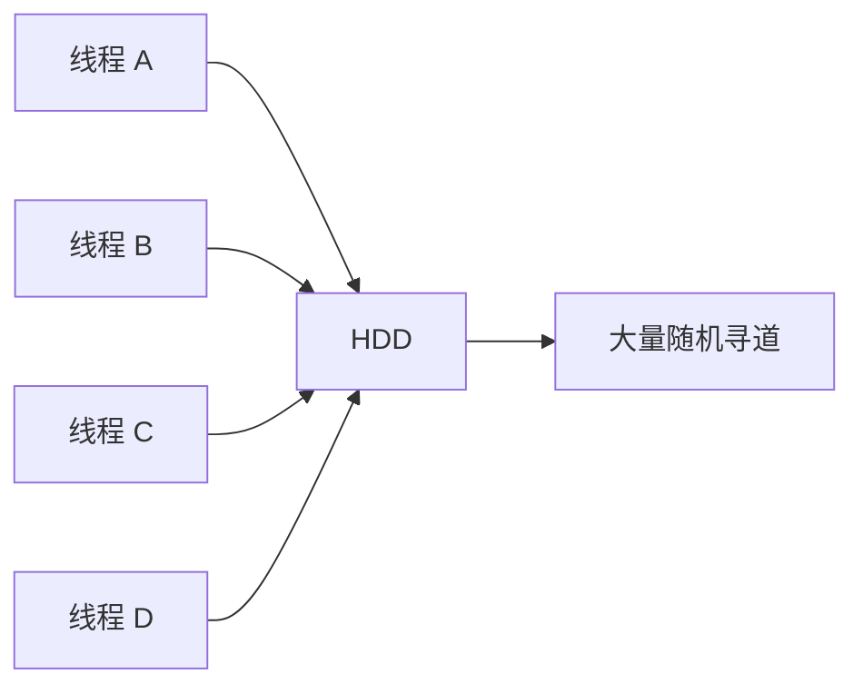

SSD 没有机械磁头。

因此大量并行元数据读取更容易获得收益。

所以：

> **现代并行磁盘分析工具的“快”通常与存储介质、目录结构、缓存状态和文件数量有关。**

不能简单理解为：

```text
Rust/Go 工具一定比 du 快十倍
```

------

## `dua`：并行分析与交互清理

`dua` 即：

> Disk Usage Analyzer

项目默认进行并行扫描，并明确表示会充分利用 SSD；它还可以进入交互模式分析和删除不需要的数据。 ([GitHub](https://github.com/byron/dua-cli))

基本分析：

```bash
dua
```

分析指定目录：

```bash
dua /home
```

交互模式通常使用：

```bash
dua interactive
```

### 适合的场景

例如：

```text
~/Downloads
~/Projects
~/Workspace
~/Data
```

开发机上经常出现：

```text
项目已经废弃
但 target 目录还有 30 GB

项目半年前不用了
但 node_modules 还有 5 GB

Python 环境已经不用
.venv 仍然有 8 GB
```

交互式分析比：

```bash
find
```

一个文件一个文件看更加自然。

### `dua` 和 `gdu` 怎么选

可以简单理解：

| 需求               | 推荐   |
| ------------------ | ------ |
| 快速 TUI 浏览      | `gdu`  |
| 并行扫描与交互清理 | `dua`  |
| 简单稳定服务器分析 | `ncdu` |
| 一眼看大目录       | `dust` |

我的习惯会是：

```text
dust 先定位
gdu 再深入
```

------

## `erdtree`：开发目录分析非常有意思

`erdtree`，命令通常是：

```bash
erd
```

它不仅是磁盘占用工具。

项目将自己描述为：

> `du`、`tree`、`find`、`wc` 和 `ls` 的一部分能力组合。

它是跨平台、多线程文件系统和磁盘分析工具，可以按逻辑或物理大小统计，并提供树形布局、元数据和搜索能力。 ([GitHub](https://github.com/solidiquis/erdtree))

例如：

```bash
erd
```

查看磁盘占用：

```bash
erd -H .
```

其磁盘使用模式可以区分：

```text
logical
physical
block
```

项目文档中对 physical 的定义会考虑块、稀疏文件和压缩等因素。 ([GitHub](https://github.com/solidiquis/erdtree))

### 特别适合代码仓库

例如：

```text
project/
├── src/
├── target/
├── node_modules/
├── .git/
└── build/
```

传统：

```bash
du -hd2 .
```

只是告诉你大小。

`erdtree` 更偏向：

```text
文件系统结构分析
+
大小分析
+
文件元数据分析
```

### 一个重要注意事项

`erdtree` 默认意识到：

```text
.gitignore
隐藏文件规则
```

项目文档明确说明默认尊重 `.gitignore`，并提供 `--no-ignore` 关闭这一行为。 ([GitHub](https://github.com/solidiquis/erdtree))

这对于代码浏览非常方便。

但是对于：

> **完整磁盘审计**

反而需要小心。

例如：

```text
node_modules/
target/
build/
```

可能恰好在 `.gitignore`。

而它们往往正是最大的目录。

因此完整空间调查时，应确认是否需要：

```bash
erd --no-ignore
```

或对应短选项：

```bash
erd -i
```

否则：

> 你可能把最值得清理的目录过滤掉。

------

## `diskonaut`：使用 Treemap 看空间

`diskonaut` 是终端磁盘空间导航器。

它会扫描目录并把元数据索引到内存中，然后使用 Treemap 类似的方式展示占用；项目也支持扫描过程中浏览，并可以在界面中删除文件或目录。 ([GitHub](https://github.com/imsnif/diskonaut))

运行：

```bash
diskonaut
```

指定目录：

```bash
diskonaut /home
```

Treemap 的思想是：

```text
面积越大
代表占用越大
```

例如：

```text
+-----------------------------------+
| Docker                            |
|                                   |
|                                   |
|                                   |
+-------------------+---------------+
| Downloads         | .cache        |
|                   +-------+-------+
|                   | Git   | Logs  |
+-------------------+-------+-------+
```

对新手而言，这种展示很直观：

> 最大的块通常就是第一调查对象。

### 什么时候推荐它

适合：

```text
个人电脑
开发机
桌面 Linux
希望“看图找大户”
```

服务器运维我仍更倾向：

```text
ncdu
```

或：

```text
gdu
```

因为操作路径更加传统。

------

## 查找超大文件

目录大不一定意味着：

```text
很多文件
```

有时只是一个文件：

```text
80 GB
```

这时候使用 `find`。

### 查找大于 1 GB 的文件

```bash
sudo find / -xdev -type f -size +1G 2>/dev/null
```

解释：

| 参数          | 含义         |
| ------------- | ------------ |
| `/`           | 从根目录开始 |
| `-xdev`       | 不跨文件系统 |
| `-type f`     | 普通文件     |
| `-size +1G`   | 大于 1 GiB   |
| `2>/dev/null` | 隐藏权限错误 |

GNU `find` 支持 `-size`、`-xdev` 和 `-printf` 等条件与输出机制。 ([man7.org](https://man7.org/linux/man-pages/man1/find.1.html?utm_source=chatgpt.com))

### 显示文件大小

GNU `find`：

```bash
sudo find / -xdev -type f -size +1G \
  -printf '%s\t%p\n' 2>/dev/null
```

输出：

```text
42949672960    /var/lib/libvirt/images/vm.qcow2
18253611008    /home/user/Downloads/archive.tar
8589934592     /var/log/app.log
```

其中：

```text
%s
```

是字节大小。

### 按大小排序

```bash
sudo find / -xdev -type f -size +1G \
  -printf '%s\t%p\n' 2>/dev/null |
sort -nr
```

然后：

```bash
sudo find / -xdev -type f -size +1G \
  -printf '%s\t%p\n' 2>/dev/null |
sort -nr |
head -n 20
```

得到最大的 20 个文件。

### 更稳健地处理奇怪文件名

Linux 文件名理论上可以包含：

```text
空格
Tab
换行
```

所以严谨脚本中，应使用 NUL 分隔。

例如：

```bash
sudo find / -xdev -type f -size +1G \
  -printf '%s\t%p\0' 2>/dev/null |
sort -z -nr |
head -z -n 20 |
tr '\0' '\n'
```

日常人工排查通常没有必要这么复杂。

但是写自动化脚本时要知道：

> **换行不是绝对安全的文件名分隔符，NUL 才是经典安全方案。**

------

## 使用 `find` 按修改时间找增长文件

有时你的问题不是：

> 哪个文件最大？

而是：

> 为什么今天磁盘突然少了 50 GB？

此时应该考虑：

```text
最近修改的文件
```

例如查看过去 24 小时修改的文件：

```bash
sudo find /var -xdev -type f -mtime -1 2>/dev/null
```

大于 100 MB：

```bash
sudo find /var -xdev \
  -type f \
  -mtime -1 \
  -size +100M \
  -printf '%TY-%Tm-%Td %TH:%TM\t%s\t%p\n' \
  2>/dev/null
```

然后排序：

```bash
sudo find /var -xdev \
  -type f \
  -mtime -1 \
  -size +100M \
  -printf '%s\t%p\n' \
  2>/dev/null |
sort -nr
```

这种方法对于排查：

```text
日志暴涨
数据库 dump
程序 core dump
临时文件
错误循环产生的数据
```

特别有效。

------

## 目录大和文件多是两个不同问题

假设：

```text
/data/a
```

占用：

```text
100 GB
```

可能是：

```text
一个 100 GB 文件
```

也可能是：

```text
1 亿个 1 KB 文件
```

两种问题完全不同。

### 大文件型

特征：

```text
容量高
inode 使用正常
```

分析：

```bash
find ... -size
```

### 小文件海量型

特征：

```text
容量可能还有
inode 却接近 100%
```

分析：

```bash
df -i
```

因此一定要理解：

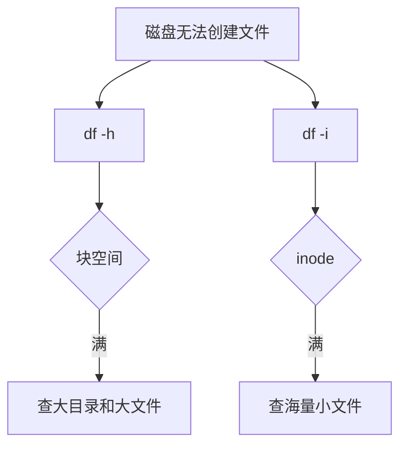

------

## inode 耗尽：明明有空间却不能创建文件

检查：

```bash
df -i
```

GNU `df` 的 `-i` 或 `--inodes` 会显示 inode 信息，而不是普通块空间统计。 ([man7.org](https://man7.org/linux/man-pages/man1/df.1.html?utm_source=chatgpt.com))

例如：

```text
Filesystem       Inodes   IUsed   IFree IUse% Mounted on
/dev/nvme0n1p2  6553600 6553590      10  100% /
```

但是：

```bash
df -h
```

可能显示：

```text
20G available
```

于是出现：

```text
No space left on device
```

很多新手会问：

> 明明还有 20 GB，为什么说没有空间？

原因可能是：

```text
inode 用完
```

### inode 可以粗略理解成什么

可以把 inode 粗略理解为：

> 文件系统用于描述文件对象的元数据记录。

目录里：

```text
a.txt
b.txt
c.txt
```

这些都是文件对象。

即使每个只有：

```text
1 byte
```

也仍然需要相应的文件系统元数据。

所以：

```text
几百万个小文件
```

可能比：

```text
一个 500 GB 文件
```

更容易耗尽 inode。

------

## 怎么找哪个目录文件数量特别多

简单方法：

```bash
find /var -xdev -type f 2>/dev/null | wc -l
```

查看某目录文件数量：

```bash
find /var/cache -xdev -type f 2>/dev/null | wc -l
```

不过这种方法需要遍历。

针对一级目录，可以写：

```bash
for dir in /var/*; do
    printf '%s\t' "$dir"
    find "$dir" -xdev -type f 2>/dev/null | wc -l
done
```

可能得到：

```text
/var/cache      1920
/var/lib        825013
/var/log        322
/var/spool      7854192
```

此时：

```text
/var/spool
```

非常可疑。

继续分析。

常见海量小文件来源包括：

```text
应用缓存
邮件队列
任务队列
session 文件
图片缩略图
构建缓存
包管理缓存
临时文件
程序错误循环
```

不要看到几百万文件就立即：

```bash
rm -rf
```

应该先确认：

> 谁创建它们？

------

## 为什么 `df` 很满，但 `du` 找不到那么多数据

这是 Linux 磁盘排查中非常经典的问题。

例如：

```bash
df -h /
```

显示：

```text
Used: 190G
```

但是：

```bash
sudo du -xsh /
```

显示：

```text
120G
```

相差：

```text
70 GB
```

不要立即认为：

```text
du 坏了
```

可能的原因包括：

- 已删除但仍被进程打开的文件；
- Btrfs / CoW / 快照共享空间；
- 挂载点覆盖；
- 文件系统元数据；
- 保留空间；
- `du` 没有权限读取部分目录；
- 稀疏、压缩或共享 extent 语义；
- 文件系统正在变化。

其中最值得优先检查的是：

> **deleted but open file**

------

## 文件删了，为什么空间没有释放

Linux 中：

```bash
rm app.log
```

本质上可以理解为：

> 删除目录项对应的名字链接。

如果进程仍持有该文件的打开文件描述符（File Descriptor，FD），文件对象可能仍然存在。

例如：

```text
Java 服务
   |
   +-- fd 7
          |
          +-- app.log
```

执行：

```bash
rm app.log
```

目录中：

```text
app.log 消失
```

但：

```text
Java 服务
   |
   +-- fd 7
          |
          +-- 原文件对象仍然打开
```

于是：

```text
ls 看不到
du 扫不到正常路径
df 仍显示空间被使用
```

`lsof` 的 `+L1` 可以选择仍然打开但已经被 unlink 的文件。 ([man7.org](https://man7.org/linux/man-pages/man8/lsof.8.html?utm_source=chatgpt.com))

检查：

```bash
sudo lsof +L1
```

常见输出类似：

```text
COMMAND   PID USER  FD   TYPE DEVICE SIZE/OFF NLINK NAME
java     1234 app   7w   REG  259,2      50G     0 /var/log/app.log (deleted)
```

关键：

```text
(deleted)
```

和：

```text
SIZE/OFF 50G
```

现在找到那 50 GB 了。

### 怎么释放

最推荐：

> 正常重启对应服务。

例如：

```bash
sudo systemctl restart myapp.service
```

然后确认：

```bash
sudo lsof +L1
```

再检查：

```bash
df -h
```

### 不要第一反应就是 kill -9

推荐顺序：

```text
确认进程
 |
 v
确认文件
 |
 v
判断服务影响
 |
 v
正常 reload / restart
 |
 v
检查空间
```

使用：

```bash
kill -9
```

应该是更靠后的手段。

------

## 挂载点覆盖也会造成“文件找不到”

假设：

```text
/data
```

原本有：

```text
/data/backup.tar    100 GB
```

后来在 `/data` 上挂载了一块新磁盘：

```bash
mount /dev/sdb1 /data
```

现在：

```bash
ls /data
```

看到的是：

```text
/dev/sdb1 的内容
```

原来根文件系统中的：

```text
/data/backup.tar
```

被挂载点遮住了。

它不是删除了。

只是：

> 当前路径视图被新的文件系统覆盖。

抽象来看：

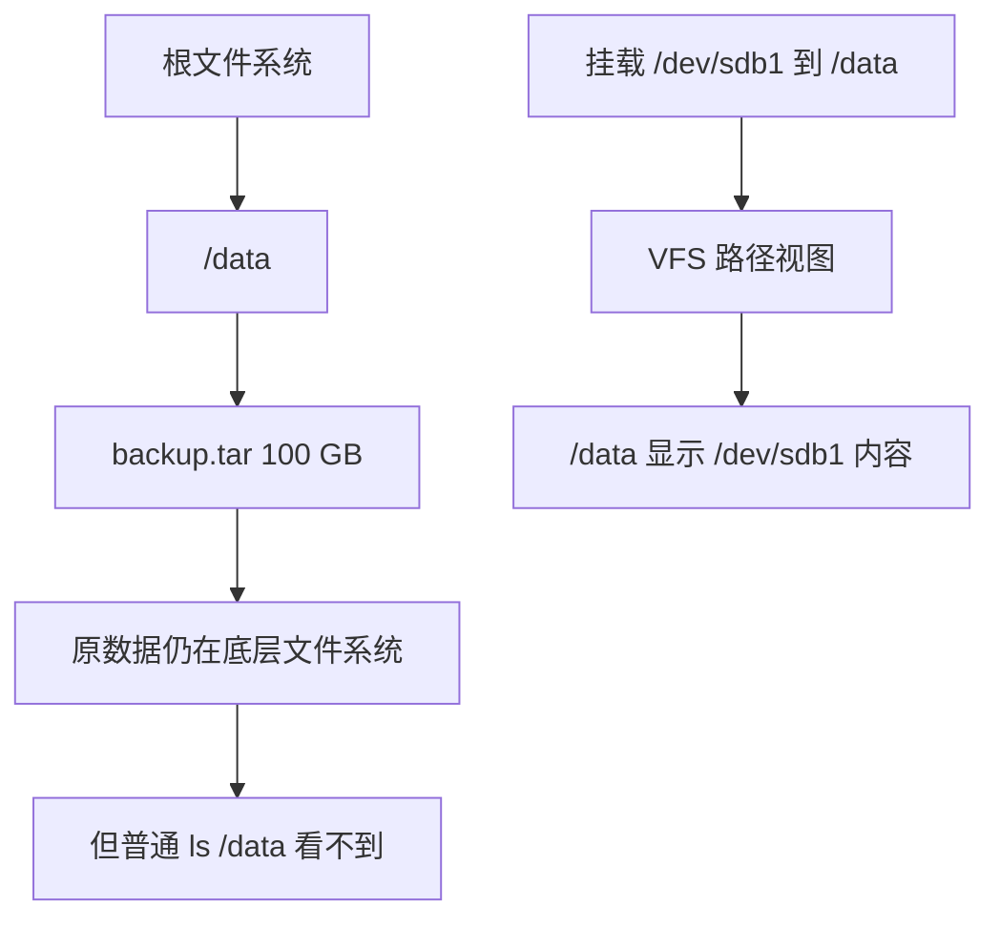

因此可能出现：

```text
df 说根盘用了很多
du / 看起来数据不够
```

这属于更高级的排查场景。

首先查看挂载：

```bash
findmnt
```

查询路径对应挂载：

```bash
findmnt -T /data
```

也可以：

```bash
df -h /data
```

重点是建立：

> **目录路径和文件系统不是同一个概念。**

目录可以成为：

```text
Mount Point
```

即挂载点。

------

## `/var` 是磁盘异常的重点调查区域

服务器中，我通常优先关注：

```text
/var
```

原因是很多“持续变化的数据”都会放在其中。

常见区域：

| 目录                  | 常见内容          |
| --------------------- | ----------------- |
| `/var/log`            | 日志              |
| `/var/cache`          | 缓存              |
| `/var/lib`            | 应用状态数据      |
| `/var/tmp`            | 临时数据          |
| `/var/spool`          | 队列              |
| `/var/lib/docker`     | Docker            |
| `/var/lib/containers` | Podman 等容器数据 |
| `/var/lib/flatpak`    | 系统 Flatpak 数据 |

因此根盘满时，我经常直接：

```bash
sudo du -xhd1 /var | sort -h
```

或者：

```bash
sudo dust -n 30 /var
```

再决定下一步。

------

## 分析系统日志

首先：

```bash
sudo du -xhd1 /var/log | sort -h
```

查大文件：

```bash
sudo find /var/log \
  -xdev \
  -type f \
  -size +100M \
  -printf '%s\t%p\n' \
  2>/dev/null |
sort -nr
```

可能发现：

```text
/var/log/myapp/error.log
```

已经：

```text
80 GB
```

### 先不要直接删除

应该问：

```text
为什么日志这么大？
```

可能是：

```text
程序异常循环
连接数据库失败，每毫秒输出一次错误
Debug 日志误开启
logrotate 未配置
应用自己管理日志但失败
```

如果只是：

```bash
rm error.log
```

程序仍持续每秒写：

```text
100 MB
```

一小时以后磁盘又满。

真正正确的方法是：

```text
诊断增长原因
+
配置日志轮转
+
限制保留周期
+
修复异常日志源
```

------

## 分析 systemd Journal

查看当前 journal 使用量：

```bash
journalctl --disk-usage
```

例如：

```text
Archived and active journals take up 8.0G
```

清理到指定容量：

```bash
sudo journalctl --vacuum-size=1G
```

按照时间：

```bash
sudo journalctl --vacuum-time=7d
```

`journalctl` 官方文档提供 `--vacuum-size`、`--vacuum-time` 和 `--vacuum-files`，用于清理归档 journal；时间和容量限制还可以组合使用。 ([自由桌面](https://www.freedesktop.org/software/systemd/man/journalctl.html?utm_source=chatgpt.com))

例如：

```bash
sudo journalctl \
  --vacuum-size=1G \
  --vacuum-time=14d
```

### 最佳实践

紧急清理：

```bash
journalctl --disk-usage
sudo journalctl --vacuum-size=1G
```

长期治理：

> 配置 journald 的容量策略。

而不是每两个月手工清一次。

systemd 的 `journald.conf` 支持文件系统使用限制相关配置；官方文档也说明默认限制会受到文件系统比例和容量上限规则影响。 ([自由桌面](https://www.freedesktop.org/software/systemd/man/journald.conf.html?utm_source=chatgpt.com))

------

## 软件包缓存也是常见占用来源

### Debian / Ubuntu

先看：

```bash
sudo du -sh /var/cache/apt
```

APT：

```bash
sudo apt clean
```

或：

```bash
sudo apt autoclean
```

两者不是完全一样。

APT 官方手册说明：

- `clean` 会清除下载的软件包缓存；
- `autoclean` 只删除已经无法再下载、基本无用的包文件；
- `autoremove` 删除作为依赖自动安装、后来已不再需要的软件包。 ([Debian Manpages](https://manpages.debian.org/trixie/apt/apt-get.8.en.html?utm_source=chatgpt.com))

因此：

```bash
sudo apt clean
```

是：

```text
清包缓存
```

而：

```bash
sudo apt autoremove
```

是：

```text
处理不再需要的自动依赖
```

不要混为一谈。

运行：

```bash
sudo apt autoremove
```

之前应仔细查看待删除列表。APT 官方文档同样提醒用户检查其中是否包含实际上希望保留的软件。 ([Debian Manpages](https://manpages.debian.org/testing/apt/apt.8.en.html?utm_source=chatgpt.com))

### Fedora

查看：

```bash
sudo du -sh /var/cache/dnf
```

清理：

```bash
sudo dnf clean all
```

Fedora 官方文档在系统升级清理流程中也使用 `dnf clean all` 清除 DNF 缓存。 ([docs.fedoraproject.org](https://docs.fedoraproject.org/en-US/quick-docs/upgrading-fedora-online/?utm_source=chatgpt.com))

### Arch Linux

重点：

```text
/var/cache/pacman/pkg
```

查看：

```bash
sudo du -sh /var/cache/pacman/pkg
```

Arch 文档将包缓存明确列为系统维护中的空间清理对象。 ([wiki.archlinux.org](https://wiki.archlinux.org/title/System_maintenance?utm_source=chatgpt.com))

但是 Arch 用户尤其应该注意：

> 软件包缓存有降级价值。

Arch 的降级文档明确提到，如果旧版本仍保留在 pacman 缓存，可以直接用于降级。 ([wiki.archlinux.org](https://wiki.archlinux.org/title/Downgrading_packages?utm_source=chatgpt.com))

因此不推荐无脑：

```text
全部永久删除
```

更合理的是保留有限数量的历史版本。

------

## Docker 主机不要直接 `rm -rf /var/lib/docker`

假设：

```bash
sudo du -sh /var/lib/docker
```

显示：

```text
180G
```

很多人的第一想法：

```bash
sudo rm -rf /var/lib/docker/*
```

这是危险操作。

因为 Docker 有自己的对象模型：

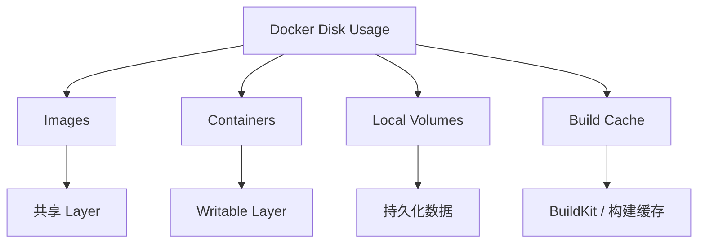

正确的第一步：

```bash
docker system df
```

Docker 官方将该命令定义为显示 Docker daemon 使用的磁盘空间信息。 ([Docker Documentation](https://docs.docker.com/reference/cli/docker/system/df/?utm_source=chatgpt.com))

详细：

```bash
docker system df -v
```

可能看到：

```text
TYPE            TOTAL   ACTIVE   SIZE      RECLAIMABLE
Images          120     10       85GB      70GB
Containers      30      5        12GB      8GB
Local Volumes   50      20       60GB      30GB
Build Cache                       40GB      38GB
```

注意：

```text
RECLAIMABLE
```

这是非常重要的信息。

### 为什么不能只用 `du`

Docker 镜像存在共享 Layer。

例如：

```text
Image A
├── Ubuntu Layer 500 MB
└── App A 100 MB

Image B
├── Ubuntu Layer 500 MB
└── App B 200 MB
```

简单看：

```text
Image A = 600 MB
Image B = 700 MB
```

不能直接得出：

```text
总占用 = 1.3 GB
```

因为：

```text
Ubuntu Layer
```

可能共享。

Docker `system df -v` 会区分共享空间（Shared Size）与镜像独占空间（Unique Size）。 ([Docker Documentation](https://docs.docker.com/reference/cli/docker/system/df/?utm_source=chatgpt.com))

### 清理未使用资源

先查看：

```bash
docker system df -v
```

然后根据情况分别分析。

统一清理：

```bash
docker system prune
```

Docker 官方说明，该命令会删除未使用的数据，包括停止的容器、未使用网络、相关镜像和构建缓存；卷需要特别考虑相应选项。 ([Docker Documentation](https://docs.docker.com/reference/cli/docker/system/prune/?utm_source=chatgpt.com))

更激进：

```bash
docker system prune -a
```

注意：

```text
-a
```

可能删除所有当前未被容器使用的镜像，而不仅仅是 dangling image。

所以生产机器上不要形成：

```text
磁盘满
  |
  v
复制 docker system prune -a --volumes
  |
  v
按 Enter
```

这样的习惯。

尤其：

```text
Volume
```

可能保存：

```text
数据库数据
上传文件
应用状态
```

必须先确认用途。

------

## Flatpak 也可能占用较大空间

系统级 Flatpak 数据通常涉及：

```text
/var/lib/flatpak
```

用户级：

```text
~/.local/share/flatpak
```

Flatpak 官方文档说明，系统级和用户级安装拥有不同数据位置，并使用 OSTree 管理应用和运行时数据。 ([Flatpak](https://docs.flatpak.org/ru/latest/flatpak-command-reference.html?utm_source=chatgpt.com))

查看：

```bash
du -sh /var/lib/flatpak
```

用户：

```bash
du -sh ~/.local/share/flatpak
```

删除未使用运行时可以考虑：

```bash
flatpak uninstall --unused
```

但仍然建议：

```bash
flatpak list
```

先理解机器上实际安装了什么。

------

## Btrfs 上不要完全相信普通 `du` 直觉

如果使用：

```text
Btrfs
```

必须理解：

```text
Copy-on-Write
Snapshot
Reflink
Shared Extent
```

### 什么是 CoW

CoW：

> Copy-on-Write，写时复制。

假设文件：

```text
A
```

使用 reflink 创建：

```text
B
```

开始时：

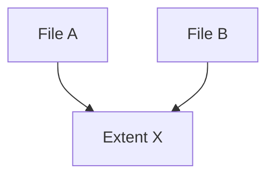

两个文件可以引用共享 extent。

修改 B 的一部分后：

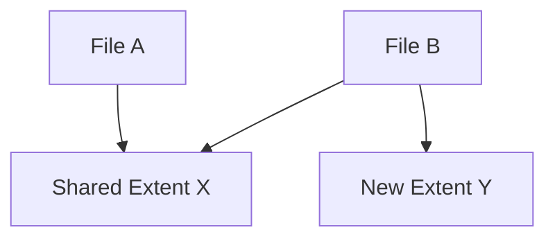

因此：

```text
文件逻辑大小之和
```

不等于：

```text
实际独占磁盘空间
```

Btrfs 官方文档明确说明子卷可以共享文件 extent，snapshot 本身也是 subvolume；reflink 文件在修改前可以共享 extent。 ([BTRFS 文档](https://btrfs.readthedocs.io/en/latest/Subvolumes.html?utm_source=chatgpt.com))

### 使用 Btrfs 自己的空间命令

查看：

```bash
sudo btrfs filesystem usage /
```

更详细地分析文件或目录共享空间：

```bash
sudo btrfs filesystem du /path
```

汇总：

```bash
sudo btrfs filesystem du -s /path
```

`btrfs filesystem du` 会考虑共享 extent，并报告相关 shared-space 统计。 ([BTRFS 文档](https://btrfs.readthedocs.io/en/latest/btrfs-filesystem.html?utm_source=chatgpt.com))

### 为什么删除文件不一定释放预期空间

假设：

```text
原文件 100 GB
快照引用 100 GB extent
```

删除原文件：

```text
原文件引用消失
```

但是：

```text
快照仍引用 extent
```

那么 extent 不能释放。

所以：

```text
rm 100 GB 文件
```

不一定意味着：

```text
df Available +100 GB
```

### 快照不是备份

Btrfs 官方文档特别提醒，快照本身并不会让数据“更安全”；它可以保存在线历史状态，但不能天然替代独立备份。 ([BTRFS 文档](https://btrfs.readthedocs.io/en/latest/Subvolumes.html?utm_source=chatgpt.com))

例如：

```text
SSD 损坏
```

原子卷和同盘快照可能一起损失。

------

## 符号链接与硬链接也要理解

### Symbolic Link

符号链接（Symbolic Link，Symlink）：

```text
link -> target
```

本身是独立的文件系统对象，保存目标路径。

通常：

```bash
du
```

不会默认递归跟随普通目录中的符号链接目标。

分析工具中经常有：

```text
--follow
-L
```

类似选项。

磁盘审计时：

> 不要随便开启“跟随全部符号链接”。

否则可能：

```text
重复遍历
跨目录
进入意外路径
```

### Hard Link

硬链接（Hard Link）更特殊。

例如：

```bash
ln fileA fileB
```

可能是：

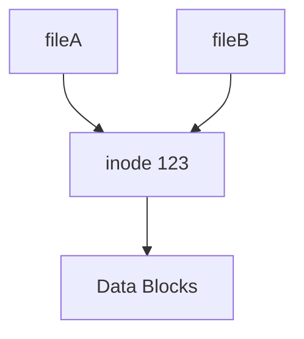

这里：

```text
fileA
fileB
```

是两个目录项。

但它们引用：

```text
同一个 inode
同一份数据
```

所以简单把：

```text
ls -l fileA 的大小
+
ls -l fileB 的大小
```

相加，可能产生重复理解。

优秀的磁盘占用分析工具通常需要专门处理 hard link。

这也是：

> “看文件逻辑长度”和“分析真正磁盘占用”不同的原因之一。

------

## 常见空间大户速查

### 用户目录

```text
~/Downloads
~/.cache
~/.local/share
```

开发人员尤其注意：

```text
~/.cargo
~/.rustup
~/.npm
~/.pnpm-store
~/.cache/pip
~/.cache/uv
~/.conda
~/.local/share/virtualenvs
```

先分析：

```bash
dust -n 30 ~
```

或者：

```bash
du -hd1 ~ 2>/dev/null | sort -h
```

注意隐藏目录。

Shell glob：

```bash
*
```

默认不匹配很多 dotfile / dot directory。

因此：

```bash
du -sh *
```

可能漏掉：

```text
.cache
.local
.config
```

这是一个非常常见的误区。

直接：

```bash
du -hd1 ~
```

比：

```bash
du -sh ~/*
```

更适合做完整一级目录分析。

------

## 开发机常见空间黑洞

### Node.js

```text
node_modules
```

查找：

```bash
find ~/Projects -type d -name node_modules -prune
```

查看每个大小：

```bash
find ~/Projects \
  -type d \
  -name node_modules \
  -prune \
  -exec du -sh {} \;
```

### Rust

重点：

```text
target
~/.cargo
~/.rustup
```

查项目 target：

```bash
find ~/Projects \
  -type d \
  -name target \
  -prune \
  -exec du -sh {} \;
```

对于仍在维护的 Cargo 项目，更推荐进入项目：

```bash
cargo clean
```

而不是随意删除 Cargo 管理的数据。

### Python

常见：

```text
.venv
venv
~/.cache/pip
Conda env
```

查虚拟环境：

```bash
find ~/Projects \
  -type d \
  \( -name .venv -o -name venv \) \
  -prune
```

### Java

注意：

```text
~/.m2
~/.gradle
build
target
```

这里特别容易出现：

```text
几十 GB 的 Gradle Cache
```

### C / C++

常见：

```text
build
cmake-build-*
bazel-*
```

### IDE

例如：

```text
JetBrains cache
VS Code extension/cache
Language Server cache
```

这里最佳实践不是：

```text
看见 cache 就全部 rm -rf
```

而是：

```text
先确认大小
再确认工具是否有自己的清理机制
```

------

## 不要把缓存一概视为“垃圾”

Cache：

> 缓存。

缓存的目的通常是：

```text
用磁盘换时间
```

例如：

```text
npm cache
Cargo registry
Gradle cache
pip cache
浏览器 cache
```

删除后可能发生：

```text
重新下载
重新解压
重新构建
```

所以：

```text
可删除
```

不等于：

```text
应该经常删除
```

更好的决策模型：

| 情况           | 建议               |
| -------------- | ------------------ |
| 磁盘紧急告警   | 清理高收益缓存     |
| 缓存明显失控   | 清理并配置限制     |
| 空间充足       | 通常不必处理       |
| CI 临时 runner | 可以积极清理       |
| 离线开发机     | 谨慎清包缓存       |
| 网络很慢       | 缓存可能非常有价值 |

正确的问题应该是：

> **删除 20 GB 缓存，未来付出的重新下载和重新构建成本是否值得？**

------

## 一套我推荐的现代 Linux 磁盘排查流程

假设报警：

```text
No space left on device
```

### 先看块空间

```bash
df -hT
```

或者：

```bash
duf
```

假设发现：

```text
/ 97%
```

### 再看 inode

```bash
df -i /
```

或者：

```bash
duf --inodes
```

如果 inode 正常，继续。

### 确认路径所属文件系统

```bash
findmnt -T /
```

检查挂载布局：

```bash
findmnt
```

### 一级目录定位

标准方案：

```bash
sudo du -xhd1 / 2>/dev/null | sort -h
```

现代方案：

```bash
sudo dust -n 30 /
```

交互方案：

```bash
sudo ncdu -x /
```

高速 SSD：

```bash
sudo gdu /
```

### 假设发现 `/var` 最大

```bash
sudo du -xhd1 /var 2>/dev/null | sort -h
```

或：

```bash
sudo dust -n 30 /var
```

### 根据类型切换工具

如果是：

```text
/var/log
```

执行：

```bash
journalctl --disk-usage
```

和：

```bash
find /var/log -xdev -type f -size +100M
```

如果是：

```text
/var/lib/docker
```

执行：

```bash
docker system df -v
```

如果是：

```text
Btrfs
```

执行：

```bash
btrfs filesystem usage /
btrfs filesystem du -s /path
```

如果普通目录仍找不到占用：

```bash
sudo lsof +L1
```

### 最后才执行删除

推荐：

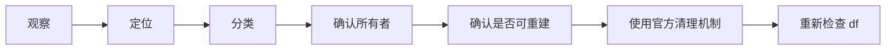

而不是：

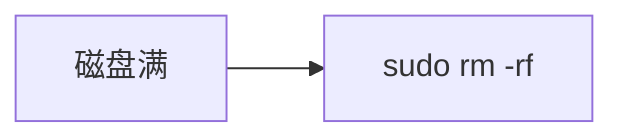

------

## 安全清理的核心原则

### 先测量，再删除

错误：

```bash
rm -rf /some/path
```

正确：

```bash
du -sh /some/path
```

然后：

```bash
findmnt -T /some/path
```

再确认用途。

------

### 优先使用资源所有者提供的清理机制

| 数据            | 优先工具                     |
| --------------- | ---------------------------- |
| systemd journal | `journalctl --vacuum-*`      |
| Docker          | `docker ... prune`           |
| APT cache       | `apt clean`                  |
| DNF cache       | `dnf clean`                  |
| Cargo build     | `cargo clean`                |
| Flatpak runtime | `flatpak uninstall --unused` |

不要优先：

```bash
rm -rf /var/lib/xxx
```

原因是应用通常知道：

```text
哪些对象仍被引用
哪些可以重建
哪些是持久化数据
```

普通 `rm` 不知道。

------

### 删除前问三个问题

#### 谁创建了它

例如：

```text
myapp.log
```

由哪个服务写？

#### 删除后能否重建

例如：

```text
cache
```

通常可以。

但是：

```text
database volume
```

可能不能。

#### 它为什么增长

如果增长原因没有解决：

```text
清理只是延迟下一次磁盘满
```

------

### 不要把 `sudo` 当默认选项

先：

```bash
du -hd1 ~
```

只有权限不足时再：

```bash
sudo
```

特别是交互式删除工具：

```text
ncdu
gdu
dua
```

使用 root 运行意味着：

> 一个误操作可能删除系统级文件。

分析可以 root。

删除必须更谨慎。

------

## 推荐安装与工具组合策略

现代工具的包名和版本会随发行版仓库变化，因此我的建议是：

> **优先使用发行版仓库；仓库版本明显过旧或没有对应工具时，再使用项目官方 release 或语言包管理器。**

例如先搜索：

Debian / Ubuntu：

```bash
apt search ncdu
apt search duf
apt search dust
```

Fedora：

```bash
dnf search ncdu
dnf search gdu
dnf search diskonaut
```

Arch：

```bash
pacman -Ss ncdu
pacman -Ss duf
```

`dust` 官方也提供 Linux 预编译 release 安装方式；`dua` 官方支持预编译二进制以及 `cargo install dua-cli`；`diskonaut` 官方支持 `cargo install diskonaut`。 ([GitHub](https://github.com/bootandy/dust))

我不建议从陌生博客复制：

```bash
curl ... | sudo sh
```

尤其是 root 环境。

推荐顺序：

```text
发行版官方仓库
        |
        v
项目官方 Release
        |
        v
Cargo / Go 等官方构建方式
```

------

## 我的个人推荐工具集

### 极简服务器

安装：

```text
ncdu
```

使用：

```bash
df -hT
df -i
sudo ncdu -x /
sudo lsof +L1
```

已经可以解决非常多问题。

------

### 现代 CLI 用户

使用：

```text
duf
dust
gdu
```

工作流：

```bash
duf
```

然后：

```bash
dust -n 30 /
```

最后：

```bash
gdu /var
```

这是我比较推荐的一套现代组合。

------

### Linux 开发机

推荐：

```text
duf
dust
gdu
erdtree
fd
```

分析：

```bash
dust -n 50 ~
```

代码目录：

```bash
erd -i -H ~/Projects
```

深度调查：

```bash
gdu ~/Projects
```

查构建目录：

```bash
fd -t d '^(target|node_modules|build|\.venv)$' ~/Projects
```

`fd` 项目将其定位为更简单、快速、用户友好的 `find` 替代方案，并采用并行目录遍历；但它默认会忽略隐藏文件和 ignore 规则，因此完整磁盘审计时同样必须理解其过滤行为。 ([GitHub](https://github.com/sharkdp/fd?utm_source=chatgpt.com))

------

## 最值得记住的命令速查

### 看哪个文件系统满

```bash
df -hT
```

现代：

```bash
duf
```

### 看 inode

```bash
df -i
```

现代：

```bash
duf --inodes
```

### 看一级目录

```bash
du -xhd1 /path
```

### 排序

```bash
du -xhd1 /path 2>/dev/null | sort -h
```

### 快速现代目录分析

```bash
dust -n 30 /path
```

### 远程服务器交互分析

```bash
ncdu -x /path
```

### SSD 高速分析

```bash
gdu /path
```

### 查大于 1 GB 的文件

```bash
find /path -xdev -type f -size +1G
```

### 查已删除但仍被打开的文件

```bash
sudo lsof +L1
```

### 看 Journal 大小

```bash
journalctl --disk-usage
```

### 限制 Journal 大小

```bash
sudo journalctl --vacuum-size=1G
```

### Docker 空间

```bash
docker system df
```

详细：

```bash
docker system df -v
```

### Btrfs 空间

```bash
sudo btrfs filesystem usage /
```

共享数据分析：

```bash
sudo btrfs filesystem du -s /path
```

------

## 最终建议：形成自己的“三阶段磁盘分析法”

我认为最适合新手长期记忆的是下面这套模型。

### 文件系统层

回答：

> **哪里满了？**

使用：

```text
df
duf
df -i
findmnt
```

### 目录与文件层

回答：

> **谁占的？**

使用：

```text
du
dust
ncdu
gdu
dua
find
```

### 资源所有者层

回答：

> **应该怎么安全释放？**

使用：

```text
journalctl
docker
apt
dnf
flatpak
cargo
btrfs
systemctl
```

可以概括为：

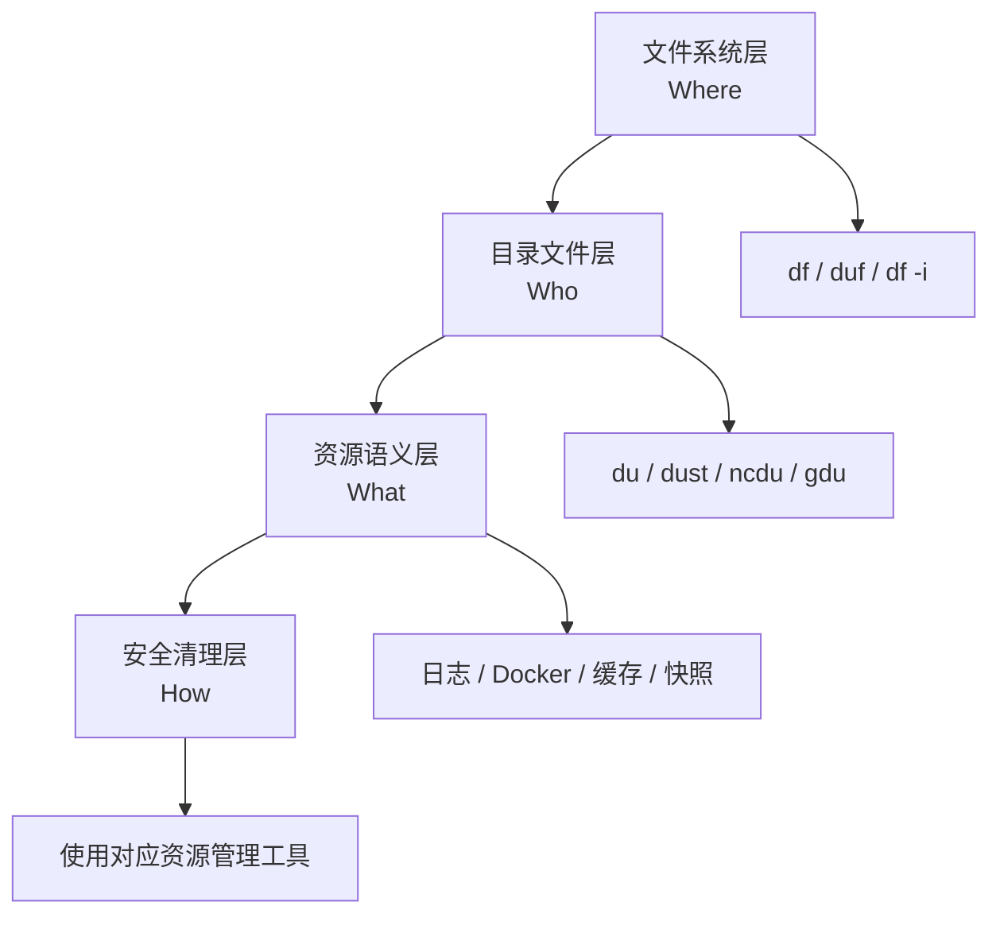

**真正成熟的磁盘清理思路，不是掌握一条“找最大文件”的命令，而是知道什么时候应该从 `df` 切换到 `du`，什么时候应该放下 `du`，转而使用 `lsof`、`docker system df`、`journalctl` 或 Btrfs 自己的空间统计工具。**

对于大多数 Linux 用户，我建议直接记住这一条实战路径：

```bash
df -hT
df -i
sudo du -xhd1 / 2>/dev/null | sort -h
sudo dust -n 30 /var
sudo lsof +L1
```

发现具体资源类型后，**停止“盲目找文件”，切换到该资源自己的管理工具**。这通常才是既快、又安全、又适合长期运维的磁盘空间清理方法。