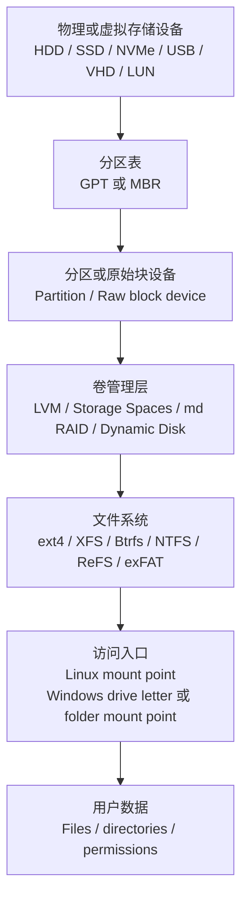
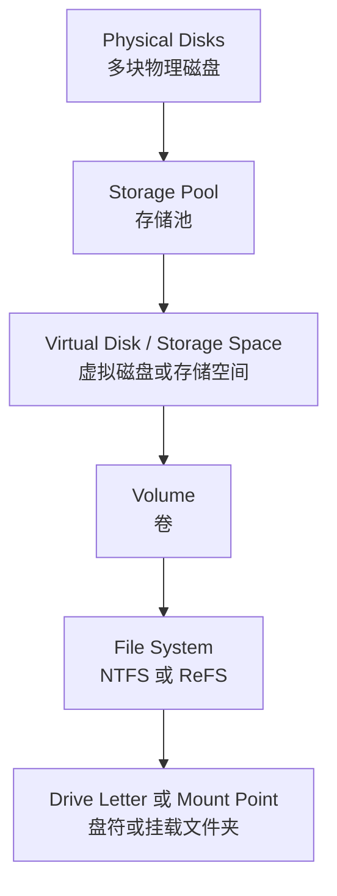
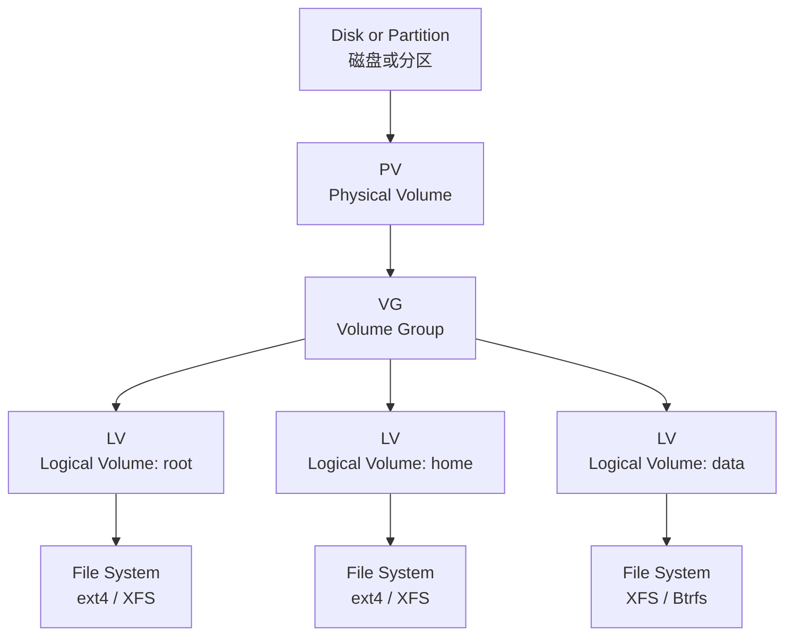
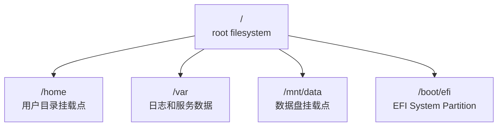
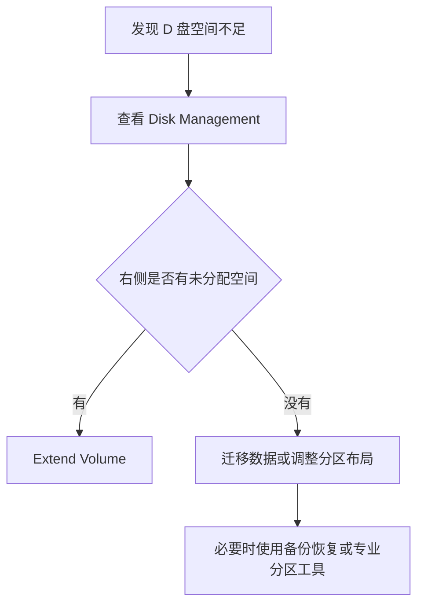
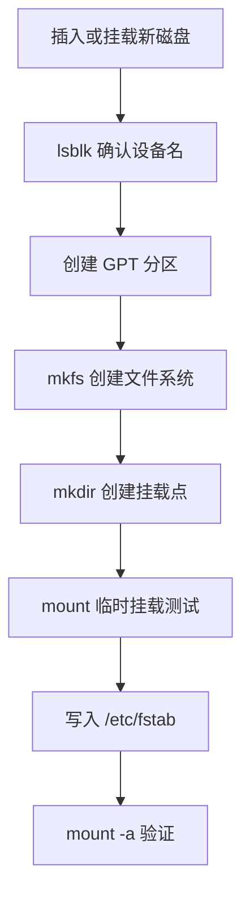

[toc]


## 学习大纲

把操作系统的磁盘管理理解为一条从“硬件空间”到“用户可访问文件”的抽象链路：

| 学习模块     | 你要掌握的问题                        | Linux 重点                                             | Windows 重点                                                 |
| ------------ | ------------------------------------- | ------------------------------------------------------ | ------------------------------------------------------------ |
| 存储硬件识别 | 系统如何看到硬盘、SSD、U 盘、虚拟磁盘 | 块设备、`/dev/sdX`、`/dev/nvmeXnY`、`lsblk`、`udev`    | 磁盘、设备管理器、磁盘管理、PowerShell Storage cmdlet        |
| 分区表       | 一块盘如何被切分                      | GPT、MBR、`fdisk`、`parted`、`gdisk`                   | GPT、MBR、磁盘初始化、Disk Management、`diskpart`            |
| 分区与卷     | “分区”和“卷”是不是一回事              | partition、filesystem、mount point、LVM logical volume | partition、volume、drive letter、mount point folder          |
| 文件系统     | 数据如何组织成文件和目录              | ext4、XFS、Btrfs、F2FS、exFAT、NTFS 支持               | NTFS、ReFS、exFAT、FAT32                                     |
| 挂载与路径   | 用户如何访问磁盘内容                  | 统一目录树、`mount`、`/etc/fstab`、UUID                | 盘符、卷挂载点、`C:`、`D:`、NTFS folder mount point          |
| 动态扩容     | 如何增加磁盘空间                      | LVM、Btrfs、mdadm、resize2fs、xfs_growfs               | Extend Volume、Storage Spaces、dynamic disk、PowerShell      |
| 冗余与池化   | 如何做镜像、条带、校验                | md RAID、LVM RAID、Btrfs RAID、ZFS                     | Storage Spaces、动态磁盘镜像、硬件 RAID                      |
| 加密与安全   | 丢盘后如何保护数据                    | dm-crypt、LUKS、TPM、文件权限                          | BitLocker、EFS、TPM、NTFS ACL                                |
| 健康与性能   | 如何判断磁盘是否健康、是否瓶颈        | SMART、iostat、fio、TRIM、I/O scheduler                | SMART、Performance Monitor、Optimize Drives、Storage reliability counters |
| 备份与恢复   | 如何避免误删、坏盘、系统损坏          | rsync、snapshot、LVM snapshot、Btrfs snapshot          | File History、System Restore、VSS、Windows Backup、Storage Spaces 修复 |

- Windows 官方将 Disk Management 描述为用于初始化驱动器、查看磁盘和分区、扩展或收缩卷、修改盘符等高级存储操作的系统工具；
- Linux 侧，`lsblk` 这类工具则通过 `sysfs` 和 `udev` 数据库读取块设备信息。

两者管理对象不同叫法很多，但底层都围绕“物理设备、分区表、卷、文件系统、挂载入口”这些层次展开。([微软学习](https://learn.microsoft.com/en-us/windows-server/storage/disk-management/overview-of-disk-management?utm_source=chatgpt.com))

## 磁盘管理模型

磁盘管理不是单一动作，而是多层抽象。



实际系统中并不总是每层都有。例如：

| 场景                     | 可能的层次                                                   |
| ------------------------ | ------------------------------------------------------------ |
| 普通 Windows 系统盘      | 物理盘 -> GPT -> EFI/MSR/Windows/Recovery 分区 -> NTFS -> `C:` |
| 普通 Linux 系统盘        | 物理盘 -> GPT -> EFI/root/home/swap 分区 -> ext4/XFS/Btrfs -> `/`、`/home` |
| Linux LVM 服务器         | 物理盘 -> GPT 分区 -> LVM PV -> VG -> LV -> XFS/ext4 -> `/data` |
| Windows Storage Spaces   | 多块物理盘 -> Storage Pool -> Virtual Disk -> Volume -> NTFS/ReFS -> 盘符或挂载文件夹 |
| 加密 Linux 笔记本        | 物理盘 -> GPT -> LUKS/dm-crypt -> LVM 或文件系统 -> `/`      |
| BitLocker Windows 笔记本 | GPT 分区 -> NTFS volume -> BitLocker 加密 -> `C:`            |

## Linux 与 Windows 的核心差异

最重要的区别不是“谁更高级”，而是命名体系和设计习惯不同。

| 维度         | Linux                                                        | Windows                                                 |
| ------------ | ------------------------------------------------------------ | ------------------------------------------------------- |
| 存储对象入口 | 一切尽量抽象为文件或设备节点，例如 `/dev/sda`、`/dev/nvme0n1` | 以“磁盘、分区、卷、盘符”为主要图形化概念                |
| 访问路径     | 单一目录树，从 `/` 开始，通过 mount point 接入               | 传统上使用盘符，如 `C:`、`D:`；也支持挂载到 NTFS 文件夹 |
| 设备命名     | `/dev/sda1`、`/dev/nvme0n1p1`、`/dev/mapper/vg-lv`           | Disk 0、Disk 1、Volume C、PhysicalDisk、VirtualDisk     |
| 配置持久挂载 | `/etc/fstab`，常用 UUID 或 LABEL                             | 卷 GUID、盘符、挂载点、注册表和系统卷管理数据库         |
| 逻辑卷管理   | LVM、device mapper、mdadm、Btrfs/ZFS                         | Basic Disk、Dynamic Disk、Storage Spaces                |
| 常见文件系统 | ext4、XFS、Btrfs、F2FS、exFAT                                | NTFS、ReFS、exFAT、FAT32                                |
| 权限模型     | POSIX 权限、ACL、SELinux/AppArmor                            | NTFS ACL、SID、安全描述符、BitLocker                    |
| 管理风格     | 命令行和配置文件强，图形工具因发行版而异                     | GUI 工具统一，PowerShell 和 `diskpart` 也很重要         |

Windows 的 NTFS 是现代 Windows 的默认文件系统，具备安全描述符、加密、磁盘配额、丰富元数据等能力；ReFS 则面向抗损坏和大规模存储，并与 Windows Server 存储技术结合更紧密。([微软学习](https://learn.microsoft.com/en-us/windows-server/storage/file-server/ntfs-overview?utm_source=chatgpt.com))

## 关键术语总表：Linux 与 Windows 对等概念

| 通用概念  | 英文或缩写来源                                     | Linux 叫法                             | Windows 叫法                                            | 是否完全等价                                   |
| --------- | -------------------------------------------------- | -------------------------------------- | ------------------------------------------------------- | ---------------------------------------------- |
| 磁盘      | Disk                                               | disk、block device(磁盘,块设备)        | disk、drive(磁盘,驱动器)                                | 接近等价                                       |
| 块设备    | Block Device                                       | `/dev/sda`、`/dev/nvme0n1`             | 物理磁盘、虚拟磁盘                                      | Windows 不常直接使用“block device”这个用户概念 |
| 分区表    | Partition Table                                    | GPT、MBR                               | GPT、MBR                                                | 等价                                           |
| GPT       | GUID Partition Table，GUID 分区表                  | GPT                                    | GPT                                                     | 等价                                           |
| MBR       | Master Boot Record，主引导记录                     | MBR、msdos partition table             | MBR                                                     | 基本等价                                       |
| 分区      | Partition                                          | partition，例如 `/dev/sda1`            | partition                                               | 接近等价                                       |
| 卷        | Volume                                             | 通常指**可挂载的文件系统**或**逻辑卷** | volume 是核心概念                                       | 不完全等价                                     |
| 逻辑卷    | Logical Volume，LV                                 | LVM LV                                 | dynamic volume、Storage Spaces virtual disk 上的 volume | 概念相似，机制不同                             |
| 文件系统  | File System，FS                                    | ext4、XFS、Btrfs                       | NTFS、ReFS、exFAT                                       | 等价层级                                       |
| 挂载点    | Mount Point                                        | `/mnt/data`、`/home`                   | NTFS folder mount point                                 | 概念等价                                       |
| 盘符      | Drive Letter                                       | 无直接对应                             | `C:`、`D:`                                              | Linux 通常不用盘符                             |
| 卷标      | Label                                              | filesystem LABEL                       | volume label                                            | 基本等价                                       |
| UUID      | Universally Unique Identifier                      | 文件系统 UUID、分区 UUID               | Volume GUID、Disk GUID                                  | 类似，但使用位置不同                           |
| LVM       | Logical Volume Manager                             | PV、VG、LV                             | 无完全对应；接近 Storage Spaces / Dynamic Disk          | 部分相似                                       |
| PV        | Physical Volume                                    | LVM 物理卷                             | Storage Spaces physical disk                            | 近似                                           |
| VG        | Volume Group                                       | LVM 卷组                               | Storage Pool                                            | 近似                                           |
| LV        | Logical Volume                                     | LVM 逻辑卷                             | Virtual Disk / Volume                                   | 近似但不要混用                                 |
| RAID      | Redundant Array of Independent Disks               | md RAID、LVM RAID、Btrfs RAID          | Storage Spaces resiliency、Dynamic Disk RAID            | 目标相似，管理体系不同                         |
| TRIM      | ATA TRIM command，SSD 空闲块通知                   | `fstrim`、discard                      | Optimize Drives、ReTrim                                 | 目标相同                                       |
| SMART     | Self-Monitoring, Analysis and Reporting Technology | `smartctl`                             | SMART status、厂商工具、PowerShell                      | 目标相同                                       |
| VHD/VHDX  | Virtual Hard Disk                                  | 可通过 loop/qemu/libguestfs 等使用     | Windows 原生虚拟硬盘格式                                | VHDX 是 Windows/Hyper-V 常见格式               |
| LUN       | Logical Unit Number                                | SAN/iSCSI 多路径设备                   | SAN/iSCSI 磁盘                                          | 企业存储中等价                                 |
| dm-crypt  | device-mapper crypt target                         | Linux 块设备透明加密                   | 无直接等价                                              | Windows 对应 BitLocker                         |
| LUKS      | Linux Unified Key Setup                            | Linux 磁盘加密元数据格式               | BitLocker                                               | 加密                                           |
| BitLocker | Microsoft BitLocker Drive Encryption               | 可读写需第三方或有限支持               | Windows 全卷加密                                        | 对应 Linux 的 LUKS/dm-crypt                    |
| ReFS      | Resilient File System                              | 一般不原生使用                         | Windows 抗损坏文件系统                                  | Windows 特有                                   |
| NTFS      | New Technology File System                         | Linux 可通过 ntfs3/ntfs-3g 访问        | Windows 默认文件系统                                    | Windows 原生最佳                               |

## 磁盘、驱动器、块设备

新手最容易混淆的是“disk、drive、device、volume”。

在 Windows 中，用户常说“C 盘,D 盘”，但严格说 `C:` 通常不是物理磁盘，而是一个卷的访问入口。

- 一个物理磁盘上可以有多个分区和多个卷；
- 一个卷也可能来自多个物理磁盘，例如 Storage Spaces 或动态磁盘**跨区卷**。

在 Linux 中，系统更直接暴露块设备：

| Linux 设备名       | 含义                                             |
| ------------------ | ------------------------------------------------ |
| `/dev/sda`         | 第一块 SCSI/SATA/USB/SAS 类磁盘                  |
| `/dev/sda1`        | `/dev/sda` 上的第一个分区                        |
| `/dev/nvme0n1`     | 第一块 NVMe 命名空间设备                         |
| `/dev/nvme0n1p1`   | 该 NVMe 设备上的第一个分区                       |
| `/dev/mmcblk0`     | eMMC 或 SD 卡类块设备                            |
| `/dev/mapper/name` | device mapper 生成的映射设备，例如 LVM、dm-crypt |
| `/dev/md0`         | Linux md RAID 设备                               |
| `/dev/loop0`       | loop device，把文件当作块设备使用                |

`lsblk` 会列出可用块设备，并通过 `sysfs` 与 `udev` 数据库获取设备信息；这也是 Linux 排查磁盘层次关系最常用的入口之一。([内核下载](https://www.kernel.org/doc/man-pages/online/pages/man8/lsblk.8.html?utm_source=chatgpt.com))

常用命令：

```bash
lsblk -f
blkid
fdisk -l
parted -l
findmnt
df -hT
du -sh /path
```

对应 Windows 常用工具：

```powershell
Get-Disk
Get-Partition
Get-Volume
Get-PhysicalDisk
Get-VirtualDisk
```

以及传统命令：

```cmd
diskpart
list disk
list volume
```

`diskpart` 是 Windows 用来管理磁盘、分区、卷和虚拟硬盘的命令解释器。([微软学习](https://learn.microsoft.com/en-us/windows-server/administration/windows-commands/diskpart?utm_source=chatgpt.com))

## GPT 与 MBR

GPT 和 MBR 是“分区表格式”，决定一块磁盘如何记录分区边界、分区类型和启动信息。

| 项目       | MBR                                       | GPT                           |
| ---------- | ----------------------------------------- | ----------------------------- |
| 英文来源   | Master Boot Record                        | GUID Partition Table          |
| 所属时代   | BIOS 传统启动时代                         | UEFI 现代启动时代             |
| 分区数量   | 传统限制为 4 个主分区，可通过扩展分区变通 | Windows 常见上限为 128 个分区 |
| 大容量支持 | 传统 MBR 在大容量磁盘上受限明显           | 面向现代大容量磁盘            |
| 冗余       | 主要信息在磁盘开头                        | 有主 GPT 和备份 GPT           |
| 启动关系   | 常见于 BIOS 启动                          | 常见于 UEFI 启动              |
| 新系统建议 | 除兼容旧系统外不推荐新建                  | 新机器、新系统优先选择        |

GPT 是 UEFI 规范的一部分；UEFI 规范要求 GPT 磁盘布局中有 Protective MBR，用于兼容不理解 GPT 的旧工具。Windows 文档也说明 GPT 比旧的 MBR 分区方案更灵活，Windows 在 UEFI 设备部署系统盘时要求使用 GPT。([uefi.org](https://uefi.org/specs/UEFI/2.10/05_GUID_Partition_Table_Format.html?utm_source=chatgpt.com))

### 实用建议

| 场景                                   | 建议                                                         |
| -------------------------------------- | ------------------------------------------------------------ |
| 新电脑安装 Windows 11 / Windows Server | 使用 UEFI + GPT                                              |
| 新 Linux 服务器                        | 使用 GPT                                                     |
| 大于 2 TB 的磁盘                       | 使用 GPT                                                     |
| 需要兼容非常旧的 BIOS 系统             | 才考虑 MBR                                                   |
| 双系统                                 | 优先统一为 UEFI + GPT，避免 BIOS/UEFI 混用                   |
| 转换 MBR/GPT                           | 先备份。Windows 普通转换通常要求删除卷；系统盘可根据场景考虑 `mbr2gpt` |

Microsoft 的转换分区样式文档明确提醒，在转换磁盘分区样式前应备份或迁移数据。([微软学习](https://learn.microsoft.com/en-us/windows-server/storage/disk-management/change-disk-partition-scheme?utm_source=chatgpt.com))

## 分区、卷、文件系统的关系

这是最核心的一组概念。


但在有逻辑卷管理时，中间会多一层：


### 用一句话区分

| 概念         | 简明解释                                         |
| ------------ | ------------------------------------------------ |
| 磁盘         | 一块物理或虚拟存储设备                           |
| 分区表       | 记录“磁盘被怎么切”的表                           |
| 分区         | 磁盘上的一段连续空间                             |
| 卷           | 操作系统拿来格式化、挂载、分配盘符的逻辑存储单元 |
| 文件系统     | 把块空间组织成目录、文件、权限、元数据的规则     |
| 挂载点或盘符 | 用户访问这个文件系统的入口                       |

### Linux 中的典型关系

| 对象       | 示例                      |
| ---------- | ------------------------- |
| 磁盘       | `/dev/sda`                |
| 分区       | `/dev/sda1`               |
| LVM 物理卷 | `/dev/sda2` 被初始化为 PV |
| LVM 卷组   | `vgdata`                  |
| LVM 逻辑卷 | `/dev/vgdata/lvapp`       |
| 文件系统   | XFS 或 ext4               |
| 挂载点     | `/app`                    |

### Windows 中的典型关系

| 对象         | 示例                                                         |
| ------------ | ------------------------------------------------------------ |
| 磁盘         | Disk 0                                                       |
| 分区         | EFI System Partition、MSR、Windows partition、Recovery partition |
| 卷           | Windows volume                                               |
| 文件系统     | NTFS                                                         |
| 访问入口     | `C:`                                                         |
| 可选挂载方式 | `C:\DataMount\` 作为卷挂载文件夹                             |

Windows 支持给卷分配盘符，也支持把卷挂载到空文件夹中。Microsoft 文档将这种方式称为 mount point folder path，作用是让一个驱动器像普通文件夹一样被访问。([微软学习](https://learn.microsoft.com/en-us/windows-server/storage/disk-management/change-a-drive-letter?utm_source=chatgpt.com))

## Windows 的 Basic Disk、Dynamic Disk、Storage Spaces

Windows 磁盘管理中有三个容易混淆的体系。

| 体系           | 中文常见叫法 | 适合场景                              | 新手建议           |
| -------------- | ------------ | ------------------------------------- | ------------------ |
| Basic Disk     | 基本磁盘     | 普通个人电脑、系统盘、单盘数据盘      | 默认选择           |
| Dynamic Disk   | 动态磁盘     | 老式 Windows 逻辑卷、跨区、镜像、条带 | 新系统不优先推荐   |
| Storage Spaces | 存储空间     | 多盘池化、镜像、校验、弹性扩容        | 多盘数据池优先考虑 |

Windows 官方文档区分 Basic Disk 和 Dynamic Disk；动态磁盘可以创建比基本磁盘更灵活的卷类型，但现代 Windows 的多盘池化和弹性能力更多建议通过 Storage Spaces 理解。([微软学习](https://learn.microsoft.com/en-us/windows/win32/fileio/basic-and-dynamic-disks?utm_source=chatgpt.com))

### Basic Disk

Basic Disk 是普通 Windows 最常见的磁盘类型。

它通常包含：

| 分区类型                          | 作用                          |
| --------------------------------- | ----------------------------- |
| EFI System Partition，ESP         | UEFI 启动文件                 |
| Microsoft Reserved Partition，MSR | Windows 在 GPT 磁盘上保留使用 |
| Windows 分区                      | 通常是 `C:`，NTFS             |
| Recovery 分区                     | Windows 恢复环境              |

### Dynamic Disk

Dynamic Disk 可以创建：

| 卷类型          | 作用                     | 类似概念    |
| --------------- | ------------------------ | ----------- |
| Simple Volume   | 单磁盘上的简单卷         | 普通分区/卷 |
| Spanned Volume  | 跨多块磁盘拼接容量       | JBOD        |
| Striped Volume  | 条带化，提高吞吐，无冗余 | RAID 0      |
| Mirrored Volume | 双盘镜像                 | RAID 1      |
| RAID-5 Volume   | 带校验的条带             | RAID 5      |

注意：动态磁盘不是“性能更强”的代名词。它是旧式 Windows 逻辑卷管理方案。对于新部署，尤其是多盘池化，通常应优先了解 Storage Spaces。

### Storage Spaces

Storage Spaces 的层级更像 Linux 的 LVM + RAID + thin provisioning 混合体：



Storage Spaces 会把物理存储抽象成 storage pool，然后从池中创建 virtual disk，也就是 storage space，并可配置 resiliency 与性能特性。Microsoft 的独立服务器部署文档也说明，Storage Spaces 的 virtual disk 可以设置 simple、mirror、parity 等 resiliency 类型，以及 thin 或 fixed provisioning。([微软学习](https://learn.microsoft.com/en-us/windows-server/storage/storage-spaces/overview?utm_source=chatgpt.com))

| Storage Spaces 概念          | 英文来源          | 类似 Linux 概念                     |
| ---------------------------- | ----------------- | ----------------------------------- |
| Storage Pool                 | 存储池            | LVM VG、ZFS pool、Btrfs 多设备池    |
| Physical Disk                | 物理磁盘          | LVM PV、mdadm member disk           |
| Virtual Disk / Storage Space | 虚拟磁盘/存储空间 | LVM LV、ZFS dataset/zvol、md device |
| Resiliency                   | 弹性/冗余能力     | RAID level、mirror、parity          |
| Simple                       | 简单，无冗余      | RAID 0 或单盘逻辑卷                 |
| Mirror                       | 镜像              | RAID 1 / RAID 10                    |
| Parity                       | 校验              | RAID 5 / RAID 6 类似                |
| Thin Provisioning            | 精简配置          | LVM thin pool、thin LV              |
| Fixed Provisioning           | 固定配置          | 预分配厚置备                        |

## Linux 的 LVM、device mapper、md RAID

Linux 磁盘管理比 Windows 更“分层化”。

### device mapper

device mapper，常缩写为 DM，是 Linux 内核中用于把一个块设备映射成另一个虚拟块设备的框架。LVM、dm-crypt、multipath 等都建立在这个思想上。Linux kernel 文档也将 dm-crypt 描述为 device-mapper 的 crypt target，用内核 crypto API 为块设备提供透明加密。([内核文档](https://docs.kernel.org/admin-guide/device-mapper/index.html?utm_source=chatgpt.com))

### LVM

LVM 是 Logical Volume Manager，逻辑卷管理器。Red Hat 文档将 LVM 描述为一种存储虚拟化软件，用于提升物理存储设备管理的灵活性；它通过 PV、VG、LV 三层抽象动态创建、调整和删除虚拟存储设备。([红帽文档](https://docs.redhat.com/en/documentation/red_hat_enterprise_linux/8/html/configuring_and_managing_logical_volumes/index?utm_source=chatgpt.com))



| LVM 术语  | 英文来源        | 含义                    | Windows 类比                 |
| --------- | --------------- | ----------------------- | ---------------------------- |
| PV        | Physical Volume | 被 LVM 接管的磁盘或分区 | Storage Spaces physical disk |
| VG        | Volume Group    | 多个 PV 组成的容量池    | Storage Pool                 |
| LV        | Logical Volume  | 从 VG 中划出的逻辑卷    | Virtual Disk 或 Volume       |
| PE        | Physical Extent | PV 上的固定大小分配单元 | 存储池分配单元               |
| LE        | Logical Extent  | LV 侧的逻辑分配单元     | 逻辑分配单元                 |
| Thin Pool | 精简池          | 按需分配空间            | Thin Provisioning            |
| Snapshot  | 快照            | 某时刻的逻辑卷视图      | VSS snapshot 或存储快照      |

### md RAID

mdadm 管理 Linux software RAID，常见 `/dev/md0`。它更接近传统 RAID 层，而不是 LVM。

| RAID 级别 | 作用             | 容量效率  | 容错                   |
| --------- | ---------------- | --------- | ---------------------- |
| RAID 0    | 条带化，提升吞吐 | 100%      | 无                     |
| RAID 1    | 镜像             | 约 50%    | 可坏一块，视成员数而定 |
| RAID 5    | 单校验           | 约 N-1 块 | 可坏一块               |
| RAID 6    | 双校验           | 约 N-2 块 | 可坏两块               |
| RAID 10   | 镜像加条带       | 约 50%    | 视坏盘位置而定         |

新手要记住：RAID 不是备份。RAID 解决的是部分硬盘故障时业务不中断或数据仍可访问，不解决误删、勒索软件、文件系统损坏、火灾、水灾、误格式化等问题。

## 文件系统对比

文件系统负责把块设备上的空间组织为文件、目录、权限、时间戳、索引、日志、配额等结构。

| 文件系统 | 英文来源                         | 主要系统            | 特点                                             | 新手建议                                      |
| -------- | -------------------------------- | ------------------- | ------------------------------------------------ | --------------------------------------------- |
| NTFS     | New Technology File System       | Windows             | Windows 默认；支持 ACL、加密、压缩、配额、日志等 | Windows 系统盘和普通数据盘首选                |
| ReFS     | Resilient File System            | Windows Server 为主 | 强调抗损坏、大规模存储、与 Storage Spaces 结合   | 服务器、虚拟化、大容量数据场景再考虑          |
| FAT32    | File Allocation Table 32-bit     | 跨平台              | 兼容性强，但功能弱，单文件大小受限               | 只适合兼容旧设备                              |
| exFAT    | Extensible File Allocation Table | Windows/macOS/Linux | 适合 U 盘、移动硬盘、大文件交换                  | 跨平台移动盘常用                              |
| ext4     | Fourth Extended File System      | Linux               | 稳定、成熟、通用                                 | Linux 新手首选之一                            |
| XFS      | X File System                    | Linux               | 大文件、大容量、并发性能好                       | 服务器数据盘常用                              |
| Btrfs    | B-tree File System               | Linux               | CoW、快照、校验、压缩、子卷                      | 桌面快照、实验性/高级管理适合                 |
| F2FS     | Flash-Friendly File System       | Linux/Android       | 面向闪存优化                                     | 特定闪存设备可考虑                            |
| ZFS      | Zettabyte File System            | Linux/BSD/Illumos   | 存储池、校验、快照、压缩、复制                   | 高级存储系统常用，但 Linux 发行版支持策略不同 |

Btrfs 官方内核文档将其描述为 Linux 的 copy-on-write 文件系统，目标是实现高级特性，同时关注容错、修复和易管理性。([内核文档](https://docs.kernel.org/filesystems/btrfs.html?utm_source=chatgpt.com))

### NTFS、ReFS、exFAT 怎么选

| 场景                                               | 推荐                       |
| -------------------------------------------------- | -------------------------- |
| Windows 系统盘                                     | NTFS                       |
| Windows 普通数据盘                                 | NTFS                       |
| Windows Server 大容量、虚拟化、Storage Spaces 场景 | 评估 ReFS                  |
| U 盘、移动硬盘跨 Windows/macOS/Linux               | exFAT                      |
| 需要兼容老电视、车机、相机                         | FAT32 或 exFAT，视设备支持 |
| 需要 Windows 权限、审计、压缩、配额                | NTFS                       |
| 需要最大兼容性但不需要权限                         | exFAT                      |

Microsoft 的文件系统功能比较文档覆盖 NTFS、exFAT、UDF、FAT32 的功能、限制、日志、安全、压缩、配额等差异；exFAT 规范也说明 exFAT 是 FAT32 所在 FAT 家族的后继文件系统。([微软学习](https://learn.microsoft.com/en-us/windows/win32/fileio/filesystem-functionality-comparison?utm_source=chatgpt.com))

### ext4、XFS、Btrfs 怎么选

| 场景                           | 推荐                             |
| ------------------------------ | -------------------------------- |
| Linux 新手系统盘               | ext4                             |
| Linux 服务器数据盘             | XFS 或 ext4                      |
| 大文件、日志、数据库、对象存储 | XFS 常见                         |
| 需要快照、压缩、子卷           | Btrfs                            |
| 需要简单稳定、资料最多         | ext4                             |
| 需要高级存储池、强校验         | ZFS 或 Btrfs，前提是理解维护成本 |

## 挂载点、盘符、路径命名空间

Linux 和 Windows 最直观的区别在这里。

### Linux：一棵目录树

Linux 没有 `C:`、`D:` 的传统盘符模型。所有文件系统都挂载到统一目录树中。



示例：

```bash
mount /dev/sdb1 /mnt/data
```

持久挂载通常写入 `/etc/fstab`。Red Hat 文档说明，`/etc/fstab` 用于控制文件系统的持久挂载点，每一行定义一个文件系统的挂载点。([红帽文档](https://docs.redhat.com/en/documentation/red_hat_enterprise_linux/10/html/managing_file_systems/persistently-mounting-file-systems?utm_source=chatgpt.com))

常见 `/etc/fstab` 示例：

```fstab
UUID=2b1cxxxx-xxxx-xxxx-xxxx-xxxxxxxxxxxx /data xfs defaults,nofail 0 2
```

推荐用 UUID 而不是 `/dev/sdb1`，因为设备名可能因硬盘顺序、控制器变化而变化。

### Windows：盘符为主，也支持文件夹挂载

Windows 传统使用：

| 入口            | 含义                         |
| --------------- | ---------------------------- |
| `C:`            | 通常是系统卷                 |
| `D:`            | 常见为数据卷、光驱或恢复分区 |
| `E:`            | 可移动磁盘或额外卷           |
| `C:\Mount\Data` | NTFS 文件夹挂载点            |

Windows 可以通过 Disk Management 修改盘符，也可以把卷挂载到文件夹路径。([微软学习](https://learn.microsoft.com/en-us/windows-server/storage/disk-management/change-a-drive-letter?utm_source=chatgpt.com))

### 对比总结

| 问题                   | Linux                              | Windows                                     |
| ---------------------- | ---------------------------------- | ------------------------------------------- |
| 新磁盘格式化后如何访问 | 挂载到目录，如 `/data`             | 分配盘符，如 `D:`                           |
| 可以不用盘符吗         | 本来就不用盘符                     | 可以，挂载到 NTFS 文件夹                    |
| 持久配置在哪里         | `/etc/fstab` 或 systemd mount unit | 磁盘管理数据库、注册表、卷 GUID、挂载管理器 |
| 推荐稳定标识           | UUID、LABEL、PARTUUID              | Volume GUID、盘符、卷标签                   |
| 常见误区               | 以为 `/dev/sdb1` 永远不变          | 以为 `D:` 一定代表第二块物理硬盘            |

## 启动相关分区

现代 UEFI + GPT 系统通常会有多个“看起来不能动”的小分区。不要随意删除。

### Windows 常见 GPT 系统盘分区

| 分区              | 英文来源                     | 作用                                |
| ----------------- | ---------------------------- | ----------------------------------- |
| ESP               | EFI System Partition         | 存放 UEFI 启动文件                  |
| MSR               | Microsoft Reserved Partition | Windows 在 GPT 磁盘上保留的管理空间 |
| Windows partition | Windows 系统分区             | 通常是 `C:`                         |
| WinRE partition   | Windows Recovery Environment | 恢复环境、修复工具                  |

Microsoft 的 UEFI/GPT 分区文档说明，在 UEFI 设备部署 Windows 时，包含 Windows 分区的硬盘必须使用 GPT；额外数据盘可以使用 GPT 或 MBR。([微软学习](https://learn.microsoft.com/en-us/windows-hardware/manufacture/desktop/configure-uefigpt-based-hard-drive-partitions?view=windows-11&utm_source=chatgpt.com))

### Linux 常见 GPT 系统盘分区

| 分区                 | 作用                                                  |
| -------------------- | ----------------------------------------------------- |
| EFI System Partition | 挂载到 `/boot/efi`，存放 GRUB/systemd-boot 等启动文件 |
| `/boot`              | 可选，存放内核和 initramfs                            |
| `/`                  | 根文件系统                                            |
| `/home`              | 可选，用户数据                                        |
| swap                 | 交换分区，或使用 swap file                            |
| LUKS 分区            | 加密容器                                              |
| LVM PV 分区          | 作为 LVM 物理卷                                       |

### 双系统注意事项

| 问题                   | 建议                                                  |
| ---------------------- | ----------------------------------------------------- |
| Windows + Linux 双系统 | 尽量统一 UEFI + GPT                                   |
| EFI 分区               | 可以共用一个 ESP，但要小心不要格式化                  |
| Windows 快速启动       | 双系统共享 NTFS 数据盘时建议关闭 Windows Fast Startup |
| 时间不一致             | Windows 默认本地时间，Linux 常用 UTC，需要统一策略    |
| BitLocker              | 安装 Linux 或调整启动项前先保存恢复密钥               |

## 容量扩展、收缩与在线调整

### Windows 扩容规则

Windows Disk Management 支持扩展和收缩卷，但有条件。Microsoft 文档说明，收缩基本卷会从卷末尾释放连续空间；扩展基本卷时，未分配空间通常需要在同一磁盘上并且紧邻该卷。([微软学习](https://learn.microsoft.com/en-us/windows-server/storage/disk-management/shrink-a-basic-volume?utm_source=chatgpt.com))

| 操作           | 常见限制                                                 |
| -------------- | -------------------------------------------------------- |
| Shrink Volume  | 只能从卷尾收缩；不可移动文件可能阻碍收缩                 |
| Extend Volume  | 基本卷通常要求右侧紧邻未分配空间                         |
| 系统盘扩容     | 通常安全，但仍需备份                                     |
| 跨盘扩容       | Basic Disk 不适合；Dynamic Disk 或 Storage Spaces 才能做 |
| FAT/exFAT 扩展 | 支持能力不如 NTFS 场景常见                               |
| ReFS 调整      | 依版本和场景而定，需要查对应系统文档                     |

Windows 扩展卷可使用 Disk Management 或 PowerShell。([微软学习](https://learn.microsoft.com/en-us/windows-server/storage/disk-management/extend-a-basic-volume?utm_source=chatgpt.com))

### Linux 扩容流程

Linux 扩容通常分为两步：


不同文件系统命令不同：

| 文件系统       | 扩容命令                  | 是否常见在线扩容             |
| -------------- | ------------------------- | ---------------------------- |
| ext4           | `resize2fs`               | 支持在线扩容                 |
| XFS            | `xfs_growfs`              | 支持在线扩容，不支持在线缩小 |
| Btrfs          | `btrfs filesystem resize` | 支持灵活调整                 |
| LVM LV         | `lvextend`                | 扩大逻辑卷                   |
| LVM + 文件系统 | `lvextend -r`             | 可同时扩 LV 和文件系统       |

示例：扩展 LVM 逻辑卷并自动扩文件系统。

```bash
lvextend -r -L +100G /dev/vgdata/lvapp
```

示例：扩展 XFS 文件系统。

```bash
xfs_growfs /data
```

### 收缩比扩容危险

无论 Linux 还是 Windows，收缩都比扩容更危险，因为它涉及移动或重新组织已有数据。最佳实践是：

| 操作       | 建议                                   |
| ---------- | -------------------------------------- |
| 扩容       | 先确认备份，再扩底层，再扩文件系统     |
| 收缩       | 先离线备份，确认文件系统支持收缩       |
| 系统盘操作 | 先创建系统镜像或快照                   |
| 生产服务器 | 尽量在维护窗口做                       |
| LVM 收缩   | 特别谨慎，顺序错误可能直接损坏文件系统 |

## 冗余、池化与 RAID 的选择

### Linux 与 Windows 对照

| 目标         | Linux 常见方案                    | Windows 常见方案                                    |
| ------------ | --------------------------------- | --------------------------------------------------- |
| 单盘普通使用 | 分区 + ext4/XFS                   | Basic Disk + NTFS                                   |
| 多盘拼接容量 | LVM、Btrfs、ZFS                   | Storage Spaces simple、Dynamic spanned              |
| 双盘镜像     | md RAID1、Btrfs RAID1、ZFS mirror | Storage Spaces mirror、Dynamic mirrored             |
| 条带性能     | md RAID0、LVM stripe              | Storage Spaces simple with columns、Dynamic striped |
| 校验冗余     | md RAID5/6、ZFS RAIDZ             | Storage Spaces parity                               |
| 企业 SAN     | multipath + LVM/XFS               | MPIO + NTFS/ReFS                                    |
| 高级快照     | Btrfs/ZFS/LVM snapshot            | VSS、Storage Spaces、ReFS 场景                      |

### 如何选择

| 场景             | 推荐                                                         |
| ---------------- | ------------------------------------------------------------ |
| 个人电脑单盘     | 不要复杂化，普通分区 + 文件系统即可                          |
| 家用双盘数据保护 | Windows 可用 Storage Spaces mirror；Linux 可用 md RAID1、Btrfs RAID1 或 ZFS mirror |
| 多盘 NAS         | ZFS、Btrfs、mdadm、Storage Spaces 视平台选择                 |
| 数据库服务器     | 硬件 RAID、企业 SSD、XFS/NTFS/ReFS，根据厂商建议             |
| 虚拟化宿主机     | Windows Server 可评估 ReFS + Storage Spaces；Linux 可用 XFS/ext4/ZFS |
| 高可用集群       | 不要只靠本机 RAID，要考虑共享存储、复制、备份、故障切换      |

### RAID 不是备份

| RAID 能解决          | RAID 不能解决    |
| -------------------- | ---------------- |
| 单块或部分硬盘损坏   | 误删除           |
| 某些读写性能问题     | 勒索软件         |
| 部分硬件故障连续运行 | 文件系统逻辑损坏 |
| 提高可用性           | 机房灾害         |
| 降低单盘故障影响     | 人为误格式化     |

## 加密：BitLocker、dm-crypt、LUKS

| 目标         | Windows                           | Linux                                   |
| ------------ | --------------------------------- | --------------------------------------- |
| 全卷加密     | BitLocker                         | dm-crypt + LUKS                         |
| 系统盘加密   | BitLocker + TPM                   | LUKS + initramfs + TPM 或口令           |
| 可移动盘加密 | BitLocker To Go                   | LUKS、VeraCrypt                         |
| 文件级加密   | EFS                               | fscrypt、GPG、应用层加密                |
| 企业集中管理 | Intune、AD、组策略、MBAM 历史方案 | Ansible、Tang/Clevis、TPM、企业密钥管理 |

BitLocker 是 Windows 的安全功能，用于加密整个卷，以降低设备丢失、被盗或不当处置时的数据泄露风险。Linux 的 dm-crypt 则是 device-mapper 的 crypt target，为块设备提供透明加密。([微软学习](https://learn.microsoft.com/en-us/windows/security/operating-system-security/data-protection/bitlocker/?utm_source=chatgpt.com))

### 新手最佳实践

| 项目               | 建议                                       |
| ------------------ | ------------------------------------------ |
| BitLocker 恢复密钥 | 必须保存到安全位置，不要只存在同一台电脑上 |
| LUKS header        | 备份 LUKS header，尤其是重要数据盘         |
| TPM                | 方便自动解锁，但不要误以为 TPM 等于备份    |
| 加密盘维修         | 分区调整、系统升级前确认恢复密钥可用       |
| 数据恢复           | 加密盘没有密钥时，数据恢复几乎不可行       |
| 备份               | 备份也应加密，尤其是移动硬盘和云备份       |

## 快照、备份、恢复

快照和备份也经常被混用。

| 概念          | 解释                               | 典型工具                                        |
| ------------- | ---------------------------------- | ----------------------------------------------- |
| Snapshot      | 某一时刻的数据视图，通常很快       | LVM snapshot、Btrfs snapshot、ZFS snapshot、VSS |
| Backup        | 独立副本，最好在另一块盘或另一地点 | rsync、borg、restic、Windows Backup             |
| Clone         | 整盘或分区克隆                     | Clonezilla、dd、Macrium、厂商工具               |
| Image         | 系统镜像                           | Windows System Image、Linux image backup        |
| Restore Point | 系统状态还原点，不等于完整备份     | Windows System Restore                          |
| Versioning    | 文件历史版本                       | File History、云盘历史版本、Btrfs snapshots     |

### 快照不是完整备份

如果快照和原数据在同一块盘上，硬盘损坏时快照也会一起丢。正确做法：


推荐遵循 3-2-1 原则：

| 规则 | 含义              |
| ---- | ----------------- |
| 3    | 至少 3 份数据     |
| 2    | 使用 2 种不同介质 |
| 1    | 至少 1 份异地保存 |

## 磁盘健康、性能与维护

### 健康检查

| 目标             | Linux                               | Windows                               |
| ---------------- | ----------------------------------- | ------------------------------------- |
| 查看磁盘列表     | `lsblk`                             | Disk Management、`Get-Disk`           |
| 查看文件系统空间 | `df -hT`                            | File Explorer、`Get-Volume`           |
| 查看目录占用     | `du -sh`                            | Settings、第三方工具                  |
| SMART 健康       | `smartctl -a /dev/sdX`              | PowerShell、厂商工具                  |
| I/O 性能         | `iostat`、`fio`、`iotop`            | Performance Monitor、Resource Monitor |
| 文件系统检查     | `fsck`、`xfs_repair`、`btrfs check` | `chkdsk`                              |
| SSD TRIM         | `fstrim`、mount discard             | Optimize Drives                       |

Linux kernel 的 I/O statistics 文档说明，磁盘统计信息可从 `/proc/diskstats` 和 `sysfs` 获取，两者使用同一信息来源。([内核下载](https://www.kernel.org/doc/html/v6.8/admin-guide/iostats.html?utm_source=chatgpt.com))

### 性能基本原则

| 原则               | 说明                                         |
| ------------------ | -------------------------------------------- |
| 随机 I/O 看 IOPS   | 数据库、小文件、虚拟机更关注 IOPS 和延迟     |
| 顺序 I/O 看吞吐    | 大文件复制、视频、备份更关注 MB/s 或 GB/s    |
| 延迟比峰值更重要   | 系统卡顿往往来自高延迟而不是平均吞吐不足     |
| 队列深度要合理     | NVMe 可承受更高并发，机械盘不适合高随机并发  |
| 文件系统要匹配负载 | 大文件、数据库、小文件、快照需求不同         |
| 不要把盘塞满       | SSD 和文件系统都需要空闲空间                 |
| 监控写放大         | CoW 文件系统、虚拟机镜像、数据库可能放大写入 |
| 对齐很重要         | 分区 4K 对齐、RAID 条带对齐会影响性能        |

### SSD 特别注意

| 项目         | 建议                                                         |
| ------------ | ------------------------------------------------------------ |
| TRIM         | 定期启用，Linux 可用 `fstrim.timer`，Windows Optimize Drives 通常会处理 |
| 剩余空间     | 保留一定空闲空间，避免长期 95% 以上                          |
| 过度碎片整理 | SSD 不需要传统机械盘式频繁碎片整理                           |
| 温度         | 高温会降速甚至影响寿命                                       |
| 写入寿命     | 关注 TBW、SMART wear indicator                               |
| 掉电保护     | 数据库和服务器优先选企业级 SSD                               |

## Linux 实用操作路径

### 查看当前磁盘结构

```bash
lsblk -o NAME,SIZE,FSTYPE,TYPE,MOUNTPOINTS,UUID
```

输出理解：

| 字段        | 含义                            |
| ----------- | ------------------------------- |
| NAME        | 设备名                          |
| SIZE        | 容量                            |
| FSTYPE      | 文件系统类型                    |
| TYPE        | disk、part、lvm、crypt、raid 等 |
| MOUNTPOINTS | 挂载点                          |
| UUID        | 文件系统 UUID                   |

### 新增一块数据盘的经典流程

```bash
lsblk
sudo parted /dev/sdb
sudo mkfs.xfs /dev/sdb1
sudo mkdir -p /data
sudo blkid /dev/sdb1
sudo mount /dev/sdb1 /data
df -hT
```

写入 `/etc/fstab`：

```fstab
UUID=xxxxxxxx-xxxx-xxxx-xxxx-xxxxxxxxxxxx /data xfs defaults,nofail 0 2
```

验证：

```bash
sudo mount -a
findmnt /data
```

### 使用 LVM 创建数据卷

```bash
sudo pvcreate /dev/sdb
sudo vgcreate vgdata /dev/sdb
sudo lvcreate -n lvdata -L 500G vgdata
sudo mkfs.xfs /dev/vgdata/lvdata
sudo mkdir /data
sudo mount /dev/vgdata/lvdata /data
```

扩容：

```bash
sudo lvextend -r -L +100G /dev/vgdata/lvdata
```

### 安全卸载

```bash
sync
sudo umount /data
```

如果提示 busy：

```bash
lsof +f -- /data
fuser -vm /data
```

## Windows 实用操作路径

### 查看磁盘

PowerShell：

```powershell
Get-Disk
Get-Partition
Get-Volume
```

### 初始化新磁盘

典型流程：

| 步骤         | 操作              |
| ------------ | ----------------- |
| 打开磁盘管理 | `diskmgmt.msc`    |
| 初始化磁盘   | 选择 GPT          |
| 新建简单卷   | New Simple Volume |
| 格式化       | NTFS 或 exFAT     |
| 分配入口     | 盘符或挂载文件夹  |

Windows 初始化新磁盘文档展示了通过“Create and format hard disk partitions”进入磁盘管理并为卷分配盘符的流程。([微软学习](https://learn.microsoft.com/en-us/windows-server/storage/disk-management/initialize-new-disks?utm_source=chatgpt.com))

### PowerShell 创建数据卷示例

```powershell
Get-Disk
Initialize-Disk -Number 1 -PartitionStyle GPT
New-Partition -DiskNumber 1 -UseMaximumSize -DriveLetter D
Format-Volume -DriveLetter D -FileSystem NTFS -NewFileSystemLabel "Data"
```

### 扩展卷

```powershell
Resize-Partition -DriveLetter D -Size 500GB
```

实际扩容前应先用 `Get-PartitionSupportedSize` 查看支持范围。

```powershell
Get-PartitionSupportedSize -DriveLetter D
```

## 常见误区纠正

| 误区                               | 正确认识                                                     |
| ---------------------------------- | ------------------------------------------------------------ |
| `C:` 就是第一块硬盘                | `C:` 是卷的访问入口，不等于物理磁盘                          |
| Linux 的 `/dev/sdb` 永远是第二块盘 | 设备名可能变化，持久挂载应使用 UUID/PARTUUID/LABEL           |
| 格式化只是清空文件                 | 格式化会重建文件系统元数据，可能导致数据恢复困难             |
| RAID 等于备份                      | RAID 提高可用性，不替代备份                                  |
| 分区越多越专业                     | 分区应服务于备份、权限、性能、隔离和管理，不应盲目复杂       |
| 动态磁盘比基本磁盘高级             | 动态磁盘只是另一套机制，新部署不一定优先                     |
| ReFS 一定比 NTFS 好                | ReFS 适合特定服务器和大规模场景，普通 Windows 桌面仍以 NTFS 为主 |
| Btrfs 快照就是备份                 | 同盘快照不是独立备份                                         |
| 扩容一定安全                       | 扩容通常比收缩安全，但仍可能因断电、误操作、文件系统错误出问题 |
| 加密后就万无一失                   | 加密保护离线泄露，不保护误删、勒索、在线入侵                 |

## 最佳实践清单

### 新手通用原则

| 场景               | 最佳实践                                                     |
| ------------------ | ------------------------------------------------------------ |
| 新磁盘             | 优先 GPT                                                     |
| Windows 普通盘     | NTFS                                                         |
| 跨平台移动盘       | exFAT                                                        |
| Linux 普通系统     | ext4 或 XFS                                                  |
| Linux 服务器数据盘 | XFS 或 ext4                                                  |
| 需要快照           | Btrfs/ZFS/LVM snapshot，但仍要独立备份                       |
| 多盘冗余           | Windows 用 Storage Spaces，Linux 用 mdadm/ZFS/Btrfs/LVM RAID |
| 持久挂载           | Linux 使用 UUID，Windows 谨慎固定盘符                        |
| 重要操作前         | 先备份，再操作                                               |
| 系统盘调整         | 准备启动盘、恢复密钥、系统镜像                               |
| 加密               | 保存恢复密钥或 LUKS header                                   |
| 生产环境           | 先测试恢复流程，而不仅是测试备份是否完成                     |

### Windows 推荐组合

| 场景           | 推荐组合                                |
| -------------- | --------------------------------------- |
| 桌面系统盘     | GPT + NTFS + BitLocker                  |
| 普通数据盘     | GPT + NTFS                              |
| 跨平台移动盘   | GPT 或 MBR + exFAT                      |
| 多盘镜像       | Storage Spaces mirror + NTFS/ReFS       |
| Hyper-V 数据卷 | 评估 ReFS 或 NTFS，按工作负载和版本选择 |
| 企业终端       | BitLocker + TPM + 恢复密钥托管          |

### Linux 推荐组合

| 场景         | 推荐组合                                      |
| ------------ | --------------------------------------------- |
| 新手桌面     | GPT + ext4                                    |
| 服务器系统盘 | GPT + LVM + XFS/ext4                          |
| 大容量数据盘 | GPT + XFS                                     |
| 需要快照桌面 | Btrfs 子卷 + snapshot 工具                    |
| 加密笔记本   | GPT + LUKS + ext4/Btrfs                       |
| 多盘服务器   | mdadm/ZFS/Btrfs/LVM RAID，配合监控和备份      |
| 云服务器     | 使用云盘快照 + 文件级备份，避免只依赖云盘快照 |

## 经典用例讲解

### 用例：Windows 增加 D 盘容量

| 检查点                          | 说明                                  |
| ------------------------------- | ------------------------------------- |
| D 盘右侧是否有未分配空间        | Basic Disk 扩展通常要求相邻未分配空间 |
| 文件系统是否支持                | NTFS 最常见                           |
| 是否有备份                      | 扩容前仍建议备份                      |
| 是否是动态磁盘或 Storage Spaces | 跨盘扩展规则不同                      |
| 是否涉及系统分区或恢复分区      | 不要随意删除恢复分区                  |

处理思路：



### 用例：Linux 新增 `/data`

处理思路：



关键点：

| 项目                   | 建议                          |
| ---------------------- | ----------------------------- |
| 不确定设备名           | 多用 `lsblk -f`、`blkid` 确认 |
| 持久挂载               | 用 UUID                       |
| 开机不因数据盘缺失失败 | 可加 `nofail`                 |
| 服务器数据盘           | XFS 常见，ext4 也稳定         |
| 重要数据               | 先设计备份，再上线            |

### 用例：双系统共享数据盘

| 项目     | 建议                                                         |
| -------- | ------------------------------------------------------------ |
| 文件系统 | exFAT 最省心；NTFS 也可，但需注意 Linux 驱动和 Windows 快速启动 |
| 不建议   | Linux ext4 直接给 Windows 使用，除非有第三方驱动且能接受风险 |
| 权限     | exFAT 无完整 UNIX/NTFS 权限语义                              |
| 休眠     | Windows 休眠或快速启动可能导致 NTFS 卷状态不干净             |
| 加密     | BitLocker 共享盘在 Linux 下访问较麻烦                        |

## 推荐学习路线

| 阶段 | 学习目标                            | 实践任务                                                  |
| ---- | ----------------------------------- | --------------------------------------------------------- |
| 入门 | 看懂磁盘、分区、卷、文件系统        | 在虚拟机里添加一块 10 GB 虚拟盘并格式化                   |
| 基础 | 掌握 GPT、MBR、挂载、盘符           | 分别在 Linux 和 Windows 新建数据盘                        |
| 进阶 | 掌握扩容、收缩、LVM、Storage Spaces | Linux 创建 LVM 并扩容；Windows 创建 Storage Spaces mirror |
| 安全 | 掌握加密和恢复密钥                  | 测试 BitLocker 或 LUKS，并演练恢复                        |
| 运维 | 掌握健康监控和备份                  | 配置 SMART 检查、定期备份、恢复演练                       |
| 架构 | 掌握冗余、快照、性能权衡            | 比较 RAID1、RAID5、mirror、parity、snapshot 的适用场景    |

## 最后用一张表记住全局对应关系

| 层级       | Linux 典型对象                         | Windows 典型对象                              | 学习重点                 |
| ---------- | -------------------------------------- | --------------------------------------------- | ------------------------ |
| 硬件层     | `/dev/sda`、`/dev/nvme0n1`             | Disk 0、PhysicalDisk                          | 识别设备，确认别操作错盘 |
| 分区层     | GPT/MBR、`/dev/sda1`                   | GPT/MBR、Partition                            | 明白边界和启动分区       |
| 卷管理层   | LVM、mdadm、dm-crypt、Btrfs/ZFS        | Basic/Dynamic Disk、Storage Spaces、BitLocker | 理解抽象和映射关系       |
| 文件系统层 | ext4、XFS、Btrfs                       | NTFS、ReFS、exFAT                             | 选择合适文件系统         |
| 命名空间层 | `/`、`/home`、`/data`                  | `C:`、`D:`、folder mount point                | 知道用户如何访问         |
| 保护层     | LUKS、snapshot、backup、RAID           | BitLocker、VSS、Storage Spaces、Backup        | 加密、冗余、恢复都要区分 |
| 维护层     | `fsck`、`smartctl`、`fstrim`、`iostat` | `chkdsk`、Optimize Drives、PerfMon            | 健康、性能、容量监控     |

一句话总结：Linux 更强调“块设备 + 挂载点 + 可组合层次”，Windows 更强调“磁盘 + 卷 + 盘符 + 图形化管理”。理解了这条抽象链路，就不会再把“硬盘、分区、卷、文件系统、盘符、挂载点”混为一谈。