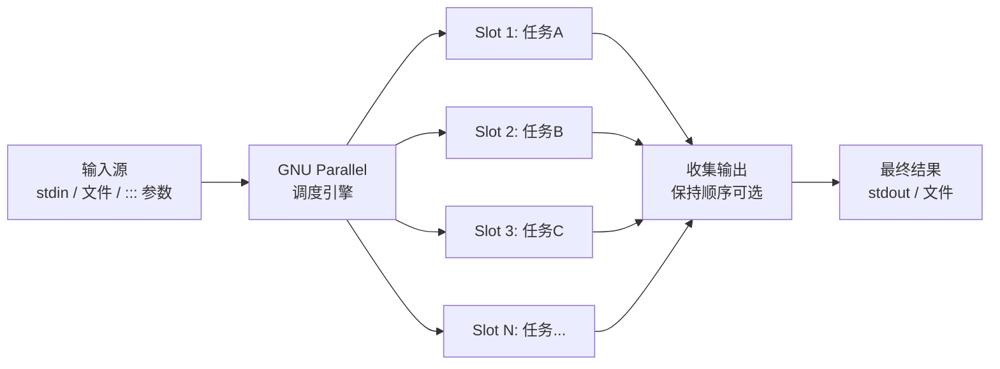
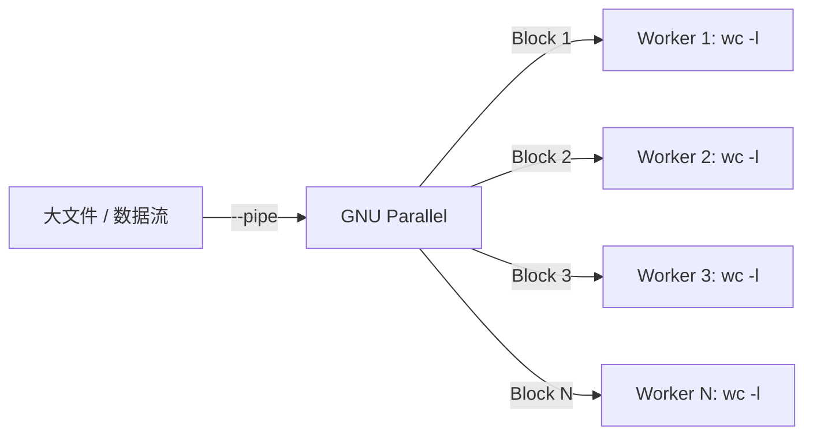
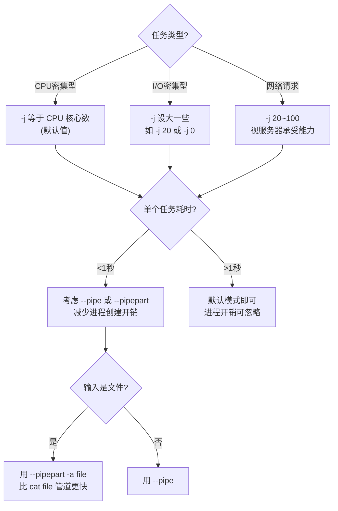

[toc]

# GNU Parallel 系统学习指南

## 一、概述

GNU Parallel 是一个 **Shell 工具**，用于在一台或多台计算机上**并行执行任务**。它可以将输入拆分为多个块，同时分发给多个进程/核心处理，从而大幅提升批量任务的执行效率。

> 本文介绍parallel,但是复杂并发执行任务的脚本建议使用更加结构化的脚本语言,例如python.

### 与相关工具对比

| 特性         | `for` 循环 | `xargs -P` | GNU Parallel                   |
| ------------ | ---------- | ---------- | ------------------------------ |
| 并行执行     | ❌ 串行     | ✅ 基础并行 | ✅ 高级并行                     |
| 输出顺序保持 | ✅          | ❌ 输出混杂 | ✅ `--keep-order`               |
| 进度条       | ❌          | ❌          | ✅ `--progress`/`--bar`         |
| 失败重试     | ❌          | ❌          | ✅ `--retry-failed`             |
| 远程执行     | ❌          | ❌          | ✅ `--sshlogin`                 |
| 替换字符串   | 无         | `{}` 基础  | `{}` `{.}` `{/}` `{//}` 等丰富 |
| 断点续传     | ❌          | ❌          | ✅ `--resume` / `--joblog`      |
| 负载控制     | ❌          | ❌          | ✅ `--load` / `--memfree`       |

---

## 二、安装

```bash
# Debian/Ubuntu
sudo apt install parallel

# CentOS/RHEL/Fedora
sudo dnf install parallel

# macOS (Homebrew)
brew install parallel

# 从源码安装（获取最新版）
wget https://ftp.gnu.org/gnu/parallel/parallel-latest.tar.bz2
tar xjf parallel-latest.tar.bz2
cd parallel-*
./configure && make && sudo make install

# 验证安装
parallel --version

# 关闭首次运行的引用提示（常见操作）
mkdir -p ~/.parallel && touch ~/.parallel/will-cite
```

---

## 三、核心概念与工作原理

### 3.1 执行流程



### 3.2 核心术语

| 术语                   | 含义                      | 示例                          |
| ---------------------- | ------------------------- | ----------------------------- |
| **Job**                | 一个待执行的命令实例      | `gzip file1.txt`              |
| **Job Slot**           | 可同时运行的并发槽位      | 默认等于 CPU 核心数           |
| **Input Source**       | 参数的来源                | stdin、文件、`:::` 内联       |
| **Replacement String** | 命令模板中的占位符        | `{}`、`{.}`、`{/}` 等         |
| **Joblog**             | 任务执行日志              | 记录每个 job 的退出码、耗时等 |
| **Block**              | `--pipe` 模式下的数据分块 | 默认 1MB                      |

---

## 四、基础语法

### 4.1 最基本的形式

```bash
parallel [选项] 命令模板 ::: 参数列表
```

```bash
# 等价于依次执行 echo 1; echo 2; echo 3，但是并行
parallel echo ::: 1 2 3

# 从 stdin 读取输入（管道模式）
cat filelist.txt | parallel gzip

# 从文件读取参数
parallel -a filelist.txt gzip
```

### 4.2 三种输入方式


```bash
# 方式1: 内联参数 :::
parallel echo ::: apple banana cherry

# 方式2: 从文件读取 ::::
echo -e "apple\nbanana\ncherry" > fruits.txt
parallel echo :::: fruits.txt

# 方式3: 管道 stdin
echo -e "apple\nbanana\ncherry" | parallel echo

# 混合使用
parallel echo {1} {2} ::: A B ::: 1 2
# 输出: A 1 / A 2 / B 1 / B 2（笛卡尔积）
```

---

## 五、替换字符串（Replacement Strings）— 核心重点

这是 GNU Parallel 最强大的特性之一。

### 5.1 内置替换字符串速查

假设输入为 `/home/user/documents/report.final.txt`：

| 替换字符串 | 含义                  | 结果                                    |
| ---------- | --------------------- | --------------------------------------- |
| `{}`       | 完整输入              | `/home/user/documents/report.final.txt` |
| `{.}`      | 去掉扩展名            | `/home/user/documents/report.final`     |
| `{/}`      | 仅文件名（basename）  | `report.final.txt`                      |
| `{//}`     | 仅目录路径（dirname） | `/home/user/documents`                  |
| `{/.}`     | 文件名且去扩展名      | `report.final`                          |
| `{#}`      | 任务序号（从1开始）   | `1`, `2`, `3`...                        |
| `{%}`      | Job Slot 编号         | `1`~`N`（N=并发数）                     |

### 5.2 实战示例

```bash
# 批量转换图片格式: .png → .jpg
parallel convert {} {.}.jpg ::: *.png
# input.png → convert input.png input.jpg

# 在新目录保持文件名
mkdir -p output
parallel convert {} output/{/} ::: images/*.png
# images/photo.png → convert images/photo.png output/photo.png

# 使用序号重命名
parallel mv {} photo_{#}.jpg ::: *.jpg
# 第1个文件 → photo_1.jpg, 第2个 → photo_2.jpg
```

### 5.3 多参数位置引用

当有多个输入源时，使用 `{1}`, `{2}`, ... 引用不同位置：

```bash
parallel echo {1} loves {2} ::: Alice Bob ::: cats dogs
# Alice loves cats
# Alice loves dogs
# Bob loves cats
# Bob loves dogs

# 组合替换字符串: {1.} 表示第1个参数去扩展名
parallel ffmpeg -i {1} -s {2} {1.}_{2}.mp4 \
  ::: *.avi ::: 1920x1080 1280x720
```

### 5.4 自定义分隔符与替换字符串

```bash
# 使用逗号分隔的 CSV 数据
echo -e "John,25\nJane,30" | parallel --colsep ',' echo Name={1} Age={2}
# Name=John Age=25
# Name=Jane Age=30

# 自定义替换字符串
parallel -I @@ echo "Hello @@" ::: World
# Hello World
```

---

## 六、关键选项详解

### 6.1 并发控制

| 选项                  | 作用                            | 示例                        |
| --------------------- | ------------------------------- | --------------------------- |
| `-j N` / `--jobs N`   | 并发任务数                      | `-j 4`（4个并行）           |
| `-j +N`               | CPU核心数 + N                   | `-j +0`（等于核心数，默认） |
| `-j N%`               | CPU核心数的百分比               | `-j 50%`                    |
| `-j 0`                | 尽可能多地并发                  | 适合I/O密集型               |
| `--load N`            | 当系统负载 > N 时暂停启动新任务 | `--load 80%`                |
| `--memfree N`         | 当可用内存 < N 时暂停           | `--memfree 1G`              |
| `--semaphore` / `sem` | 信号量模式（限制并发脚本）      | 见示例                      |

```bash
# 最多4个任务并行
parallel -j 4 gzip ::: *.log

# 根据系统负载自动调整
parallel -j 8 --load 80% heavy_task ::: {1..100}

# 确保可用内存充足
parallel --memfree 2G --jobs 4 process_data ::: *.csv
```

### 6.2 输出控制

| 选项                  | 作用                                         |
| --------------------- | -------------------------------------------- |
| `--keep-order` / `-k` | 按输入顺序输出结果（默认谁先完成谁先输出）   |
| `--tag`               | 每行输出前加上输入参数作为标签               |
| `--tagstring STR`     | 自定义标签格式                               |
| `--results DIR`       | 将每个 job 的 stdout/stderr 保存到目录结构中 |
| `--group`             | 将每个 job 的输出整体分组（默认行为）        |
| `--ungroup` / `-u`    | 不分组，实时输出（更快，但可能混杂）         |
| `--line-buffer`       | 按行缓冲（折中方案，行不会混杂）             |

```bash
# 保持顺序
parallel -k echo ::: 3 1 2
# 输出始终是: 3, 1, 2

# 带标签
parallel --tag 'sleep {}; echo done' ::: 2 1 3
# 2    done
# 1    done
# 3    done

# 保存结果到目录
parallel --results outdir/ hostname -s ::: ::: 
```

### 6.3 进度与日志

```bash
# 显示进度
parallel --progress gzip ::: *.log

# 进度条（需要终端支持）
parallel --bar gzip ::: *.log

# 显示预估完成时间
parallel --eta gzip ::: *.log

# 任务日志（关键功能！）
parallel --joblog job.log gzip ::: *.log
cat job.log
# Seq  Host  Starttime        JobRuntime  Send  Receive  Exitval  Signal  Command
# 1    :     1700000000.000   0.050       0     0        0        0       gzip file1.log
```

---

## 七、高级用法

### 7.1 Pipe 模式 —— 数据分块并行处理

普通模式是**参数并行**（每个参数对应一个任务），Pipe 模式是**数据流并行**（将 stdin 拆分成多块分发）。



```bash
# 将大文件分块处理（每块 10MB）
cat huge_file.csv | parallel --pipe --block 10M wc -l

# 并行排序大文件（经典用法）
cat huge_file.txt | parallel --pipe --merge-sort sort | sort -m

# 并行 grep
cat huge_log.txt | parallel --pipe grep 'ERROR'

# 按记录分割（保持每条记录完整性）
cat data.csv | parallel --pipe --header : --block 5M process_csv.py

# --pipepart: 直接对文件分块（比 --pipe 更快，避免 cat）
parallel --pipepart -a huge_file.csv --block 10M wc -l
```

| `--pipe` 选项    | 作用                          |
| ---------------- | ----------------------------- |
| `--block SIZE`   | 每块大小（默认 1M）           |
| `--recstart STR` | 记录起始标记                  |
| `--recend STR`   | 记录结束标记（默认 `\n`）     |
| `--header :`     | 将首行（表头）传给每个 worker |
| `--round-robin`  | 轮询分发（而非按块分）        |
| `--pipepart`     | 直接 seek 文件（更高效）      |

### 7.2 远程执行

```bash
# 在远程主机上执行
parallel --sshlogin user@server1,user@server2 echo ::: A B C D

# 使用 SSH 登录文件
cat << EOF > hosts.txt
user@server1
user@server2
user@server3
EOF
parallel --sshloginfile hosts.txt echo ::: A B C D

# 传输文件到远程 → 执行 → 取回结果
parallel --sshlogin user@server \
  --transferfile {} \
  --return {.}.gz \
  --cleanup \
  gzip {} ::: *.txt

# 简写（--trc = --transferfile + --return + --cleanup）
parallel --sshlogin user@server --trc {.}.gz gzip {} ::: *.txt
```

### 7.3 失败处理与断点续传

```bash
# 记录日志 + 失败后重试
parallel --joblog job.log --retries 3 ./might_fail.sh ::: {1..100}

# 断点续传：只运行上次未完成/失败的任务
parallel --joblog job.log --resume-failed ./might_fail.sh ::: {1..100}

# 任何任务失败就立即终止所有任务
parallel --halt now,fail=1 ./critical_task.sh ::: {1..100}

# 失败比例超过 20% 时终止
parallel --halt soon,fail=20% ./task.sh ::: {1..1000}
```

| `--halt` 模式   | 含义                                        |
| --------------- | ------------------------------------------- |
| `now,fail=1`    | 第1个失败立即终止所有                       |
| `soon,fail=1`   | 第1个失败后不启动新任务，等待运行中任务完成 |
| `now,fail=20%`  | 失败率达20%立即终止                         |
| `now,success=1` | 第1个成功就终止（竞赛模式）                 |

### 7.4 信号量模式（限流）

适用于在脚本循环中限制并发数：

```bash
# 在 for 循环中限制并发为4
for file in *.gz; do
  sem -j 4 zcat "$file" '|' process_data
done
sem --wait   # 等待所有任务完成

# 等价于（更推荐的写法）
parallel -j 4 'zcat {} | process_data' ::: *.gz
```

### 7.5 SQL 模式与任务队列

```bash
# 使用 SQLite 作为任务队列
parallel --sqlandworker sqlite3:///tmp/my.db echo ::: {1..100}

# 先创建任务，后执行（分步模式）
# 步骤1: 往队列里塞任务
parallel --sqlmaster sqlite3:///tmp/my.db echo ::: {1..100}

# 步骤2: 启动 worker（可在多台机器上运行）
parallel --sqlworker sqlite3:///tmp/my.db
```

---

## 八、经典实战用例

### 8.1 文件处理类

```bash
# 1. 批量压缩文件
parallel gzip ::: *.log

# 2. 批量解压
parallel gunzip ::: *.gz

# 3. 批量重命名（小写转大写）
parallel mv {} '{= s/(.+)/\U$1/ =}' ::: *.txt

# 4. 批量转换图片格式 + 调整大小
parallel convert {} -resize 800x600 resized/{/} ::: photos/*.jpg

# 5. 批量转码视频
parallel -j 2 ffmpeg -i {} -c:v libx264 -crf 23 output/{/.}.mp4 ::: *.avi

# 6. 查找并删除超过30天的日志
find /var/log -name "*.log" -mtime +30 | parallel rm

# 7. 计算多个文件的 MD5
parallel md5sum ::: *.iso > checksums.md5
```

### 8.2 数据处理类

```bash
# 1. 并行下载文件列表
parallel -j 10 wget -q ::: url1 url2 url3
cat urls.txt | parallel -j 10 wget -q

# 2. 使用 curl 并行请求 API
parallel -j 20 --tag \
  'curl -s "https://api.example.com/users/{}"' ::: {1..100}

# 3. 并行处理 CSV 分片
parallel --header : --colsep ',' \
  echo 'Name={Name} Age={Age}' :::: people.csv

# 4. 并行数据库导入
parallel -j 4 \
  "mysql -u root mydb < {}" ::: sql_parts/*.sql

# 5. 并行 grep 多个文件
parallel -j 8 grep -l 'ERROR' ::: /var/log/*.log
```

### 8.3 系统运维类

```bash
# 1. 并行 ping 检测主机存活
parallel -j 50 --tag 'ping -c 1 -W 1 {} >/dev/null 2>&1 && echo UP || echo DOWN' \
  ::: 192.168.1.{1..254}

# 2. 并行 SSH 执行命令
parallel --sshlogin server1,server2,server3 --tag \
  'df -h / | tail -1' ::: ""

# 3. 并行 rsync 同步多个目录
parallel rsync -avz {} backup_server:/backup/{/} ::: /data/dir{1..10}

# 4. 批量测试端口
parallel -j 100 --tag \
  "nc -zw1 {} 2>&1 && echo OPEN || echo CLOSED" \
  ::: host1:80 host2:443 host3:22
```

### 8.4 开发与 CI/CD 类

```bash
# 1. 并行运行测试套件
parallel --halt soon,fail=1 python -m pytest {} ::: tests/test_*.py

# 2. 并行 lint 检查
parallel --tag flake8 ::: src/**/*.py

# 3. 并行构建多个 Docker 镜像
parallel --tag -j 4 \
  'docker build -t myapp:{} -f Dockerfile.{} .' \
  ::: alpine debian ubuntu

# 4. 并行编译（替代 make -j）
find src/ -name "*.c" | parallel gcc -c {} -o {.}.o
```

---

## 九、Perl 表达式替换（高级替换）

GNU Parallel 内置 Perl 表达式引擎，通过 `{= EXPR =}` 语法进行灵活的参数变换：

```bash
# 转为大写
parallel echo '{= $_=uc($_) =}' ::: hello world
# HELLO  WORLD

# 数字补零
parallel echo '{= $_=sprintf("%04d",$_) =}' ::: 1 42 100
# 0001  0042  0100

# 正则替换
parallel echo '{= s/foo/bar/g =}' ::: "foobar" "foofoo"
# barbar  barbar

# 条件过滤（跳过不匹配的输入）
parallel echo '{= /\.txt$/ or skip() =}' ::: a.txt b.log c.txt
# a.txt  c.txt

# 综合示例：从 URL 提取域名
parallel echo '{= s|https?://([^/]+).*|$1| =}' \
  ::: "https://example.com/page" "http://test.org/api"
# example.com  test.org
```

---

## 十、性能调优指南

### 10.1 调优决策树



### 10.2 性能要点

| 场景       | 建议                                           | 原因                |
| ---------- | ---------------------------------------------- | ------------------- |
| 大量小任务 | 使用 `--pipe` 或打包任务                       | 避免进程创建开销    |
| 处理大文件 | `--pipepart -a file` 优于 `cat file \| --pipe` | 直接 seek，无需 cat |
| 输出不重要 | 使用 `--ungroup` 或 `--line-buffer`            | 减少缓冲开销        |
| 远程执行   | 使用 `--controlmaster`                         | SSH 连接复用        |
| I/O 瓶颈   | 减少 `-j`，避免磁盘抢占                        | 过度并行反而更慢    |
| 内存受限   | `--memfree 1G`                                 | 自动暂停避免 OOM    |

---

## 十一、最佳实践与常见陷阱

### ✅ 最佳实践

```bash
# 1. 始终先用 --dry-run 预览命令
parallel --dry-run gzip ::: *.log

# 2. 始终使用 --joblog 记录任务状态
parallel --joblog tasks.log --resume-failed my_task ::: {1..1000}

# 3. 使用 --halt 控制失败策略
parallel --halt soon,fail=5% critical_task ::: inputs

# 4. 复杂命令使用引号包裹
parallel 'echo {} | wc -c' ::: hello world

# 5. 使用函数（需要 export）
my_func() { echo "Processing: $1"; sleep 1; }
export -f my_func
parallel my_func ::: A B C D

# 6. 大批量任务添加进度提示
parallel --bar --joblog run.log task ::: {1..10000}

# 7. 使用 --results 保存结构化输出
parallel --results output_dir/ curl -s 'https://api.example.com/{}' ::: {1..100}
```

### ❌ 常见陷阱

| 陷阱                   | 问题                               | 正确做法                             |
| ---------------------- | ---------------------------------- | ------------------------------------ |
| 未导出函数             | `bash: my_func: command not found` | `export -f my_func`                  |
| 特殊字符未转义         | 管道符 `\|` 在 parallel 中被解释   | 用引号包裹整个命令 `'cmd1 \| cmd2'`  |
| `-j 0` 用于 CPU 密集型 | 启动过多进程，上下文切换浪费       | 使用默认值或 `-j $(nproc)`           |
| 忽略退出码             | 不知道哪些任务失败了               | 加 `--joblog`                        |
| 变量未传递             | 并行子进程看不到变量               | `parallel --env VAR` 或 `export VAR` |
| 管道内命令未加引号     | `parallel echo {} \| wc` 解析错误  | `parallel 'echo {} \| wc'`           |

```bash
# ❌ 错误：变量不会传递
MY_DIR="/data"
parallel echo $MY_DIR/{} ::: a b c   # $MY_DIR 在 parallel 之前就被展开了（这里碰巧OK）

# ✅ 更安全：显式传递环境变量
export MY_DIR="/data"
parallel --env MY_DIR 'echo ${MY_DIR}/{}' ::: a b c

# ❌ 错误：管道未被正确处理
parallel echo {} | wc -l ::: a b c   # wc 接收的是 parallel 整体输出

# ✅ 正确：引号包裹
parallel 'echo {} | wc -l' ::: a b c   # 每个 job 内部管道
```

---

## 十二、速查表

### 12.1 最常用命令模式

```bash
# 模式1: 简单并行
parallel COMMAND ::: ARG1 ARG2 ARG3

# 模式2: 管道输入
cat input.txt | parallel COMMAND

# 模式3: 文件输入
parallel -a input.txt COMMAND

# 模式4: 组合输入（笛卡尔积）
parallel COMMAND {1} {2} ::: A B ::: 1 2

# 模式5: 链接输入（一一对应，非笛卡尔积）
parallel --link COMMAND {1} {2} ::: A B C ::: 1 2 3
# A-1, B-2, C-3（而非6种组合）

# 模式6: Pipe 模式
cat bigfile | parallel --pipe COMMAND

# 模式7: 远程执行
parallel --sshlogin host1,host2 COMMAND ::: ARGS
```

### 12.2 常用选项一览

| 类别     | 选项                  | 简写      | 说明                                    |
| -------- | --------------------- | --------- | --------------------------------------- |
| **并发** | `--jobs N`            | `-j N`    | 并发数                                  |
|          | `--load N`            |           | 负载限制                                |
|          | `--memfree N`         |           | 可用内存限制                            |
| **输入** | `--arg-file FILE`     | `-a FILE` | 从文件读取参数                          |
|          | `--colsep REGEX`      |           | 列分隔符                                |
|          | `--header :`          |           | 首行作为列名                            |
| **输出** | `--keep-order`        | `-k`      | 保持输入顺序                            |
|          | `--tag`               |           | 输出加标签                              |
|          | `--results DIR`       |           | 结构化输出到目录                        |
|          | `--line-buffer`       |           | 按行缓冲                                |
| **日志** | `--joblog FILE`       |           | 任务日志                                |
|          | `--resume`            |           | 跳过已完成任务                          |
|          | `--resume-failed`     |           | 重跑失败任务                            |
|          | `--progress`          |           | 显示进度                                |
|          | `--bar`               |           | 显示进度条                              |
|          | `--eta`               |           | 显示预估时间                            |
| **错误** | `--retries N`         |           | 失败重试次数                            |
|          | `--halt MODE`         |           | 终止策略                                |
|          | `--timeout N`         |           | 单任务超时（秒）                        |
| **远程** | `--sshlogin HOST`     | `-S HOST` | SSH 远程主机                            |
|          | `--sshloginfile FILE` |           | 主机列表文件                            |
|          | `--transferfile {}`   | `--tf {}` | 传输文件到远程                          |
|          | `--return FILE`       |           | 取回结果文件                            |
|          | `--cleanup`           |           | 完成后清理远程文件                      |
|          | `--trc {.}.out`       |           | 传输+取回+清理简写                      |
| **调试** | `--dry-run`           |           | 仅打印命令不执行                        |
|          | `--verbose`           | `-v`      | 执行前打印命令                          |
| **其他** | `--null`              | `-0`      | 输入以 NULL 分隔（配合 `find -print0`） |
|          | `--delimiter STR`     | `-d STR`  | 自定义输入分隔符                        |
|          | `--link`              |           | 链接模式（非笛卡尔积）                  |
|          | `--xargs`             |           | 单个命令接多个参数（类似 xargs）        |

---

## 十三、学习资源与进阶

```bash
# 内置教程（强烈推荐）
parallel --teaser

# 完整手册
man parallel
man parallel_tutorial

# 示例集（200+示例）
man parallel_examples

# 在线文档
# https://www.gnu.org/software/parallel/


```

---

**小结**：GNU Parallel 的核心价值在于**零改造成本地将串行任务并行化**。掌握 `替换字符串`、`-j 并发控制`、`--pipe 数据分块`、`--joblog 断点续传` 这四个核心能力，就能覆盖 90% 的使用场景。

从 `parallel --dry-run` 开始，安全地探索它的强大能力。