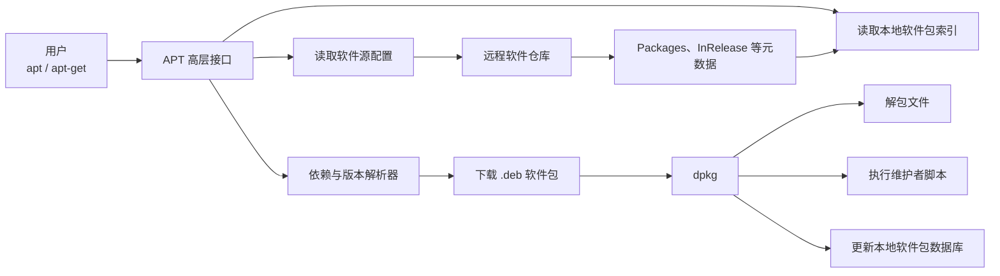
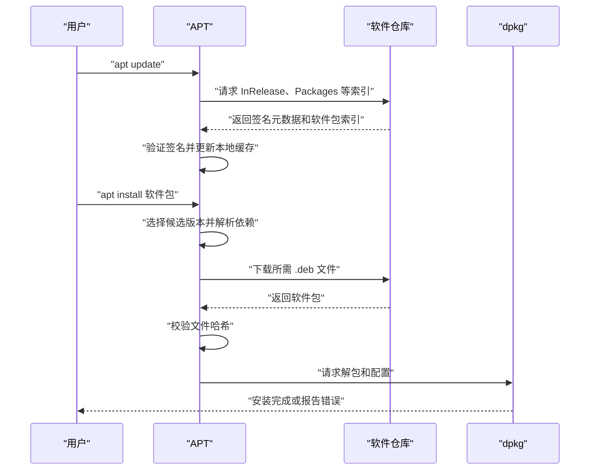
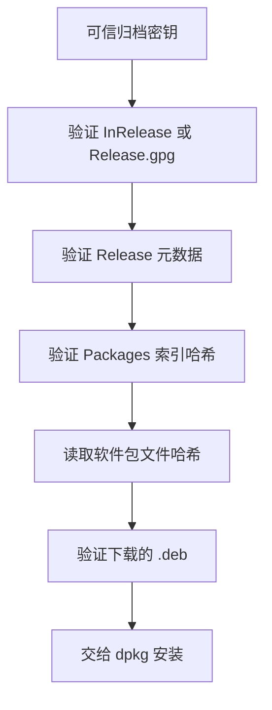
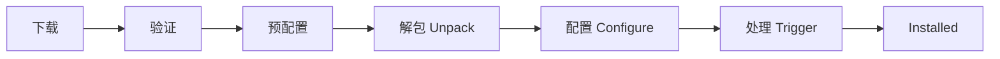
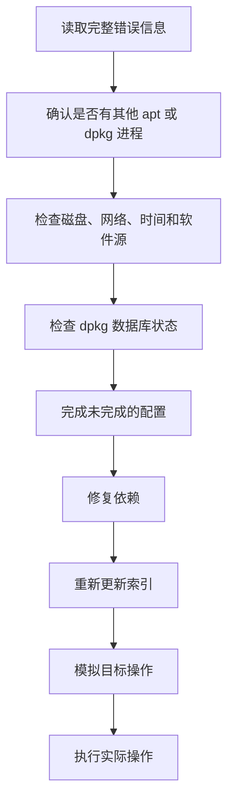

[toc]


以下内容可直接作为新手教程、课程讲义或知识库文章使用。

## APT 包管理工具：从基础原理到安全实践

APT（Advanced Package Tool，高级软件包工具）是 Debian、Ubuntu 及其衍生发行版中常用的软件包管理系统。它负责从软件仓库获取软件包信息，计算依赖关系，选择合适的软件包版本，并调用底层的 `dpkg` 完成解包、安装、配置和删除操作。([Ubuntu](https://ubuntu.com/server/docs/reference/glossary/?utm_source=chatgpt.com))

学习 APT 时，不应只记忆 `apt install`、`apt update` 等命令，更重要的是理解以下问题：

- APT 从哪里知道有哪些软件包？
- `apt update` 究竟更新了什么？
- 为什么一个软件包会自动安装许多其他软件包？
- `upgrade` 和 `full-upgrade` 有什么区别？
- APT 如何验证软件包没有被篡改？
- 为什么第三方仓库可能破坏系统升级？
- `apt`、`apt-get`、`apt-cache` 和 `dpkg` 应该如何选择？
- 软件包安装失败后，应该按照什么顺序修复？

------

## 学习路线

建议按照以下顺序学习：

| 学习阶段     | 核心内容                                  | 学习成果                   |
| ------------ | ----------------------------------------- | -------------------------- |
| 建立整体认识 | APT、仓库、索引、依赖、`dpkg`             | 理解 APT 的工作边界        |
| 掌握基础操作 | 更新、搜索、安装、升级、删除              | 能完成日常软件管理         |
| 理解软件源   | suite、codename、component、deb822        | 能正确配置官方和第三方仓库 |
| 掌握查询工具 | `apt show`、`apt-cache policy`、`dpkg -S` | 能解释软件包的来源和状态   |
| 理解依赖解析 | Depends、Recommends、自动安装状态         | 能判断自动删除是否安全     |
| 学习版本控制 | 指定版本、hold、pinning                   | 能控制候选版本             |
| 学习安全机制 | 仓库签名、密钥、`Signed-By`               | 能安全添加第三方仓库       |
| 学习故障排查 | 中断安装、依赖损坏、锁冲突                | 能处理常见 APT 故障        |
| 学习自动化   | `apt-get`、非交互模式、容器构建           | 能编写稳定的自动化脚本     |

------

## APT 在系统中的位置

APT 不是单独完成所有工作的工具，而是一套分层的软件包管理体系。



可以将整个过程理解为：

- **APT 负责规划**：查找软件、选择版本、解决依赖、下载安装包。
- **`dpkg` 负责执行**：解开 `.deb` 文件、写入文件、运行安装脚本、记录安装状态。
- **软件仓库负责提供内容**：包括软件包、版本信息、依赖信息和签名数据。

`dpkg` 本身主要管理本机已有的 Debian 软件包和 `.deb` 文件，不会像 APT 那样自动从远程仓库下载依赖。Debian 官方手册将其定位为比 APT 更底层的软件包管理工具。([Debian Manpages](https://manpages.debian.org/trixie/dpkg/dpkg.1.en.html?utm_source=chatgpt.com))

------

## APT 工具家族

| 工具                 | 主要用途                         | 推荐使用场景                 |
| -------------------- | -------------------------------- | ---------------------------- |
| `apt`                | 面向最终用户的高层命令           | 日常交互式管理               |
| `apt-get`            | 功能稳定、选项丰富的包操作工具   | Shell 脚本、自动化、恢复操作 |
| `apt-cache`          | 查询 APT 本地元数据缓存          | 查询依赖、候选版本和来源     |
| `apt-mark`           | 管理自动、手动、hold 等标记      | 控制自动删除和版本保持       |
| `dpkg`               | 管理本地已安装软件包和 `.deb`    | 查询文件归属、修复配置状态   |
| `dpkg-query`         | 以可格式化方式查询 `dpkg` 数据库 | 脚本化查询已安装软件         |
| `dpkg-deb`           | 查看、解包或构建 `.deb` 文件     | 检查软件包内容               |
| `apt-file`           | 查询尚未安装的软件包包含哪些文件 | 查找“哪个包提供某个文件”     |
| `unattended-upgrade` | 自动安装符合策略的更新           | 自动安全更新                 |
| `aptitude`           | APT 的交互式终端界面             | 需要 TUI 或探索依赖方案时    |

### `apt` 和 `apt-get` 如何选择

`apt` 面向人类交互，默认输出更友好，例如进度显示和简化的信息。其行为可能随着版本发展而调整。

`apt-get` 和 `apt-cache` 更重视命令行兼容性，因此在脚本、Dockerfile、配置管理系统和长期维护的自动化程序中，应优先使用它们。Debian 的 `apt(8)` 手册明确建议脚本使用专用的 APT 工具，而不是依赖 `apt` 的交互式输出。([Debian Manpages](https://manpages.debian.org/trixie/apt/apt.8.en.html?utm_source=chatgpt.com))

推荐原则：

- 终端中手动操作：使用 `apt`
- Shell 脚本和 Dockerfile：使用 `apt-get`
- 查询依赖和候选版本：使用 `apt-cache`
- 查询本机安装文件：使用 `dpkg` 或 `dpkg-query`

------

## 核心术语

| 术语       | 英文                            | 含义                                                 |
| ---------- | ------------------------------- | ---------------------------------------------------- |
| 软件包     | Package                         | 软件及其元数据、脚本和文件的分发单元                 |
| 二进制包   | Binary Package                  | 可直接安装的 `.deb` 软件包                           |
| 源码包     | Source Package                  | 用于构建一个或多个二进制包的源码与打包文件           |
| 软件仓库   | Repository                      | 存放软件包和索引数据的服务器或目录                   |
| 软件源     | Package Source                  | 本机配置的仓库入口                                   |
| 索引       | Package Index                   | 描述仓库中软件包名称、版本和依赖的数据               |
| 套件       | Suite                           | `stable`、`testing`、`unstable` 等滚动名称           |
| 代号       | Codename                        | `bookworm`、`trixie`、`noble` 等固定发行代号         |
| 组件       | Component                       | `main`、`contrib`、`non-free`、`universe` 等仓库分区 |
| 架构       | Architecture                    | `amd64`、`arm64`、`i386`、`all` 等目标平台           |
| 候选版本   | Candidate Version               | APT 当前计划安装的软件包版本                         |
| 依赖       | Dependency                      | 软件包正常安装或工作所需的其他软件包                 |
| 虚拟包     | Virtual Package                 | 由一个或多个实际软件包通过 `Provides` 提供的能力名称 |
| 配置文件   | Conffile                        | 由 `dpkg` 特别跟踪的系统配置文件                     |
| 维护者脚本 | Maintainer Script               | 安装、升级或删除时执行的脚本                         |
| 固定版本   | Pinning                         | 使用优先级控制候选版本或仓库来源                     |
| 自动安装包 | Automatically Installed Package | 为满足依赖而安装的软件包                             |
| 手动安装包 | Manually Installed Package      | 用户明确要求安装的软件包                             |

------

## 软件包包含什么

一个典型的 Debian 二进制软件包不仅包含程序文件，还可能包含：

- 可执行文件
- 共享库
- systemd 服务单元
- 配置文件
- 文档和手册页
- 图标、语言文件和其他资源
- 软件包控制信息
- 安装前脚本 `preinst`
- 安装后脚本 `postinst`
- 删除前脚本 `prerm`
- 删除后脚本 `postrm`
- 触发器（Trigger）信息
- 校验和与依赖关系

可以使用以下命令检查一个尚未安装的 `.deb` 文件：

```bash
dpkg-deb --info package.deb
dpkg-deb --contents package.deb
```

`dpkg-deb` 可以读取和解包 Debian 软件包，但仅将文件解压到根目录并不等同于正确安装，因为正常安装还涉及数据库记录、依赖、维护者脚本和触发器。([Debian Manpages](https://manpages.debian.org/trixie/dpkg/dpkg-deb.1.en.html?utm_source=chatgpt.com))

------

## APT 使用的关键目录

| 路径                                | 作用                             |
| ----------------------------------- | -------------------------------- |
| `/etc/apt/sources.list`             | 传统的主软件源配置文件           |
| `/etc/apt/sources.list.d/`          | 独立的软件源配置目录             |
| `/etc/apt/sources.list.d/*.sources` | deb822 格式的软件源文件          |
| `/etc/apt/sources.list.d/*.list`    | 传统单行格式的软件源文件         |
| `/etc/apt/keyrings/`                | 系统管理员手动管理的仓库密钥     |
| `/usr/share/keyrings/`              | 通常由软件包管理的仓库密钥       |
| `/etc/apt/preferences`              | APT 全局版本优先级配置           |
| `/etc/apt/preferences.d/`           | 独立的 pinning 配置目录          |
| `/etc/apt/apt.conf`                 | APT 主配置文件                   |
| `/etc/apt/apt.conf.d/`              | APT 分片配置目录                 |
| `/var/lib/apt/lists/`               | `apt update` 下载的软件包索引    |
| `/var/cache/apt/archives/`          | 下载的 `.deb` 软件包缓存         |
| `/var/lib/dpkg/status`              | 本机软件包安装状态数据库         |
| `/var/lib/dpkg/info/`               | 已安装包的文件列表、脚本和元数据 |
| `/var/log/apt/history.log`          | APT 操作历史                     |
| `/var/log/apt/term.log`             | APT 终端操作输出                 |
| `/var/log/dpkg.log`                 | `dpkg` 安装、升级和删除记录      |

APT 会将仓库索引放在本地状态目录中，将下载的软件包放入归档缓存目录；`dpkg` 则维护本机实际安装状态。([Debian Manpages](https://manpages.debian.org/trixie/apt/apt.conf.5.en.html?utm_source=chatgpt.com))

------

## APT 的基本工作流程



------

## 查看系统信息

在修改软件源或安装第三方软件前，应先确定发行版、版本和架构。

```bash
cat /etc/os-release
dpkg --print-architecture
uname -m
```

查看已经启用的附加架构：

```bash
dpkg --print-foreign-architectures
```

注意：

- `uname -m` 描述内核运行的硬件架构。
- `dpkg --print-architecture` 描述 Debian 软件包管理系统的主架构。
- 两者的命名可能不同，例如 `x86_64` 通常对应 Debian 的 `amd64`。

------

## 更新软件包索引

```bash
sudo apt update
```

`apt update` 会从所有已配置的软件源下载最新的软件包元数据，并更新本地索引。它通常不会直接升级已经安装的软件。其他搜索、安装和升级命令都依赖这份本地索引。([Debian Manpages](https://manpages.debian.org/trixie/apt/apt.8.en.html?utm_source=chatgpt.com))

因此：

```bash
sudo apt update
```

表示“刷新可用软件信息”，而不是“更新所有软件”。

典型操作顺序是：

```bash
sudo apt update
apt list --upgradable
sudo apt upgrade
```

### 为什么安装前经常需要执行 `apt update`

假设仓库已经删除了旧版本软件包，但本机索引仍然指向旧版本，那么安装时可能出现：

```text
404 Not Found
```

此时通常先执行：

```bash
sudo apt update
```

如果仍然失败，再检查：

- 软件源是否对应当前发行版
- 仓库是否停止支持当前版本
- suite 或 codename 是否写错
- 系统时间是否正确
- 代理或网络是否缓存了旧数据

------

## 搜索和查看软件包

### 按名称和描述搜索

```bash
apt search nginx
apt search "web server"
```

搜索基于本机已经下载的软件包索引，因此搜索结果是否新鲜取决于最近一次 `apt update`。

在脚本中，不应依赖 `apt search` 的人类可读输出。可以根据需求使用 `apt-cache`、`apt-patterns` 或其他机器可读接口。

### 查看软件包详情

```bash
apt show nginx
```

常见字段包括：

| 字段             | 含义                 |
| ---------------- | -------------------- |
| `Package`        | 软件包名称           |
| `Version`        | 版本                 |
| `Architecture`   | 架构                 |
| `Installed-Size` | 安装后占用空间       |
| `Depends`        | 必需依赖             |
| `Recommends`     | 推荐依赖             |
| `Suggests`       | 建议安装的相关软件   |
| `Conflicts`      | 不能同时存在的软件包 |
| `Description`    | 软件包说明           |
| `Homepage`       | 上游项目主页         |

### 查看所有可用版本和来源

```bash
apt-cache policy nginx
```

典型输出结构：

```text
nginx:
  Installed: 1.24.0-2
  Candidate: 1.26.0-1
  Version table:
     1.26.0-1 500
        500 https://example.invalid stable/main amd64 Packages
 *** 1.24.0-2 100
        100 /var/lib/dpkg/status
```

其中：

- `Installed` 是当前已安装版本。
- `Candidate` 是执行普通安装或升级时准备选择的版本。
- 数字 `500`、`100` 是 APT 优先级。
- `***` 标记当前已安装版本。

`apt-cache` 主要读取本地 APT 缓存，不修改系统状态；如果索引太旧，查询结果也可能过时。([Debian Manpages](https://manpages.debian.org/trixie/apt/apt-cache.8.en.html?utm_source=chatgpt.com))

### 查看依赖关系

```bash
apt-cache depends nginx
apt-cache rdepends nginx
```

- `depends` 查看当前软件包依赖哪些包。
- `rdepends` 查看哪些软件包反向依赖当前包。

### 查看已安装软件包

```bash
apt list --installed
```

更适合脚本化处理的方式：

```bash
dpkg-query -W
```

自定义输出：

```bash
dpkg-query -W -f='${binary:Package}\t${Version}\n'
```

------

## 安装软件包

### 从仓库安装

```bash
sudo apt install nginx
```

APT 会：

- 查询候选版本
- 计算依赖关系
- 显示将安装、升级或删除的软件包
- 显示下载大小和磁盘变化
- 下载 `.deb`
- 验证仓库签名和软件包哈希
- 调用 `dpkg` 解包和配置

安装多个软件包：

```bash
sudo apt install curl git vim
```

### 安装前模拟操作

```bash
apt install --simulate nginx
```

也可以使用：

```bash
apt-get -s install nginx
```

模拟模式适合以下场景：

- 生产服务器
- 将要升级大量软件包
- 使用混合软件源
- 使用第三方仓库
- 不确定是否会删除重要软件
- 执行 `full-upgrade` 前

模拟输出中的常见标志：

| 标志   | 含义         |
| ------ | ------------ |
| `Inst` | 将安装或升级 |
| `Remv` | 将删除       |
| `Conf` | 将配置       |

### 只下载，不安装

```bash
apt-get download nginx
```

下载到当前目录。

或者：

```bash
sudo apt-get --download-only install nginx
```

后者会将所需软件包下载到 APT 缓存，但不执行安装。`apt-get` 官方手册将 `--download-only` 定义为仅获取软件包而不解包或安装。([Debian Manpages](https://manpages.debian.org/trixie/apt/apt-get.8.en.html?utm_source=chatgpt.com))

### 安装本地 `.deb`

推荐：

```bash
sudo apt install ./package.deb
```

路径前的 `./` 很重要，它告诉 APT 参数是本地文件，而不是仓库中的软件包名称。

相比：

```bash
sudo dpkg -i package.deb
```

使用 `apt install ./package.deb` 的优势是 APT 可以尝试从软件源补齐依赖。

`dpkg -i` 更适合：

- 底层诊断
- 离线环境
- 已经准备好全部依赖
- 需要观察具体的 `dpkg` 行为

------

## 软件包依赖关系

Debian 软件包可以通过多个字段表达依赖、冲突和替代关系。APT 依赖解析器会根据这些关系计算可安装方案。([Debian](https://www.debian.org/doc/debian-policy/ch-relationships.html?utm_source=chatgpt.com))

| 关系          | 含义                                         |
| ------------- | -------------------------------------------- |
| `Pre-Depends` | 在当前包开始解包前，依赖包必须达到规定状态   |
| `Depends`     | 软件包正常配置或运行所必需的依赖             |
| `Recommends`  | 通常应与主软件包一起安装的重要功能           |
| `Suggests`    | 有关联但不是核心功能的软件包                 |
| `Enhances`    | 当前包能够增强另一个包                       |
| `Breaks`      | 当前版本会导致特定版本的另一个包无法正常工作 |
| `Conflicts`   | 两个软件包不能同时安装或解包                 |
| `Replaces`    | 当前包可以替换另一个包的文件或整个包         |
| `Provides`    | 当前包提供某个虚拟能力或接口                 |

### 推荐依赖

APT 默认通常会安装 `Recommends`。

不安装推荐依赖：

```bash
sudo apt install --no-install-recommends package-name
```

这种方式适用于：

- 极简容器镜像
- 明确了解软件依赖的服务器
- 临时构建环境

但在普通桌面系统上，长期全局禁用 `Recommends` 可能导致：

- 缺少插件
- 缺少证书或辅助工具
- 功能不完整
- 文档和集成组件缺失

更稳妥的方式是针对特定命令使用 `--no-install-recommends`，而不是不加判断地全局关闭。

------

## 手动安装与自动安装

APT 会记录软件包是：

- 用户明确安装的
- 为满足依赖而自动安装的

例如：

```bash
sudo apt install application-a
```

如果 `application-a` 依赖 `library-b`，通常：

- `application-a` 被标记为手动安装
- `library-b` 被标记为自动安装

查看标记：

```bash
apt-mark showmanual
apt-mark showauto
```

将包标记为手动安装：

```bash
sudo apt-mark manual package-name
```

将包标记为自动安装：

```bash
sudo apt-mark auto package-name
```

当没有任何手动安装的软件包依赖某个自动安装包时，它可能成为可自动删除的软件包。`apt autoremove` 正是根据这类状态计算清理对象。([Debian Manpages](https://manpages.debian.org/trixie/apt/apt.8.en.html?utm_source=chatgpt.com))

------

## 升级软件包

### 查看可升级软件包

```bash
apt list --upgradable
```

### 常规升级

```bash
sudo apt upgrade
```

`apt upgrade` 会升级已安装软件包；如果新依赖是完成升级所必需的，可以安装新包，但不会为了完成升级而删除现有软件包。需要删除其他包才能升级的软件包会暂时不处理。([Debian Manpages](https://manpages.debian.org/trixie/apt/apt.8.en.html?utm_source=chatgpt.com))

适合：

- 日常维护
- 希望避免软件包被自动删除
- 普通安全更新
- 风险相对较低的更新

### 完整升级

```bash
sudo apt full-upgrade
```

`full-upgrade` 允许依赖解析器为了完成整体升级而删除已安装的软件包。([Debian Manpages](https://manpages.debian.org/trixie/apt/apt.8.en.html?utm_source=chatgpt.com))

常见用途：

- 内核或底层依赖发生变化
- 软件包重命名或被替代
- 发行版内部发生较大的依赖迁移
- 常规 `upgrade` 长期保留大量软件包

执行前建议：

```bash
apt full-upgrade --simulate
```

重点检查：

- 是否删除内核元包
- 是否删除桌面环境元包
- 是否删除 SSH、网络或存储组件
- 是否删除数据库或关键服务
- 是否从第三方仓库引入大量替代包

### 只升级指定软件包

```bash
sudo apt install --only-upgrade nginx
```

也可以使用：

```bash
sudo apt install nginx
```

当 `nginx` 已安装时，APT 通常会尝试将它升级到候选版本。

### 重新安装

```bash
sudo apt reinstall nginx
```

适合：

- 软件包文件被误删
- 可执行文件损坏
- 希望恢复软件包自带文件

注意：重新安装通常不会强行覆盖用户已经修改的受管理配置文件。

------

## `upgrade` 与发行版升级不是一回事

以下命令：

```bash
sudo apt upgrade
sudo apt full-upgrade
```

是在当前软件源配置范围内升级软件包。

它们本身不会自动把系统从一个发行版升级到另一个发行版。发行版升级通常需要：

- 修改或切换软件源的 suite 或 codename
- 使用发行版提供的升级工具
- 检查第三方仓库兼容性
- 阅读发行说明
- 处理废弃包和配置迁移
- 准备备份和恢复方案

Ubuntu 通常使用其发行版升级工具；Debian 应遵循对应版本的发行说明，不应只凭修改 codename 后直接执行 `full-upgrade`。

------

## 删除软件包

### 删除程序但保留系统配置

```bash
sudo apt remove nginx
```

`remove` 会删除软件包提供的大部分文件，但通常保留由软件包管理的系统配置文件，便于以后重新安装时恢复原有配置。

### 连同软件包配置一起清除

```bash
sudo apt purge nginx
```

`purge` 会进一步删除软件包登记的配置文件。

但它通常不会删除：

- 用户家目录中的配置
- 应用创建的业务数据
- 数据库中的内容
- 未被软件包登记的自定义文件
- 管理员额外创建的目录

`remove` 与 `purge` 的区别由 APT 官方手册明确区分；两者都不会自动清理用户家目录中的数据。([Debian Manpages](https://manpages.debian.org/trixie/apt/apt.8.en.html?utm_source=chatgpt.com))

### 删除不再需要的自动依赖

```bash
sudo apt autoremove
```

建议先模拟：

```bash
apt autoremove --simulate
```

如果列表中包含仍然需要的软件：

```bash
sudo apt-mark manual package-name
```

随后重新执行模拟。

部分较新的 APT 版本还提供：

```bash
sudo apt autopurge
```

它相当于自动删除不再需要的软件包，并清除其软件包配置；旧版本可能不支持此子命令。([Debian Manpages](https://manpages.debian.org/trixie/apt/apt-get.8.en.html?utm_source=chatgpt.com))

------

## 清理下载缓存

### 清空所有已下载的软件包缓存

```bash
sudo apt clean
```

该命令会清理 `/var/cache/apt/archives/` 中已下载的软件包归档。([Debian Manpages](https://manpages.debian.org/trixie/apt/apt-get.8.en.html?utm_source=chatgpt.com))

### 只清理已经无法从仓库下载的旧缓存

```bash
sudo apt autoclean
```

`autoclean` 比 `clean` 保守，只清理已经无法获取、通常没有继续保留价值的归档。([Debian Manpages](https://manpages.debian.org/trixie/apt/apt-get.8.en.html?utm_source=chatgpt.com))

### 查看缓存占用

```bash
du -sh /var/cache/apt/archives
```

不要把以下两个目录混为一谈：

| 目录                       | 内容                 |
| -------------------------- | -------------------- |
| `/var/cache/apt/archives/` | 已下载的 `.deb` 文件 |
| `/var/lib/apt/lists/`      | 仓库的软件包索引     |

------

## 软件包版本规则

Debian 软件包版本常见格式：

```text
epoch:upstream_version-debian_revision
```

例如：

```text
2:1.4.7-3ubuntu2
```

可以拆解为：

| 部分             | 示例       | 含义                               |
| ---------------- | ---------- | ---------------------------------- |
| Epoch            | `2`        | 用于覆盖普通版本比较结果的版本纪元 |
| Upstream Version | `1.4.7`    | 上游项目版本                       |
| Debian Revision  | `3ubuntu2` | Debian 或 Ubuntu 打包修订版本      |

并非每个版本都包含 Epoch 或 Debian Revision。

`dpkg` 会按照 Debian 自己的版本比较规则比较这些字段，而不是简单地按字典顺序或普通小数比较。特殊字符 `~` 会排在普通版本之前，因此经常用于预发行版本。([Debian Manpages](https://manpages.debian.org/trixie/dpkg-dev/deb-version.7.pt.html?utm_source=chatgpt.com))

比较版本：

```bash
dpkg --compare-versions 1.0~rc1 lt 1.0
echo $?
```

返回 `0` 表示条件成立。

查看版本排序：

```bash
printf '%s\n' '1.0' '1.0~rc1' '1.0-2' | sort -V
```

注意：通用的 `sort -V` 与 Debian 的完整版本比较算法并不完全等价。需要可靠判断时，应使用 `dpkg --compare-versions`。

------

## 安装指定版本

查看可用版本：

```bash
apt-cache policy package-name
apt list --all-versions package-name
```

安装指定版本：

```bash
sudo apt install package-name=1.2.3-1
```

从指定 suite 或 codename 选择：

```bash
sudo apt install package-name/stable
sudo apt install package-name/trixie
```

APT 支持使用 `包名=版本` 指定精确版本，也支持使用 `包名/发行版` 从指定 suite 或 codename 中选择。([Debian Manpages](https://manpages.debian.org/testing/apt/apt.8.en.html?utm_source=chatgpt.com))

指定版本时需要注意：

- 目标版本必须仍然存在于已配置仓库中。
- 依赖软件包也必须能形成可安装组合。
- 降级可能需要显式的 `--allow-downgrades`。
- 某些软件包降级后无法读取新版本生成的数据。
- 数据库、文件格式和系统服务降级尤其危险。

------

## 保持软件包版本

阻止软件包自动升级：

```bash
sudo apt-mark hold package-name
```

查看所有 hold：

```bash
apt-mark showhold
```

解除：

```bash
sudo apt-mark unhold package-name
```

`hold` 适合临时规避问题，例如：

- 新版本存在已知兼容性问题
- 某个内核版本与硬件不兼容
- 应用暂时只支持特定运行库
- 等待上游或发行版发布修复

不建议将大量基础包永久 hold，因为可能导致：

- 安全更新缺失
- 依赖解析越来越困难
- 完整升级失败
- 发行版升级被阻塞

------

## 软件源配置

APT 会读取：

```text
/etc/apt/sources.list
/etc/apt/sources.list.d/
```

现代 APT 支持两种主要格式：

| 格式        | 扩展名     | 特点                             |
| ----------- | ---------- | -------------------------------- |
| 单行格式    | `.list`    | 简洁但较难维护复杂选项           |
| deb822 格式 | `.sources` | 字段化、多行、易读、易禁用和扩展 |

Debian 的 `sources.list(5)` 同时定义了传统单行格式和 deb822 格式；Ubuntu 24.04 LTS 及之后的默认配置已采用 deb822 风格。([Debian Manpages](https://manpages.debian.org/trixie/sources.list(5)?utm_source=chatgpt.com))

### 传统单行格式

```text
deb https://deb.example.invalid/debian stable main
```

结构大致为：

```text
类型 选项 仓库地址 suite component...
```

### deb822 格式

```text
Types: deb
URIs: https://deb.example.invalid/debian
Suites: stable
Components: main
Architectures: amd64
Signed-By: /etc/apt/keyrings/example-archive-keyring.asc
```

字段含义：

| 字段            | 含义                                     |
| --------------- | ---------------------------------------- |
| `Types`         | `deb` 表示二进制包，`deb-src` 表示源码包 |
| `URIs`          | 仓库地址                                 |
| `Suites`        | suite 或 codename                        |
| `Components`    | 仓库组件                                 |
| `Architectures` | 限制需要下载索引的架构                   |
| `Signed-By`     | 限制该仓库使用的签名密钥                 |
| `Enabled`       | 设置为 `no` 可以禁用此条目               |

禁用一个 deb822 软件源：

```text
Enabled: no
Types: deb
URIs: https://deb.example.invalid/debian
Suites: stable
Components: main
Signed-By: /etc/apt/keyrings/example-archive-keyring.asc
```

相比删除配置，使用 `Enabled: no` 更适合临时排障和保留配置记录。

------

## Suite 与 Codename

以 Debian 风格仓库为例：

| 类型     | 示例              | 特点                           |
| -------- | ----------------- | ------------------------------ |
| Suite    | `stable`          | 会随着新稳定版发布而指向新版本 |
| Codename | `trixie`          | 固定指向特定发行版             |
| 更新仓库 | `trixie-updates`  | 特定发行版的常规更新           |
| 安全仓库 | `trixie-security` | 特定发行版的安全更新           |

使用 `stable` 的优点是可以跟随稳定版变化，但新稳定版发布时可能引入大规模升级。

使用 codename 的优点是系统不会仅因 `stable` 指针变化就自动跨发行版。

对于长期运行的服务器，通常应明确使用发行代号，并按照正式升级流程切换到下一代号。

------

## APT 仓库安全模型

APT 的安全机制不是简单地“验证每个 `.deb` 文件有没有独立签名”，而是建立一条从发行版归档密钥到软件包文件哈希的信任链。



Debian 仓库会对 `Release` 数据签名；`Release` 包含各索引文件的校验和，索引文件又包含软件包文件的校验和。APT 通过这条链验证仓库元数据和下载文件的一致性。([Debian Manpages](https://manpages.debian.org/trixie/apt/apt-secure.8.en.html?utm_source=chatgpt.com))

需要区分：

- **HTTPS**：保护传输过程，提供服务器连接认证和一定的隐私保护。
- **APT 仓库签名**：验证仓库元数据是否由可信密钥签发，并检测内容篡改。

HTTPS 不能替代 APT 签名，APT 签名也不等同于对第三方软件本身进行安全审计。

------

## 安全添加第三方仓库

第三方 APT 仓库中的软件包并不运行在独立沙箱中。软件包维护者脚本可能在安装过程中以系统权限执行，而且第三方软件包可能覆盖、替代或干扰发行版官方软件包。Ubuntu 官方文档特别指出，第三方仓库与系统官方仓库之间不存在安全边界，并且第三方仓库是发行版升级故障的重要来源之一。([Ubuntu](https://ubuntu.com/server/docs/explanation/software/third-party-repository-usage/?utm_source=chatgpt.com))

### 推荐流程

- 确认仓库来自软件官方发布者。
- 通过独立渠道核对签名密钥指纹。
- 将密钥保存为独立文件。
- 使用 deb822 `.sources` 文件。
- 使用 `Signed-By` 将密钥限制在单一仓库。
- 检查仓库是否会替代官方基础包。
- 必要时为第三方仓库设置较低的 pinning 优先级。
- 添加后先执行 `apt update`，仔细查看签名和 Release 信息。
- 发行版升级前禁用或移除第三方仓库。

### 创建密钥目录

```bash
sudo install -d -m 0755 /etc/apt/keyrings
```

### 下载 ASCII-armored 密钥

下面使用虚构地址，仅展示结构：

```bash
curl -fsSL https://packages.example.invalid/archive-key.asc \
  | sudo tee /etc/apt/keyrings/example-archive-keyring.asc > /dev/null
```

设置权限：

```bash
sudo chmod 0644 /etc/apt/keyrings/example-archive-keyring.asc
```

APT 的 `_apt` 系统用户需要能够读取该密钥。

### 检查密钥指纹

```bash
gpg --show-keys --fingerprint \
  /etc/apt/keyrings/example-archive-keyring.asc
```

不要只根据密钥文件的 URL 判断可信性。应将显示的完整指纹与软件发布者通过可信渠道公布的指纹进行比较。

### 创建 deb822 软件源

```bash
sudo tee /etc/apt/sources.list.d/example.sources > /dev/null <<'EOF'
Types: deb
URIs: https://packages.example.invalid/debian
Suites: stable
Components: main
Architectures: amd64
Signed-By: /etc/apt/keyrings/example-archive-keyring.asc
EOF
```

更新索引：

```bash
sudo apt update
```

查看候选版本和来源：

```bash
apt-cache policy package-name
```

`Signed-By` 会要求指定仓库使用特定密钥完成验证，而不是让该密钥对所有仓库获得全局信任。管理员管理的密钥推荐放在 `/etc/apt/keyrings`，由软件包管理的密钥通常放在 `/usr/share/keyrings`。([Debian Manpages](https://manpages.debian.org/trixie/apt/sources.list.5.nl.html?utm_source=chatgpt.com))

### 不再推荐 `apt-key`

旧教程经常使用：

```bash
curl ... | sudo apt-key add -
```

这种方式会把密钥加入全局信任集合，使它可能被用于验证其他仓库，权限范围过大。现代做法是使用独立密钥文件和 `Signed-By`。Ubuntu 官方第三方仓库文档明确说明 `apt-key` 已不再推荐。([Ubuntu](https://ubuntu.com/server/docs/explanation/software/third-party-repository-usage/?utm_source=chatgpt.com))

### 不要绕过签名检查

应避免使用：

```text
trusted=yes
AllowInsecureRepositories
--allow-unauthenticated
```

也不要在公网第三方仓库上关闭 `apt-secure` 验证。此类选项会破坏 APT 的信任链，只适用于极少数受控的本地测试环境。([Debian Manpages](https://manpages.debian.org/trixie/apt/sources.list.5.de.html?utm_source=chatgpt.com))

------

## 软件包候选版本与优先级

当同一个软件包在多个仓库中存在不同版本时，APT 不只是选择“版本号最大”的一个，而是综合考虑：

- 软件源
- suite 和 codename
- 仓库 Release 信息
- 目标发行版
- 已安装版本
- pinning 优先级
- 版本号
- 依赖是否可满足
- 架构

查看最终决策：

```bash
apt-cache policy package-name
```

基本原则包括：

- 优先级小于 `0` 的版本不会被选择。
- 普通仓库版本通常具有中等优先级。
- 已安装版本通常也有自己的优先级。
- APT 通常不会自动降级。
- 只有优先级高于 `1000` 的版本才可能在普通候选选择中触发降级。
- 同一优先级下通常再比较版本。

APT 会为每个可用版本分配优先级，并从可满足依赖的版本中选出候选版本。([Debian Manpages](https://manpages.debian.org/trixie/apt/apt_preferences.5.pl.html?utm_source=chatgpt.com))

------

## APT Pinning

Pinning 用于精确控制哪些仓库或版本具有更高或更低优先级。

配置目录：

```text
/etc/apt/preferences
/etc/apt/preferences.d/
```

### 降低第三方仓库优先级

示例：

```text
Package: *
Pin: release o=ExampleVendor
Pin-Priority: 100
```

这意味着：

- 第三方仓库独有的软件仍可被显式安装。
- 当官方仓库和第三方仓库都提供同名包时，官方仓库通常更容易成为候选。
- 实际匹配结果取决于仓库 `Release` 文件中的 `Origin` 字段。

配置前应检查：

```bash
apt-cache policy
apt-cache policy package-name
```

不要猜测 `Origin`、`Label`、`Suite` 或 `Codename`。

### 固定特定版本范围

```text
Package: example
Pin: version 2.4.*
Pin-Priority: 1001
```

优先级 `1001` 可能允许降级，因此风险很高，应谨慎使用。

### Pinning 的常见风险

- 拼错匹配字段，规则没有生效。
- `Package: *` 影响范围过大。
- 阻止安全版本成为候选。
- 将测试仓库大量软件引入稳定系统。
- 形成无法满足的混合依赖。
- 使发行版升级变得困难。

Pinning 是高级功能。新手应先熟悉 `apt-cache policy`，再修改优先级。

------

## 软件包模式搜索

现代 APT 支持 `apt-patterns`，用于表达复杂的软件包筛选条件。

例如查看可升级软件包：

```bash
apt list '?upgradable'
```

查看自动安装的软件包：

```bash
apt list '?automatic'
```

查看已安装且自动安装的软件包：

```bash
apt list '?and(?installed,?automatic)'
```

APT 2.0 起支持结构化搜索模式；依赖旧式未锚定正则表达式回退的写法已经被弃用或移除，因此自动化查询应优先使用明确的包名、glob 或 `apt-patterns`。([Debian Manpages](https://manpages.debian.org/trixie/apt/apt-patterns.7.nl.html?utm_source=chatgpt.com))

由于不同发行版的 APT 版本不同，使用复杂模式前可查看：

```bash
man apt-patterns
```

------

## 查询文件属于哪个软件包

### 查询已经安装的文件

```bash
dpkg -S /usr/bin/curl
```

### 查看已安装包包含哪些文件

```bash
dpkg -L curl
```

### 查询尚未安装的软件包

安装 `apt-file`：

```bash
sudo apt install apt-file
```

搜索：

```bash
apt-file search bin/example-command
```

查看某个包的文件列表：

```bash
apt-file list package-name
```

`dpkg -S` 只能查询本机已安装软件包登记的文件，而 `apt-file` 可以根据仓库的 Contents 索引查询尚未安装的软件包。([Debian Manpages](https://manpages.debian.org/trixie/dpkg/dpkg.1.en.html?utm_source=chatgpt.com))

注意：

- 用户自己创建的文件不属于任何软件包。
- 安装脚本运行时动态生成的文件不一定出现在软件包文件列表中。
- 被其他工具覆盖的文件，其登记归属与实际内容可能不同。

------

## 查看软件包状态

```bash
dpkg -s package-name
```

或者：

```bash
dpkg-query -W -f='${binary:Package}\n${Status}\n${Version}\n' package-name
```

常见 `dpkg` 软件包状态包括：

| 状态               | 含义                         |
| ------------------ | ---------------------------- |
| `not-installed`    | 未安装                       |
| `config-files`     | 软件已删除，但仍保留部分配置 |
| `half-installed`   | 安装开始但没有完成           |
| `unpacked`         | 文件已解包，但尚未配置       |
| `half-configured`  | 配置过程开始但失败           |
| `triggers-awaited` | 等待触发器处理               |
| `triggers-pending` | 有待处理触发器               |
| `installed`        | 已正确安装和配置             |

`dpkg` 官方手册明确区分这些中间状态，它们是排查中断安装的重要依据。([Debian Manpages](https://manpages.debian.org/trixie/dpkg/dpkg.1.en.html?utm_source=chatgpt.com))

------

## 软件包安装阶段

APT 调用 `dpkg` 后，通常经历以下阶段：



### 解包

将软件包文件写入文件系统，但此时软件可能还不能正常使用。

### 配置

通常包括：

- 运行 `postinst`
- 生成配置
- 创建用户和组
- 更新缓存
- 注册服务
- 启用或重启服务
- 更新 alternatives
- 执行触发器

因此，“文件已经解压”不代表“软件包安装成功”。

------

## 配置文件冲突提示

软件包升级时，如果管理员修改过一个由 `dpkg` 管理的配置文件，而新版本软件包也提供了新配置，系统可能询问：

- 保留当前本地版本
- 安装维护者提供的新版本
- 查看差异
- 打开 Shell 检查

通用建议：

- 生产服务器不要直接选择覆盖。
- 先查看差异。
- 记录本地修改。
- 将发行版的新默认配置与现有配置合并。
- 合并后运行配置语法检查。
- 重启服务前确认测试通过。

例如：

```bash
diff -u /etc/example/example.conf \
  /etc/example/example.conf.dpkg-dist
```

可能出现的辅助文件：

| 后缀         | 常见含义                   |
| ------------ | -------------------------- |
| `.dpkg-dist` | 软件包提供的新配置未被采用 |
| `.dpkg-old`  | 升级前的旧配置             |
| `.dpkg-new`  | 安装过程中生成的新文件     |
| `.ucf-dist`  | 由 `ucf` 管理的新版本配置  |
| `.ucf-old`   | 由 `ucf` 保存的旧版本      |

这些文件的具体出现方式取决于软件包和配置管理机制。

------

## 多架构支持

查看主架构：

```bash
dpkg --print-architecture
```

查看附加架构：

```bash
dpkg --print-foreign-architectures
```

添加附加架构：

```bash
sudo dpkg --add-architecture i386
sudo apt update
```

安装指定架构的软件包：

```bash
sudo apt install package-name:i386
```

删除附加架构前，应先清理该架构的软件包：

```bash
sudo dpkg --remove-architecture i386
```

Debian 的 Multi-Arch 机制允许部分软件包跨架构满足依赖，或者让同一软件包的不同架构版本共存；是否允许取决于软件包的 `Multi-Arch` 字段。([Debian](https://www.debian.org/doc/debian-policy/ch-controlfields.html?utm_source=chatgpt.com))

不要为了“可能需要”而添加额外架构，因为这会：

- 增加索引下载量
- 增加候选版本复杂度
- 使依赖排查更困难
- 可能意外安装错误架构的库

------

## 自动安全更新

Debian 和 Ubuntu 系统可以使用 `unattended-upgrades` 自动安装符合配置策略的更新。

安装：

```bash
sudo apt install unattended-upgrades
```

手动测试：

```bash
sudo unattended-upgrade --dry-run --debug
```

常见日志：

```text
/var/log/unattended-upgrades/unattended-upgrades.log
/var/log/unattended-upgrades/unattended-upgrades-dpkg.log
```

`unattended-upgrade` 会按照配置的软件源匹配规则选择更新，并记录自身及 `dpkg` 的操作日志。([Debian Manpages](https://manpages.debian.org/trixie/unattended-upgrades/unattended-upgrade.8.en.html?utm_source=chatgpt.com))

实施自动更新前，应明确：

- 允许哪些 Origin 和 Suite
- 是否只安装安全更新
- 是否允许自动重启
- 哪些软件包应加入黑名单
- 更新失败如何告警
- 是否有可用的系统快照或备份
- 关键服务是否具备高可用或维护窗口

自动更新不是“完全无需管理”。仍需监控：

- 失败日志
- 长期 hold 的软件包
- 待重启服务
- 内核更新后的重启需求
- 磁盘空间
- 第三方仓库签名过期

------

## 软件包快照与可重复部署

传统仓库会不断向前更新。即使安装命令相同，不同日期也可能解析出不同版本。

需要高可重复性的场景包括：

- CI/CD 构建
- 生产服务器批量部署
- 法规或审计环境
- 故障复现
- 长期维护的容器镜像

可以考虑：

- 使用发行版提供的仓库快照服务
- 固定基础镜像摘要
- 保存完整软件包版本清单
- 保存软件源配置和密钥指纹
- 使用内部仓库代理或镜像
- 在升级前创建系统或虚拟机快照

Ubuntu 的 APT 快照服务支持在 deb822 软件源条目中使用 `Snapshot` 字段选择指定时间点的仓库状态。([Ubuntu](https://ubuntu.com/server/docs/how-to/software/snapshot-service/?utm_source=chatgpt.com))

示意配置：

```text
Types: deb
URIs: https://archive.example.invalid/ubuntu
Suites: release release-updates release-security
Components: main
Signed-By: /usr/share/keyrings/distribution-archive-keyring.gpg
Snapshot: 20250530T223000Z
```

是否支持 `Snapshot` 取决于仓库服务，不是任意 APT 仓库都具备快照能力。

------

## 容器中的 APT 最佳实践

Dockerfile 中应使用 `apt-get` 而不是面向交互的 `apt`。

推荐结构：

```dockerfile
RUN apt-get update \
    && apt-get install -y --no-install-recommends \
        ca-certificates \
        curl \
    && rm -rf /var/lib/apt/lists/*
```

关键点：

- `apt-get update` 与 `apt-get install` 放在同一个 `RUN` 层。
- 使用 `-y` 避免交互式确认。
- 根据需要使用 `--no-install-recommends`。
- 安装后删除 `/var/lib/apt/lists/*`，减小镜像层。
- 不要在镜像中保留不需要的编译器和构建工具。
- 优先使用多阶段构建。
- 需要可重复性时固定基础镜像和软件包版本。

Docker 官方构建最佳实践明确建议将 `apt-get update` 与安装命令放在同一条 `RUN` 指令中，以避免构建缓存复用旧索引，并建议在同一层清除索引。([Docker Documentation](https://docs.docker.com/build/building/best-practices/?utm_source=chatgpt.com))

错误示例：

```dockerfile
RUN apt-get update
RUN apt-get install -y curl
```

问题在于第一层可能被 Docker 缓存，后续新增软件包时仍使用过期索引。

### 非交互模式

部分软件包会通过 debconf 提问。构建镜像时可以针对单条指令设置：

```dockerfile
RUN DEBIAN_FRONTEND=noninteractive \
    apt-get update \
    && apt-get install -y --no-install-recommends tzdata \
    && rm -rf /var/lib/apt/lists/*
```

不建议把以下设置永久写入整个镜像：

```dockerfile
ENV DEBIAN_FRONTEND=noninteractive
```

因为它可能影响容器后续的交互式维护操作。

------

## 脚本中的 APT

### 基础示例

```bash
#!/usr/bin/env bash
set -euo pipefail

export DEBIAN_FRONTEND=noninteractive

apt-get update

apt-get install -y --no-install-recommends \
  ca-certificates \
  curl

rm -rf /var/lib/apt/lists/*
```

### 不要解析 `apt` 的彩色人类输出

以下方式不可靠：

```bash
apt list --installed | grep package-name
```

更适合脚本的方式：

```bash
if dpkg-query -W -f='${db:Status-Abbrev}' package-name \
    2>/dev/null | grep -q '^ii'; then
    echo "installed"
fi
```

或者只判断软件包是否已正确安装：

```bash
if dpkg-query -W package-name >/dev/null 2>&1; then
    echo "installed"
fi
```

### 检查命令退出状态

APT 正常完成时返回 `0`，发生错误时通常返回 `100`。脚本不应只检查输出文字。`apt(8)` 和 `apt-cache(8)` 手册都定义了对应的退出状态。([Debian Manpages](https://manpages.debian.org/trixie/apt/apt.8.en.html?utm_source=chatgpt.com))

------

## 故障排查的基本原则

不要一看到错误就执行大量“修复命令”。先确认系统当前状态。

推荐顺序：



------

## APT 或 dpkg 被中断

常见原因：

- SSH 会话断开
- 系统重启
- 进程被终止
- 磁盘空间耗尽
- 软件包维护者脚本失败
- 用户在配置提示中中断
- 服务启动或迁移脚本失败

### 检查数据库

```bash
sudo dpkg --audit
```

`dpkg --audit` 会检查部分安装、元数据缺失或状态不一致的软件包，并给出可能的修复建议。([Debian Manpages](https://manpages.debian.org/trixie/dpkg/dpkg.1.en.html?utm_source=chatgpt.com))

### 完成所有未配置的软件包

```bash
sudo dpkg --configure -a
```

这一步不会重新下载软件包，而是尝试继续配置已经解包但尚未配置完成的软件包。

### 修复依赖

```bash
sudo apt --fix-broken install
```

或者在脚本或恢复流程中：

```bash
sudo apt-get -f install
```

`--fix-broken` 会让 APT 尝试计算一个能够恢复依赖一致性的方案，但依赖结构严重损坏时仍可能需要人工移除问题软件包。([Debian Manpages](https://manpages.debian.org/trixie/apt/apt-get.8.en.html?utm_source=chatgpt.com))

常用恢复顺序：

```bash
sudo dpkg --audit
sudo dpkg --configure -a
sudo apt-get -f install
sudo apt update
```

不要在不了解后果的情况下使用大量 `--force-*` 选项。

------

## 锁文件错误

典型错误：

```text
Could not get lock /var/lib/dpkg/lock-frontend
```

这通常意味着另一个 APT、`dpkg` 或自动更新进程正在运行。

首先检查：

```bash
ps -ef | grep -E '[a]pt|[d]pkg'
```

在使用 systemd 的系统中还可检查：

```bash
systemctl status apt-daily.service
systemctl status apt-daily-upgrade.service
```

处理原则：

- 正常更新正在运行：等待完成。
- 进程仍有活动：不要强行终止。
- 进程无响应：先查看日志并判断卡住原因。
- 系统刚启动：自动更新服务可能正在刷新索引。
- 确认进程已经完全退出后，再执行数据库检查。

不要把“删除锁文件”作为第一步。锁文件只是并发控制的一部分，直接删除并不能终止真正占用数据库的进程，还可能让两个软件包管理进程同时修改状态数据库。

------

## `apt update` 签名错误

常见信息：

```text
NO_PUBKEY ...
The following signatures couldn't be verified
EXPKEYSIG ...
The repository is not signed
```

排查顺序：

- 检查系统时间。
- 确认仓库地址是否来自官方说明。
- 检查 `Signed-By` 路径。
- 检查密钥文件权限。
- 检查密钥是否过期。
- 核对完整指纹。
- 确认仓库是否已经轮换签名密钥。
- 检查是否配置了相同 URI 但不同 `Signed-By` 的重复条目。
- 不要通过关闭签名检查掩盖问题。

查看软件源中的密钥引用：

```bash
grep -R "Signed-By" \
  /etc/apt/sources.list \
  /etc/apt/sources.list.d 2>/dev/null
```

检查密钥：

```bash
gpg --show-keys --fingerprint /etc/apt/keyrings/*.asc
```

------

## Release 文件不存在

典型错误：

```text
The repository does not have a Release file
```

可能原因：

- suite 或 codename 写错
- 仓库不支持当前发行版
- 发行版生命周期结束
- 仓库目录结构错误
- 使用了普通文件下载地址而不是 APT 仓库地址
- 仓库发布过程失败
- 代理返回了错误页面

不要使用允许不安全仓库的选项绕过。应修正或禁用对应软件源。

查看所有已启用条目：

```bash
grep -R --line-number \
  --include='*.list' \
  --include='*.sources' \
  -vE '^[[:space:]]*(#|$)' \
  /etc/apt/sources.list \
  /etc/apt/sources.list.d 2>/dev/null
```

------

## 找不到软件包

典型错误：

```text
E: Unable to locate package ...
```

检查：

```bash
sudo apt update
apt search package-name
apt-cache policy package-name
```

进一步确认：

- 包名是否正确
- 仓库组件是否启用
- 当前发行版是否提供该包
- 当前 CPU 架构是否受支持
- 软件是否改名或被拆包
- 是否需要额外仓库
- 是否配置了正确的 suite
- 是否正在容器的极简基础镜像中
- 索引下载是否失败

不要因为“找不到包”就立即添加未知 PPA 或随机第三方仓库。

------

## 软件包被保留

升级输出可能显示：

```text
The following packages have been kept back
```

常见原因：

- 升级需要安装新依赖
- 升级需要删除或替换现有包
- 软件包被 hold
- 分阶段发布策略暂未推送该版本
- pinning 阻止候选版本
- 依赖暂时不可满足
- 混合软件源导致版本冲突

检查：

```bash
apt-mark showhold
apt-cache policy package-name
apt install --simulate package-name
apt full-upgrade --simulate
```

不要在没有查看删除列表的情况下直接执行完整升级。

------

## 磁盘空间不足

检查：

```bash
df -h
df -i
du -sh /var/cache/apt/archives
du -sh /var/lib/apt/lists
```

可能的清理方式：

```bash
sudo apt clean
sudo apt autoremove --simulate
```

还要检查：

- `/boot` 是否被旧内核占满
- inode 是否耗尽
- 日志是否异常增长
- 容器存储是否占满
- 快照是否占用大量空间
- 数据库临时文件是否过大

不要手动删除当前正在使用的内核文件。

------

## 第三方仓库导致依赖冲突

先查看候选来源：

```bash
apt-cache policy
apt-cache policy affected-package
```

查找第三方软件源：

```bash
grep -R --line-number \
  -vE '^[[:space:]]*(#|$)' \
  /etc/apt/sources.list \
  /etc/apt/sources.list.d 2>/dev/null
```

推荐恢复策略：

- 暂时禁用第三方软件源。
- 执行 `apt update`。
- 查看官方仓库候选版本。
- 对受影响软件包执行模拟降级或替换。
- 清理不再需要的第三方包。
- 再次检查依赖。
- 确认稳定后移除无用密钥和 pinning 配置。

仅删除 `.sources` 文件并不会自动删除已经从该仓库安装的软件包。

------

## 检查软件包完整性

检查软件包数据库一致性：

```bash
sudo dpkg --audit
```

校验已安装文件：

```bash
sudo dpkg --verify package-name
```

`dpkg --verify` 当前主要根据数据库中记录的文件 MD5 校验和检查内容变化。这是完整性检查，不应被理解为安全签名验证或恶意软件检测。([Debian Manpages](https://manpages.debian.org/trixie/dpkg/dpkg.1.en.html?utm_source=chatgpt.com))

查看修改过的配置文件：

```bash
dpkg-query -W -f='${Conffiles}\n' package-name
```

------

## 阅读升级变更

查看软件包变更日志：

```bash
apt changelog package-name
```

也可安装：

```bash
sudo apt install apt-listchanges
```

`apt-listchanges` 可以在升级过程中显示软件包的 `NEWS.Debian` 或 changelog 内容，适合在服务器升级前了解兼容性变化。([Debian Manpages](https://manpages.debian.org/trixie/apt-listchanges/apt-listchanges.1.en.html?utm_source=chatgpt.com))

关键系统建议重点关注：

- 数据库服务器
- Web 服务器
- SSH
- 防火墙
- 网络管理组件
- 引导加载器
- 内核
- 容器运行时
- 语言运行时
- 加密库
- systemd

------

## 日常维护推荐流程

### 工作站

```bash
sudo apt update
apt list --upgradable
sudo apt upgrade
apt autoremove --simulate
```

检查无误后：

```bash
sudo apt autoremove
```

### 服务器

```bash
sudo apt update
apt list --upgradable
apt full-upgrade --simulate
```

然后：

- 阅读安全公告和软件包变更。
- 检查删除列表。
- 确认备份有效。
- 确认维护窗口。
- 记录升级前版本。
- 执行升级。
- 检查服务和日志。
- 按需要安排重启。

### 升级后检查

```bash
systemctl --failed
sudo dpkg --audit
apt-mark showhold
```

还应检查：

- 关键端口是否监听
- 应用健康检查
- 数据库连接
- 反向代理状态
- 文件系统空间
- 内核版本
- 是否需要重启
- 自动更新日志

------

## 最佳实践

### 软件源

- 优先使用发行版官方仓库。
- 优先使用 deb822 `.sources`。
- 每个第三方仓库使用独立文件。
- 每个第三方仓库使用独立密钥。
- 使用 `Signed-By` 限制密钥作用域。
- 手动管理的密钥放在 `/etc/apt/keyrings`。
- 不使用 `apt-key` 添加新的仓库。
- 不使用 `trusted=yes` 绕过验证。
- 发行版升级前审计第三方仓库。
- 删除仓库时同时检查密钥、pinning 和已安装软件。

### 安装与升级

- 安装前先更新索引。
- 生产环境先模拟。
- 仔细阅读新增和删除列表。
- 不盲目使用 `-y`。
- 不盲目执行 `full-upgrade`。
- 对关键软件查看 changelog。
- 避免永久 hold 大量基础软件包。
- 避免混用稳定版、测试版和不稳定版仓库。
- 不随意降级数据库和系统核心组件。

### 清理

- `autoremove` 前先模拟。
- 不把自动删除当作无风险操作。
- 不手动删除 `dpkg` 数据库文件。
- 不手动删除正在运行的内核。
- 不以删除锁文件作为第一解决方案。
- 不定期清空索引后又忘记重新执行 `apt update`。

### 自动化

- 脚本使用 `apt-get` 和 `apt-cache`。
- 不解析 `apt` 的彩色交互输出。
- 检查命令退出状态。
- 明确是否使用 `--no-install-recommends`。
- 对交互式配置制定 debconf 策略。
- 固定需要重现的软件包版本或仓库快照。
- Dockerfile 中将更新、安装和清理放在同一层。

### 安全

- 核对第三方密钥完整指纹。
- 只信任确实需要的发布者。
- 认识到仓库签名不等于代码安全审计。
- 监控密钥过期和仓库停止维护。
- 保持系统时间准确。
- 关注安全更新失败。
- 使用备份、快照或可重建部署降低升级风险。

------

## 常见误区

### `apt update` 会升级所有软件

错误。

它主要更新仓库索引。升级已安装软件通常需要：

```bash
sudo apt upgrade
```

### `apt upgrade` 一定不会改变依赖

不准确。

现代 `apt upgrade` 可以安装完成升级所需的新依赖，但不会为了完成升级而删除现有软件包。([Debian Manpages](https://manpages.debian.org/trixie/apt/apt.8.en.html?utm_source=chatgpt.com))

### `purge` 会删除软件的一切数据

错误。

`purge` 主要删除软件包登记的系统配置，不保证删除用户目录、数据库或应用运行时生成的数据。

### `autoremove` 中的包一定没用

错误。

它们只是根据依赖标记判断为“不再被需要”。用户可能已经开始直接使用其中某个软件包。

### 只要使用 HTTPS，仓库就一定安全

错误。

HTTPS 保护传输连接，但不能代替 APT 仓库签名，也不能保证仓库发布者的软件没有恶意行为或安全漏洞。

### 仓库密钥能验证每个软件包作者

不准确。

APT 主要验证仓库归档签名和元数据哈希链。信任仓库密钥意味着信任仓库运营方发布该仓库中的软件包。

### 删除锁文件可以解决所有锁问题

错误。

锁冲突的根本原因通常是另一个软件包管理进程正在运行。删除文件不会停止进程，反而可能造成并发写入。

### `dpkg -i` 与 `apt install ./file.deb` 完全相同

错误。

`dpkg -i` 主要执行本地包安装，不负责像 APT 那样从仓库补齐完整依赖方案。

### 软件包版本号可以按普通小数比较

错误。

Debian 使用专门的版本比较算法，包括 Epoch、Debian Revision 和 `~` 等特殊规则。([Debian Manpages](https://manpages.debian.org/trixie/dpkg-dev/deb-version.7.pt.html?utm_source=chatgpt.com))

------

## 命令速查表

| 任务                 | 命令                                 |
| -------------------- | ------------------------------------ |
| 更新软件包索引       | `sudo apt update`                    |
| 查看可升级软件       | `apt list --upgradable`              |
| 常规升级             | `sudo apt upgrade`                   |
| 完整依赖升级         | `sudo apt full-upgrade`              |
| 模拟完整升级         | `apt full-upgrade --simulate`        |
| 搜索软件包           | `apt search keyword`                 |
| 查看软件包详情       | `apt show package-name`              |
| 查看候选版本         | `apt-cache policy package-name`      |
| 查看依赖             | `apt-cache depends package-name`     |
| 查看反向依赖         | `apt-cache rdepends package-name`    |
| 安装软件包           | `sudo apt install package-name`      |
| 安装本地 `.deb`      | `sudo apt install ./package.deb`     |
| 重新安装             | `sudo apt reinstall package-name`    |
| 删除并保留配置       | `sudo apt remove package-name`       |
| 删除并清除配置       | `sudo apt purge package-name`        |
| 模拟自动删除         | `apt autoremove --simulate`          |
| 自动删除无用依赖     | `sudo apt autoremove`                |
| 清空下载缓存         | `sudo apt clean`                     |
| 清理过期缓存         | `sudo apt autoclean`                 |
| 查看 hold            | `apt-mark showhold`                  |
| 设置 hold            | `sudo apt-mark hold package-name`    |
| 解除 hold            | `sudo apt-mark unhold package-name`  |
| 查看手动安装包       | `apt-mark showmanual`                |
| 查看自动安装包       | `apt-mark showauto`                  |
| 完成未完成配置       | `sudo dpkg --configure -a`           |
| 检查包数据库         | `sudo dpkg --audit`                  |
| 修复依赖             | `sudo apt --fix-broken install`      |
| 查询文件归属         | `dpkg -S /path/to/file`              |
| 查看包安装文件       | `dpkg -L package-name`               |
| 查看本机包状态       | `dpkg -s package-name`               |
| 查看软件包 changelog | `apt changelog package-name`         |
| 查看主架构           | `dpkg --print-architecture`          |
| 查看附加架构         | `dpkg --print-foreign-architectures` |

------

## 新手练习

### 只读查询练习

选择一个常见软件包，例如 `curl`：

```bash
apt search curl
apt show curl
apt-cache policy curl
apt-cache depends curl
apt-cache rdepends curl
```

目标：

- 找到软件包描述。
- 找到候选版本。
- 确认软件包来自哪个仓库。
- 找出它的必需依赖和推荐依赖。

### 文件归属练习

```bash
command -v curl
dpkg -S "$(command -v curl)"
dpkg -L curl
```

目标：

- 找到 `curl` 可执行文件路径。
- 确认该文件属于哪个包。
- 查看软件包安装的其他文件。

### 模拟安装练习

```bash
apt install --simulate nginx
```

目标：

- 找出将安装多少软件包。
- 区分主软件包与依赖。
- 观察磁盘空间变化。

### 自动依赖练习

选择一个测试环境：

```bash
sudo apt install package-name
apt-mark showmanual
apt-mark showauto
apt autoremove --simulate
```

目标：

- 理解手动包和自动包的区别。
- 不实际执行自动删除，只观察候选列表。

### 软件源审计练习

```bash
grep -R --line-number \
  -vE '^[[:space:]]*(#|$)' \
  /etc/apt/sources.list \
  /etc/apt/sources.list.d 2>/dev/null
```

目标：

- 识别官方仓库和第三方仓库。
- 找出 `.list` 与 `.sources` 文件。
- 检查第三方仓库是否使用 `Signed-By`。
- 确认是否存在重复软件源。

------

## 学习完成标准

完成本章后，应能够解释并实践：

- APT 与 `dpkg` 的职责区别。
- 仓库索引与已安装软件包数据库的区别。
- `apt update`、`upgrade` 和 `full-upgrade` 的区别。
- `remove`、`purge` 和 `autoremove` 的区别。
- 候选版本和优先级的基本概念。
- 手动包与自动依赖包的作用。
- 为什么脚本更适合使用 `apt-get`。
- 如何通过 `apt-cache policy` 判断软件包来源。
- 如何使用 deb822 和 `Signed-By` 配置第三方仓库。
- 为什么不应继续使用 `apt-key`。
- 如何处理未完成配置和损坏依赖。
- 为什么不应直接删除 APT 锁文件。
- 如何在生产升级前进行模拟、备份和检查。
- 如何在 Dockerfile 中正确组合更新、安装和索引清理。

APT 的关键并不是记住最多的命令，而是始终能够回答三个问题：

- **当前系统掌握的软件包信息是否是最新的？**
- **APT 为什么选择这个版本和这组依赖？**
- **执行操作后，哪些软件包、配置和服务会发生变化？**

只要在安装、升级和删除前持续检查这三个问题，就能够避开绝大多数由软件包管理引起的系统故障。

后续可按 Debian 桌面、Ubuntu Server、Docker 镜像构建或生产故障排查场景进一步拆分为独立实验手册。