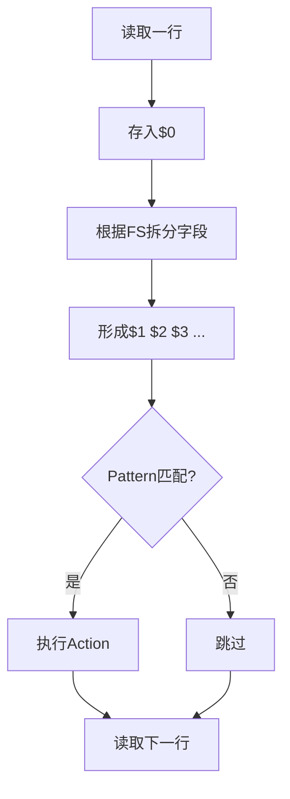
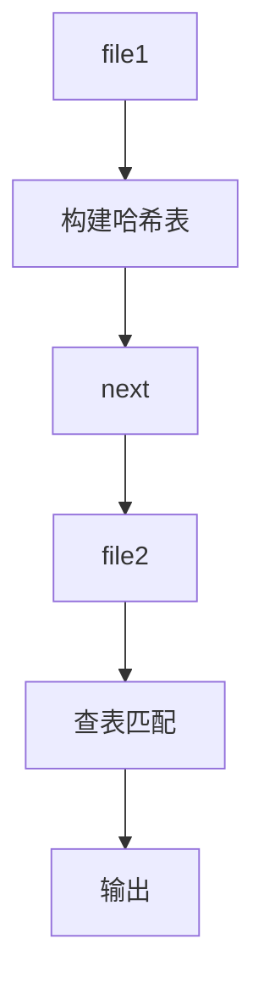
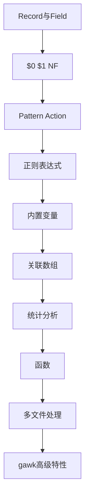

[toc]


# GNU awk（gawk）系统介绍

GNU awk（简称 **gawk**）是 GNU 项目维护的 awk 实现，是 Linux/Unix 世界中最重要的文本处理工具之一。

它既是一门**面向文本流的数据处理语言**，也是一个高性能的命令行解释器。

很多人把 awk 简单理解成“按列处理文本的工具”，这并不准确。

更准确地说：

> awk 是一种基于「记录（Record）+字段（Field）+模式（Pattern）+动作（Action）」模型的数据处理语言。

它特别适合：

- 日志分析
- CSV/TSV处理
- 配置文件分析
- 系统运维脚本
- 数据清洗
- 报表统计
- 流式文本转换

即使在 Python、Go、Rust 盛行的今天，awk 仍然是 Linux 运维和数据处理领域的重要工具。

------

# 什么是 GNU awk

awk 最初由三位作者设计：

- Alfred Aho
- Peter Weinberger
- Brian Kernighan

AWK 名称来自三位作者姓氏首字母：

```text
Aho
Weinberger
Kernighan
```

GNU awk（gawk）是在 POSIX awk 基础上的增强实现。

特点：

| 特性         | awk  | GNU awk |
| ------------ | ---- | ------- |
| POSIX兼容    | ✓    | ✓       |
| 正则增强     | 基础 | 更强    |
| 数组排序     | ×    | ✓       |
| 网络功能     | ×    | ✓       |
| 动态加载扩展 | ×    | ✓       |
| UTF-8支持    | 一般 | 更完善  |
| 调试器       | ×    | ✓       |

通常 Linux 中：

```bash
awk
```

实际可能链接到：

```bash
gawk
```

查看版本：

```bash
awk --version
```

例如：

```text
GNU Awk 5.3.0
```

------

# awk解决什么问题

假设有日志：

```text
Tom  18
Jack 22
Lucy 30
```

需求：

- 取第二列
- 求平均值
- 过滤年龄大于20的人

awk 一条命令即可完成：

```bash
awk '$2 > 20'
```

输出：

```text
Jack 22
Lucy 30
```

awk 的设计目标：

```text
输入文本流
    ↓
拆分记录
    ↓
拆分字段
    ↓
模式匹配
    ↓
执行动作
    ↓
输出结果
```

------

# awk工作模型

这是理解 awk 最重要的内容。



awk 是逐行工作的。

------

# Record（记录）

awk 默认：

```text
一行 = 一个Record
```

例如：

```text
Tom 18
Jack 22
Lucy 30
```

第一轮：

```text
$0 = "Tom 18"
```

第二轮：

```text
$0 = "Jack 22"
```

------

## RS（Record Separator）

记录分隔符：

默认：

```awk
RS="\n"
```

即：

```text
换行分隔记录
```

例如：

```text
a:b:c:d
awk 'BEGIN{RS=":"}{print $0}'
```

输出：

```text
a
b
c
d
```

------

# Field（字段）

awk 最大特色。

默认：

```awk
FS=" "
```

即：

```text
空白字符分割字段
```

输入：

```text
Tom 18 Beijing
```

字段：

| 表达式 | 内容    |
| ------ | ------- |
| $0     | 整行    |
| $1     | Tom     |
| $2     | 18      |
| $3     | Beijing |
| NF     | 3       |

------

## 指定分隔符

CSV：

```text
Tom,18,Beijing
awk -F',' '{print $2}'
```

输出：

```text
18
```

等价：

```awk
BEGIN {
    FS=","
}
```

------

# Pattern-Action 模型

awk 核心语法：

```awk
pattern {
    action
}
```

例如：

```awk
$2 > 20 {
    print $1
}
```

含义：

```text
如果第二列 > 20
    输出第一列
```

------

## Pattern省略

```awk
{
    print
}
```

等价：

```text
对所有记录执行
```

------

## Action省略

```awk
$2 > 20
```

等价：

```awk
$2 > 20 {
    print $0
}
```

这是很多人第一次接触 awk 时容易困惑的地方。

------

# 特殊块

awk 有三个生命周期阶段。


------

## BEGIN

开始前执行一次：

```awk
BEGIN {
    print "start"
}
```

------

## 主处理阶段

```awk
{
    print $1
}
```

每条记录执行。

------

## END

结束执行一次：

```awk
END {
    print "done"
}
```

------

# 最重要的内置变量

| 变量     | 含义           |
| -------- | -------------- |
| $0       | 当前记录       |
| $1~$N    | 字段           |
| NF       | 字段数量       |
| NR       | 当前记录号     |
| FNR      | 当前文件记录号 |
| FS       | 输入字段分隔符 |
| OFS      | 输出字段分隔符 |
| RS       | 输入记录分隔符 |
| ORS      | 输出记录分隔符 |
| ARGC     | 参数数量       |
| ARGV     | 参数列表       |
| FILENAME | 当前文件名     |

------

## NF

字段数量：

```bash
awk '{print NF}'
```

------

## NR

行号：

```bash
awk '{print NR,$0}'
```

输出：

```text
1 Tom 18
2 Jack 22
3 Lucy 30
```

------

## FNR vs NR

两个文件：

```bash
awk '{print FNR,NR,$0}' a.txt b.txt
```

结果：

```text
1 1 ...
2 2 ...
1 3 ...
2 4 ...
```

规律：

| 变量 | 重置     |
| ---- | -------- |
| FNR  | 每文件   |
| NR   | 永不重置 |

------

# 输出

## print

自动格式化：

```awk
print $1,$2
```

输出：

```text
Tom 18
```

------

## printf

类似 C：

```awk
printf "%s %d\n",$1,$2
```

------

示例：

```awk
printf "%-10s %5d\n",$1,$2
```

输出：

```text
Tom           18
Jack          22
```

------

# 条件判断

```awk
if ($2 > 20)
    print
```

------

```awk
if ($2 > 20)
    print
else
    print "skip"
```

------

# 循环

## while

```awk
while (i <= 10) {
    print i
    i++
}
```

------

## for

```awk
for(i=1;i<=10;i++)
    print i
```

------

## for in

数组遍历：

```awk
for(k in arr)
    print k,arr[k]
```

------

# 关联数组（awk灵魂特性）

awk 没有传统数组起家。

最强能力是：

```text
Associative Array
```

即哈希表。

------

创建：

```awk
count["Tom"]++
```

等价：

```text
Tom -> 1
```

再次出现：

```awk
count["Tom"]++
```

变成：

```text
Tom -> 2
```

------

统计词频：

```awk
{
    count[$1]++
}

END {
    for(i in count)
        print i,count[i]
}
```

输入：

```text
Tom
Tom
Jack
```

输出：

```text
Tom 2
Jack 1
```

------

# 字符串处理

## length

```awk
length($1)
```

------

## substr

```awk
substr(str,2,3)
```

------

## index

```awk
index(str,"abc")
```

------

## split

```awk
split(str,arr,",")
```

------

## sprintf

```awk
s = sprintf("%04d",12)
```

结果：

```text
0012
```

------

# 正则表达式

awk 内建正则引擎。

------

匹配：

```awk
/ERROR/
```

等价：

```awk
$0 ~ /ERROR/
```

------

反向：

```awk
$0 !~ /ERROR/
```

------

示例：

```bash
awk '/ERROR/'
```

------

提取 IP：

```awk
match($0,
/[0-9]+\.[0-9]+\.[0-9]+\.[0-9]+/)
```

匹配成功：

```awk
RSTART
RLENGTH
```

自动设置。

------

# 数值运算

awk 天生支持浮点数。

```awk
BEGIN {
    print 3/2
}
```

结果：

```text
1.5
```

------

统计平均值：

```awk
{
    sum += $2
}

END {
    print sum/NR
}
```

------

# 用户函数

```awk
function add(a,b)
{
    return a+b
}
```

调用：

```awk
{
    print add($1,$2)
}
```

------

# 多文件处理

经典技巧：

```bash
awk 'NR==FNR{
    a[$1]
    next
}
$1 in a' file1 file2
```

工作过程：



类似数据库：

```text
Hash Join
```

------

# gawk增强能力

## 排序

普通awk：

```awk
for(i in arr)
```

顺序随机。

gawk：

```awk
PROCINFO["sorted_in"]="@ind_str_asc"
```

------

例如：

```awk
END{
    PROCINFO["sorted_in"]="@ind_num_desc"

    for(i in count)
        print i,count[i]
}
```

------

## 删除元素

```awk
delete arr["Tom"]
```

------

全部删除：

```awk
delete arr
```

------

## 多维数组

gawk 支持：

```awk
a[1][2]=100
```

现代 gawk 推荐这样写。

------

# CSV处理最佳实践

很多新手：

```bash
awk -F','
```

直接解析 CSV。

这在简单情况有效：

```text
Tom,18,Beijing
```

但面对：

```text
Tom,"New York, USA",18
```

会失败。

现代 gawk（5.3+）提供：

```awk
BEGIN {
    PROCINFO["CSV"] = 1
}
```

之后：

```awk
{
    print $2
}
```

可以正确解析标准 CSV。

这是现代 gawk 的重要进步。

------

# 调试技巧

输出变量：

```awk
print "DEBUG:",var > "/dev/stderr"
```

------

查看字段：

```awk
{
    for(i=1;i<=NF;i++)
        print i,$i
}
```

------

查看不可见字符：

```bash
cat -A file
```

配合 awk 十分有效。

------

# 性能特点

awk 属于：

```text
流式处理（Streaming）
```

特点：

| 特性       | awk    |
| ---------- | ------ |
| 逐行处理   | ✓      |
| 全文件加载 | ×      |
| 内存占用   | 低     |
| TB级日志   | 可处理 |
| 哈希统计   | 强     |
| 正则匹配   | 强     |

因此：

```bash
cat 100GB.log | awk ...
```

通常完全可行。

------

# 现代awk最佳实践

## 永远显式指定分隔符

推荐：

```bash
awk -F'\t'
```

不要依赖默认空白分隔。

------

## 复杂逻辑写脚本文件

不要：

```bash
awk '......200行......'
```

推荐：

```bash
awk -f report.awk
```

------

## 使用函数封装

推荐：

```awk
function normalize(v)
{
    ...
}
```

避免复制逻辑。

------

## 大量查找优先使用关联数组

不要：

```awk
O(n²)
```

推荐：

```awk
hash[key]
```

达到：

```text
O(1)
```

平均查找复杂度。

------

## CSV优先使用CSV模式

现代 gawk：

```awk
PROCINFO["CSV"]=1
```

不要依赖：

```awk
-F,
```

解析复杂 CSV。

------

## 使用 BEGIN 设置环境

推荐：

```awk
BEGIN{
    FS=","
    OFS="\t"
}
```

统一管理配置。

------

# 新手学习路线

建议按下面顺序掌握：



掌握到“关联数组”阶段后，已经能够解决大多数实际日志分析与文本处理问题；掌握“多文件处理”和“gawk增强能力”后，基本具备了用 awk 独立完成中等复杂度数据清洗与报表生成任务的能力。