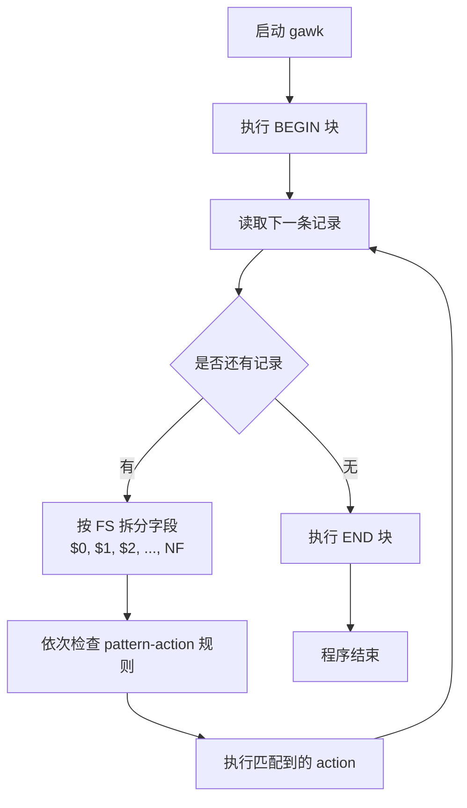
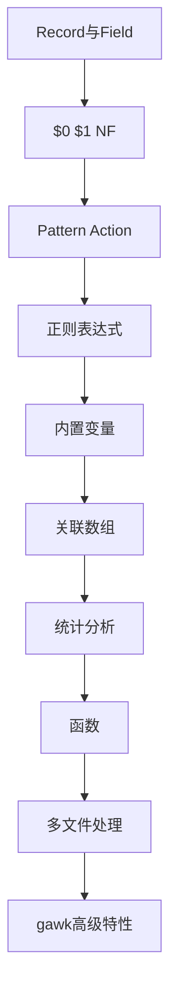

[toc]


## GNU awk 是什么

**GNU awk**，通常命令名是 `gawk`，是 GNU 项目对 AWK 语言的实现。AWK 是一种面向**文本扫描、字段提取、模式匹配、报表生成和轻量数据转换**的脚本语言。GNU awk 官方手册说明它用于“选择文件中的记录并对其执行操作”。([GNU 网站](https://www.gnu.org/software/gawk/manual/gawk.html?utm_source=chatgpt.com))

在 GNU/Linux 上，`awk` 通常就是 `gawk` 的链接或兼容实现；在 macOS、BSD、BusyBox、某些容器镜像中，`awk` 可能不是 GNU awk。需要 GNU 特性时，建议明确使用：

```bash
gawk 'program' file
```

而不是：

```bash
awk 'program' file
```

GNU awk 遵循 POSIX awk，并提供许多 GNU 扩展；man7 的手册页也说明，gawk 是 GNU 项目的 AWK 实现，符合 POSIX awk 定义，并包含 Brian Kernighan awk 的现代特性和 GNU 扩展。([man7.org](https://man7.org/linux/man-pages/man1/gawk.1.html?utm_source=chatgpt.com))

------

## 适合用 awk 解决的问题

AWK 最擅长处理**一行一行的结构化或半结构化文本**。

| 场景                   | awk 是否合适 | 示例                               |
| ---------------------- | ------------ | ---------------------------------- |
| 按列提取数据           | 很合适       | 从日志中取第 1、4、7 列            |
| 过滤满足条件的行       | 很合适       | 找出状态码大于等于 500 的访问日志  |
| 求和、计数、分组统计   | 很合适       | 统计每个 IP 的访问次数             |
| 生成简单报表           | 很合适       | 输出对齐表格、汇总结果             |
| CSV/TSV/分隔符文本处理 | 合适         | 处理逗号、制表符、冒号分隔数据     |
| 多文件逐行处理         | 合适         | 对多个日志文件做统一统计           |
| 简单 ETL               | 合适         | 清洗、转换、汇总文本数据           |
| 复杂嵌套 JSON/XML      | 不太合适     | 更推荐 `jq`、Python、专用 XML 工具 |
| 大型业务系统开发       | 不合适       | 更推荐 Python、Go、Rust 等通用语言 |

AWK 的定位不是替代 Python，而是在 shell 管道里提供一个**极高效、低依赖、表达力强**的文本处理工具。

------

## awk 的工作模型

AWK 程序的核心模型可以概括为：

> 读入一条记录，判断哪些模式匹配，执行对应动作，然后继续下一条记录。

默认情况下：

- 一条**记录**是一行文本。
- 一条记录会被自动拆成多个**字段**。
- `$0` 表示整行。
- `$1`、`$2`、`$3` 分别表示第 1、第 2、第 3 个字段。
- `NF` 表示当前行字段数量。
- `NR` 表示目前读到的总行号。
- `FS` 表示输入字段分隔符。
- `OFS` 表示输出字段分隔符。



------

## 最小可用示例

假设有文件 `access.log`：

```text
192.168.1.10 GET /index.html 200
192.168.1.11 POST /login 403
192.168.1.10 GET /api/users 500
```

打印第 1 列和第 4 列：

```bash
gawk '{ print $1, $4 }' access.log
```

输出：

```text
192.168.1.10 200
192.168.1.11 403
192.168.1.10 500
```

筛选状态码大于等于 400 的行：

```bash
gawk '$4 >= 400 { print $0 }' access.log
```

统计每个 IP 出现次数：

```bash
gawk '{ count[$1]++ } END { for (ip in count) print ip, count[ip] }' access.log
```

这已经体现了 AWK 的三大核心能力：

| 能力           | 对应语法         |
| -------------- | ---------------- |
| 自动逐行读取   | 不需要显式写循环 |
| 自动按字段拆分 | `$1`、`$2`、`NF` |
| 内置关联数组   | `count[$1]++`    |

------

## awk 程序的基本结构

AWK 程序由一组 **pattern-action** 规则组成：

```awk
pattern { action }
```

含义是：

> 当当前记录满足 pattern 时，执行 action。

常见形式如下：

| 形式                 | 含义                       |
| -------------------- | -------------------------- |
| `pattern { action }` | 匹配模式时执行动作         |
| `{ action }`         | 没有模式，表示每一行都执行 |
| `pattern`            | 没有动作，默认打印整行     |
| `BEGIN { action }`   | 读取输入前执行             |
| `END { action }`     | 所有输入处理完后执行       |

示例：

```bash
gawk 'BEGIN { print "start" } { print NR, $0 } END { print "done" }' file.txt
```

------

## BEGIN、主体规则、END

| 阶段     | 执行时机           | 常见用途                         |
| -------- | ------------------ | -------------------------------- |
| `BEGIN`  | 读取任何输入之前   | 初始化变量、设置分隔符、打印表头 |
| 主体规则 | 每读取一条记录时   | 过滤、提取、统计、转换           |
| `END`    | 所有输入处理完之后 | 打印汇总、排序前准备、输出总计   |

示例：统计文件行数、字段总数、平均字段数。

```bash
gawk '
BEGIN {
    print "开始统计"
}
{
    total_fields += NF
}
END {
    print "行数:", NR
    print "字段总数:", total_fields
    if (NR > 0)
        print "平均每行字段数:", total_fields / NR
}
' file.txt
```

------

## 记录与字段

### 记录

AWK 默认把输入按行处理，每行是一条记录。

| 变量  | 含义           | 默认值 |
| ----- | -------------- | ------ |
| `RS`  | 输入记录分隔符 | 换行符 |
| `ORS` | 输出记录分隔符 | 换行符 |

默认情况下：

```bash
gawk '{ print NR, $0 }' file.txt
```

会逐行打印行号和整行内容。

### 字段

AWK 默认用空白字符分割字段。这里的“空白”不仅仅是一个空格，而是连续的空格、制表符等。

| 变量  | 含义             | 默认值         |
| ----- | ---------------- | -------------- |
| `FS`  | 输入字段分隔符   | 空格语义       |
| `OFS` | 输出字段分隔符   | 单个空格       |
| `NF`  | 当前记录字段数量 | 动态计算       |
| `$0`  | 当前整条记录     | 当前行         |
| `$1`  | 第一个字段       | 当前行第 1 列  |
| `$NF` | 最后一个字段     | 当前行最后一列 |

打印最后一列：

```bash
gawk '{ print $NF }' file.txt
```

打印倒数第二列：

```bash
gawk '{ print $(NF-1) }' file.txt
```

注意，`$NF` 是“第 NF 个字段”，而不是变量名叫 `$NF`。

------

## 字段分隔符 FS

### 使用命令行参数设置 FS

处理冒号分隔的 `/etc/passwd`：

```bash
gawk -F ':' '{ print $1, $3, $7 }' /etc/passwd
```

### 在 BEGIN 中设置 FS

```bash
gawk 'BEGIN { FS = ":" } { print $1, $3, $7 }' /etc/passwd
```

### 同时设置输入和输出分隔符

```bash
gawk -F ':' 'BEGIN { OFS = "\t" } { print $1, $3, $7 }' /etc/passwd
```

这会用冒号读入，用制表符输出。

------

## print 与 printf

### print

`print` 简单、自动换行、自动使用 `OFS` 连接字段。

```bash
gawk '{ print $1, $2, $3 }' file.txt
```

### printf

`printf` 更适合格式化输出，不会自动换行。

```bash
gawk '{ printf "%-20s %8d\n", $1, $2 }' file.txt
```

| 格式符  | 含义              |
| ------- | ----------------- |
| `%s`    | 字符串            |
| `%d`    | 十进制整数        |
| `%f`    | 浮点数            |
| `%.2f`  | 保留两位小数      |
| `%10s`  | 宽度为 10，右对齐 |
| `%-10s` | 宽度为 10，左对齐 |
| `\n`    | 换行              |
| `\t`    | 制表符            |

示例：计算平均值并保留两位小数。

```bash
gawk '{ sum += $1 } END { printf "avg = %.2f\n", sum / NR }' numbers.txt
```

------

## 模式匹配

AWK 中的 pattern 可以是条件表达式、正则表达式、范围模式等。

### 条件表达式

```bash
gawk '$3 > 80 { print $1, $3 }' scores.txt
```

### 正则表达式匹配整行

```bash
gawk '/error/ { print }' app.log
```

等价于：

```bash
gawk '/error/' app.log
```

因为没有 action 时默认执行 `print $0`。

### 某个字段匹配正则

```bash
gawk '$5 ~ /^5[0-9][0-9]$/ { print }' access.log
```

含义：第 5 列是 500 到 599 的 HTTP 状态码。

### 不匹配正则

```bash
gawk '$0 !~ /debug/ { print }' app.log
```

### 范围模式

```bash
gawk '/BEGIN/,/END/ { print }' file.txt
```

含义：从匹配 `BEGIN` 的行开始打印，到匹配 `END` 的行结束。

------

## 正则表达式基础

AWK 使用正则表达式做文本匹配。GNU awk 支持 POSIX 扩展正则表达式，并有 GNU 扩展能力。官方手册是 GNU awk 正则、字段、记录、数组、函数等语义的权威来源。([GNU 网站](https://www.gnu.org/software/gawk/manual/gawk.html?utm_source=chatgpt.com))

| 正则     | 含义                       | 示例       |
| -------- | -------------------------- | ---------- |
| `.`      | 任意单个字符               | `a.c`      |
| `*`      | 前一个元素重复 0 次或多次  | `ab*`      |
| `+`      | 前一个元素重复 1 次或多次  | `ab+`      |
| `?`      | 前一个元素重复 0 次或 1 次 | `ab?`      |
| `^`      | 行首                       | `^ERROR`   |
| `$`      | 行尾                       | `.log$`    |
| `[abc]`  | a、b、c 中任一字符         | `[Yy]es`   |
| `[^abc]` | 非 a、b、c                 | `[^0-9]`   |
| `[0-9]`  | 数字范围                   | `[0-9]+`   |
| `(foo    | bar)`                      | 分组或选择 |

示例：找出以 `ERROR` 开头的行。

```bash
gawk '/^ERROR/ { print }' app.log
```

示例：找出包含 IPv4 地址的行。

```bash
gawk '/[0-9]+\.[0-9]+\.[0-9]+\.[0-9]+/ { print }' app.log
```

------

## 变量与类型

AWK 的变量不需要声明，首次使用时自动创建。

```bash
gawk '{ sum += $1 } END { print sum }' numbers.txt
```

AWK 的值通常可以在字符串和数字之间自动转换。

| 表达式           | 说明       |
| ---------------- | ---------- |
| `x = 10`         | 数字       |
| `name = "alice"` | 字符串     |
| `sum += $3`      | 累加       |
| `count++`        | 自增       |
| `avg = sum / n`  | 计算平均值 |

需要注意：自动类型转换方便，但也可能带来隐蔽问题。

例如：

```awk
"10" + 2
```

结果是数字 `12`。

而：

```awk
"abc" + 2
```

字符串无法合理转为数字时，通常按 `0` 参与数值运算。

最佳实践是：对明显的数字字段先做数据校验。

```bash
gawk '$2 ~ /^[0-9]+$/ { sum += $2 } END { print sum }' file.txt
```

------

## 内置变量速查

| 变量       | 含义                      |
| ---------- | ------------------------- |
| `NR`       | 已处理的总记录数          |
| `FNR`      | 当前文件中的记录数        |
| `NF`       | 当前记录的字段数          |
| `FS`       | 输入字段分隔符            |
| `OFS`      | 输出字段分隔符            |
| `RS`       | 输入记录分隔符            |
| `ORS`      | 输出记录分隔符            |
| `FILENAME` | 当前输入文件名            |
| `ARGC`     | 命令行参数数量            |
| `ARGV`     | 命令行参数数组            |
| `ENVIRON`  | 环境变量数组              |
| `RSTART`   | `match()` 匹配Streaming） |

特点：

| 特性 | awk |
|--------|--------|
| 逐行处理 | ✓ |
| 全文件加载 | × |
| 内存占用 | 低 |
| TB级日志 | 可处理 |
| 哈希统计 | 强 |
| 正则匹配 | 强 |

因此：

```bash
cat 100GB.log | awk ...
```

通常完全可行。

------

# 现代awk最佳实践

## 永远显式指定分隔符

推荐：

```bash
awk -F'\t'
```

不要依赖默认空白分隔。

------

## 复杂逻辑写脚本文件

不要：

```bash
awk '......200行......'
```

推荐：

```bash
awk -f report.awk
```

------

## 使用函数封装

推荐：

```awk
function normalize(v)
{
    ...
}
```

避免复制逻辑。

------

## 大量查找优先使用关联数组

不要：

```awk
O(n²)
```

推荐：

```awk
hash[key]
```

达到：

```text
O(1)
```

平均查找复杂度。

------

## CSV优先使用CSV模式

现代 gawk：

```awk
PROCINFO["CSV"]=1
```

不要依赖：

```awk
-F,
```

解析复杂 CSV。

------

## 使用 BEGIN 设置环境

推荐：

```awk
BEGIN{
    FS=","
    OFS="\t"
}
```

统一管理配置。

------

# 新手学习路线

建议按下面顺序掌握：



掌握到“关联数组”阶段后，已经能够解决大多数实际日志分析与文本处理问题；掌握“多文件处理”和“gawk增强能力”后，基本具备了用 awk 独立完成中等复杂度数据清洗与报表生成任务的能力。