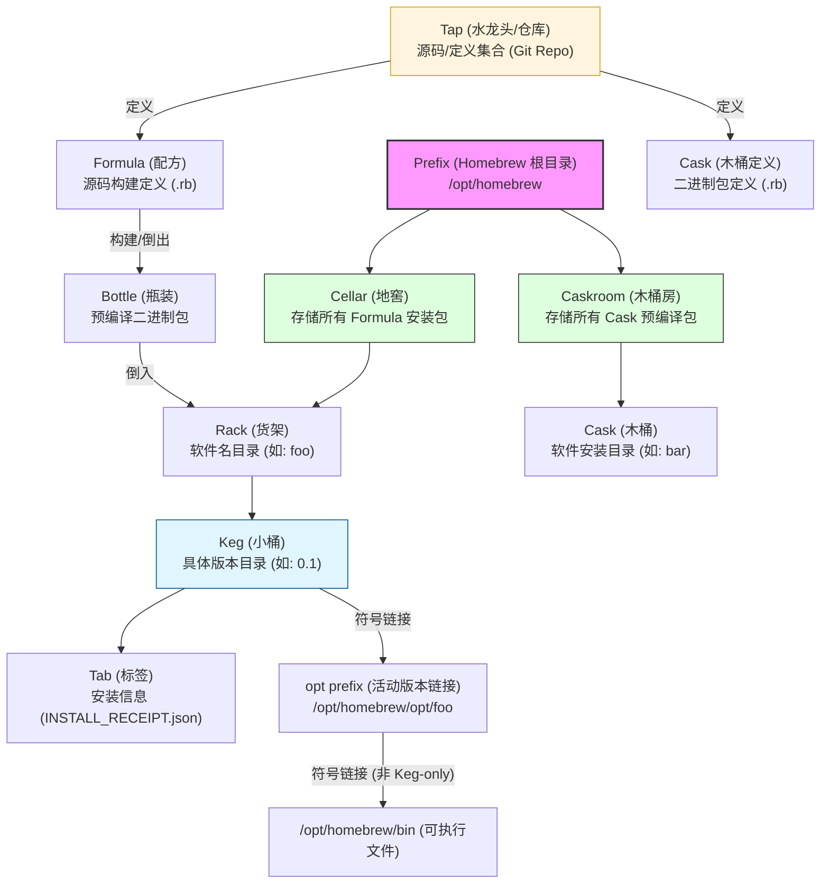

[toc]

## abstract

- [macOS（或 Linux）缺失的软件包的管理器 — Homebrew](https://brew.sh/zh-cn/)

使用 Homebrew 安装 Apple（或您的 Linux 系统）没有预装但 [你需要的东西](https://formulae.brew.sh/formula/)。

Homebrew 会将软件包安装到独立目录，并将其文件软链接至 `/opt/homebrew` 。

Homebrew 不会将文件安装到它本身目录之外，所以您可将 Homebrew 安装到任意位置

- 但是对于`linuxbrew`([Linux 上的 Homebrew — Homebrew 文档 --- Homebrew on Linux — Homebrew Documentation](https://docs.brew.sh/Homebrew-on-Linux)),建议的目录是`/home/linuxbrew/.linuxbrew` .
- 理论上，你可以将 Homebrew 安装到任何你想要的位置。但是，你不应该安装在默认、受支持且最佳的前缀之外。在默认前缀之外，很多东西都需要从源代码构建。从源代码构建速度慢、能耗高、容易出错且不受支持。Homebrew 之所以能正常工作，主要原因是**它**使用 bottle（二进制软件包），而大多数 bottle 都需要使用默认前缀。
- 选择前缀 `/home/linuxbrew/.linuxbrew` 是为了避免安装后写入系统目录，同时仍然允许使用大多数预编译二进制文件（bottles）。Homebrew 是为单用户安装而设计的，而不是为共享角色帐户而设计的。

## 文档和手册

- [brew(1) – The Missing Package Manager for macOS (or Linux) — Homebrew Documentation](https://docs.brew.sh/Manpage) 
- 或者在brew已经安装的情况下,通过输入`man brew`查询本地手册;

### homebrew相关术语和概念

[ Formula Cookbook — Homebrew Documentation](https://docs.brew.sh/Formula-Cookbook#homebrew-terminology)

### 安装目录

以macos上的homebrew目录为例:

```bash
# cxxu @ CxxuMac in /opt/homebrew on git:stable o [22:22:19]
$ ls -d */
bin/       Cellar/       docs/  Frameworks/  lib/      manpages/  package/  share/
Caskroom/  completions/  etc/   include/     Library/  opt/       sbin/     var/
(base)
```


## Homebrew 术语

| 术语              | 描述                                                         | 示例                                                         |
| :---------------- | :----------------------------------------------------------- | :----------------------------------------------------------- |
| **formula**       | 从上游源码构建的 Homebrew **包定义**                         | `/opt/homebrew/Library/Taps/homebrew/homebrew-core/Formula/f/foo.rb` |
| **cask**          | 安装由上游构建并签名的预编译**二进制文件**的 Homebrew **包定义** | `/opt/homebrew/Library/Taps/homebrew/homebrew-cask/Casks/b/bar.rb` |
| **prefix**        | Homebrew 安装路径                                            | `/opt/homebrew`,`/home/linuxbrew/.linuxbrew`                 |
| **keg**           | 给定 **formula** 版本的**安装目标目录**                      | `/opt/homebrew/Cellar/foo/0.1`                               |
| **rack**          | 包含一个或多个版本化 **kegs** 的目录                         | `/opt/homebrew/Cellar/foo`                                   |
| **keg-only**      | 如果 **formula** 未符号链接到 Homebrew 的 prefix 中，则称为 *keg-only* | `openjdk` formula                                            |
| **opt prefix**    | 指向 **keg** 活动版本的**符号链接**                          | `/opt/homebrew/opt/foo`                                      |
| **Cellar**        | 包含一个或多个命名 **racks** 的目录                          | `/opt/homebrew/Cellar`                                       |
| **Caskroom**      | 包含一个或多个命名 **casks** 的目录                          | `/opt/homebrew/Caskroom`                                     |
| **tap**           | **formulae**、**casks** 和/或**外部命令**的目录（通常是 Git 仓库） | `/opt/homebrew/Library/Taps/homebrew/homebrew-core`          |
| **bottle**        | 预构建的 **keg**，直接倒入 **Cellar** 的 **rack** 中，而不是从上游源码构建 | `qt--6.5.1.ventura.bottle.tar.gz`                            |
| **tab**           | 关于 **keg** 的信息，例如它是从 **bottle** 倒入还是从源码构建 | `/opt/homebrew/Cellar/foo/0.1/INSTALL_RECEIPT.json`          |
| **Brew Bundle**   | Homebrew 的声明式接口                                        | `brew 'myservice', restart_service: true`                    |
| **Brew Services** | 管理后台服务的 Homebrew 命令                                 | `brew services start myservice`                              |

Homebrew 的术语体系充满了“酿酒”的趣味，理解它们能让你更好地掌握这个工具。

`opt prefix`在用户和具体的软件(版本)安装路径中间加了一层,对于同名软件的多个不同版本,这样处理隐藏了具体的版本号;

```bash
$ type -a shfmt
shfmt is /opt/homebrew/bin/shfmt
# 查看符号链接的指向(查看软件当前指向的版本(keg))
$ type -aS shfmt
shfmt is /opt/homebrew/bin/shfmt -> /opt/homebrew/bin/../Cellar/shfmt/3.13.1/bin/shfmt
```

### 概念关系示意图




图表要点说明：

- **层级包含关系**：`Cellar` (地窖) 包含多个 `Rack` (货架)，每个 `Rack` 下有不同版本的 `Keg` (小桶)。这完美对应了 Homebrew 这种类比酿酒厂的命名方式。
- **安装来源**：`Formula`（配方）决定了如何通过源码或 `Bottle`（预编译好的瓶装包）来填充 `Keg`。
- **访问方式**：为了方便调用，当前活跃的 `Keg` 会被链接到 `opt prefix`，如果不是 `keg-only` 的软件，它的可执行文件最终会出现在系统的 `bin` 路径下。
- **Cask 的区别**：`Caskroom` 与 `Cellar` 并列，专门用于处理那些预编译好的 GUI 程序或二进制应用（如 Chrome, Docker 等）。

### 展开解释

#### Formula (配方)

- **字面意思**：公式，配方。
- **地道解释**：这是 Homebrew 的核心，一个用 Ruby 语言编写的脚本文件。它定义了如何下载、编译和安装一个软件包。当你执行 `brew install <软件名>` 时，Homebrew 就是在执行对应的 Formula。复数形式为 **Formulae**。

#### Bottle (瓶装酒)

- **字面意思**：瓶子。
- **地道解释**：指预先编译好的软件包。就像买一瓶已经酿好的酒，你无需自己从头开始“酿酒”（即从源码编译），可以直接下载安装。绝大多数官方软件都是通过 Bottle 方式安装的。

#### Cask (酒桶)

- **字面意思**：（装酒的）木桶。
- **地道解释**：这是 Homebrew 的扩展，专门用来安装 **macOS** 的图形界面（GUI）应用程序，比如 Chrome、VS Code 等。通过 `brew install --cask <应用名>` 命令，你就可以在命令行里轻松安装这些带界面的软件。

#### Cellar (酒窖)

- **字面意思**：地窖，酒窖。
- **地道解释**：这是所有通过 Homebrew 安装的软件的“大本营”，即它们的总安装目录。所有软件都会被规规矩矩地存放在这个“酒窖”里，不会弄乱你的系统。
  - **Apple Silicon (M系列芯片)** 的默认路径是：`/opt/homebrew`
  - **Intel 芯片** 的默认路径是：`/usr/local`

#### Keg (小酒桶)

- **字面意思**：（装啤酒的）小桶。
- **地道解释**：`Cellar` 的**子目录**。每一个具体版本的软件包都会被安装在 `Cellar` 里的一个独立 `Keg` 中。例如，`/opt/homebrew/Cellar/git/2.41.0` 就是一个 Keg。这种设计让版本切换和管理变得异常简单。

#### Tap (水龙头)

- **字面意思**：水龙头，栓口。
- **地道解释**：指 Homebrew 的软件仓库源。默认情况下，Homebrew 有 `homebrew-core`（核心库）和 `homebrew-cask`（图形应用库）**两个官方 Taps**。你也可以通过 `brew tap` 命令添加第三方的 Taps，**来获取更多社区维护的软件包**。

#### Bundle (捆绑包)

- **字面意思**：捆，束。
- **地道解释**：用于描述一组 Homebrew 软件包及其依赖关系。它允许你通过一个文件来定义和安装一整套开发环境或工具集，方便在不同机器间同步配置。

### cellar和rack

以下面到例子为例:

```bash
# cxxu @ CxxuMac in /opt/homebrew/Cellar/openssl@3 on git:stable o [23:19:08]
$ ls
3.6.1  3.6.2
```

`openssl@3`是rack(软件名),而这个rack中有软件的不同版本的(keg)

```bash
$ type -aS openssl
openssl is /opt/homebrew/bin/openssl -> /opt/homebrew/bin/../Cellar/openssl@3/3.6.2/bin/openssl
```

其中`/opt/homebrew/bin/../Cellar/openssl@3/3.6.2/bin/openssl`是软件的最终的可执行文件路径.

### 简介

Homebrew 使用 Git 存储 formula 并为项目做贡献。

从 Homebrew 4.0.0 开始，formulae 以 JSON 格式从 [https://formulae.brew.sh](https://formulae.brew.sh/) 下载，该网站由定时任务自动从 Homebrew/homebrew-core 仓库的默认分支重新生成。

Homebrew 将 `formulae` 安装到 `$(brew --cellar)` 的 Cellar 中，然后将部分安装内容符号链接到 `$(brew --prefix)` 的 prefix 中（例如 `/opt/homebrew`），以便其他程序可以看到安装内容。

> 建议在你的 Cellar 中对几个 kegs 运行 `brew ls` 来了解其排列方式。

包是根据其 `formula` 安装的。

>  阅读一个简单的 formula，例如 `brew edit etl`（或 etl.rb），或一个更高级的，例如 `brew edit git`（或 git.rb）。

## 关于prefix和opt prefix

- prefix(homebrew prefix):主要是指homebrew安装目录;
- opt prefix:在 Homebrew 的语境下，`opt` 这个词并不是随机选择的，它背后有着 Unix 系统的传统逻辑和 Homebrew 特有的版本管理机制。

`opt` 既代表 **Optional**（第三方软件目录），也代表了 Homebrew 的 **优化访问层**。它通过提供一个“永久固定”的地址，屏蔽了底层软件版本更迭带来的路径变化。

### 1. Unix 传统的传承

在传统的 Unix 文件系统层次结构（Filesystem Hierarchy Standard）中，**/opt** 目录代表 **"optional"**（可选的）。

- 它通常用于存放那些不属于操作系统核心部分的软件，或者由第三方供应商提供的软件包。
- Homebrew 沿用了这个命名习惯，将它管理的所有软件包放在这个目录下。

------

### 2. 在 Homebrew 中的核心作用：符号链接（Symlink）

虽然 Homebrew 的软件真正下载和解压的地方是在 `/opt/homebrew/Cellar`（窖藏），但直接引用 Cellar 里的路径会非常麻烦，因为路径里包含了具体的版本号。

这就是 `opt` 目录发挥威力的地方。它存放的是指向当前 **活动版本（active version）** 的**符号链接（Symbolic Links）**。

为什么要这么做？

我们可以通过下面这个例子来理解：

| **路径类型**          | **实际路径示例**                  | **存在的问题/优点**                      |
| --------------------- | --------------------------------- | ---------------------------------------- |
| **真实路径 (Cellar)** | `/opt/homebrew/Cellar/foo/1.2.3/` | 软件升级到 1.2.4 后，旧路径就会失效。    |
| **优化路径 (opt)**    | `/opt/homebrew/opt/foo/`          | **始终有效**。它永远指向当前最新的版本。 |

homebrew会自动维护opt中的符号链接指向,默认情况下指向最新版本;

- **版本无关性**：你在配置环境变量（如 `PATH` 或 `LDFLAGS`）时，只需要指向 `opt/foo`。这样即使你通过 `brew upgrade` 升级了软件，你的配置文件也不需要做任何修改。
- **平滑切换**：Homebrew 只需要更改 `opt/foo` 这个“快捷方式”的目标，就能瞬间完成版本的切换。

在windows平台的scoop有类似的手法;

### 环境变量

[ENVIRONMENT 环境变量](https://docs.brew.sh/Manpage#environment)

## 国内配置brew加速

[Module: Homebrew::EnvConfig — Homebrew Ruby API](https://docs.brew.sh/rubydoc/Homebrew/EnvConfig.html)

在国内配置 Homebrew 加速，本质上是将 Homebrew 的各个组成部分（基础工具、核心配方库、预编译二进制包）的下载地址从 GitHub/Amazon S3 切换到国内的镜像服务器（如中科大 USTC、清华 TUNA 或阿里云）。

以下是配置加速的三个主要**核心要点**和**操作流程**：

------

###  核心加速点 (Components)

要达到完全加速，配置以下几个部分(尤其是前2个)：

- **Brew Repo**: Homebrew 程序本身的源代码（Git 仓库）。
- **Homebrew Bottles**: 预编译好的二进制包（最影响下载速度的部分）。

brew4.0后,下面的两个配置项不再必须,考虑兼容性,可以按需配置:

- **Core Repo (Formulae)**: 核心软件包定义文件，决定了 `brew install` 搜什么、怎么装。
- (`*`)**Case Repo**(for MacOs):针对Macos的应用,主要是GUI程序;linux系统一般不用关心;

---

> 替换homebrew为国内镜像加速有两类方案:
>
> - homebrew镜像环境变量配置方案
> - homebrew相关的git仓库绑定源更换
>
> [常见 Homebrew 国内镜像源大全](https://xuanyuan.cloud/docker/homebrew-mirrors?section=tsinghua-source)

以中科大源为例:

1. Homebrew 源代码仓库[Homebrew - USTC Mirror Help](https://mirrors.ustc.edu.cn/help/brew.git.html)
2. Homebrew **预编译**二进制软件包与软件包**元数据文件**[Homebrew Bottles - USTC Mirror Help](https://mirrors.ustc.edu.cn/help/homebrew-bottles.html)

> Brew 4.0 版本后默认使用元数据 JSON API 获取仓库信息，因此在大部分情况下都不再需要进行如下配置。可参考 `homebrew-bottles` 进行相关配置。

- Homebrew 核心软件仓库[Homebrew Core - USTC Mirror Help](https://mirrors.ustc.edu.cn/help/homebrew-core.git.html)

- `*`Homebrew cask 软件仓库，提供 **macOS** 应用和大型二进制文件[Homebrew Cask - USTC Mirror Help](https://mirrors.ustc.edu.cn/help/homebrew-cask.git.html)

  针对于macos(linux用户不用关心)`brew tap --custom-remote homebrew/cask https://mirrors.ustc.edu.cn/homebrew-cask.git`

```bash
# Homebrew 源代码仓库
export HOMEBREW_BREW_GIT_REMOTE="https://mirrors.ustc.edu.cn/brew.git"
# Homebrew 预编译二进制软件包与软件包元数据文件
export HOMEBREW_BOTTLE_DOMAIN="https://mirrors.ustc.edu.cn/homebrew-bottles"
export HOMEBREW_API_DOMAIN="https://mirrors.ustc.edu.cn/homebrew-bottles/api"
# Homebrew 核心软件仓库(Brew 4.0 版本后默认使用元数据 JSON API 获取仓库信息，因此在大部分情况下都不再需要进行如下配置。可参考 homebrew-bottles 进行相关配置。)
export HOMEBREW_CORE_GIT_REMOTE="https://mirrors.ustc.edu.cn/homebrew-core.git"
brew update
```


------

## brew配置信息查看

使用`brew config`命令,Homebrew 会列出当前环境下生效的所有配置及其说明：

```bash
(base) #( 04/22/26@10:17PM )( cxxu@CxxuMac ):~/sh@main✗✗✗
   brew config
HOMEBREW_VERSION: 5.1.7
ORIGIN: https://mirrors.ustc.edu.cn/brew.git
HEAD: 3aae056b8d072624255bc8fd27febb7f327b2265
Last commit: 5 days ago
Branch: stable
Core tap JSON: 22 Apr 13:56 UTC
Core cask tap JSON: 22 Apr 13:56 UTC
HOMEBREW_PREFIX: /opt/homebrew
HOMEBREW_API_DOMAIN: https://mirrors.ustc.edu.cn/homebrew-bottles/api
HOMEBREW_BOTTLE_DOMAIN: https://mirrors.ustc.edu.cn/homebrew-bottles
HOMEBREW_CASK_OPTS: []
HOMEBREW_DOWNLOAD_CONCURRENCY: 20
HOMEBREW_FORBID_PACKAGES_FROM_PATHS: set
HOMEBREW_MAKE_JOBS: 10
HOMEBREW_PIP_INDEX_URL: https://pypi.mirrors.ustc.edu.cn/simple
Homebrew Ruby: 4.0.2 => /opt/homebrew/Library/Homebrew/vendor/portable-ruby/4.0.2_1/bin/ruby
CPU: deca-core 64-bit dunno
Clang: 21.0.0 build 2100
Git: 2.53.0 => /opt/homebrew/bin/git
Curl: 8.7.1 => /usr/bin/curl
macOS: 26.4.1-arm64
CLT: 26.4.1.0.1775747724
Xcode: N/A
Rosetta 2: false
```

### brew info 查询软件包信息

以curl为例:

```bash
(base) #( 04/22/26@11:05PM )( cxxu@CxxuMac ):~/sh@main✗✗✗
   brew info curl
==> curl ✔: stable 8.19.0 (bottled), HEAD [keg-only]
Get a file from an HTTP, HTTPS or FTP server
https://curl.se
Installed (on request)
/opt/homebrew/Cellar/curl/8.19.0 (551 files, 4.7MB)
  Poured from bottle using the formulae.brew.sh API on 2026-04-15 at 23:06:20
From: https://github.com/Homebrew/homebrew-core/blob/HEAD/Formula/c/curl.rb
License: curl
==> Dependencies
Required (7): brotli ✔, libnghttp2 ✘, libnghttp3 ✔, libngtcp2 ✘, libssh2 ✔, openssl@3 ✔, zstd ✔
Recursive Runtime (10): 10 ✔, 0 ✘
==> Options
--HEAD
        Install HEAD version
==> Caveats
curl is keg-only, which means it was not symlinked into /opt/homebrew,
because macOS already provides this software and installing another version in
parallel can cause all kinds of trouble.

If you need to have curl first in your PATH, run:
  echo 'export PATH="/opt/homebrew/opt/curl/bin:$PATH"' >> ~/.zshrc

For compilers to find curl you may need to set:
  export LDFLAGS="-L/opt/homebrew/opt/curl/lib"
  export CPPFLAGS="-I/opt/homebrew/opt/curl/include"
==> Downloading https://mirrors.ustc.edu.cn/homebrew-bottles/api/formula/curl.json
```

这里的Caveats(注意事项)指出,`curl`是`keg-only`,也就是说它不会为用户在brew prefix目录中创建符号链接;

> 这类系统自带软件(虽然不是最新新版)的情况下,homebrew可以安装新版,但是会归类为`keg-only`,防止造成意外问题.
>
> 如果用户坚持使用brew安装的版本,则需要修改环境变量,上述的输出已经给出提示:
>
> `echo 'export PATH="/opt/homebrew/opt/curl/bin:$PATH"' >> ~/.zshrc`(或者其他shell的配置文件中)

##  主要配置流程

### 第一步：设置环境变量（临时生效或写入配置文件）

这是最快的方法。

在终端执行以下命令，可以让当前的安装进程直接走国内镜像：

```Bash
# 以清华镜像源为例
export HOMEBREW_API_DOMAIN="https://mirrors.tuna.tsinghua.edu.cn/homebrew-bottles/api"
export HOMEBREW_BOTTLE_DOMAIN="https://mirrors.tuna.tsinghua.edu.cn/homebrew-bottles"
export HOMEBREW_BREW_GIT_REMOTE="https://mirrors.tuna.tsinghua.edu.cn/git/homebrew/brew.git"
export HOMEBREW_CORE_GIT_REMOTE="https://mirrors.tuna.tsinghua.edu.cn/git/homebrew/homebrew-core.git"
```

### 第二步：更换常规仓库远程地址 (Permanent)

为了配置固化,以后每次使用都快，需要修改 Git 的远程仓库地址：

> 依然以清华源为例

1. **修改 brew.git**:

   ```bash
   cd "$(brew --repo)"
   git remote set-url origin https://mirrors.tuna.tsinghua.edu.cn/git/homebrew/brew.git
   ```
   
2. **修改 homebrew-core.git**:

   ```bash
   cd "$(brew --repo)/Library/Taps/homebrew/homebrew-core"
   git remote set-url origin https://mirrors.tuna.tsinghua.edu.cn/git/homebrew/homebrew-core.git
   ```

### 第三步：刷新配置

执行更新命令，确保所有索引指向镜像站：

```bash
brew update
```

------

##  针对不同架构的路径要点

根据我们之前的示意图，不同架构的 Homebrew **Prefix** 不同，这会影响你寻找配置文件的位置：

| **架构类型**                 | **Prefix 路径 (根目录)**     | **配置文件位置 (常见)**         |
| ---------------------------- | ---------------------------- | ------------------------------- |
| **Apple Silicon (M1/M2/M3)** | `/opt/homebrew`              | `~/.zshrc`                      |
| **Intel Mac**                | `/usr/local`                 | `~/.bash_profile` 或 `~/.zshrc` |
| **Linux**                    | `/home/linuxbrew/.linuxbrew` | `~/.bashrc`                     |

------

##  自动化安装/换源脚本

如果你觉得手动配置太麻烦，国内目前最流行的“一键安装/换源”方案:

### 方案1

```Bash
# 自动选择最快镜像源的一键脚本 (由国内开发者维护)
/bin/zsh -c "$(curl -fsSL https://gitee.com/cunkai/HomebrewCN/raw/master/Homebrew.sh)"
```

### 方案2

> 非交互式安装,通过指定选项完成安装

```bash
source <(curl -fsSL https://raw.giteeusercontent.com/xuchaoxin1375/scripts/raw/main/wp/woocommerce/woo_df/sh/shell_utils.sh)
install_brew_cn # 添加-h选项查看帮助(默认使用ustc源安装)
```


### 小贴士：

- **关于 Cask**: 如果你经常安装带 GUI 的应用（如 Chrome），记得也要更换 `homebrew-cask` 的远程地址。
- **关于 API**: 现代版本的 Homebrew 默认开启了 API 模式（不再需要下载庞大的整个仓库），因此设置 `HOMEBREW_API_DOMAIN` 环境变量在 2024 年以后变得尤为重要。

