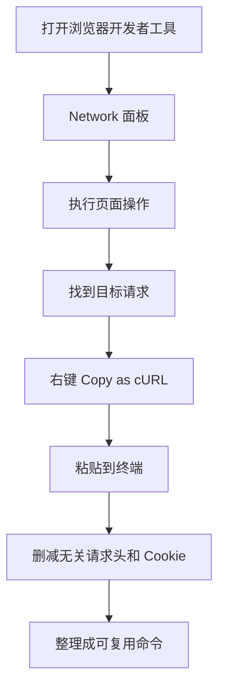

[toc]


## curl 是什么

`curl` 是一个命令行数据传输工具，用 URL 作为目标地址，常用于请求 HTTP/HTTPS 接口、下载文件、上传文件、调试 API、排查网络问题。它底层由 `libcurl` 提供能力，官方文档说明 curl 支持大量协议，包括 HTTP、HTTPS、FTP、FTPS、SFTP、SCP、SMTP、IMAP、POP3、LDAP、MQTT、WebSocket 等；不过日常开发里最常见的还是 HTTP/HTTPS。([Curl](https://curl.se/docs/manpage.html?utm_source=chatgpt.com))

简单理解：

```bash
curl https://example.com
```

这条命令的含义是：让 curl 向 `https://example.com` 发起一次请求，并把服务器返回的响应体输出到终端。

curl 的定位不是“浏览器”，而是“可脚本化的网络请求工具”。浏览器会自动处理页面渲染、JS、Cookie、缓存等复杂行为；curl 更偏底层，它让你明确控制请求方法、请求头、请求体、认证方式、代理、TLS、超时、重试、输出格式等。

------

## 基本请求模型

一次 HTTP 请求大致包含这些部分：

| 组成部分 | 含义                                       | curl 中常见参数               |
| -------- | ------------------------------------------ | ----------------------------- |
| URL      | 请求目标地址                               | 直接写在命令末尾              |
| Method   | 请求方法，如 GET、POST、PUT、DELETE        | `-X`                          |
| Headers  | 请求头，如 `Content-Type`、`Authorization` | `-H`                          |
| Body     | 请求体，常见于 POST/PUT/PATCH              | `-d`、`--data-raw`、`--json`  |
| Cookies  | 会话信息                                   | `-b`、`-c`                    |
| TLS/SSL  | HTTPS 证书校验、客户端证书等               | `--cacert`、`--cert`、`--key` |
| Output   | 响应输出到终端或文件                       | `-o`、`-O`                    |
| Debug    | 查看请求响应细节                           | `-v`、`-i`、`--trace`         |

示意流程如下：


------

## 安装与版本检查

大多数 Linux、macOS 系统已经预装 curl。Windows 10/11 也通常内置了 curl。

检查版本：

```bash
curl --version
```

你会看到类似信息：

```text
curl 8.x.x ...
Protocols: ...
Features: ...
```

重点看三类信息：

| 信息      | 说明                                                  |
| --------- | ----------------------------------------------------- |
| curl 版本 | 判断某些新参数是否可用                                |
| Protocols | 当前构建支持哪些协议                                  |
| Features  | 是否支持 SSL、HTTP2、HTTP3、brotli、zstd、IPv6 等功能 |

官方维护的 `Everything curl` 是非常完整的学习资料，官方也说明 curl 的命令行选项超过两百个，因此新手不需要一开始背全部参数，而应该先掌握高频场景。([Everything Curl](https://everything.curl.dev/cmdline/options/index.html?utm_source=chatgpt.com))

------

## 最基础用法

### GET 请求

```bash
curl https://httpbin.org/get
```

默认情况下，curl 对 HTTP/HTTPS URL 发起 GET 请求。

带查询参数：

```bash
curl "https://httpbin.org/get?name=alice&age=20"
```

注意 URL 中有 `&`、`?`、空格等特殊字符时，建议加引号，避免被 shell 错误解释。

------

### 查看响应头

只看响应头：

```bash
curl -I https://example.com
```

`-I` 会发送 HEAD 请求，通常用于查看状态码、服务器类型、缓存策略、重定向信息等。

请求并显示响应头和响应体：

```bash
curl -i https://example.com
```

`-i` 会把响应头也输出出来，适合调试接口。

------

### 跟随重定向

很多网站会从 HTTP 跳转到 HTTPS，或者从旧路径跳转到新路径。默认情况下 curl 不一定自动跟随重定向，常用：

```bash
curl -L https://example.com
```

`-L` 表示 follow redirect。

常见组合：

```bash
curl -L -i https://example.com
```

可以看到最终响应，也能观察重定向链路。

------

### 保存响应到文件

保存到指定文件名：

```bash
curl -o page.html https://example.com
```

使用服务器端文件名保存：

```bash
curl -O https://example.com/file.zip
```

区别：

| 参数      | 含义                        |
| --------- | --------------------------- |
| `-o file` | 自己指定保存文件名          |
| `-O`      | 使用 URL 路径中的原始文件名 |

------

## 常用参数速查

| 参数                | 长参数             | 用途                                         |
| ------------------- | ------------------ | -------------------------------------------- |
| `-X`                | `--request`        | 指定 HTTP 方法                               |
| `-H`                | `--header`         | 添加请求头                                   |
| `-d`                | `--data`           | 发送请求体，常用于 POST                      |
| 无短参数            | `--json`           | 发送 JSON 请求体，并自动设置 JSON 相关请求头 |
| `-I`                | `--head`           | 只请求响应头                                 |
| `-i`                | `--include`        | 输出响应头和响应体                           |
| `-v`                | `--verbose`        | 输出详细调试信息                             |
| `-L`                | `--location`       | 跟随重定向                                   |
| `-o`                | `--output`         | 保存为指定文件                               |
| `-O`                | `--remote-name`    | 按远程文件名保存                             |
| `-u`                | `--user`           | 用户名密码认证                               |
| `-b`                | `--cookie`         | 发送 Cookie                                  |
| `-c`                | `--cookie-jar`     | 保存 Cookie                                  |
| `-k`                | `--insecure`       | 跳过 TLS 证书校验，不推荐生产使用            |
| `--connect-timeout` | 同名               | 限制连接超时                                 |
| `--max-time`        | 同名               | 限制整个请求最大耗时                         |
| 无短参数            | `--retry`          | 请求失败时重试                               |
| 无短参数            | `--fail-with-body` | HTTP 错误时返回失败码，同时保留响应体        |

------

## GET、POST、PUT、PATCH、DELETE

### GET：查询资源

```bash
curl "https://api.example.com/users?id=1001"
```

GET 通常用于读取数据，不应该有副作用。

------

### POST：创建资源或提交数据

表单格式：

```bash
curl -X POST https://api.example.com/login \
  -d "username=alice" \
  -d "password=secret"
```

使用 `-d` 时，如果没有显式指定方法，curl 通常会使用 POST，因此很多时候可以省略 `-X POST`：

```bash
curl https://api.example.com/login \
  -d "username=alice" \
  -d "password=secret"
```

------

### JSON 请求

现代 API 最常见的是 JSON。

传统写法：

```bash
curl https://api.example.com/users \
  -H "Content-Type: application/json" \
  -d '{"name":"Alice","age":20}'
```

较新的 curl 支持 `--json`，它会发送 JSON 数据，并自动设置常见 JSON 请求头，更适合现代 API 调试：

```bash
curl https://api.example.com/users \
  --json '{"name":"Alice","age":20}'
```

`--json` 是推荐学习的新写法之一，但在较旧版本 curl 中可能不可用。如果你在服务器上执行报错，可以先用 `curl --version` 检查版本，或者改回 `-H "Content-Type: application/json" -d ...`。

------

### PUT：整体更新资源

```bash
curl -X PUT https://api.example.com/users/1001 \
  --json '{"name":"Alice","age":21}'
```

PUT 通常语义是“替换或整体更新”。

------

### PATCH：局部更新资源

```bash
curl -X PATCH https://api.example.com/users/1001 \
  --json '{"age":21}'
```

PATCH 通常语义是“只更新部分字段”。

------

### DELETE：删除资源

```bash
curl -X DELETE https://api.example.com/users/1001
```

如果 API 要求带认证：

```bash
curl -X DELETE https://api.example.com/users/1001 \
  -H "Authorization: Bearer $TOKEN"
```

------

## 请求头 Headers

请求头用于告诉服务器“我是谁、我想要什么格式、我提交的内容是什么格式”。

常见请求头：

| 请求头              | 用途                                  |
| ------------------- | ------------------------------------- |
| `Content-Type`      | 请求体格式，例如 JSON、表单、文件上传 |
| `Accept`            | 希望服务器返回什么格式                |
| `Authorization`     | 认证信息                              |
| `User-Agent`        | 客户端标识                            |
| `Cookie`            | 会话状态                              |
| `Referer`           | 来源页面                              |
| `If-None-Match`     | 缓存协商，配合 ETag                   |
| `If-Modified-Since` | 缓存协商，配合 Last-Modified          |

添加请求头：

```bash
curl https://api.example.com/data \
  -H "Accept: application/json" \
  -H "Authorization: Bearer $TOKEN"
```

覆盖 User-Agent：

```bash
curl https://example.com \
  -H "User-Agent: my-test-client/1.0"
```

最佳实践：敏感 token 不要直接写死在命令历史里，优先使用环境变量。

```bash
export TOKEN="your_token_here"

curl https://api.example.com/me \
  -H "Authorization: Bearer $TOKEN"
```

------

## 请求体 Body

### 表单数据

```bash
curl https://api.example.com/login \
  -d "username=alice" \
  -d "password=secret"
```

这类请求默认接近：

```text
Content-Type: application/x-www-form-urlencoded
```

适合普通表单提交。

------

### 原始文本数据

```bash
curl https://api.example.com/raw \
  -H "Content-Type: text/plain" \
  --data-raw "hello world"
```

`--data-raw` 更强调发送原始内容，不把 `@` 当作文件读取标记处理。

------

### 从文件读取请求体

```bash
curl https://api.example.com/users \
  -H "Content-Type: application/json" \
  -d @user.json
```

`@user.json` 表示请求体来自本地文件。

如果是现代写法：

```bash
curl https://api.example.com/users \
  --json @user.json
```

------

## 文件上传

### multipart/form-data 上传

这是最常见的文件上传方式：

```bash
curl https://api.example.com/upload \
  -F "file=@photo.jpg" \
  -F "description=test image"
```

`-F` 表示 multipart 表单。

多个文件：

```bash
curl https://api.example.com/upload \
  -F "files=@a.jpg" \
  -F "files=@b.jpg"
```

指定文件 MIME 类型：

```bash
curl https://api.example.com/upload \
  -F "file=@photo.jpg;type=image/jpeg"
```

------

### PUT 上传原始文件

有些对象存储、文件服务会要求直接 PUT 文件内容：

```bash
curl -X PUT https://storage.example.com/files/a.txt \
  --data-binary @a.txt
```

`--data-binary` 会更忠实地发送二进制内容，适合文件、压缩包、图片等。

------

## 文件下载

### 普通下载

```bash
curl -L -o app.tar.gz https://example.com/app.tar.gz
```

### 断点续传

```bash
curl -C - -O https://example.com/big-file.zip
```

`-C -` 表示自动从已下载的位置继续。

### 限速下载

```bash
curl --limit-rate 1M -O https://example.com/big-file.zip
```

这在测试弱网环境、避免占满带宽时有用。

------

## 状态码与错误处理

HTTP 响应状态码是调试 API 的核心。

| 状态码          | 含义             | 常见原因                 |
| --------------- | ---------------- | ------------------------ |
| 200             | 成功             | 请求正常                 |
| 201             | 已创建           | POST 创建成功            |
| 204             | 成功但无响应体   | DELETE 或更新成功        |
| 301/302/307/308 | 重定向           | URL 迁移、HTTP 到 HTTPS  |
| 400             | 请求错误         | 参数格式不对             |
| 401             | 未认证           | token 缺失或无效         |
| 403             | 无权限           | 已登录但无访问权限       |
| 404             | 不存在           | URL 或资源 ID 错误       |
| 409             | 冲突             | 重复创建、版本冲突       |
| 422             | 语义校验失败     | 字段校验不通过           |
| 429             | 请求过多         | 触发限流                 |
| 500             | 服务端错误       | 后端异常                 |
| 502/503/504     | 网关或服务不可用 | 服务下线、超时、代理问题 |

只输出状态码：

```bash
curl -o /dev/null -s -w "%{http_code}\n" https://example.com
```

解释：

| 参数           | 作用                   |
| -------------- | ---------------------- |
| `-o /dev/null` | 丢弃响应体             |
| `-s`           | 静默模式，不显示进度条 |
| `-w`           | 自定义输出格式         |
| `%{http_code}` | 输出 HTTP 状态码       |

更适合脚本的写法：

```bash
curl --fail-with-body https://api.example.com/data
```

`--fail-with-body` 的价值是：当 HTTP 状态码表示错误时，curl 会返回失败退出码，同时保留服务端返回的错误响应体，方便排查问题。相比老的 `--fail`，它对 API 调试更友好。

------

## 调试请求

### verbose 模式

```bash
curl -v https://example.com
```

`-v` 会显示 DNS、连接、TLS 握手、请求头、响应头等信息。

常见输出符号：

| 符号 | 含义               |
| ---- | ------------------ |
| `*`  | curl 自身调试信息  |
| `>`  | 发送给服务器的请求 |
| `<`  | 服务器返回的响应   |
| `{}` | 数据传输相关信息   |

------

### 只看请求过程，不关心响应体

```bash
curl -v -o /dev/null https://example.com
```

------

### trace 模式

```bash
curl --trace-ascii trace.txt https://example.com
```

`--trace-ascii` 会记录更完整的传输细节，适合复杂问题定位。

注意：trace 可能包含 token、cookie、密码等敏感信息，不要直接发到公开平台。

------

## 认证方式

### Basic Auth

```bash
curl -u username:password https://api.example.com/private
```

更安全一点：

```bash
curl -u username https://api.example.com/private
```

这样 curl 会提示你输入密码，避免密码进入 shell 历史。

------

### Bearer Token

```bash
curl https://api.example.com/me \
  -H "Authorization: Bearer $TOKEN"
```

这是现代 REST API、OAuth2、JWT 场景最常见的认证方式。

------

### API Key

不同服务 API Key 放置位置不一样。

放请求头：

```bash
curl https://api.example.com/data \
  -H "X-API-Key: $API_KEY"
```

放查询参数：

```bash
curl "https://api.example.com/data?api_key=$API_KEY"
```

最佳实践：优先使用请求头传 API Key，因为查询参数更容易出现在日志、浏览器历史、代理记录中。

------

### Cookie 认证

发送 Cookie：

```bash
curl https://example.com/profile \
  -b "sessionid=abc123"
```

保存服务端返回的 Cookie：

```bash
curl -c cookies.txt https://example.com/login
```

读取并发送 Cookie：

```bash
curl -b cookies.txt https://example.com/profile
```

登录后保存 Cookie，再访问页面：

```bash
curl -c cookies.txt https://example.com/login \
  -d "username=alice" \
  -d "password=secret"

curl -b cookies.txt https://example.com/profile
```

------

## HTTPS、证书与安全

curl 默认会校验 HTTPS 证书。如果证书无效、过期、自签名、不受信任，curl 会报错。

### 不推荐但常见的跳过证书校验

```bash
curl -k https://self-signed.example.com
```

`-k` 或 `--insecure` 会跳过证书校验。它适合本地临时测试，但不应该用于生产脚本，因为这会削弱 HTTPS 的安全性，使中间人攻击更容易发生。

### 使用指定 CA 证书

```bash
curl --cacert company-ca.pem https://internal.example.com
```

这是访问企业内网、自签 CA 服务时更好的方式。

### 双向 TLS 客户端证书

```bash
curl https://secure.example.com \
  --cert client.crt \
  --key client.key
```

有些企业 API、金融系统、内部网关会要求客户端证书认证。

------

## 超时、重试与稳定性

新手常写：

```bash
curl https://api.example.com/data
```

但脚本中不建议这样裸跑，因为网络请求可能卡住很久。

更稳的写法：

```bash
curl https://api.example.com/data \
  --connect-timeout 5 \
  --max-time 30 \
  --retry 3 \
  --retry-delay 2 \
  --fail-with-body
```

参数解释：

| 参数                  | 建议用途                              |
| --------------------- | ------------------------------------- |
| `--connect-timeout 5` | 连接阶段最多等 5 秒                   |
| `--max-time 30`       | 整个请求最多 30 秒                    |
| `--retry 3`           | 失败时最多重试 3 次                   |
| `--retry-delay 2`     | 每次重试间隔 2 秒                     |
| `--fail-with-body`    | HTTP 错误时让命令失败，并保留错误响应 |

更适合自动化脚本：

```bash
response=$(curl -sS --fail-with-body \
  --connect-timeout 5 \
  --max-time 30 \
  --retry 3 \
  https://api.example.com/data)
```

其中：

| 参数  | 含义                           |
| ----- | ------------------------------ |
| `-s`  | 静默模式                       |
| `-S`  | 静默时仍显示错误               |
| `-sS` | 脚本里很常用，既安静又不吞错误 |

------

## 代理

### HTTP 代理

```bash
curl -x http://127.0.0.1:7890 https://example.com
```

### SOCKS5 代理

```bash
curl --socks5 127.0.0.1:1080 https://example.com
```

### 使用环境变量

```bash
export HTTP_PROXY=http://127.0.0.1:7890
export HTTPS_PROXY=http://127.0.0.1:7890

curl https://example.com
```

取消代理：

```bash
unset HTTP_PROXY HTTPS_PROXY
```

绕过代理：

```bash
curl --noproxy localhost,127.0.0.1 https://example.com
```

------

## HTTP 版本

查看当前连接协商情况：

```bash
curl -v https://example.com
```

指定 HTTP/1.1：

```bash
curl --http1.1 https://example.com
```

指定 HTTP/2：

```bash
curl --http2 https://example.com
```

HTTP/3 支持取决于 curl 编译时是否启用了相关库。可以先看：

```bash
curl --version
```

如果 Features 或帮助中支持 HTTP3，再使用：

```bash
curl --http3 https://example.com
```

现代化理解：不是所有 curl 二进制都支持 HTTP/3，即使 curl 版本较新，也要看构建特性。

------

## DNS 与连接调试

### 查看连接耗时

```bash
curl -o /dev/null -s -w \
"namelookup: %{time_namelookup}
connect: %{time_connect}
appconnect: %{time_appconnect}
starttransfer: %{time_starttransfer}
total: %{time_total}
http_code: %{http_code}
" https://example.com
```

含义：

| 指标                 | 含义             |
| -------------------- | ---------------- |
| `time_namelookup`    | DNS 解析耗时     |
| `time_connect`       | TCP 连接建立耗时 |
| `time_appconnect`    | TLS 握手完成耗时 |
| `time_starttransfer` | 首字节返回时间   |
| `time_total`         | 总耗时           |
| `http_code`          | HTTP 状态码      |

### 指定域名解析结果

测试某个 IP 上的站点，但保持 Host/SNI 不变：

```bash
curl --resolve example.com:443:1.2.3.4 https://example.com
```

这对排查负载均衡、CDN、灰度节点非常有用。

------

## URL 编码

URL 中如果有中文、空格、特殊符号，需要编码。

简单参数可以自己加引号：

```bash
curl "https://api.example.com/search?q=hello%20world"
```

也可以让 curl 帮你编码查询参数：

```bash
curl -G https://api.example.com/search \
  --data-urlencode "q=hello world" \
  --data-urlencode "tag=C++"
```

`-G` 表示把 `-d` 或 `--data-urlencode` 的数据拼到 URL 查询参数里，而不是作为 POST 请求体发送。

------

## 多请求与批量下载

### 下载多个文件

```bash
curl -O https://example.com/a.txt \
     -O https://example.com/b.txt
```

### 使用 URL 范围

```bash
curl -O "https://example.com/img[1-5].jpg"
```

会尝试下载：

```text
img1.jpg
img2.jpg
img3.jpg
img4.jpg
img5.jpg
```

### 并发下载

较新版本 curl 支持并行传输参数，例如：

```bash
curl --parallel -O https://example.com/a.zip -O https://example.com/b.zip
```

是否支持取决于本机 curl 版本。

------

## 配置文件

curl 可以从配置文件读取参数，官方手册也说明了 `-K, --config <file>` 可用于指定一个文本文件，让 curl 从中读取命令行参数。([Curl](https://curl.se/docs/manpage.html?utm_source=chatgpt.com))

例如创建 `curl.conf`：

```text
url = "https://api.example.com/data"
header = "Accept: application/json"
connect-timeout = 5
max-time = 30
retry = 3
```

执行：

```bash
curl -K curl.conf
```

适合参数很多、命令太长、需要复用的场景。

但注意：配置文件里不要保存长期有效的明文密码或 token，除非你能严格控制文件权限。

------

## 从浏览器复制 curl

浏览器开发者工具通常支持“Copy as cURL”。流程大致是：



复制出来的 curl 往往很长，包含大量浏览器请求头。新手不要全部照抄到代码里，应保留必要部分。

通常值得保留：

| 内容                   | 是否保留                             |
| ---------------------- | ------------------------------------ |
| URL                    | 必须                                 |
| 请求方法               | 必须                                 |
| `Content-Type`         | 通常需要                             |
| `Authorization`        | 如果接口需要认证，则需要             |
| Cookie                 | 如果依赖登录态，则需要，但要注意安全 |
| 请求体                 | 通常需要                             |
| `User-Agent`           | 一般不必保留，除非服务端强依赖       |
| `sec-ch-ua` 等浏览器头 | 通常不必保留                         |
| `Accept-Language`      | 多数 API 不需要                      |
| `Referer`              | 某些网站需要，API 通常不需要         |

------

## curl 与 Postman、HTTPie、wget 的区别

| 工具    | 适合场景                         | 特点                               |
| ------- | -------------------------------- | ---------------------------------- |
| curl    | 脚本化、自动化、调试底层网络问题 | 几乎处处可用，参数强大             |
| Postman | 图形化 API 调试、团队接口管理    | 上手直观，适合接口集合管理         |
| HTTPie  | 更友好的命令行 API 调试          | 输出美观，语法简洁                 |
| wget    | 下载文件、镜像站点               | 下载场景强，API 调试不如 curl 灵活 |

经验判断：

| 需求                   | 推荐           |
| ---------------------- | -------------- |
| 临时测接口             | curl 或 HTTPie |
| 写 CI/CD 脚本          | curl           |
| 下载大文件             | curl 或 wget   |
| 管理大量 API 集合      | Postman        |
| 排查 TLS、代理、重定向 | curl           |
| 从浏览器复现请求       | curl           |

------

## 常见实战场景

### 测试接口是否可用

```bash
curl -i https://api.example.com/health
```

或者只看状态码：

```bash
curl -o /dev/null -s -w "%{http_code}\n" https://api.example.com/health
```

------

### 带 token 请求用户信息

```bash
curl https://api.example.com/me \
  -H "Authorization: Bearer $TOKEN" \
  -H "Accept: application/json"
```

------

### 提交 JSON 创建用户

```bash
curl https://api.example.com/users \
  --json '{"name":"Alice","email":"alice@example.com"}'
```

------

### 从 JSON 文件提交

`user.json`：

```json
{
  "name": "Alice",
  "email": "alice@example.com"
}
```

命令：

```bash
curl https://api.example.com/users \
  --json @user.json
```

------

### 上传头像

```bash
curl https://api.example.com/avatar \
  -H "Authorization: Bearer $TOKEN" \
  -F "avatar=@avatar.png"
```

------

### 下载文件并显示进度

```bash
curl -L -O https://example.com/file.zip
```

------

### 断点续传下载

```bash
curl -L -C - -O https://example.com/file.zip
```

------

### 测试接口耗时

```bash
curl -o /dev/null -s -w "status=%{http_code} total=%{time_total}s\n" \
  https://api.example.com/data
```

------

### 检查重定向链

```bash
curl -L -I https://example.com
```

------

### 使用代理访问

```bash
curl -x http://127.0.0.1:7890 https://example.com
```

------

## 常见错误与排查

### Could not resolve host

含义：域名解析失败。

常见原因：

| 原因              | 处理              |
| ----------------- | ----------------- |
| URL 写错          | 检查拼写          |
| DNS 问题          | 换 DNS 或检查网络 |
| shell 把 URL 切坏 | 给 URL 加引号     |
| 代理环境异常      | 检查代理变量      |

示例：

```bash
curl "https://api.example.com/search?q=a&b=c"
```

不要写成未加引号的：

```bash
curl https://api.example.com/search?q=a&b=c
```

因为 `&` 在 shell 中有特殊含义。

------

### SSL certificate problem

含义：证书校验失败。

处理顺序：

| 方案                                   | 推荐程度 |
| -------------------------------------- | -------- |
| 检查系统时间是否正确                   | 高       |
| 更新 CA 证书                           | 高       |
| 使用公司 CA：`--cacert company-ca.pem` | 高       |
| 临时测试用 `-k`                        | 低       |
| 生产脚本长期使用 `-k`                  | 不推荐   |

------

### 401 Unauthorized

含义：没有通过认证。

检查：

| 检查项                        | 示例                        |
| ----------------------------- | --------------------------- |
| token 是否为空                | `echo "$TOKEN"`             |
| Authorization 格式是否正确    | `Authorization: Bearer xxx` |
| token 是否过期                | 重新登录或刷新 token        |
| 环境变量是否在当前 shell 生效 | 重新 export                 |

------

### 403 Forbidden

含义：认证了，但没有权限。

可能原因：

| 原因                 | 说明                    |
| -------------------- | ----------------------- |
| 账号权限不足         | 需要管理员授权          |
| API Key 权限范围不够 | scope 不包含目标资源    |
| IP 白名单限制        | 当前网络不在允许范围    |
| CSRF 或 Referer 校验 | 某些 Web 接口会检查来源 |

------

### 415 Unsupported Media Type

通常是 `Content-Type` 错了。

比如服务端要求 JSON，你却发送了普通表单：

```bash
curl https://api.example.com/users \
  -d '{"name":"Alice"}'
```

更合适：

```bash
curl https://api.example.com/users \
  -H "Content-Type: application/json" \
  -d '{"name":"Alice"}'
```

或者：

```bash
curl https://api.example.com/users \
  --json '{"name":"Alice"}'
```

------

### 422 Unprocessable Entity

通常是字段校验失败，例如缺少必填字段、字段类型不对、邮箱格式不对等。

建议加上 `-i` 查看状态码和响应体：

```bash
curl -i https://api.example.com/users \
  --json '{"email":"bad-email"}'
```

------

## Shell 引号规则

curl 很多问题不是 curl 本身造成的，而是 shell 引号造成的。

### Linux/macOS Bash/Zsh

推荐外层用单引号包 JSON：

```bash
curl https://api.example.com/users \
  --json '{"name":"Alice","age":20}'
```

如果 JSON 里需要变量，外层可以用双引号，但要注意转义：

```bash
curl https://api.example.com/users \
  --json "{\"name\":\"$NAME\",\"age\":20}"
```

更稳的做法是把 JSON 放到文件里：

```bash
curl https://api.example.com/users \
  --json @user.json
```

### Windows PowerShell

PowerShell 的引号规则不同，复杂 JSON 更建议使用文件：

```powershell
curl.exe https://api.example.com/users --json @user.json
```

注意在 Windows PowerShell 中，`curl` 可能曾经是别名，现代环境建议明确使用 `curl.exe`，避免和 PowerShell 自己的命令混淆。

------

## 安全最佳实践

| 做法                                     | 原因                                             |
| ---------------------------------------- | ------------------------------------------------ |
| 不要把 token、密码硬编码进脚本           | 防止泄露                                         |
| 不要把含敏感信息的 curl 命令发到公开论坛 | 请求头、Cookie 可能包含登录态                    |
| 使用环境变量保存临时 token               | 降低命令历史泄露风险                             |
| 生产环境不要长期使用 `-k`                | 避免绕过 HTTPS 证书校验                          |
| 调试日志发给别人前先脱敏                 | `Authorization`、`Cookie`、`Set-Cookie` 都要处理 |
| 给脚本加超时                             | 防止 CI/CD 或定时任务卡死                        |
| 使用 `--fail-with-body`                  | 让脚本正确感知 HTTP 错误                         |
| 对外部输入做 URL 编码                    | 避免参数被截断或注入                             |
| 避免用 GET 传敏感信息                    | URL 容易进入日志                                 |
| Cookie 文件设置合适权限                  | 避免会话被其他用户读取                           |

示例：脚本中的较安全写法

```bash
#!/usr/bin/env bash
set -euo pipefail

: "${TOKEN:?TOKEN is required}"

curl -sS --fail-with-body \
  --connect-timeout 5 \
  --max-time 30 \
  --retry 3 \
  -H "Authorization: Bearer $TOKEN" \
  -H "Accept: application/json" \
  https://api.example.com/me
```

说明：

| 写法                               | 作用                       |
| ---------------------------------- | -------------------------- |
| `set -euo pipefail`                | 脚本遇到错误时更早失败     |
| `: "${TOKEN:?TOKEN is required}"`  | token 未设置时直接报错     |
| `-sS`                              | 安静输出，但保留错误       |
| `--fail-with-body`                 | HTTP 错误时返回失败码      |
| `--connect-timeout` / `--max-time` | 避免卡死                   |
| `--retry`                          | 提高临时网络故障下的稳定性 |

------

## 学习路线

### 入门阶段

先掌握：

| 能力        | 对应内容              |
| ----------- | --------------------- |
| 发 GET 请求 | `curl URL`            |
| 看响应头    | `-i`、`-I`            |
| 跟随重定向  | `-L`                  |
| 保存文件    | `-o`、`-O`            |
| 发 JSON     | `--json` 或 `-H + -d` |
| 添加请求头  | `-H`                  |
| 调试请求    | `-v`                  |

练习目标：能用 curl 调用一个公开 API，并看懂状态码、响应头、响应体。

------

### 进阶阶段

继续掌握：

| 能力     | 对应内容                                     |
| -------- | -------------------------------------------- |
| 认证     | `Authorization`、`-u`、Cookie                |
| 上传文件 | `-F`、`--data-binary`                        |
| 超时重试 | `--connect-timeout`、`--max-time`、`--retry` |
| 输出格式 | `-w`                                         |
| 代理     | `-x`、`--socks5`                             |
| TLS 证书 | `--cacert`、`--cert`、`--key`                |
| URL 编码 | `--data-urlencode`、`-G`                     |

练习目标：能把浏览器或 Postman 中的请求改写成简洁、安全、可复用的 curl 命令。

------

### 实战阶段

重点是脚本化和排障：

| 能力           | 典型任务                   |
| -------------- | -------------------------- |
| 接口健康检查   | 定时请求 `/health`         |
| CI/CD 调用 API | 发布后通知、触发构建       |
| 网络问题排查   | DNS、TLS、代理、重定向     |
| 批量下载上传   | 文件同步、数据采集         |
| 性能初步观察   | 首字节时间、总耗时、状态码 |

------

## 新手最容易踩的坑

| 坑                         | 错误表现              | 正确做法                               |
| -------------------------- | --------------------- | -------------------------------------- |
| URL 不加引号               | `&` 后面的参数丢失    | URL 包上双引号                         |
| 忘记 `Content-Type`        | 服务端解析不了 JSON   | 用 `--json` 或手动加头                 |
| 滥用 `-X POST`             | 方法和数据语义混乱    | 用 `-d` 时通常不用显式 `-X POST`       |
| 把 token 写进命令          | 历史记录泄露          | 使用环境变量                           |
| 生产使用 `-k`              | HTTPS 安全失效        | 配置正确 CA                            |
| 脚本不加超时               | 网络异常时卡死        | 加 `--connect-timeout` 和 `--max-time` |
| 只看响应体                 | 忽略状态码            | 调试时加 `-i` 或 `-w`                  |
| 复制浏览器 curl 后不清理   | 命令冗长且泄露 Cookie | 删除无关请求头并脱敏                   |
| Windows 直接照抄 Bash 命令 | 引号不兼容            | PowerShell 优先用 JSON 文件            |

------

## 常用命令模板

### API GET 模板

```bash
curl -sS --fail-with-body \
  -H "Accept: application/json" \
  "https://api.example.com/resources?page=1"
```

### API POST JSON 模板

```bash
curl -sS --fail-with-body \
  -H "Authorization: Bearer $TOKEN" \
  --json '{"name":"Alice"}' \
  https://api.example.com/resources
```

### 文件上传模板

```bash
curl -sS --fail-with-body \
  -H "Authorization: Bearer $TOKEN" \
  -F "file=@report.pdf" \
  https://api.example.com/upload
```

### 下载模板

```bash
curl -L --fail \
  --connect-timeout 10 \
  --max-time 300 \
  -o file.zip \
  https://example.com/file.zip
```

### 调试模板

```bash
curl -v -i \
  -H "Authorization: Bearer $TOKEN" \
  https://api.example.com/debug
```

### 耗时分析模板

```bash
curl -o /dev/null -s -w \
"status=%{http_code}
dns=%{time_namelookup}
connect=%{time_connect}
tls=%{time_appconnect}
ttfb=%{time_starttransfer}
total=%{time_total}
" https://example.com
```

------

## 推荐记忆方式

curl 命令可以按这个结构记：

```text
curl [全局控制参数] [请求描述参数] [URL]
```

更具体一点：

```text
curl
  -sS / -v / -L / --fail-with-body        控制行为
  -H "Header: value"                     请求头
  --json '{}' / -d 'a=b' / -F file=@x    请求体
  -o file / -w format                    输出
  https://example.com                    URL
```

新手最应该熟练掌握这组组合：

```bash
curl -i -L https://example.com
curl -sS --fail-with-body https://api.example.com/data
curl https://api.example.com/users --json '{"name":"Alice"}'
curl -H "Authorization: Bearer $TOKEN" https://api.example.com/me
curl -v https://example.com
```

掌握这些以后，再按场景补充 Cookie、上传、代理、TLS、重试、耗时分析，就能覆盖绝大多数日常开发和运维需求。

## 附录：学习资源

### 官方资源

- **官方网站**: https://curl.se/
- **官方文档**: https://curl.se/docs/
- **在线手册**: https://curl.se/docs/manpage.html
- **GitHub**: https://github.com/curl/curl

### 在线工具

- **curl 命令生成器**: https://curlbuilder.com/
- **HTTP 转 curl**: 浏览器开发者工具 → 网络 → 右键 → Copy as cURL
- **curl 转代码**: https://curlconverter.com/

### 推荐书籍

- 《Everything curl》 - Daniel Stenberg (免费电子书)
  https://everything.curl.dev/

### 练习资源

```bash
# 公开测试 API
curl https://httpbin.org/get                    # 回显请求信息
curl https://jsonplaceholder.typicode.com/posts # 模拟 REST API
curl https://api.github.com                     # GitHub API
curl wttr.in/Beijing                            # 天气查询
curl ifconfig.me                                # 查看公网 IP
```

