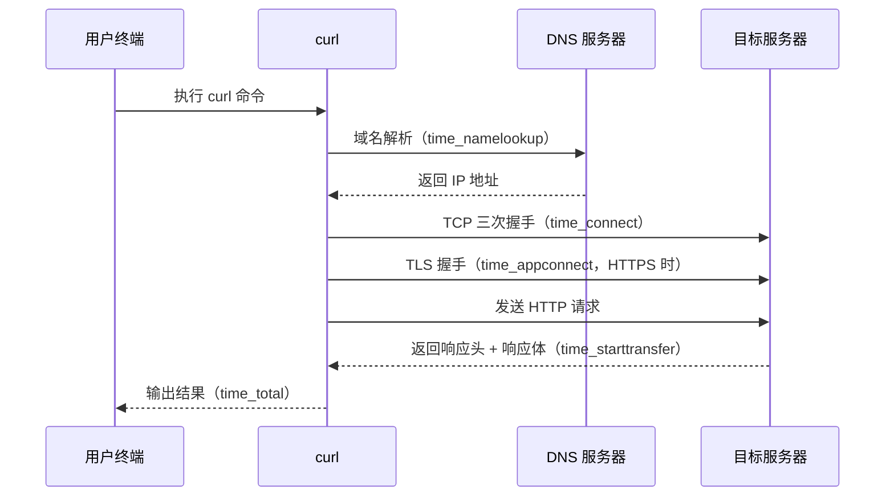
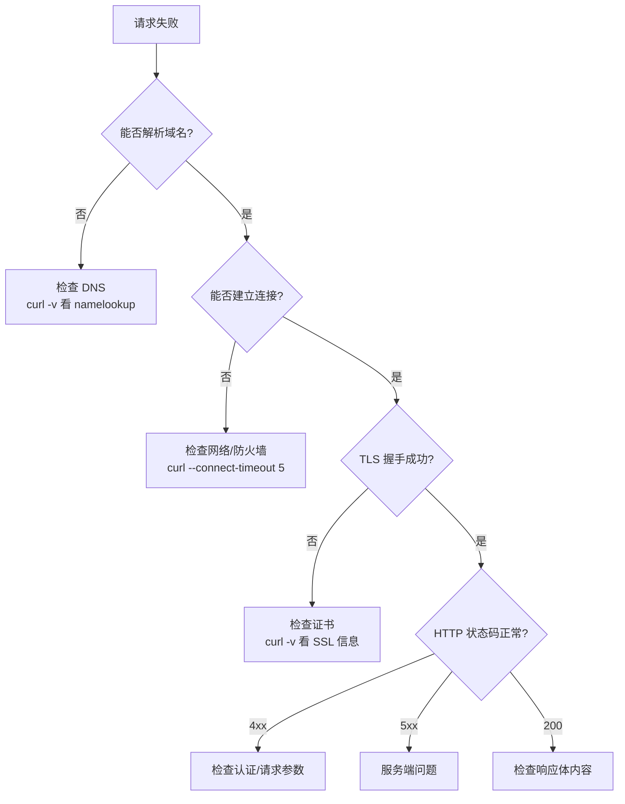

[toc]


# curl 学习指南

## 什么是 curl

curl（Client URL）是一个命令行工具和库（libcurl），用于通过 URL 语法传输数据。它支持几乎所有主流网络协议，是开发者日常工作中最常用的网络调试和数据传输工具之一。

curl 的核心价值：

- 无需图形界面即可发起网络请求，适合服务器环境和自动化脚本
- 支持协议极其广泛（HTTP、HTTPS、FTP、SFTP、SMTP、MQTT 等）
- 跨平台，几乎所有操作系统都预装或可安装
- 输出可控，便于与其他命令行工具组合使用

## 基础用法

### 最简请求

```bash
curl https://example.com
```

这会将响应体直接输出到标准输出（终端）。

### 常用基础选项

| 选项        | 作用                           | 示例                                      |
| ----------- | ------------------------------ | ----------------------------------------- |
| `-o <file>` | 将响应保存到指定文件           | `curl -o page.html https://example.com`   |
| `-O`        | 用远程文件名保存               | `curl -O https://example.com/file.tar.gz` |
| `-L`        | 跟随重定向（3xx）              | `curl -L https://short.url/abc`           |
| `-v`        | 显示详细通信过程               | `curl -v https://example.com`             |
| `-s`        | 静默模式，不显示进度条         | `curl -s https://api.example.com/data`    |
| `-S`        | 与 `-s` 搭配，出错时仍显示错误 | `curl -sS https://api.example.com/data`   |
| `-I`        | 只获取响应头（HEAD 请求）      | `curl -I https://example.com`             |
| `-i`        | 响应中包含响应头               | `curl -i https://example.com`             |

### 理解 -v 输出

`-v`（verbose）是调试的核心工具，输出中的符号含义：

| 前缀 | 含义                              |
| ---- | --------------------------------- |
| `*`  | curl 内部信息（连接、TLS 握手等） |
| `>`  | 发送给服务器的请求数据            |
| `<`  | 从服务器收到的响应数据            |

```bash
curl -v https://httpbin.org/get
```

## HTTP 方法与请求构造

### 指定 HTTP 方法

| 方法   | 写法                         | 说明                                                    |
| ------ | ---------------------------- | ------------------------------------------------------- |
| GET    | 默认，无需指定               | `curl https://api.example.com/users`                    |
| POST   | `-X POST` 或用 `-d` 自动触发 | `curl -d '{}' https://api.example.com/users`            |
| PUT    | `-X PUT`                     | `curl -X PUT -d '{}' https://api.example.com/users/1`   |
| PATCH  | `-X PATCH`                   | `curl -X PATCH -d '{}' https://api.example.com/users/1` |
| DELETE | `-X DELETE`                  | `curl -X DELETE https://api.example.com/users/1`        |

最佳实践：当使用 `-d` 发送数据时，curl 自动使用 POST 方法，无需额外加 `-X POST`。只在需要覆盖默认方法时才使用 `-X`。

### 发送请求头

```bash
curl -H "Content-Type: application/json" \
     -H "Authorization: Bearer token123" \
     https://api.example.com/data
```

### 发送 JSON 数据

```bash
# 传统方式
curl -X POST \
     -H "Content-Type: application/json" \
     -d '{"name": "Alice", "email": "alice@example.com"}' \
     https://api.example.com/users

# curl 7.82+ 推荐方式：--json 自动设置 Content-Type 和 Accept
curl --json '{"name": "Alice", "email": "alice@example.com"}' \
     https://api.example.com/users
```

`--json` 选项等价于同时设置：

- `-H "Content-Type: application/json"`
- `-H "Accept: application/json"`
- `--data`

### 表单数据

```bash
# application/x-www-form-urlencoded（默认）
curl -d "username=alice&password=secret" https://example.com/login

# multipart/form-data（文件上传）
curl -F "avatar=@/path/to/photo.jpg" \
     -F "name=Alice" \
     https://example.com/upload
```

`-d` 与 `-F` 的区别：

| 特性         | `-d`                              | `-F`                |
| ------------ | --------------------------------- | ------------------- |
| Content-Type | application/x-www-form-urlencoded | multipart/form-data |
| 文件上传     | 不支持                            | 支持（用 `@` 前缀） |
| 适用场景     | 简单键值对                        | 文件上传、混合数据  |

### 从文件读取请求体

```bash
# 从文件读取 JSON
curl --json @payload.json https://api.example.com/users

# 从标准输入读取
echo '{"key": "value"}' | curl --json @- https://api.example.com/data
```

## 认证与安全

### 常见认证方式

```bash
# Basic 认证
curl -u username:password https://api.example.com/protected

# Bearer Token
curl -H "Authorization: Bearer eyJhbGciOi..." https://api.example.com/me

# 从 .netrc 文件读取凭据（避免命令行暴露密码）
curl --netrc https://api.example.com/protected
```

最佳实践：避免在命令行中直接写密码，因为它会出现在 shell 历史和进程列表中。使用 `--netrc`、环境变量或配置文件代替。

```bash
# 使用环境变量
curl -H "Authorization: Bearer $API_TOKEN" https://api.example.com/data
```

### TLS/SSL 相关

```bash
# 跳过证书验证（仅用于开发调试，生产环境绝不使用）
curl -k https://self-signed.example.com

# 指定 CA 证书
curl --cacert /path/to/ca.pem https://example.com

# 客户端证书认证
curl --cert client.pem --key client-key.pem https://mutual-tls.example.com
```

## 响应处理

### 控制输出

```bash
# 只输出响应体（常用于脚本）
curl -s https://api.example.com/data

# 输出到文件，终端显示进度
curl -o output.json https://api.example.com/large-data

# 获取 HTTP 状态码
curl -s -o /dev/null -w "%{http_code}" https://example.com
```

### -w 格式化输出

`-w`（write-out）可以提取请求的各种元信息：

```bash
curl -s -o /dev/null -w "\
HTTP Code: %{http_code}\n\
Total Time: %{time_total}s\n\
DNS Time: %{time_namelookup}s\n\
Connect Time: %{time_connect}s\n\
TLS Time: %{time_appconnect}s\n\
Download Size: %{size_download} bytes\n" \
https://example.com
```

常用 `-w` 变量：

| 变量                    | 含义                           |
| ----------------------- | ------------------------------ |
| `%{http_code}`          | HTTP 状态码                    |
| `%{time_total}`         | 总耗时（秒）                   |
| `%{time_namelookup}`    | DNS 解析耗时                   |
| `%{time_connect}`       | TCP 连接耗时                   |
| `%{time_appconnect}`    | TLS 握手完成耗时               |
| `%{time_starttransfer}` | 首字节到达耗时（TTFB）         |
| `%{size_download}`      | 下载字节数                     |
| `%{url_effective}`      | 最终请求的 URL（跟随重定向后） |

## 请求生命周期(时序图)



## Cookie 处理

```bash
# 发送 cookie
curl -b "session=abc123" https://example.com

# 保存服务器返回的 cookie 到文件
curl -c cookies.txt https://example.com/login -d "user=alice&pass=secret"

# 使用保存的 cookie 发起后续请求
curl -b cookies.txt https://example.com/dashboard

# 同时读取和保存（模拟浏览器会话）
curl -b cookies.txt -c cookies.txt https://example.com/page
```

## 代理

```bash
# HTTP 代理
curl -x http://proxy.example.com:8080 https://target.com

# SOCKS5 代理
curl --socks5 127.0.0.1:1080 https://target.com

# 通过环境变量设置（许多工具通用）
export https_proxy=http://proxy.example.com:8080
curl https://target.com
```

## 超时与重试

```bash
# 连接超时（秒）
curl --connect-timeout 5 https://slow-server.com

# 总超时
curl --max-time 30 https://slow-server.com

# 自动重试（适合不稳定网络）
curl --retry 3 --retry-delay 2 --retry-max-time 60 https://flaky-api.com

# 只对特定错误重试（网络错误和 5xx）
curl --retry 3 --retry-all-errors https://api.example.com/data
```

## 下载与上传

### 下载

```bash
# 断点续传
curl -C - -O https://example.com/large-file.iso

# 限速下载（避免占满带宽）
curl --limit-rate 1M -O https://example.com/large-file.iso

# 同时下载多个文件
curl -O https://example.com/file1.zip -O https://example.com/file2.zip
```

### 上传

```bash
# PUT 上传文件
curl -T localfile.txt https://example.com/upload/

# FTP 上传
curl -T backup.tar.gz ftp://ftp.example.com/ -u user:pass

# 分块上传大文件（HTTP chunked transfer）
curl -H "Transfer-Encoding: chunked" -T bigfile.dat https://example.com/upload
```

## 实用技巧

### 配置文件

在 `~/.curlrc` 中设置默认选项，避免重复输入：

```
# ~/.curlrc
--location
--silent
--show-error
--connect-timeout 10
--max-time 60
--user-agent "MyCurl/1.0"
```

### URL 通配

```bash
# 下载编号序列
curl -O "https://example.com/img/photo_[001-100].jpg"

# 多个变体
curl -O "https://example.com/{en,fr,de}/page.html"
```

### 模拟浏览器请求

```bash
curl -A "Mozilla/5.0 (Windows NT 10.0; Win64; x64) AppleWebKit/537.36" \
     -H "Accept: text/html" \
     -H "Accept-Language: en-US,en;q=0.9" \
     -L \
     https://example.com
```

### 与 jq 配合处理 JSON

```bash
# 获取并格式化 JSON
curl -s https://api.github.com/users/octocat | jq .

# 提取特定字段
curl -s https://api.github.com/users/octocat | jq '.login, .public_repos'

# 处理数组
curl -s https://api.github.com/users/octocat/repos | jq '.[].name'
```

### 在脚本中使用 curl

```bash
#!/bin/bash

response=$(curl -s -w "\n%{http_code}" https://api.example.com/health)
body=$(echo "$response" | head -n -1)
http_code=$(echo "$response" | tail -n 1)

if [ "$http_code" -eq 200 ]; then
    echo "Service healthy: $body"
else
    echo "Service unhealthy (HTTP $http_code)" >&2
    exit 1
fi
```

## 调试技巧

### 逐步排查问题



### 常用调试组合

```bash
# 完整调试信息（包括 TLS 细节）
curl -v --trace-time https://example.com

# 将调试信息保存到文件（不干扰输出）
curl --trace trace.log https://example.com

# 对比请求差异：导出为可复现的命令
curl -v https://example.com 2>&1 | grep "^[>*]"
```

## 从浏览器到 curl

现代浏览器的开发者工具支持将请求复制为 curl 命令：

- Chrome/Edge：Network 面板 → 右键请求 → Copy → Copy as cURL
- Firefox：Network 面板 → 右键请求 → Copy Value → Copy as cURL

这在复现浏览器中的请求行为时非常有用，复制出的命令通常包含所有 cookie 和请求头。

## 常见错误与解决

| 错误信息                       | 原因                     | 解决方案                             |
| ------------------------------ | ------------------------ | ------------------------------------ |
| `Could not resolve host`       | DNS 解析失败             | 检查域名拼写、DNS 配置               |
| `Connection refused`           | 目标端口未监听           | 确认服务运行、端口正确               |
| `Connection timed out`         | 网络不通或防火墙拦截     | 检查网络连通性、防火墙规则           |
| `SSL certificate problem`      | 证书无效或不受信任       | 更新 CA 证书包，或用 `--cacert` 指定 |
| `curl: (56) Recv failure`      | 连接被对端重置           | 检查服务端日志、代理配置             |
| `curl: (35) SSL connect error` | TLS 版本或密码套件不匹配 | 尝试 `--tlsv1.2` 或 `--tlsv1.3`      |

## 版本与协议支持

查看当前 curl 的能力：

```bash
# 查看版本和支持的协议
curl --version

# 输出示例中关注：
# - Protocols: 支持的协议列表
# - Features: 支持的特性（如 HTTP2, HTTP3, TLS）
```

### HTTP/2 和 HTTP/3

```bash
# 强制使用 HTTP/2
curl --http2 https://example.com

# 尝试 HTTP/3（需要 curl 编译时启用）
curl --http3 https://example.com
```

## 最佳实践总结

| 场景       | 推荐做法                                                 |
| ---------- | -------------------------------------------------------- |
| API 调试   | 使用 `-v` 查看完整交互，`--json` 简化 JSON 请求          |
| 脚本中使用 | 始终加 `-s -S`，用 `-w` 获取状态码，检查退出码           |
| 安全凭据   | 用环境变量或 `--netrc`，不要硬编码在命令中               |
| 生产环境   | 设置 `--connect-timeout` 和 `--max-time`，配置 `--retry` |
| 大文件传输 | 使用 `-C -` 支持断点续传，`--limit-rate` 控制带宽        |
| 跟随重定向 | 始终加 `-L`，用 `--max-redirs` 限制跳转次数              |
| 复现问题   | 从浏览器复制 curl 命令，用 `--trace` 保存完整日志        |