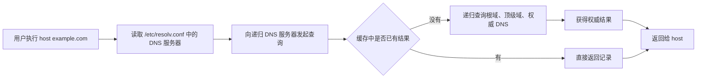

[toc]


## `host` 命令是什么

`host` 是一个轻量级 DNS 查询工具，主要用来做两件事：**域名查 IP**，以及 **IP 反查域名**。它属于 BIND 9 工具体系，适合快速确认 DNS 解析是否正常。官方手册对它的定位就是 “DNS lookup utility”，默认用于在主机名和 IP 地址之间互查。([manpages.debian.org](https://manpages.debian.org/bookworm/bind9-host/host.1.en.html))

它的基本格式是：

```bash
host [选项] 域名或IP [指定DNS服务器]
```

常见写法：

```bash
host example.com
host 8.8.8.8
host example.com 1.1.1.1
host -t MX example.com
host -t TXT example.com
```

其中最后一个参数 `[指定DNS服务器]` 很重要：不写时，`host` 会使用系统 `/etc/resolv.conf` 里配置的 DNS 服务器；写了就会直接查询你指定的 DNS 服务器。([manpages.debian.org](https://manpages.debian.org/bookworm/bind9-host/host.1.en.html))

## 它和 `hosts` 文件不是一回事

新手最容易混淆这两个东西：

| 名称           | 含义             | 典型位置 / 命令            | 作用                                         |
| -------------- | ---------------- | -------------------------- | -------------------------------------------- |
| `host`         | 命令             | `/usr/bin/host`            | 查询 DNS                                     |
| `hosts`        | 本地静态解析文件 | `/etc/hosts`               | 本机名字映射                                 |
| `getent hosts` | 系统解析测试命令 | `getent hosts example.com` | 按系统 NSS 顺序查，包括 `/etc/hosts`、DNS 等 |

重点：**`host` 主要用于 DNS 查询，不适合用来验证 `/etc/hosts` 是否生效**。如果你改了 `/etc/hosts`，应该用：

```bash
getent hosts example.com
```

如果你想看 DNS 服务器返回了什么，才用：

```bash
host example.com
```

## DNS 查询的基本原理

DNS 可以理解为“互联网电话簿”：用户输入域名，DNS 返回对应的 IP 地址。`host` 做的事情就是向 DNS 服务器发起查询，然后把结果打印出来。



这里有几个核心概念：

| 概念     | 解释                                                         |
| -------- | ------------------------------------------------------------ |
| 递归 DNS | 帮你一路查到底的 DNS 服务器，比如运营商 DNS、公司内网 DNS、公共 DNS |
| 权威 DNS | 真正负责某个域名区域的 DNS 服务器                            |
| DNS 记录 | 域名上的不同类型信息，比如 A、AAAA、MX、TXT                  |
| TTL      | 缓存时间，表示这个 DNS 结果可以被缓存多久                    |
| 反向解析 | 通过 IP 查询对应域名，通常查的是 PTR 记录                    |

## 安装方式

不同发行版包名略有差异，常见安装方式如下：

| 系统                              | 安装命令                                              |
| --------------------------------- | ----------------------------------------------------- |
| Debian / Ubuntu                   | `sudo apt install bind9-host`                         |
| Ubuntu 部分版本                   | `sudo apt install bind9-dnsutils`                     |
| RHEL / CentOS / Rocky / AlmaLinux | `sudo dnf install bind-utils`                         |
| Arch Linux                        | `sudo pacman -S bind`                                 |
| macOS                             | 通常自带，也可通过 `brew install bind` 获取 BIND 工具 |

安装后可以确认版本：

```bash
host -V
```

`-V` 会打印版本并退出，这是官方手册列出的选项。([manpages.debian.org](https://manpages.debian.org/bookworm/bind9-host/host.1.en.html))

## 最常用的查询方式

### 查询域名对应的 IP

```bash
host example.com
```

典型输出类似：

```text
example.com has address 93.184.216.34
example.com has IPv6 address 2606:2800:220:1:248:1893:25c8:1946
```

默认没有指定查询类型时，`host` 会自动选择合适的查询类型；对普通域名，通常会查询 A、AAAA 和 MX 记录。([manpages.debian.org](https://manpages.debian.org/bookworm/bind9-host/host.1.en.html))

### 指定查询 IPv4 地址

```bash
host -t A example.com
```

A 记录表示 IPv4 地址。

### 指定查询 IPv6 地址

```bash
host -t AAAA example.com
```

AAAA 记录表示 IPv6 地址。现在做服务排障时，不要只看 A 记录，也要看 AAAA 记录，因为很多线上访问异常其实和 IPv6 解析、IPv6 路由、IPv6 防火墙有关。

### 查询邮件服务器

```bash
host -t MX example.com
```

MX 记录决定邮件发往哪个邮件服务器。排查“邮件收不到”“域名邮箱配置异常”时，这是第一批要看的记录。

### 查询 TXT 记录

```bash
host -t TXT example.com
```

TXT 记录经常用于：

| 用途     | 常见内容                               |
| -------- | -------------------------------------- |
| SPF      | 邮件发信服务器白名单                   |
| DKIM     | 邮件签名公钥                           |
| DMARC    | 邮件反伪造策略                         |
| 域名验证 | 云服务、证书服务、第三方平台验证所有权 |

### 查询 NS 记录

```bash
host -t NS example.com
```

NS 记录表示这个域名由哪些权威 DNS 服务器负责。

### 查询 SOA 记录

```bash
host -t SOA example.com
```

SOA 记录包含区域的管理信息，常用于判断 DNS 区域版本、主 DNS、刷新时间等。

### IP 反向解析

```bash
host 8.8.8.8
```

如果传入的是 IPv4 或 IPv6 地址，`host` 默认会做反向查询，也就是查 PTR 记录。([manpages.debian.org](https://manpages.debian.org/bookworm/bind9-host/host.1.en.html))

## 常见 DNS 记录类型

| 类型                | 作用                       | 示例用途                   |
| ------------------- | -------------------------- | -------------------------- |
| A                   | 域名到 IPv4                | 网站访问                   |
| AAAA                | 域名到 IPv6                | IPv6 网站访问              |
| CNAME               | 别名                       | `www` 指向 CDN 域名        |
| MX                  | 邮件服务器                 | 企业邮箱                   |
| TXT                 | 文本记录                   | SPF、DKIM、DMARC、域名验证 |
| NS                  | 权威 DNS 服务器            | 判断域名托管在哪           |
| SOA                 | 区域起始授权记录           | DNS 区域管理               |
| PTR                 | IP 到域名                  | 反向解析                   |
| CAA                 | 允许哪些 CA 给域名签发证书 | 证书安全                   |
| SRV                 | 服务发现                   | LDAP、SIP、部分内部服务    |
| DNSKEY / DS / RRSIG | DNSSEC 相关记录            | DNSSEC 排查                |
| HTTPS / SVCB        | 新型服务绑定记录           | HTTP/3、ECH、服务参数发布  |

`host -t type` 可以指定记录类型，官方手册也说明 `-t` 支持被识别的查询类型，例如 CNAME、NS、SOA、TXT、DNSKEY、AXFR 等。([manpages.debian.org](https://manpages.debian.org/bookworm/bind9-host/host.1.en.html))

## 指定 DNS 服务器查询

这是 `host` 最实用的能力之一。

```bash
host example.com 1.1.1.1
host example.com 8.8.8.8
host example.com 223.5.5.5
```

对比不同 DNS 返回结果：

```bash
host example.com 1.1.1.1
host example.com 8.8.8.8
host example.com 114.114.114.114
```

适合排查：

| 场景             | 判断思路                           |
| ---------------- | ---------------------------------- |
| 本机解析异常     | 对比本机默认 DNS 和公共 DNS        |
| 公司内网域名异常 | 指定公司内网 DNS 查询              |
| CDN 解析差异     | 不同地区、不同 DNS 可能返回不同 IP |
| 域名刚修改记录   | 看不同 DNS 是否已经更新            |
| 怀疑 DNS 污染    | 对比可信 DNS、运营商 DNS、权威 DNS |

## 查询权威 DNS

先查 NS：

```bash
host -t NS example.com
```

假设返回：

```text
example.com name server ns1.example-dns.com.
example.com name server ns2.example-dns.com.
```

再直接问权威 DNS：

```bash
host example.com ns1.example-dns.com
```

这样可以绕过递归 DNS 缓存，直接看权威 DNS 上的真实配置。

排障时要区分：

| 查询对象              | 看到的是什么                                    |
| --------------------- | ----------------------------------------------- |
| 公共 DNS / 运营商 DNS | 可能是缓存结果                                  |
| 公司内网 DNS          | 可能有内网覆盖记录                              |
| 权威 DNS              | 域名当前真实发布的记录                          |
| 本机应用访问结果      | 可能还受 `/etc/hosts`、浏览器缓存、系统缓存影响 |

## 常用选项速查

| 选项      | 作用                                 | 示例                                 |
| --------- | ------------------------------------ | ------------------------------------ |
| `-t TYPE` | 指定查询类型                         | `host -t MX example.com`             |
| `-a`      | 近似“查询全部”，等价于 verbose + ANY | `host -a example.com`                |
| `-A`      | 类似 `-a`，但省略部分 DNSSEC 记录    | `host -A example.com`                |
| `-v`      | 详细输出                             | `host -v example.com`                |
| `-d`      | 调试输出，等价于 verbose             | `host -d example.com`                |
| `-4`      | 仅使用 IPv4 作为查询传输             | `host -4 example.com`                |
| `-6`      | 仅使用 IPv6 作为查询传输             | `host -6 example.com`                |
| `-T`      | 使用 TCP 查询                        | `host -T example.com`                |
| `-U`      | 使用 UDP 查询                        | `host -U example.com`                |
| `-p PORT` | 指定 DNS 端口，默认 53               | `host -p 5353 example.com 127.0.0.1` |
| `-r`      | 非递归查询                           | `host -r example.com 8.8.8.8`        |
| `-C`      | 检查权威 NS 上的 SOA 一致性          | `host -C example.com`                |
| `-W 秒数` | 设置等待超时时间                     | `host -W 3 example.com`              |
| `-R 次数` | 设置 UDP 重试次数                    | `host -R 2 example.com`              |
| `-V`      | 查看版本                             | `host -V`                            |

官方手册说明，`-T` 使用 TCP，默认通常使用 UDP；AXFR 等需要 TCP 的查询会自动选择 TCP。([manpages.debian.org](https://manpages.debian.org/bookworm/bind9-host/host.1.en.html))

## 关于 `-a` 和 ANY 查询的现代注意事项

以前很多人喜欢用：

```bash
host -a example.com
```

它通常等价于：

```bash
host -v -t ANY example.com
```

但现代 DNS 中，**不建议把 ANY 查询当作“查出所有记录”的可靠方法**。RFC 8482 已经允许权威 DNS 服务器出于安全、性能或策略原因，不返回传统意义上的完整 ANY 结果，甚至只返回最小化响应。([IETF Datatracker](https://datatracker.ietf.org/doc/html/rfc8482))

更好的做法是：**你想查什么，就明确查什么**。

```bash
host -t A example.com
host -t AAAA example.com
host -t MX example.com
host -t TXT example.com
host -t CAA example.com
host -t NS example.com
```

## 递归查询与非递归查询

默认情况下，`host` 通常发起的是递归查询，也就是希望 DNS 服务器“帮我查到底”。

非递归查询使用：

```bash
host -r example.com 8.8.8.8
```

`-r` 会清除 DNS 查询里的 RD，也就是 recursion desired 标志位。官方手册说明，这会让接收查询的服务器不要替你递归解析，而是像 DNS 服务器之间查询那样返回已有答案或转介信息。([manpages.debian.org](https://manpages.debian.org/bookworm/bind9-host/host.1.en.html))

简单理解：

| 模式       | 含义                   | 适合谁               |
| ---------- | ---------------------- | -------------------- |
| 递归查询   | DNS 服务器帮你查到底   | 普通用户、日常排障   |
| 非递归查询 | 只问当前服务器知道什么 | DNS 管理员、深入排障 |

## UDP 与 TCP 的区别

DNS 默认多用 UDP 53，因为开销小、速度快。但在以下情况会用到 TCP：

| 场景                   | 原因              |
| ---------------------- | ----------------- |
| 响应太大               | UDP 包可能放不下  |
| 区域传送 AXFR          | 必须使用 TCP      |
| 排查 UDP 被防火墙拦截  | 用 TCP 对比       |
| 某些安全或企业网络环境 | UDP 53 可能被限制 |

示例：

```bash
host -T example.com 8.8.8.8
host -U example.com 8.8.8.8
```

如果 UDP 失败但 TCP 成功，可能是网络、防火墙、运营商链路或安全设备对 UDP DNS 做了限制。

## 典型排障流程

### 网站打不开，先确认 DNS 是否能解析

```bash
host example.com
```

如果没有 A / AAAA 结果，说明 DNS 层可能有问题。

### 指定公共 DNS 对比

```bash
host example.com 1.1.1.1
host example.com 8.8.8.8
```

如果公共 DNS 正常、本机默认 DNS 不正常，优先检查本机 DNS 配置、公司 DNS、路由器 DNS 或运营商 DNS。

### 查询权威 DNS

```bash
host -t NS example.com
host example.com ns1.example-dns.com
```

如果权威 DNS 上都是错的，说明域名记录配置本身有问题。

如果权威 DNS 正确，但公共 DNS 还不正确，可能是缓存未过期，继续看 TTL。

### 检查邮件解析

```bash
host -t MX example.com
host -t TXT example.com
```

邮件问题通常至少要看 MX、SPF、DKIM、DMARC。SPF、DKIM、DMARC 多在 TXT 记录里。

### 检查证书签发限制

```bash
host -t CAA example.com
```

CAA 配置错误可能导致某些 CA 无法给域名签发证书。

### 检查 IPv6 相关问题

```bash
host -t A example.com
host -t AAAA example.com
```

如果网站有 AAAA 记录，但服务器 IPv6 防火墙、路由或服务监听没配置好，用户可能出现“有的人能访问，有的人访问慢或失败”的情况。

## 常见错误和含义

| 输出 / 现象                                         | 可能原因                                                     |
| --------------------------------------------------- | ------------------------------------------------------------ |
| `Host example.com not found: 3(NXDOMAIN)`           | 域名不存在，或该名字没有对应记录                             |
| `connection timed out; no servers could be reached` | DNS 服务器不可达、防火墙拦截、网络异常                       |
| `SERVFAIL`                                          | DNS 服务器解析失败，可能是权威 DNS 异常、DNSSEC 异常、上游失败 |
| 有 A 没 AAAA                                        | 只支持 IPv4                                                  |
| 有 AAAA 但访问异常                                  | 可能是 IPv6 服务或网络链路异常                               |
| 查公共 DNS 正常，查内网 DNS 异常                    | 内网 DNS 配置或缓存问题                                      |
| 权威 DNS 正常，递归 DNS 不正常                      | 缓存、同步延迟或递归 DNS 问题                                |

## `host`、`dig`、`nslookup` 怎么选

| 工具           | 特点                   | 适合场景                             |
| -------------- | ---------------------- | ------------------------------------ |
| `host`         | 输出简洁，上手快       | 快速查 IP、MX、TXT、NS               |
| `dig`          | 信息最完整，选项强     | 专业 DNS 排障                        |
| `nslookup`     | 老牌工具，交互模式常见 | 临时查询、兼容旧习惯                 |
| `getent hosts` | 按系统解析顺序查询     | 验证 `/etc/hosts`、NSS、系统解析行为 |

建议新手这样用：

| 目标                        | 推荐命令                   |
| --------------------------- | -------------------------- |
| 快速看域名解析              | `host example.com`         |
| 查指定记录                  | `host -t TXT example.com`  |
| 深入看 DNS 报文、TTL、flags | `dig example.com`          |
| 验证本机应用实际解析        | `getent hosts example.com` |

## 经典用例

### 查看域名所有基础解析

```bash
host -t A example.com
host -t AAAA example.com
host -t CNAME www.example.com
host -t MX example.com
host -t TXT example.com
host -t NS example.com
```

### 对比本地 DNS 和公共 DNS

```bash
host example.com
host example.com 1.1.1.1
host example.com 8.8.8.8
```

### 查内网 DNS

```bash
host internal.example.com 10.0.0.53
```

### 查本地自建 DNS 服务

```bash
host example.com 127.0.0.1
host -p 5353 example.com 127.0.0.1
```

### 检查区域 SOA 一致性

```bash
host -C example.com
```

`-C` 会查询该区域所有权威 NS 上的 SOA 记录，用来检查权威 DNS 之间是否一致。([manpages.debian.org](https://manpages.debian.org/bookworm/bind9-host/host.1.en.html))

## 最佳实践

| 建议                             | 原因                                                  |
| -------------------------------- | ----------------------------------------------------- |
| 明确指定 `-t`                    | 避免默认查询带来的误解                                |
| 不依赖 `host -a`                 | 现代 DNS 中 ANY 查询不可靠                            |
| 同时查 A 和 AAAA                 | IPv6 问题越来越常见                                   |
| 对比多个 DNS 服务器              | 快速判断是本机、递归 DNS，还是权威 DNS 问题           |
| 必要时直查权威 DNS               | 避免被缓存结果误导                                    |
| 验证系统解析用 `getent hosts`    | `host` 只适合 DNS 查询                                |
| 深度排障切换到 `dig`             | `dig` 能显示 flags、authority、additional、TTL 等细节 |
| DNSSEC 排障优先用 `dig` / `delv` | `host` 能查 DNSSEC 记录，但不是最适合验证链路的工具   |

## 新手记忆版

`host` 的核心就是：

```bash
host 域名
host IP
host -t 记录类型 域名
host 域名 DNS服务器
```

最常用的几条：

```bash
host example.com
host -t A example.com
host -t AAAA example.com
host -t MX example.com
host -t TXT example.com
host -t NS example.com
host example.com 8.8.8.8
```

一句话总结：**`host` 适合快速确认 DNS 返回了什么；如果要确认系统最终怎么解析，用 `getent hosts`；如果要做专业 DNS 排障，用 `dig`。**