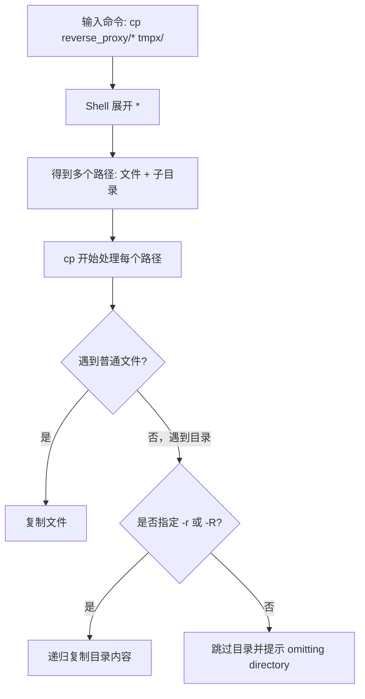
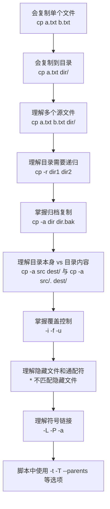

[toc]


## `cp` 是什么

`cp` 是 Unix/Linux/macOS 中用于**复制文件和目录**的命令，全称可以理解为 **copy**。

它的核心作用是：

> 读取源文件或源目录中的内容，然后在目标位置创建一份新的副本。

GNU Coreutils 手册对 `cp` 的基本描述是：`cp` 用于复制文件，或者在指定递归选项时复制目录；复制出来的结果与原文件是相互独立的副本。([GNU](https://www.gnu.org/software/coreutils/manual/html_node/cp-invocation.html))

------

## 基本语法

常见语法有三类：

```bash
cp [选项] 源文件 目标文件
cp [选项] 源文件... 目标目录
cp [选项] -t 目标目录 源文件...
```

对应关系如下：

| 写法                     | 含义                           | 示例                        |
| ------------------------ | ------------------------------ | --------------------------- |
| `cp a.txt b.txt`         | 把一个文件复制成另一个文件     | `cp readme.txt readme.bak`  |
| `cp a.txt dir/`          | 把文件复制到目录中，文件名不变 | `cp app.conf backup/`       |
| `cp a.txt b.txt dir/`    | 把多个文件复制到目录中         | `cp a.txt b.txt backup/`    |
| `cp -r dir1 dir2`        | 递归复制目录                   | `cp -r project project.bak` |
| `cp -t dir/ a.txt b.txt` | 指定目标目录，适合脚本         | `cp -t backup/ a.txt b.txt` |

GNU `cp` 支持这三种基本形式：两个路径时表示“源到目标”，多个源时最后一个参数通常必须是目录，也可以用 `-t` 显式指定目标目录。([GNU](https://www.gnu.org/software/coreutils/manual/html_node/cp-invocation.html))

------

## `cp` 的核心规则

### 复制文件时，目标不存在

```bash
cp a.txt b.txt
```

如果 `b.txt` 不存在，就创建 `b.txt`。

结果：

```text
a.txt        原文件仍然存在
b.txt        新复制出来的文件
```

------

### 复制文件时，目标已存在

```bash
cp a.txt b.txt
```

如果 `b.txt` 已存在，默认会用 `a.txt` 的内容覆盖 `b.txt`。

也就是说：

| 文件    | 复制前   | 复制后              |
| ------- | -------- | ------------------- |
| `a.txt` | 保持不变 | 保持不变            |
| `b.txt` | 旧内容   | 变成 `a.txt` 的内容 |

如果不希望误覆盖，建议使用：

```bash
cp -i a.txt b.txt
```

`-i` 会在覆盖前询问。

------

### 复制文件到目录

```bash
cp a.txt backup/
```

表示把 `a.txt` 复制到 `backup/` 目录中，文件名保持为 `a.txt`。

等价于：

```bash
cp a.txt backup/a.txt
```

------

### 多个源文件复制到目录

```bash
cp a.txt b.txt c.txt backup/
```

最后一个参数 `backup/` 必须是目录。

否则 `cp` 不知道多个文件应该复制到哪里。

------

### 默认不复制目录

这是新手最容易踩坑的地方。

```bash
cp reverse_proxy/* tmpx/
```

如果 `reverse_proxy/` 下有目录，例如：

```text
reverse_proxy/
├── nginx.conf
├── app.conf
└── gateway/
    └── main.go
```

Shell 会先把 `reverse_proxy/*` 展开为：

```bash
cp reverse_proxy/nginx.conf reverse_proxy/app.conf reverse_proxy/gateway tmpx/
```

其中 `reverse_proxy/gateway` 仍然是一个目录。

而 `cp` 默认**不会复制目录**，所以报错：

```text
cp: -r not specified; omitting directory 'reverse_proxy/gateway'
```

正确写法是：

```bash
cp -r reverse_proxy/* tmpx/
```

GNU 手册也明确说明：默认情况下 `cp` 不复制目录，只有使用 `-R`、`-r` 或 `-a` 时才会递归复制目录。([GNU](https://www.gnu.org/software/coreutils/manual/html_node/cp-invocation.html))

------

## `*` 通配符和 `-r` 的关系

`*` 是 **Shell 通配符**，不是 `cp` 的功能。

也就是说，在 `cp` 真正执行之前，Shell 会先展开路径。

```bash
cp reverse_proxy/* tmpx/
```

实际可能变成：

```bash
cp reverse_proxy/a.conf reverse_proxy/b.conf reverse_proxy/gateway tmpx/
```

`*` 只负责“匹配路径”，不负责“递归复制”。

是否递归复制目录，由 `cp -r` 或 `cp -R` 决定。



------

## 常用选项总览

| 选项        | 长选项                  | 作用                                       | 常见程度                    |
| ----------- | ----------------------- | ------------------------------------------ | --------------------------- |
| `-r`        | `--recursive`           | 递归复制目录                               | 很常用                      |
| `-R`        | `--recursive`           | 递归复制目录，传统上更偏 POSIX 风格        | 很常用                      |
| `-a`        | `--archive`             | 归档复制，尽量保留权限、时间、符号链接等   | 很常用                      |
| `-i`        | `--interactive`         | 覆盖前询问                                 | 很常用                      |
| `-f`        | `--force`               | 必要时强制覆盖                             | 常用但需谨慎                |
| `-n`        | `--no-clobber`          | 不覆盖已有文件                             | 曾常用，现代 GNU 中不太推荐 |
| `-u`        | `--update`              | 只在源文件较新时复制                       | 常用                        |
| `-v`        | `--verbose`             | 显示复制过程                               | 很常用                      |
| `-p`        | `--preserve`            | 保留指定属性                               | 常用                        |
| `-L`        | `--dereference`         | 跟随符号链接，复制链接指向的真实文件       | 进阶                        |
| `-P`        | `--no-dereference`      | 不跟随符号链接，复制链接本身               | 进阶                        |
| `-d`        | 组合选项                | 等价于 `--no-dereference --preserve=links` | 进阶                        |
| `-T`        | `--no-target-directory` | 不把目标当目录处理                         | 脚本中有用                  |
| `-t`        | `--target-directory`    | 显式指定目标目录                           | 脚本中有用                  |
| `--parents` |                         | 保留源路径结构                             | 进阶                        |
| `--backup`  |                         | 覆盖前创建备份                             | 实用                        |
| `--reflink` |                         | 尝试写时复制，适合支持 COW 的文件系统      | 现代文件系统中有用          |

------

## `-r`、`-R`、`-a` 的区别

### `-r` / `-R`

二者在 GNU/Linux 上通常都表示递归复制目录：

```bash
cp -r dir1 dir2
cp -R dir1 dir2
```

作用都是复制目录及其内部内容。

不过从可移植性角度，脚本里更推荐 `-R` 或 `-a`。GNU 手册提到，在某些非 GNU 系统上，`-r` 对符号链接或特殊文件的行为可能不完全可移植。([GNU](https://www.gnu.org/software/coreutils/manual/html_node/cp-invocation.html))

------

### `-a`

`-a` 是归档复制，常用于备份、迁移目录。

```bash
cp -a project project.bak
```

它大致等价于：

```bash
cp -dR --preserve=all
```

也就是：

| 能力             | `cp -r`      | `cp -a`    |
| ---------------- | ------------ | ---------- |
| 递归复制目录     | ✅            | ✅          |
| 尽量保留权限     | 不一定完整   | ✅          |
| 保留时间戳       | ❌ 默认不保留 | ✅          |
| 保留符号链接本身 | 视情况而定   | ✅          |
| 保留硬链接关系   | ❌            | ✅          |
| 保留扩展属性     | ❌ 默认不完整 | ✅ 尽量保留 |
| 适合普通复制     | ✅            | ✅          |
| 适合备份迁移     | 一般         | ✅          |

GNU 手册说明 `-a` 会尽量保留源文件结构和属性，并等价于 `-dR --preserve=all`，但对某些安全上下文或扩展属性失败时会降低诊断强度。([GNU](https://www.gnu.org/software/coreutils/manual/html_node/cp-invocation.html))

------

## 常见复制场景

### 复制单个文件

```bash
cp config.yml config.yml.bak
```

用途：修改配置文件前做备份。

------

### 复制文件到目录

```bash
cp config.yml backup/
```

结果：

```text
backup/config.yml
```

------

### 复制多个文件到目录

```bash
cp a.txt b.txt c.txt backup/
```

------

### 复制目录本身

```bash
cp -r project project.bak
```

如果 `project.bak` 不存在，结果通常是：

```text
project.bak/
├── ...
```

------

### 复制目录到已有目录中

```bash
cp -r project backup/
```

如果 `backup/` 已存在，结果是：

```text
backup/
└── project/
    └── ...
```

也就是说，`project` 这个目录会被复制进 `backup/` 里面。

------

### 只复制目录内容，不复制目录本身

```bash
cp -r project/* backup/
```

这会复制 `project/` 下的非隐藏内容到 `backup/`。

注意：`*` 默认不匹配隐藏文件，例如 `.env`、`.gitignore`。

------

### 复制包括隐藏文件在内的目录内容

更推荐用这种方式：

```bash
cp -a project/. backup/
```

`project/.` 的意思是“复制 `project` 目录中的内容”，包括隐藏文件。

这是非常实用的写法。

| 命令                      | 是否复制隐藏文件     | 是否复制目录本身            |
| ------------------------- | -------------------- | --------------------------- |
| `cp -r project/* backup/` | ❌ 默认不包括隐藏文件 | ❌                           |
| `cp -a project/. backup/` | ✅                    | ❌                           |
| `cp -a project backup/`   | ✅                    | ✅，复制成 `backup/project/` |

------

## 目标路径是否存在对结果的影响

这是 `cp` 最需要理解的规则之一。

假设源目录为：

```text
src/
└── a.txt
```

### 目标目录不存在

```bash
cp -r src dest
```

结果：

```text
dest/
└── a.txt
```

此时 `dest` 是新创建的目录副本。

------

### 目标目录已存在

```bash
mkdir dest
cp -r src dest
```

结果：

```text
dest/
└── src/
    └── a.txt
```

此时 `src` 被复制进了 `dest` 里面。

------

### 只想把内容复制进去

```bash
cp -a src/. dest/
```

结果：

```text
dest/
└── a.txt
```

这条命令在部署、同步配置、复制项目内容时非常常用。

------

## `cp -r source dest` 和 `cp -r source/ dest` 有区别吗

在 GNU `cp` 中，复制普通目录时：

```bash
cp -r source dest
```

和：

```bash
cp -r source/ dest
```

通常效果相同。

但在涉及符号链接时，尾部 `/` 可能影响路径解析。为了避免歧义，建议：

| 目的                   | 推荐写法               |
| ---------------------- | ---------------------- |
| 复制目录本身           | `cp -a source dest/`   |
| 复制目录内容           | `cp -a source/. dest/` |
| 脚本中避免目标被当目录 | `cp -T source dest`    |

GNU 手册中也有 `--strip-trailing-slashes` 和 `-T` 这类选项，用于处理尾部斜杠和目标目录歧义。([GNU](https://www.gnu.org/software/coreutils/manual/html_node/cp-invocation.html))

------

## 覆盖行为详解

### 默认覆盖

```bash
cp a.txt b.txt
```

如果 `b.txt` 存在，会被覆盖。

------

### 覆盖前确认：`-i`

```bash
cp -i a.txt b.txt
```

出现提示：

```text
cp: overwrite 'b.txt'?
```

输入 `y` 才覆盖。

适合新手和手动操作。

------

### 强制覆盖：`-f`

```bash
cp -f a.txt b.txt
```

`-f` 的含义不是“无脑覆盖所有东西”，而是：当目标文件无法直接打开写入时，尝试先删除再重新创建。GNU 手册对 `--force` 的描述是：如果目标文件无法打开，`cp` 会尝试先删除它再重新创建。([GNU](https://www.gnu.org/software/coreutils/manual/html_node/cp-invocation.html))

日常理解可以简化为：

> 遇到已有目标时，尽量覆盖，不要因为权限、只读等问题轻易中断。

但注意：`-f` 不等于安全。

------

### 不覆盖已有文件：`-n`

```bash
cp -n a.txt b.txt
```

如果 `b.txt` 已存在，则跳过。

不过 GNU Coreutils 当前文档中提到，`--no-clobber` / `-n` 因为不同平台退出状态行为不一致，已经不太推荐；更现代的替代方案是使用 `--update` 提供更明确的控制。([GNU](https://www.gnu.org/software/coreutils/manual/html_node/cp-invocation.html))

------

### 只复制更新的文件：`-u`

```bash
cp -u a.txt backup/
```

如果目标中已有同名文件，并且目标文件时间更新或相同，则跳过。

复制目录时常见：

```bash
cp -au project/. backup/
```

这表示归档复制，并只更新较旧的目标文件。

GNU 手册说明，`--update` 可以控制只有在源文件较新时才替换目标文件，并且新版 GNU Coreutils 还提供了更细分的 `--update=all|none|none-fail|older` 行为。([GNU](https://www.gnu.org/software/coreutils/manual/html_node/cp-invocation.html))

------

## `cp -r` 和 `cp -rf`

递归复制时启用`-f`的效果

| 命令              | 递归复制目录 | 覆盖时是否更强硬     | 适合场景                     |
| ----------------- | ------------ | -------------------- | ---------------------------- |
| `cp -r src dest`  | ✅            | 普通覆盖             | 一般目录复制                 |
| `cp -rf src dest` | ✅            | 更强制               | 自动化脚本、确认无误后的覆盖 |
| `cp -ri src dest` | ✅            | 覆盖前询问           | 新手、手动操作               |
| `cp -rv src dest` | ✅            | 普通覆盖，并显示过程 | 学习、排查                   |
| `cp -av src dest` | ✅            | 保留属性，并显示过程 | 备份、迁移                   |

示例：

```bash
cp -r reverse_proxy/* tmpx/
```

遇到同名文件时可能覆盖，目录会递归复制。

```bash
cp -rf reverse_proxy/* tmpx/
```

递归复制，并在目标文件难以直接写入时尝试强制处理。

更推荐学习阶段使用：

```bash
cp -rv reverse_proxy/. tmpx/
```

或者想保留属性时：

```bash
cp -av reverse_proxy/. tmpx/
```

------

## `-v`：显示复制过程

```bash
cp -rv src/ dest/
```

输出类似：

```text
'src/a.txt' -> 'dest/src/a.txt'
'src/lib/main.js' -> 'dest/src/lib/main.js'
```

新手非常建议加 `-v`，因为你能看到到底复制了什么。

------

## `-p`：保留属性

```bash
cp -p a.txt backup/
```

`-p` 会尽量保留文件的权限、所有者、时间戳等属性。

也可以更精确地写：

```bash
cp --preserve=mode,timestamps a.txt backup/
```

GNU 手册中说明，`--preserve` 可保留 `mode`、`ownership`、`timestamps`、`links`、`context`、`xattr` 等属性；不带属性列表时，通常等价于保留权限、所有权和时间戳。([GNU](https://www.gnu.org/software/coreutils/manual/html_node/cp-invocation.html))

------

## 符号链接处理

符号链接是 Linux 中很重要的概念。

假设：

```text
real.conf
link.conf -> real.conf
```

### 默认行为可能因选项而变化

简单复制符号链接时：

```bash
cp link.conf backup/
```

通常会复制链接指向文件的内容，生成普通文件。

------

### 复制符号链接本身：`-P`

```bash
cp -P link.conf backup/
```

结果：

```text
backup/link.conf -> real.conf
```

------

### 跟随符号链接：`-L`

```bash
cp -L link.conf backup/
```

结果通常是普通文件：

```text
backup/link.conf
```

内容来自 `real.conf`。

------

### 归档复制：`-a`

```bash
cp -a link.conf backup/
```

通常会保留符号链接本身。

GNU 手册说明，`-P` 表示不跟随源符号链接，而 `-L` 表示跟随符号链接；`-a` 包含不跟随符号链接并保留链接信息的行为。([GNU](https://www.gnu.org/software/coreutils/manual/html_node/cp-invocation.html))

------

## `--parents`：保留路径结构

普通复制：

```bash
cp src/config/app.yml backup/
```

结果：

```text
backup/app.yml
```

使用 `--parents`：

```bash
cp --parents src/config/app.yml backup/
```

结果：

```text
backup/src/config/app.yml
```

适合从不同目录收集文件，同时保留原路径结构。

GNU 手册说明，`--parents` 会把源路径名附加到目标目录下，并创建必要的中间目录。([GNU](https://www.gnu.org/software/coreutils/manual/html_node/cp-invocation.html))

------

## `-t`：显式指定目标目录

普通写法：

```bash
cp a.txt b.txt backup/
```

使用 `-t`：

```bash
cp -t backup/ a.txt b.txt
```

这在脚本中更清晰，因为目标目录不会混在最后一个参数里。

例如：

```bash
cp -v -t backup/ *.conf
```

------

## `-T`：不要把目标当目录

这是脚本中很实用但新手较少接触的选项。

默认情况下：

```bash
cp -r src dest
```

如果 `dest` 已经是目录，结果会变成：

```text
dest/src/
```

如果你想明确表示：

> 我就是要把 `src` 复制成 `dest`，不要因为 `dest` 是目录就改成复制进去。

可以使用：

```bash
cp -rT src dest
```

这在自动化部署脚本中可以减少歧义。

GNU 手册说明，`-T` / `--no-target-directory` 会阻止 `cp` 把最后一个操作数特殊地当作目录处理。([GNU](https://www.gnu.org/software/coreutils/manual/html_node/cp-invocation.html))

------

## `--reflink`：现代文件系统中的快速复制

在支持 COW，也就是 Copy-on-Write 的文件系统上，例如 Btrfs、XFS 的部分配置、APFS 等，`cp` 可以创建轻量副本。

```bash
cp --reflink=auto big.img big-copy.img
```

含义是：

> 如果文件系统支持写时复制，就快速创建共享数据块的副本；如果不支持，就退回普通复制。

更强硬的写法：

```bash
cp --reflink=always big.img big-copy.img
```

如果不支持 COW，就直接失败。

GNU 手册说明，`--reflink` 会尝试执行轻量级的写时复制副本；成功后，源文件和目标文件在修改前可能共享底层数据块。([GNU](https://www.gnu.org/software/coreutils/manual/html_node/cp-invocation.html))

适合：

| 场景                    | 建议                         |
| ----------------------- | ---------------------------- |
| 复制大镜像文件          | `cp --reflink=auto`          |
| 创建本地快照式副本      | `cp -a --reflink=auto`       |
| 需要确认必须是 COW 副本 | `cp --reflink=always`        |
| 跨文件系统复制          | 不一定支持，可能退回普通复制 |

------

## `cp` 与隐藏文件

这是非常常见的坑。

```bash
cp -r source/* dest/
```

不会复制：

```text
source/.env
source/.gitignore
source/.config
```

因为 `*` 默认不匹配以 `.` 开头的隐藏文件。

更好的写法：

```bash
cp -a source/. dest/
```

它可以复制 `source` 目录中的全部内容，包括隐藏文件。

### 不推荐的新手写法

```bash
cp -r source/.* dest/
```

这个写法有风险，因为在某些 Shell 或场景中可能涉及 `.` 和 `..`，容易造成误复制或错误提示。

现代实践中更推荐：

```bash
cp -a source/. dest/
```

------

## `cp` 与权限

复制文件时，新文件的权限不一定与源文件完全一样。

默认情况下，新文件权限会受到当前用户的 `umask` 影响。

例如源文件权限是：

```text
-rwxrwxrwx
```

复制后可能变成：

```text
-rwxr-xr-x
```

如果希望尽量保持权限和时间戳：

```bash
cp -p file backup/
```

如果是目录备份：

```bash
cp -a dir backup/
```

注意：普通用户通常不能随意保留原文件所有者。GNU 手册中也提到，在现代系统中，改变文件所有者通常需要相应权限。([GNU](https://www.gnu.org/software/coreutils/manual/html_node/cp-invocation.html))

------

## `cp` 与特殊文件

特殊文件包括：

| 类型      | 示例                     |
| --------- | ------------------------ |
| 设备文件  | `/dev/null`、`/dev/zero` |
| FIFO 管道 | 命名管道                 |
| Socket    | Unix socket              |
| 符号链接  | `link -> target`         |

普通用户日常复制项目目录时一般不用关心太多。

但复制系统目录时要特别小心：

```bash
cp -r /dev backup/
```

这类操作可能产生非常危险或无意义的结果。

GNU 手册特别提醒，递归复制时使用 `--copy-contents` 通常是错误的，因为复制 FIFO、设备文件等特殊文件内容可能导致挂起，甚至填满目标文件系统，例如读取 `/dev/zero`。([GNU](https://www.gnu.org/software/coreutils/manual/html_node/cp-invocation.html))

------

## 典型实战案例

### 修改配置前备份

```bash
cp -a nginx.conf nginx.conf.bak
```

为什么用 `-a`？

因为配置文件的权限和时间戳可能有价值。

------

### 复制项目目录作为备份

```bash
cp -a myapp myapp.bak
```

结果：

```text
myapp.bak/
├── ...
```

------

### 把一个目录内容复制到另一个目录

```bash
cp -a myapp/. deploy/
```

适合：

| 场景         | 说明                     |
| ------------ | ------------------------ |
| 部署静态文件 | 把构建结果复制进目标目录 |
| 合并配置目录 | 保留隐藏文件             |
| 初始化目录   | 复制模板内容             |

------

### 复制并显示过程

```bash
cp -av myapp/. deploy/
```

`-a` 保留属性，`-v` 显示过程。

------

### 复制但避免误覆盖

```bash
cp -aiv source/. dest/
```

含义：

| 选项 | 作用       |
| ---- | ---------- |
| `-a` | 归档复制   |
| `-i` | 覆盖前询问 |
| `-v` | 显示过程   |

新手手动操作时很推荐。

------

### 强制覆盖部署目录

```bash
cp -af build/. /var/www/html/
```

适合你明确知道目标可以被覆盖的情况。

更稳一点：

```bash
cp -av build/. /var/www/html/
```

先观察输出。

------

### 只更新较旧文件

```bash
cp -au source/. dest/
```

适合简单增量复制。

但如果你需要严格同步，包括删除目标中多余文件，`cp` 不适合，应该用 `rsync`。

------

## `cp` 不等于同步工具

`cp` 只负责复制，不负责完整同步。

例如：

```bash
cp -a source/. dest/
```

如果 `dest/` 中有一个旧文件，而 `source/` 中已经删除了这个文件，`cp` 不会自动删除 `dest/` 中的旧文件。

如果你要做“镜像同步”，更适合：

```bash
rsync -av --delete source/ dest/
```

对比：

| 能力             | `cp`              | `rsync`      |
| ---------------- | ----------------- | ------------ |
| 简单复制         | ✅                 | ✅            |
| 递归复制目录     | ✅                 | ✅            |
| 保留属性         | ✅，用 `-a`        | ✅，用 `-a`   |
| 增量复制         | 部分支持，用 `-u` | ✅ 更强       |
| 删除目标多余文件 | ❌                 | ✅ `--delete` |
| 远程复制         | ❌                 | ✅            |
| 显示详细同步差异 | 一般              | 强           |

------

## 新手常见错误

### 忘记 `-r`

错误：

```bash
cp dir1 dir2
```

报错：

```text
cp: -r not specified; omitting directory 'dir1'
```

正确：

```bash
cp -r dir1 dir2
```

或者更推荐：

```bash
cp -a dir1 dir2
```

------

### 以为 `*` 会递归

错误理解：

```bash
cp source/* dest/
```

误以为会复制所有层级内容。

实际：

| 内容               | 是否被 `source/*` 匹配 |
| ------------------ | ---------------------- |
| `source/a.txt`     | ✅                      |
| `source/dir`       | ✅，但只是目录这个路径  |
| `source/dir/b.txt` | ❌ 不会直接展开         |
| `source/.env`      | ❌ 默认不匹配隐藏文件   |

如果有目录，仍然需要：

```bash
cp -r source/* dest/
```

如果还想包括隐藏文件，更推荐：

```bash
cp -a source/. dest/
```

------

### 混淆复制目录本身和复制目录内容

| 目的                               | 推荐命令                           |
| ---------------------------------- | ---------------------------------- |
| 复制 `src` 这个目录到 `backup/src` | `cp -a src backup/`                |
| 复制 `src` 里面的内容到 `backup/`  | `cp -a src/. backup/`              |
| 把 `src` 复制成一个新的 `dest`     | `cp -a src dest`，且 `dest` 不存在 |
| 强制把 `src` 视为替换目标 `dest`   | `cp -aT src dest`                  |

------

### 忽略隐藏文件

错误：

```bash
cp -r project/* backup/
```

可能漏掉：

```text
.env
.gitignore
.dockerignore
```

推荐：

```bash
cp -a project/. backup/
```

------

### 盲目使用 `-rf`

```bash
cp -rf source/* dest/
```

这个命令很常见，但不一定是最佳选择。

风险：

| 风险           | 说明                    |
| -------------- | ----------------------- |
| 覆盖目标文件   | 不容易察觉              |
| 漏掉隐藏文件   | `*` 默认不匹配隐藏文件  |
| 权限属性不完整 | `-r` 不如 `-a` 适合备份 |
| 目标目录写错   | 可能覆盖错误位置        |

更稳妥：

```bash
cp -av source/. dest/
```

确认无误后再考虑：

```bash
cp -af source/. dest/
```

------

### 把目标目录写错

危险示例：

```bash
cp -rf build/* /var/www/html
```

如果你本意是复制到 `/var/www/html/`，最好写上尾部斜杠：

```bash
cp -rf build/. /var/www/html/
```

并配合 `-v`：

```bash
cp -av build/. /var/www/html/
```

------

## 推荐命令速查

| 场景                       | 推荐命令                            |
| -------------------------- | ----------------------------------- |
| 复制单个文件               | `cp file file.bak`                  |
| 复制文件到目录             | `cp file dir/`                      |
| 复制多个文件到目录         | `cp file1 file2 dir/`               |
| 覆盖前询问                 | `cp -i file dir/`                   |
| 显示复制过程               | `cp -v file dir/`                   |
| 复制目录                   | `cp -a dir dir.bak`                 |
| 复制目录到另一个目录内     | `cp -a dir backup/`                 |
| 复制目录内容，包括隐藏文件 | `cp -a dir/. backup/`               |
| 复制目录内容并显示过程     | `cp -av dir/. backup/`              |
| 强制覆盖复制目录内容       | `cp -af dir/. backup/`              |
| 只更新旧文件               | `cp -au dir/. backup/`              |
| 复制并保留路径结构         | `cp --parents path/to/file backup/` |
| 目标目录显式放前面         | `cp -t backup/ a.txt b.txt`         |
| 避免目标目录歧义           | `cp -T source dest`                 |
| 大文件快速 COW 复制        | `cp --reflink=auto file file.copy`  |

------

## 推荐学习路径

新手可以按下面顺序掌握：



------

## 实用最佳实践

### 手动操作时优先安全

建议：

```bash
cp -av source/. dest/
```

如果可能覆盖重要文件：

```bash
cp -aiv source/. dest/
```

含义是：

| 选项 | 目的         |
| ---- | ------------ |
| `-a` | 保留属性     |
| `-i` | 覆盖前确认   |
| `-v` | 看清复制过程 |

------

### 备份目录优先用 `-a`

不要优先写：

```bash
cp -r project project.bak
```

更推荐：

```bash
cp -a project project.bak
```

因为 `-a` 更像“完整复制一份”。

------

### 复制目录内容优先用 `目录/.`

不推荐：

```bash
cp -r project/* dest/
```

推荐：

```bash
cp -a project/. dest/
```

原因：

| 写法        | 问题                       |
| ----------- | -------------------------- |
| `project/*` | 漏隐藏文件                 |
| `project/.` | 表示目录内容，包含隐藏文件 |

------

### 脚本中减少歧义

可以使用：

```bash
cp -aT source dest
```

或：

```bash
cp -t dest/ file1 file2 file3
```

这样脚本更不容易因为“最后一个参数是不是目录”而产生意外行为。

------

### 自动化覆盖前先演练

`cp` 没有真正的 dry-run 选项。

如果你想先看可能复制什么，可以用：

```bash
find source -print
```

或者先用：

```bash
cp -av source/. dest/
```

观察输出。

如果要严肃同步，建议使用：

```bash
rsync -av --dry-run source/ dest/
```

确认后再执行真正同步。

------

## 一句话总结

`cp` 的关键不是背选项，而是理解这几件事：

| 核心问题             | 结论                                                         |
| -------------------- | ------------------------------------------------------------ |
| 文件怎么复制         | `cp 源 目标`                                                 |
| 目录为什么复制不了   | 默认不复制目录，需要 `-r`、`-R` 或 `-a`                      |
| `*` 为什么不够       | `*` 只是 Shell 展开路径，不负责递归                          |
| 复制目录本身还是内容 | `cp -a dir dest/` 复制目录本身；`cp -a dir/. dest/` 复制内容 |
| 如何避免漏隐藏文件   | 用 `dir/.`，不要只用 `dir/*`                                 |
| 备份迁移用什么       | 优先 `cp -a`                                                 |
| 新手安全写法         | `cp -aiv source/. dest/`                                     |
| 自动化谨慎写法       | `cp -av` 先看输出，确认后再考虑 `cp -af`                     |