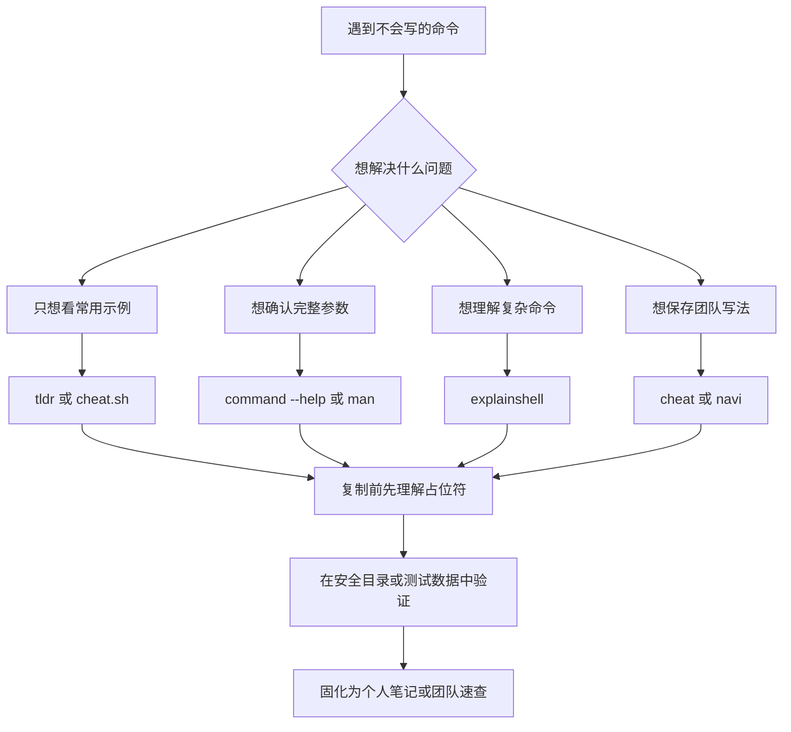

[toc]

## abstract

linux@命令行助手@Man手册补充工具@tldr@example

`tldr` 这类项目不是为了取代官方文档，而是为了弥补传统手册页（manual pages，`man`）“信息完整但不够快”的问题。`tldr-pages` 官方将自己定位为“由社区维护的命令行工具帮助页集合”，目标是作为传统 `man pages` 的更简单、更易接近的补充，并且重点放在实际示例上。([GitHub](https://github.com/tldr-pages/tldr))

可以把这类工具理解为：

| 类型         | 代表工具                | 主要解决的问题                                  |
| ------------ | ----------------------- | ----------------------------------------------- |
| 官方完整文档 | `man`、`info`、`--help` | 查完整参数、版本匹配、权威说明                  |
| 示例型速查   | `tldr`、`eg`            | 快速看常用命令怎么写                            |
| 聚合型速查   | `cheat.sh`              | 用一个入口查 Linux 命令、编程语言、数据库等片段 |
| 交互式速查   | `navi`                  | 搜索示例、填参数、生成或执行命令                |
| 个人知识库   | `cheat`、`kb`           | 保存团队或个人常用命令                          |
| 命令解释器   | `explainshell`          | 解释复杂命令里每个参数的含义                    |

新手最容易犯的错误，是把 `tldr` 当作“权威完整文档”。更准确的用法是：**先用 `tldr` 快速获得常用写法，再用 `man` 或 `--help` 确认边界、风险和版本差异**。

## 推荐学习大纲

### 入门层：知道这些工具解决什么问题

先理解命令行帮助的几种来源：

| 来源     | 典型命令                        | 适合场景                               | 局限                       |
| -------- | ------------------------------- | -------------------------------------- | -------------------------- |
| 内置帮助 | `tar --help`、`git help commit` | 当前机器上最贴近版本的帮助             | 往往偏参数罗列             |
| 手册页   | `man tar`                       | 查完整语义、默认行为、返回值、文件格式 | 对新手偏长，示例不一定突出 |
| 信息页   | `info coreutils`                | GNU 工具的体系化说明                   | 阅读交互成本较高           |
| tldr 页  | `tldr tar`                      | 快速看高频用法                         | 不覆盖所有参数             |
| 在线速查 | `curl cht.sh/tar`               | 临时机器、无安装环境、编程片段         | 依赖网络，内容来源混合     |
| 个人速查 | `cheat tar`、`navi`             | 团队 SOP、项目命令、常用排错           | 需要维护                   |

### 核心层：掌握查询路径

建议形成固定的“查询漏斗”：



这个流程背后的原则是：**示例工具负责“启发你怎么写”，官方文档负责“确认它一定能这样写”**。

### 实践层：先配置一套简单可靠的工具链

对新手，我推荐从这一组开始：

| 工具                               | 用途             | 推荐理由                 |
| ---------------------------------- | ---------------- | ------------------------ |
| `tlrc` 或官方 Python `tldr` 客户端 | 本地查 `tldr` 页 | 快、简单、离线缓存       |
| `man` / `--help`                   | 权威确认         | 和本机版本一致           |
| `cheat.sh`                         | 在线补充         | 无需安装，适合临时查询   |
| `explainshell`                     | 理解复杂命令     | 适合拆解陌生命令         |
| `cheat` 或 `navi`                  | 个人/团队沉淀    | 把常用命令变成可复用知识 |

`tldr-pages` 当前官方页面推荐成熟的 Python 客户端，可通过 `pipx install tldr` 安装；项目 Wiki 也列出官方 Python 客户端、官方 Rust 客户端 `tlrc`，以及社区客户端。([TLDR](https://tldr.sh/))

## 核心概念解释

### TL;DR

`TL;DR` 是 “Too Long; Didn't Read” 的缩写，原意是“太长了，没读”。在命令帮助场景中，它表示：**把冗长手册压缩成少量常见用法示例**。`tldr-pages` 官方 README 也解释了该缩写来源。([GitHub](https://github.com/tldr-pages/tldr))

### man page

`man page` 是 Unix/Linux 传统手册页。它偏完整、权威、系统化，尤其适合确认某个参数的精确定义。man7.org 的在线页面说明，它提供 Linux man-pages 项目以及其他自由软件项目手册页的 HTML 渲染版本。([man7.org](https://man7.org/linux/man-pages/?utm_source=chatgpt.com))

### cheat sheet

`cheat sheet` 通常译为“速查表”。它不是完整教程，而是把高频操作浓缩成可复制、可修改的示例。`tldr`、`cheat.sh`、`devhints` 都属于这个方向，只是覆盖范围和交互方式不同。

### client

`client` 是“客户端”。在 `tldr` 生态里，内容仓库和查询工具是分开的：`tldr-pages` 负责维护 Markdown 帮助页，客户端负责下载、缓存、搜索和渲染这些页面。`tldr-pages` 官方说明，目前有命令行客户端、桌面/移动 GUI 客户端、Web 客户端以及集成到其他应用中的客户端。([TLDR](https://tldr.sh/))

### cache

`cache` 是“缓存”。本地客户端通常会把页面下载到本机，这样查询时不用每次联网。`tlrc` 的手册说明，页面会从缓存目录加载；缓存为空时会自动下载，之后可以离线工作，直到自动更新被触发或用户显式执行更新。([TLDR](https://tldr.sh/tlrc/))

### option、flag、argument、operand

这些术语经常混用，但初学者最好区分：

| 术语     | 英文            | 示例                       | 含义               |
| -------- | --------------- | -------------------------- | ------------------ |
| 选项     | option          | `-l`、`--all`              | 改变命令行为       |
| 标志     | flag            | `-r`、`--verbose`          | 通常指不带值的选项 |
| 选项参数 | option-argument | `-o file.txt`              | 传给某个选项的值   |
| 操作数   | operand         | `file.txt`                 | 命令要处理的对象   |
| 子命令   | subcommand      | `git commit` 中的 `commit` | 主命令下的具体动作 |

POSIX Utility Conventions 明确讨论了 utility、option、option-argument、operand 等命令行约定，这些概念是理解 Unix 风格命令的基础。([pubs.opengroup.org](https://pubs.opengroup.org/onlinepubs/9699919799/basedefs/V1_chap12.html?utm_source=chatgpt.com))

## tldr-pages 项目详解

### 项目目标

`tldr-pages` 的目标不是解释所有参数，而是给出最常用、最实用的命令示例。官方仓库说明，它收集了 UNIX、Linux、macOS、BSD、Android、Windows、Cisco IOS、DOS 等平台常见命令行工具的示例。([GitHub](https://github.com/tldr-pages/tldr))

典型使用方式：

```bash
tldr tar
tldr git checkout
tldr docker run
tldr rsync
```

注意：`git checkout` 这类多词命令，在一些客户端内部会映射为 `git-checkout` 页面；`tlrc` 手册说明，如果传入多个 page 参数，会用连字符拼接，例如 `git checkout` 会变成 `git-checkout`。([TLDR](https://tldr.sh/tlrc/))

### 页面风格

`tldr` 页通常包含：

| 元素         | 作用                                       |
| ------------ | ------------------------------------------ |
| 命令标题     | 表明当前页面对应哪个命令                   |
| 简短描述     | 一句话说明命令用途                         |
| 更多信息链接 | 指向官方文档或项目主页                     |
| 示例说明     | 解释这个示例做什么                         |
| 示例命令     | 可复制、可修改的命令                       |
| 占位符       | 用 `{{path/to/file}}` 这类形式提示用户替换 |

一个典型的 `tldr` 风格示例可以理解为：

```text
- 解压 tar 文件：

tar -xvf {{archive.tar}}

- 创建 gzip 压缩包：

tar -czvf {{archive.tar.gz}} {{path/to/directory}}
```

这里的 `{{archive.tar}}`、`{{path/to/directory}}` 不是要原样输入的内容，而是占位符（placeholder），需要替换成真实文件名或路径。

### 本地安装方案

官方 Python 客户端适合已经有 Python 工具链的新手：

```bash
pipx install tldr
tldr tar
tldr --update
```

`tldr-pages` 官方网站目前称 Python 客户端是成熟客户端，并给出 `pipx install tldr` 的安装方式。([TLDR](https://tldr.sh/))

官方 Rust 客户端 `tlrc` 适合追求速度、单文件体验和跨平台安装的人：

```bash
# macOS 或 Linux，使用 Homebrew
brew install tlrc

# Rust 用户
cargo install tlrc --locked

# Windows
winget install tldr-pages.tlrc
```

`tlrc` 仓库列出了 Homebrew、Nix、AUR、XBPS、Zypper、Winget、Scoop、MacPorts、Conda、Cargo、GitHub Releases 等安装方式，并说明它是 Rust 编写的 tldr 客户端。([GitHub](https://github.com/tldr-pages/tlrc))

### 在线查询方案

不想安装时，可以使用官方 Web 方案。`tldr-pages` README 提到，浏览器中可以使用 Web client，并且该 Web client 支持 PWA 离线能力。([GitHub](https://github.com/tldr-pages/tldr))

适合在线查询的场景：

| 场景                 | 推荐方式                |
| -------------------- | ----------------------- |
| 临时电脑             | Web client              |
| 手机或平板           | Web client / 移动客户端 |
| 不方便安装软件       | Web client / PDF        |
| 网络可用但终端无配置 | `cheat.sh`              |
| 想离线保存整套内容   | 本地客户端缓存或 PDF    |

### tldr 的优点和局限

| 维度     | 优点               | 局限                           |
| -------- | ------------------ | ------------------------------ |
| 学习成本 | 示例少、直观       | 不解释所有背景                 |
| 查询速度 | 本地缓存后很快     | 首次缓存要下载                 |
| 内容质量 | 社区维护，覆盖面广 | 可能滞后于某些工具版本         |
| 安全性   | 示例通常偏常见用法 | 危险命令仍需确认               |
| 权威性   | 适合入门和回忆     | 不能替代官方文档               |
| 平台支持 | 覆盖多个系统平台   | 同名命令在不同平台行为可能不同 |

## 重要替代与补充项目

### cheat.sh

`cheat.sh` 是一个在线聚合型速查服务。它的特点是可以直接用 `curl` 查询，也有自己的命令行客户端 `cht.sh`。官方 README 显示，可以通过 `curl cheat.sh/tar`、`curl cht.sh/curl`、`curl https://cheat.sh/rsync` 等方式查询命令帮助；它也提供 `cht.sh` 客户端，支持 shell 模式、查询历史、剪贴板集成和补全等能力。([GitHub](https://github.com/chubin/cheat.sh))

常见用法：

```bash
curl cht.sh/tar
curl cht.sh/rsync
curl cht.sh/python/reverse+list
curl cht.sh/go/:list
curl cht.sh/tar~extract
```

`cheat.sh` 的 `:intro` 页面说明，根命名空间用于 UNIX/Linux 命令，编程语言速查位于子命名空间，例如 `cht.sh/go/func`；它还支持用 `~` 做搜索，例如 `cht.sh/tar~extract`。([Cheat Sheet](https://cheat.sh/%3Aintro))

安装客户端：

```bash
mkdir -p ~/bin
curl https://cht.sh/:cht.sh > ~/bin/cht.sh
chmod +x ~/bin/cht.sh
```

之后可以这样查：

```bash
cht.sh tar
cht.sh python reverse list
cht.sh --shell python
```

### tealdeer

`tealdeer` 是 Rust 实现的高速 `tldr` 客户端。它的目标包括下载和缓存页面、除更新缓存外不需要网络、遵守 tldr 客户端规范、支持高级高亮和配置，并尽可能快速。([GitHub](https://github.com/tealdeer-rs/tealdeer))

适合人群：

| 人群                         | 是否推荐       |
| ---------------------------- | -------------- |
| 只想快速查 tldr 页           | 推荐           |
| 喜欢 Rust 工具链             | 推荐           |
| 需要高度稳定的官方客户端身份 | 更推荐 `tlrc`  |
| 需要长期发行版包支持         | 看系统仓库版本 |

### tlrc

`tlrc` 是官方 Rust 客户端。它和 `tealdeer` 的定位接近，但优势在于官方维护身份、配置项丰富、缓存机制清晰。`tlrc` 在线手册注明它是官方 Rust tldr client，并说明缓存默认超过两周会触发自动更新。([TLDR](https://tldr.sh/tlrc/))

推荐配置思路：

```toml
# 示例，仅表示思路
[cache]
auto_update = true
max_age = 336

[output]
show_title = true
platform_title = true
```

`tlrc` README 的配置示例中，`max_age = 336` 表示两周，`languages` 可用于指定要下载的页面语言；英文会始终下载。([GitHub](https://github.com/tldr-pages/tlrc))

### cheat

`cheat` 更像“本地可编辑的速查表系统”。它允许用户创建和查看交互式 cheatsheets，最初设计目标是帮助 Unix 系统管理员记住那些“经常用但不常用到足以背下来”的命令选项。([GitHub](https://github.com/cheat/cheat))

常用命令：

```bash
cheat tar
cheat -e tar
cheat -l
cheat -s ssh
cheat -d
```

它的价值不只是查公共速查表，更在于维护个人和团队知识。`cheat` 支持多个 cheatpath，可以把 community 和 personal 分开，还可以把上游只读，避免修改公共速查表导致冲突。([GitHub](https://github.com/cheat/cheat))

适合保存：

| 内容             | 示例                           |
| ---------------- | ------------------------------ |
| 公司内部部署命令 | `kubectl` 命名空间、Helm 参数  |
| 项目常用脚本     | `make dev`、`make migrate`     |
| 排错 SOP         | 查看日志、回滚、清缓存         |
| 个人高频命令     | `ffmpeg`、`rsync`、`find` 模板 |

### navi

`navi` 是交互式 cheatsheet 工具。它允许浏览自己写的或下载的 cheatsheets，并且可以执行命令；参数建议会动态显示在列表中。它底层使用 `fzf` 或 `skim`，既可以作为普通命令使用，也可以作为 shell widget 使用。([GitHub](https://github.com/denisidoro/navi))

典型 `.cheat` 文件示例：

```text
% git, branch

# 切换分支
git checkout <branch>

$ branch: git branch | awk '{print $NF}'
```

这类工具特别适合“命令模板 + 参数选择”的场景。例如 `kubectl`、`docker`、`git`、`ssh`、`ffmpeg` 的命令很长，但结构相对固定，用 `navi` 可以减少记忆和复制错误。

`navi` 还可以使用其他工具的 cheatsheets，包括 `tldr` 和 `cheat.sh`；项目 README 明确列出可从其他工具导入或使用 cheatsheets。([GitHub](https://github.com/denisidoro/navi))

### explainshell

`explainshell` 的定位不是“给你示例”，而是“解释你已经看到的复杂命令”。它会解析 man pages，提取选项，然后把输入命令中的每个参数匹配到对应帮助文本。官方仓库说明，它通过 manpage reader、options extractor、SQLite 存储、基于 bashlex 的 AST matcher 等组件工作。([GitHub](https://github.com/idank/explainshell))

适合输入：

```bash
tar xzvf archive.tar.gz
find . -type f -print0
ssh -i keyfile -f -N -L 1234:www.google.com:80 host
```

在线站点也直接提供输入框，并支持选择不同发行版的 manpages，例如 all、arch/latest、ubuntu/26.04。([Explainshell](https://explainshell.com/))

### Devhints 和 DevDocs

`Devhints` 更偏开发者速查站，覆盖 Web 开发、命令行、编辑器、框架等内容；其首页列出 Bash、tar、grep、tmux、Docker Compose、cron、curl、ffmpeg、find、rsync、sed、zsh 等许多速查页。([Devhints.io cheatsheets](https://devhints.io/?utm_source=chatgpt.com))

`DevDocs` 是 API 文档浏览器，不是专门的命令行帮助工具，但非常适合查编程语言和库文档。它官网定位为“快速、离线、免费的开发者文档浏览器”，可在一个 Web app 中搜索大量文档集。([DevDocs](https://devdocs.io/?utm_source=chatgpt.com))

## 本地运行方案

### 最小配置：tldr 客户端

适合绝大多数新手：

```bash
# Python 客户端
pipx install tldr

# 查询
tldr tar
tldr find
tldr git commit

# 更新缓存
tldr --update
```

优点：

| 优点       | 说明                      |
| ---------- | ------------------------- |
| 学习成本低 | 命令就是 `tldr <command>` |
| 内容聚焦   | 直接给常用示例            |
| 离线可用   | 更新后可在本地查          |
| 适合日常   | 比打开浏览器快            |

注意：

| 风险                 | 建议                                         |
| -------------------- | -------------------------------------------- |
| 发行版包版本可能旧   | 优先用官方推荐安装方式或新版本包管理器       |
| 页面可能不覆盖新工具 | 回到 `--help`、官方文档或项目 README         |
| 危险命令不要直接复制 | 涉及 `rm`、`dd`、`mkfs`、`chmod -R` 等先测试 |

### 速度优先：tlrc 或 tealdeer

如果你希望体验更快、跨平台更一致，可以选 Rust 客户端：

```bash
brew install tlrc
tldr tar
tldr --update
```

或：

```bash
# 发行版仓库可用时
sudo apt install tealdeer
tldr --update
tldr tar
```

`tealdeer` 的官方文档称它是 Rust 实现的快速 tldr 工具，定位为 simplified、example based、community driven man pages。([Tealdeer](https://tealdeer-rs.github.io/tealdeer/))

### 个人知识库：cheat

适合已经开始积累自己的命令：

```bash
cheat -e ssh
cheat -e docker
cheat -s "port"
cheat -l
```

推荐目录策略：

| 路径             | 用途         | 是否只读   |
| ---------------- | ------------ | ---------- |
| `community`      | 社区速查表   | 是         |
| `personal`       | 个人命令     | 否         |
| `team`           | 团队 SOP     | 视团队流程 |
| `project/.cheat` | 项目局部命令 | 否         |

`cheat` 支持在当前目录及其父目录查找 `.cheat` 目录，从而把项目局部 cheatsheets 临时加入查询路径。([GitHub](https://github.com/cheat/cheat))

### 交互式执行：navi

适合命令很长、参数很多、需要从候选项中选择的场景：

```bash
navi
```

示例场景：

| 场景                 | navi 的价值               |
| -------------------- | ------------------------- |
| `kubectl` 多命名空间 | 动态列出 namespace、pod   |
| `docker` 容器操作    | 动态列出 container、image |
| `git` 分支操作       | 动态列出 branch           |
| `ssh` 连接           | 动态列出 host             |
| `ffmpeg` 转码        | 避免记复杂参数            |

### 本地运行 explainshell

`explainshell` 也可以本地运行。官方仓库给出本地运行方式，包括克隆仓库、创建 Python virtualenv、安装依赖、下载 live database 等步骤。([GitHub](https://github.com/idank/explainshell))

简化理解：

```bash
git clone https://github.com/idank/explainshell.git
cd explainshell
python3 -m venv .venv
source .venv/bin/activate
pip install -r requirements-dev.txt
make download-latest-db
```

适合本地运行的情况：

| 场景                           | 是否值得                 |
| ------------------------------ | ------------------------ |
| 普通个人学习                   | 通常不值得，在线站点够用 |
| 内网环境                       | 值得                     |
| 教学平台                       | 值得                     |
| 安全合规要求不能提交命令到外网 | 值得                     |
| 想研究命令解析机制             | 值得                     |

## 在线查询方案

### tldr Web client

适合不想安装、临时查命令、手机浏览。`tldr-pages` README 提到可以使用浏览器 Web client，并且支持 PWA 离线。([GitHub](https://github.com/tldr-pages/tldr))

适合：

| 场景                 | 原因       |
| -------------------- | ---------- |
| 公司电脑不能安装软件 | 浏览器可用 |
| 手机查命令           | 不需要终端 |
| 教学演示             | 页面可视化 |
| 临时环境             | 无需配置   |

### cheat.sh

最适合“在线命令行查询”。优点是无需安装，只要有 `curl` 即可：

```bash
curl cht.sh/tar
curl cht.sh/find
curl cht.sh/python/read+json
curl cht.sh/go/http+server
```

`cheat.sh` 还支持特殊页面，比如 `:help`、`:intro`、`:list`，并且语言子命名空间可以列出条目，例如 `curl cht.sh/go/:list`。([GitHub](https://github.com/chubin/cheat.sh))

### explainshell 在线版

适合看到陌生命令时“反向理解”：

```bash
tar zcf - some-dir | ssh some-server "cd /; tar xvzf -"
```

它比 `tldr` 更适合解释“组合命令”：

| 任务                          | 推荐工具   |
| ----------------------------- | ---------- |
| 我想知道 `tar` 怎么压缩       | `tldr tar` |
| 我想查 `tar` 所有参数         | `man tar`  |
| 我想查别人常用的压缩/解压套路 | `cheat.sh` |

## 本地方案与在线方案对比

| 维度       | 本地运行             | 在线查询                         |
| ---------- | -------------------- | -------------------------------- |
| 速度       | 缓存后最快           | 取决于网络                       |
| 离线能力   | 强                   | 通常弱，除 PWA 或离线文档        |
| 安全隐私   | 更好，命令不出本机   | 输入敏感命令有泄露风险           |
| 安装成本   | 需要安装和更新       | 几乎零安装                       |
| 内容新鲜度 | 取决于缓存更新       | 通常更容易拿到最新内容           |
| 团队定制   | 强，可维护内部 cheat | 弱，除非自托管                   |
| 临时机器   | 不方便               | 很方便                           |
| 新手体验   | 好，但要安装         | 很好，打开即用                   |
| 可自动化   | 强                   | 可通过 `curl` 自动化，但依赖网络 |

我的推荐是：

| 用户类型       | 推荐组合                                          |
| -------------- | ------------------------------------------------- |
| 命令行新手     | `tldr` 或 `tlrc` + `man` + `cheat.sh`             |
| Linux 日常用户 | `tlrc` / `tealdeer` + `cheat.sh` + `explainshell` |
| DevOps / SRE   | `tlrc` + `cheat` + `navi` + 内部 Git 仓库         |
| 后端开发       | `tldr` + `cheat.sh` + `DevDocs`                   |
| 教学场景       | tldr Web + explainshell + 本地演示                |
| 内网/离线环境  | `tlrc` 缓存 + `cheat` + 自托管 docs               |
| 团队规范化     | `cheat` / `navi` + 代码仓库评审流程               |

## 工具横向对比

| 工具           | 类型              | 本地可用          | 在线可用 | 主要优点                  | 主要局限                | 推荐程度       |
| -------------- | ----------------- | ----------------- | -------- | ------------------------- | ----------------------- | -------------- |
| `tldr-pages`   | 内容项目          | 通过客户端        | Web/PDF  | 示例清晰，覆盖广          | 不完整、不权威          | 强烈推荐       |
| `tlrc`         | 官方 Rust 客户端  | 是                | 否       | 快、官方、缓存机制好      | 只服务 tldr 内容        | 强烈推荐       |
| Python `tldr`  | 官方客户端        | 是                | 否       | 安装简单，成熟            | 依赖 Python/pipx        | 推荐           |
| `tealdeer`     | Rust 客户端       | 是                | 否       | 快、配置灵活              | 非官方主客户端身份      | 推荐           |
| `cheat.sh`     | 聚合查询服务      | 可装客户端/自托管 | 是       | `curl` 即用，覆盖编程片段 | 来源混合，依赖网络      | 强烈推荐       |
| `cheat`        | 本地速查表        | 是                | 否       | 适合个人/团队沉淀         | 要维护内容              | 推荐           |
| `navi`         | 交互式 cheatsheet | 是                | 否       | 可搜索、填参、执行        | 配置成本高于 tldr       | 推荐给进阶用户 |
| `explainshell` | 命令解释          | 可本地跑          | 是       | 适合理解复杂命令          | 覆盖取决于 manpage 解析 | 推荐           |
| `Devhints`     | Web cheatsheets   | 间接              | 是       | 开发者速查丰富            | 不专注 CLI              | 补充           |
| `DevDocs`      | API 文档浏览器    | 离线模式          | 是       | 查语言/库文档强           | 不是命令帮助工具        | 补充           |

## 新手学习路径

### 先掌握内置帮助

每个新手都应该熟悉这几个入口：

```bash
command --help
man command
info command
command -h
command help
git help commit
docker run --help
kubectl explain pod
```

不同工具的帮助风格不同。比如 `git`、`docker`、`kubectl` 这类现代 CLI 往往有子命令帮助；传统 Unix 工具则多依赖 `man` 和 `--help`。

### 再用 tldr 看常用套路

示例：

```bash
tldr tar
tldr find
tldr grep
tldr rsync
tldr ssh
tldr chmod
```

学习时不要只复制命令，要按下面的方式读：

| 观察点   | 问题                                 |
| -------- | ------------------------------------ |
| 命令主体 | 这个命令要完成什么动作？             |
| 选项     | 每个 `-x`、`--long` 是什么意思？     |
| 参数顺序 | 文件、目录、模式分别在哪里？         |
| 占位符   | 哪些内容要替换？                     |
| 风险点   | 是否会删除、覆盖、递归修改？         |
| 平台差异 | macOS、GNU/Linux、BusyBox 是否一致？ |

### 然后用 man 确认关键细节

例如你从 `tldr` 看到：

```bash
find {{root_path}} -name '{{*.ext}}'
```

继续用：

```bash
man find
find --help
```

确认：

| 细节                       | 为什么重要          |
| -------------------------- | ------------------- |
| `-name` 是否区分大小写     | 可能要用 `-iname`   |
| shell glob 是否需要引号    | 防止 shell 提前展开 |
| `-exec` 的 `{}` 和 `\;`    | 语法容易错          |
| macOS/BSD 与 GNU find 差异 | 跨平台脚本常见坑    |

### 最后沉淀自己的命令

一旦某个命令你查了三次，就值得保存：

```bash
cheat -e rsync
cheat -e docker-cleanup
cheat -e kubectl-debug
```

或写成 `navi` cheatsheet，让参数可选、可补全。

## 经典场景示例

### 压缩与解压

查询顺序：

```bash
tldr tar
man tar
curl cht.sh/tar
```

学习重点：

| 命令                              | 关注点         |
| --------------------------------- | -------------- |
| `tar -xvf archive.tar`            | 解包           |
| `tar -czvf archive.tar.gz dir`    | gzip 压缩      |
| `tar -xzvf archive.tar.gz`        | gzip 解压      |
| `tar -tf archive.tar`             | 查看归档内容   |
| `tar -C /target -xvf archive.tar` | 解压到指定目录 |

最佳实践：

| 建议                         | 原因                       |
| ---------------------------- | -------------------------- |
| 解压前先 `tar -tf`           | 防止覆盖或路径污染         |
| 对陌生压缩包先在临时目录测试 | 降低误覆盖风险             |
| 注意 `-C` 的位置             | `tar` 参数顺序容易影响结果 |
| 脚本中写长选项更清晰         | 可读性比短选项组合更好     |

### 文件搜索

查询：

```bash
tldr find
curl cht.sh/find
man find
```

常用模式：

```bash
find . -name "*.log"
find . -type f -size +100M
find . -type f -mtime -7
find . -type f -name "*.tmp" -delete
```

安全规则：

| 规则                              | 说明                            |
| --------------------------------- | ------------------------------- |
| `-delete` 前先不加 `-delete` 预览 | 防止误删                        |
| 文件名模式加引号                  | 防止 shell 提前展开             |
| 复杂条件加括号时注意转义          | `find` 表达式和 shell 都会解析  |
| 跨平台脚本谨慎使用 GNU 扩展       | macOS 默认 BSD 工具行为可能不同 |

### 文本搜索

查询：

```bash
tldr grep
curl cht.sh/grep
man grep
```

常见写法：

```bash
grep -R "pattern" .
grep -n "pattern" file.txt
grep -i "error" app.log
grep -v "debug" app.log
```

学习重点：

| 点       | 说明                           |
| -------- | ------------------------------ |
| `-R`     | 递归搜索                       |
| `-n`     | 显示行号                       |
| `-i`     | 忽略大小写                     |
| `-v`     | 反向匹配                       |
| 正则差异 | Basic、Extended、PCRE 支持不同 |

### 远程同步

查询：

```bash
tldr rsync
curl cht.sh/rsync
man rsync
```

常见写法：

```bash
rsync -av source/ target/
rsync -av --dry-run source/ user@host:/path/
rsync -av --delete source/ target/
```

安全规则：

| 规则                 | 说明                           |
| -------------------- | ------------------------------ |
| 第一次加 `--dry-run` | 预览变化                       |
| 小心源路径末尾 `/`   | `source` 和 `source/` 语义不同 |
| 小心 `--delete`      | 目标端可能被删除文件           |
| 重要同步先备份       | 防止误覆盖                     |

### Git 操作

查询：

```bash
tldr git commit
tldr git rebase
tldr git reset
git help reset
```

建议新手重点区分：

| 命令               | 风险               |
| ------------------ | ------------------ |
| `git reset --hard` | 丢弃工作区改动     |
| `git clean -fd`    | 删除未跟踪文件     |
| `git rebase`       | 改写提交历史       |
| `git push --force` | 可能覆盖远端历史   |
| `git revert`       | 更适合公共分支回滚 |

`Git` 这类复杂 CLI 最适合“tldr 看常用模式，官方帮助确认风险，团队 cheat 固化规范”。

## 内容质量与安全规则

### 不要盲目复制

凡是出现下面关键词，要停下来确认：

| 高风险内容 | 原因                   |
| ---------- | ---------------------- |
| `rm -rf`   | 递归强制删除           |
| `dd`       | 可直接覆盖磁盘         |
| `mkfs`     | 格式化文件系统         |
| `chmod -R` | 递归改权限             |
| `chown -R` | 递归改所有者           |
| `sudo`     | 提权执行               |
| `curl ...  | sh`                    |
| `--delete` | 删除目标端内容         |
| `> file`   | 覆盖文件               |
| `xargs`    | 批量执行，误匹配风险大 |

### 先读占位符

不要把 `{{path/to/file}}` 原样复制。占位符的价值是告诉你“这里要放什么类型的值”。

| 占位符             | 应替换为     |
| ------------------ | ------------ |
| `{{path/to/file}}` | 真实文件路径 |
| `{{directory}}`    | 真实目录     |
| `{{pattern}}`      | 搜索模式     |
| `{{user}}`         | 用户名       |
| `{{host}}`         | 主机名或 IP  |
| `{{command}}`      | 要执行的命令 |

### 先在测试目录验证

推荐新手养成这个习惯：

```bash
mkdir -p /tmp/cli-lab
cd /tmp/cli-lab
touch a.txt b.log c.tmp
```

先用测试文件练习 `find`、`grep`、`tar`、`xargs`、`sed`，确认效果后再处理真实数据。

### 对照本机版本

在线示例常常默认 GNU 工具，但 macOS 默认很多工具是 BSD 版本，BusyBox/Alpine 又是另一套简化实现。遇到不兼容时，优先查：

```bash
command --version
command --help
man command
```

再确认是否需要安装 GNU 版本，例如 macOS 上的 `coreutils`、`gnu-sed`、`grep` 等。

## 如何选择：我的推荐结论

### 最推荐的默认组合

对大多数人：

```bash
tlrc + man + cheat.sh + explainshell
```

理由：

| 工具             | 负责什么           |
| ---------------- | ------------------ |
| `tlrc`           | 本地快速查常用示例 |
| `man` / `--help` | 权威确认           |
| `cheat.sh`       | 在线补充和编程片段 |
| `explainshell`   | 拆解复杂命令       |

### 新手最小组合

```bash
tldr + man + curl cht.sh
```

只需要记住：

```bash
tldr tar
man tar
curl cht.sh/tar
```

### 进阶工作流组合

```bash
tlrc + navi + cheat + explainshell
```

适合经常写复杂命令、需要团队协作的人。

### 团队推荐组合

| 层级     | 工具                     |
| -------- | ------------------------ |
| 公共知识 | `tldr-pages`             |
| 团队知识 | `cheat` 仓库             |
| 交互执行 | `navi`                   |
| 审查流程 | Pull Request             |
| 安全规范 | 禁止未审查的危险命令模板 |

团队可以把 `cheat` 或 `navi` 的内容放进 Git 仓库，像代码一样评审。任何涉及生产环境、删除、迁移、回滚的命令，都应该经过 review。

## 最佳实践清单

| 实践                 | 说明                                      |
| -------------------- | ----------------------------------------- |
| 先 `tldr`，再 `man`  | 先理解常见用法，再确认完整语义            |
| 危险命令先 dry-run   | `rsync --dry-run`、删除前先打印           |
| 固化高频命令         | 查三次的命令就写进 `cheat` 或 `navi`      |
| 使用长选项写脚本     | `--recursive` 比 `-r` 更适合团队阅读      |
| 标注平台             | 写明 GNU/Linux、macOS、BusyBox 差异       |
| 标注前置条件         | 例如需要 root、需要环境变量、需要当前目录 |
| 保留来源链接         | 速查表里写官方文档或 issue 链接           |
| 定期更新缓存         | 避免本地 tldr 页长期过期                  |
| 不把密钥写进示例     | token、密码、内网地址用占位符             |
| 对生产命令做二次确认 | 尤其是删除、覆盖、迁移、权限变更          |

## 建议的个人配置路线

### 初级配置

```bash
pipx install tldr
tldr --update
```

Shell alias：

```bash
alias h='tldr'
alias hh='man'
```

使用：

```bash
h tar
hh tar
```

### 中级配置

```bash
brew install tlrc
brew install navi
```

建立个人 cheatsheets：

```bash
mkdir -p ~/.local/share/navi/cheats/personal
```

把常用命令写成模板。

### 高级配置

维护一个 Git 仓库：

```text
cli-cheats/
  tldr-notes/
  cheat/
  navi/
  docs/
  README.md
```

推荐规则：

| 规则                   | 说明                      |
| ---------------------- | ------------------------- |
| 每条命令必须有说明     | 不允许只贴命令            |
| 危险命令必须有 dry-run | 没有 dry-run 就写风险说明 |
| 每条生产命令必须标环境 | dev、staging、prod        |
| 每条命令必须标依赖     | 工具版本、权限、上下文    |
| 每月 review 一次       | 删除过时命令              |

## 一句话总结

`tldr` 这类工具的最佳定位是：**帮你快速获得“常见正确写法”，但不替你承担理解、确认和验证的责任**。

最稳妥的学习和工作流是：

```text
tldr 看示例
man 查细节
cheat.sh 补充场景
explainshell 理解复杂命令
cheat 或 navi 沉淀自己的知识
```

对新手，我最推荐从 **`tlrc` 或 Python `tldr` 客户端 + `man` + `cheat.sh`** 开始；对团队，则进一步引入 **`cheat` 或 `navi`**，把高频命令变成可审查、可复用、可维护的知识库。
