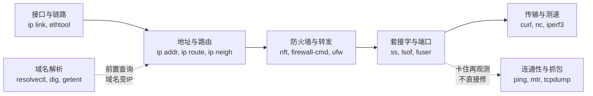

## 背景与目标

Linux网络命令给人“多而杂”的印象，根因有三：**历史包袱重**、**分层视角多**、**发行版差异大**。本文给出一个**功能域总览**：先建立分类心智模型，再按域给出**现代首选命令**、**废弃对照**与**排障路径**，帮读者从“我记得某个命令”切换到“我知道该去哪一域查”。

本文默认面向**国内中文读者**，试验环境默认位于国内，生产默认面向国外服务器；偏好**免费、开源、跨平台**方案。`Windows` 与 `*nix` 差异在文末单列说明。

## 为什么杂：一次历史清算

**核心结论：先记住一套替换关系，再学新命令，旧命令只做只读识别。**

`net-tools（网络工具集）` 是上世纪90年代的 `ifconfig/route/arp/netstat` 合集，2011年前后即停止积极维护；

`iproute2（IP路由套件）` 自1999年随Linux 2.2引入，贴近内核演进，支持**多播、隧道、虚拟链路、流量控制、策略路由、低层IPsec**等新能力。

`ArchLinux`、`RHEL 7` 起的发行版陆续废弃 `net-tools`，最小化镜像与容器默认不再预装，出现 `command not found` 属于正常现象，不是系统损坏。

| 旧命令 | 现代首选 | 包与中文说法 | 说明 |
| --- | --- | --- | --- |
| `ifconfig` | `ip addr`、`ip link` | `iproute2` | 查看与配置地址和链路；`ip -br addr` 为单行简表 |
| `route -n` | `ip route` | `iproute2` | 查看与管理路由表；`route` 不支持策略路由 |
| `arp -a` | `ip neigh` | `iproute2` | 查看邻居表，对应 `ARP（地址解析协议）` 与 `NDP（邻居发现协议）` |
| `netstat -tulpn` | `ss -tulpn` | `iproute2` | 查看套接字；`ss(socket statistics，socket统计)` 直接读内核，速度更快、状态更全，`netstat` 为兼容保留 |
| `nslookup` | `dig`、`host`、`resolvectl query` | `bind-utils/dnsutils`、`systemd-resolved` | `nslookup` 行为与系统解析库不一致，排障以 `dig` 为准 |
| `iptables` | `nft` | `nftables` | `Netfilter` 官方后继，自内核3.13起主流发行版2019年后默认后端；`iptables-nft` 仅为兼容垫片 |
| `service network restart` | `networkctl`、`nmcli`、`netplan apply` | `systemd/NetworkManager/Netplan` | 按实际接管者选择，不可混用重启 |

`ss` 值得单独说明：全称 `socket statistics`，中文“socket统计”，诞生背景即为取代 `netstat`。`netstat` 经由 `/proc` 反复解析，连接数大时缓慢且信息滞后；`ss` 直接使用内核 `netlink` 接口转储套接字表，因此在大并发服务器上几乎是唯一可用选择。

## 心智模型：七域总览

按**报文旅程**记功能域。中部主链自左向右是报文转发必经方向；顶部**域名解析**是前置查询，先把域名变IP再进主链；底部**连通性与抓包**是旁观观测器，任意一段卡住才调用。

**图解**：主链是报文转发必经方向，虚线都是按需切，不是必经。重点只看**地址与路由**、**防火墙与转发**、**套接字与端口**三框：打不开域名先查顶部**域名解析**，`ping`通而 `curl` 不通直接看到**传输与测速**，卡住才切到右下**连通性与抓包**定界。定到框后按**排障路径1-8**执行，组合查**速查总表**。

## 接口与链路：先看网卡亮不亮

**关键区分：`UP（管理状态开）` 不等于 `LOWER_UP（链路层真的有载波）`；`mtu（最大传输单元）` 与 `qdisc（排队规则）` 异常会导致大包通、小包不通的怪象。**

| 命令 | 包来源 | 用途 | 典型写法 |
| --- | --- | --- | --- |
| `ip link` | `iproute2` | 查看与启停接口、改 `MTU` 与 `MAC` | `ip -br link`、`ip link set dev eth0 up` |
| `ip addr` | `iproute2` | 查看与增删IP地址 | `ip -br addr`、`ip addr add 192.0.2.10/24 dev eth0` |
| `ethtool` | `ethtool` | 查看协商速率、双工、链路检测 | `ethtool eth0` |
| `nmcli` | `NetworkManager` | 桌面与笔记本场景的连接管理 | `nmcli device status`、`nmcli connection show` |
| `networkctl` | `systemd-networkd` | 服务器场景的状态查看 | `networkctl status`、`networkctl list` |
| `netplan` | `Netplan` | `Ubuntu` 抽象配置层，不直接管理，只生成后端配置 | `netplan status`、`netplan try`、`netplan apply` |

形式化用法逐项释义，以 `ip` 为例：

- `ip [OPTIONS] OBJECT COMMAND` 中 `OBJECT` 取值为 `link/addr/route/neigh/rule` 等，决定操作对象；`COMMAND` 取值为 `show/add/del/flush/get`，决定动作。
- `ip addr add 192.0.2.10/24 dev eth0` 中 `192.0.2.10/24` 为地址加前缀长，`dev eth0` 指定绑定接口；缺省 `dev` 即报错，不可省略。
- `ip -br` 中 `-br` 为 `--brief` 简写，表示单行摘要，适合脚本解析；`-s` 表示统计计数，`-d` 表示细节。

**示例：新机器先看三行，再动手**。`ip -br link` 确认接口是否 `UP`；`ip -br addr` 确认地址是否挂对接口；`ip route get to 8.8.8.8` 确认出站走哪条路由。三者正常再往上查，不要一上来就改配置文件。

配置归属判定按序执行：

1. 看 `nmcli device status` 与 `networkctl list` 谁显示 `connected/configured`，谁就是实际接管者；
2. `Ubuntu` 再看 `/etc/netplan/*.yaml` 的 `renderer` 是 `NetworkManager` 还是 `networkd`；
3. 只改接管者的配置，改完只用接管者的生效命令；`netplan` 场景优先 `netplan try`，120秒自动回滚，防止断网失联。

## 地址与路由：报文往哪走

| 命令 | 用途 | 典型写法 |
| --- | --- | --- |
| `ip route` | 查看、增删默认网关与静态路由，查询命中 | `ip route`、`ip route get to 8.8.8.8`、`ip route add default via 192.0.2.1` |
| `ip rule` | 查看策略路由规则 | `ip rule show` |
| `ip neigh` | 查看 `ARP/NDP` 邻居表 | `ip neigh show` |
| `hostname -I` | 快速取本机全部地址，适合脚本 | `hostname -I` |

**示例：区分“没地址”与“没路由”**。`ip -br addr` 无地址即 DHCP 或静态配置失败，去查 `Netplan/NetworkManager/systemd-networkd`；有地址但 `ip route get to 8.8.8.8` 报错或走错接口，即网关或策略路由问题。`VPS` 副IP不同网段常需 `/32` 单地址复用主网关，详见 `ip地址绑定和管理.md`，本文不重复。

占位符释义：`ip route add 192.0.2.0/24 via 192.0.2.1 dev eth0` 中 `192.0.2.0/24` 为目的网段，`via` 后为下一跳网关，`dev` 后为出接口；主机路由缺省网段写 `default`，即 `0.0.0.0/0` 与 `::/0` 的合写。

## 域名解析：先分清走没走DNS

**常见误区：`ping` 通域名只证明解析加连通都正常，`dig` 失败而 `curl` 正常往往是 `nsswitch` 或缓存差异，不必反复换 `DNS`。**

| 命令 | 中文说法与定位 | 典型写法 |
| --- | --- | --- |
| `resolvectl status`、`resolvectl query` | `systemd-resolved` 解析器状态与查询，现代发行版首选 | `resolvectl status`、`resolvectl query example.com` |
| `dig` | `BIND` 域名查询工具，行为最可预期 | `dig example.com`、`dig @8.8.8.8 example.com +short`、`dig example.com +trace` |
| `host` | 轻量查询，输出最短 | `host example.com`、`host 8.8.8.8` |
| `getent hosts` | 走系统 `NSS（名称服务切换）` 的真实解析路径，含 `/etc/hosts` | `getent hosts example.com` |
| `nslookup` | 遗留兼容查询，仅做只读识别 | `nslookup example.com` |

占位符释义：`dig [@server] name [type]` 中 `@server` 指定本次查询的递归服务器，缺省走 `/etc/resolv.conf`；`name` 为待查域名；`type` 缺省为 `A`，常用 `AAAA/MX/TXT/CNAME`。`+short` 表示仅输出答案，`+trace` 表示自根逐级迭代，用于定位授权链断裂。

**示例：三问定位解析故障**。先 `resolvectl status` 看当前 `DNS` 是谁，有无 `search` 域污染；再 `dig @8.8.8.8 example.com +short` 对比 `dig example.com +short`，判断是本地还是上游问题；最后 `getent hosts example.com` 验证应用真实看到的结果。三者结论不一致即存在缓存或 `NSS` 分流，不要急于改 `/etc/resolv.conf`（该文件多为自动生成，手工改写重启即丢失）。

英文注释要求：`DNS（Domain Name System，域名系统）`、`CNAME（Canonical Name，别名记录）`、`NXDOMAIN（不存在的域名）`、`SERVFAIL（服务器失败）` 首次出现须配中文；`DNSSEC（DNS安全扩展）` 涉及时补一句“用于校验应答真实性的签名体系”。

## 套接字与端口：本机谁在听

**核心认知：操作系统管理的不是“端口”，而是 `socket（套接字）`；`LISTEN` 行只证明应用准备好了，不证明外部能连上。**判定细节与冲突矩阵已在 `现代操作系统@网络端口信息查看@放行端口@端口占用.md` 讲透，本文只给命令分工。

| 命令 | 定位 | 典型写法 |
| --- | --- | --- |
| `ss -tlnp`、`ss -ulnp` | `TCP/UDP` 监听 triumvirate 首选，按协议分开查 | `ss -tlnp`、`ss -ulnp`、`ss -tanp` |
| `ss -s` | 套接字总数统计，大并发先看总量 | `ss -s` |
| `lsof -i` | 以文件视角看“谁打开了谁”，需 `root` 看全 | `lsof -i -P -n \| grep LISTEN`、`lsof -i :443` |
| `fuser` | 按端口反查进程并可直接发信号 | `fuser 8080/tcp` |
| `nmap` | 对端视角的端口探测，用于验证可达性 | `nmap -p 22,80,443 192.0.2.10` |
| `nc` | `netcat`，手动建连测端口，比 `telnet` 更可预期 | `nc -zv 192.0.2.10 80` |

占位符释义：`ss [OPTIONS] [FILTER]` 中 `-t/-u` 限定 `TCP/UDP`，`-l` 仅显示监听，`-n` 禁止反解（排障默认必加，否则慢且误导），`-p` 显示进程。`lsof -i [protocol][@host][:port]` 中缺省全选，`TCP:443`、`@192.0.2.10`、`UDP:53` 均为合法过滤。

**示例：`Address already in use` 按序三查**。`ss -tlnp \| grep 8080` 看三元组是否重叠；`ps -o pid,cmd -p <PID>` 看是谁；若为 `SO_REUSEPORT（端口复用）` 刻意多进程共享则不杀，详见端口深挖文档。本地域名禁止事项：不得用 `netstat -b`（该参数为 `Windows` 专有，Linux 无效），不得在无 `root` 时断言 `lsof` 为空即无监听。

## 防火墙与转发：通不通的第二战场

**一句话模型：`Netfilter` 是内核框架，`nftables` 是现代引擎，`firewalld/UFW` 是管理前端，`iptables` 是遗留语法。**

| 命令 | 中文说法与定位 | 典型写法 |
| --- | --- | --- |
| `nft` | `nftables` 用户态工具，原生语法，合一处理 `IPv4/IPv6` | `nft list ruleset` |
| `firewall-cmd` | `firewalld` 动态防火墙，`RHEL` 系默认前端，底层多为 `nftables` | `firewall-cmd --state`、`firewall-cmd --list-all` |
| `ufw` | `Uncomplicated Firewall`，`Ubuntu` 简化前端 | `ufw status verbose`、`ufw allow 22/tcp` |
| `iptables -L` | 遗留查看，只用于识别老机器与容器垫片 | `iptables -L -n -v`、`iptables-save` |
| `conntrack -L` | 连接跟踪表，`NAT` 异常时看表满否 | `conntrack -L \| head` |

**示例：云上“监听正常但外网不通”**。按由外向内逐层排除：云安全组是否放行，再 `ufw/firewall-cmd` 是否放行，再 `nft list ruleset` 看是否为 `DROP` 还是 `REJECT`（前者超时，后者拒绝），再 `ss` 确认监听地址是否为 `127.0.0.1` 误绑，最后看 `NAT/DNAT` 与应用层准入。完整判定图见端口深挖文档防火墙一节，本文不另画重图。

英文注释要求：`DNAT（目的地址转换）`、`SNAT（源地址转换）`、`DROP（静默丢弃）`、`REJECT（显式拒绝）` 首次出现配中文；`tcp_tw_reuse`、`somaxconn` 等内核参数沿用端口文档的“先修应用再调内核”结论。

## 连通性与抓包：从黑盒到白盒

| 命令 | 定位 | 典型写法 |
| --- | --- | --- |
| `ping` | `ICMP（网际控制报文协议）` 连通性与丢包，禁 `ICMP` 即失效 | `ping -c 4 8.8.8.8` |
| `traceroute`、`tracepath` | 路径跟踪；`Linux` 默认 `UDP`，`Windows tracert` 默认 `ICMP`，行为差异属正常 | `traceroute example.com`、`tracepath example.com` |
| `mtr` | `ping` 加 `traceroute` 的实时组合，定位抖动首选 | `mtr -r -c 10 example.com` |
| `tcpdump` | 命令行抓包，精确到包 | `tcpdump -i eth0 port 80 -n`、`tcpdump -w capture.pcap` |
| `tshark`、`wireshark` | 结构化分析，前者命令行，后者图形 | `tshark -r capture.pcap -Y http` |
| `nstat` | 内核 `SNMP` 计数，看丢包重传与溢出 | `nstat -az TcpExtListenOverflows TcpExtListenDrops` |

占位符释义：`tcpdump -i eth0 host 192.0.2.10 and port 443 -w out.pcap` 中 `-i` 指定接口，`host/port/and` 为过滤表达式，`-w` 写文件、`-r` 读文件、`-n` 禁止反解，三者为高频组合。`mtr -r -c 10` 中 `-r` 为报告模式，`-c` 为每跳发包数，适合粘贴到工单。

**示例：先分段再抓包**。`ping` 网关、`ping` 公网IP、`ping` 域名三步先定性为本网、运营商还是解析问题；`mtr` 看哪一跳开始丢包；最后才 `tcpdump` 确认对端是否回包。生产抓包务必加 `port/host` 过滤并控制时长，避免满盘与敏感数据外泄。

## 传输与测速：应用层是否真的可用

| 命令 | 定位 | 典型写法 |
| --- | --- | --- |
| `curl` | `HTTP/HTTPS` 细节首选，可看握手与时序 | `curl -v https://example.com`、`curl -w "%{http_code} %{time_total}\n" -o /dev/null -s https://example.com` |
| `wget` | 简单下载兼容 | `wget https://example.com/file` |
| `nc/socat` | 万能 `TCP/UDP` 瑞士军刀，发包与转发 | `nc -zv 192.0.2.10 443`、`socat - TCP:192.0.2.10:80` |
| `iperf3` | 端到端带宽与抖动，需两端配合 | 服务端 `iperf3 -s`，客户端 `iperf3 -c 192.0.2.10 -t 10` |
| `ethtool/sar` | 网卡协商与历史统计辅助 | `ethtool eth0`、`sar -n DEV 1 5` |

占位符释义：`curl -w` 后为输出格式变量，`%{http_code}` 为状态码，`%{time_total}` 为总耗时；`iperf3 -c` 后为服务端地址，`-t` 为测试秒数，`-u` 切换 `UDP` 模式，`-R` 反向测试。`nc -zv` 中 `-z` 为只扫不交互，`-v` 为输出详情，二者常配对使用。

**示例：不要用 `ping` 证明 `Web` 正常**。`ping` 通只证明 `ICMP` 通，`curl -v` 看到 `TLS` 握手与 `HTTP` 状态才是应用可用；带宽争议用 `iperf3` 打流，跨国链路注明测试时段与方向，避免单次结论。

## 排障路径：一张可执行的顺序表

简单线性流程按规范用列表呈现，不另画复杂图。通用顺序为**先本机后远端、先链路后应用、先只读后抓包**。

1. 看接口与地址：`ip -br link`、`ip -br addr` 确认网卡与地址；
2. 看路由：`ip route get to <目标>` 确认出接口与网关；
3. 看解析：`resolvectl status`、`dig +short`、`getent hosts` 三问定性；
4. 看监听：`ss -tlnp` 按协议分开确认，避免 `TCP/UDP` 混查；
5. 看防火墙：由外向内核对安全组、主机防火墙、监听地址；
6. 看路径：`mtr -r -c 10 <目标>` 定位丢包跳；
7. 看传输：`curl -v` 或 `nc -zv` 验证应用层；
8. 看计数与抓包：`nstat`、`conntrack`、`tcpdump` 收尾，避免一上来就抓包。

## 极简环境与跨系统差异

**极简容器与救援模式**常缺 `mtr/nmap/tcpdump/iperf3`，兜底动作为 `/proc` 只读加系统自带工具：`cat /proc/net/dev` 看收发计数，`cat /proc/net/tcp` 粗看连接，`ip` 与 `ss` 多数镜像仍保留，`curl` 或 `wget` 视镜像二选一，`ping` 依赖 `iputils-ping/inetutils-ping` 需显式安装。抓包缺失时优先用 `curl -v` 与 `ss -s` 定性，不要复制生产二进制进去。

**跨系统差异必须单列**：`Windows` 用 `ipconfig/tracert/netstat -ano/nslookup/pathping`，`Linux` 用 `ip/traceroute/ss/dig/mtr`；`tracert` 默认 `ICMP` 而 `traceroute` 默认 `UDP`，结果不可直接对比延时；换行默认 `CRLF` 与 `LF` 不同，脚本跨系统需统一；同一份抓包过滤表达式在 `tcpdump` 与 `Wireshark` 显示过滤语法不同，复用前须核对。需要访问外网时，`*nix` 与 `Windows` 应分别配置代理或镜像加速，引用前核验可用性；`Mihomo` 等本地代理按各自文档分系统说明，本文不展开。

## 速查总表与推荐组合

| 现象 | 首选组合 | 次选深入 |
| --- | --- | --- |
| 不知道本机是谁 | `ip -br addr`、`hostname -I` | `networkctl status`、`nmcli device status` |
| 上不了网 | `ip route get to 8.8.8.8`、`ping -c 4 8.8.8.8` | `mtr -r -c 10 8.8.8.8` |
| 域名打不开 | `resolvectl status`、`dig +short`、`getent hosts` | `dig +trace` |
| 端口不通 | `ss -tlnp`、`nc -zv` | `nmap -p`、`lsof -i` |
| 疑似防火墙 | `nft list ruleset`、`firewall-cmd --list-all`、`ufw status verbose` | `conntrack -L`、`nstat -az` |
| 卡顿抖动 | `mtr`、`iperf3` | `tcpdump`、`sar -n DEV` |
| 要看线上传了什么 | `tcpdump -n` | `tshark/wireshark` |
| 要测应用可用 | `curl -v` | `socat`、`wget` |

**推荐结论清晰完整**：日常记住 **七个现代首选**即可覆盖九成场景：`ip` 管接口地址路由，`resolvectl/dig` 管解析，`ss` 管监听，`nft/firewall-cmd/ufw` 按发行版三选一管防火墙，`mtr` 管路径，`curl` 管应用，`tcpdump` 管定案。旧命令只做只读识别，新脚本一律用新命令；`netstat/ifconfig/route/nslookup/iptables` 不得写入新文档的操作步骤。

## 改动说明与待确认事项

- **结构**：新建七域总览，以报文旅程组织，首尾配两张 `Mermaid` 图；存量深挖文档做分工引用，不重复展开。
- **术语与规范**：英文专有名词配中文，`ss` 补来历说明；表格优先，要点与步骤用列表；无 `H1`、无编号标题、无 `text` 代码块。
- **逻辑与严谨性**：每条形式化用法配占位符释义；排障按序执行；防火墙三层模型显式权衡可靠性、成熟度、现代化程度。
- **示例与直观性**：每域配最小可执行示例；两图配贴图解释，引用文本均为渲染可见标题。
- **待确认事项**：读者实际发行版与接管后端（`NetworkManager` 或 `systemd-networkd`）需按 `nmcli/networkctl` 实测回填；云厂商安全组位置各家不同，需按控制台补充截图口径。
