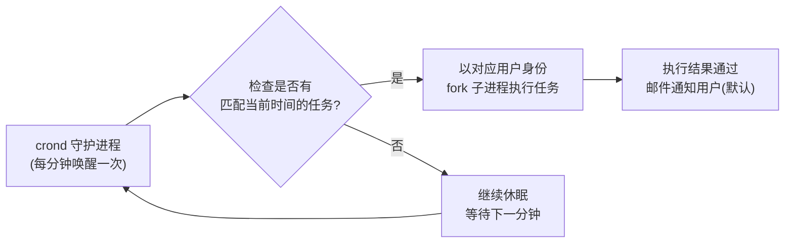
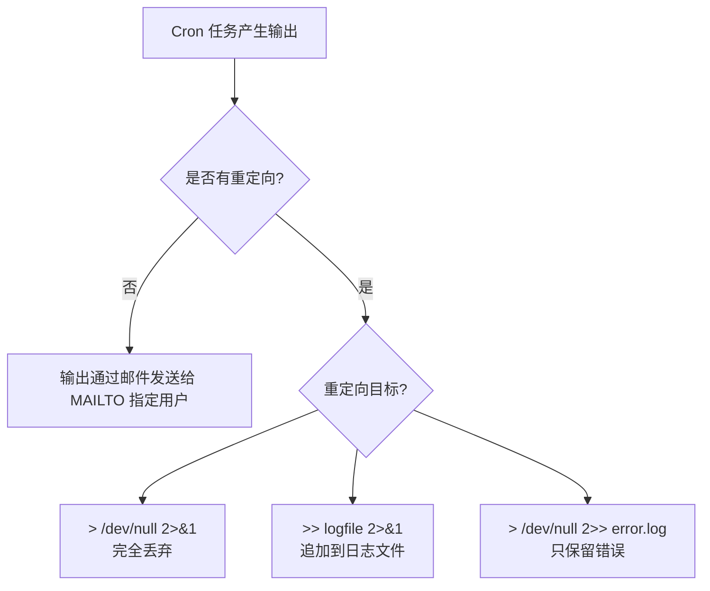
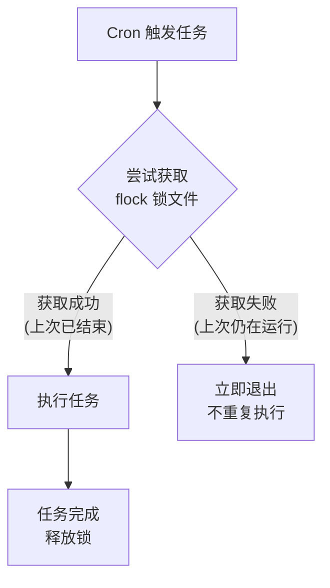
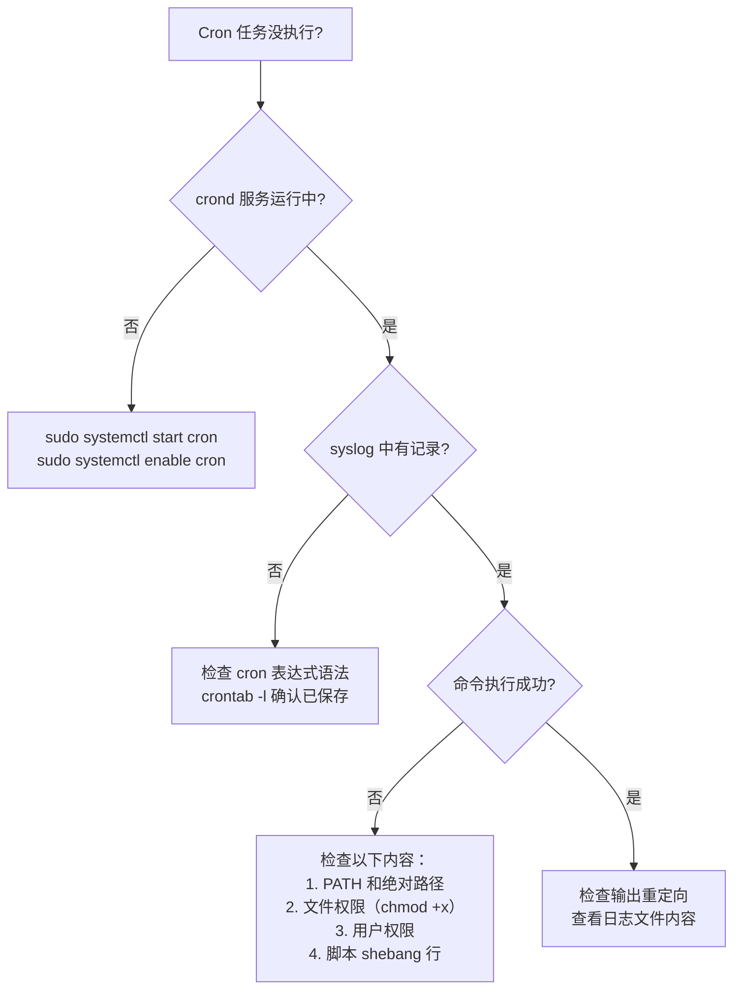

[toc]


# Linux Crontab 完全指南

## 一、什么是 Crontab？

**Crontab**（Cron Table）是 Linux/Unix 系统中基于时间的**任务调度器**。它允许用户设定在特定时间、日期或间隔**自动执行**脚本或命令，是系统自动化运维的核心工具。

> **核心原理**：系统后台运行一个名为 `crond` 的守护进程（daemon），它每分钟醒来一次，检查所有用户的 crontab 文件以及系统级 cron 配置，判断当前时刻是否有需要执行的任务。如果有，就以对应用户的身份启动该任务。



---

### 部分发行版的crontab说明

archlinux推荐使用现代化的`systemd timer`;

在 Arch Linux 上，`crontab` 通常由 `cronie` 这个包提供。与其他发行版(例如debian,ubuntu...)不同，Arch 遵循 **KISS 原则**，默认可能不会自动启动或甚至没有预装 cron 服务。

你可以按照以下步骤检查并管理服务：

```bash
# archlinux中使用cronie这个名字,ubuntu等使用cron这个名字
systemctl status cronie
```

**如果显示 `active (running)`**：说明服务正常。

**如果显示 `inactive (dead)`**：说明服务未启动。

**如果显示 `not-found`**：说明你还没安装 cron 软件（Arch 默认不带它）。

### 安装与启动

如果你发现命令不存在，请先安装：

```bash
sudo pacman -S cronie
```

安装后，执行以下命令**启动**并设置**开机自启**：

```bash
sudo systemctl enable --now cronie
```


## 二、Crontab 文件体系

Linux 中 cron 的配置分为**用户级**和**系统级**两类：

| 类型         | 文件/目录                                                    | 说明                                     |
| ------------ | ------------------------------------------------------------ | ---------------------------------------- |
| **用户级**   | `/var/spool/cron/crontabs/<用户名>`                          | 每个用户各有一个，通过 `crontab -e` 编辑 |
| **系统级**   | `/etc/crontab`                                               | 系统全局 crontab，包含额外的「用户」字段 |
| **系统目录** | `/etc/cron.d/`                                               | 存放软件包自带的 cron 配置文件           |
| **预置目录** | `/etc/cron.hourly/`、`cron.daily/`、`cron.weekly/`、`cron.monthly/` | 放入脚本即可按对应频率自动执行           |
| **权限控制** | `/etc/cron.allow`、`/etc/cron.deny`                          | 控制哪些用户可以使用 crontab             |

> **权限判定规则**：如果 `cron.allow` 存在，则只有其中列出的用户可以使用；如果不存在则检查 `cron.deny`，其中列出的用户被禁止使用。两个文件都不存在时，通常仅 root 可用（取决于发行版）。

---

## 三、Crontab 命令操作

| 命令                   | 功能                              | 示例                          |
| ---------------------- | --------------------------------- | ----------------------------- |
| `crontab -e`           | 编辑当前用户的 crontab            | 打开编辑器进行编辑            |
| `crontab -l`           | 查看当前用户的 crontab            | 列出所有已设定的任务          |
| `crontab -r`           | 删除当前用户的 **全部** crontab   | ⚠️ 危险操作，无确认提示        |
| `crontab -ri`          | 交互式删除（有确认提示）          | 更安全的删除方式              |
| `crontab -u <user> -e` | 编辑指定用户的 crontab（需 root） | `sudo crontab -u www-data -e` |
| `crontab <file>`       | 从文件导入 crontab（覆盖式）      | `crontab my_crontab.txt`      |

---

## 自定义crontab编辑器

如果你想修改 `crontab -e` 默认打开的编辑器（比如从很难用的 `vi` 切换到 `nano` 或 `vim`），可以通过修改环境变量来实现。

这里有几种常见的方法，取决于你是想**临时修改**还是**永久生效**。

------

### 1. 临时切换（仅对当前终端会话有效）

如果你只想在本次操作中使用特定的编辑器，可以在命令前直接指定环境变量：

Bash

```bash
EDITOR=nano crontab -e #EDITOR=nano 环境变量赋值语句,后面是启动crontab -e 两个分句写在一起表示此赋值仅是一次性生效(作用于后面的crontab -e)
# 或者
VISUAL=vim crontab -e
```

### 2. 永久修改（推荐）

要让修改永久生效，需要将环境变量写入你的 shell 配置文件中（通常是 `~/.bashrc` 或 `~/.zshrc`）。

1. **打开配置文件：**

   ```bash
   nano ~/.bashrc
   ```

2. **在文件末尾添加以下行：**

   ```bash
   export EDITOR=vim
   export VISUAL=vim
   ```

3. **使配置立即生效：**

   ```bash
   source ~/.bashrc
   ```

### 3. 使用系统自带的选择器 (仅限 Debian/Ubuntu)

如果你使用的是 Ubuntu 或 Debian 系统，有一个更简单、交互式的方法：

```bash
sudo select-editor
```

执行后，系统会列出已安装的所有编辑器（如 `nano`, `vim.basic`, `vim.tiny`），你只需输入对应的数字编号即可。

------

### 💡 为什么有两个变量 `EDITOR` 和 `VISUAL`？

这是一个历史遗留问题，但了解一下很有趣：

- **`VISUAL`**：指代“可视化”编辑器（如 Vim, Nano），能够全屏显示代码。
- **`EDITOR`**：最初指代“行”编辑器（如 Ed），现在大多数程序会优先查看 `VISUAL`，如果没设置，再回退到 `EDITOR`。
- **建议**：为了万无一失，通常建议两个变量都设置为你喜欢的编辑器。

------

### 如何确认修改成功？

设置完成后，你可以输入以下命令检查：

Bash

```
echo $EDITOR
```

如果返回了你设置的路径（如 `/usr/bin/vim`），那么下次运行 `crontab -e` 时就会自动打开它了。

**需要我帮你检查一下你当前系统里都安装了哪些编辑器吗？**

## 四、Cron 表达式语法（核心）

### 4.1 五字段格式

```bash
┌──────────── 分钟 (0-59)
│ ┌────────── 小时 (0-23)
│ │ ┌──────── 日期(day of month) (1-31)
│ │ │ ┌────── 月份 (1-12 或 jan-dec)
│ │ │ │ ┌──── 星期(day of week) (0-7, 0和7都是星期日, 或 sun-sat)
│ │ │ │ │
* * * * *  command_to_execute
```

```bash
       # You can also override PATH, but by default, newer versions inherit it from the environment
       #PATH=/usr/local/sbin:/usr/local/bin:/sbin:/bin:/usr/sbin:/usr/bin

       # Example of job definition:
       # .---------------- minute (0 - 59)
       # |  .------------- hour (0 - 23)
       # |  |  .---------- day of month (1 - 31)
       # |  |  |  .------- month (1 - 12) OR jan,feb,mar,apr ...
       # |  |  |  |  .---- day of week (0 - 6) (Sunday=0 or 7) OR sun,mon,tue,wed,thu,fri,sat
       # |  |  |  |  |
       # m h dom mon dow usercommand
       17 * * * *  root  cd / && run-parts --report /etc/cron.hourly
       25 6 * * *  root  test -x /usr/sbin/anacron || ( cd / && run-parts --report /etc/cron.daily )
       47 6 * * 7  root  test -x /usr/sbin/anacron || ( cd / && run-parts --report /etc/cron.weekly )
       52 6 1 * *  root  test -x /usr/sbin/anacron || ( cd / && run-parts --report /etc/cron.monthly )
       #

       Note that all the system-wide tasks will run, by default, from 6 am to 7 am.  In  the  case  of  systems
       that  are  not  powered on during that period of time, only the hourly tasks will be executed unless the
       defaults above are changed.
```


### 4.2 特殊符号

| 符号 | 名称   | 含义                         | 示例                                  |
| ---- | ------ | ---------------------------- | ------------------------------------- |
| `*`  | 星号   | 匹配该字段**所有**可能的值   | `* * * * *` → 每分钟                  |
| `,`  | 逗号   | 列举**多个**离散值           | `1,15,30 * * * *` → 第 1、15、30 分钟 |
| `-`  | 连字符 | 指定**连续范围**             | `1-5 * * * *` → 第 1 到 5 分钟        |
| `/`  | 斜杠   | 指定**步长/间隔**            | `*/10 * * * *` → 每 10 分钟           |
| `?`  | 问号   | 不指定值（部分扩展实现支持） | 标准 cron 中不支持                    |

### 4.3 关于"日期"与"星期"的关系（重要易混淆点）

> ⚠️ **当"日期"和"星期"字段同时指定非 `*` 值时，两者是 OR（或）的关系，而非 AND。** 这意味着满足任何一个条件都会触发执行。
>
> 例如：`0 9 15 * 1` 表示"**每月15号 或者 每周一**的 9:00 执行"，而不是"每月15号且为周一时执行"。

### 4.4 预定义时间宏（现代 cron 支持）

大部分现代 Linux 发行版（使用 Vixie cron 或 cronie）支持以下便捷写法：

| 宏                      | 等价表达式  | 含义                |
| ----------------------- | ----------- | ------------------- |
| `@reboot`               | —           | 系统启动时执行一次  |
| `@yearly` / `@annually` | `0 0 1 1 *` | 每年 1 月 1 日 0:00 |
| `@monthly`              | `0 0 1 * *` | 每月 1 日 0:00      |
| `@weekly`               | `0 0 * * 0` | 每周日 0:00         |
| `@daily` / `@midnight`  | `0 0 * * *` | 每天 0:00           |
| `@hourly`               | `0 * * * *` | 每小时整点          |

---

## 五、经典示例大全

### 5.1 基础示例

| 表达式           | 含义                                                |
| ---------------- | --------------------------------------------------- |
| `30 8 * * *`     | 每天 08:30 执行                                     |
| `0 */2 * * *`    | 每 2 小时整点执行                                   |
| `0 9-18 * * 1-5` | 工作日（周一到周五）的 9:00 到 18:00 每小时整点执行 |
| `*/5 * * * *`    | 每 5 分钟执行                                       |
| `0 0 1,15 * *`   | 每月 1 号和 15 号的 0:00 执行                       |
| `0 3 * * 0`      | 每周日凌晨 3:00 执行                                |
| `0 0 * * *`      | 每天午夜 0:00 执行                                  |
| `5 4 * * 6,0`    | 每周六、周日凌晨 4:05 执行                          |

### 5.2 实战示例

```bash
# ---- 每天凌晨 2:30 备份数据库 ----
30 2 * * * /usr/local/bin/backup_mysql.sh >> /var/log/backup.log 2>&1

# ---- 每 5 分钟检查磁盘空间 ----
*/5 * * * * /usr/local/bin/check_disk.sh

# ---- 每周日凌晨 3:00 清理 /tmp 目录下超过 7 天的文件 ----
0 3 * * 0 find /tmp -type f -mtime +7 -delete

# ---- 每月 1 号生成上月报表 ----
0 6 1 * * /opt/scripts/monthly_report.py

# ---- 系统启动时启动应用 ----
@reboot /opt/myapp/start.sh

# ---- 工作日每天 9:00 发送提醒邮件 ----
0 9 * * 1-5 /usr/local/bin/send_reminder.sh

# ---- 每天 0:00 使用 certbot 自动续签 SSL 证书 ----
0 0 * * * certbot renew --quiet --post-hook "systemctl reload nginx"
```

---

## 六、环境变量与执行上下文（关键坑点）

### 6.1 Cron 的执行环境 ≠ 你的终端环境

这是新手最常遇到的问题。cron 执行任务时使用的是一个**极简的环境**，默认 PATH 通常只有：

```
/usr/bin:/bin
```

**解决方案**（多种，按推荐度排列）：

```bash
# 方案一：在 crontab 顶部设置环境变量（推荐）
PATH=/usr/local/sbin:/usr/local/bin:/usr/sbin:/usr/bin:/sbin:/bin
SHELL=/bin/bash

30 2 * * * /opt/scripts/backup.sh

# 方案二：在脚本开头 source 配置文件
#!/bin/bash
source /etc/profile
source ~/.bashrc
# ... 后续脚本逻辑

# 方案三：命令使用绝对路径
30 2 * * * /usr/bin/python3 /opt/scripts/report.py
```

### 6.2 Crontab 中可设置的特殊变量

| 变量        | 说明                    | 示例                                |
| ----------- | ----------------------- | ----------------------------------- |
| `SHELL`     | 指定执行命令的 shell    | `SHELL=/bin/bash`                   |
| `PATH`      | 命令搜索路径            | `PATH=/usr/local/bin:/usr/bin:/bin` |
| `MAILTO`    | 输出邮件发送给谁        | `MAILTO=admin@example.com`          |
| `MAILTO=""` | 禁止发送任何邮件        | 避免邮件堆积                        |
| `HOME`      | 设置工作目录            | `HOME=/opt/myapp`                   |
| `CRON_TZ`   | 设置时区（cronie 支持） | `CRON_TZ=Asia/Shanghai`             |

---

## 七、输出处理与日志

### 7.1 重定向规则

```bash
# 默认行为：stdout 和 stderr 都通过邮件发送给用户
* * * * * /opt/scripts/task.sh

# 将 stdout 追加到日志文件，stderr 合并到 stdout
* * * * * /opt/scripts/task.sh >> /var/log/task.log 2>&1

# 完全丢弃所有输出（静默执行）
* * * * * /opt/scripts/task.sh > /dev/null 2>&1

# 只记录错误信息
* * * * * /opt/scripts/task.sh > /dev/null 2>> /var/log/task_error.log
```



### 7.2 查看 Cron 执行日志

日志可以用来检查crontab对某个定时任务是否正确启动

```bash
# Debian/Ubuntu（rsyslog）
grep CRON /var/log/syslog

# RHEL/CentOS/Fedora
cat /var/log/cron

# 使用 journalctl（systemd 系统，推荐）
journalctl -u cron          # Debian/Ubuntu
journalctl -u crond         # RHEL/CentOS
journalctl -u cron --since "1 hour ago"  # 查看最近 1 小时
```

---

## 八、`/etc/crontab` 与 `/etc/cron.d/` 的区别

系统级配置文件比用户 crontab 多了一个**用户名**字段：

```
# /etc/crontab 格式（注意第 6 个字段是用户名）
分 时 日 月 周  用户名  命令

# 示例
*/5 * * * * root /usr/local/bin/health_check.sh
0   3 * * * www-data /opt/app/cleanup.sh
```

| 对比项   | `crontab -e`（用户级） | `/etc/crontab`、`/etc/cron.d/`（系统级） |
| -------- | ---------------------- | ---------------------------------------- |
| 编辑方式 | `crontab -e` 命令      | 直接用文本编辑器编辑文件                 |
| 用户字段 | 无（隐含为当前用户）   | **必须指定**运行用户                     |
| 适用场景 | 个人用户的定时任务     | 系统维护、软件包自带任务                 |
| 语法检查 | 保存时自动检查         | 无自动检查，需人工确认                   |

---

## 九、最佳实践

### 9.1 编写健壮的 Cron 任务

```bash
# ✅ 完整的最佳实践示例
SHELL=/bin/bash
PATH=/usr/local/sbin:/usr/local/bin:/usr/sbin:/usr/bin:/sbin:/bin
MAILTO=ops-team@example.com

# 数据库备份 —— 使用 flock 防止重复执行
30 2 * * * /usr/bin/flock -n /tmp/backup.lock /opt/scripts/backup_mysql.sh >> /var/log/cron/backup.log 2>&1
```

### 9.2 最佳实践清单

| 实践要点                      | 说明                                                         |
| ----------------------------- | ------------------------------------------------------------ |
| 🔒 **使用 flock 防止重叠执行** | 长时间任务可能在上一次未完成时再次触发，用 `flock -n lockfile command` 避免 |
| 📝 **始终重定向输出**          | 避免邮件堆积；用 `>> logfile 2>&1` 记录日志                  |
| 📂 **使用绝对路径**            | cron 的 PATH 极简，所有命令和文件路径都用绝对路径            |
| 🧪 **先手动测试脚本**          | 编入 crontab 前，以目标用户身份手动运行一遍                  |
| 💬 **添加注释**                | 在每个任务上方加注释说明用途和负责人                         |
| ⏱ **避免同一时刻集中调度**    | 不要把所有任务都设在 `0 0 * * *`，适当错开分钟数             |
| 📊 **日志轮转**                | 对 cron 日志文件配置 logrotate，防止无限增长                 |
| 🔑 **最小权限原则**            | 能用普通用户运行的任务不要用 root                            |
| ✉️ **设置 MAILTO**             | 确保任务失败时有人能收到通知                                 |
| 🕐 **注意时区**                | 服务器时区可能是 UTC，用 `date` 确认并在必要时设置 `CRON_TZ` |

### 9.3 使用 flock 防止任务重叠（详解）

```bash
# 场景：备份脚本运行时间不确定，可能超过调度间隔
# -n: 非阻塞模式，如果锁被占用则立即退出（不排队等待）
# -w 60: 最多等待 60 秒获取锁

*/10 * * * * /usr/bin/flock -n /var/lock/my_task.lock /opt/scripts/my_task.sh
```



---

## 十、调试与排错

### 10.1 常见问题排查流程



### 10.2 实用调试命令

```bash
# 1. 确认 cron 服务状态
sudo systemctl status cron      # Debian/Ubuntu
sudo systemctl status crond     # RHEL/CentOS

# 2. 查看当前用户的 crontab
crontab -l

# 3. 模拟 cron 的简化环境来测试脚本
env -i SHELL=/bin/bash PATH=/usr/bin:/bin HOME=$HOME /opt/scripts/my_task.sh

# 4. 临时添加一个"每分钟"测试任务
# 验证整个 cron 机制是否工作
* * * * * echo "cron works at $(date)" >> /tmp/cron_test.log

# 5. 检查是否有权限限制
cat /etc/cron.allow 2>/dev/null
cat /etc/cron.deny  2>/dev/null
```

### 10.3 常见错误对照表

| 现象                  | 可能原因                          | 解决方法                                        |
| --------------------- | --------------------------------- | ----------------------------------------------- |
| 任务完全没执行        | crond 未启动                      | `systemctl start cron && systemctl enable cron` |
| 任务没执行            | 用户在 `/etc/cron.deny` 中        | 从 deny 文件中移除该用户                        |
| 手动能执行，cron 不行 | PATH 不同，命令找不到             | 使用绝对路径或在 crontab 中设置 PATH            |
| 脚本执行但结果异常    | 工作目录不同                      | 脚本开头 `cd /proper/path` 或设置 HOME          |
| 收到大量邮件          | 输出未重定向                      | 添加 `>> logfile 2>&1` 或设 `MAILTO=""`         |
| `%` 导致命令截断      | crontab 中 `%` 是特殊字符（换行） | 用 `\%` 转义，或把逻辑放入脚本文件              |
| 任务重复执行          | 上一次没执行完又触发了            | 使用 `flock` 加锁                               |

> **关于 `%` 的坑**：在 crontab 中，`%` 会被解释为**换行符**，且第一个 `%` 之后的内容会作为命令的 **stdin**。所以：
> ```bash
> # ❌ 错误写法
> 0 0 * * * echo "Today is $(date +%Y-%m-%d)"
> 
> # ✅ 正确写法（转义 %）
> 0 0 * * * echo "Today is $(date +\%Y-\%m-\%d)"
> 
> # ✅ 更好的写法（把逻辑放入脚本）
> 0 0 * * * /opt/scripts/print_date.sh
> ```

---

## 十一、现代替代方案对比

虽然 crontab 依然广泛使用，但现代 Linux 提供了一些替代或补充方案：

| 工具              | 特点                               | 适用场景                            |
| ----------------- | ---------------------------------- | ----------------------------------- |
| **crontab**       | 经典、轻量、普遍可用               | 简单的定时任务，几乎所有 Linux 环境 |
| **systemd Timer** | 精度更高、日志集成好、支持依赖关系 | 需要精细控制、依赖管理的复杂任务    |
| **anacron**       | 系统关机后补执行错过的任务         | 不保证 24 小时开机的桌面/笔记本     |
| **at**            | 一次性任务调度                     | 只需要执行一次的定时任务            |

### systemd Timer 简单示例（对比参考）

```ini
# /etc/systemd/system/backup.timer
[Unit]
Description=Daily backup timer

[Timer]
OnCalendar=*-*-* 02:30:00
Persistent=true        # 错过的任务会补执行（类似 anacron）

[Install]
WantedBy=timers.target
```

```bash
# 查看所有 systemd 定时器
systemctl list-timers --all
```

---

## 十二、快速备忘录

```bash
# ========== 日常操作速查 ==========

crontab -e              # 编辑
crontab -l              # 查看
crontab -l > backup.txt # 备份
crontab backup.txt      # 从文件恢复（覆盖当前）
crontab -r              # 删除全部（⚠️慎用）

# ========== 时间表达式速查 ==========
#  *        每单位
#  */5      每5单位
#  1,3,5    枚举
#  1-5      范围
#  1-10/2   范围+步长 (1,3,5,7,9)

# ========== 万能模板 ==========
# 分 时 日 月 周  命令
SHELL=/bin/bash
PATH=/usr/local/sbin:/usr/local/bin:/usr/sbin:/usr/bin:/sbin:/bin
MAILTO=""

# 描述：做什么 | 负责人：谁 | 创建时间：何时
*/5 * * * * /usr/bin/flock -n /tmp/task.lock /opt/scripts/task.sh >> /var/log/cron/task.log 2>&1
```

---

## 小结

掌握 crontab 的核心要点：

1. **五字段时间表达式** — 分、时、日、月、周，理解 `*` `,` `-` `/` 四个符号即可覆盖绝大多数场景
2. **执行环境差异** — cron 的 PATH 极简，始终使用绝对路径或显式设置 PATH
3. **输出处理** — 始终重定向输出，避免邮件堆积
4. **防重叠** — 长任务用 flock 加锁
5. **先测试再部署** — 模拟 cron 环境测试脚本，部署后检查系统日志确认执行