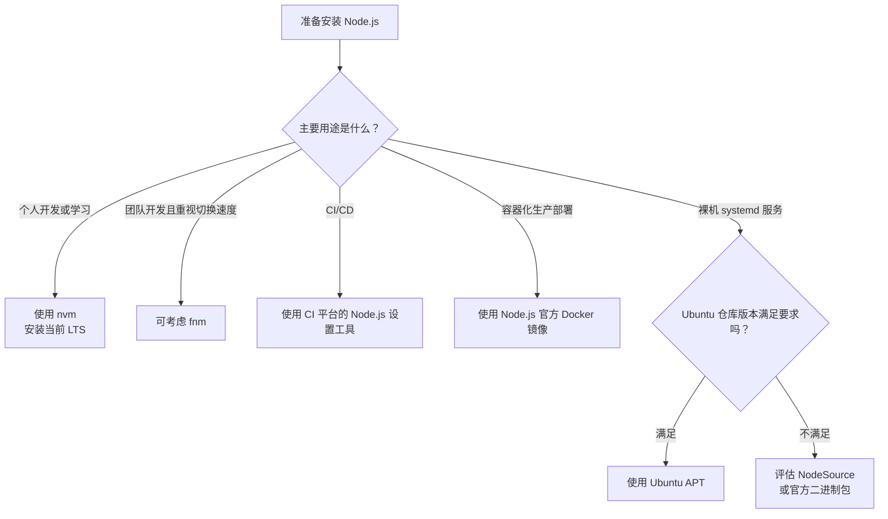

[toc]


## abstract

对于绝大多数 Ubuntu 用户，建议这样选择：

| 场景                           | 推荐方案                            |       推荐程度 | 核心理由                                                  |
| ------------------------------ | ----------------------------------- | -------------: | --------------------------------------------------------- |
| 个人开发机、学习环境           | **nvm + 当前 LTS**                  |           首选 | 无需 root、可安装多个 Node.js 版本、避免 npm 全局权限问题 |
| 团队开发，希望更快的启动和切换 | fnm + 当前 LTS                      |           可选 | 单文件程序、速度快，并兼容 `.nvmrc`                       |
| CI/CD                          | CI 平台的 Node.js 设置工具          |           首选 | 显式声明版本，容易缓存和复现                              |
| Docker/Kubernetes 生产部署     | Node.js 官方 Docker 镜像            |           首选 | 运行时和依赖可随应用一起固定                              |
| 裸机或虚拟机上的 systemd 服务  | 可信 APT 包或经过校验的官方二进制包 |           推荐 | 可提供稳定的系统级可执行路径                              |
| 只需要 Ubuntu 仓库提供的版本   | Ubuntu 官方 APT                     |     视版本而定 | 系统集成好，但主版本可能落后                              |
| 需要较新的系统级 Node.js       | NodeSource APT 仓库                 |       谨慎使用 | 更新及时，但属于第三方软件源                              |
| 特殊架构、离线环境             | 官方二进制包或源码构建              |       高级方案 | 可精确控制，但维护成本较高                                |
| 从源码编译                     | 仅特殊需求                          | 不建议日常使用 | 编译慢，升级和维护复杂                                    |

**面向初学者的默认答案是：在自己的开发账户中安装 nvm，然后用 nvm 安装 Node.js 24 LTS。**

npm 官方文档也明确建议优先使用 Node.js 版本管理器，例如 nvm；这能减少全局安装时的权限错误。



---

## 先理解几个核心概念

### Node.js、npm、npx 分别是什么

| 名称    | 英文全称或含义         | 作用                                      |
| ------- | ---------------------- | ----------------------------------------- |
| Node.js | JavaScript Runtime     | 在浏览器之外运行 JavaScript               |
| npm     | Node Package Manager   | 安装和管理项目依赖，也是默认包管理器      |
| npx     | npm package executor   | 运行项目中的或临时下载的命令行工具        |
| nvm     | Node Version Manager   | 按用户安装和切换多个 Node.js 版本         |
| fnm     | Fast Node Manager      | Rust 编写的快速 Node.js 版本管理器        |
| LTS     | Long-Term Support      | 长期支持版本，适合生产环境                |
| EOL     | End of Life            | 生命周期结束，不再得到上游正式维护        |
| PATH    | Executable Search Path | Shell 查找 `node`、`npm` 等命令的路径顺序 |

通常安装 Node.js 时会同时得到 npm；npx 由现代 npm 提供。不要把 Node.js 运行时、npm 包管理器和 nvm 版本管理器混为一谈。

### Current、Active LTS、Maintenance LTS 与 EOL

| 阶段            | 含义                     | 推荐用途                           |
| --------------- | ------------------------ | ---------------------------------- |
| Current         | 当前创新版本，新特性较多 | 尝鲜、兼容性测试                   |
| Active LTS      | 活跃长期支持版本         | 新生产项目的默认选择               |
| Maintenance LTS | 维护期 LTS               | 继续运行已有项目，同时规划升级     |
| EOL             | 生命周期结束             | 不应继续用于新项目或互联网生产服务 |

截至 **2026 年 9 月 9 日**：

- Node.js 官方下载页显示 **Node.js 24 为当前 LTS**，Node.js 26 为 Current。
- Node.js 24 将于 **2026 年 10 月 20 日**进入维护期，计划支持到 **2028 年 4 月 30 日**。
- Node.js 26 计划于 **2026 年 10 月 28 日**进入 LTS。
- Node.js 22 已处于维护期，计划支持到 **2027 年 4 月 30 日**。
- Node.js 20 已于 **2026 年 4 月 30 日**结束生命周期。

生产应用应使用受支持的 Active LTS 或 Maintenance LTS，而不是 EOL 分支。

> 本文以 `24` 作为主要示例，而不在所有命令中固定补丁版本。这样既清晰，也能让版本管理器安装 Node.js 24 分支的最新安全补丁。

### 为什么不能无条件推荐 `apt install nodejs`

Ubuntu 的包版本通常围绕操作系统发行周期进行集成，而不是始终追踪 Node.js 最新 LTS。例如在核验时，Ubuntu 软件包索引列出的版本包括：

| Ubuntu 版本      | 官方仓库中的 Node.js 主版本 | Node.js 上游状态 |
| ---------------- | --------------------------: | ---------------- |
| Ubuntu 22.04 LTS |                          12 | 已 EOL           |
| Ubuntu 24.04 LTS |                          18 | 已 EOL           |
| Ubuntu 26.04 LTS |                          22 | Maintenance LTS  |

表中版本来自 Ubuntu 软件包索引；Node.js 生命周期状态来自 Node.js 官方发布计划。

这并不意味着 Ubuntu APT 包“一定不安全”。Linux 发行版可能自行回移安全修复，即 **backport**。但仍需考虑：

- 旧 Node.js 主版本可能不满足现代框架的 `engines.node` 要求。
- 新 JavaScript、Web API 和 Node.js API 可能不可用。
- Ubuntu 中的 `nodejs` 位于 `universe` 仓库，其安全维护政策与 `main` 不完全相同。
- Node.js 上游支持状态和 Ubuntu 软件包支持状态是两套不同概念。

因此，开发环境不能只看“APT 能否安装”，还要检查“它安装的版本是否符合项目要求”。

---

## 推荐方案：使用 nvm 安装

### nvm 的工作原理

nvm 是一个按用户安装、按 Shell 加载的 Node.js 版本管理器。不同 Node.js 版本通常放在：

`~/.nvm/versions/node/`

加载 nvm 后，它通过调整 `PATH`，决定当前执行哪个 `node`、`npm` 和 `npx`。

例如：

```bash
nvm use 24
```

并不是替换 `/usr/bin/node`，而是把类似下面的目录放到 `PATH` 前面：

`~/.nvm/versions/node/v24.x.y/bin`

因此，同一台机器上可以同时存在 Node.js 22 和 24，并在不同项目间切换。

### nvm 的优点和限制

**优点：**

- 不需要使用 `sudo` 安装 Node.js。
- 可以同时保留多个 Node.js 主版本。
- 项目可以通过 `.nvmrc` 声明版本。
- npm 全局包安装在用户目录中，减少 `EACCES` 权限错误。
- 不会随意改动 Ubuntu 的系统级 Node.js 包。

**限制：**

- nvm 是 Shell 函数，不是普通二进制程序。
- systemd、cron 和非交互式脚本不会自动读取你的 `.bashrc`。
- 每个 Linux 用户需要分别安装。
- 每个 Node.js 版本有独立的全局 npm 包目录。
- 不适合直接作为系统服务运行时的唯一版本发现机制。

nvm 官方明确说明应使用 `command -v nvm` 检查安装，因为 `which nvm` 可能找不到 Shell 函数。

---

### 安装nvm前检查

先确认 Ubuntu、CPU 架构、当前 Shell，以及机器上是否已经存在 Node.js：

```bash
cat /etc/os-release
uname -m
printf '%s\n' "$SHELL"

type -a node npm npx 2>/dev/null || true
node --version 2>/dev/null || true
npm --version 2>/dev/null || true

apt-cache policy nodejs npm
```

重点观察：

- `uname -m` 常见输出为 `x86_64` 或 `aarch64`。
- `type -a node` 可以发现是否同时存在 `/usr/bin/node`、`/usr/local/bin/node` 和 nvm 安装的 Node.js。
- 不要在尚未确认新安装可用之前急着删除旧版本。

如果以前手工设置过 npm 全局目录，还应检查：

```bash
npm config get prefix 2>/dev/null || true
grep -nE '^(prefix|globalconfig)=' "$HOME/.npmrc" 2>/dev/null || true
```

nvm 与 `.npmrc` 中固定的 `prefix` 配置不兼容。使用 nvm 后，通常应删除这类旧配置。

---

### 安装基础工具

apt为例

```bash
sudo apt update
sudo apt install -y curl ca-certificates git
```

只有项目包含需要本机编译的原生扩展（Native Addon）时，才需要额外安装：

```bash
sudo apt install -y build-essential python3
```

`node-gyp` 编译原生模块时需要 Python、`make` 和 C/C++ 编译工具链；`build-essential` 会提供 Ubuntu 上常用的 GCC、G++ 和 Make。

---

### 正式安装 nvm

与直接执行 `curl ... | bash` 相比，下面先下载、检查、再执行，透明度更高：

```bash
NVM_VERSION="v0.40.6" #根据仓库实际最新版本填写

curl -fsSLo /tmp/nvm-install.sh \
  "https://raw.githubusercontent.com/nvm-sh/nvm/${NVM_VERSION}/install.sh"
# 查看(可选)
# less /tmp/nvm-install.sh
# 安装
bash /tmp/nvm-install.sh
# 清理an
rm -f /tmp/nvm-install.sh
```

如果明确使用 Ubuntu 默认 Bash，可以要求安装器更新 `~/.bashrc`：

```bash
PROFILE="$HOME/.bashrc" bash /tmp/nvm-install.sh
```

但这条命令必须在删除临时脚本之前执行。

### 加载 nvm

重新打开终端通常最简单。也可以在当前 Bash 会话中执行：

```bash
export NVM_DIR="$HOME/.nvm"

if [ -s "$NVM_DIR/nvm.sh" ]; then
  . "$NVM_DIR/nvm.sh"
fi
```

验证：

```bash
command -v nvm
nvm --version
```

正确情况下，`command -v nvm` 应输出：

```bash
nvm
```

如果使用 Zsh，应检查 `~/.zshrc`；如果使用 Bash，则通常检查 `~/.bashrc`。

---

## 安装 Node.js LTS

### 安装当前 LTS

```bash
nvm install --lts
```

在本文核验日期，这会选择 Node.js 24 LTS。

将 Node.js 24 设置为新终端中的默认版本：

```bash
nvm alias default 24
nvm use 24
```

验证完整环境：

```bash
node --version
npm --version
npx --version
nvm current

command -v node
node -p 'process.execPath'
npm config get prefix
```

使用 nvm 时：

- `process.execPath` 应指向 `~/.nvm/versions/node/.../bin/node`。
- `npm config get prefix` 通常也应位于 `~/.nvm` 内。
- 不应指向 `/usr` 或 `/usr/local` 中残留的其他安装。

### 查看和切换版本

```bash
nvm ls
nvm ls-remote --lts

nvm install 22
nvm use 22

nvm use 24
```

查看某个版本的 Node.js 路径：

```bash
nvm which 24
```

---

## 为项目固定 Node.js 版本

仅仅在开发机上“默认使用 Node.js 24”还不够。项目仓库应该声明自己的运行时要求。

### 使用 `.nvmrc`

在项目根目录创建：

```bash
printf '%s\n' '24' > .nvmrc
```

进入项目后：

```bash
nvm install
nvm use
```

这里的 `24` 表示使用 Node.js 24 分支中可用的版本。它便于自动获取补丁更新。

如果项目要求严格复现运行时，可以写入当前完整版本：

```bash
node --version > .nvmrc
```

这样 `.nvmrc` 中会出现类似：

```bash
v24.21.0
```

### 主版本与完整版本如何选择

| 写法         | 示例      | 优点               | 代价                           |
| ------------ | --------- | ------------------ | ------------------------------ |
| 固定主版本   | `24`      | 容易获取安全补丁   | 不同时间安装的补丁版本可能不同 |
| 固定次版本   | `24.21`   | 兼顾稳定与补丁更新 | 需要定期更新次版本             |
| 固定完整版本 | `24.21.0` | 可复现性最高       | 必须主动跟进安全更新           |

通常建议：

- 普通开发项目：`.nvmrc` 使用 `24`。
- 对运行时一致性要求很高的项目：固定完整版本，并通过自动化依赖更新工具定期升级。
- Docker 生产镜像：至少固定完整标签，严格场景进一步固定镜像摘要（digest）。

### 在 `package.json` 中声明兼容范围

```bash
npm pkg set engines.node='>=24 <25'
npm pkg set "packageManager=npm@$(npm --version)"
```

得到的配置大致如下：

```json
{
  "engines": {
    "node": ">=24 <25"
  },
  "packageManager": "npm@实际使用的版本"
}
```

注意：

- `.nvmrc` 用于帮助开发者和工具**选择 Node.js 版本**。
- `engines.node` 用于声明项目的**兼容范围**。
- `packageManager` 用于声明 npm、pnpm 或 Yarn 的具体版本。
- npm 默认只会对不匹配的 `engines` 发出警告，除非额外启用严格检查。

---

## npm 使用最佳实践

### 不要使用 `sudo npm install -g`

使用 nvm 后，下面这种做法通常是错误的：

```bash
sudo npm install -g eslint
```

它可能造成：

- 文件所有权混乱。
- 一部分包属于 root，一部分属于普通用户。
- 切换 Node.js 版本后命令失效。
- 将 nvm 管理的环境和系统目录混合。

npm 官方建议使用 Node.js 版本管理器解决全局包的 `EACCES` 权限问题。

### 优先使用项目本地依赖

推荐：

```bash
npm install --save-dev eslint
npx eslint .
```

或通过 `package.json` 的脚本执行：

```json
{
  "scripts": {
    "lint": "eslint .",
    "test": "node --test"
  }
}
```

```bash
npm run lint
npm test
```

这样工具版本会记录在项目中，不依赖开发机上某个不透明的全局安装。

### 提交锁文件

使用 npm 时应将 `package-lock.json` 提交到版本控制系统。

开发时：

```bash
npm install
```

CI 和部署时：

```bash
npm ci
```

`npm ci` 要求锁文件存在，并且当 `package.json` 与锁文件不一致时直接失败；它不会改写锁文件，因此更适合自动化构建。

### 不要盲目升级 npm

Node.js 安装包已经带有与该 Node.js 分支配套的 npm。除非：

- 项目明确要求某个 npm 版本；
- 当前 npm 存在已知问题；
- 团队已经测试新版本；

否则不必在安装 Node.js 后立即运行：

```bash
npm install -g npm@latest
```

更可控的方法是通过 `packageManager` 字段记录团队使用的版本。

---

## pnpm、Yarn 与 Corepack

Corepack 是包管理器版本管理工具，可以按照项目的 `packageManager` 字段选择 Yarn、pnpm 或 npm 版本。

Node.js 24 中仍附带 Corepack，但它并不一定默认启用：

```bash
corepack enable
```

例如采用 pnpm：

```bash
corepack use pnpm@latest
```

该命令会解析当前版本，并把具体包管理器版本写入 `package.json`。之后应提交相应锁文件，例如 `pnpm-lock.yaml`。

需要注意一个现代版本差异：

- Corepack 随 Node.js `14.19.0` 至 Node.js 24 分发。
- 从 Node.js 25 开始不再随 Node.js 一起分发。
- 因此在 Node.js 25、26 及以后不能假定 `corepack` 一定存在，需要单独安装。

如果未来升级到不包含 Corepack 的 Node.js，可按项目需要单独安装：

```bash
npm install -g corepack@latest
corepack enable
```

不要同时通过多种方式全局安装 Yarn 或 pnpm，否则可能出现 PATH 中命令互相覆盖的问题。

---

## fnm：更快的替代方案

fnm 是使用 Rust 编写的 Node.js 版本管理器，特点包括：

- 单文件程序。
- Shell 启动速度通常比 nvm 更快。
- 支持 Linux、macOS 和 Windows。
- 支持 `.nvmrc` 与 `.node-version`。
- 支持进入目录时自动切换版本。

安装脚本也建议先下载、检查，再执行：

```bash
sudo apt update
sudo apt install -y curl unzip

curl -fsSLo /tmp/fnm-install.sh https://fnm.vercel.app/install
less /tmp/fnm-install.sh
bash /tmp/fnm-install.sh
rm -f /tmp/fnm-install.sh
```

Bash 中启用自动切换通常需要：

```bash
eval "$(fnm env --use-on-cd --shell bash)"
```

将其写入 `~/.bashrc` 后重新加载：

```bash
source "$HOME/.bashrc"
```

安装 Node.js：

```bash
fnm install --lts
fnm use 24
```

### nvm 与 fnm 怎么选

| 对比项               | nvm          | fnm             |
| -------------------- | ------------ | --------------- |
| 成熟度和教程数量     | 很高         | 高              |
| npm 官方文档直接推荐 | 是           | 未作为主要示例  |
| 实现方式             | Shell 函数   | Rust 二进制程序 |
| 启动和切换速度       | 一般         | 较快            |
| `.nvmrc`             | 支持         | 支持            |
| Fish Shell           | 不是主要目标 | 原生支持较好    |
| 初学者默认建议       | **推荐**     | 可选            |

不要在同一个 Shell 中同时初始化 nvm、fnm、Volta 和 mise。多个版本管理器都会修改 `PATH`，容易产生难以排查的覆盖关系。

---

## 使用 Ubuntu 官方 APT 仓库

如果 Ubuntu 仓库中的 Node.js 版本满足项目要求，可以直接安装：

```bash
sudo apt update
apt-cache policy nodejs npm
sudo apt install -y nodejs npm
```

验证：

```bash
node --version
npm --version
command -v node
dpkg -S "$(command -v node)"
```

### APT 方案适合什么场景

适合：

- 系统级工具依赖 Node.js。
- 不需要频繁切换版本。
- 组织要求只使用 Ubuntu 官方软件源。
- Ubuntu 仓库中的版本满足项目要求。
- 希望通过系统补丁管理流程维护运行时。

不太适合：

- 前端或 Node.js 开发机。
- 多项目需要不同 Node.js 主版本。
- 现代框架要求比 Ubuntu 仓库更新的版本。
- 需要紧跟 Node.js LTS 补丁和功能版本。

APT 是 Ubuntu 管理 Debian 软件包的标准方式，但第三方仓库并不继承 Ubuntu 官方仓库的信任和支持边界。

---

## 使用 NodeSource 安装系统级 Node.js

### 什么时候考虑 NodeSource

NodeSource 提供 Debian/Ubuntu 的 Node.js 二进制软件包。它适合：

- 需要 `/usr/bin/node` 这样的稳定系统路径。
- 需要通过 APT 升级 Node.js。
- Ubuntu 官方仓库版本太旧。
- 裸机或虚拟机上运行 systemd 服务。
- 组织接受并审核过 NodeSource 这个第三方软件源。

需要理解：

- NodeSource 不是 Ubuntu 官方仓库。
- 也不是 Node.js 项目自己维护的 Ubuntu 仓库。
- 添加它相当于信任该仓库发布的软件包和维护基础设施。
- 第三方仓库可能影响操作系统版本升级，应记录并定期审计。Ubuntu 官方文档建议第三方源使用独立密钥、`Signed-By` 和包优先级约束。

### 透明地配置 NodeSource 24.x 仓库

先安装基础工具：

```bash
sudo apt update
sudo apt install -y ca-certificates curl gnupg
```

检查架构：

```bash
dpkg --print-architecture
```

核验时，NodeSource 的安装脚本对 Node.js 24 软件源明确检查 `amd64` 和 `arm64`。其他架构应改用 Ubuntu 包、官方二进制包或容器。

导入独立签名密钥：

```bash
curl -fsSL \
  https://deb.nodesource.com/gpgkey/nodesource-repo.gpg.key \
  | sudo gpg --dearmor \
      -o /usr/share/keyrings/nodesource.gpg

sudo chmod 0644 /usr/share/keyrings/nodesource.gpg
```

使用 Ubuntu 24.04 及以后推荐的 deb822 格式创建软件源：

```bash
ARCH="$(dpkg --print-architecture)"

sudo tee /etc/apt/sources.list.d/nodesource.sources >/dev/null <<EOF
Types: deb
URIs: https://deb.nodesource.com/node_24.x
Suites: nodistro
Components: main
Architectures: ${ARCH}
Signed-By: /usr/share/keyrings/nodesource.gpg
EOF
```

只对 `nodejs` 包设置来源优先级：

```bash
sudo tee /etc/apt/preferences.d/nodejs >/dev/null <<'EOF'
Package: nodejs
Pin: origin deb.nodesource.com
Pin-Priority: 600
EOF
```

更新索引并检查候选版本：

```bash
sudo apt update
apt-cache policy nodejs
```

确认 `Candidate` 来自 `deb.nodesource.com`，并且主版本为 24 后再安装：

```bash
sudo apt install -y nodejs
```

验证：

```bash
node --version
npm --version
command -v node
dpkg -S "$(command -v node)"
```

上述仓库格式、`nodistro` Suite、独立 `Signed-By` 密钥和包优先级均基于 NodeSource 当前的 Node.js 24 安装脚本。

> 安装 NodeSource 的 `nodejs` 包后，npm 已包含在其中，不要再额外执行 `apt install npm`，否则可能尝试混入 Ubuntu 仓库中的另一套 npm 依赖。

---

## nvm 不适合直接用于 systemd 的原因

systemd 不会像交互式终端那样自动加载 `~/.bashrc`。因此下面这种服务定义通常会失败：

```ini
ExecStart=node /srv/myapp/server.js
```

如果 `node` 只存在于 nvm 管理的用户目录中，systemd 可能无法找到它。

把 nvm 的完整版本路径直接写进去也有问题：

```ini
ExecStart=/home/user/.nvm/versions/node/v24.21.0/bin/node /srv/myapp/server.js
```

升级到另一个补丁版本后，路径会变化，服务可能无法启动。

裸机生产环境通常更适合：

- 使用系统级 APT 包，得到 `/usr/bin/node`；
- 将经过验证的官方二进制包安装到稳定路径，如 `/opt/node`；
- 或直接使用容器固定运行时。

一个简化的 systemd 服务示例：

```ini
[Unit]
Description=My Node.js Application
After=network.target

[Service]
Type=simple
User=nodeapp
Group=nodeapp
WorkingDirectory=/srv/myapp
Environment=NODE_ENV=production
EnvironmentFile=-/etc/myapp.env
ExecStart=/usr/bin/node /srv/myapp/dist/server.js
Restart=on-failure
RestartSec=5
NoNewPrivileges=true
PrivateTmp=true

[Install]
WantedBy=multi-user.target
```

生产服务应使用专门的低权限账户，而不是 root，也不必为了简单的进程守护强制引入 PM2；systemd 本身已经可以负责启动、重启和日志接入。

---

## 容器化部署

对于 Docker 或 Kubernetes，通常不需要在 Ubuntu 宿主机上单独安装 Node.js；宿主机只需提供容器运行时。

推荐使用 Node.js 官方镜像，并优先选择 Debian 系列，而不是一开始就选择 Alpine：

```dockerfile
FROM node:24-bookworm AS build

WORKDIR /app

COPY package.json package-lock.json ./
RUN npm ci

COPY . .
RUN npm run build \
    && npm prune --omit=dev


FROM node:24-bookworm-slim AS runtime

ENV NODE_ENV=production
WORKDIR /app

COPY --from=build --chown=node:node /app/package.json ./
COPY --from=build --chown=node:node /app/package-lock.json ./
COPY --from=build --chown=node:node /app/node_modules ./node_modules
COPY --from=build --chown=node:node /app/dist ./dist

USER node

CMD ["node", "dist/server.js"]
```

这里包含几个重要实践：

- 使用多阶段构建（Multi-stage Build）。
- 使用 `npm ci` 和锁文件。
- 构建后删除开发依赖。
- 运行阶段使用非 root 的 `node` 用户。
- 构建和运行阶段均使用 Debian 系列，避免原生模块在不同 C 库之间不兼容。
- 生产环境应进一步把 `node:24-bookworm-slim` 固定到经过测试的完整补丁标签或镜像摘要，并定期重建。

Alpine 使用 `musl libc`，而 Debian/Ubuntu 通常使用 `glibc`。一些原生依赖可能没有合适的 musl 预编译包，导致安装时编译失败或运行不兼容。因此，不应只因为 Alpine 镜像较小就无条件选择它。

---

## CI/CD 中固定 Node.js

以 GitHub Actions 为例：

```yaml
name: test

on:
  push:
  pull_request:

jobs:
  test:
    runs-on: ubuntu-latest

    steps:
      - uses: actions/checkout@v7

      - uses: actions/setup-node@v7
        with:
          node-version-file: .nvmrc
          cache: npm

      - run: npm ci
      - run: npm test
```

这样本地开发和 CI 可以共同读取 `.nvmrc`。

如果没有 `.nvmrc`，也可以明确写：

```yaml
      - uses: actions/setup-node@v7
        with:
          node-version: 24
          cache: npm
```

`setup-node` 支持从 `.nvmrc`、`.node-version`、`package.json` 等文件读取版本，并可缓存 npm、Yarn 或 pnpm 的下载缓存；它不会直接缓存整个 `node_modules`。

对于高权限或可接触发布凭据的工作流，应审慎使用自动缓存，并按照 CI 平台的安全建议限制权限。

---

## 更新 Node.js

### 使用 nvm 更新同一主版本

先查看当前版本：

```bash
nvm current
node --version
```

安装 Node.js 24 分支的最新可用版本：

```bash
nvm install 24
nvm use 24
nvm alias default 24
```

查看旧版本：

```bash
nvm ls
```

确认项目正常后再删除旧版本：

```bash
nvm uninstall 24.旧次版本.旧补丁版本
```

不建议依赖大量全局 npm 包。确实需要迁移时，可以使用：

```bash
nvm install 24 --reinstall-packages-from=current
```

但迁移全局包也可能把过时工具一起带到新环境，更干净的方法通常是按需重新安装。

### 使用 APT 更新

```bash
sudo apt update
apt list --upgradable
sudo apt upgrade
```

只更新 Node.js：

```bash
sudo apt install --only-upgrade nodejs
```

更新前可查看候选版本和来源：

```bash
apt-cache policy nodejs
```

### 版本升级原则

- 补丁版本：通常应及时升级，尤其是安全版本。
- LTS 次版本：测试后定期升级。
- 主版本：先查看迁移说明、依赖兼容性和 CI 测试结果。
- 不要等到 EOL 当天才开始迁移。
- 开发环境、CI 和生产环境应使用相同的 Node.js 主版本。

---

## 卸载与清理

### 卸载 nvm

先查看安装目录：

```bash
printf '%s\n' "${NVM_DIR:-$HOME/.nvm}"
```

确认无误后：

```bash
nvm deactivate 2>/dev/null || true
rm -rf "${NVM_DIR:-$HOME/.nvm}"
```

然后从 `~/.bashrc`、`~/.profile` 或 `~/.zshrc` 中删除类似内容：

```bash
export NVM_DIR="$HOME/.nvm"
[ -s "$NVM_DIR/nvm.sh" ] && . "$NVM_DIR/nvm.sh"
```

重新启动 Shell：

```bash
exec "$SHELL" -l
```

### 卸载 Ubuntu 或 NodeSource 软件包

```bash
sudo apt remove --purge nodejs
sudo apt autoremove
```

如果曾配置 NodeSource，还应删除其软件源、优先级和密钥：

```bash
sudo rm -f /etc/apt/sources.list.d/nodesource.sources
sudo rm -f /etc/apt/sources.list.d/nodesource.list
sudo rm -f /etc/apt/preferences.d/nodejs
sudo rm -f /usr/share/keyrings/nodesource.gpg

sudo apt update
```

执行 `rm` 前应确认路径拼写，不要扩展为模糊通配符。

---

## 常见问题排查

| 现象                           | 常见原因                      | 处理方法                                               |
| ------------------------------ | ----------------------------- | ------------------------------------------------------ |
| `nvm: command not found`       | 当前 Shell 尚未加载 `nvm.sh`  | 重新打开终端，或加载 `~/.bashrc`                       |
| `which nvm` 没有输出           | nvm 是 Shell 函数             | 使用 `command -v nvm`                                  |
| `node -v` 不是预期版本         | PATH 中有多个 Node.js         | 使用 `type -a node` 和 `node -p 'process.execPath'`    |
| `sudo node` 与 `node` 版本不同 | `sudo` 使用另一套 PATH        | 不要在 nvm 环境中通过 `sudo node` 运行项目             |
| npm 全局安装出现 `EACCES`      | 使用了系统目录或残留 `prefix` | 使用 nvm，并检查 `~/.npmrc`                            |
| `node-gyp` 编译失败            | 缺少 Python、Make 或编译器    | 安装 `build-essential python3`                         |
| systemd 找不到 `node`          | systemd 没加载 nvm            | 使用系统级 Node.js 或绝对稳定路径                      |
| 切换版本后仍执行旧程序         | Shell 命令路径缓存            | 执行 `hash -r`，再检查 `type -a node`                  |
| `corepack: command not found`  | Node.js 25 以后不再内置       | 单独安装 Corepack                                      |
| NodeSource 安装失败            | 架构不支持或软件源配置错误    | 检查 `dpkg --print-architecture` 和 `apt-cache policy` |
| npm 下载出现证书错误           | 代理、企业 CA 或系统时间问题  | 配置可信 CA 和代理，不要关闭 TLS 校验                  |

### 系统化诊断命令

```bash
printf '%s\n' "PATH=$PATH"
printf '%s\n' "SHELL=$SHELL"

type -a node npm npx 2>/dev/null || true
command -v nvm 2>/dev/null || true

node --version 2>/dev/null || true
npm --version 2>/dev/null || true
nvm current 2>/dev/null || true

node -p 'process.execPath' 2>/dev/null || true
npm config get prefix 2>/dev/null || true

apt-cache policy nodejs npm
dpkg -l | grep -E '^(ii|rc)[[:space:]]+(nodejs|npm|libnode)'
```

诊断时应同时看：

- 命令版本；
- 命令实际路径；
- APT 软件包状态；
- `PATH` 顺序；
- Shell 初始化文件。

只看 `node -v` 往往不足以发现混装问题。

---

## 容易踩坑的做法

### 混用多种安装方法

最常见的问题是同时使用：

- Ubuntu APT；
- NodeSource APT；
- `/usr/local` 手工安装；
- nvm；
- fnm；
- Snap；
- Homebrew for Linux。

它们都可能提供名为 `node` 和 `npm` 的命令，最终由 `PATH` 中最靠前者胜出。

**最佳实践：一个使用场景只选择一个主要管理者。**

开发账户使用 nvm 时，可以保留系统 Node.js，但要清楚：

- 普通交互终端使用 nvm 版本；
- systemd 或其他用户可能使用 `/usr/bin/node`；
- 文档中要明确二者用途。

### 从随机教程复制 `curl | bash`

风险不只是网络传输：

- URL 可能指向非官方镜像。
- 脚本内容可能已变化。
- 教程可能固定了存在漏洞的旧版本。
- 管道执行前无法检查内容。

更稳妥的流程是：

- 从项目官方页面获得地址；
- 固定安装器版本；
- 下载为本地文件；
- 检查内容；
- 再执行；
- 企业环境中记录哈希并经过内部审核。

### 为解决证书错误关闭 TLS 校验

不应使用：

```bash
npm config set strict-ssl false
```

也不应使用不安全的 `curl -k` 作为长期方案。

正确做法是配置：

- 企业代理；
- 企业根 CA；
- `HTTPS_PROXY`；
- npm 的 `cafile`；
- 正确的系统时间和 CA 软件包。

### 盲目删除系统 Node.js

Ubuntu 中其他软件包可能依赖 `nodejs`。删除前先查看：

```bash
apt-cache rdepends --installed nodejs
```

如果只是希望交互终端优先使用 nvm，不一定需要删除 `/usr/bin/node`。

---

## 最佳实践检查清单

### 开发机

- [ ] 使用 nvm 或 fnm，不直接依赖过旧的 Ubuntu Node.js 包。
- [ ] 默认使用受支持的 LTS。
- [ ] 项目提交 `.nvmrc` 或等效版本文件。
- [ ] `package.json` 声明 `engines.node`。
- [ ] 声明并固定包管理器版本。
- [ ] 提交锁文件。
- [ ] 不使用 `sudo npm install -g`。
- [ ] CLI 工具优先作为项目 `devDependencies`。
- [ ] 不同时初始化多个 Node.js 版本管理器。
- [ ] 定期安装同一 LTS 分支的最新安全补丁。

### CI/CD

- [ ] 明确设置 Node.js 版本，不依赖 Runner 偶然预装的版本。
- [ ] 使用 `npm ci` 而非 `npm install`。
- [ ] 缓存包管理器下载缓存，而不是盲目缓存 `node_modules`。
- [ ] 测试多个受支持 Node.js 版本时使用矩阵构建。
- [ ] 发布工作流使用最小权限和受保护凭据。

### 生产环境

- [ ] 只使用受支持的 LTS。
- [ ] 服务进程使用非 root 用户。
- [ ] 不依赖交互式 `.bashrc` 才能找到 Node.js。
- [ ] systemd 使用稳定、明确的 `ExecStart` 路径。
- [ ] 容器使用官方 Node.js 镜像。
- [ ] 容器尽量使用 Debian 系列，除非确认所有依赖支持 musl。
- [ ] 固定完整运行时版本或镜像摘要。
- [ ] 定期重建镜像，而不只是重启旧容器。
- [ ] 在 Node.js 版本进入 EOL 前完成升级。
- [ ] 记录并审计所有第三方 APT 仓库。

---

## 最终推荐配置

如果你是在 Ubuntu 上进行普通 Node.js 开发，可以把推荐流程浓缩为：

```bash
sudo apt update
sudo apt install -y curl ca-certificates git

NVM_VERSION="v0.40.6"

curl -fsSLo /tmp/nvm-install.sh \
  "https://raw.githubusercontent.com/nvm-sh/nvm/${NVM_VERSION}/install.sh"

less /tmp/nvm-install.sh
bash /tmp/nvm-install.sh
rm -f /tmp/nvm-install.sh

export NVM_DIR="$HOME/.nvm"
[ -s "$NVM_DIR/nvm.sh" ] && . "$NVM_DIR/nvm.sh"

command -v nvm

nvm install --lts
nvm alias default 24
nvm use 24

node --version
npm --version
node -p 'process.execPath'
```

在每个项目中：

```bash
printf '%s\n' '24' > .nvmrc

npm pkg set engines.node='>=24 <25'
npm pkg set "packageManager=npm@$(npm --version)"

npm install
```

在 CI 和部署中：

```bash
npm ci
npm test
```

这套方案兼顾了：

- 初学者可理解性；
- 多版本切换；
- 权限隔离；
- 项目可复现性；
- Node.js LTS 生命周期；
- 后续升级维护。

## 内容依据与总体截止日期

本文总体资料核验截止于 **2026 年 9 月 9 日**，主要依据包括：

- Node.js 官方发布状态和发布计划。
- npm 官方安装、权限与 `npm ci` 文档。
- nvm 官方安装和使用文档。
- Ubuntu 官方 APT、软件包与第三方仓库安全指导。
- NodeSource 官方仓库配置脚本。
- Node.js 官方 Docker 镜像文档。
- Node.js Corepack 与 node-gyp 官方项目文档。