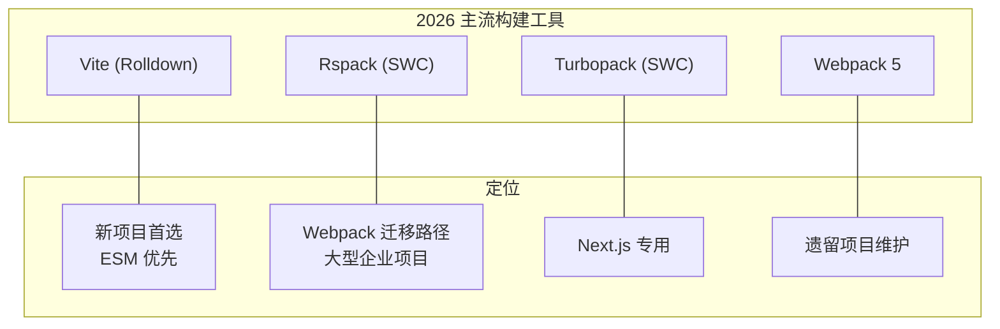

[toc]


## Node.js 生态与工具：系统指南

### 什么是 Node.js

**Node.js** 是一个**开源、跨平台的 JavaScript 运行时**（Runtime），构建在 Google 的 V8 JavaScript 引擎之上，使 JavaScript 能够脱离浏览器在服务器端运行。它采用**事件驱动**（Event-Driven）、**非阻塞 I/O**（Non-blocking I/O）模型，天然适合构建高并发的网络应用。

Node.js 的核心价值：

- **前后端统一语言**：前端开发者可以用 JavaScript/TypeScript 编写服务端逻辑
- **极其丰富的生态**：npm 仓库拥有超过 200 万个包，是世界上最大的开源包注册表
- **高性能 I/O**：适合 API 服务、实时通信（WebSocket）、流处理等 I/O 密集型场景
- **工具链基石**：几乎所有现代前端构建工具（Vite、Webpack、ESLint 等）都运行在 Node.js 上

---

### Node.js 版本与发布策略

#### 当前版本状况（2026 年 9 月）

| 版本线            | 状态                         | 代号    | EOL 日期                   |
| ----------------- | ---------------------------- | ------- | -------------------------- |
| **Node.js 26**    | **Current**（当前版）        | —       | 将于 2026 年 10 月进入 LTS |
| **Node.js 24**    | **Active LTS**（推荐生产用） | Krypton | EOL 2028 年 4 月 30 日     |
| Node.js 22        | Maintenance LTS              | —       | EOL 2027 年 4 月 30 日     |
| Node.js 20 及以下 | EOL（已停止维护）            | —       | —                          |

**推荐**：新项目使用 Node 24；Node 26 目前最适合开发环境和测试，等其进入 LTS 后再用于生产。

#### LTS 生命周期模型

Node.js 的发布分为三个阶段：**Current**、**Active LTS**、**Maintenance LTS**：


- **Current**：包含最新特性，用于开发测试
- **Active LTS**（Long-Term Support）：**生产环境推荐**，持续获得 bug 修复和安全补丁
- **Maintenance LTS**：仅接收关键安全修复

#### 重大变化：新版发布策略

Node.js 项目宣布了一项根本性的发布策略变更：从 Node.js 27 开始，将从每年两个大版本改为每年一个，取消了延续十多年的奇偶版本模型。关键变化：

- 自 2026 年 10 月起：每年 4 月发布一个大版本，10 月升为 LTS。每个版本都将成为 LTS，不再有奇偶区分——Node.js 27 将成为 LTS
- 引入 **Alpha 通道**用于早期测试，使用 semver 预发布格式（如 `27.0.0-alpha.1`），版本号与日历年对齐
- 总支持周期：从首次 Current 发布到 EOL 为 36 个月
- Node.js 26 是现有发布模型下的最后一个版本

#### Node.js 26 新特性亮点

Node.js 26 于 2026 年 5 月 5 日发布，主要新特性：

- **Temporal API** 默认启用——这是一个现代日期/时间 API，提供了比遗留 `Date` 对象更健壮和功能更丰富的替代方案
- V8 引擎升级至 **14.6** 版本（Chromium 146 的一部分）
- 移除了多个已弃用多个大版本的遗留 API
- 新的 ES 特性：`Map.prototype.getOrInsert()`、`Iterator.concat()` 等

---

### Node.js 版本管理

在多个项目之间切换 Node.js 版本是日常需求。以下是 2026 年主流的三个版本管理器对比：

| 特性               | **nvm**          | **fnm**                    | **Volta**                            |
| ------------------ | ---------------- | -------------------------- | ------------------------------------ |
| **语言/性能**      | Bash 脚本，较慢  | **Rust 编写，极快**        | **Rust 编写，极快**                  |
| **跨平台**         | 仅 macOS/Linux   | **全平台（含 Windows）**   | **全平台（含 Windows）**             |
| **版本配置文件**   | `.nvmrc`         | `.nvmrc` / `.node-version` | **`package.json` 中的 `volta` 字段** |
| **自动切换**       | 需手动 `nvm use` | **cd 自动切换**            | **透明拦截，无需切换**               |
| **管理包管理器**   | 否               | 否                         | **是（npm/Yarn 也可 pin）**          |
| **Shell 启动开销** | +75ms            | +15ms                      | +1ms（二进制 shim 透明介入）         |

> **注意**：原版 nvm 不支持 Windows，Windows 上有一个独立项目 **nvm-windows**（由 coreybutler 维护），命令类似但并非同一工具。

#### 推荐方案

- **个人开发机**推荐 **fnm**——与 nvm 使用相同的 `.nvmrc` 文件，shell 启动更快，支持 Windows
- **团队项目**推荐 **Volta**——将 Node 和包管理器版本 pin 在 `package.json` 中，透明切换
- 如果你已在用 nvm 且没有跨平台需求，继续使用也完全可以

#### fnm 安装与配置

**安装**：

```bash
# macOS (Homebrew)
brew install fnm

# Windows (Scoop)
scoop install fnm

# Windows (winget)
winget install Schniz.fnm

# Linux / macOS (curl)
curl -fsSL https://fnm.vercel.app/install | bash
```

**Shell 集成**（在 `~/.bashrc`、`~/.zshrc` 或对应配置文件中添加）：

```bash
# Bash / Zsh
eval "$(fnm env --use-on-cd)"
```

对于 **Windows PowerShell**，在 `$PROFILE` 中添加：

```powershell
fnm env --use-on-cd | Out-String | Invoke-Expression
```

**基本使用**：

```bash
fnm install 24        # 安装 Node 24 LTS
fnm use 24            # 切换到 Node 24
fnm default 24        # 设为默认版本
echo "24" > .nvmrc    # 在项目根目录创建版本锁定文件
```

当你 `cd` 到包含 `.nvmrc` 的项目目录时，fnm 会**自动切换**到指定版本。

#### Volta 安装与配置

```bash
# macOS / Linux
curl https://get.volta.sh | bash

# Windows（使用安装器）
# 从 https://volta.sh 下载 Windows 安装包
```

**基本使用**：

```bash
volta install node@24   # 安装并设为全局默认
volta pin node@24       # 将版本锁定写入当前项目 package.json
volta pin npm@10        # 同时锁定包管理器版本
```

Volta 的核心理念是将版本信息直接记录在 `package.json` 中。克隆仓库后运行任何命令，Volta 都会透明使用正确版本——无需 `.nvmrc`，无需 shell hook。`package.json` 中会出现：

```json
{
  "volta": {
    "node": "24.18.1",
    "npm": "10.9.0"
  }
}
```

---

### 包管理器（Package Manager）

Node.js 生态中有三大包管理器：**npm**、**pnpm**、**Yarn**。

#### 三大包管理器对比

| 特性                    | **npm**                                                      | **pnpm**                                                     | **Yarn**（v4 Berry）                           |
| ----------------------- | ------------------------------------------------------------ | ------------------------------------------------------------ | ---------------------------------------------- |
| **定位**                | Node.js 默认自带                                             | 高性能、严格依赖管理                                         | 创新特性丰富                                   |
| **安装方式**            | 随 Node.js 自带                                              | 独立安装或通过 Corepack                                      | 通过 Corepack 推荐                             |
| **`node_modules` 结构** | 扁平结构，依赖提升到顶层，可能产生**幽灵依赖**（Phantom Dependencies） | **符号链接结构 + 全局内容寻址存储**（Content-Addressable Store），严格隔离且不重复存储 | 支持 PnP（Plug'n'Play）零安装或 `node_modules` |
| **磁盘效率**            | 一般（每个项目完整副本）                                     | **极高**（全局存储 + 硬链接）                                | 高（PnP 模式下无 node_modules）                |
| **安装速度**            | 基线                                                         | **显著更快**（尤其重复安装）                                 | 快                                             |
| **Monorepo 支持**       | **workspaces**（基础）                                       | **workspaces**（优秀，`--filter` 过滤）                      | **workspaces**（优秀，Plug'n'Play）            |
| **严格性**              | 较宽松                                                       | **默认严格**（禁止幽灵依赖）                                 | 可配置                                         |
| **锁文件**              | `package-lock.json`                                          | `pnpm-lock.yaml`                                             | `yarn.lock`                                    |

#### 推荐策略

- **新手或简单项目**：直接使用 **npm**，零配置，随 Node.js 开箱即用
- **中大型项目 / Monorepo**：推荐 **pnpm**——磁盘效率高、安装快、依赖严格
- **已有 Yarn 项目**：继续使用 Yarn v4（Berry）即可，生态成熟

#### Corepack：包管理器的版本管理器

**Corepack** 是 Node.js 内置的一个工具，它让你无需手动安装即可使用 Yarn、npm 和 pnpm。它通过 `package.json` 中的 `packageManager` 字段来声明项目所需的包管理器及版本：

```json
{
  "packageManager": "pnpm@10.5.0"
}
```

**重要变更**：Corepack 从 Node.js 14.19.0 到 24.x（不含 25.0.0）随 Node.js 一起分发。Node.js 26（即 v25+）不再内置 Corepack，需要单独安装：

```bash
npm install -g corepack
```

在仍内置 Corepack 的版本（Node 22/24）上启用：

```bash
corepack enable           # 启用 Corepack（激活 yarn/pnpm shim）
corepack use pnpm@latest  # 在当前项目设置 pnpm 并写入 package.json
```

#### pnpm 快速上手

```bash
# 安装（推荐独立安装方式，不依赖 Corepack）
# macOS / Linux
curl -fsSL https://get.pnpm.io/install.sh | sh -
# Windows (PowerShell)
iwr https://get.pnpm.io/install.ps1 -useb | iex

# 基本使用
pnpm install              # 安装所有依赖
pnpm add express          # 添加生产依赖
pnpm add -D typescript    # 添加开发依赖
pnpm remove lodash        # 移除依赖
pnpm run build            # 运行 scripts 中的命令
pnpm dlx create-vite      # 类似 npx，临时执行包命令
```

**pnpm 在 Monorepo 中的使用**：

在项目根目录创建 `pnpm-workspace.yaml`：

```yaml
packages:
  - "packages/*"
  - "apps/*"
```

常用 Monorepo 操作：

```bash
pnpm --filter @myorg/web add react       # 仅给指定包添加依赖
pnpm --filter @myorg/api run build       # 仅构建指定包
pnpm -r run test                          # 递归在所有包中执行 test
```

---

### 模块系统：CJS vs ESM

这是 Node.js 生态中**最需要理解的核心概念之一**。Node.js 中存在两种模块系统：

| 方面             | **CommonJS (CJS)**             | **ES Modules (ESM)**                      |
| ---------------- | ------------------------------ | ----------------------------------------- |
| **语法**         | `require()` / `module.exports` | `import` / `export`                       |
| **加载方式**     | **同步**加载                   | **异步**加载                              |
| **历史**         | Node.js 原生模块系统           | JavaScript 标准模块系统（ES2015+）        |
| **文件扩展名**   | `.cjs` 或 `.js`（默认）        | `.mjs` 或 `.js`（当 `type: "module"` 时） |
| **浏览器支持**   | 不支持（需打包）               | **原生支持**                              |
| **Tree-shaking** | 困难                           | **天然支持**                              |
| **顶层 await**   | 不支持                         | **支持**                                  |

**如何选择模块类型**：通过 `package.json` 的 `type` 字段决定 `.js` 文件的解析方式：

```json
{
  "type": "module"
}
```

- `"type": "module"` → `.js` 文件按 **ESM** 解析（**推荐新项目使用**）
- `"type": "commonjs"` 或省略 → `.js` 文件按 **CJS** 解析（默认行为）
- 不论 `type` 设置如何，`.mjs` 始终是 ESM，`.cjs` 始终是 CJS

**互操作**：
- ESM 中可以 `import` CJS 模块（Node.js 会自动处理）
- CJS 中**不能**直接 `require()` ESM 模块（需使用动态 `import()`）

**最佳实践**：
- **新项目一律使用 ESM**（`"type": "module"`）
- 发布 npm 库时，考虑同时提供 CJS 和 ESM 入口（**双格式发布**，通过 `package.json` 的 `exports` 字段）：

```json
{
  "exports": {
    ".": {
      "import": "./dist/index.mjs",
      "require": "./dist/index.cjs"
    }
  }
}
```

---

### TypeScript 原生支持

这是近年 Node.js 最重要的特性突破之一。

#### 工作原理

Node.js 通过一种叫做**类型擦除**（Type Stripping）的轻量级处理来运行 TypeScript：它移除可擦除的 TypeScript 语法（如类型注解和接口），然后执行剩余的 JavaScript。

```bash
# 直接运行 .ts 文件，无需任何标志（Node 23.6+ / Node 22.6+ 实验性）
node app.ts
```

#### 版本支持情况

- Node.js 22.6 引入实验性支持，Node.js 23.6 稳定化
- Node.js 24（Active LTS）：稳定可用
- Node.js 26 默认会对仅包含可擦除 TypeScript 语法的文件执行类型擦除，将 TypeScript 语法替换为空白字符，不执行类型检查

#### 支持与限制

**支持的（可擦除语法）**：类型注解（Type Annotations）、接口（Interfaces）、类型别名（Type Aliases）、`import type`

**不支持的（需要代码生成的语法）**：包括 `enum`、参数属性（Parameter Properties）、含运行时代码的 namespace、import 别名

**关键限制**：
- Node.js 运行 TypeScript 文件时**不进行类型检查**，需单独使用 `tsc`
- Node.js **不读取 `tsconfig.json`**，不支持依赖 tsconfig 设置的功能，如 `paths` 映射或将新 JS 语法转换为旧标准
- 不支持 JSX 文件

#### 推荐的工作流

开发时直接用 Node.js 运行以获得快速反馈，在单独的命令或 CI 流程中运行 `tsc --noEmit` 进行类型检查：

```bash
# 开发：直接运行
node app.ts

# 类型检查（CI 或 pre-commit hook 中）
npx tsc --noEmit
```

推荐的 `tsconfig.json` 基础配置（与 Node.js 原生 TS 行为对齐）：

```json
{
  "compilerOptions": {
    "target": "ESNext",
    "module": "NodeNext",
    "moduleResolution": "nodenext",
    "strict": true,
    "noEmit": true,
    "skipLibCheck": true,
    "isolatedModules": true,
    "verbatimModuleSyntax": true
  }
}
```

> `verbatimModuleSyntax` 强制使用 `import type` 语法，与 Node.js 的类型擦除行为一致。由于类型擦除的特性，`type` 关键字是正确擦除类型导入所必需的。没有 `type` 关键字，Node.js 会将导入视为值导入，导致运行时错误。

---

### 构建与打包工具

2026 年的 JavaScript 构建工具格局已经发生了根本性变化——**Rust 时代**的前端工具链已成为基准线。

#### 构建工具全景图



| 工具           | 核心引擎                                                     | 适用场景                                                     | 状态                             |
| -------------- | ------------------------------------------------------------ | ------------------------------------------------------------ | -------------------------------- |
| **Vite** (v8+) | **Rolldown**（Rust）——统一了开发和生产构建引擎，消除了旧的 esbuild 与 Rollup 不匹配问题 | **新项目首选**                                               | ~4000 万周下载，驱动所有主流框架 |
| **Rspack**     | SWC（Rust）                                                  | Webpack 的 Rust 重写，5-10x 更快，保持 webpack 插件 API 兼容 | Webpack 项目迁移首选             |
| **Turbopack**  | SWC（Rust）                                                  | Next.js 深度绑定                                             | 仅限 Next.js 生态                |
| **Webpack 5**  | JavaScript                                                   | 遗留项目维护                                                 | 仍广泛使用但不推荐新项目         |

**推荐**：
- **Vite 是大多数团队最安全的选择**
- 已有 Webpack 项目且构建慢？Rspack 是最低风险的迁移路径——相同 loaders、相同 plugins，5-10x 更快
- 使用 Next.js？Turbopack 已内置

#### Vite 快速上手

```bash
# 创建新项目（推荐使用 pnpm）
pnpm dlx create-vite my-app --template react-ts
cd my-app
pnpm install

# 启动开发服务器
pnpm dev

# 生产构建
pnpm build

# 预览生产构建结果
pnpm preview
```

Vite 的核心优势：
- **极快的冷启动**：基于原生 ESM 的开发服务器，无需预打包所有代码
- **即时 HMR**（热模块替换）：修改代码后页面局部更新，几乎无感知延迟
- **开箱即用**：TypeScript、JSX、CSS Modules、PostCSS 等无需额外配置
- **丰富的插件生态**：兼容 Rollup 插件

#### Vite+：统一工具链（2026 新方向）

2026 年 3 月，VoidZero（Evan You 的公司）发布了 **Vite+**，一个统一的前端工具链。它将 Vite、Rolldown、Vitest、Oxlint、Oxfmt、Tsdown 整合到一个 CLI（`vp`）和一个配置文件中。

Vite+ 将 Vite 从单纯的构建工具定位提升为一个完整的工具链平台——类似于 Rust 的 `cargo` 或 Go 的 `go` 命令。

---

### 代码质量工具

#### Linting（代码检查）

| 工具       | 语言       | 特点                                                      |
| ---------- | ---------- | --------------------------------------------------------- |
| **ESLint** | JavaScript | 生态最大、插件最丰富，v9+ 采用**扁平配置**（Flat Config） |
| **Oxlint** | Rust       | 极快（50-100x），可配合 ESLint 使用                       |
| **Biome**  | Rust       | Lint + Format 一体化工具，Rust 编写，极快                 |

**ESLint 扁平配置**（Flat Config）是 ESLint v9+ 的新配置格式，使用 `eslint.config.js`（而非旧的 `.eslintrc.*`）：

```javascript
// eslint.config.js
import js from "@eslint/js";
import tseslint from "typescript-eslint";

export default [
  js.configs.recommended,
  ...tseslint.configs.recommended,
  {
    rules: {
      "no-unused-vars": "warn",
    },
  },
];
```

#### Formatting（代码格式化）

| 工具         | 语言       | 特点                                            |
| ------------ | ---------- | ----------------------------------------------- |
| **Prettier** | JavaScript | 生态最广、零配置哲学，业界标准                  |
| **Biome**    | Rust       | 兼具 lint 和格式化，速度极快，Prettier 兼容性高 |
| **Oxfmt**    | Rust       | VoidZero 出品，与 Vite+ 生态集成                |

**推荐**：
- 传统方案：**ESLint + Prettier**（通过 `eslint-config-prettier` 避免冲突）
- 现代方案：**Biome**（一个工具搞定 lint + format，速度极快，适合新项目）
- Vite 生态：随 **Vite+** 使用 Oxlint + Oxfmt

#### 测试工具

| 工具                     | 类型          | 说明                                                         |
| ------------------------ | ------------- | ------------------------------------------------------------ |
| **Vitest**               | 单元/集成测试 | **已替代 Jest 成为新标准**，与 Vite 共享配置和转换管道，API 兼容 Jest |
| Node.js 内置 test runner | 单元测试      | `node:test` 模块，零依赖，适合简单场景                       |
| **Playwright**           | E2E 测试      | 成为 E2E 测试的默认选择                                      |
| Cypress                  | E2E 测试      | 仍广泛使用，但 Playwright 势头更强                           |

**Vitest 示例**：

```typescript
// sum.test.ts
import { expect, test } from "vitest";
import { sum } from "./sum.js";

test("adds 1 + 2 to equal 3", () => {
  expect(sum(1, 2)).toBe(3);
});
```

```bash
pnpm add -D vitest
pnpm vitest        # 运行测试（watch 模式）
pnpm vitest run    # 运行一次
```

---

### Node.js 内置能力速览

现代 Node.js（v22+）已经内置了大量原本需要第三方包的功能：

| 能力             | 内置方式                              | 替代的第三方包         |
| ---------------- | ------------------------------------- | ---------------------- |
| **HTTP 请求**    | `fetch()`（全局可用）                 | axios, node-fetch, got |
| **测试运行器**   | `node:test` + `node:assert`           | Jest, Mocha            |
| **环境变量**     | `--env-file=.env`（Node 20+）         | dotenv                 |
| **Watch 模式**   | `node --watch app.js`                 | nodemon                |
| **TypeScript**   | 原生类型擦除（Node 22.6+）            | ts-node, tsx           |
| **文件监听**     | `fs.watch`（改进版）                  | chokidar               |
| **性能度量**     | `node:perf_hooks`                     | 外部 APM 工具          |
| **Worker 线程**  | `node:worker_threads`                 | —                      |
| **单文件可执行** | SEA（Single Executable Applications） | pkg                    |

**示例——使用内置能力构建简单服务**：

```typescript
// server.ts — Node.js 24+ 可直接运行：node server.ts
import { createServer } from "node:http";

const server = createServer((req, res) => {
  res.writeHead(200, { "Content-Type": "application/json" });
  res.end(JSON.stringify({ message: "Hello from Node.js!" }));
});

server.listen(3000, () => {
  console.log("Server running at http://localhost:3000");
});
```

```bash
# 开发时使用 watch 模式 + 环境变量文件
node --watch --env-file=.env server.ts
```

---

### 主流 Web 框架概览

| 框架        | 定位               | 特点                                           |
| ----------- | ------------------ | ---------------------------------------------- |
| **Express** | 经典 HTTP 框架     | 极简、生态最丰富、v5 已发布                    |
| **Fastify** | 高性能 HTTP 框架   | 比 Express 快、内置 Schema 验证、插件体系完善  |
| **Koa**     | Express 精神继承者 | 更现代的中间件模型（基于 async/await）         |
| **Hono**    | 超轻量、多运行时   | 支持 Node.js/Deno/Bun/Cloudflare Workers，极快 |
| **NestJS**  | 企业级全功能框架   | 类 Angular 架构、DI 容器、TypeScript 深度集成  |
| **Next.js** | React 全栈框架     | SSR/SSG/RSC、文件路由、API Routes              |
| **Nuxt**    | Vue 全栈框架       | SSR/SSG、文件路由、自动导入                    |

**推荐**：
- API 服务 / 微服务：**Fastify**（性能优秀、TypeScript 友好、生态成熟）
- 全栈 React 应用：**Next.js**
- 全栈 Vue 应用：**Nuxt**
- 边缘计算 / 多运行时：**Hono**
- 快速原型 / 简单 API：**Express**（社区资源最丰富）

---

### 关键配置文件一览

一个典型的现代 Node.js 项目根目录常见文件：

| 文件                                                 | 用途                                              |
| ---------------------------------------------------- | ------------------------------------------------- |
| `package.json`                                       | **项目元数据、依赖声明、脚本命令、模块类型**      |
| `package-lock.json` / `pnpm-lock.yaml` / `yarn.lock` | **依赖锁定文件**（必须提交到 Git）                |
| `tsconfig.json`                                      | TypeScript 编译器配置                             |
| `.nvmrc` / `.node-version`                           | 项目 Node.js 版本声明（fnm/nvm 读取）             |
| `eslint.config.js`                                   | ESLint 扁平配置                                   |
| `.prettierrc`                                        | Prettier 格式化配置                               |
| `vite.config.ts`                                     | Vite 构建工具配置                                 |
| `.env` / `.env.local`                                | 环境变量（`.env.local` 不提交到 Git）             |
| `.gitignore`                                         | Git 忽略文件（务必忽略 `node_modules/`、`dist/`） |

#### `package.json` 核心字段详解

```json
{
  "name": "@myorg/my-app",
  "version": "1.0.0",
  "type": "module",
  "engines": { "node": ">=24" },
  "packageManager": "pnpm@10.5.0",
  "scripts": {
    "dev": "vite",
    "build": "tsc --noEmit && vite build",
    "test": "vitest",
    "lint": "eslint .",
    "format": "prettier --write ."
  },
  "dependencies": {
    "fastify": "^5.0.0"
  },
  "devDependencies": {
    "typescript": "^5.8.0",
    "vitest": "^3.0.0"
  },
  "exports": {
    ".": {
      "import": "./dist/index.js",
      "require": "./dist/index.cjs"
    }
  }
}
```

重要字段说明：

- **`type`**：声明模块系统，新项目必须设为 `"module"`
- **`engines`**：声明 Node.js 版本要求，包管理器可据此检查
- **`packageManager`**：供 Corepack 或 pnpm v10+ 识别包管理器版本
- **`exports`**：**条件导出**（Conditional Exports），是现代 npm 包定义入口点的标准方式，替代了旧的 `main` 字段
- **`scripts`**：定义项目命令，通过 `pnpm run <name>` 调用

---

### 跨平台注意事项

#### 换行符问题（LF vs CRLF）

Windows 默认使用 CRLF（`\r\n`），而 macOS/Linux 使用 LF（`\n`）。对于 Node.js 项目，**统一使用 LF** 是最佳实践：

**Git 配置**（全局或仓库级别）：

```bash
# 推荐：在仓库中使用 .gitattributes 文件（跨平台一致）
echo "* text=auto eol=lf" > .gitattributes
```

`.gitattributes` 文件应提交到 Git 仓库，这样所有平台的所有开发者都会统一使用 LF。

**编辑器配置**（`.editorconfig`）：

```ini
# .editorconfig
root = true

[*]
end_of_line = lf
charset = utf-8
indent_style = space
indent_size = 2
insert_final_newline = true
trim_trailing_whitespace = true
```

#### 脚本跨平台兼容

`package.json` 的 `scripts` 中应避免使用平台特定的 shell 命令。推荐：

- 使用 **`cross-env`** 设置环境变量（兼容 Windows）：`cross-env NODE_ENV=production node app.js`
- 文件操作使用 **`rimraf`**（替代 `rm -rf`）、**`cpy-cli`**（替代 `cp`）
- 或使用 Node.js 脚本替代 shell 命令

#### 网络环境（国内访问）

npm/pnpm/Yarn 的默认注册表 `registry.npmjs.org` 在国内访问可能较慢，可以配置镜像：

```bash
# npm 使用淘宝镜像
npm config set registry https://registry.npmmirror.com

# pnpm 使用淘宝镜像
pnpm config set registry https://registry.npmmirror.com

# Yarn v4
yarn config set npmRegistryServer https://registry.npmmirror.com
```

对于 GitHub 上的资源（如 release 二进制文件），可使用加速代理，例如 `https://ghproxy.com` 包裹原链接。

使用本地代理（如 mihomo）时的配置方式：

```bash
# *nix (bash/zsh) —— 设置临时代理
export http_proxy=http://127.0.0.1:7890
export https_proxy=http://127.0.0.1:7890

# Windows PowerShell
$env:http_proxy = "http://127.0.0.1:7890"
$env:https_proxy = "http://127.0.0.1:7890"

# Windows CMD
set http_proxy=http://127.0.0.1:7890
set https_proxy=http://127.0.0.1:7890
```

> 端口号 `7890` 依据你本地 mihomo 的实际配置调整。

---

### 竞争运行时：Deno 与 Bun

Node.js 不再是唯一的 JavaScript 服务端运行时。了解竞争者有助于做出更好的技术选型：

| 特性           | **Node.js**                   | **Deno**                         | **Bun**                  |
| -------------- | ----------------------------- | -------------------------------- | ------------------------ |
| **创始人**     | Ryan Dahl（2009）             | Ryan Dahl（2018，"Node 的反思"） | Jarred Sumner（2022）    |
| **引擎**       | V8                            | V8                               | JavaScriptCore（WebKit） |
| **包管理**     | npm/pnpm/Yarn + node_modules  | URL 导入 + npm 兼容              | 内置包管理器             |
| **TypeScript** | 类型擦除（受限）              | **原生完整支持**                 | **原生完整支持**         |
| **生态成熟度** | **极高**（最丰富的 npm 生态） | 中（兼容大部分 npm 包）          | 中（兼容度持续提升）     |
| **适用场景**   | 企业级、大型项目、成熟生态    | 安全敏感、现代化开发             | 追求极致性能             |

**务实建议**：

- **生产环境首选 Node.js**——生态最成熟、社区最大、企业支持最广
- Deno 和 Bun 在个人项目和特定场景中值得尝试
- 少数团队在 Node.js EOL 时会考虑迁移到 Deno 或 Bun 等不同运行时，但这属于重大平台变更，需谨慎评估

---

### 推荐的项目初始化清单

面对一个全新的 Node.js 项目，以下是推荐的最佳实践清单：

1. **Node.js 版本管理**：安装 **fnm** 或 **Volta**，在项目中锁定版本
2. **包管理器**：新项目推荐 **pnpm**，配置国内镜像
3. **模块系统**：`package.json` 设置 `"type": "module"`
4. **TypeScript**：启用，配置 `tsconfig.json`，利用 Node.js 原生类型擦除
5. **构建工具**：前端项目用 **Vite**，库项目用 **tsup** 或 **tsdown**
6. **代码质量**：ESLint（扁平配置）+ Prettier，或 **Biome**
7. **测试**：**Vitest**（单元/集成）+ **Playwright**（E2E）
8. **Git 配置**：`.gitattributes`（`* text=auto eol=lf`）+ `.editorconfig`
9. **环境变量**：使用 `--env-file=.env`（Node 20+ 内置），不再需要 `dotenv`
10. **CI/CD**：锁定 Node 版本（如 `FROM node:24-alpine`），提交锁文件

---

### 生态工具速查表

| 类别                  | 推荐工具                     | 备选                     |
| --------------------- | ---------------------------- | ------------------------ |
| **Node 版本管理**     | fnm / Volta                  | nvm                      |
| **包管理器**          | pnpm                         | npm, Yarn v4             |
| **开发服务器 / 打包** | Vite                         | Rspack, Webpack          |
| **TypeScript 编译**   | Node.js 原生 + tsc           | tsx, ts-node             |
| **单元测试**          | Vitest                       | Node.js 内置 test runner |
| **E2E 测试**          | Playwright                   | Cypress                  |
| **Linting**           | ESLint + Biome               | Oxlint                   |
| **格式化**            | Prettier / Biome             | Oxfmt                    |
| **API 框架**          | Fastify                      | Express, Hono, NestJS    |
| **全栈框架**          | Next.js (React) / Nuxt (Vue) | Remix, SvelteKit         |
| **Monorepo**          | pnpm workspaces + Turborepo  | Nx, Lerna                |
| **进程管理（生产）**  | PM2 / Docker                 | systemd                  |
| **HTTP 客户端**       | 内置 `fetch()`               | ky, ofetch               |
| **ORM / 数据库**      | Drizzle ORM, Prisma          | TypeORM, Knex            |
| **校验**              | Zod                          | Yup, AJV                 |

---

### 学习资源

- **官方文档**：https://nodejs.org/docs/latest/api/ — 权威 API 参考
- **Node.js Learn**：https://nodejs.org/learn — 官方教程，涵盖基础到进阶
- **TypeScript 官方手册**：https://www.typescriptlang.org/docs/handbook/
- **Vite 官方文档**：https://vite.dev/guide/
- **pnpm 官方文档**：https://pnpm.io/
- **Node.js 发布计划**：https://github.com/nodejs/Release

---

以上内容力求涵盖 2026 年 Node.js 生态和工具链的全貌，从运行时本身到版本管理、包管理、模块系统、TypeScript 支持、构建工具、代码质量、测试、框架选型等各方面做了系统性介绍。核心建议是：**拥抱 ESM + TypeScript + Vite + pnpm 的现代化组合，善用 Node.js 日益丰富的内置能力，减少不必要的第三方依赖**。