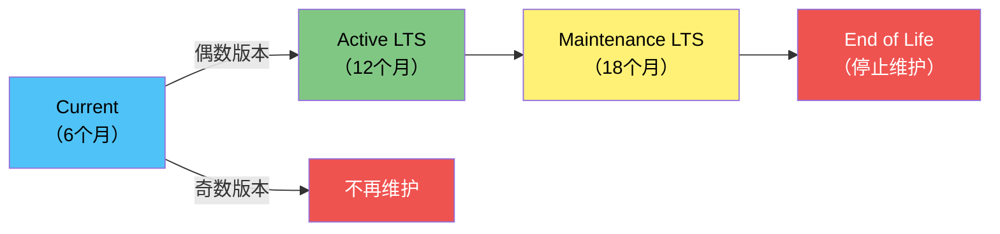
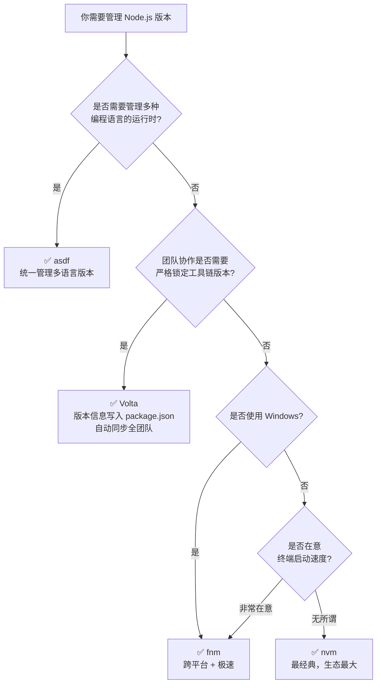
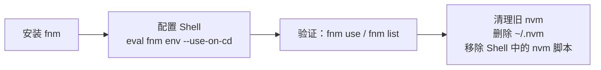
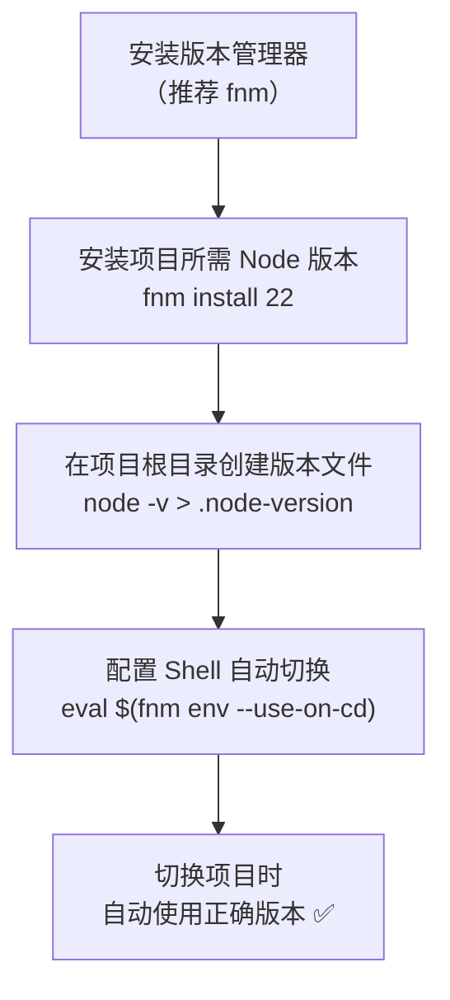
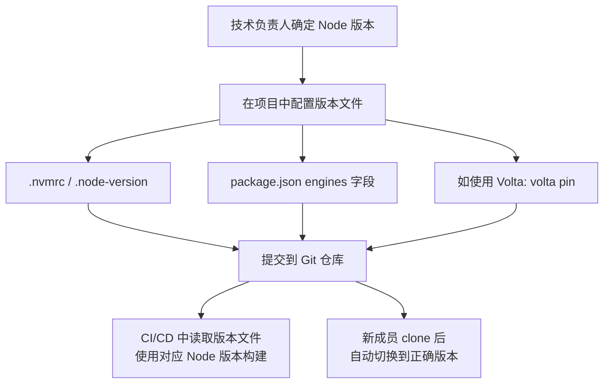

[toc]


# Node.js 环境管理完全指南

---

## 为什么需要 Node.js 环境管理

在 JavaScript 开发生态中，管理不同的 Node.js 版本是一大挑战。随着项目不断演进，依赖关系也在变化，开发者经常需要在不同的 Node.js 版本之间切换——可能是为了维护与老系统的兼容性，可能是为了尝试新版本特性，也可能是为了与团队的技术要求对齐。

举个典型场景：

> 你接手了一个老项目使用 Node 18，同时正在开发的新项目使用 Node 22，而团队另一个微服务需要 Node 20。如果系统只安装了一个全局 Node 版本，频繁卸载/安装简直是噩梦。

为了解决这类问题，社区开发了被称为"Node 版本管理器"的工具——一种让你在不同 Node.js 版本之间轻松切换的 Shell 工具。

---

## 理解 Node.js 版本发布体系

在选择和管理 Node.js 版本之前，首先要理解其发布机制。

### 版本号语义（SemVer）

Node.js 遵循语义化版本控制。第一个数字是主版本号（大变更，可能有破坏性更新），第二个数字是次版本号（新特性），最后一个数字是补丁号（Bug 修复）。

```
v22.12.1
 │  │  └─ 补丁版本 (patch) — Bug/安全修复
 │  └──── 次版本 (minor) — 新增特性，向后兼容
 └─────── 主版本 (major) — 破坏性变更
```

### 发布生命周期

Node.js 的发布分为三个阶段：Current（当前版本）、Active LTS（长期支持活跃期）和 Maintenance（维护期）。



每个主版本发布后先进入 Current 状态持续 6 个月，给库作者时间来适配。之后，奇数版本停止支持，偶数版本进入 Active LTS，保证关键 Bug 将被修复，总计约 30 个月。生产环境应只使用 Active LTS 或 Maintenance LTS 版本。


| 版本         | 代号    | 状态                                       | EOL 日期           |
| ------------ | ------- | ------------------------------------------ | ------------------ |
| Node.js 20.x | Iron    | Maintenance LTS                            | 2026 年 4 月 30 日 |
| Node.js 22.x | Jod     | Active LTS → 将于 2025-10 转为 Maintenance | 2027 年 4 月 30 日 |
| Node.js 24.x | Krypton | Active LTS（2025-10-28 起）                | 2028 年 4 月 30 日 |
| Node.js 25.x | —       | Current（奇数版，不会进入 LTS）            | 2026 年 6 月 1 日  |

💡 **重大变化预告**：从 Node.js 27 开始，发布策略将改为每年一个主版本（4 月发布），并且每个版本都会成为 LTS，不再区分奇偶。这是 Node.js 发布体系 10 年来最大的一次调整。

---

## 主流版本管理工具全景

现在有很多 Node.js 版本管理工具，其中最流行的五个是：NVM、NVS、fnm、Volta 和 asdf。

### 工具对比一览

| 特性           | **nvm**                      | **fnm**                             | **Volta**                        | **asdf**                    |
| -------------- | ---------------------------- | ----------------------------------- | -------------------------------- | --------------------------- |
| 编写语言       | Shell 脚本                   | Rust                                | Rust                             | Shell + 插件                |
| 跨平台         | 不完全（不原生支持 Windows） | Windows/macOS/Linux ✅               | Windows/macOS/Linux ✅            | macOS/Linux                 |
| 切换速度       | 较慢（Shell 脚本开销）       | 极快（Rust 原生编译）               | 极快                             | 一般                        |
| 自动切换版本   | 需额外配置                   | 支持（基于 .nvmrc / .node-version） | 自动（无需显式切换命令）         | 支持                        |
| 管理范围       | 仅 Node.js                   | 仅 Node.js                          | Node.js + npm/Yarn 等工具链      | 多语言（Ruby/Python/Go 等） |
| 版本配置文件   | `.nvmrc`                     | `.nvmrc` / `.node-version`          | `package.json` 中的 `volta` 字段 | `.tool-versions`            |
| Shell 启动影响 | 约 2~3 秒延迟                | 几乎无感知                          | 无感知                           | 轻微                        |
| 社区生态       | 最大（~75k GitHub Stars）    | ~15k Stars，增长快                  | ~10k Stars，势头强劲             | 多语言通用                  |
| 适合人群       | 初学者/追求简单              | 追求速度 + 跨平台                   | 团队协作 + 工具链一致性          | 多语言开发者                |

### 工具选型决策流程



---

## nvm —— 经典之选

nvm 是最流行的 Node 版本管理方案（GitHub Stars 约 75.2k），也是最早期的版本管理器之一，在社区中享有极高的知名度。

### 安装

前往github获取最新安装链接;

> 国内用户如果没有代理,可以使用github加速镜像,例如`https://gh-proxy.com/`套在原github链接前;
>
> ```bash
> curl -o- https://gh-proxy.com/https://raw.githubusercontent.com/nvm-sh/nvm/v0.40.4/install.sh | bash
> ```

安装完毕后,会给出提示,注意其插入的片段以及插入哪个配置文件中(如果是zsh,bash用户,需要关注一下)

```bash
  master
=> Compressing and cleaning up git repository

=> Appending nvm source string to /home/cxxu/.zshrc
=> Appending bash_completion source string to /home/cxxu/.zshrc
=> Close and reopen your terminal to start using nvm or run the following to use it now:

export NVM_DIR="$HOME/.nvm"
[ -s "$NVM_DIR/nvm.sh" ] && \. "$NVM_DIR/nvm.sh"  # This loads nvm
[ -s "$NVM_DIR/bash_completion" ] && \. "$NVM_DIR/bash_completion"  # This loads nvm bash_completion
```

安装完成后需重启终端或执行 `source ~/.bashrc`（或 `.zshrc`）。

如果使用多个shell(bash,zsh),可以维护一个共用的`shell_env_mgr.sh`

```bash
#!/bin/bash
# shellcheck disable=SC1091
# 在这里可以手动维护一些常用的环境管理的程序的导入脚本,注意检查相关环境变量,避免重复导入;
if [[ -z $NVM_DIR ]]; then
    export NVM_DIR="$HOME/.nvm"
    [ -s "$NVM_DIR/nvm.sh" ] && \. "$NVM_DIR/nvm.sh"                   # This loads nvm
    [ -s "$NVM_DIR/bash_completion" ] && \. "$NVM_DIR/bash_completion" # This loads nvm bash_completion
fi

```

然后以合适的方式让shell的rc配置文件能够导入这个公用j

### 核心命令

```bash
# 查看所有可安装的远程版本
nvm ls-remote

# 安装指定版本
nvm install 22            # 安装 v22 最新小版本
nvm install 22.12.0       # 安装精确版本
nvm install --lts          # 安装最新 LTS 版本(如果第一次运行遇到错误,比如没有获取到版本号,可以重试运行)

# 切换版本（仅当前 Shell 会话）
nvm use 22

# 设置默认版本（所有新 Shell 生效）
nvm alias default 22

# 查看已安装版本
nvm ls

# 查看当前使用版本
nvm current

# 卸载指定版本
nvm uninstall 18.17.0
```

### 项目级版本锁定

在项目根目录创建 `.nvmrc` 文件：

```bash
echo "22.12.0" > .nvmrc
```

之后在该目录执行 `nvm use` 即可自动读取并切换版本。

### 局限性

- 不原生支持 Windows（仅能在 GitBash/WSL 中使用），Windows 需要使用独立的 nvm-windows 包。同时也只支持 POSIX Shell（如 bash/zsh），Fish 用户无法使用。
- 频繁切换版本时可能较慢；版本切换需手动操作，缺乏自动化。

---

## fnm —— 现代开发者的首选

对大多数开发者来说，fnm 在速度、功能和上手便捷度之间提供了最佳平衡，尤其适合从 nvm 迁移的用户。

### 为什么推荐 fnm

fnm 是跨平台的 Node.js 版本管理器，使用 Rust 编写，号称比 nvm 快 40 倍，同时提供大部分相同功能。与 nvm 不同，fnm 支持 Windows（PowerShell）和 Fish Shell，适用范围更广。

### 安装

```bash
# macOS (Homebrew)
brew install fnm

# Windows (winget)
winget install Schniz.fnm

# Linux / macOS (脚本)
curl -fsSL https://fnm.vercel.app/install | bash

# 通过 Cargo (Rust 包管理器)
cargo install fnm
```

安装后，需要在 Shell 配置文件中添加初始化脚本：

```bash
# ~/.bashrc 或 ~/.zshrc 中添加
eval "$(fnm env --use-on-cd)"
```

其中 `--use-on-cd` 参数极为关键——它启用了自动版本切换功能：当你从一个使用 v18 的项目目录切换到另一个使用 v20 的项目时，fnm 会自动完成 Node 版本切换。

### 核心命令

```bash
# 安装版本
fnm install 22
fnm install --lts

# 切换版本
fnm use 22

# 设置默认版本
fnm default 22

# 查看已安装版本
fnm list

# 查看远程可用版本
fnm ls-remote

# 创建别名
fnm alias 22.12.0 my-project
```

### 项目级版本锁定

fnm 支持两种版本文件：

```bash
# 方式一: .node-version（推荐）
node -v > .node-version

# 方式二: .nvmrc（兼容 nvm）
echo "22.12.0" > .nvmrc
```

从 nvm 或其他版本管理器迁移到 fnm 非常顺滑，因为 fnm 同时支持 `.node-version` 和 `.nvmrc` 文件格式。只要文件存在于目录中，运行 `fnm use` 即可切换到指定版本。如果该版本未安装，会提示你先安装。

### 从 nvm 迁移到 fnm 的步骤



迁移成功后务必清理旧的 nvm 安装，以避免冲突。在 Windows 上删除 nvm 安装目录（通常是 `C:\Users\<用户名>\AppData\Roaming\nvm`），并更新 Shell 配置文件以移除旧的 nvm 初始化脚本。

---

## Volta —— 团队工具链管理利器

Volta 的职责是管理整个 JavaScript 命令行工具链，包括 node、npm、yarn 以及 JS 包中的可执行文件。与包管理器类似，Volta 基于当前目录自动识别你所在的项目，并路由到正确版本的工具。

### Volta 的核心理念——"Pin"

与 nvm/fnm 使用独立版本文件不同，Volta 的 `pin` 命令会直接更新项目的 `package.json` 文件来记录选定的工具版本。

```bash
# 安装 Volta
curl https://get.volta.sh | bash      # macOS/Linux
# Windows 使用官网安装器

# 安装默认 Node 版本
volta install node@22

# 将版本"钉"到项目
volta pin node@22.12.0
volta pin npm@10
volta pin yarn@4.0.0
```

执行 `pin` 后，`package.json` 会自动添加：

```json
{
  "volta": {
    "node": "22.12.0",
    "npm": "10.2.4"
  }
}
```

Volta 将精确的 Node 引擎版本保存在 `package.json` 中，所以你可以将这个配置提交到 Git。从这之后，每次在项目目录中运行 Node 时，Volta 都会自动使用指定版本。

### Volta vs fnm/nvm 的关键差异

| 维度       | fnm / nvm                              | Volta                                                        |
| ---------- | -------------------------------------- | ------------------------------------------------------------ |
| 配置位置   | 独立文件（`.nvmrc` / `.node-version`） | `package.json`（随项目代码一起提交）                         |
| 切换机制   | 修改 Shell 的 PATH                     | 使用 shim 机制路由到正确版本                                 |
| 管理范围   | 仅 Node 版本                           | 整个 JavaScript 工具链，追踪项目所需的精确包版本             |
| 全局包处理 | 每个 Node 版本独立                     | Volta 解决了全局包的问题——给你全局安装的便利，但没有其危险性 |

### 何时选择 Volta

多个 JavaScript 项目的团队可能从 Volta 的方式中受益最大。它的优势场景包括：

- 需要每位团队成员使用完全一致的 Node + npm/Yarn 版本
- 不想依赖开发者手动执行 `nvm use` 或配置 Shell
- 项目的 `package.json` 是唯一的版本真相来源

---

## asdf —— 多语言版本统一管理

asdf 是一个支持多种语言的版本管理器，包括 Node.js，是一个通用工具，可以管理各种运行时版本和扩展。

```bash
# 安装 asdf（以 macOS 为例）
brew install asdf

# 添加 Node.js 插件
asdf plugin add nodejs

# 安装/管理版本
asdf install nodejs 22.12.0
asdf global nodejs 22.12.0    # 设置全局版本
asdf local nodejs 22.12.0     # 设置当前目录版本（写入 .tool-versions）
```

对于全栈项目，可以在一个 `.tool-versions` 文件中同时管理 Node.js 和 Python 等多种运行时版本，确保整个技术栈版本一致。

`.tool-versions` 示例：

```
nodejs 22.12.0
python 3.12.1
ruby 3.3.0
```

如果你日常开发涉及多种编程语言，asdf 提供了统一的界面来管理所有运行时版本。

---

## 版本配置文件体系

不同的场景和工具使用不同的配置文件来声明 Node.js 版本。理解它们的关系至关重要：

| 文件                            | 示例内容             | 支持的工具        | 特点                         |
| ------------------------------- | -------------------- | ----------------- | ---------------------------- |
| `.nvmrc`                        | `22.12.0`            | nvm, fnm, asdf    | 最通用，事实标准             |
| `.node-version`                 | `22.12.0`            | fnm, asdf, nodenv | 更语义化的文件名             |
| `package.json` → `volta` 字段   | `{"node":"22.12.0"}` | Volta             | 随项目代码提交，团队协作最佳 |
| `package.json` → `engines` 字段 | `{"node":">=22"}`    | npm (仅警告/报错) | 声明兼容范围，不自动切换     |
| `.tool-versions`                | `nodejs 22.12.0`     | asdf              | 多语言统一配置               |

> 💡 **最佳实践**：推荐同时维护 `.nvmrc`（或 `.node-version`）和 `package.json` 的 `engines` 字段。前者供版本管理器自动切换，后者作为兼容性声明让 npm/yarn 在版本不匹配时发出警告。

### engines 字段示例

```json
{
  "engines": {
    "node": ">=20.0.0",
    "npm": ">=10.0.0"
  }
}
```

配合 `.npmrc` 中设置 `engine-strict=true`，可以在 `npm install` 时强制检查版本。

---

## 最佳实践总结

### 个人开发工作流



### 团队协作工作流



### 关键原则清单

| 原则                       | 说明                                                         |
| -------------------------- | ------------------------------------------------------------ |
| **始终使用 LTS 版本**      | 生产环境应只使用 Active LTS 或 Maintenance LTS 版本。        |
| **版本文件必须提交到 Git** | `.nvmrc` / `.node-version` / `.tool-versions` 都应纳入版本控制 |
| **启用自动切换**           | 避免手动 `nvm use` 导致"忘切版本"的低级错误                  |
| **CI 与本地保持一致**      | CI/CD 流水线应读取同一份版本配置文件                         |
| **关注 EOL 日期**          | 版本到达 EOL 后将不再收到任何更新，包括安全补丁，可能让应用暴露在安全风险中。 |
| **定期升级**               | 每年至少评估一次是否应迁移到新的 LTS 版本                    |

### 不同场景的推荐方案

| 场景                | 推荐工具   | 理由                                                |
| ------------------- | ---------- | --------------------------------------------------- |
| 个人学习/入门       | **fnm**    | 安装简单、速度快、跨平台、命令与 nvm 兼容           |
| 前端团队协作        | **Volta**  | 版本信息存在 `package.json`，自动生效，无需额外配置 |
| 全栈/多语言项目     | **asdf**   | 一个工具管理 Node + Python + Ruby + Go 等           |
| 已有 nvm 环境且满意 | **nvm**    | 没有迁移成本，生态成熟                              |
| 生产环境部署        | **Docker** | 完全隔离的环境，版本在 Dockerfile 中声明            |

---

## 常见问题排查

| 症状                      | 可能原因                                       | 解决方法                                                     |
| ------------------------- | ---------------------------------------------- | ------------------------------------------------------------ |
| `node: command not found` | Shell 未加载版本管理器初始化脚本               | 检查 `.bashrc` / `.zshrc` 中是否有 `eval "$(fnm env)"` 等语句 |
| 切换目录后版本不变        | 未启用自动切换                                 | fnm 需添加 `--use-on-cd` 参数；nvm 需安装 `avn` 或手动执行 `nvm use` |
| 全局安装的包找不到        | 切换了 Node 版本后全局包不共享                 | 重新安装全局包，或使用 `nvm reinstall-packages` 从旧版迁移   |
| 终端启动缓慢              | nvm 基于 Bash 脚本，在多版本场景下可能引入延迟 | 迁移到 fnm 或 Volta                                          |
| 不同终端 Node 版本不一致  | Shell 级别的版本切换是会话隔离的               | 设置 `fnm default` 或 `nvm alias default` 来确定兜底默认版本 |

---

## 总结

Node.js 版本管理工具已经走过了很长的路。nvm 是最早也是最流行的方案。但生态在演进，随着时间推移，n、fnm、Volta 等工具相继出现。

如果你是新手，现在入场的最佳建议是：

1. **安装 fnm** —— 安装最简单、速度最快、跨平台兼容
2. **配置自动切换** —— `eval "$(fnm env --use-on-cd)"`，一劳永逸
3. **每个项目创建 `.node-version` 文件** —— 和代码一起提交
4. **选择当前 Active LTS 版本** 作为新项目起点（目前推荐 Node.js 24.x）
5. 如果未来加入团队，按团队规范选择 Volta 或其他工具即可 —— 概念相通，迁移成本极低